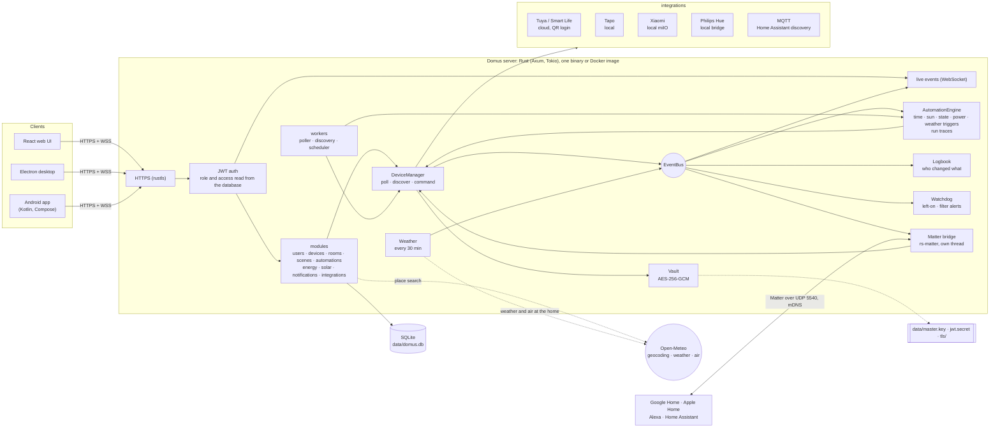
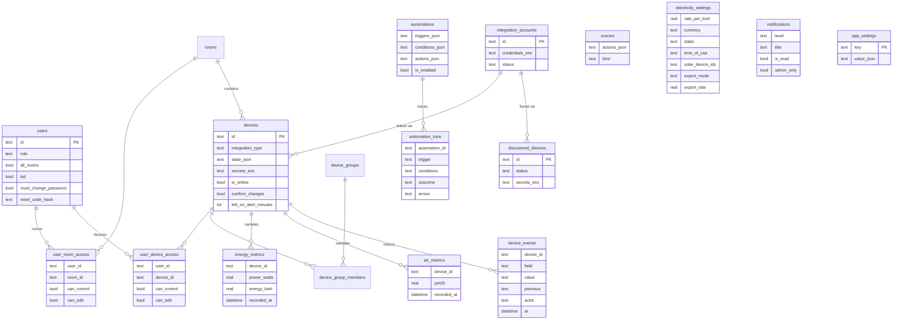

# Domus

<p align="center">
  <b>Translations</b><br>
  <a href="README.md">English</a> ·
  <a href="README.ar.md">العربية</a> ·
  <a href="README.bn.md">বাংলা</a> ·
  <a href="README.de.md">Deutsch</a> ·
  <a href="README.es.md">Español</a> ·
  <a href="README.fr.md">Français</a> ·
  <a href="README.gu.md">ગુજરાતી</a> ·
  <a href="README.hi.md">हिन्दी</a> ·
  <a href="README.id.md">Bahasa Indonesia</a> ·
  <a href="README.it.md">Italiano</a> ·
  <a href="README.ja.md">日本語</a> ·
  <a href="README.kn.md">ಕನ್ನಡ</a> ·
  <a href="README.ko.md">한국어</a> ·
  <a href="README.ml.md">മലയാളം</a> ·
  <a href="README.mr.md">मराठी</a> ·
  <a href="README.pa.md">ਪੰਜਾਬੀ</a> ·
  <a href="README.pl.md">Polski</a> ·
  <a href="README.pt-BR.md">Português (Brasil)</a> ·
  <a href="README.ru.md">Русский</a> ·
  <a href="README.ta.md">தமிழ்</a> ·
  <a href="README.te.md">తెలుగు</a> ·
  <a href="README.th.md">ไทย</a> ·
  <a href="README.tr.md">Türkçe</a> ·
  <a href="README.ur.md">اردو</a> ·
  <a href="README.vi.md">Tiếng Việt</a> ·
  <a href="README.zh-CN.md">简体中文</a> ·
  <a href="README.zh-TW.md">繁體中文</a>
</p>

[](https://github.com/aiyu-ayaan/Domus-Rust/actions/workflows/release.yml)
[](https://github.com/aiyu-ayaan/Domus-Rust/releases)
[](LICENSE)
[](https://github.com/aiyu-ayaan/Domus-Rust/commits/master)
[](https://hub.docker.com/r/aiyuayaan/domus)
[](https://hub.docker.com/r/aiyuayaan/domus)


[](https://ghloc.dev/aiyu-ayaan/Domus)


مركز محلي أولاً (Local-first) لإدارة المنزل الذكي على خادمك المنزلي. خلفية برمجية مبنية بلغة Rust، وقاعدة بيانات SQLite، وواجهة ويب React (مع غلاف سطح مكتب Electron)، وتكاملات قابلة للتوصيل تدعم **Tuya / Smart Life** (تسجيل دخول عبر رمز QR دون حساب مطور)، و**TP-Link Tapo** (محلياً)، و**Xiaomi Mi Home** (محلياً، عبر رموز المصادقة من حساب Mi الخاص بك)، و**Philips Hue** (جسر محلي)، و**MQTT** (Zigbee2MQTT وESPHome وأي نظام يدعم ميزة Home Assistant discovery). يتيح **جسر Matter** المدمج لكل من Google Home وApple Home وAlexa وHome Assistant تبديل حالة هذه الأجهزة وتعتيمها وضبط ألوانها مباشرة عبر شبكتك المحلية.

- **اكتشاف تلقائي للأجهزة الجديدة**، مع صندوق وارد أو إضافة تلقائية مباشرة
- **لوحة معلومات حية**: استهلاك الطاقة، الفاتورة الحالية والفاتورة المتوقعة، جودة الهواء، قراءات الحركة / الأبواب / التسريب / البطارية
- **غرف ومجموعات أجهزة ومشاهد وأتمتة**؛ مُشغلات حسب الوقت، عند **شروق الشمس أو غروبها** (مع إمكانية تحديد فارق زمني)، عند تغيير حالة جهاز، مستوى استهلاك الطاقة (وكذلك *أعلى من X لمدة N دقيقة*)، انقطاع الاتصال، أو **الطقس الخارجي**
- **تشغيلات الأتمتة**: تحتفظ كل أتمتة بسجل لآخر 50 عملية تشغيل، مع توضيح المُشغّل الذي أطلقها والشرط الذي أوقفها إن وُجد
- **سجل الأجهزة**: كل تغيير يطرأ على الجهاز والجهة المسؤولة عنه (شخص والتطبيق المستخدم، أتمتة، Matter، أو الجهاز نفسه)
- **تنبيهات دون الحاجة لكتابة أتمتة**: تنبيه عند ترك جهاز يعمل لفترة طويلة، أو انخفاض عمر فلتر منقي الهواء
- **جسر Matter**: شارك الأجهزة التي تختارها مع Google Home أو Apple Home أو Alexa أو Home Assistant محلياً ودون الحاجة لأي حساب سحابي
- **الطقس وجودة الهواء في الخارج** عند موقع المنزل (عبر Open-Meteo بدون مفتاح API) على لوحة المعلومات، إلى جانب القراءات الداخلية
- **السؤال قبل التبديل**: حدد مفتاحاً رئيسياً وسيقوم كل تطبيق ومجموعة ومشهد وتشغيل يدوي لأتمتة بتحذيرك قبل تشغيله أو إيقافه
- **حساب فاتورة الكهرباء** بتعرفة ثابتة أو شرائح تصاعدية وتعرفة **حسب الوقت من اليوم** بأي عملة، مع حساب **تكلفة وضع الاستعداد** لكل جهاز، ونظام **الطاقة الشمسية**: التوليد والتصدير وصافي القياس أو تعرفة التغذية
- **تعدد المستخدمين** بأدوار مسؤول / عضو / ضيف وصلاحيات مخصصة لكل غرفة أو لكل جهاز (عرض فقط، تحكم، أو تعديل)
- **الويب، وسطح المكتب عبر Electron (لينكس وويندوز)، وتطبيق أندرويد أصيل (Native)**، متزامنة بشكل فوري ومباشر
- **27 لغة** في تطبيقات الويب وسطح المكتب والأندرويد، تتبع لغة نظامك مع إمكانية التحديد اليدوي من الإعدادات؛ مع دعم كامل للاتجاه من اليمين إلى اليسار (RTL) للعربية والأردية
- **صفحة التحديثات** تحتوي على ملاحظات الإصدار (بتنسيق Markdown وجداول وصور) في كل تطبيق
- **HTTPS افتراضياً**؛ تشفير بيانات الاعتماد ومفاتيح الأجهزة أثناء التخزين؛ ونسخ احتياطي واستعادة بملف واحد

الهندسة المعمارية والمخططات: [`development/docs/ARCHITECTURE.md`](development/docs/ARCHITECTURE.md)، وملخصة [أدناه](#كيفية-عمل-النظام-معا).  
ملف تصميم واجهة المستخدم: [`design-system/domus/MASTER.md`](design-system/domus/MASTER.md).  
متابعة التقدم: [`development/TODO.md`](development/TODO.md).

## كيفية عمل النظام معاً



تتواصل تطبيقات العميل مع الخادم فقط؛ ويتواصل الخادم مع أجهزتك (محلياً حيثما تسمح الشركة المصنعة بذلك) ويحفظ كل شيء في ملف SQLite واحد. لا يتم اللجوء إلى السحابة إلا عندما لا توفر الشركة المصنعة إمكانية التحكم المحلي (Tuya) أو لجلب مفاتيح الأجهزة (Xiaomi)، بالإضافة إلى طلبات البحث الاختيارية: البحث عن الأماكن والطقس وجودة الهواء الخارجي لموقع المنزل (Open-Meteo، فقط بعد تعيين الموقع) والتحقق من التحديثات عبر GitHub. يعمل جسر Matter عبر الشبكة المحلية فقط.

### نموذج البيانات



تُخزن بيانات الاعتماد ومفاتيح الأجهزة مشفرة ومختومة (`*_enc`) باستخدام المفتاح `data/master.key` غير الموجود في قاعدة البيانات. تتوفر المجموعة الكاملة من المخططات لكل ميزة على حدة في [`development/docs`](development/docs).

## لقطات الشاشة

<p align="center"></p>

**سطح المكتب** (Electron والويب)

<p>
  
  
  
  
  
  
</p>

**أندرويد**

<p>
  
  
  
  
  
</p>

**أجهزة أندرويد اللوحية** (عمودان للشاشات من 840dp فما فوق، وعرض الإعدادات كقائمة وتفاصيل)

<p>
  
  
  
  
  
</p>

**متصفح الهاتف المحمول**

<p>
  
  
  
  
  
</p>

جميع اللقطات متوفرة في المجلد [`res/screenshots`](res/screenshots)؛ والجولة الاستعراضية الكاملة عالية الجودة متوفرة في [`res/domus.mp4`](res/domus.mp4).

## التنزيل

| | |
|---|---|
| الخادم (Docker) | `aiyuayaan/domus` على Docker Hub لمعماريتي amd64 وarm64 |
| أندرويد | حزمة `Domus-<version>.apk` من [أحدث إصدار](https://github.com/aiyu-ayaan/Domus-Rust/releases) |
| سطح مكتب لينكس | أداة التثبيت ذات السطر الواحد أدناه، أو حزمة `.deb` / `.AppImage` من صفحة الإصدارات |
| سطح مكتب ويندوز | ملف `Domus-<version>-Setup.exe` من صفحة الإصدارات |

### الخادم

ملف واحد هو كل ما يحتاجه الخادم المضيف:

```bash
mkdir domus && cd domus
wget https://raw.githubusercontent.com/aiyu-ayaan/Domus-Rust/master/docker-compose.yml
docker compose up -d
```

افتح الرابط `https://<server-ip>:8443` وأنشئ حساب المسؤول. يُظهر الأمر `docker compose logs domus` بصمة الشهادة التي تطلب منك التطبيقات تأكيدها.

```bash
docker compose pull && docker compose up -d      # التحديث
DOMUS_VERSION=beta docker compose up -d          # تتبع قناة معينة: latest (افتراضي)، أو beta، أو alpha، أو 0.0.1
TZ=Asia/Kolkata DOMUS_PORT=9443 docker compose up -d
docker compose --profile mqtt up -d              # تشغيل وسيط Mosquitto الاختياري أيضاً
```

ضع المتغيرات `DOMUS_VERSION` و`TZ` و`DOMUS_PORT` في ملف `.env` بجوار ملف compose للاحتفاظ بها.

### تطبيق سطح المكتب لنظام لينكس

يثبت أحدث إصدار للمستخدم الحالي (x86_64، بدون صلاحيات root): حزمة AppImage، ومدخل في القائمة مع أيقونة Domus، وأمر `domus`. يتكفل التطبيق بعد ذلك بتحديث نفسه تلقائياً.

```bash
curl -fsSL https://raw.githubusercontent.com/aiyu-ayaan/Domus-Rust/master/scripts/install-linux.sh | sh
# ... | sh -s -- --channel beta     لبناء نسخ تجريبية بيتا أيضاً (أو ألفا)
# ... | sh -s -- --uninstall        لإلغاء التثبيت؛ يتم الاحتفاظ بالإعدادات
```

### أندرويد

قم بتنزيل ملف APK من صفحة الإصدارات وافتحه. يتم تقديم التحديثات اللاحقة عند فتح التطبيق وفي الإعدادات ← التحديثات، على قنوات المستقر (Stable) أو البيتا (Beta) أو الألفا (Alpha)، وتثبيتها من هناك؛ يطلب نظام أندرويد الإذن مرة واحدة للسماح لـ Domus بتثبيتها.

تعرض صفحة **التحديثات** (الإعدادات ← التحديثات على أندرويد، أو الإعدادات ← حول ← التحديثات على الويب وسطح المكتب) الإصدار المشغل حالياً وأحدث إصدار على قناتك وملاحظات الإصدار المكتوبة بتنسيق Markdown.

تفاصيل الإصدارات وأرقام النسخ وقنوات التحديث: [development/docs/RELEASE.md](development/docs/RELEASE.md).

## المتطلبات

- Rust 1.80+ (`cargo`)
- Node.js 18+ و`pnpm`

## التشغيل في بيئة التطوير

```bash
pnpm install
npm run dev            # backend (https://127.0.0.1:8443) + web (http://localhost:3000)

npm run dev:backend    # الخادم الخلفي فقط
npm run dev:web        # الويب فقط (يمرر طلبات /api إلى الخادم الخلفي)
npm run dev:desktop    # تطبيق Electron؛ اختر الخادم في صفحة الاتصال
```

افتح الرابط http://localhost:3000. ستطلب منك الزيارة الأولى إنشاء حساب المسؤول.

## التشغيل على الخادم المنزلي

```bash
pnpm build:web                     # بناء apps/web/dist، ليقدمه الخادم الخلفي
APP_ENV=production cargo run --release --manifest-path backend/Cargo.toml
```

ثم افتح `https://<server-ip>:8443`. عند تفعيل جسر Matter، فإنه يستخدم أيضاً منفذ UDP 5540 (`[matter] port`) وبروتوكول mDNS على الشبكة المحلية (LAN).

أو قم ببناء صورة Docker من مسار العمل الحالي هذا (باستخدام وضع شبكة المضيف host networking والبيانات في وحدة التخزين `domus_data`):

```bash
docker compose -f docker-compose.local.yml up -d --build
```

تم توضيح الوصول عن بُعد عبر Cloudflare Tunnel، وعنوان المنزل/العنوان البعيد الذي تبدل التطبيقات بينهما، وحزم سطح المكتب (`pnpm build:desktop`) في [development/docs/DEPLOYMENT.md](development/docs/DEPLOYMENT.md).

عند أول تشغيل، ينشئ Domus المجلد `data/` متضمناً:

| الملف | الغرض |
|---|---|
| `domus.db` | قاعدة بيانات SQLite |
| `master.key` | يُشفر بيانات اعتماد التكاملات ومفاتيح الأجهزة — **احتفظ بنسخة احتياطية منه** |
| `jwt.secret` | توقيع جلسات المستخدمين |
| `tls/` | شهادة موقعة ذاتياً (يمكن استبدالها عبر `tls.cert_path` / `tls.key_path`) |

توجد الإعدادات في `config/default.toml`؛ ويمكن تجاوز أي مفتاح باستخدام متغيرات البيئة بصيغة `DOMUS__SECTION__KEY` (انظر `.env.example`).

## النسخ الاحتياطي والاستعادة

كل شيء محفوظ في `data/`. يمكنك عمل نسخة احتياطية للمجلد بأكمله، أو إنشاء نسخة احتياطية من ملف واحد:

**النسخ الاحتياطي.** سجّل الدخول كمسؤول ← الإعدادات ← **النسخ الاحتياطي** ← *تنزيل النسخة الاحتياطية*. الملف عبارة عن نسخة من قاعدة البيانات تحتوي على المفتاح الرئيسي بداخلها، بحيث يمكن فتح الحسابات المرتبطة فيها بعد الاستعادة. يتم إنشاؤها أثناء تشغيل الخادم. احرص على سريتها التامة: فمن يمتلكها يمكنه فتح تلك الحسابات. لا يتم تضمين سر JWT وشهادة TLS في هذه النسخة.

**الاستعادة.** أوقف الخادم أولاً، ثم:

```bash
# Docker
docker compose cp domus-backup-2026-10-11.db domus:/app/data/restore.db
docker compose stop domus
docker compose run --rm domus domus-backend restore data/restore.db
docker compose start domus

# بدون Docker، من المجلد الرئيسي للمشروع (يستخدم ./data)
domus-backend restore ~/Downloads/domus-backup-2026-10-11.db
```

يتم الاحتفاظ بالبيانات السابقة بجوارها بالامتداد `*.before-restore`. بعد الاستعادة على جهاز جديد، يقوم المستخدمون بتسجيل الدخول مرة أخرى وتطلب التطبيقات الوثوق بالشهادة الجديدة. إذا قمت بتعيين المفتاح باستخدام المتغير `DOMUS_MASTER_KEY`، فلن تحتوي النسخة الاحتياطية على أي مفتاح وسيحتاج الخادم المستعاد إلى نفس المتغير. مزيد من التفاصيل في [development/docs/DEPLOYMENT.md](development/docs/DEPLOYMENT.md#backup-and-restore).

## هل نسيت كلمة مرور المسؤول؟

لا يحتوي Domus على خادم بريد، لذا لا يتم إرسال أي شيء عبر البريد الإلكتروني. إليك الحلول حسب سهولتها:

1. **مسؤول آخر** يفتح الإعدادات ← الأشخاص والصلاحيات، ويفعل خيار *رمز إعادة التعيين* لك ويخبرك بالرمز المكون من 8 أرقام (صالح لمدة 30 دقيقة و5 محاولات خاطئة). في شاشة تسجيل الدخول اختر *هل نسيت كلمة المرور؟*، ثم أدخل اسم المستخدم متبوعاً بالرمز.
2. **من الخادم مباشرة**، ويعمل ذلك أثناء تشغيل Domus أو إيقافه ولا يتطلب تسجيل الدخول:

   ```bash
   docker compose exec domus domus-backend reset-password <username>              # يطبع كلمة مرور عشوائية جديدة
   docker compose exec domus domus-backend reset-password <username> 'new-pass'   # أو حدد كلمة مرور من اختيارك (8 أحرف أو أكثر)
   domus-backend reset-password <username>                                        # بدون Docker، من المجلد الرئيسي للمشروع
   ```

   سجّل الدخول بها ثم غيّرها من الإعدادات ← كلمة المرور.

عند إدخال 5 كلمات مرور خاطئة لاسم مستخدم معين، يتم قفل هذا الحساب لمدة 15 دقيقة في بيئة الإنتاج (يُرفع القفل بإعادة تشغيل الخادم، ويكون معطلاً في بيئة التطوير). التفاصيل وقواعد كلمات المرور المولدة وحسابات الأطفال متوفرة في: [development/docs/ACCOUNTS.md](development/docs/ACCOUNTS.md).

## اللغات

الإنجليزية، الهندية، الإسبانية، البرتغالية (البرازيل)، الإندونيسية، العربية، الفرنسية، الروسية، الألمانية، التركية، اليابانية، الكورية، الإيطالية، الفيتنامية، التايلاندية، الصينية (المبسطة والتقليدية)، البولندية، البنغالية، التاميلية، التيلوغوية، الماراثية، الغوجاراتية، الكانادية، الماليالامية، البنجابية والأردية. تُعرض اللغتان العربية والأردية باتجاه من اليمين إلى اليسار (RTL).

يتبع كل تطبيق لغة متصفحك أو نظام التشغيل، ويعرض الإنجليزية عندما لا تتوفر ترجمة للغتك. لاختيار لغة أخرى، افتح الإعدادات > اللغة (المظهر على الويب وسطح المكتب)؛ يعيدك خيار *افتراضي النظام* إلى متابعة لغة النظام. على أندرويد 13 والإصدارات الأحدث، يظهر الخيار أيضاً ضمن إعدادات الهاتف > التطبيقات > Domus > اللغة.

الترجمات تمت آلياً ولم تتم مراجعتها من قِبل متحدثين أصليين، لذا قد تجد بعض التعبيرات غير الدقيقة. التعديل يتم بتغيير سطر واحد في ملف اللغة المعني. كيفية عمل اللغات وإضافة لغة جديدة وقواعد النصوص الجديدة: [development/docs/LOCALIZATION.md](development/docs/LOCALIZATION.md).

## توصيل الأجهزة

| العلامة التجارية | طريقة التوصيل |
|---|---|
| Tuya / Smart Life | التكاملات ← *الربط عبر رمز QR*. أدخل **رمز المستخدم** من تطبيق Smart Life (أنا ← الإعدادات ← الحساب والأمان ← رمز المستخدم)، ثم امسح رمز QR داخل التطبيق. |
| Tapo | التكاملات ← *ربط حساب* باستخدام معرف TP-Link ID الخاص بك. يتم العثور على الأجهزة على الشبكة المحلية تلقائياً والتحكم بها محلياً. يجلب موزع H100 المستشعرات والمفاتيح وأجهزة تنظيم الحرارة معه. الكاميرات مدرجة لكنها غير مدعومة بعد. |
| Xiaomi | التكاملات ← *ربط حساب* باستخدام حساب Mi ومنطقة الخادم. إذا طلبت Xiaomi التحقق بخطوتين، فأدخل الرمز الذي ترسله لك عبر البريد أو الرسائل القصيرة في نفس اللوحة. يمكن أن يكون الحساب بريداً إلكترونياً، أو رقم هاتف مع رمز الدولة (`+91…`)، أو معرف Xiaomi ID. تُجلب الرموز المميزة (Tokens) لمرة واحدة؛ ويكون التحكم محلياً. يمكن أيضاً إضافة الأجهزة باستخدام الرمز المميز مباشرة. |
| Philips Hue | اضغط على الزر الدائري في الجسر، ثم انتقل إلى التكاملات ← Philips Hue ← *ربط* خلال 30 ثانية. اترك العنوان فارغاً للعثور على الجسر تلقائياً. يتم التحكم بالأضواء وقوابس Hue الذكية محلياً. |
| MQTT | التكاملات ← MQTT ← *ربط* مع إدخال عنوان الوسيط والمنفذ وبيانات تسجيل الدخول. تظهر الأجهزة التي تعلن عن نفسها عبر Home Assistant MQTT discovery (مثل Zigbee2MQTT وESPHome و…) ضمن المكتشفة: أضواء، مفاتيح، قوابس، مراوح ومستشعرات. مع الوسيط المدمج (`--profile mqtt`)، يكون العنوان `mqtt` والمنفذ `1883`. |

راجع `development/docs/INTEGRATIONS.md` لمعرفة ما يغطيه كل تكامل.

## حساب فاتورة الكهرباء

الطاقة ← *خطة الكهرباء*: اختر أي عملة، وحدد سعراً ثابتاً لكل كيلوواط ساعة (kWh) أو **شرائح** للتعرفة المعتمدة على استهلاك الوحدات (على سبيل المثال: 0–100 وحدة بسعر معين، و101–300 بسعر تالٍ، وهكذا). تُحسب الفاتورة لكل دورة فوترة، بالإضافة إلى الرسوم الشهرية الثابتة.

يمكن أن تتضمن التعرفة أيضاً نوافذ **حسب الوقت من اليوم**: ساعات معينة (وفقاً لساعة المنزل، ويُسمح بما بعد منتصف الليل) تكون تكلفة وحداتها أعلى أو أقل بمقدار محدد، كخصم ليلي أو رسوم إضافية في أوقات الذروة، تُضاف فوق السعر الثابت أو سعر الشريحة.

تظهر الأجهزة الجديدة ضمن **الأجهزة ← المكتشفة**. فعّل خيار *إضافة الأجهزة الجديدة تلقائياً* هناك لتخطي صندوق الوارد.

## شروق الشمس وغروبها

حدد موقع المنزل في الإعدادات ← **موقع المنزل**: استخدم موقع هذا الهاتف أو المتصفح، أو ابحث عن المدينة (يسأل الخادم خدمة الترميز الجغرافي المجانية من Open-Meteo؛ ولا يخرج من المنزل سوى الاسم الذي تكتبه)، أو اكتب خط العرض وخط الطول. يتم تقريب الإحداثيات إلى حوالي كيلومتر واحد وتظل على خادمك. يمكن بعد ذلك للأتمتة أن تعمل عند شروق الشمس أو غروبها، قبلها أو بعدها بعدة دقائق. بدون تحديد موقع، لن يعمل أي مُشغّل شمسي أبداً.

## السؤال قبل التبديل

من السهل إيقاف تشغيل المفتاح الرئيسي الذي يقطع الطاقة عن كل شيء متصل به عن طريق الخطأ. افتح الجهاز وفعّل خيار **السؤال قبل التبديل**: يطلب كل تطبيق بعد ذلك تأكيداً قبل تشغيله أو إيقافه، وكذلك خيارات الغرفة *تشغيل الكل / إيقاف الكل* ومجموعات الأجهزة والمشاهد (بما في ذلك المشاهد المتداخلة) والتشغيل اليدوي لأي أتمتة من شأنها تبديله. يُحفظ هذا الإعداد على الخادم، ليكون متطابقاً على الويب وسطح المكتب وأندرويد. الأتمتة التي تعمل تلقائياً لا تطلب تأكيداً وتنفذ كما هي، ولا يشمل ذلك أي إجراء من خارج Domus (كتطبيق الشركة المصنعة أو مفتاح الجدار الفعلي).

## Matter (Google Home وApple Home وAlexa)

الإعدادات ← **Matter** (للمسؤولين): قم بتفعيله، وضع علامة على الأجهزة المراد مشاركتها، ثم امسح رمز QR أو اكتب رمز الاقتران في Google Home أو Apple Home أو Alexa أو Home Assistant. تظهر المصابيح كمصابيح ملونة أو قابلة للتعتيم، ويظهر كل ما عدا ذلك ممن يمتلك مفتاح تشغيل/إيقاف كمقبس كهربائي؛ وتعمل ميزات التبديل والتعتيم وضبط الألوان بشكل سليم، وتظهر التغييرات التي تجريها في Domus (تشغيل/إيقاف، سطوع) في تطبيق التحكم. يتيح خيار "السماح بالاقتران لمدة 15 دقيقة" إضافة نظام بيئي ثانٍ؛ ويبدأ خيار "نسيان كل الاقترانات" من جديد برمز اقتران جديد.

الجسر غير معتمد رسمياً (حيث يستخدم شهادة اختبار Matter test attestation)، لذا ستطلب منك التطبيقات تأكيد إضافته، ولا يقبله Google Home إلا بعد إضافة الجسر كجهاز اختبار في وحدة تحكم مطوري Google Home. التفاصيل: [`development/docs/MATTER.md`](development/docs/MATTER.md).

## السجل وتشغيلات الأتمتة والتنبيهات

- **السجل** في بطاقة كل جهاز: ما الذي تغير، ومتى، ومن قام بذلك (*بواسطة Ayaan · Android*، أو *أتمتة "وضع الليل"*، أو *Matter*، أو *على الجهاز نفسه*). يُحتفظ به للمدة نفسها التي يُحتفظ بها بسجل الطاقة.
- **تشغيلات** كل أتمتة: *تم التشغيل*، أو *فشل* مع ذكر الخطأ، أو *تم التخطي* مع توضيح الشرط الذي أوقفها، لتقديم إجابة واضحة عن سبب عدم عملها.
- **تنبيه عند تركه يعمل** في بطاقة تفاصيل الجهاز (من 30 دقيقة إلى 12 ساعة): يتلقى المسؤولون إشعاراً بذلك. يُعتبر الجهاز المزود بمقياس طاقة قيد التشغيل إذا تجاوز استهلاكه 10 واط، وبذلك يُعتبر التلفزيون في وضع الاستعداد مطفأً.
- **انخفاض عمر الفلتر**: إشعار عندما ينخفض عمر فلتر منقي الهواء إلى 10%.

## الطقس ووضع الاستعداد والطاقة الشمسية

- عند تعيين موقع المنزل، تعرض لوحة المعلومات **الطقس وقيمة PM2.5 في الهواء الخارجي** بجوار القراءات الداخلية، ويمكن للأتمتة استخدامها (*عندما يرتفع PM2.5 في الخارج فوق 35*، أو *فقط إذا كانت درجة الحرارة الخارجية أقل من 20*).
- الطاقة ← **الاستعداد** يعرض مقدار الطاقة التي يسحبها كل جهاز عندما لا يستخدمه أحد (أدنى ساعة استهلاك خلال هذا الأسبوع) وتكلفة ذلك شهرياً.
- الطاقة ← *خطة الكهرباء* ← **الطاقة الشمسية**: حدد المقابس التي تقيس توليد الطاقة الشمسية، ثم اختر صافي القياس (net metering) أو تعرفة التغذية (feed-in rate). تحسب الفاتورة بعد ذلك ما تشتريه من الشبكة فقط، وتعرض بطاقة الطاقة الشمسية ما تم توليده وما استُهلك في المنزل وما تم تصديره وما تم جنيه من أرباح. تُحسب تدفقات الشبكة كل 15 دقيقة استناداً إلى الأجهزة المزودة بعدادات، لذا فإن الأجهزة التي لا تحتوي على عدادات قد تجعل قراءة التصدير تبدو أعلى من الواقع.

الخطة والمخططات: [`development/docs/ROADMAP.md`](development/docs/ROADMAP.md).

## الترخيص

يتم إصدار Domus بموجب [ترخيص MIT](LICENSE). تحتفظ مكتبات الطرف الثالث بتراخيصها الخاصة؛ وهي مدرجة تحت قسم حول ← شكر وتقدير في كل تطبيق.

## الاختبارات

```bash
cargo test --workspace
pnpm --filter @domus/web exec tsc -b
```

يتضمن الأمر `cargo test --workspace` ملف الاختبار `backend/tests/matter_bridge.rs`، الذي يقترن بجهاز تحكم Matter مع الجسر عبر UDP ويقوم بتبديل أجهزته وتعتيمها وتغيير ألوانها (يتطلب واجهة شبكة تدعم IPv4).
