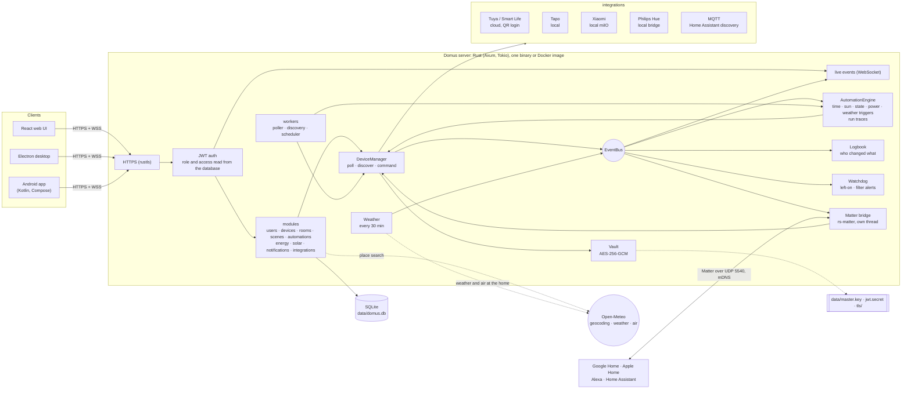
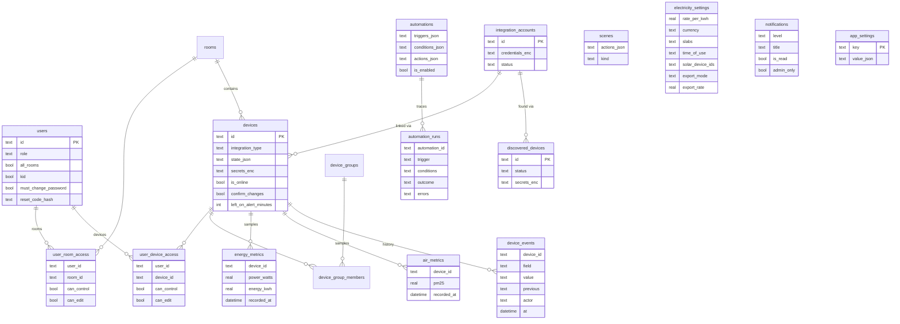

# Domus

<p align="center">
  <b>Translations</b><br>
  <a href="README.md">English</a> ·
  <a href="README.ar.md">العربية</a> ·
  <a href="README.bn.md">বাংলা</a> ·
  <a href="README.de.md">Deutsch</a> ·
  <a href="README.es.md">Español</a> ·
  <a href="README.fr.md">Français</a> ·
  <a href="README.gu.md">ગુજરાતી</a> ·
  <a href="README.hi.md">हिन्दी</a> ·
  <a href="README.id.md">Bahasa Indonesia</a> ·
  <a href="README.it.md">Italiano</a> ·
  <a href="README.ja.md">日本語</a> ·
  <a href="README.kn.md">ಕನ್ನಡ</a> ·
  <a href="README.ko.md">한국어</a> ·
  <a href="README.ml.md">മലയാളം</a> ·
  <a href="README.mr.md">मराठी</a> ·
  <a href="README.pa.md">ਪੰਜਾਬੀ</a> ·
  <a href="README.pl.md">Polski</a> ·
  <a href="README.pt-BR.md">Português (Brasil)</a> ·
  <a href="README.ru.md">Русский</a> ·
  <a href="README.ta.md">தமிழ்</a> ·
  <a href="README.te.md">తెలుగు</a> ·
  <a href="README.th.md">ไทย</a> ·
  <a href="README.tr.md">Türkçe</a> ·
  <a href="README.ur.md">اردو</a> ·
  <a href="README.vi.md">Tiếng Việt</a> ·
  <a href="README.zh-CN.md">简体中文</a> ·
  <a href="README.zh-TW.md">繁體中文</a>
</p>

[](https://github.com/aiyu-ayaan/Domus-Rust/actions/workflows/release.yml)
[](https://github.com/aiyu-ayaan/Domus-Rust/releases)
[](LICENSE)
[](https://github.com/aiyu-ayaan/Domus-Rust/commits/master)
[](https://hub.docker.com/r/aiyuayaan/domus)
[](https://hub.docker.com/r/aiyuayaan/domus)


আপনার হোম সার্ভারের জন্য একটি লোকাল-ফার্স্ট স্মার্ট-হোম হাব। রাস্ট (Rust) ব্যাকএন্ড, SQLite, React ওয়েব UI (Electron ডেস্কটপ শেল সহ), এবং **Tuya / Smart Life** (QR-কোড লগইন, ডেভেলপার অ্যাকাউন্টের প্রয়োজন নেই), **TP-Link Tapo** (লোকাল), **Xiaomi Mi Home** (লোকাল, আপনার Mi অ্যাকাউন্ট থেকে টোকেন), **Philips Hue** (লোকাল ব্রিজ) এবং **MQTT** (Zigbee2MQTT, ESPHome এবং Home Assistant ডিসকভারি সমর্থনকারী অন্যান্য ডিভাইস)-এর জন্য প্লাগযোগ্য ইন্টিগ্রেশন। একটি বিল্ট-ইন **Matter ব্রিজ** Google Home, Apple Home, Alexa এবং Home Assistant-কে আপনার নিজস্ব লোকাল নেটওয়ার্কে এই ডিভাইসগুলো স্যুইচ, ডিম এবং রঙ পরিবর্তন করার সুবিধা দেয়।

- নতুন ডিভাইসের স্বয়ংক্রিয় অনুসন্ধান (Automatic discovery), ইনবক্স বা অটো-অ্যাড সুবিধার সাথে
- লাইভ ড্যাশবোর্ড: বিদ্যুৎ ব্যবহার, এখন পর্যন্ত বিল ও সম্ভাব্য বিল, বাতাসের মান, মোশন / দরজা / ফুটো (লিক) / ব্যাটারি রিডিং
- ঘর (Rooms), ডিভাইস গ্রুপ, সিন এবং অটোমেশন; নির্দিষ্ট সময়ে, **সূর্যোদয় বা সূর্যাস্তে** (অফসেট সহ), ডিভাইসের স্থিতি পরিবর্তনে, পাওয়ার স্তরে (যেমন *N মিনিটের জন্য X-এর উপরে থাকলে*), অফলাইনে গেলে বা **বাইরের আবহাওয়া** অনুযায়ী ট্রিগার
- **অটোমেশন রান ইতিহাস**: প্রতিটি অটোমেশন তার শেষ ৫০টি রান সংরক্ষণ করে, যেখানে এটি ট্রিগার হওয়ার কারণ এবং এটিকে আটকে রাখা শর্তের বিস্তারিত থাকে
- **ডিভাইসের ইতিহাস (Device history)**: ডিভাইসের প্রতিটি পরিবর্তন এবং কে তা করেছে (কোনো ব্যক্তি ও তাদের ব্যবহৃত অ্যাপ, একটি অটোমেশন, Matter, নাকি ডিভাইসটি নিজে)
- অটোমেশন তৈরি না করেই **সতর্কবার্তা**: কোনো ডিভাইস দীর্ঘক্ষণ চালু থাকলে, অথবা এয়ার পিউরিফায়ারের ফিল্টার কমে গেলে
- **Matter ব্রিজ**: ক্লাউড অ্যাকাউন্ট ছাড়াই স্থানীয়ভাবে Google Home, Apple Home, Alexa বা Home Assistant-এর সাথে আপনার পছন্দের ডিভাইসগুলো শেয়ার করুন
- ঘরের ড্যাশবোর্ডে ইনডোর রিডিংয়ের পাশাপাশি **বাইরের আবহাওয়া ও বাতাস** (Open-Meteo, কোনো API কি প্রয়োজন নেই)
- **স্যুইচ করার আগে জিজ্ঞাসা করুন (Ask before switching)**: মূল স্যুইচটি চিহ্নিত করুন এবং প্রতিটি অ্যাপ, গ্রুপ, সিন ও ম্যানুয়াল অটোমেশন রান এটি চালু বা বন্ধ করার আগে নিশ্চিতকরণ চাইবে
- যেকোনো মুদ্রায় ফ্ল্যাট, স্ল্যাব এবং **টাইম-অফ-ডে (Time-of-Day)** ট্যারিফ সহ বিদ্যুৎ বিলিং, ডিভাইস প্রতি **স্ট্যান্ডবাই খরচ**, এবং **সৌরশক্তি (Solar)**: উৎপাদন, রপ্তানি এবং নেট মিটারিং বা ফিড-ইন রেট
- অ্যাডমিন / সদস্য / অতিথি রোল এবং ঘর বা ডিভাইস প্রতি অ্যাক্সেস (শুধুমাত্র দেখার, নিয়ন্ত্রণ বা সম্পাদনার অনুমতি) সহ একাধিক ব্যবহারকারী
- ওয়েব, Electron ডেস্কটপ (Linux, Windows) এবং নেটিভ Android অ্যাপ, যা রিয়েল-টাইমে সিঙ্ক থাকে
- ওয়েব, ডেস্কটপ এবং Android অ্যাপে **২৭টি ভাষা**, যা সেটিংসে পিকারের মাধ্যমে আপনার সিস্টেমের ভাষা অনুসরণ করে; আরবি এবং উর্দুর জন্য ডান-থেকে-বাম (RTL) লেআউট
- প্রতিটি অ্যাপে রিলিজ নোট (Markdown, টেবিল এবং ছবি সহ) সম্বলিত আপডেট (Updates) পৃষ্ঠা
- ডিফল্টভাবে HTTPS; ক্রেডেনশিয়াল এবং ডিভাইসের কি-সমূহ নিরাপদে এনক্রিপ্ট করা থাকে; সিঙ্গেল-ফাইল ব্যাকআপ এবং রিস্টোর

আর্কিটেকচার এবং ডায়াগ্রাম: [`development/docs/ARCHITECTURE.md`](development/docs/ARCHITECTURE.md), সংক্ষেপে [নিচে দেখুন](#এটি-যেভাবে-একসাথে-কাজ-করে)।
UI ডিজাইন প্রোফাইল: [`design-system/domus/MASTER.md`](design-system/domus/MASTER.md)।
অগ্রগতি: [`development/TODO.md`](development/TODO.md)।

## এটি যেভাবে একসাথে কাজ করে



ক্লায়েন্টরা কেবল সার্ভারের সাথে যোগাযোগ করে; সার্ভার সরাসরি আপনার ডিভাইসগুলোর সাথে যোগাযোগ করে (যেখানে ভেন্ডর অনুমতি দেয় সেখানে লোকালভাবে) এবং সবকিছু একটি মাত্র SQLite ফাইলে রাখে। ক্লাউড শুধুমাত্র সেখানেই ব্যবহার করা হয় যেখানে ভেন্ডর কোনো লোকাল নিয়ন্ত্রণের সুযোগ দেয় না (Tuya) বা ডিভাইসের টোকেন আনার জন্য (Xiaomi), সাথে কিছু ঐচ্ছিক অনুসন্ধান: স্থান অনুসন্ধান, বাড়ির অবস্থানের আবহাওয়া এবং বাইরের বায়ু (Open-Meteo, কেবল অবস্থান সেট করা হলে) এবং আপডেটের তথ্য জানার জন্য GitHub। Matter ব্রিজ শুধুমাত্র লোকাল নেটওয়ার্কে কাজ করে।

### ডেটা মডেল



ক্রেডেনশিয়াল এবং ডিভাইসের কি-সমূহ `data/master.key`-এর অধীনে এনক্রিপ্ট (`*_enc`) করে সংরক্ষিত থাকে, যা ডাটাবেসের অন্তর্ভুক্ত নয়। প্রতিটি ফিচারের বিস্তারিত ডায়াগ্রাম [`development/docs`](development/docs)-এ রয়েছে।

## স্ক্রিনশট

<p align="center"></p>

**ডেস্কটপ** (Electron এবং ওয়েব)

<p>
  
  
  
  
  
  
</p>

**Android**

<p>
  
  
  
  
  
</p>

**Android ট্যাবলেট** (840dp থেকে দুটি কলাম, সেটিংস তালিকা ও বিস্তারিত হিসাবে)

<p>
  
  
  
  
  
</p>

**মোবাইল ওয়েব**

<p>
  
  
  
  
  
</p>

সবগুলো ক্যাপচার [`res/screenshots`](res/screenshots)-এ রয়েছে; সম্পূর্ণ মানের ওয়াকথ্রু ভিডিওটি [`res/domus.mp4`](res/domus.mp4)-এ পাওয়া যাবে।

## ডাউনলোড

| | |
|---|---|
| সার্ভার (Docker) | Docker Hub-এ `aiyuayaan/domus`, amd64 এবং arm64 |
| Android | [সর্বশেষ রিলিজ](https://github.com/aiyu-ayaan/Domus-Rust/releases) থেকে `Domus-<version>.apk` |
| Linux ডেস্কটপ | নিচের এক-লাইনের ইনস্টলার, অথবা রিলিজ থেকে `.deb` / `.AppImage` |
| Windows ডেস্কটপ | রিলিজ থেকে `Domus-<version>-Setup.exe` |

### সার্ভার

হোস্টের জন্য শুধুমাত্র একটি ফাইলের প্রয়োজন:

```bash
mkdir domus && cd domus
wget https://raw.githubusercontent.com/aiyu-ayaan/Domus-Rust/master/docker-compose.yml
docker compose up -d
```

`https://<server-ip>:8443` খুলুন এবং অ্যাডমিনিস্ট্রেটর অ্যাকাউন্ট তৈরি করুন। `docker compose logs domus` সার্টিফিকেটের ফিঙ্গারপ্রিন্ট দেখায় যা অ্যাপগুলো আপনাকে নিশ্চিত করতে বলবে।

```bash
docker compose pull && docker compose up -d      # আপডেট করুন
DOMUS_VERSION=beta docker compose up -d          # চ্যানেল অনুসরণ করুন: latest (ডিফল্ট), beta, alpha, বা 0.0.1
TZ=Asia/Kolkata DOMUS_PORT=9443 docker compose up -d
docker compose --profile mqtt up -d              # ঐচ্ছিক Mosquitto ব্রোকারও চালু করুন
```

এই কনফিগারেশনগুলো সংরক্ষণ করতে compose ফাইলের পাশে একটি `.env` ফাইলে `DOMUS_VERSION`, `TZ` এবং `DOMUS_PORT` রাখুন।

### Linux ডেস্কটপ অ্যাপ

বর্তমান ব্যবহারকারীর জন্য সর্বশেষ রিলিজ ইনস্টল করে (x86_64, root প্রয়োজন নেই): AppImage, Domus আইকন সহ মেনু এন্ট্রি এবং একটি `domus` কমান্ড। এরপর অ্যাপটি স্বয়ংক্রিয়ভাবে নিজেকে আপডেট রাখে।

```bash
curl -fsSL https://raw.githubusercontent.com/aiyu-ayaan/Domus-Rust/master/scripts/install-linux.sh | sh
# ... | sh -s -- --channel beta     বিটা বিল্ডের জন্য (অথবা আলফা)
# ... | sh -s -- --uninstall        মুছে ফেলার জন্য; সেটিংস সংরক্ষিত থাকে
```

### Android

রিলিজ পৃষ্ঠা থেকে APK ডাউনলোড করে ওপেন করুন। অ্যাপ খোলার সময় এবং সেটিংস → আপডেট (Settings → Updates)-এ Stable, Beta বা Alpha চ্যানেলে পরবর্তী আপডেটগুলো পাওয়া যায় এবং সেখান থেকেই ইনস্টল করা যায়; Android একবার Domus-কে সেগুলি ইনস্টল করার অনুমতি দিতে বলে।

**আপডেট** পৃষ্ঠা (Android-এ সেটিংস → আপডেট, ওয়েব ও ডেস্কটপে সেটিংস → পরিচিতি → আপডেট) দেখায় আপনি কোন সংস্করণ চালাচ্ছেন, আপনার চ্যানেলে সর্বশেষ রিলিজ এবং এর রিলিজ নোট, যা Markdown-এ লেখা।

রিলিজ, সংস্করণ নম্বর এবং আপডেট চ্যানেল: [development/docs/RELEASE.md](development/docs/RELEASE.md)।

## প্রয়োজনীয়তা

- Rust 1.80+ (`cargo`)
- Node.js 18+ এবং `pnpm`

## ডেভেলপমেন্টে রান করা

```bash
pnpm install
npm run dev            # ব্যাকএন্ড (https://127.0.0.1:8443) + ওয়েব (http://localhost:3000)

npm run dev:backend    # শুধুমাত্র ব্যাকএন্ড
npm run dev:web        # শুধুমাত্র ওয়েব (ব্যাকএন্ডের জন্য /api প্রক্সি করে)
npm run dev:desktop    # Electron; এর কানেক্ট পেজে সার্ভার নির্বাচন করুন
```

http://localhost:3000 খুলুন। প্রথমবার প্রবেশের সময় এটি আপনাকে অ্যাডমিনিস্ট্রেটর অ্যাকাউন্ট তৈরি করতে বলবে।

## হোম সার্ভারে রান করা

```bash
pnpm build:web                     # apps/web/dist তৈরি করে, যা ব্যাকএন্ড দ্বারা পরিবেশন করা হয়
APP_ENV=production cargo run --release --manifest-path backend/Cargo.toml
```

তারপর `https://<server-ip>:8443` খুলুন। Matter ব্রিজ চালু থাকলে LAN-এ UDP 5540 (`[matter] port`) এবং mDNS ব্যবহার করে।

অথবা এই চেকআউট থেকে Docker ইমেজ তৈরি করুন (হোস্ট নেটওয়ার্কিং, ডেটা `domus_data` ভলিউমে):

```bash
docker compose -f docker-compose.local.yml up -d --build
```

Cloudflare টানেলের মাধ্যমে রিমোট অ্যাক্সেস, হোম/রিমোট অ্যাড্রেস যার মাঝে অ্যাপগুলো স্যুইচ করে, এবং ডেস্কটপ প্যাকেজসমূহ (`pnpm build:desktop`) বিস্তারিতভাবে [development/docs/DEPLOYMENT.md](development/docs/DEPLOYMENT.md)-এ বর্ণনা করা হয়েছে।

প্রথমবার চালু হলে Domus `data/` ফোল্ডার তৈরি করে যেখানে থাকে:

| ফাইল | উদ্দেশ্য |
|---|---|
| `domus.db` | SQLite ডাটাবেস |
| `master.key` | ইন্টিগ্রেশন ক্রেডেনশিয়াল এবং ডিভাইসের কি এনক্রিপ্ট করে — **এটি ব্যাকআপ রাখুন** |
| `jwt.secret` | সেশন সাইন করে |
| `tls/` | সেলফ-সাইনড সার্টিফিকেট (`tls.cert_path` / `tls.key_path` দ্বারা পরিবর্তনযোগ্য) |

সেটিংস `config/default.toml`-এ থাকে; যেকোনো কি `DOMUS__SECTION__KEY` এনভায়রনমেন্ট ভেরিয়েবল দিয়ে ওভাররাইড করা যায় (দেখুন `.env.example`)।

## ব্যাকআপ এবং রিস্টোর

সবকিছু `data/`-তে থাকে। সম্পূর্ণ ফোল্ডারটি ব্যাকআপ নিন, অথবা সিঙ্গেল-ফাইল ব্যাকআপ ব্যবহার করুন:

**ব্যাকআপ নেওয়া।** অ্যাডমিনিস্ট্রেটর হিসেবে সাইন ইন করুন → সেটিংস → **ব্যাকআপ** → *ব্যাকআপ ডাউনলোড করুন*। ফাইলটি ডাটাবেসের একটি অনুলিপি যার ভেতরে মাস্টার কি সংরক্ষিত থাকে, যাতে রিস্টোরের পরেও এর ভেতরের লিঙ্ক করা অ্যাকাউন্টগুলো খোলা যায়। সার্ভার চলার সময় এটি তৈরি করা হয়। এটি গোপন রাখুন: যার কাছে এই ফাইলটি থাকবে সে এই অ্যাকাউন্টগুলো খুলতে পারবে। JWT সিক্রেট এবং TLS সার্টিফিকেট এতে অন্তর্ভুক্ত থাকে না।

**রিস্টোর করা।** সার্ভার বন্ধ করুন, তারপর:

```bash
# Docker
docker compose cp domus-backup-2026-10-11.db domus:/app/data/restore.db
docker compose stop domus
docker compose run --rm domus domus-backend restore data/restore.db
docker compose start domus

# Docker ছাড়া, রিপো রুট থেকে (./data ব্যবহার করে)
domus-backend restore ~/Downloads/domus-backup-2026-10-11.db
```

সেখানে যা ছিল তা এর পাশে `*.before-restore` হিসেবে সংরক্ষিত থাকে। একটি নতুন মেশিনে রিস্টোর করার পরে ব্যবহারকারীদের আবার সাইন ইন করতে হবে এবং অ্যাপগুলো নতুন সার্টিফিকেটকে বিশ্বাস করার জন্য নিশ্চিতকরণ চাইবে। আপনি যদি `DOMUS_MASTER_KEY` দিয়ে কি সেট করে থাকেন, তবে ব্যাকআপে কোনো কি থাকে না এবং রিস্টোর করা সার্ভারে একই ভেরিয়েবল প্রদান করতে হয়। আরও তথ্যের জন্য দেখুন [development/docs/DEPLOYMENT.md](development/docs/DEPLOYMENT.md#backup-and-restore)।

## অ্যাডমিনিস্ট্রেটর পাসওয়ার্ড ভুলে গেলে

Domus-এ কোনো মেইল সার্ভার নেই, তাই ইমেলের মাধ্যমে কিছুই পাঠানো হয় না। সহজ থেকে ক্রমানুসারে:

১. **অন্য কোনো অ্যাডমিনিস্ট্রেটর** সেটিংস → ব্যক্তি (Settings → People) খুলে আপনার জন্য *রিসেট কোড* সক্রিয় করবেন এবং আপনাকে ৮-সংখ্যার কোডটি জানাবেন (৩০ মিনিট এবং ৫টি ভুল প্রচেষ্টার জন্য কার্যকর)। সাইন-ইন স্ক্রিনে *পাসওয়ার্ড ভুলে গেছেন?* নির্বাচন করুন, আপনার ইউজারনেম এবং তারপর কোডটি লিখুন।
২. **সার্ভার থেকে**, যা Domus চলাকালীন বা বন্ধ থাকা অবস্থায় কাজ করে এবং কোনো সাইন-ইনের প্রয়োজন হয় না:

   ```bash
   docker compose exec domus domus-backend reset-password <username>              # একটি নতুন র্যান্ডম পাসওয়ার্ড প্রদর্শন করে
   docker compose exec domus domus-backend reset-password <username> 'new-pass'   # অথবা পছন্দমতো বেছে নিন (৮+ অক্ষর)
   domus-backend reset-password <username>                                        # Docker ছাড়া, রিপো রুট থেকে
   ```

   এটি দিয়ে সাইন ইন করুন এবং সেটিংস → পাসওয়ার্ড-এ গিয়ে পরিবর্তন করুন।

প্রোডাকশনে কোনো ইউজারনেমের জন্য পরপর পাঁচটি ভুল পাসওয়ার্ড দিলে সেই নামটি ১৫ মিনিটের জন্য লক হয়ে যায় (সার্ভার রিস্টার্ট করলে এই লক উঠে যায়, এবং ডেভেলপমেন্টে এটি নিষ্ক্রিয় থাকে)। বিবরণ এবং জেনারেট করা পাসওয়ার্ড ও শিশুদের অ্যাকাউন্টের নিয়মাবলী: [development/docs/ACCOUNTS.md](development/docs/ACCOUNTS.md)।

## ভাষা

ইংরেজি, হিন্দি, স্প্যানিশ, পর্তুগিজ (ব্রাজিল), ইন্দোনেশিয়ান, আরবি, ফরাসি, রাশিয়ান, জার্মান, তুর্কি, জাপানি, কোরিয়ান, ইতালীয়, ভিয়েতনামী, থাই, চীনা (সরলীকৃত ও ঐতিহ্যবাহী), পোলিশ, বাংলা, তামিল, তেলেগু, মারাঠি, গুজরাটি, কন্নড়, মালায়ালাম, পাঞ্জাবি এবং উর্দু। আরবি এবং উর্দু ডান-থেকে-বাম (RTL) পদ্ধতিতে প্রদর্শিত হয়।

প্রতিটি অ্যাপ আপনার ব্রাউজার বা সিস্টেমের ভাষা অনুসরণ করে এবং অনুবাদ না থাকলে ইংরেজি প্রদর্শন করে। অন্য ভাষা নির্বাচন করতে সেটিংস > ভাষা (ওয়েব এবং ডেস্কটপে Appearance) খুলুন; *সিস্টেম ডিফল্ট* পুনরায় সিস্টেমকে অনুসরণ করে। Android 13 এবং পরবর্তী সংস্করণে এটি ফোনের সেটিংস > অ্যাপস > Domus > ভাষাতেও প্রদর্শিত হয়।

অনুবাদগুলো মেশিন দ্বারা তৈরি এবং স্থানীয় ভাষাভাষীদের দ্বারা পর্যালোচনা করা হয়নি, তাই কিছু শব্দের ব্যবহারে ত্রুটি থাকতে পারে। যেকোনো ভাষার ক্যাটালগে এক লাইনের পরিবর্তনের মাধ্যমেই এটি সংশোধন করা সম্ভব। ভাষাগুলো যেভাবে কাজ করে, কীভাবে নতুন ভাষা যোগ করবেন এবং নতুন লেখার নিয়মাবলী: [development/docs/LOCALIZATION.md](development/docs/LOCALIZATION.md)।

## ডিভাইস সংযুক্ত করা

| ব্র্যান্ড | পদ্ধতি |
|---|---|
| Tuya / Smart Life | ইন্টিগ্রেশন → *QR কোড দিয়ে লিঙ্ক করুন*। Smart Life থেকে **ইউজার কোড** লিখুন (আমি → সেটিংস → অ্যাকাউন্ট এবং নিরাপত্তা → ইউজার কোড), তারপর অ্যাপে QR স্ক্যান করুন। |
| Tapo | আপনার TP-Link ID দিয়ে ইন্টিগ্রেশন → *অ্যাকাউন্ট লিঙ্ক করুন*। LAN-এ থাকা ডিভাইসগুলো স্বয়ংক্রিয়ভাবে আবিষ্কৃত হয় এবং স্থানীয়ভাবে নিয়ন্ত্রিত হয়। একটি H100 হাবের সাথে তার সেন্সর, স্যুইচ এবং থার্মোস্ট্যাট যুক্ত হয়। ক্যামেরাগুলো তালিকাভুক্ত হলেও এখনও সমর্থিত নয়। |
| Xiaomi | আপনার Mi অ্যাকাউন্ট এবং সার্ভার অঞ্চলের সাথে ইন্টিগ্রেশন → *অ্যাকাউন্ট লিঙ্ক করুন*। Xiaomi টু-স্টেপ ভেরিফিকেশন চাইলে, তারা যে কোডটি ইমেল বা এসএমএস করে পাঠিয়েছে তা একই প্যানেলে লিখুন। অ্যাকাউন্টটি একটি ইমেল, দেশের কোড সহ ফোন নম্বর (`+91…`) বা Xiaomi ID হতে পারে। টোকেন একবার আনা হয়; নিয়ন্ত্রণ সম্পূর্ণ লোকাল। টোকেন ব্যবহার করেও ডিভাইস যোগ করা যেতে পারে। |
| Philips Hue | ব্রিজের গোল বোতামটি চাপুন, তারপর ৩০ সেকেন্ডের মধ্যে ইন্টিগ্রেশন → Philips Hue → *লিঙ্ক করুন*-এ ক্লিক করুন। ব্রিজটি স্বয়ংক্রিয়ভাবে খুঁজে পেতে ঠিকানা খালি রাখুন। লাইট এবং Hue স্মার্ট প্লাগগুলো স্থানীয়ভাবে নিয়ন্ত্রিত হয়। |
| MQTT | আপনার ব্রোকারের ঠিকানা, পোর্ট এবং লগইন তথ্য দিয়ে ইন্টিগ্রেশন → MQTT → *লিঙ্ক করুন*। Home Assistant MQTT ডিসকভারির (Zigbee2MQTT, ESPHome, …) মাধ্যমে যেসব ডিভাইস সংযুক্ত হয় সেগুলো আবিষ্কৃত (Discovered)-এর অধীনে প্রদর্শিত হয়: লাইট, স্যুইচ, প্লাগ, ফ্যান এবং সেন্সর। বান্ডেল করা ব্রোকারের (`--profile mqtt`) সাথে ঠিকানা হলো `mqtt`, পোর্ট `1883`। |

প্রতিটি ইন্টিগ্রেশনের আওতায় কী কী রয়েছে তা দেখতে `development/docs/INTEGRATIONS.md` দেখুন।

## বিদ্যুৎ বিলিং

শক্তি (Energy) → *বিদ্যুৎ পরিকল্পনা*: যেকোনো মুদ্রা বেছে নিন, এবং প্রতি কিলোওয়াট ঘণ্টায় একটি নির্দিষ্ট হার বা ইউনিট-ভিত্তিক শুল্কের জন্য **স্ল্যাব (slabs)** নির্বাচন করুন (যেমন পুনে/MSEDCL: ০–১০০ ইউনিট এক হারে, ১০১–৩০০ ইউনিট পরবর্তী হারে, ইত্যাদি)। বিলিং চক্র অনুযায়ী বিল হিসাব করা হয়, সাথে নির্দিষ্ট মাসিক চার্জ যোগ হয়।

ট্যারিফে **টাইম-অফ-ডে (time-of-day)** সময়সীমাও থাকতে পারে: নির্দিষ্ট কিছু ঘণ্টা (বাড়ির ঘড়ির সময় অনুযায়ী, মধ্যরাতের পরের সময়ও প্রযোজ্য) যেখানে বিদ্যুতের দাম ফ্ল্যাট বা স্ল্যাব মূল্যের চেয়ে নির্দিষ্ট পরিমাণ কম বা বেশি হয়, উদাহরণস্বরূপ রাতের ছাড় বা পিক সময়ের অতিরিক্ত চার্জ।

নতুন ডিভাইসগুলো **ডিভাইস → আবিষ্কৃত (Devices → Discovered)**-এর অধীনে প্রদর্শিত হয়। ইনবক্স এড়িয়ে যেতে সেখানে *স্বয়ংক্রিয়ভাবে নতুন ডিভাইস যোগ করুন* চালু করুন।

## সূর্যোদয় এবং সূর্যাস্ত

বাড়িটি কোথায় অবস্থিত তা সেটিংস → **বাড়ির অবস্থান (Home location)**-এ সেট করুন: এই ফোন বা ব্রাউজারের অবস্থান ব্যবহার করুন, শহর অনুসন্ধান করুন (সার্ভার বিনামূল্যে Open-Meteo জিওকোডারকে অনুরোধ পাঠায়; শুধুমাত্র আপনার টাইপ করা নামটি বাড়ির বাইরে যায়), অথবা অক্ষাংশ ও দ্রাঘিমাংশ টাইপ করুন। স্থানাঙ্কগুলো প্রায় এক কিলোমিটার পর্যন্ত রাউন্ড করা হয় এবং আপনার সার্ভারেই থাকে। এরপর একটি অটোমেশন সূর্যোদয় বা সূর্যাস্তে, অথবা কয়েক মিনিট আগে বা পরে চলতে পারে। অবস্থান নির্ধারণ না করলে সূর্য ভিত্তিক ট্রিগার কখনোই কার্যকর হয় না।

## স্যুইচ করার আগে জিজ্ঞাসা করুন

একটি প্রধান স্যুইচ যা এর সাথে সংযুক্ত সমস্ত ডিভাইসের বিদ্যুৎ বিচ্ছিন্ন করে দেয়, তা ভুলবশত বন্ধ হয়ে যেতে পারে। ডিভাইসটি খুলুন এবং **স্যুইচ করার আগে জিজ্ঞাসা করুন (Ask before switching)** চালু করুন: প্রতিটি অ্যাপ তখন এটি চালু বা বন্ধ করার আগে নিশ্চিতকরণ চাইবে, এবং রুমের *সব চালু / সব বন্ধ*, ডিভাইস গ্রুপ, সিন (সিনের ভেতরের সিন সহ) এবং কোনো অটোমেশনের ম্যানুয়াল *রান* যা এটি স্যুইচ করবে, তারাও নিশ্চিতকরণ চাইবে। এই সেটিংটি সার্ভারে সংরক্ষিত থাকে, তাই ওয়েব, ডেস্কটপ এবং Android-এ একই থাকে। স্বয়ংক্রিয়ভাবে চালু হওয়া অটোমেশনগুলো জিজ্ঞাসা করতে পারে না এবং নির্ধারিত নিয়ম অনুযায়ী চলে, এবং Domus-এর বাইরের কোনো কিছু (ভেন্ডর অ্যাপ, দেওয়ালের স্যুইচ) এর আওতাভুক্ত নয়।

## Matter (Google Home, Apple Home, Alexa)

সেটিংস → **Matter** (অ্যাডমিনিস্ট্রেটর): এটি চালু করুন, শেয়ার করার জন্য ডিভাইসগুলো টিক চিহ্ন দিন, তারপর Google Home, Apple Home, Alexa বা Home Assistant-এ QR স্ক্যান করুন বা পেয়ারিং কোড টাইপ করুন। লাইটগুলো কালার বা ডিমেবল লাইট হিসেবে আসে, চালু/বন্ধ স্যুইচ থাকা বাকি সবকিছু প্লাগ হিসেবে প্রদর্শিত হয়; স্যুইচিং, ডিমিং এবং রঙ পরিবর্তন কাজ করে এবং Domus-এ করা পরিবর্তনগুলো (অন/অফ, ব্রাইটনেস) কন্ট্রোলারে দেখা যায়। "১৫ মিনিটের জন্য পেয়ারিংয়ের অনুমতি দিন" একটি দ্বিতীয় ইকোসিস্টেম যোগ করে; "সমস্ত পেয়ারিং ভুলে যান" একটি নতুন কোড দিয়ে পুনরায় শুরু করে।

ব্রিজটি আনুষ্ঠানিকভাবে প্রত্যয়িত নয় (এটি Matter টেস্ট অ্যাটেস্টেশন ব্যবহার করে), তাই অ্যাপগুলো এটি যুক্ত করার বিষয়ে নিশ্চিতকরণ চায়, এবং Google Home ডেভেলপার কনসোলে একটি টেস্ট ডিভাইস হিসেবে যোগ করার পরেই Google Home এটি গ্রহণ করে। বিস্তারিত: [`development/docs/MATTER.md`](development/docs/MATTER.md)।

## ইতিহাস, অটোমেশন রান এবং সতর্কতা

- প্রতিটি ডিভাইস শীটে **ইতিহাস**: কী পরিবর্তিত হয়েছে, কখন হয়েছে এবং কে করেছে (*আয়ান দ্বারা · Android*, *অটোমেশন "নাইট মোড"*, *Matter*, *ডিভাইসে*)। এনার্জি হিস্ট্রির সমান সময়কাল পর্যন্ত সংরক্ষিত থাকে।
- প্রতিটি অটোমেশনের **রান**: *চালানো হয়েছে (Ran)*, ত্রুটি সহ *ব্যর্থ (Failed)*, অথবা যে শর্ত এটিকে আটকে রেখেছে তা সহ *বাতিল (Skipped)*, যাতে "এটি কেন চলল না?" তার উত্তর পাওয়া যায়।
- ডিভাইস শীটে **চালু থাকলে সতর্কতা** (৩০ মিনিট থেকে ১২ ঘণ্টা): অ্যাডমিনিস্ট্রেটররা একটি বিজ্ঞপ্তি পান। ১০ ওয়াটের বেশি বিদ্যুৎ খরচকারী মিটারযুক্ত ডিভাইসকে চালু বলে গণ্য করা হয়, তাই স্ট্যান্ডবাইতে থাকা টিভি বন্ধ হিসেবে বিবেচিত হয়।
- **ফিল্টার কমে যাওয়ার সতর্কতা**: এয়ার পিউরিফায়ারের ফিল্টার ১০%-এ নেমে আসলে একটি বিজ্ঞপ্তি পাঠানো হয়।

## আবহাওয়া, স্ট্যান্ডবাই এবং সৌরশক্তি

- বাড়ির অবস্থান সেট করা থাকলে ড্যাশবোর্ড ইনডোর রিডিংয়ের পাশে **আবহাওয়া এবং বহিরঙ্গন PM2.5** দেখায়, এবং অটোমেশনগুলো সেগুলো ব্যবহার করতে পারে (*যখন বাইরের PM2.5 ৩৫-এর উপরে ওঠে*, *শুধুমাত্র যদি বাইরের তাপমাত্রা ২০-এর নিচে থাকে*)।
- শক্তি → **স্ট্যান্ডবাই** তালিকাভুক্ত করে যে কোনো ডিভাইস যখন কেউ ব্যবহার করে না তখন কতটুকু বিদ্যুৎ টানে (এই সপ্তাহের সর্বনিম্ন এক ঘণ্টার গড়) এবং প্রতি মাসে তার খরচ কত।
- শক্তি → *বিদ্যুৎ পরিকল্পনা* → **সৌরশক্তি (Solar)**: সৌর উৎপাদন পরিমাপকারী প্লাগগুলো চিহ্নিত করুন, তারপর নেট মিটারিং বা একটি ফিড-ইন রেট নির্বাচন করুন। এরপর বিলে শুধুমাত্র গ্রিড থেকে কেনা বিদ্যুতের হিসাব হয়, এবং সোলার কার্ডে উৎপাদিত, বাড়িতে ব্যবহৃত, রপ্তানি করা এবং উপার্জিত অর্থের পরিমাণ দেখায়। মিটারযুক্ত ডিভাইসগুলো থেকে প্রতি ১৫ মিনিটে গ্রিড প্রবাহ হিসাব করা হয়, তাই মিটার ছাড়া যন্ত্রপাতি রপ্তানির পরিমাণ বেশি দেখাতে পারে।

পরিকল্পনা এবং ডায়াগ্রাম: [`development/docs/ROADMAP.md`](development/docs/ROADMAP.md)।

## লাইসেন্স

Domus [MIT লাইসেন্স](LICENSE)-এর অধীনে প্রকাশিত। থার্ড-পার্টি লাইব্রেরিগুলো তাদের নিজস্ব লাইসেন্স বজায় রাখে; প্রতিটি অ্যাপে পরিচিতি → কৃতজ্ঞতা স্বীকার (About → Acknowledgements)-এর অধীনে সেগুলো তালিকাভুক্ত রয়েছে।

## টেস্টসমূহ

```bash
cargo test --workspace
pnpm --filter @domus/web exec tsc -b
```

`cargo test --workspace`-এ `backend/tests/matter_bridge.rs` অন্তর্ভুক্ত রয়েছে, যা UDP-এর মাধ্যমে একটি Matter কন্ট্রোলারকে ব্রিজের সাথে পেয়ার করে এবং এর ডিভাইসগুলোকে স্যুইচ, ডিম ও রঙ পরিবর্তন করে (এর জন্য IPv4 সহ একটি নেটওয়ার্ক ইন্টারফেস প্রয়োজন)।
