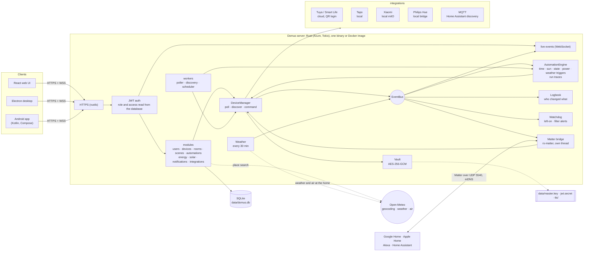
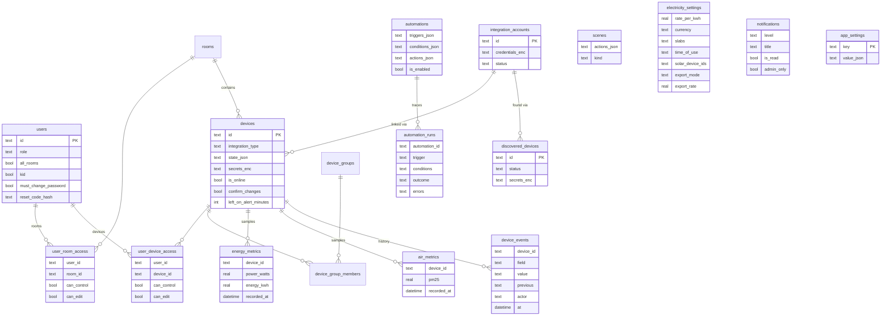

<p align="center">
  <b>Translations</b><br>
  <a href="README.md">English</a> ·
  <a href="README.ar.md">العربية</a> ·
  <a href="README.bn.md">বাংলা</a> ·
  <a href="README.de.md">Deutsch</a> ·
  <a href="README.es.md">Español</a> ·
  <a href="README.fr.md">Français</a> ·
  <a href="README.gu.md">ગુજરાતી</a> ·
  <a href="README.hi.md">हिन्दी</a> ·
  <a href="README.id.md">Bahasa Indonesia</a> ·
  <a href="README.it.md">Italiano</a> ·
  <a href="README.ja.md">日本語</a> ·
  <a href="README.kn.md">ಕನ್ನಡ</a> ·
  <a href="README.ko.md">한국어</a> ·
  <a href="README.ml.md">മലയാളം</a> ·
  <a href="README.mr.md">मराठी</a> ·
  <a href="README.pa.md">ਪੰਜਾਬੀ</a> ·
  <a href="README.pl.md">Polski</a> ·
  <a href="README.pt-BR.md">Português (Brasil)</a> ·
  <a href="README.ru.md">Русский</a> ·
  <a href="README.ta.md">தமிழ்</a> ·
  <a href="README.te.md">తెలుగు</a> ·
  <a href="README.th.md">ไทย</a> ·
  <a href="README.tr.md">Türkçe</a> ·
  <a href="README.ur.md">اردو</a> ·
  <a href="README.vi.md">Tiếng Việt</a> ·
  <a href="README.zh-CN.md">简体中文</a> ·
  <a href="README.zh-TW.md">繁體中文</a>
</p>


# Domus

[](https://github.com/aiyu-ayaan/Domus-Rust/actions/workflows/release.yml)
[](https://github.com/aiyu-ayaan/Domus-Rust/releases)
[](LICENSE)
[](https://github.com/aiyu-ayaan/Domus-Rust/commits/master)
[](https://hub.docker.com/r/aiyuayaan/domus)
[](https://hub.docker.com/r/aiyuayaan/domus)


Eine lokale Smart-Home-Zentrale für Ihren Heimserver. Rust-Backend, SQLite, React-Weboberfläche (mit einer Electron-Desktop-Anwendung) und modulare Integrationen für **Tuya / Smart Life** (QR-Code-Anmeldung, kein Entwicklerkonto erforderlich), **TP-Link Tapo** (lokal), **Xiaomi Mi Home** (lokal, Token aus Ihrem Mi-Konto), **Philips Hue** (lokale Bridge) und **MQTT** (Zigbee2MQTT, ESPHome und alles weitere mit Home Assistant-Geräteerkennung). Eine integrierte **Matter-Bridge** ermöglicht es Google Home, Apple Home, Alexa und Home Assistant, diese Geräte direkt über Ihr lokales Netzwerk zu schalten, zu dimmen und deren Farben anzupassen.

- Automatische Erkennung neuer Geräte mit Posteingang oder direktem automatischen Hinzufügen
- Live-Dashboard: Stromverbrauch, aufgelaufene und prognostizierte Kosten, Luftqualität sowie Messwerte für Bewegung, Türen, Leckagen und Batteriestand
- Räume, Gerätegruppen, Szenen und Automationen; Auslöser nach Uhrzeit, bei **Sonnenaufgang oder Sonnenuntergang** (mit Zeitversatz), bei Gerätestatusänderung, Leistungsaufnahme (auch *über X W für N Minuten*), Verbindungsabbruch oder **Außenwetter**
- **Automationsausführungen**: Jede Automation speichert die letzten 50 Ausführungen inklusive des Auslösers und etwaiger nicht erfüllter Bedingungen
- **Geräteverlauf**: Jede Zustandsänderung eines Geräts mit Verursacher (Person und verwendete App, Automation, Matter oder das Gerät selbst)
- **Warnungen** ohne eigene Automation: Wenn ein Gerät zu lange eingeschaltet bleibt oder der Filter eines Luftreinigers zur Neige geht
- **Matter-Bridge**: Geben Sie ausgewählte Geräte für Google Home, Apple Home, Alexa oder Home Assistant frei – komplett lokal, ohne Cloud-Konto
- **Außenwetter und Außenluft** am Standort (Open-Meteo, ohne API-Schlüssel) auf dem Dashboard direkt neben den Innenraumwerten
- **Vor dem Schalten nachfragen**: Kennzeichnen Sie wichtige Hauptschalter; jede App, Gruppe, Szene und manuelle Automation warnt vor dem Ein- oder Ausschalten
- Stromkostenabrechnung mit Pauschaltarifen, Stufentarifen und **Tageszeittarifen** (HT/NT) in beliebiger Währung, **Standby-Kosten** pro Gerät sowie **Solar**: Erzeugung, Netzeinspeisung, Net-Metering oder Einspeisevergütung
- Mehrere Benutzerkonten mit Rollen (Administrator, Mitglied, Gast) und Zugriffsrechten pro Raum oder Gerät (nur ansehen, steuern oder bearbeiten)
- Web, Electron-Desktop (Linux, Windows) und native Android-App, stets in Echtzeit synchronisiert
- **27 Sprachen** in Web-, Desktop- und Android-App, automatische Erkennung der Systemsprache mit Sprachauswahl in den Einstellungen; Rechts-nach-Links-Layout für Arabisch und Urdu
- Integrierte Update-Seite mit Versionshinweisen (Markdown, Tabellen und Bilder) in jeder App
- HTTPS standardmäßig aktiviert; Zugangsdaten und Geräteschlüssel im Ruhezustand verschlüsselt; Ein-Klick-Backup und -Wiederherstellung

Architektur und Diagramme: [`development/docs/ARCHITECTURE.md`](development/docs/ARCHITECTURE.md), zusammenfassend [unten dargestellt](#wie-alles-zusammenh%C3%A4ngt).
Designprofil der Benutzeroberfläche: [`design-system/domus/MASTER.md`](design-system/domus/MASTER.md).
Projektfortschritt: [`development/TODO.md`](development/TODO.md).

## Wie alles zusammenhängt



Clients kommunizieren ausschließlich mit dem Server; der Server kommuniziert mit Ihren Geräten (lokal, wo immer der Hersteller dies ermöglicht) und speichert sämtliche Daten in einer einzigen SQLite-Datei. Die Cloud wird ausschließlich dort genutzt, wo ein Hersteller keine lokale Steuerung anbietet (Tuya) oder um Geräteschlüssel abzurufen (Xiaomi), sowie für optionale Abfragen: Ortssuche, Wetter und Außenluft für den Heimatstandort (Open-Meteo, erst nach Festlegung des Standorts) und GitHub für Update-Prüfungen. Die Matter-Bridge arbeitet ausschließlich im lokalen Netzwerk.

### Datenmodell



Zugangsdaten und Geräteschlüssel werden versiegelt (`*_enc`) mit `data/master.key` gespeichert, der sich außerhalb der Datenbank befindet. Alle Funktionsdiagramme finden Sie in [`development/docs`](development/docs).

## Screenshots

<p align="center"></p>

**Desktop** (Electron und Web)

<p>
  
  
  
  
  
  
</p>

**Android**

<p>
  
  
  
  
  
</p>

**Android-Tablet** (zweispalting ab 840dp, Einstellungen mit Listen- und Detailansicht)

<p>
  
  
  
  
  
</p>

**Mobiles Web**

<p>
  
  
  
  
  
</p>

Alle Aufnahmen befinden sich in [`res/screenshots`](res/screenshots); ein vollständiges Demovideo in hoher Qualität unter [`res/domus.mp4`](res/domus.mp4).

## Herunterladen

| | |
|---|---|
| Server (Docker) | `aiyuayaan/domus` auf Docker Hub, amd64 und arm64 |
| Android | `Domus-<version>.apk` aus den [neuesten Releases](https://github.com/aiyu-ayaan/Domus-Rust/releases) |
| Linux-Desktop | Einzeiler-Installationsskript unten oder `.deb` / `.AppImage` aus dem Release |
| Windows-Desktop | `Domus-<version>-Setup.exe` aus dem Release |

### Server

Für das Basissystem wird lediglich eine Datei benötigt:

```bash
mkdir domus && cd domus
wget https://raw.githubusercontent.com/aiyu-ayaan/Domus-Rust/master/docker-compose.yml
docker compose up -d
```

Öffnen Sie `https://<server-ip>:8443` und erstellen Sie das Administratorkonto. Mit `docker compose logs domus` sehen Sie den Zertifikats-Fingerprint, den die Clients zur Bestätigung anzeigen.

```bash
docker compose pull && docker compose up -d      # Aktualisieren
DOMUS_VERSION=beta docker compose up -d          # Release-Kanal wählen: latest (Standard), beta, alpha oder 0.0.1
TZ=Asia/Kolkata DOMUS_PORT=9443 docker compose up -d
docker compose --profile mqtt up -d              # Optionalen Mosquitto-Broker mitstarten
```

Tragen Sie `DOMUS_VERSION`, `TZ` und `DOMUS_PORT` in eine `.env`-Datei neben der Compose-Datei ein, um sie dauerhaft zu speichern.

### Linux-Desktop-App

Installiert die neueste Version für den aktuellen Benutzer (x86_64, ohne Root-Rechte): AppImage, Menüeintrag mit Domus-Icon und der Befehl `domus`. Die App aktualisiert sich anschließend selbstständig.

```bash
curl -fsSL https://raw.githubusercontent.com/aiyu-ayaan/Domus-Rust/master/scripts/install-linux.sh | sh
# ... | sh -s -- --channel beta     Beta-Builds installieren (oder alpha)
# ... | sh -s -- --uninstall        Deinstallieren; Einstellungen bleiben erhalten
```

### Android

Laden Sie die APK-Datei von der Release-Seite herunter und installieren Sie diese. Zukünftige Updates werden beim Start der App sowie unter Einstellungen → Updates auf dem gewählten Kanal (Stable, Beta oder Alpha) angeboten und direkt installiert; Android fragt einmalig nach der Installationsberechtigung für Domus.

Die Seite **Updates** (unter Android: Einstellungen → Updates; im Web und auf dem Desktop: Einstellungen → Über → Updates) zeigt die aktuelle Version, die neueste Version auf Ihrem Kanal und deren Versionshinweise in Markdown-Formatierung an.

Informationen zu Releases, Versionsnummern und Update-Kanälen: [development/docs/RELEASE.md](development/docs/RELEASE.md).

## Voraussetzungen

- Rust 1.80+ (`cargo`)
- Node.js 18+ und `pnpm`

## In Entwicklung ausführen

```bash
pnpm install
npm run dev            # Backend (https://127.0.0.1:8443) + Web (http://localhost:3000)

npm run dev:backend    # Nur Backend
npm run dev:web        # Nur Web (leitet /api an das Backend weiter)
npm run dev:desktop    # Electron; Server über die Verbindungsseite wählen
```

Öffnen Sie http://localhost:3000. Beim ersten Aufruf werden Sie aufgefordert, das Administratorkonto einzurichten.

## Auf dem Heimserver ausführen

```bash
pnpm build:web                     # Erstellt apps/web/dist, wird vom Backend ausgeliefert
APP_ENV=production cargo run --release --manifest-path backend/Cargo.toml
```

Öffnen Sie anschließend `https://<server-ip>:8443`. Wenn die Matter-Bridge aktiviert ist, nutzt sie zusätzlich UDP 5540 (`[matter] port`) und mDNS im lokalen Netzwerk.

Alternativ können Sie das Docker-Image direkt aus dem Quellcode erstellen (Host-Netzwerk, Daten im Volume `domus_data`):

```bash
docker compose -f docker-compose.local.yml up -d --build
```

Fernzugriff über einen Cloudflare-Tunnel, die automatische Umschaltung zwischen Heim- und Fernadresse in den Apps sowie Desktop-Installationspakete (`pnpm build:desktop`) werden in [development/docs/DEPLOYMENT.md](development/docs/DEPLOYMENT.md) beschrieben.

Beim ersten Start erstellt Domus das Verzeichnis `data/` mit folgenden Dateien:

| Datei | Zweck |
|---|---|
| `domus.db` | SQLite-Datenbank |
| `master.key` | Verschlüsselt Zugangsdaten von Integrationen und Geräteschlüssel – **unbedingt sichern** |
| `jwt.secret` | Signiert Benutzersitzungen |
| `tls/` | Selbstsigniertes Zertifikat (anpassbar über `tls.cert_path` / `tls.key_path`) |

Die Konfiguration befindet sich in `config/default.toml`; jeder Wert kann über `DOMUS__SEKTION__SCHLÜSSEL`-Umgebungsvariablen überschrieben werden (siehe `.env.example`).

## Sichern und Wiederherstellen

Alle Daten liegen im Ordner `data/`. Sichern Sie entweder das gesamte Verzeichnis oder laden Sie ein Ein-Klick-Backup herunter:

**Sichern:** Als Administrator anmelden → Einstellungen → **Backup** → *Backup herunterladen*. Die Datei ist eine Kopie der Datenbank inklusive des Masterschlüssels, sodass verknüpfte Konten nach dem Wiederherstellen sofort wieder entschlüsselt werden können. Das Backup wird im laufenden Serverbetrieb erstellt. Behandeln Sie die Datei vertraulich: Wer sie besitzt, kann auf verknüpfte Integrationen zugreifen. Das JWT-Secret und das TLS-Zertifikat sind nicht enthalten.

**Wiederherstellen:** Server stoppen und folgenden Befehl ausführen:

```bash
# Docker
docker compose cp domus-backup-2026-10-11.db domus:/app/data/restore.db
docker compose stop domus
docker compose run --rm domus domus-backend restore data/restore.db
docker compose start domus

# Ohne Docker, aus dem Repository-Wurzelverzeichnis (verwendet ./data)
domus-backend restore ~/Downloads/domus-backup-2026-10-11.db
```

Der vorherige Datenstand wird unter `*.before-restore` gesichert. Nach der Wiederherstellung auf einem neuen Rechner melden sich die Benutzer erneut an und die Apps fordern dazu auf, dem neuen Zertifikat zu vertrauen. Wurde der Schlüssel über die Umgebungsvariable `DOMUS_MASTER_KEY` gesetzt, enthält das Backup keinen Schlüssel und der neue Server benötigt dieselbe Variable. Weitere Details unter [development/docs/DEPLOYMENT.md](development/docs/DEPLOYMENT.md#backup-and-restore).

## Administrator-Passwort vergessen

Da Domus keinen eigenen Mailserver betreibt, werden keine E-Mails versendet. Folgende Optionen stehen zur Verfügung:

1. **Ein anderer Administrator** öffnet Einstellungen → Personen, aktiviert *Code zum Zurücksetzen anfordern* für Ihr Konto und teilt Ihnen den 8-stelligen Zahlencode mit (gültig für 30 Minuten und 5 Fehlversuche). Wählen Sie im Anmeldebildschirm *Passwort vergessen?*, geben Sie Ihren Benutzernamen und danach den Code ein.
2. **Direkt auf dem Server**, funktioniert sowohl bei laufendem als auch bei gestopptem Server und erfordert keine vorherige Anmeldung:

   ```bash
   docker compose exec domus domus-backend reset-password <username>              # Gibt ein neues Zufallspasswort aus
   docker compose exec domus domus-backend reset-password <username> 'new-pass'   # Oder ein eigenes Passwort setzen (mind. 8 Zeichen)
   domus-backend reset-password <username>                                        # Ohne Docker, aus dem Repository-Wurzelverzeichnis
   ```

   Melden Sie sich damit an und ändern Sie das Passwort anschließend unter Einstellungen → Passwort.

Fünf fehlerhafte Passworteingaben sperren das entsprechende Benutzerkonto im Produktivbetrieb für 15 Minuten (die Sperre wird durch einen Neustart des Servers aufgehoben; im Entwicklungsmodus ist sie inaktiv). Details sowie Regeln für generierte Passwörter und Kinder-Konten: [development/docs/ACCOUNTS.md](development/docs/ACCOUNTS.md).

## Sprachen

Englisch, Hindi, Spanisch, Portugiesisch (Brasilien), Indonesisch, Arabisch, Französisch, Russisch, Deutsch, Türkisch, Japanisch, Koreanisch, Italienisch, Vietnamesisch, Thailändisch, Chinesisch (Vereinfacht und Traditionell), Polnisch, Bengali, Tamil, Telugu, Marathi, Gujarati, Kannada, Malayalam, Punjabi und Urdu. Arabisch und Urdu werden von rechts nach links dargestellt.

Jede App passt sich automatisch der Sprache Ihres Browsers bzw. Betriebssystems an; ist keine passende Übersetzung vorhanden, wird Englisch angezeigt. Eine manuelle Auswahl ist über Einstellungen > Sprache (im Web und Desktop unter Erscheinungsbild) möglich; *Systemstandard* stellt wieder auf die Systemsprache um. Unter Android 13+ ist die Auswahl auch über die Systemeinstellungen des Telefons unter Einstellungen > Apps > Domus > Sprache verfügbar.

Die Übersetzungen wurden maschinell erstellt und noch nicht von Muttersprachlern gegengelesen, sodass Formulierungen abweichen können. Anpassungen lassen sich mit einer einzeiligen Änderung im Sprachkatalog vornehmen. Funktionsweise, Hinzufügen weiterer Sprachen und Richtlinien für neue Texte: [development/docs/LOCALIZATION.md](development/docs/LOCALIZATION.md).

## Geräte verbinden

| Marke | Anleitung |
|---|---|
| Tuya / Smart Life | Integrationen → *Per QR-Code verknüpfen*. Geben Sie den **Benutzercode** aus Smart Life ein (Profil → Einstellungen → Konto und Sicherheit → Benutzercode) und scannen Sie den QR-Code in der App. |
| Tapo | Integrationen → *Konto verknüpfen* mit Ihrer TP-Link-ID. Geräte im lokalen Netzwerk werden automatisch erkannt und lokal gesteuert. Ein H100-Hub bindet verbundene Sensoren, Schalter und Thermostate direkt mit ein. Kameras werden gelistet, aber derzeit noch nicht unterstützt. |
| Xiaomi | Integrationen → *Konto verknüpfen* mit Ihrem Mi-Konto und der Serverregion. Fordert Xiaomi eine Zwei-Faktor-Authentifizierung an, geben Sie den per E-Mail oder SMS empfangenen Bestätigungscode im selben Dialog ein. Als Konto kann eine E-Mail-Adresse, Telefonnummer mit Ländervorwahl (`+49…`) oder eine Xiaomi-ID verwendet werden. Token werden einmalig abgerufen; die Gerätesteuerung erfolgt lokal. Geräte können auch manuell per Token hinzugefügt werden. |
| Philips Hue | Drücken Sie die runde Taste auf der Bridge und wählen Sie innerhalb von 30 Sekunden Integrationen → Philips Hue → *Verknüpfen*. Lassen Sie das Adressfeld leer, um die Bridge automatisch im Netzwerk zu finden. Leuchtmittel und Hue Smart Plugs werden lokal gesteuert. |
| MQTT | Integrationen → MQTT → *Verknüpfen* mit Adresse, Port und Zugangsdaten Ihres Brokers. Geräte, die sich über die Home Assistant MQTT-Discovery melden (Zigbee2MQTT, ESPHome usw.), erscheinen unter Entdeckt: Lampen, Schalter, Zwischenstecker, Ventilatoren und Sensoren. Bei Nutzung des mitgelieferten Brokers (`--profile mqtt`) lautet die Adresse `mqtt`, Port `1883`. |

Eine genaue Übersicht über den Funktionsumfang aller Integrationen finden Sie in `development/docs/INTEGRATIONS.md`.

## Stromabrechnung

Energie → *Stromtarif*: Wählen Sie eine beliebige Währung und legen Sie einen festen Arbeitspreis pro kWh fest oder konfigurieren Sie **Stufen** für gestaffelte Verbrauchstarife (z. B. 0–100 Einheiten zu einem Satz, 101–300 zum nächsten usw.). Die Abrechnung erfolgt pro Abrechnungszeitraum zuzüglich des festen monatlichen Grundpreises.

Tarife unterstützen zudem **Tageszeitfenster** (HT/NT): Zeitbereiche (nach der Uhrzeit Ihres Zuhauses, auch über Mitternacht hinaus), in denen Einheiten um einen festgelegten Betrag günstiger oder teurer abgerechnet werden, beispielsweise als Nachtrabatt oder Spitzenlastzuschlag auf den Grund- oder Stufenpreis.

Neu erkannte Geräte erscheinen unter **Geräte → Entdeckt**. Aktivieren Sie dort die Option *Neue Geräte automatisch hinzufügen*, um den Posteingang zu überspringen.

## Sonnenaufgang und Sonnenuntergang

Legen Sie den Standort Ihres Zuhauses unter Einstellungen → **Standort des Zuhauses** fest: Nutzen Sie den aktuellen Standort Ihres Smartphones oder Browsers, suchen Sie nach einem Ort (der Server nutzt den kostenlosen Geocodierungsdienst von Open-Meteo; lediglich der eingegebene Suchbegriff verlässt Ihr Zuhause) oder geben Sie Breiten- und Längengrad manuell ein. Die Koordinaten werden auf etwa einen Kilometer gerundet und verbleiben ausschließlich auf Ihrem Server. Automationen können damit exakt zum Sonnenauf- oder -untergang sowie mit Minutenversatz davor oder danach ausgelöst werden. Ohne hinterlegten Standort wird ein sonnenbasierter Auslöser nicht ausgeführt.

## Vor dem Schalten nachfragen

Ein Hauptschalter, an dem wichtige Geräte hängen, kann versehentlich betätigt werden. Öffnen Sie die Detailansicht des Geräts und aktivieren Sie **Vor dem Schalten nachfragen**: Jede App fordert nun vor dem Ein- oder Ausschalten eine Bestätigung an. Dies gilt auch für Raumfunktionen wie *Alle an / Alle aus*, Gerätegruppen, Szenen (einschließlich verschachtelter Szenen) sowie die manuelle Ausführung (*Ausführen*) einer entsprechenden Automation. Die Einstellung wird zentral auf dem Server gespeichert und gilt einheitlich für Web, Desktop und Android. Automatisch ausgelöste Automationen fragen nicht nach und laufen wie definiert ab; Schaltungen außerhalb von Domus (z. B. Hersteller-Apps oder physische Wandschalter) werden hiervon nicht erfasst.

## Matter (Google Home, Apple Home, Alexa)

Einstellungen → **Matter** (nur für Administratoren): Aktivieren Sie die Funktion, wählen Sie die freizugebenden Geräte aus und scannen Sie den QR-Code oder geben Sie den Kopplungscode in Google Home, Apple Home, Alexa oder Home Assistant ein. Leuchtmittel werden als farbige oder dimmbare Lampen eingebunden, alle sonstigen schaltbaren Geräte als Zwischenstecker. Schalten, Dimmen und Farbanpassung werden unterstützt, und in Domus vorgenommene Änderungen werden direkt an die Steuerungs-App übermittelt. Über „Kopplung für 15 Minuten erlauben“ kann ein weiteres Ökosystem hinzugefügt werden; „Alle Kopplungen vergessen“ setzt die Bridge mit einem neuen Kopplungscode zurück.

Da die Bridge nicht offiziell zertifiziert ist (sie nutzt die Matter-Test-Attestierung), fordern die Steuerungs-Apps eine Bestätigung beim Hinzufügen. In Google Home kann die Bridge erst eingebunden werden, nachdem sie in der Google Home Developer Console als Testgerät registriert wurde. Details: [`development/docs/MATTER.md`](development/docs/MATTER.md).

## Verlauf, Automationsausführungen und Benachrichtigungen

- **Verlauf** in jeder Gerätedetailansicht: Was wurde wann geändert und durch wen (*Von Ayaan · Android*, *Automation „Nachtmodus“*, *Matter*, *Am Gerät*). Wird für den gleichen Zeitraum wie die Energiedaten aufbewahrt.
- **Ausführungen** jeder Automation: *Ausgeführt*, *Fehlgeschlagen* mit Fehlermeldung oder *Übersprungen* mit Angabe der nicht erfüllten Bedingung – so lässt sich immer nachvollziehen, warum eine Automation nicht ausgelöst wurde.
- **Warnen, wenn eingeschaltet gelassen** in der Gerätedetailansicht (30 Minuten bis 12 Stunden): Administratoren erhalten eine Benachrichtigung. Bei Geräten mit Leistungsmessung gilt ein Verbrauch über 10 W als eingeschaltet, sodass ein Fernseher im Standby als ausgeschaltet gewertet wird.
- **Filter läuft ab**: Eine Benachrichtigung warnt rechtzeitig, sobald die Restlebensdauer des Filters eines Luftreinigers auf 10 % sinkt.

## Wetter, Standby und Solar

- Bei konfiguriertem Standort zeigt das Dashboard das **Wetter und den Außen-PM2.5-Wert** direkt neben den Innenraummesswerten an; Automationen können diese Werte als Bedingungen oder Auslöser nutzen (*wenn Außen-PM2.5 über 35 steigt*, *nur wenn Außentemperatur unter 20 °C liegt*).
- Energie → **Standby** listet den Ruhestromverbrauch jedes Geräts auf (der niedrigste gemessene Stundenwert dieser Woche) sowie die daraus resultierenden monatlichen Kosten.
- Energie → *Stromtarif* → **Solar**: Wählen Sie die Zwischenstecker aus, die Ihre Solareinspeisung erfassen, und wählen Sie Net-Metering oder eine feste Einspeisevergütung. Die Stromrechnung berücksichtigt dann ausschließlich den Netzbezug; die Solar-Kachel schlüsselt erzeugte, selbst verbrauchte, eingespeiste und vergütete Energie übersichtlich auf. Netzflüsse werden alle 15 Minuten anhand gemessener Geräte berechnet; ungemessene Verbraucher können zu einem rechnerisch höheren Exportwert führen.

Roadmap und Architekturdiagramme: [`development/docs/ROADMAP.md`](development/docs/ROADMAP.md).

## Lizenz

Domus steht unter der [MIT-Lizenz](LICENSE). Drittanbieter-Bibliotheken unterliegen ihren jeweiligen Lizenzen und sind in jeder App unter Über → Danksagungen aufgeführt.

## Tests

```bash
cargo test --workspace
pnpm --filter @domus/web exec tsc -b
```

`cargo test --workspace` umfasst auch `backend/tests/matter_bridge.rs`, welcher einen Matter-Controller über UDP mit der Bridge koppelt und Geräte schaltet, dimmt und deren Farbe anpasst (erfordert eine Netzwerkschnittstelle mit IPv4).
