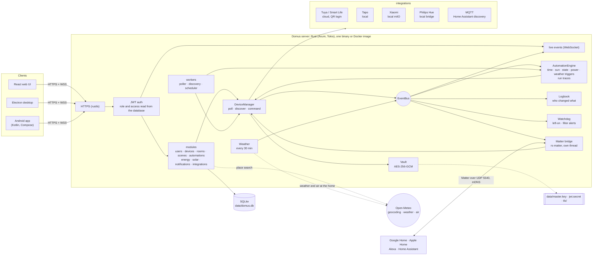
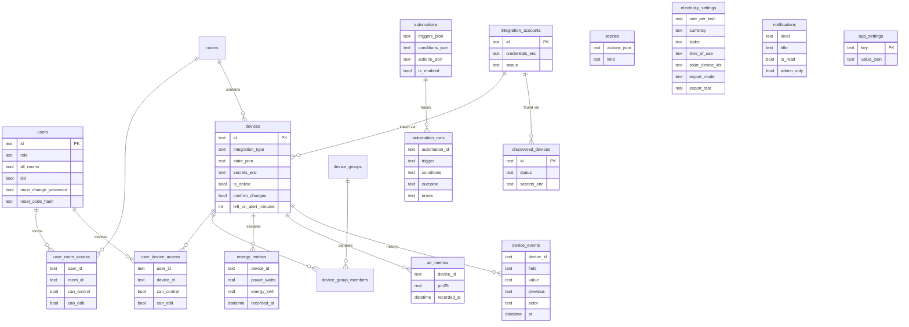

# Domus

<p align="center">
  <b>Translations</b><br>
  <a href="README.md">English</a> ·
  <a href="README.ar.md">العربية</a> ·
  <a href="README.bn.md">বাংলা</a> ·
  <a href="README.de.md">Deutsch</a> ·
  <a href="README.es.md">Español</a> ·
  <a href="README.fr.md">Français</a> ·
  <a href="README.gu.md">ગુજરાતી</a> ·
  <a href="README.hi.md">हिन्दी</a> ·
  <a href="README.id.md">Bahasa Indonesia</a> ·
  <a href="README.it.md">Italiano</a> ·
  <a href="README.ja.md">日本語</a> ·
  <a href="README.kn.md">ಕನ್ನಡ</a> ·
  <a href="README.ko.md">한국어</a> ·
  <a href="README.ml.md">മലയാളം</a> ·
  <a href="README.mr.md">मराठी</a> ·
  <a href="README.pa.md">ਪੰਜਾਬੀ</a> ·
  <a href="README.pl.md">Polski</a> ·
  <a href="README.pt-BR.md">Português (Brasil)</a> ·
  <a href="README.ru.md">Русский</a> ·
  <a href="README.ta.md">தமிழ்</a> ·
  <a href="README.te.md">తెలుగు</a> ·
  <a href="README.th.md">ไทย</a> ·
  <a href="README.tr.md">Türkçe</a> ·
  <a href="README.ur.md">اردو</a> ·
  <a href="README.vi.md">Tiếng Việt</a> ·
  <a href="README.zh-CN.md">简体中文</a> ·
  <a href="README.zh-TW.md">繁體中文</a>
</p>

[](https://github.com/aiyu-ayaan/Domus-Rust/actions/workflows/release.yml)
[](https://github.com/aiyu-ayaan/Domus-Rust/releases)
[](LICENSE)
[](https://github.com/aiyu-ayaan/Domus-Rust/commits/master)
[](https://hub.docker.com/r/aiyuayaan/domus)
[](https://hub.docker.com/r/aiyuayaan/domus)


[](https://ghloc.dev/aiyu-ayaan/Domus)


Un centro de domótica local para tu servidor doméstico. Backend en Rust, SQLite, interfaz web en React (con versión de escritorio en Electron) e integraciones modulares para **Tuya / Smart Life** (inicio de sesión mediante código QR, sin cuenta de desarrollador), **TP-Link Tapo** (local), **Xiaomi Mi Home** (local, tokens obtenidos desde tu cuenta Mi), **Philips Hue** (puente local) y **MQTT** (Zigbee2MQTT, ESPHome y cualquier sistema compatible con el descubrimiento de Home Assistant). Un **puente Matter** integrado permite que Google Home, Apple Home, Alexa y Home Assistant conmuten, regulen y cambien el color de estos dispositivos a través de tu red local.

- Detección automática de nuevos dispositivos, con bandeja de entrada o adición automática
- Panel en tiempo real: consumo eléctrico, factura acumulada y proyectada, calidad del aire y mediciones de movimiento, puertas, fugas y batería
- Habitaciones, grupos de dispositivos, escenas y automatizaciones; activadores por hora, al **amanecer o atardecer** (con margen de minutos), por cambio de estado, potencia (también *superior a X durante N minutos*), desconexión o el **clima exterior**
- **Ejecuciones de automatización**: cada automatización conserva sus últimas 50 ejecuciones, con el disparador que la activó y la condición que la detuvo
- **Historial de dispositivos**: cada cambio de un dispositivo y quién lo realizó (una persona y la aplicación usada, una automatización, Matter o el propio dispositivo)
- **Alertas** sin necesidad de programar una automatización: dispositivos olvidados encendidos o filtro del purificador de aire por agotarse
- **Puente Matter**: comparte los dispositivos que elijas con Google Home, Apple Home, Alexa o Home Assistant, de forma local y sin cuentas en la nube
- **Clima y aire exterior** en la ubicación del hogar (Open-Meteo, sin clave de API) en el panel de control, junto a las mediciones interiores
- **Preguntar antes de conmutar**: marca un interruptor principal y cada aplicación, grupo, escena o ejecución manual advertirá antes de encenderlo o apagarlo
- Facturación eléctrica con tarifas planas, por tramos y **por discriminación horaria** en cualquier divisa, coste de consumo **en espera** por dispositivo y **solar**: generación, exportación, balance neto o compensación de excedentes
- Múltiples cuentas de usuario con roles de administrador, miembro o invitado y permisos por habitación o dispositivo (solo ver, controlar o editar)
- Aplicaciones Web, de escritorio en Electron (Linux, Windows) y nativa de Android, sincronizadas en directo
- **27 idiomas** en las aplicaciones web, de escritorio y Android, adaptándose al idioma de tu sistema con selector en Ajustes; compatibilidad de derecha a izquierda para árabe y urdu
- Página de Actualizaciones con notas de la versión (Markdown, tablas e imágenes) en cada app
- HTTPS por defecto; credenciales y claves de dispositivos cifradas en reposo; copia de seguridad y restauración en un solo archivo

Arquitectura y diagramas: [`development/docs/ARCHITECTURE.md`](development/docs/ARCHITECTURE.md), resumidos [más abajo](#c%C3%B3mo-encaja-todo).
Perfil de diseño de la interfaz: [`design-system/domus/MASTER.md`](design-system/domus/MASTER.md).
Estado del proyecto: [`development/TODO.md`](development/TODO.md).

## Cómo encaja todo



Las aplicaciones cliente se comunican exclusivamente con el servidor; el servidor interactúa con tus dispositivos (localmente siempre que el fabricante lo admita) y almacena todo en un único archivo SQLite. La nube se utiliza únicamente donde el fabricante no ofrece control local (Tuya) o para obtener las claves de los dispositivos (Xiaomi), además de consultas opcionales: búsqueda de lugares, clima y aire exterior para la ubicación configurada (Open-Meteo, solo una vez establecida una ubicación) y comprobaciones de actualizaciones en GitHub. El puente Matter opera exclusivamente en la red local.

### Modelo de datos



Las credenciales y claves de dispositivos se almacenan selladas (`*_enc`) mediante `data/master.key`, que se conserva fuera de la base de datos. El conjunto completo de diagramas por funcionalidad se encuentra en [`development/docs`](development/docs).

## Capturas de pantalla

<p align="center"></p>

**Escritorio** (Electron y Web)

<p>
  
  
  
  
  
  
</p>

**Android**

<p>
  
  
  
  
  
</p>

**Tablet Android** (dos columnas a partir de 840dp, Ajustes como lista y detalle)

<p>
  
  
  
  
  
</p>

**Web móvil**

<p>
  
  
  
  
  
</p>

Todas las capturas están disponibles en [`res/screenshots`](res/screenshots); el vídeo de demostración completo se encuentra en [`res/domus.mp4`](res/domus.mp4).

## Descargas

| | |
|---|---|
| Servidor (Docker) | `aiyuayaan/domus` en Docker Hub, amd64 y arm64 |
| Android | `Domus-<version>.apk` desde las [últimas versiones publicadas](https://github.com/aiyu-ayaan/Domus-Rust/releases) |
| Escritorio Linux | Script de instalación directa inferior, o paquetes `.deb` / `.AppImage` del release |
| Escritorio Windows | `Domus-<version>-Setup.exe` desde la página de releases |

### Servidor

El host solo requiere un único archivo:

```bash
mkdir domus && cd domus
wget https://raw.githubusercontent.com/aiyu-ayaan/Domus-Rust/master/docker-compose.yml
docker compose up -d
```

Abre `https://<server-ip>:8443` y crea la cuenta de administrador. Con `docker compose logs domus` puedes ver la huella digital del certificado que las aplicaciones te pedirán confirmar.

```bash
docker compose pull && docker compose up -d      # actualizar
DOMUS_VERSION=beta docker compose up -d          # seguir un canal: latest (por defecto), beta, alpha o 0.0.1
TZ=Asia/Kolkata DOMUS_PORT=9443 docker compose up -d
docker compose --profile mqtt up -d              # iniciar también el broker opcional Mosquitto
```

Puedes definir `DOMUS_VERSION`, `TZ` y `DOMUS_PORT` en un archivo `.env` junto al archivo compose para mantenerlos.

### Aplicación de escritorio para Linux

Instala la versión más reciente para el usuario actual (x86_64, sin permisos de root): el AppImage, una entrada en el menú con el icono de Domus y el comando `domus`. La aplicación se mantendrá actualizada automáticamente.

```bash
curl -fsSL https://raw.githubusercontent.com/aiyu-ayaan/Domus-Rust/master/scripts/install-linux.sh | sh
# ... | sh -s -- --channel beta     instalar versiones beta (o alpha)
# ... | sh -s -- --uninstall        desinstalar; la configuración se conserva
```

### Android

Descarga el APK desde la página de versiones e instálalo. Las actualizaciones futuras se ofrecerán al abrir la app o desde Ajustes → Actualizaciones en los canales Estable, Beta o Alpha, e instaladas directamente; Android solicitará autorización una vez para permitir a Domus instalarlas.

La pantalla de **Actualizaciones** (Ajustes → Actualizaciones en Android; Ajustes → Acerca de → Actualizaciones en web y escritorio) muestra tu versión actual, la última versión disponible en tu canal y sus notas de versión en formato Markdown.

Información sobre releases, numeración y canales de actualización: [development/docs/RELEASE.md](development/docs/RELEASE.md).

## Requisitos

- Rust 1.80+ (`cargo`)
- Node.js 18+ y `pnpm`

## Ejecutar en desarrollo

```bash
pnpm install
npm run dev            # backend (https://127.0.0.1:8443) + web (http://localhost:3000)

npm run dev:backend    # solo backend
npm run dev:web        # solo web (redirige /api al backend)
npm run dev:desktop    # Electron; selecciona el servidor en la pantalla de conexión
```

Abre http://localhost:3000. En la primera visita se te pedirá crear la cuenta de administrador.

## Ejecutar en el servidor doméstico

```bash
pnpm build:web                     # compila apps/web/dist, servido por el backend
APP_ENV=production cargo run --release --manifest-path backend/Cargo.toml
```

Luego abre `https://<server-ip>:8443`. Si el puente Matter está activado, también utilizará UDP 5540 (`[matter] port`) y mDNS en la red local.

O genera la imagen de Docker a partir de este repositorio (red de host, datos en el volumen `domus_data`):

```bash
docker compose -f docker-compose.local.yml up -d --build
```

El acceso remoto mediante túneles de Cloudflare, la alternancia automática entre dirección local y remota en las apps y los paquetes de escritorio (`pnpm build:desktop`) están documentados en [development/docs/DEPLOYMENT.md](development/docs/DEPLOYMENT.md).

En el primer arranque, Domus crea el directorio `data/` con:

| Archivo | Propósito |
|---|---|
| `domus.db` | Base de datos SQLite |
| `master.key` | Cifra las credenciales de integraciones y claves de dispositivos — **haz una copia de seguridad** |
| `jwt.secret` | Firma las sesiones |
| `tls/` | Certificado autofirmado (reemplazable mediante `tls.cert_path` / `tls.key_path`) |

La configuración se gestiona en `config/default.toml`; cualquier valor puede sobrescribirse mediante variables de entorno `DOMUS__SECCION__CLAVE` (ver `.env.example`).

## Copia de seguridad y restauración

Todos los datos se guardan en `data/`. Puedes respaldar toda la carpeta o descargar una copia en un solo archivo:

**Copia de seguridad:** Inicia sesión como administrador → Ajustes → **Copia de seguridad** → *Descargar copia de seguridad*. El archivo es una copia de la base de datos con la clave maestra incluida, lo que permite que las cuentas vinculadas sigan funcionando tras restaurarse. Se genera en caliente con el servidor en ejecución. Mantén este archivo a buen recaudo: cualquiera con él puede acceder a esas cuentas. El secreto JWT y el certificado TLS no se incluyen.

**Restauración:** Detén el servidor y ejecuta:

```bash
# Docker
docker compose cp domus-backup-2026-10-11.db domus:/app/data/restore.db
docker compose stop domus
docker compose run --rm domus domus-backend restore data/restore.db
docker compose start domus

# Sin Docker, desde la raíz del repositorio (usa ./data)
domus-backend restore ~/Downloads/domus-backup-2026-10-11.db
```

El estado existente se conserva junto a él como `*.before-restore`. Tras restaurar en un servidor nuevo, los usuarios deberán iniciar sesión de nuevo y las aplicaciones pedirán confiar en el nuevo certificado. Si configuraste la clave con `DOMUS_MASTER_KEY`, la copia de seguridad no incluirá ninguna clave y el nuevo servidor necesitará la misma variable. Más detalles en [development/docs/DEPLOYMENT.md](development/docs/DEPLOYMENT.md#backup-and-restore).

## Olvidó la contraseña de administrador

Domus no incorpora servidor de correo saliente, por lo que nada se envía por correo electrónico. Opciones por orden de sencillez:

1. **Otro administrador** entra en Ajustes → Personas, activa *Código de restablecimiento* para tu usuario y te proporciona el código de 8 dígitos (válido durante 30 minutos y 5 intentos erróneos). En la pantalla de inicio de sesión selecciona *¿Olvidó su contraseña?*, introduce tu nombre de usuario y el código.
2. **Desde el servidor**, funciona con Domus en ejecución o detenido y no requiere inicio de sesión previo:

   ```bash
   docker compose exec domus domus-backend reset-password <username>              # muestra una nueva contraseña aleatoria
   docker compose exec domus domus-backend reset-password <username> 'new-pass'   # o especifica una propia (8+ caracteres)
   domus-backend reset-password <username>                                        # sin Docker, desde la raíz del repositorio
   ```

   Inicia sesión con ella y cámbiala en Ajustes → Contraseña.

Cinco intentos fallidos de contraseña bloquean el nombre de usuario durante 15 minutos en producción (el bloqueo se cancela reiniciando el servidor, y está inactivo en desarrollo). Detalles y reglas para contraseñas generadas y cuentas infantiles: [development/docs/ACCOUNTS.md](development/docs/ACCOUNTS.md).

## Idiomas

Inglés, hindi, español, portugués (Brasil), indonesio, árabe, francés, ruso, alemán, turco, japonés, coreano, italiano, vietnamita, tailandés, chino (simplificado y tradicional), polaco, bengalí, tamil, telugu, maratí, guyaratí, canarés, malabar, punyabí y urdu. El árabe y el urdu cuentan con disposición de derecha a izquierda.

Cada aplicación sigue el idioma del navegador o sistema, mostrando inglés cuando no existe una traducción. Para cambiar de idioma, ve a Ajustes > Idioma (Apariencia en web y escritorio); *Predeterminado del sistema* vuelve a seguir la configuración del sistema. En Android 13 y posteriores también figura en los Ajustes del sistema del teléfono > Aplicaciones > Domus > Idioma.

Las traducciones son automáticas y no han sido revisadas exhaustivamente por hablantes nativos, por lo que algunas expresiones pueden diferir. Corregir cualquier término requiere una sola línea en el catálogo correspondiente. Cómo funciona la localización, cómo añadir nuevos idiomas y pautas para textos: [development/docs/LOCALIZATION.md](development/docs/LOCALIZATION.md).

## Conectar dispositivos

| Marca | Procedimiento |
|---|---|
| Tuya / Smart Life | Integraciones → *Vincular con código QR*. Introduce el **Código de usuario** de Smart Life (Yo → Ajustes → Cuenta y seguridad → Código de usuario) y escanea el QR en la app. |
| Tapo | Integraciones → *Vincular cuenta* con tu ID de TP-Link. Los dispositivos en la red local se detectan y controlan localmente. Un concentrador H100 importa automáticamente sus sensores, interruptores y termostatos. Las cámaras se muestran en la lista, pero aún no están soportadas. |
| Xiaomi | Integraciones → *Vincular cuenta* con tu cuenta Mi y región del servidor. Si Xiaomi solicita verificación en dos pasos, introduce el código recibido por correo o SMS en el mismo cuadro. La cuenta puede ser un correo electrónico, un número de teléfono con prefijo internacional (`+34…`) o un Xiaomi ID. Los tokens se obtienen una única vez; el control posterior es puramente local. También se pueden añadir dispositivos introduciendo el token de forma manual. |
| Philips Hue | Pulsa el botón redondo del puente Hue y entra en Integraciones → Philips Hue → *Vincular* antes de 30 segundos. Deja la dirección en blanco para encontrar el puente de forma automática. Las bombillas y enchufes inteligentes Hue se controlan localmente. |
| MQTT | Integraciones → MQTT → *Vincular* indicando dirección, puerto y credenciales del broker. Los dispositivos que se anuncien mediante descubrimiento MQTT de Home Assistant (Zigbee2MQTT, ESPHome, etc.) aparecerán en Descubiertos: luces, interruptores, enchufes, ventiladores y sensores. Con el broker integrado (`--profile mqtt`), la dirección es `mqtt` y el puerto `1883`. |

Consulta `development/docs/INTEGRATIONS.md` para conocer los dispositivos soportados por cada integración.

## Facturación eléctrica

Energía → *Plan eléctrico*: selecciona tu divisa y define un precio fijo por kWh o configura **tramos** para tarifas escalonadas (por ejemplo: 0–100 unidades a una tarifa, 101–300 a la siguiente, etc.). La factura se calcula por ciclo de facturación, sumando el término fijo mensual.

Las tarifas admiten además ventanas de **discriminación horaria**: franjas horarias (según el reloj del hogar, admitiendo horas pasada la medianoche) en las que el coste de la unidad aumenta o disminuye una cantidad fijada (por ejemplo, tarifa valle o recargo de hora punta) sobre el precio base o por tramos.

Los nuevos dispositivos detectados aparecen en **Dispositivos → Descubiertos**. Puedes activar *Añadir nuevos dispositivos automáticamente* para omitir la bandeja de entrada.

## Amanecer y atardecer

Establece la ubicación del hogar en Ajustes → **Ubicación del hogar**: usa la ubicación actual del dispositivo o navegador, busca una localidad (el servidor consulta el geocodificador gratuito de Open-Meteo; solo el nombre buscado sale de tu red) o introduce latitud y longitud manualmente. Las coordenadas se redondean a aproximadamente un kilómetro y no salen de tu servidor. Las automatizaciones pueden entonces programarse para el amanecer o atardecer, con minutos de antelación o retraso. Sin ubicación configurada, los activadores solares no se disparan.

## Preguntar antes de conmutar

Un interruptor principal que alimenta varios aparatos puede apagarse por descuido accidental. Abre la ficha del dispositivo y activa **Preguntar antes de conmutar**: a partir de ese momento, cada aplicación pedirá confirmación antes de encenderlo o apagarlo. Esto se aplica también a las acciones de habitación *Encender todo / Apagar todo*, grupos de dispositivos, escenas (incluidas escenas anidadas) y al botón manual *Ejecutar* de cualquier automatización que fuese a cambiar su estado. La configuración reside en el servidor, por lo que es idéntica en web, escritorio y Android. Las automatizaciones que se disparan solas no preguntan y se ejecutan tal como fueron diseñadas, y los mandos externos a Domus (apps de fabricantes, interruptores de pared físicos) no quedan cubiertos.

## Matter (Google Home, Apple Home, Alexa)

Ajustes → **Matter** (administradores): actívalo, marca los dispositivos a compartir y escanea el código QR o introduce el código de emparejamiento en Google Home, Apple Home, Alexa o Home Assistant. Las luces se reconocen como regulables o de color, y los demás dispositivos conmutables como enchufes; el encendido/apagado, la regulación y el cambio de color funcionan sin problemas, y los cambios efectuados en Domus se reflejan inmediatamente en el controlador. «Permitir emparejamiento durante 15 minutos» permite enlazar un segundo ecosistema; «Olvidar todos los emparejamientos» restablece el puente con un nuevo código.

Dado que el puente no dispone de certificación comercial (utiliza el certificado de pruebas oficial de Matter), las apps mostrarán un aviso para confirmar su inclusión. En Google Home, requiere haber sido añadido previamente como dispositivo de prueba en Google Home Developer Console. Detalles: [`development/docs/MATTER.md`](development/docs/MATTER.md).

## Historial, ejecuciones de automatización y alertas

- **Historial** en la ficha de cada dispositivo: qué cambió, cuándo y quién lo causó (*Por Ayaan · Android*, *Automatización "Modo noche"*, *Matter*, *En el dispositivo*). Se conserva durante el mismo periodo que los datos de consumo.
- **Ejecuciones** de cada automatización: *Ejecutado*, *Fallido* con el mensaje de error o *Omitido* detallando la condición que no se cumplió, resolviendo dudas de por qué no se activó.
- **Avisar si se queda encendido** en la ficha del dispositivo (de 30 minutos a 12 horas): los administradores reciben una notificación. Un dispositivo con medición de consumo se considera encendido a partir de 10 W, por lo que un televisor en modo de espera cuenta como apagado.
- **Filtro por agotarse**: notificación automática cuando la vida útil del filtro de un purificador desciende al 10%.

## Clima, en espera y solar

- Con la ubicación configurada, el panel de control muestra el **clima y el nivel de PM2.5 exterior** junto a las lecturas del interior de la vivienda, y las automatizaciones pueden emplearlos (*cuando el PM2.5 exterior suba de 35*, *solo si la temperatura exterior es inferior a 20*).
- Energía → **En espera** lista el consumo residual de cada equipo cuando nadie lo utiliza (su hora de menor consumo de la semana) y su impacto en la factura mensual.
- Energía → *Plan eléctrico* → **Solar**: marca los enchufes que miden la generación de tus paneles solares y escoge entre balance neto o compensación de excedentes. La factura computará únicamente la energía comprada a la red eléctrica, y la tarjeta Solar detallará la energía generada, el autoconsumo, la exportación y el ahorro generado. Los flujos de red se recalculan cada 15 minutos en base a los dispositivos monitorizados; los electrodomésticos sin medidor pueden provocar lecturas de exportación más elevadas.

Planificación y diagramas: [`development/docs/ROADMAP.md`](development/docs/ROADMAP.md).

## Licencia

Domus se distribuye bajo la [Licencia MIT](LICENSE). Las bibliotecas de terceros mantienen sus respectivas licencias y se detallan en Acerca de → Agradecimientos en cada aplicación.

## Pruebas

```bash
cargo test --workspace
pnpm --filter @domus/web exec tsc -b
```

`cargo test --workspace` incluye `backend/tests/matter_bridge.rs`, que vincula un controlador Matter con el puente mediante UDP y conmuta, regula y ajusta el color de los dispositivos (requiere una interfaz de red con IPv4).
