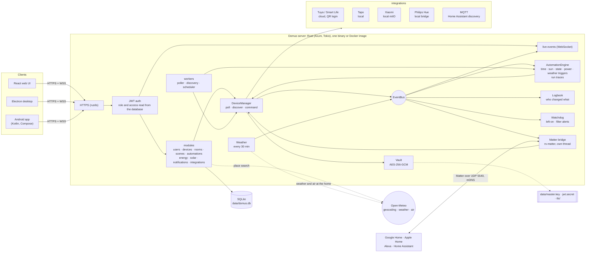
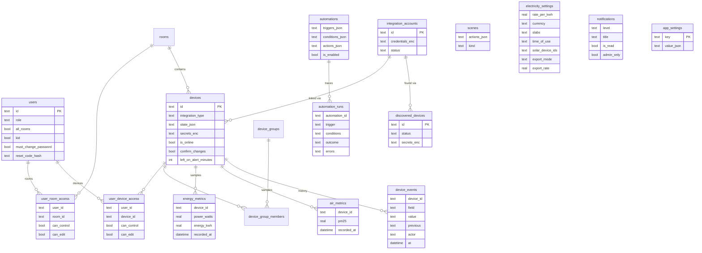

<p align="center">
  <b>Translations</b><br>
  <a href="README.md">English</a> ·
  <a href="README.ar.md">العربية</a> ·
  <a href="README.bn.md">বাংলা</a> ·
  <a href="README.de.md">Deutsch</a> ·
  <a href="README.es.md">Español</a> ·
  <a href="README.fr.md">Français</a> ·
  <a href="README.gu.md">ગુજરાતી</a> ·
  <a href="README.hi.md">हिन्दी</a> ·
  <a href="README.id.md">Bahasa Indonesia</a> ·
  <a href="README.it.md">Italiano</a> ·
  <a href="README.ja.md">日本語</a> ·
  <a href="README.kn.md">ಕನ್ನಡ</a> ·
  <a href="README.ko.md">한국어</a> ·
  <a href="README.ml.md">മലയാളം</a> ·
  <a href="README.mr.md">मराठी</a> ·
  <a href="README.pa.md">ਪੰਜਾਬੀ</a> ·
  <a href="README.pl.md">Polski</a> ·
  <a href="README.pt-BR.md">Português (Brasil)</a> ·
  <a href="README.ru.md">Русский</a> ·
  <a href="README.ta.md">தமிழ்</a> ·
  <a href="README.te.md">తెలుగు</a> ·
  <a href="README.th.md">ไทย</a> ·
  <a href="README.tr.md">Türkçe</a> ·
  <a href="README.ur.md">اردو</a> ·
  <a href="README.vi.md">Tiếng Việt</a> ·
  <a href="README.zh-CN.md">简体中文</a> ·
  <a href="README.zh-TW.md">繁體中文</a>
</p>


# Domus

[](https://github.com/aiyu-ayaan/Domus-Rust/actions/workflows/release.yml)
[](https://github.com/aiyu-ayaan/Domus-Rust/releases)
[](LICENSE)
[](https://github.com/aiyu-ayaan/Domus-Rust/commits/master)
[](https://hub.docker.com/r/aiyuayaan/domus)
[](https://hub.docker.com/r/aiyuayaan/domus)


Un hub domotique local pour votre serveur domestique. Backend en Rust, base de données SQLite, interface Web en React (avec application de bureau Electron) et intégrations modulaires pour **Tuya / Smart Life** (connexion par code QR, aucun compte développeur requis), **TP-Link Tapo** (local), **Xiaomi Mi Home** (local, jetons récupérés depuis votre compte Mi), **Philips Hue** (pont local) et **MQTT** (Zigbee2MQTT, ESPHome et tout appareil compatible avec la découverte Home Assistant). Un **pont Matter** intégré permet à Google Home, Apple Home, Alexa et Home Assistant d'allumer, varier et changer la couleur de ces appareils directement sur votre réseau local.

- Détection automatique des nouveaux appareils, avec boîte de réception ou ajout automatique
- Tableau de bord en direct : puissance consommée, facture actuelle et prévisionnelle, qualité de l'air, relevés de mouvement, portes, fuites et niveau de batterie
- Pièces, groupes d'appareils, scènes et automatisations ; déclencheurs horaires, au **lever ou coucher du soleil** (avec décalage en minutes), sur changement d'état, niveau de puissance (aussi *au-dessus de X W pendant N minutes*), passage hors ligne ou **météo extérieure**
- **Historique des exécutions** : chaque automatisation conserve ses 50 dernières exécutions, avec le déclencheur activé et la condition éventuelle qui l'a bloquée
- **Historique de l'appareil** : chaque modification d'un appareil et son auteur (une personne et l'application utilisée, une automatisation, Matter ou l'appareil lui-même)
- **Alertes intégrées** sans créer d'automatisation : appareil laissé allumé trop longtemps ou filtre de purificateur d'air presque épuisé
- **Pont Matter** : partagez les appareils de votre choix avec Google Home, Apple Home, Alexa ou Home Assistant, localement et sans compte cloud
- **Météo et qualité de l'air extérieur** au domicile (Open-Meteo, sans clé API) sur le tableau de bord, à côté des mesures intérieures
- **Demander avant de commuter** : marquez un interrupteur principal pour que chaque application, groupe, scène et exécution manuelle demande confirmation avant de l'allumer ou de l'éteindre
- Facturation électrique avec tarifs fixes, par tranches et **heures pleines / heures creuses** dans toutes les devises, coût de la consommation **en veille** par appareil, et module **Solaire** : production, injection réseau, autoconsommation et rachat d'électricité
- Gestion multi-utilisateurs avec rôles administrateur, membre ou invité et droits d'accès par pièce ou appareil (lecture seule, contrôle ou modification)
- Applications Web, de bureau Electron (Linux, Windows) et Android native, synchronisées en temps réel
- **27 langues** dans les applications Web, bureau et Android, s'adaptant à la langue du système avec sélecteur dans les Paramètres ; affichage de droite à gauche pour l'arabe et l'ourdou
- Page de mises à jour avec notes de version (Markdown, tableaux et images) intégrée à chaque application
- HTTPS activé par défaut ; identifiants et clés d'appareils chiffrés au repos ; sauvegarde et restauration en un fichier unique

Architecture et schémas : [`development/docs/ARCHITECTURE.md`](development/docs/ARCHITECTURE.md), résumés [ci-dessous](#comment-tout-sarticule).
Profil de design de l'interface : [`design-system/domus/MASTER.md`](design-system/domus/MASTER.md).
Avancement : [`development/TODO.md`](development/TODO.md).

## Comment tout s'articule



Les clients communiquent uniquement avec le serveur ; le serveur dialogue avec vos appareils (localement dès que le fabricant le permet) et conserve toutes les données dans un unique fichier SQLite. Le cloud n'est utilisé que lorsque le fabricant ne fournit aucun contrôle local (Tuya) ou pour récupérer les clés d'appareils (Xiaomi), ainsi que pour les requêtes optionnelles : recherche de lieu, météo et air extérieur pour l'emplacement du domicile (Open-Meteo, uniquement une fois la position définie) et GitHub pour la vérification des mises à jour. Le pont Matter fonctionne exclusivement sur le réseau local.

### Modèle de données



Les identifiants et les clés d'appareils sont scellés (`*_enc`) avec `data/master.key`, conservé hors de la base de données. L'ensemble des diagrammes, fonctionnalité par fonctionnalité, se trouve dans [`development/docs`](development/docs).

## Captures d'écran

<p align="center"></p>

**Bureau** (Electron et Web)

<p>
  
  
  
  
  
  
</p>

**Android**

<p>
  
  
  
  
  
</p>

**Tablette Android** (deux colonnes à partir de 840dp, Paramètres sous forme de liste et détails)

<p>
  
  
  
  
  
</p>

**Web mobile**

<p>
  
  
  
  
  
</p>

Toutes les captures sont réunies dans [`res/screenshots`](res/screenshots) ; la démonstration vidéo complète est disponible sur [`res/domus.mp4`](res/domus.mp4).

## Téléchargement

| | |
|---|---|
| Serveur (Docker) | `aiyuayaan/domus` sur Docker Hub, amd64 et arm64 |
| Android | `Domus-<version>.apk` depuis les [dernières versions publiées](https://github.com/aiyu-ayaan/Domus-Rust/releases) |
| Bureau Linux | Script d'installation en une ligne ci-dessous, ou paquets `.deb` / `.AppImage` de la version |
| Bureau Windows | `Domus-<version>-Setup.exe` depuis la page des versions |

### Serveur

Un seul fichier suffit sur la machine hôte :

```bash
mkdir domus && cd domus
wget https://raw.githubusercontent.com/aiyu-ayaan/Domus-Rust/master/docker-compose.yml
docker compose up -d
```

Ouvrez `https://<server-ip>:8443` et créez le compte administrateur. La commande `docker compose logs domus` affiche l'empreinte du certificat que les applications vous demanderont de confirmer.

```bash
docker compose pull && docker compose up -d      # mettre à jour
DOMUS_VERSION=beta docker compose up -d          # suivre un canal : latest (défaut), beta, alpha ou 0.0.1
TZ=Asia/Kolkata DOMUS_PORT=9443 docker compose up -d
docker compose --profile mqtt up -d              # lancer également le courtier Mosquitto optionnel
```

Enregistrez `DOMUS_VERSION`, `TZ` et `DOMUS_PORT` dans un fichier `.env` à côté du fichier compose pour les conserver.

### Application de bureau Linux

Installe la dernière version pour l'utilisateur actuel (x86_64, sans droits root) : l'AppImage, une entrée de menu avec l'icône Domus et la commande `domus`. L'application se met ensuite à jour automatiquement.

```bash
curl -fsSL https://raw.githubusercontent.com/aiyu-ayaan/Domus-Rust/master/scripts/install-linux.sh | sh
# ... | sh -s -- --channel beta     installer les versions bêta (ou alpha)
# ... | sh -s -- --uninstall        désinstaller ; les paramètres sont conservés
```

### Android

Téléchargez le fichier APK depuis la page des versions et ouvrez-le. Les futures mises à jour sont proposées à l'ouverture de l'application ainsi que dans Paramètres → Mises à jour, sur les canaux Stable, Bêta ou Alpha, et s'installent directement ; Android demandera une seule fois l'autorisation d'installer des paquets pour Domus.

La page **Mises à jour** (Paramètres → Mises à jour sur Android, Paramètres → À propos → Mises à jour sur le Web et le bureau) indique la version actuelle, la version la plus récente sur votre canal ainsi que ses notes de publication rédigées en Markdown.

Gestion des versions, numérotation et canaux de mise à jour : [development/docs/RELEASE.md](development/docs/RELEASE.md).

## Prérequis

- Rust 1.80+ (`cargo`)
- Node.js 18+ et `pnpm`

## Exécuter en développement

```bash
pnpm install
npm run dev            # backend (https://127.0.0.1:8443) + web (http://localhost:3000)

npm run dev:backend    # backend uniquement
npm run dev:web        # web uniquement (redirige /api vers le backend)
npm run dev:desktop    # Electron ; choisissez le serveur sur l'écran de connexion
```

Ouvrez http://localhost:3000. La première connexion vous invite à créer le compte administrateur.

## Exécuter sur le serveur domestique

```bash
pnpm build:web                     # compile apps/web/dist, servi par le backend
APP_ENV=production cargo run --release --manifest-path backend/Cargo.toml
```

Ouvrez ensuite `https://<server-ip>:8443`. Lorsque le pont Matter est activé, il utilise également le port UDP 5540 (`[matter] port`) et le mDNS sur le réseau local.

Vous pouvez aussi construire l'image Docker directement depuis ce dépôt (réseau hôte, données persistées dans le volume `domus_data`) :

```bash
docker compose -f docker-compose.local.yml up -d --build
```

L'accès à distance via tunnel Cloudflare, l'alternance automatique entre adresse locale et distante dans les applications ainsi que la création des paquets pour ordinateur (`pnpm build:desktop`) sont détaillés dans [development/docs/DEPLOYMENT.md](development/docs/DEPLOYMENT.md).

Au premier démarrage, Domus initialise le répertoire `data/` avec :

| Fichier | Rôle |
|---|---|
| `domus.db` | Base de données SQLite |
| `master.key` | Chiffre les identifiants d'intégrations et clés d'appareils — **à sauvegarder précieusement** |
| `jwt.secret` | Signature des sessions |
| `tls/` | Certificat auto-signé (remplaçable via `tls.cert_path` / `tls.key_path`) |

La configuration réside dans `config/default.toml` ; chaque paramètre peut être surchargé par les variables d'environnement `DOMUS__SECTION__CLE` (voir `.env.example`).

## Sauvegarde et restauration

Toutes les données se trouvent dans `data/`. Sauvegardez le dossier complet, ou utilisez la sauvegarde en un fichier unique :

**Sauvegarder :** Connectez-vous en tant qu'administrateur → Paramètres → **Sauvegarde** → *Télécharger la sauvegarde*. Le fichier généré est une copie exacte de la base de données incluant la clé maîtresse, permettant de réutiliser immédiatement les intégrations après restauration. L'opération s'effectue à chaud pendant que le serveur tourne. Gardez ce fichier secret : toute personne en sa possession peut accéder aux comptes liés. Le secret JWT et le certificat TLS n'y sont pas inclus.

**Restaurer :** Arrêtez le serveur, puis exécutez :

```bash
# Docker
docker compose cp domus-backup-2026-10-11.db domus:/app/data/restore.db
docker compose stop domus
docker compose run --rm domus domus-backend restore data/restore.db
docker compose start domus

# Sans Docker, depuis la racine du dépôt (utilise ./data)
domus-backend restore ~/Downloads/domus-backup-2026-10-11.db
```

L'état précédent est archivé à côté sous le nom `*.before-restore`. Après une restauration sur une nouvelle machine, les utilisateurs se reconnectent et les applications demandent d'approuver le nouveau certificat. Si vous avez défini la clé via `DOMUS_MASTER_KEY`, la sauvegarde ne contient aucune clé et le nouveau serveur aura besoin de la même variable. Pour en savoir plus : [development/docs/DEPLOYMENT.md](development/docs/DEPLOYMENT.md#backup-and-restore).

## Mot de passe administrateur oublié

Domus n'embarque aucun serveur de messagerie, aucun e-mail ne peut donc être envoyé. Par ordre de simplicité :

1. **Un autre administrateur** se rend dans Paramètres → Personnes et accès, active l'option *Code de réinitialisation* pour votre compte et vous transmet le code à 8 chiffres (valable 30 minutes, 5 tentatives autorisées). Sur l'écran de connexion, cliquez sur *Mot de passe oublié ?*, saisissez votre identifiant puis le code.
2. **Depuis le serveur**, fonctionne que Domus soit démarré ou arrêté, sans aucune connexion préalable requise :

   ```bash
   docker compose exec domus domus-backend reset-password <username>              # affiche un nouveau mot de passe aléatoire
   docker compose exec domus domus-backend reset-password <username> 'new-pass'   # ou définissez-en un (8 caractères minimum)
   domus-backend reset-password <username>                                        # sans Docker, depuis la racine du dépôt
   ```

   Connectez-vous avec ce mot de passe, puis modifiez-le dans Paramètres → Mot de passe.

Cinq tentatives infructueuses de mot de passe verrouillent le compte utilisateur pendant 15 minutes en production (le verrouillage se lève en redémarrant le serveur, et reste inactif en développement). Détails et règles sur les mots de passe générés et les comptes enfants : [development/docs/ACCOUNTS.md](development/docs/ACCOUNTS.md).

## Langues

Anglais, hindi, espagnol, portugais (Brésil), indonésien, arabe, français, russe, allemand, turc, japonais, coréen, italien, vietnamien, thaï, chinois (simplifié et traditionnel), polonais, bengali, tamoul, télougou, marathi, gujarati, kannada, malayalam, pendjabi et ourdou. L'arabe et l'ourdou s'affichent de droite à gauche.

Chaque application s'adapte automatiquement à la langue du navigateur ou du système d'exploitation, et repasse à l'anglais si aucune traduction n'est disponible. Pour choisir une autre langue, ouvrez Paramètres > Langue (Apparence sur le Web et le bureau) ; *Système par défaut* réactive le suivi automatique. Sous Android 13 et versions ultérieures, le choix est également accessible dans les Paramètres du téléphone > Applications > Domus > Langue.

Les traductions sont générées automatiquement et n'ont pas encore été intégralement relues par des locuteurs natifs ; certaines formulations peuvent donc varier. Toute correction s'effectue en modifiant une seule ligne dans le catalogue linguistique correspondant. Fonctionnement des traductions, ajout d'une langue et règles typographiques : [development/docs/LOCALIZATION.md](development/docs/LOCALIZATION.md).

## Connexion des appareils

| Marque | Procédure |
|---|---|
| Tuya / Smart Life | Intégrations → *Associer par code QR*. Saisissez le **Code utilisateur** issu de Smart Life (Moi → Paramètres → Compte et sécurité → Code utilisateur), puis scannez le QR code avec l'application. |
| Tapo | Intégrations → *Associer un compte* avec vos identifiants TP-Link ID. Les appareils présents sur le réseau local sont détectés et pilotés localement. Le hub H100 importe directement ses capteurs, interrupteurs et thermostats. Les caméras apparaissent dans la liste mais ne sont pas encore prises en charge. |
| Xiaomi | Intégrations → *Associer un compte* avec votre compte Mi et la région du serveur. Si Xiaomi demande une validation en deux étapes, renseignez dans la même boîte de dialogue le code envoyé par e-mail ou SMS. L'identifiant peut être un e-mail, un numéro de téléphone avec indicatif (`+33…`) ou un ID Xiaomi. Les jetons ne sont demandés qu'une seule fois ; le contrôle ultérieur est entièrement local. Des appareils peuvent aussi être ajoutés directement avec leur jeton. |
| Philips Hue | Appuyez sur le bouton central du pont Hue, puis cliquez sur Intégrations → Philips Hue → *Associer* dans les 30 secondes. Laissez le champ d'adresse vide pour repérer le pont automatiquement. Les ampoules et prises connectées Hue sont gérées en local. |
| MQTT | Intégrations → MQTT → *Associer* en renseignant l'adresse, le port et les identifiants de votre courtier. Les appareils qui s'annoncent via la découverte MQTT de Home Assistant (Zigbee2MQTT, ESPHome, …) s'affichent sous Découverts : lumières, interrupteurs, prises, ventilateurs et capteurs. Avec le courtier inclus (`--profile mqtt`), l'adresse est `mqtt`, port `1883`. |

Consultez `development/docs/INTEGRATIONS.md` pour le détail des fonctionnalités couvertes par chaque intégration.

## Tarification de l'électricité

Énergie → *Forfait d’électricité* : choisissez la devise de votre choix, puis définissez un tarif fixe au kWh ou des **tranches de consommation** (par exemple : de 0 à 100 unités à un prix, de 101 à 300 à un autre, etc.). La facture est calculée par période de facturation, en y ajoutant l'abonnement mensuel fixe.

Les forfaits gèrent également les plages **heures pleines / heures creuses** : des créneaux horaires (selon l'heure locale du domicile, autorisant les plages franchissant minuit) au cours desquels les unités consommées bénéficient d'une réduction ou d'une surtaxe par rapport au tarif fixe ou par tranches.

Les nouveaux appareils détectés apparaissent dans **Appareils → Découverts**. Activez l'option *Ajouter automatiquement les nouveaux appareils* pour éviter l'étape de validation manuelle.

## Lever et coucher du soleil

Renseignez la position du domicile dans Paramètres → **Emplacement du domicile** : utilisez la géolocalisation actuelle de votre appareil ou navigateur, recherchez le nom de la ville (le serveur interroge le service gratuit de géocodage Open-Meteo ; seul le nom recherché quitte votre réseau), ou entrez directement la latitude et la longitude. Les coordonnées sont arrondies à environ un kilomètre et restent cantonnées à votre serveur. Vos automatisations peuvent ainsi se déclencher à l'aube ou au crépuscule, avec un décalage de quelques minutes avant ou après. Sans position géographique renseignée, les déclencheurs solaires ne s'activent pas.

## Demander avant de commuter

Un interrupteur général alimentant des appareils sensibles peut facilement être éteint par mégarde. Ouvrez la fiche de l'appareil et activez **Demander avant de commuter** : chaque application vous demandera alors une confirmation explicite avant d'en modifier l'état. Ce comportement s'applique également aux actions d'ensemble par pièce *Tout allumer / Tout éteindre*, aux groupes d'appareils, aux scènes (y compris imbriquées) et au déclenchement manuel *Exécuter* d'une automatisation concernée. Le paramètre étant stocké sur le serveur, il est appliqué de manière homogène sur le Web, le bureau et Android. Les automatisations autonomes ne demandent pas de confirmation et s'exécutent selon leurs règles ; les commandes externes (applications constructeur, boutons physiques muraux) ne sont pas interceptées.

## Matter (Google Home, Apple Home, Alexa)

Paramètres → **Matter** (réservé aux administrateurs) : activez la fonctionnalité, cochez les appareils à partager, puis scannez le QR code ou saisissez le code d'association dans Google Home, Apple Home, Alexa ou Home Assistant. Les luminaires sont reconnus en tant qu'éclairages dimmables ou couleur, et les autres appareils commutables sous forme de prises ; le contrôle on/off, la variation et la gestion des couleurs sont opérationnels, et toute modification faite dans Domus se répercute instantanément sur vos contrôleurs vocaux. L'option « Autoriser l'association pendant 15 minutes » permet de relier un deuxième écosystème ; « Oublier toutes les associations » réinitialise le pont avec un nouveau code d'appairage.

Le pont ne disposant pas d'une certification commerciale officielle (il emploie l'attestation de test Matter standard), les applications demanderont confirmation lors de l'ajout. Dans Google Home, son intégration requiert son enregistrement préalable en tant qu'appareil de test sur la Google Home Developer Console. Précisions techniques : [`development/docs/MATTER.md`](development/docs/MATTER.md).

## Historique, exécutions d'automatisation et alertes

- **Historique** sur chaque fiche d'appareil : nature du changement, horodatage et auteur (*Par Ayaan · Android*, *Automatisation « Mode nuit »*, *Matter*, *Sur l'appareil*). Conservé sur la même durée que l'historique énergétique.
- **Exécutions** de chaque automatisation : mention *Exécutée*, *Échouée* avec le rapport d'erreur, ou *Ignorée* avec le motif de condition non remplie, permettant de diagnostiquer facilement pourquoi une automatisation ne s'est pas déclenchée.
- **Alerter s'il reste allumé** dans la fiche de l'appareil (de 30 minutes à 12 heures) : les administrateurs reçoivent une notification. Un appareil doté de mesure de puissance est considéré allumé au-delà de 10 W, ce qui évite les fausses alertes pour un téléviseur en veille.
- **Filtre presque épuisé** : alerte automatique dès que l'usure du filtre d'un purificateur d'air atteint le seuil des 10 %.

## Météo, veille et solaire

- Lorsque la position géographique est renseignée, le tableau de bord affiche les prévisions **météo et le taux de PM2.5 extérieur** à côté des relevés intérieurs, et les automatisations peuvent s'en servir comme déclencheur ou condition (*quand le PM2.5 extérieur dépasse 35*, *uniquement si la température extérieure est inférieure à 20 °C*).
- Énergie → **Veille** recense la consommation résiduelle de chaque appareil lorsqu'il n'est pas sollicité (sa valeur horaire la plus basse de la semaine) ainsi que son coût mensuel estimé.
- Énergie → *Forfait d'électricité* → **Solaire** : cochez les prises qui mesurent la production photovoltaïque, puis sélectionnez l'autoconsommation nette ou un tarif de rachat d'injection. La facture ne comptabilise alors que l'électricité soutirée au réseau, et la fiche Solaire indique en détail l'énergie produite, auto-consommée, injectée et les gains réalisés. Les flux réseau sont recalculés toutes les 15 minutes à partir des appareils mesurés ; les charges non mesurées peuvent amener à surestimer le volume d'export calculé.

Plan de développement et schémas : [`development/docs/ROADMAP.md`](development/docs/ROADMAP.md).

## Licence

Domus est distribué sous [licence MIT](LICENSE). Les bibliothèques tierces conservent leurs licences respectives, consultables dans chaque application sous À propos → Danksagungen / Remerciements.

## Tests

```bash
cargo test --workspace
pnpm --filter @domus/web exec tsc -b
```

La suite `cargo test --workspace` inclut `backend/tests/matter_bridge.rs`, qui apparie un contrôleur Matter au pont via UDP pour allumer, varier et ajuster la couleur des appareils (nécessite une interface réseau configurée en IPv4).
