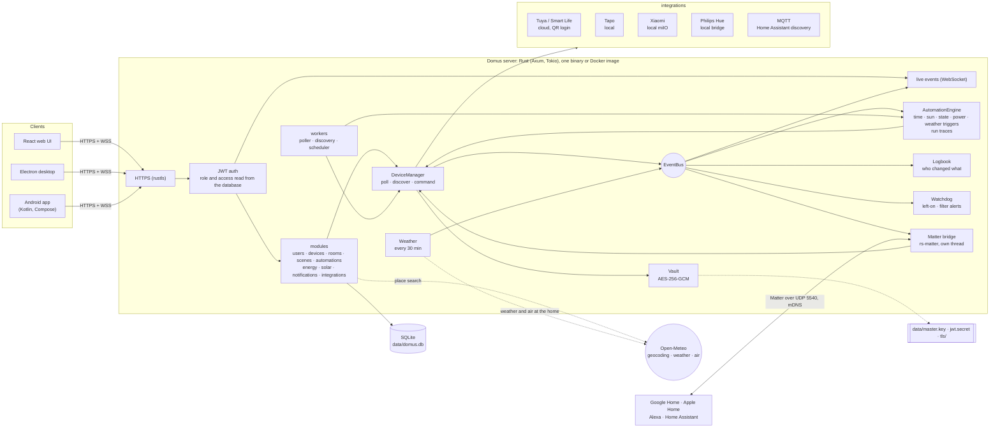
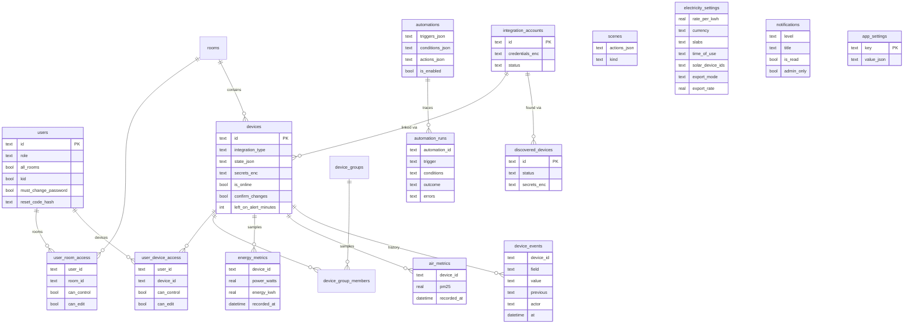

# Domus

<p align="center">
  <b>Translations</b><br>
  <a href="README.md">English</a> ·
  <a href="README.ar.md">العربية</a> ·
  <a href="README.bn.md">বাংলা</a> ·
  <a href="README.de.md">Deutsch</a> ·
  <a href="README.es.md">Español</a> ·
  <a href="README.fr.md">Français</a> ·
  <a href="README.gu.md">ગુજરાતી</a> ·
  <a href="README.hi.md">हिन्दी</a> ·
  <a href="README.id.md">Bahasa Indonesia</a> ·
  <a href="README.it.md">Italiano</a> ·
  <a href="README.ja.md">日本語</a> ·
  <a href="README.kn.md">ಕನ್ನಡ</a> ·
  <a href="README.ko.md">한국어</a> ·
  <a href="README.ml.md">മലയാളം</a> ·
  <a href="README.mr.md">मराठी</a> ·
  <a href="README.pa.md">ਪੰਜਾਬੀ</a> ·
  <a href="README.pl.md">Polski</a> ·
  <a href="README.pt-BR.md">Português (Brasil)</a> ·
  <a href="README.ru.md">Русский</a> ·
  <a href="README.ta.md">தமிழ்</a> ·
  <a href="README.te.md">తెలుగు</a> ·
  <a href="README.th.md">ไทย</a> ·
  <a href="README.tr.md">Türkçe</a> ·
  <a href="README.ur.md">اردو</a> ·
  <a href="README.vi.md">Tiếng Việt</a> ·
  <a href="README.zh-CN.md">简体中文</a> ·
  <a href="README.zh-TW.md">繁體中文</a>
</p>

[](https://github.com/aiyu-ayaan/Domus-Rust/actions/workflows/release.yml)
[](https://github.com/aiyu-ayaan/Domus-Rust/releases)
[](LICENSE)
[](https://github.com/aiyu-ayaan/Domus-Rust/commits/master)
[](https://hub.docker.com/r/aiyuayaan/domus)
[](https://hub.docker.com/r/aiyuayaan/domus)


[](https://ghloc.dev/aiyu-ayaan/Domus)


તમારા હોમ સર્વર માટે લોકલ-ફર્સ્ટ સ્માર્ટ-હોમ હબ. રસ્ટ (Rust) બેકએન્ડ, SQLite, React વેબ UI (Electron ડેસ્કટોપ શેલ સાથે), અને **Tuya / Smart Life** (QR-કોડ લોગિન, ડેવલપર એકાઉન્ટની જરૂર નથી), **TP-Link Tapo** (લોકલ), **Xiaomi Mi Home** (લોકલ, તમારા Mi એકાઉન્ટમાંથી ટોકન્સ), **Philips Hue** (લોકલ બ્રિજ) અને **MQTT** (Zigbee2MQTT, ESPHome અને Home Assistant ડિસ્કવરી સપોર્ટ કરતા તમામ ઉપકરણો) માટે પ્લગેબલ ઇન્ટિગ્રેશન્સ. ઇન-બિલ્ટ **Matter બ્રિજ** Google Home, Apple Home, Alexa અને Home Assistant ને તમારા પોતાના લોકલ નેટવર્ક પર આ ઉપકરણોને સ્વિચ, ડિમ અને રંગ બદલવાની મંજૂરી આપે છે.

- નવા ઉપકરણોની આપમેળે શોધ (Automatic discovery), ઇનબોક્સ અથવા ઓટો-એડ વિકલ્પ સાથે
- લાઈવ ડેશબોર્ડ: વીજ વપરાશ, અત્યાર સુધીનું બિલ અને અંદાજિત બિલ, હવાની ગુણવત્તા, મોશન / દરવાજો / લીક / બેટરી રીડિંગ્સ
- રૂમ, ઉપકરણ જૂથો (device groups), સીન્સ અને ઓટોમેશન; ચોક્કસ સમયે, **સૂર્યોદય કે સૂર્યાસ્ત** પર (ઓફસેટ સાથે), ઉપકરણની સ્થિતિ બદલાવા પર, પાવર સ્તર પર (દા.ત. *N મિનિટ માટે X થી વધુ*), ઓફલાઇન થવા પર અથવા **બહારના હવામાન** અનુસાર ટ્રિગર્સ
- **ઓટોમેશન રન ઇતિહાસ**: દરેક ઓટોમેશન તેના છેલ્લા 50 રનનો રેકોર્ડ રાખે છે, જેમાં તેને ટ્રિગર કરનાર પરિબળ અને રોકનારી શરત (condition) શામેલ હોય છે
- **ઉપકરણ ઇતિહાસ (Device history)**: ઉપકરણમાં થયેલો દરેક ફેરફાર અને તે કોણે કર્યો (કોઈ વ્યક્તિ અને તેમની એપ, ઓટોમેશન, Matter, અથવા ઉપકરણ પોતે)
- ઓટોમેશન લખ્યા વિના **ચેતવણીઓ (Alerts)**: કોઈ ઉપકરણ લાંબા સમય સુધી ચાલુ રહી જાય, અથવા એર પ્યુરિફાયરનું ફિલ્ટર ઓછું થઈ જાય
- **Matter બ્રિજ**: કોઈપણ ક્લાઉડ એકાઉન્ટ વિના સ્થાનિક રીતે Google Home, Apple Home, Alexa અથવા Home Assistant સાથે તમારી પસંદગીના ઉપકરણો શેર કરો
- ડેશબોર્ડ પર ઇનડોર રીડિંગ સાથે ઘરનું **બહારનું હવામાન અને હવા** (Open-Meteo, API કી વિના)
- **સ્વિચ કરતા પહેલા પૂછો (Ask before switching)**: મુખ્ય સ્વિચને ચિહ્નિત કરો અને દરેક એપ, જૂથ, સીન અને મેન્યુઅલ ઓટોમેશન રન તેને ચાલુ કે બંધ કરતા પહેલા પુષ્ટિ માંગશે
- કોઈપણ ચલણમાં ફ્લેટ, સ્લેબ અને **ટાઇમ-ઓફ-ડે (Time-of-Day)** ટેરિફ સાથે વીજળી બિલિંગ, ઉપકરણ દીઠ **સ્ટેન્ડબાય ખર્ચ**, અને **સોલર (Solar)**: ઉત્પાદન, નિકાસ અને નેટ મીટરિંગ અથવા ફીડ-ઇન દર
- એડમિન / સભ્ય / અતિથિ ભૂમિકાઓ (roles) સાથે બહુવિધ વપરાશકર્તાઓ, અને રૂમ દીઠ અથવા ઉપકરણ દીઠ ફક્ત જોવા (see-only), નિયંત્રણ (control) અથવા ફેરફાર (edit) કરવાની ઍક્સેસ
- વેબ, Electron ડેસ્કટોપ (Linux, Windows) અને મૂળ Android એપ, જે રીઅલ-ટાઇમમાં સિંક રહે છે
- વેબ, ડેસ્કટોપ અને Android એપ્લિકેશન્સમાં **27 ભાષાઓ**, જે સેટિંગ્સમાં પીકર સાથે તમારી સિસ્ટમની ભાષાને અનુસરે છે; અરબી અને ઉર્દૂ માટે જમણેથી-ડાબે (RTL) લેઆઉટ
- દરેક એપમાં રીલીઝ નોટ્સ (Markdown, કોષ્ટકો અને છબીઓ) સાથે અપડેટ્સ (Updates) પૃષ્ઠ
- ડિફૉલ્ટ રૂપે HTTPS; ક્રેડેન્શિયલ્સ અને ડિવાઇસ કી સુરક્ષિત રીતે એન્ક્રિપ્ટેડ; સિંગલ-ફાઇલ બેકઅપ અને રિસ્ટોર

આર્કિટેક્ચર અને આકૃતિઓ: [`development/docs/ARCHITECTURE.md`](development/docs/ARCHITECTURE.md), સારાંશ [નીચે જુઓ](#તે-બધું-સાથે-કેવી-રીતે-કામ-કરે-છે).
UI ડિઝાઇન પ્રોફાઇલ: [`design-system/domus/MASTER.md`](design-system/domus/MASTER.md).
પ્રગતિ: [`development/TODO.md`](development/TODO.md).

## તે બધું સાથે કેવી રીતે કામ કરે છે



ક્લાયન્ટ્સ ફક્ત સર્વર સાથે વાતચીત કરે છે; સર્વર તમારા ઉપકરણો સાથે સીધી વાત કરે છે (જ્યાં વિક્રેતા પરવાનગી આપે ત્યાં સ્થાનિક રીતે) અને બધું એક જ SQLite ફાઇલમાં રાખે છે. ક્લાઉડનો ઉપયોગ ફક્ત ત્યાં જ થાય છે જ્યાં વિક્રેતા કોઈ સ્થાનિક નિયંત્રણ આપતો નથી (Tuya) અથવા ઉપકરણ ટોકન મેળવવા માટે (Xiaomi), ઉપરાંત કેટલાક વૈકલ્પિક સંશોધનો માટે: સ્થળ શોધ, ઘરના સ્થાનનું હવામાન અને બહારની હવા (Open-Meteo, સ્થાન સેટ કર્યા પછી જ) અને અપડેટ્સ તપાસવા માટે GitHub. Matter બ્રિજ ફક્ત સ્થાનિક નેટવર્ક પર જ કાર્ય કરે છે.

### ડેટા મોડેલ



ક્રેડેન્શિયલ્સ અને ડિવાઇસ કી `data/master.key` હેઠળ સીલ (`*_enc`) કરીને સંગ્રહિત કરવામાં આવે છે, જે ડેટાબેઝમાં હોતી નથી. દરેક સુવિધા માટે વિગતવાર આકૃતિઓનો સંપૂર્ણ સેટ [`development/docs`](development/docs) માં ઉપલબ્ધ છે.

## સ્ક્રીનશોટ્સ

<p align="center"></p>

**ડેસ્કટોપ** (Electron અને વેબ)

<p>
  
  
  
  
  
  
</p>

**Android**

<p>
  
  
  
  
  
</p>

**Android ટેબ્લેટ** (840dp થી બે કૉલમ, સેટિંગ્સ સૂચિ અને વિગત તરીકે)

<p>
  
  
  
  
  
</p>

**મોબાઇલ વેબ**

<p>
  
  
  
  
  
</p>

તમામ સ્ક્રીનશૉટ્સ [`res/screenshots`](res/screenshots) માં છે; પૂર્ણ-ગુણવત્તાવાળો વિડિઓ વૉકથ્રુ [`res/domus.mp4`](res/domus.mp4) પર ઉપલબ્ધ છે.

## ડાઉનલોડ

| | |
|---|---|
| સર્વર (Docker) | Docker Hub પર `aiyuayaan/domus`, amd64 અને arm64 |
| Android | [નવીનતમ રીલીઝ](https://github.com/aiyu-ayaan/Domus-Rust/releases) માંથી `Domus-<version>.apk` |
| Linux ડેસ્કટોપ | નીચે આપેલ વન-લાઇન ઇન્સ્ટોલર, અથવા રીલીઝમાંથી `.deb` / `.AppImage` |
| Windows ડેસ્કટોપ | રીલીઝમાંથી `Domus-<version>-Setup.exe` |

### સર્વર

હોસ્ટ માટે માત્ર એક ફાઇલ જરૂરી છે:

```bash
mkdir domus && cd domus
wget https://raw.githubusercontent.com/aiyu-ayaan/Domus-Rust/master/docker-compose.yml
docker compose up -d
```

`https://<server-ip>:8443` ખોલો અને એડમિનિસ્ટ્રેટર એકાઉન્ટ બનાવો. `docker compose logs domus` સર્ટિફિકેટ ફિંગરપ્રિન્ટ બતાવે છે જે એપ્સ તમને કન્ફર્મ કરવા માટે કહે છે.

```bash
docker compose pull && docker compose up -d      # અપડેટ કરો
DOMUS_VERSION=beta docker compose up -d          # ચેનલ પસંદ કરો: latest (ડિફૉલ્ટ), beta, alpha, અથવા 0.0.1
TZ=Asia/Kolkata DOMUS_PORT=9443 docker compose up -d
docker compose --profile mqtt up -d              # વૈકલ્પિક Mosquitto બ્રોકર પણ શરૂ કરો
```

આ કન્ફિગરેશન સાચવવા માટે compose ફાઇલની બાજુમાં એક `.env` ફાઇલમાં `DOMUS_VERSION`, `TZ` અને `DOMUS_PORT` મૂકો.

### Linux ડેસ્કટોપ એપ

વર્તમાન વપરાશકર્તા માટે નવીનતમ રીલીઝ ઇન્સ્ટોલ કરે છે (x86_64, root વિના): AppImage, Domus આઇકન સાથે મેનૂ એન્ટ્રી અને `domus` આદેશ. ત્યારબાદ એપ પોતાની જાતે અપડેટ રહે છે.

```bash
curl -fsSL https://raw.githubusercontent.com/aiyu-ayaan/Domus-Rust/master/scripts/install-linux.sh | sh
# ... | sh -s -- --channel beta     બીટા બિલ્ડ્સ માટે પણ (અથવા આલ્ફા)
# ... | sh -s -- --uninstall        દૂર કરવા માટે; સેટિંગ્સ સચવાયેલી રહે છે
```

### Android

રીલીઝ પૃષ્ઠ પરથી APK ડાઉનલોડ કરો અને તેને ખોલો. પછીના અપડેટ્સ જ્યારે એપ ખોલવામાં આવે ત્યારે અને સેટિંગ્સ → અપડેટ્સ (Settings → Updates) માં Stable, Beta અથવા Alpha ચેનલ પર ઓફર કરવામાં આવે છે, અને ત્યાંથી ઇન્સ્ટોલ કરી શકાય છે; Android એકવાર Domus ને તે ઇન્સ્ટોલ કરવાની મંજૂરી આપવા માટે પૂછે છે.

**અપડેટ્સ** પૃષ્ઠ (Android પર સેટિંગ્સ → અપડેટ્સ, વેબ અને ડેસ્કટોપ પર સેટિંગ્સ → પરિચય → અપડેટ્સ) બતાવે છે કે તમે કયું વર્ઝન ચલાવી રહ્યા છો, તમારી ચેનલ પર નવીનતમ રીલીઝ અને તેની રીલીઝ નોટ્સ, જે Markdown માં લખાયેલી છે.

રીલીઝ, વર્ઝન નંબરો અને અપડેટ ચેનલો: [development/docs/RELEASE.md](development/docs/RELEASE.md).

## આવશ્યકતાઓ

- Rust 1.80+ (`cargo`)
- Node.js 18+ અને `pnpm`

## ડેવલપમેન્ટમાં ચલાવો

```bash
pnpm install
npm run dev            # બેકએન્ડ (https://127.0.0.1:8443) + વેબ (http://localhost:3000)

npm run dev:backend    # માત્ર બેકએન્ડ
npm run dev:web        # માત્ર વેબ (બેકએન્ડ માટે /api પ્રોક્સી કરે છે)
npm run dev:desktop    # Electron; તેના કનેક્ટ પૃષ્ઠ પર સર્વર પસંદ કરો
```

http://localhost:3000 ખોલો. પ્રથમ મુલાકાતમાં તે તમને એડમિનિસ્ટ્રેટર એકાઉન્ટ બનાવવા માટે કહેશે.

## હોમ સર્વર પર ચલાવો

```bash
pnpm build:web                     # apps/web/dist બનાવે છે, જે બેકએન્ડ દ્વારા સર્વ કરવામાં આવે છે
APP_ENV=production cargo run --release --manifest-path backend/Cargo.toml
```

પછી `https://<server-ip>:8443` ખોલો. Matter બ્રિજ, જ્યારે ચાલુ હોય, ત્યારે LAN પર UDP 5540 (`[matter] port`) અને mDNS નો ઉપયોગ કરે છે.

અથવા આ ચેકઆઉટમાંથી Docker ઇમેજ બનાવો (હોસ્ટ નેટવર્કિંગ, ડેટા `domus_data` વોલ્યુમમાં):

```bash
docker compose -f docker-compose.local.yml up -d --build
```

Cloudflare ટનલ દ્વારા રીમોટ એક્સેસ, હોમ/રીમોટ એડ્રેસ કે જેની વચ્ચે એપ્સ સ્વિચ કરે છે, અને ડેસ્કટોપ પેકેજીસ (`pnpm build:desktop`) [development/docs/DEPLOYMENT.md](development/docs/DEPLOYMENT.md) માં વર્ણવેલ છે.

પ્રથમ શરૂઆત પર Domus `data/` ફોલ્ડર બનાવે છે જેમાં શામેલ છે:

| ફાઇલ | હેતુ |
|---|---|
| `domus.db` | SQLite ડેટાબેઝ |
| `master.key` | ઇન્ટિગ્રેશન ક્રેડેન્શિયલ્સ અને ડિવાઇસ કી એન્ક્રિપ્ટ કરે છે — **આનો બેકઅપ રાખો** |
| `jwt.secret` | સત્રો સાઇન કરે છે |
| `tls/` | સેલ્ફ-સાઇન્ડ સર્ટિફિકેટ (`tls.cert_path` / `tls.key_path` દ્વારા બદલી શકાય છે) |

સેટિંગ્સ `config/default.toml` માં રહે છે; કોઈપણ કીને `DOMUS__SECTION__KEY` એન્વાયર્નમેન્ટ વેરિયેબલ્સ સાથે ઓવરરાઇડ કરી શકાય છે (`.env.example` જુઓ).

## બેકઅપ અને રિસ્ટોર

બધું `data/` માં રહે છે. આખા ફોલ્ડરનો બેકઅપ લો, અથવા સિંગલ-ફાઇલ બેકઅપ લો:

**બેકઅપ લો.** એડમિનિસ્ટ્રેટર તરીકે સાઇન ઇન કરો → સેટિંગ્સ → **બેકઅપ** → *બેકઅપ ડાઉનલોડ કરો*. આ ફાઇલ માસ્ટર કી સાથે ડેટાબેઝની એક નકલ છે, જેથી રિસ્ટોર કર્યા પછી પણ તેમાં રહેલા લિંક કરેલા એકાઉન્ટ્સ ખોલી શકાય. સર્વર ચાલુ હોય ત્યારે આ બનાવવામાં આવે છે. તેને સુરક્ષિત રાખો: જેની પાસે આ ફાઇલ હશે તે આ એકાઉન્ટ્સ ખોલી શકે છે. JWT સિક્રેટ અને TLS સર્ટિફિકેટ તેમાં શામેલ નથી.

**રિસ્ટોર કરો.** સર્વર બંધ કરો, પછી:

```bash
# Docker
docker compose cp domus-backup-2026-10-11.db domus:/app/data/restore.db
docker compose stop domus
docker compose run --rm domus domus-backend restore data/restore.db
docker compose start domus

# Docker વિના, રેપો રૂટ પરથી (./data વાપરે છે)
domus-backend restore ~/Downloads/domus-backup-2026-10-11.db
```

ત્યાં પહેલેથી જે હતું તે `*.before-restore` તરીકે બાજુમાં સાચવવામાં આવે છે. નવા મશીન પર રિસ્ટોર કર્યા પછી વપરાશકર્તાઓએ ફરીથી સાઇન ઇન કરવું પડશે અને એપ્સ નવા સર્ટિફિકેટ પર વિશ્વાસ કરવા માટે પૂછશે. જો તમે `DOMUS_MASTER_KEY` સાથે કી સેટ કરી હોય, તો બેકઅપમાં કોઈ કી હોતી નથી અને રિસ્ટોર કરેલા સર્વરને તે જ વેરિયેબલની જરૂર પડે છે. વધુ વિગતો [development/docs/DEPLOYMENT.md](development/docs/DEPLOYMENT.md#backup-and-restore) માં.

## એડમિનિસ્ટ્રેટર પાસવર્ડ ભૂલી ગયા

Domus માં કોઈ મેઇલ સર્વર નથી, તેથી ઇમેઇલ દ્વારા કંઈપણ મોકલવામાં આવતું નથી. સરળતાના ક્રમમાં:

૧. **બીજા એડમિનિસ્ટ્રેટર** સેટિંગ્સ → લોકો (Settings → People) ખોલે છે, તમારા માટે *રીસેટ કોડ* ચાલુ કરે છે અને તમને 8-અંકનો કોડ જણાવે છે (30 મિનિટ અને 5 ખોટા પ્રયાસો માટે માન્ય). સાઇન-ઇન સ્ક્રીન પર *પાસવર્ડ ભૂલી ગયા છો?* પસંદ કરો, તમારું વપરાશકર્તાનામ અને પછી કોડ દાખલ કરો.
૨. **સર્વર પરથી**, જે Domus ચાલુ હોય કે બંધ હોય ત્યારે કામ કરે છે અને કોઈ સાઇન-ઇનની જરૂર પડતી નથી:

   ```bash
   docker compose exec domus domus-backend reset-password <username>              # નવો રેન્ડમ પાસવર્ડ દર્શાવે છે
   docker compose exec domus domus-backend reset-password <username> 'new-pass'   # અથવા પોતાની પસંદગીનો પસંદ કરો (8+ અક્ષરો)
   domus-backend reset-password <username>                                        # Docker વિના, રેપો રૂટ પરથી
   ```

   તેનાથી સાઇન ઇન કરો અને સેટિંગ્સ → પાસવર્ડ માં જઈને તેને બદલો.

પ્રોડક્શનમાં કોઈ વપરાશકર્તાનામ માટે પાંચ ખોટા પાસવર્ડ દાખલ કરવાથી તે નામ 15 મિનિટ માટે લૉક થઈ જાય છે (સર્વર પુનઃપ્રારંભ કરવાથી આ લૉક હટી જાય છે, અને ડેવલપમેન્ટમાં આ બંધ રહે છે). વિગતો અને જનરેટ કરેલા પાસવર્ડ્સ તથા બાળકોના એકાઉન્ટ્સ માટેના નિયમો: [development/docs/ACCOUNTS.md](development/docs/ACCOUNTS.md).

## ભાષાઓ

અંગ્રેજી, હિન્દી, સ્પેનિશ, પોર્ટુગીઝ (બ્રાઝિલ), ઇન્ડોનેશિયન, અરબી, ફ્રેન્ચ, રશિયન, જર્મન, તુર્કી, જાપાનીઝ, કોરિયન, ઇટાલિયન, વિયેતનામીસ, થાઈ, ચાઇનીઝ (સરળીકૃત અને પરંપરાગત), પોલિશ, બંગાળી, તમિલ, તેલુગુ, મરાઠી, ગુજરાતી, કન્નડ, મલયાલમ, પંજાબી અને ઉર્દૂ. અરબી અને ઉર્દૂ જમણેથી-ડાબે (RTL) પદ્ધતિમાં છે.

દરેક એપ તમારા બ્રાઉઝર અથવા સિસ્ટમની ભાષાને અનુસરે છે, અને અનુવાદ ઉપલબ્ધ ન હોય ત્યારે અંગ્રેજી બતાવે છે. બીજી ભાષા પસંદ કરવા માટે સેટિંગ્સ > ભાષા (વેબ અને ડેસ્કટોપ પર Appearance) ખોલો; *સિસ્ટમ ડિફૉલ્ટ* ફરીથી સિસ્ટમને અનુસરવા લાગે છે. Android 13 અને તે પછીના વર્ઝન પર તે ફોનના સેટિંગ્સ > એપ્સ > Domus > ભાષા હેઠળ પણ દેખાય છે.

અનુવાદો મશીન દ્વારા તૈયાર કરવામાં આવ્યા છે અને સ્થાનિક વક્તાઓ દ્વારા સમીક્ષા કરવામાં આવી નથી, તેથી શબ્દરચનામાં ભૂલ હોઈ શકે છે. ભાષાના કેટલોગમાં એક લીટીના ફેરફાર દ્વારા તેને સુધારી શકાય છે. ભાષાઓ કેવી રીતે કાર્ય કરે છે, નવી ભાષા કેવી રીતે ઉમેરવી અને નવા ટેક્સ્ટ માટેના નિયમો: [development/docs/LOCALIZATION.md](development/docs/LOCALIZATION.md).

## ઉપકરણો કનેક્ટ કરવા

| બ્રાન્ડ | પદ્ધતિ |
|---|---|
| Tuya / Smart Life | ઇન્ટિગ્રેશન્સ → *QR કોડ સાથે લિંક કરો*. Smart Life માંથી **વપરાશકર્તા કોડ (User Code)** દાખલ કરો (હું → સેટિંગ્સ → એકાઉન્ટ અને સુરક્ષા → વપરાશકર્તા કોડ), પછી એપમાં QR સ્કેન કરો. |
| Tapo | તમારા TP-Link ID સાથે ઇન્ટિગ્રેશન્સ → *એકાઉન્ટ લિંક કરો*. LAN પરના ઉપકરણો આપમેળે શોધાય છે અને સ્થાનિક રીતે નિયંત્રિત થાય છે. H100 હબ તેના સેન્સર્સ, સ્વિચ અને થર્મોસ્ટેટ્સ સાથે લાવે છે. કેમેરા સૂચિબદ્ધ છે પરંતુ હજી સુધી સપોર્ટેડ નથી. |
| Xiaomi | તમારા Mi એકાઉન્ટ અને સર્વર પ્રદેશ સાથે ઇન્ટિગ્રેશન્સ → *એકાઉન્ટ લિંક કરો*. જો Xiaomi ટુ-સ્ટેપ વેરિફિકેશન માંગે છે, તો તે ઇમેઇલ અથવા એસએમએસ કરેલ કોડ તે જ પેનલમાં દાખલ કરો. એકાઉન્ટ ઇમેઇલ, દેશના કોડ સાથેનો ફોન નંબર (`+91…`) અથવા Xiaomi ID હોઈ શકે છે. ટોકન્સ એકવાર મેળવવામાં આવે છે; નિયંત્રણ સ્થાનિક છે. ટોકન વડે પણ ઉપકરણો ઉમેરી શકાય છે. |
| Philips Hue | બ્રિજ પરનું ગોળ બટન દબાવો, પછી 30 સેકન્ડની અંદર ઇન્ટિગ્રેશન્સ → Philips Hue → *લિંક કરો* પર ક્લિક કરો. બ્રિજને આપમેળે શોધવા માટે સરનામું ખાલી રાખો. લાઇટ્સ અને Hue સ્માર્ટ પ્લગ સ્થાનિક રીતે નિયંત્રિત થાય છે. |
| MQTT | તમારા બ્રોકરના સરનામા, પોર્ટ અને લૉગિન સાથે ઇન્ટિગ્રેશન્સ → MQTT → *લિંક કરો*. Home Assistant MQTT ડિસ્કવરી (Zigbee2MQTT, ESPHome, …) દ્વારા જોડાયેલા ઉપકરણો શોધાયેલ (Discovered) હેઠળ દેખાય છે: લાઇટ્સ, સ્વિચ, પ્લગ, પંખા અને સેન્સર્સ. બંડલ કરેલા બ્રોકર સાથે (`--profile mqtt`) સરનામું `mqtt`, પોર્ટ `1883` હોય છે. |

દરેક ઇન્ટિગ્રેશન શું આવરી લે છે તે જોવા માટે `development/docs/INTEGRATIONS.md` જુઓ.

## વીજળી બિલિંગ

ઊર્જા (Energy) → *વીજળી પ્લાન*: કોઈપણ ચલણ પસંદ કરો, અને પ્રતિ kWh ફ્લેટ કિંમત અથવા યુનિટ-આધારિત ટેરિફ માટે **સ્લેબ (slabs)** પસંદ કરો (દા.ત. પુણે/MSEDCL: 0–100 યુનિટ એક દરે, 101–300 પછીના દરે, વગેરે). બિલની ગણતરી બિલિંગ ચક્ર દીઠ કરવામાં આવે છે, સાથે નિશ્ચિત માસિક ચાર્જ ઉમેરવામાં આવે છે.

ટેરિફમાં **ટાઇમ-ઓફ-ડે (time-of-day)** વિન્ડો પણ હોઈ શકે છે: એવા કલાકો (ઘરની ઘડિયાળ મુજબ, મધ્યરાત્રિ પછી પણ માન્ય) કે જેના યુનિટ દર ફ્લેટ અથવા સ્લેબ કિંમત કરતાં ચોક્કસ રકમ વધારે કે ઓછા હોય છે, ઉદાહરણ તરીકે નાઇટ રિબેટ અથવા પીક સરચાર્જ.

નવા ઉપકરણો **ઉપકરણો → શોધાયેલ (Devices → Discovered)** હેઠળ દેખાય છે. ઇનબોક્સ છોડવા માટે ત્યાં *આપમેળે નવા ઉપકરણો ઉમેરો* ચાલુ કરો.

## સૂર્યોદય અને સૂર્યાસ્ત

ઘર ક્યાં છે તે સેટિંગ્સ → **ઘરનું સ્થાન (Home location)** માં સેટ કરો: આ ફોન અથવા બ્રાઉઝરના સ્થાનનો ઉપયોગ કરો, શહેર શોધો (સર્વર મફત Open-Meteo જીઓકોડરને વિનંતી મોકલે છે; ફક્ત તમે ટાઇપ કરેલું નામ ઘરની બહાર જાય છે), અથવા અક્ષાંશ અને રેખાંશ ટાઇપ કરો. કોઓર્ડિનેટ્સ લગભગ એક કિલોમીટર સુધી રાઉન્ડ કરવામાં આવે છે અને તમારા સર્વર પર જ રહે છે. ત્યારબાદ ઓટોમેશન સૂર્યોદય કે સૂર્યાસ્ત સમયે, તેની થોડી મિનિટો પહેલાં કે પછી ચાલી શકે છે. સ્થાન વિના, સૂર્ય આધારિત ટ્રિગર ક્યારેય સક્રિય થતું નથી.

## સ્વિચ કરતા પહેલા પૂછો

મુખ્ય સ્વિચ કે જે તેની સાથે જોડાયેલા તમામ ઉપકરણોનો પાવર કાપી નાખે છે, તે ભૂલથી બંધ થઈ શકે છે. ઉપકરણ ખોલો અને **સ્વિચ કરતા પહેલા પૂછો (Ask before switching)** ચાલુ કરો: દરેક એપ પછી તેને ચાલુ અથવા બંધ કરતા પહેલા પુષ્ટિ માંગશે, અને રૂમનું *બધા ચાલુ / બધા બંધ*, ઉપકરણ જૂથો, સીન્સ (સીન્સની અંદર સીન્સ સહિત) અને ઓટોમેશનનું મેન્યુઅલ *રન* પણ પુષ્ટિ માંગશે. આ સેટિંગ સર્વર પર સચવાય છે, તેથી તે વેબ, ડેસ્કટોપ અને Android પર સમાન રહે છે. પોતાની જાતે ચાલતા ઓટોમેશન્સ પૂછી શકતા નથી અને લખેલા નિયમો મુજબ ચાલે છે, અને Domus બહારની કોઈપણ વસ્તુ (વિક્રેતા એપ, દિવાલ સ્વિચ) આમાં આવરી લેવામાં આવતી નથી.

## Matter (Google Home, Apple Home, Alexa)

સેટિંગ્સ → **Matter** (એડમિનિસ્ટ્રેટર): આને ચાલુ કરો, શેર કરવા માટેના ઉપકરણોને ટિક કરો, પછી Google Home, Apple Home, Alexa અથવા Home Assistant માં QR સ્કેન કરો અથવા પેરિંગ કોડ ટાઇપ કરો. લાઇટ્સ રંગીન અથવા ડિમ કરી શકાય તેવી લાઇટ્સ તરીકે આવે છે, ચાલુ/બંધ સ્વિચવાળી બાકીની બધી વસ્તુઓ પ્લગ તરીકે આવે છે; સ્વિચિંગ, ડિમિંગ અને રંગ બદલવાનું કામ કરે છે અને Domus માં થયેલા ફેરફારો (ચાલુ/બંધ, બ્રાઇટનેસ) કંટ્રોલરમાં દેખાય છે. "15 મિનિટ માટે પેરિંગની મંજૂરી આપો" બીજી ઇકોસિસ્ટમ ઉમેરે છે; "બધા પેરિંગ્સ ભૂલી જાઓ" નવા કોડ સાથે ફરી શરૂ કરે છે.

આ બ્રિજ પ્રમાણિત નથી (તે Matter ટેસ્ટ એટેસ્ટેશનનો ઉપયોગ કરે છે), તેથી એપ્સ તમને તેને ઉમેરવાની પુષ્ટિ કરવા માટે કહે છે, અને Google Home ડેવલપર કન્સોલમાં બ્રિજને ટેસ્ટ ડિવાઇસ તરીકે ઉમેર્યા પછી જ Google Home તેને સ્વીકારે છે. વિગતો: [`development/docs/MATTER.md`](development/docs/MATTER.md).

## ઇતિહાસ, ઓટોમેશન રન અને ચેતવણીઓ

- દરેક ડિવાઇસ શીટમાં **ઇતિહાસ**: શું બદલાયું, ક્યારે બદલાયું અને કોણે કર્યું (*અયાન દ્વારા · Android*, *ઓટોમેશન "નાઇટ મોડ"*, *Matter*, *ઉપકરણ પર*). એનર્જી ઇતિહાસ જેટલો જ સંગ્રહિત રહે છે.
- દરેક ઓટોમેશનના **રન**: *ચલાવ્યું (Ran)*, ભૂલ સાથે *નિષ્ફળ (Failed)*, અથવા રોકનારી શરત સાથે *છોડી દીધું (Skipped)*, જેથી "આ શા માટે ન ચાલ્યું?" તેનો જવાબ મળી શકે.
- ડિવાઇસ શીટમાં **ચાલુ રહી જાય ત્યારે ચેતવણી** (30 મિનિટથી 12 કલાક): એડમિનિસ્ટ્રેટર્સને સૂચના મળે છે. 10 W થી વધુ વપરાશ ધરાવતું મીટર્ડ ઉપકરણ ચાલુ ગણાય છે, તેથી સ્ટેન્ડબાય પર રહેલું ટીવી બંધ માનવામાં આવે છે.
- **ફિલ્ટર ઓછું થવાની ચેતવણી**: જ્યારે એર પ્યુરિફાયરનું ફિલ્ટર 10% સુધી ઘટી જાય ત્યારે સૂચના આપવામાં આવે છે.

## હવામાન, સ્ટેન્ડબાય અને સોલર

- ઘરનું સ્થાન સેટ હોવા પર, ડેશબોર્ડ ઇનડોર રીડિંગની બાજુમાં **હવામાન અને બહારનું PM2.5** બતાવે છે, અને ઓટોમેશન તેનો ઉપયોગ કરી શકે છે (*જ્યારે બહારનું PM2.5 35 થી ઉપર જાય*, *માત્ર જો બહારનું તાપમાન 20 થી ઓછું હોય*).
- ઊર્જા → **સ્ટેન્ડબાય** કોઈ તેનો ઉપયોગ ન કરતું હોય ત્યારે દરેક ઉપકરણ કેટલો પાવર વાપરે છે (આ અઠવાડિયાનો સૌથી ઓછો કલાક) અને દર મહિને તેનો કેટલો ખર્ચ થાય છે તેની યાદી આપે છે.
- ઊર્જા → *વીજળી પ્લાન* → **સોલર (Solar)**: સોલર ઉત્પાદન માપતા પ્લગને ટિક કરો, પછી નેટ મીટરિંગ અથવા ફીડ-ઇન દર પસંદ કરો. ત્યારપછી બિલમાં ફક્ત તમે ગ્રીડમાંથી ખરીદો છો તેની જ ગણતરી થાય છે, અને સોલર કાર્ડ ઉત્પાદિત, ઘરમાં વપરાયેલ, નિકાસ કરેલ અને કમાયેલ રકમ દર્શાવે છે. મીટરવાળા ઉપકરણો પરથી દર 15 મિનિટે ગ્રીડ પ્રવાહની ગણતરી કરવામાં આવે છે, તેથી મીટર વિનાના ઉપકરણો નિકાસની ગણતરી વધારે બતાવી શકે છે.

યોજના અને આકૃતિઓ: [`development/docs/ROADMAP.md`](development/docs/ROADMAP.md).

## લાઇસન્સ

Domus [MIT લાઇસન્સ](LICENSE) હેઠળ બહાર પાડવામાં આવ્યું છે. થર્ડ-પાર્ટી લાઇબ્રેરીઓ તેમના પોતાના લાઇસન્સ જાળવી રાખે છે; તેઓ દરેક એપમાં પરિચય → આભારવિધિ (About → Acknowledgements) હેઠળ સૂચિબદ્ધ છે.

## પરીક્ષણો

```bash
cargo test --workspace
pnpm --filter @domus/web exec tsc -b
```

`cargo test --workspace` માં `backend/tests/matter_bridge.rs` શામેલ છે, જે UDP પર Matter કંટ્રોલરને બ્રિજ સાથે જોડે છે અને તેના ઉપકરણોને સ્વિચ, ડિમ અને રંગીન કરે છે (તેના માટે IPv4 સાથેનું નેટવર્ક ઇન્ટરફેસ જરૂરી છે).
