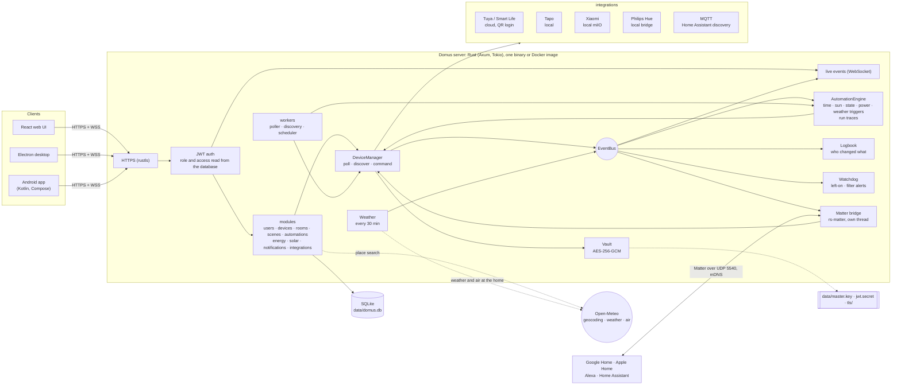
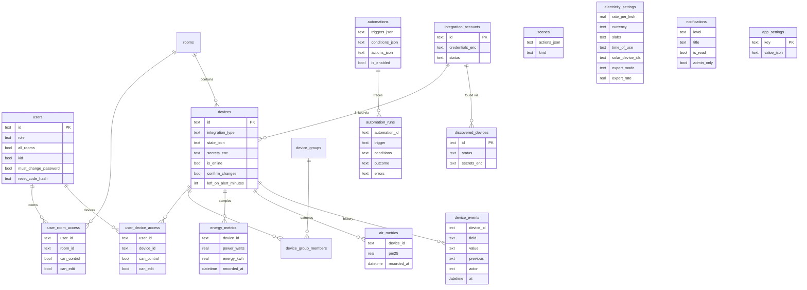

# Domus

<p align="center">
  <b>Translations</b><br>
  <a href="README.md">English</a> ·
  <a href="README.ar.md">العربية</a> ·
  <a href="README.bn.md">বাংলা</a> ·
  <a href="README.de.md">Deutsch</a> ·
  <a href="README.es.md">Español</a> ·
  <a href="README.fr.md">Français</a> ·
  <a href="README.gu.md">ગુજરાતી</a> ·
  <a href="README.hi.md">हिन्दी</a> ·
  <a href="README.id.md">Bahasa Indonesia</a> ·
  <a href="README.it.md">Italiano</a> ·
  <a href="README.ja.md">日本語</a> ·
  <a href="README.kn.md">ಕನ್ನಡ</a> ·
  <a href="README.ko.md">한국어</a> ·
  <a href="README.ml.md">മലയാളം</a> ·
  <a href="README.mr.md">मराठी</a> ·
  <a href="README.pa.md">ਪੰਜਾਬੀ</a> ·
  <a href="README.pl.md">Polski</a> ·
  <a href="README.pt-BR.md">Português (Brasil)</a> ·
  <a href="README.ru.md">Русский</a> ·
  <a href="README.ta.md">தமிழ்</a> ·
  <a href="README.te.md">తెలుగు</a> ·
  <a href="README.th.md">ไทย</a> ·
  <a href="README.tr.md">Türkçe</a> ·
  <a href="README.ur.md">اردو</a> ·
  <a href="README.vi.md">Tiếng Việt</a> ·
  <a href="README.zh-CN.md">简体中文</a> ·
  <a href="README.zh-TW.md">繁體中文</a>
</p>

[](https://github.com/aiyu-ayaan/Domus-Rust/actions/workflows/release.yml)
[](https://github.com/aiyu-ayaan/Domus-Rust/releases)
[](LICENSE)
[](https://github.com/aiyu-ayaan/Domus-Rust/commits/master)
[](https://hub.docker.com/r/aiyuayaan/domus)
[](https://hub.docker.com/r/aiyuayaan/domus)


आपके होम सर्वर के लिए एक लोकल-फर्स्ट स्मार्ट-होम हब। रस्ट (Rust) बैकएंड, SQLite, React वेब UI (Electron डेस्कटॉप शेल के साथ), और **Tuya / Smart Life** (QR-कोड लॉगिन, बिना डेवलपर अकाउंट के), **TP-Link Tapo** (लोकल), **Xiaomi Mi Home** (लोकल, आपके Mi अकाउंट से टोकन), **Philips Hue** (लोकल ब्रिज) और **MQTT** (Zigbee2MQTT, ESPHome और Home Assistant डिस्कवरी सपोर्ट करने वाले अन्य डिवाइस) के लिए प्लगेबल इंटीग्रेशन। एक इन-बिल्ट **Matter ब्रिज** की मदद से Google Home, Apple Home, Alexa और Home Assistant आपके अपने लोकल नेटवर्क पर इन उपकरणों को स्विच, डिम और उनका रंग बदल सकते हैं।

- नए उपकरणों की स्वचालित खोज (Automatic discovery), इनबॉक्स या ऑटो-ऐड के विकल्प के साथ
- लाइव डैशबोर्ड: बिजली की खपत, अब तक का बिल और अनुमानित बिल, वायु गुणवत्ता, मोशन / दरवाज़ा / लीकेज / बैटरी की रीडिंग
- कमरे, उपकरण समूह (device groups), सीन्स और ऑटोमेशन; किसी निश्चित समय पर, **सूर्योदय या सूर्यास्त** (ऑफसेट के साथ), उपकरण की स्थिति बदलने पर, बिजली की खपत पर (जैसे *N मिनट तक X से अधिक होने पर*), ऑफ़लाइन होने पर या **बाहरी मौसम** के आधार पर ट्रिगर
- **ऑटोमेशन रन इतिहास**: प्रत्येक ऑटोमेशन अपने पिछले 50 रन का रिकॉर्ड रखता है, जिसमें ट्रिगर और रोकने वाली शर्त (condition) का पूरा ब्योरा होता है
- **उपकरण इतिहास (Device history)**: उपकरण में हुआ प्रत्येक बदलाव और वह किसने किया (कोई व्यक्ति और उसका ऐप, ऑटोमेशन, Matter, या स्वयं उपकरण)
- बिना ऑटोमेशन लिखे **अलर्ट**: उपकरण बहुत देर तक चालू छूट जाने पर, या एयर प्यूरीफायर का फ़िल्टर कम होने पर
- **Matter ब्रिज**: अपनी पसंद के उपकरणों को बिना किसी क्लाउड खाते के, स्थानीय रूप से Google Home, Apple Home, Alexa या Home Assistant के साथ साझा करें
- घर का **बाहरी मौसम और वायु गुणवत्ता** (Open-Meteo, बिना API की के) डैशबोर्ड पर इनडोर रीडिंग के साथ
- **स्विच करने से पहले पूछें (Ask before switching)**: मुख्य स्विच को चिह्नित करें और हर ऐप, समूह, सीन या मैन्युअल ऑटोमेशन रन उसे चालू या बंद करने से पहले पुष्टि माँगेगा
- किसी भी मुद्रा में फ़्लैट, स्लैब और **टाइम-ऑफ़-डे (Time-of-Day)** टैरिफ के साथ बिजली बिलिंग, प्रति उपकरण **स्टैंडबाय लागत**, और **सोलर**: उत्पादन, निर्यात और नेट मीटरिंग या फ़ीड-इन दर
- एडमिन / सदस्य / अतिथि भूमिकाओं (roles) के साथ मल्टीपल यूज़र्स, और प्रति कमरा या प्रति उपकरण केवल देखने (see-only), नियंत्रण (control) या संपादन (edit) का एक्सेस
- वेब, Electron डेस्कटॉप (Linux, Windows) और नेटिव Android ऐप, जो लाइव सिंक रहते हैं
- वेब, डेस्कटॉप और Android ऐप्स में **27 भाषाएँ**, जो सेटिंग्स में पिकर के साथ आपके सिस्टम की भाषा का अनुसरण करती हैं; अरबी और उर्दू के लिए दाएँ से बाएँ (RTL) लेआउट
- हर ऐप में रिलीज़ नोट्स (Markdown, टेबल और इमेज) के साथ अपडेट्स (Updates) पेज
- डिफ़ॉल्ट रूप से HTTPS; क्रेडेंशियल्स और डिवाइस कीज़ सुरक्षित रूप से एन्क्रिप्टेड; सिंगल-फ़ाइल बैकअप और रीस्टोर

आर्किटेक्चर और आरेख: [`development/docs/ARCHITECTURE.md`](development/docs/ARCHITECTURE.md), संक्षिप्त विवरण [नीचे देखें](#यह-सब-एक-साथ-कैसे-काम-करता-है)।
UI डिज़ाइन प्रोफ़ाइल: [`design-system/domus/MASTER.md`](design-system/domus/MASTER.md)।
प्रगति: [`development/TODO.md`](development/TODO.md)।

## यह सब एक साथ कैसे काम करता है



क्लाइंट केवल सर्वर से संवाद करते हैं; सर्वर आपके उपकरणों से सीधे संवाद करता है (जहाँ वेंडर अनुमति देता है वहाँ स्थानीय रूप से) और सब कुछ एक ही SQLite फ़ाइल में रखता है। क्लाउड का उपयोग केवल वहीं किया जाता है जहाँ वेंडर कोई स्थानीय नियंत्रण प्रदान नहीं करता (Tuya) या उपकरण टोकन प्राप्त करने के लिए (Xiaomi), इसके अलावा कुछ वैकल्पिक अनुरोधों के लिए: स्थान खोज, घर के स्थान का मौसम और बाहरी वायु गुणवत्ता (Open-Meteo, केवल स्थान सेट होने पर) और अपडेट जाँचने के लिए GitHub। Matter ब्रिज केवल स्थानीय नेटवर्क पर काम करता है।

### डेटा मॉडल



क्रेडेंशियल्स और डिवाइस कीज़ `data/master.key` के तहत सुरक्षित रूप से एन्क्रिप्ट (`*_enc`) करके रखी जाती हैं, जो डेटाबेस का हिस्सा नहीं है। प्रत्येक सुविधा के विस्तृत आरेख [`development/docs`](development/docs) में उपलब्ध हैं।

## स्क्रीनशॉट

<p align="center"></p>

**डेस्कटॉप** (Electron और वेब)

<p>
  
  
  
  
  
  
</p>

**Android**

<p>
  
  
  
  
  
</p>

**Android टैबलेट** (840dp से दो कॉलम, सेटिंग्स सूची और विवरण के रूप में)

<p>
  
  
  
  
  
</p>

**मोबाइल वेब**

<p>
  
  
  
  
  
</p>

सभी स्क्रीनशॉट [`res/screenshots`](res/screenshots) में हैं; पूर्ण-गुणवत्ता वाला वीडियो वॉकथ्रू [`res/domus.mp4`](res/domus.mp4) पर उपलब्ध है।

## डाउनलोड

| | |
|---|---|
| सर्वर (Docker) | Docker Hub पर `aiyuayaan/domus`, amd64 और arm64 |
| Android | [नवीनतम रिलीज़](https://github.com/aiyu-ayaan/Domus-Rust/releases) से `Domus-<version>.apk` |
| Linux डेस्कटॉप | नीचे दिया गया वन-लाइन इंस्टॉलर, या रिलीज़ से `.deb` / `.AppImage` |
| Windows डेस्कटॉप | रिलीज़ से `Domus-<version>-Setup.exe` |

### सर्वर

होस्ट के लिए केवल एक फ़ाइल आवश्यक है:

```bash
mkdir domus && cd domus
wget https://raw.githubusercontent.com/aiyu-ayaan/Domus-Rust/master/docker-compose.yml
docker compose up -d
```

`https://<server-ip>:8443` खोलें और व्यवस्थापक (administrator) खाता बनाएँ। `docker compose logs domus` चलाने पर प्रमाणपत्र का फ़िंगरप्रिंट दिखाई देगा जिसे ऐप्स आपसे सत्यापित करने के लिए कहेंगे।

```bash
docker compose pull && docker compose up -d      # अपडेट करें
DOMUS_VERSION=beta docker compose up -d          # चैनल चुनें: latest (डिफ़ॉल्ट), beta, alpha, या 0.0.1
TZ=Asia/Kolkata DOMUS_PORT=9443 docker compose up -d
docker compose --profile mqtt up -d              # वैकल्पिक Mosquitto ब्रोकर भी शुरू करें
```

इन सेटिंग्स को बनाए रखने के लिए `DOMUS_VERSION`, `TZ` और `DOMUS_PORT` को compose फ़ाइल के पास `.env` फ़ाइल में रखें।

### Linux डेस्कटॉप ऐप

वर्तमान यूज़र के लिए नवीनतम रिलीज़ इंस्टॉल करता है (x86_64, बिना root के): AppImage, Domus आइकन के साथ मेनू एंट्री और `domus` कमांड। इसके बाद ऐप स्वयं को अपडेट रखता है।

```bash
curl -fsSL https://raw.githubusercontent.com/aiyu-ayaan/Domus-Rust/master/scripts/install-linux.sh | sh
# ... | sh -s -- --channel beta     बीटा बिल्ड के लिए (या अल्फा)
# ... | sh -s -- --uninstall        हटाने के लिए; सेटिंग्स सुरक्षित रहती हैं
```

### Android

रिलीज़ पेज से APK डाउनलोड करें और इसे खोलें। ऐप खुलने पर और सेटिंग्स → अपडेट्स (Settings → Updates) में Stable, Beta या Alpha चैनल पर अपडेट उपलब्ध कराए जाते हैं, जहाँ से उन्हें इंस्टॉल किया जा सकता है; Android एक बार Domus को उन्हें इंस्टॉल करने की अनुमति देने के लिए कहता है।

**अपडेट्स** पेज (Android पर सेटिंग्स → अपडेट्स, वेब और डेस्कटॉप पर सेटिंग्स → अबाउट → अपडेट्स) दिखाता है कि आप कौन सा वर्ज़न चला रहे हैं, आपके चैनल पर नवीनतम रिलीज़ और उसके रिलीज़ नोट्स, जो Markdown में लिखे गए हैं।

रिलीज़, वर्ज़न नंबर और अपडेट चैनल: [development/docs/RELEASE.md](development/docs/RELEASE.md)।

## आवश्यकताएँ

- Rust 1.80+ (`cargo`)
- Node.js 18+ और `pnpm`

## डेवलपमेंट में चलाएँ

```bash
pnpm install
npm run dev            # बैकएंड (https://127.0.0.1:8443) + वेब (http://localhost:3000)

npm run dev:backend    # केवल बैकएंड
npm run dev:web        # केवल वेब (बैकएंड के लिए /api को प्रॉक्सी करता है)
npm run dev:desktop    # Electron; इसके कनेक्ट पेज पर सर्वर चुनें
```

http://localhost:3000 खोलें। पहली बार विज़िट करने पर यह आपसे व्यवस्थापक (administrator) खाता बनाने के लिए कहेगा।

## होम सर्वर पर चलाएँ

```bash
pnpm build:web                     # apps/web/dist बनाता है, जिसे बैकएंड द्वारा सर्व किया जाता है
APP_ENV=production cargo run --release --manifest-path backend/Cargo.toml
```

फिर `https://<server-ip>:8443` खोलें। Matter ब्रिज, चालू होने पर, LAN पर UDP 5540 (`[matter] port`) और mDNS का भी उपयोग करता है।

या इस चेकआउट से Docker इमेज बनाएँ (होस्ट नेटवर्किंग, डेटा `domus_data` वॉल्यूम में):

```bash
docker compose -f docker-compose.local.yml up -d --build
```

Cloudflare टनल के माध्यम से रिमोट एक्सेस, होम/रिमोट एड्रेस जिसके बीच ऐप्स स्विच करते हैं, और डेस्कटॉप पैकेज (`pnpm build:desktop`) का विवरण [development/docs/DEPLOYMENT.md](development/docs/DEPLOYMENT.md) में दिया गया है।

पहली बार शुरू होने पर Domus `data/` फ़ोल्डर बनाता है जिसमें शामिल हैं:

| फ़ाइल | उद्देश्य |
|---|---|
| `domus.db` | SQLite डेटाबेस |
| `master.key` | इंटीग्रेशन क्रेडेंशियल्स और डिवाइस कीज़ को एन्क्रिप्ट करता है — **इसका बैकअप रखें** |
| `jwt.secret` | सेशन्स को साइन करता है |
| `tls/` | सेल्फ-साइन्ड सर्टिफिकेट (`tls.cert_path` / `tls.key_path` द्वारा बदला जा सकता है) |

सेटिंग्स `config/default.toml` में होती हैं; किसी भी कुंजी को `DOMUS__SECTION__KEY` पर्यावरण चर (environment variable) के साथ ओवरराइड किया जा सकता है (देखें `.env.example`)।

## बैकअप और रीस्टोर

सब कुछ `data/` में रहता है। पूरे फ़ोल्डर का बैकअप लें, या सिंगल-फ़ाइल बैकअप लें:

**बैकअप लें।** व्यवस्थापक के रूप में साइन इन करें → सेटिंग्स → **बैकअप** → *बैकअप डाउनलोड करें*। यह फ़ाइल मास्टर की (master key) के साथ डेटाबेस की एक प्रति है, ताकि रीस्टोर के बाद भी इसमें मौजूद लिंक किए गए खातों को खोला जा सके। यह सर्वर चलने के दौरान बनाया जाता है। इसे सुरक्षित रखें: जिसके पास यह फ़ाइल होगी वह उन खातों को खोल सकता है। इसमें JWT सीक्रेट और TLS प्रमाणपत्र शामिल नहीं होते हैं।

**रीस्टोर करें।** सर्वर बंद करें, फिर:

```bash
# Docker
docker compose cp domus-backup-2026-10-11.db domus:/app/data/restore.db
docker compose stop domus
docker compose run --rm domus domus-backend restore data/restore.db
docker compose start domus

# Docker के बिना, रिपो रूट से (./data का उपयोग करता है)
domus-backend restore ~/Downloads/domus-backup-2026-10-11.db
```

वहाँ पहले से मौजूद डेटा को इसके बगल में `*.before-restore` के रूप में सुरक्षित रखा जाता है। किसी नई मशीन पर रीस्टोर करने के बाद यूज़र्स को फिर से साइन इन करना होगा और ऐप्स नए प्रमाणपत्र पर भरोसा करने के लिए कहेंगे। यदि आपने `DOMUS_MASTER_KEY` के साथ कुंजी सेट की है, तो बैकअप में कोई कुंजी नहीं होती और रीस्टोर किए गए सर्वर को उसी चर की आवश्यकता होती है। अधिक जानकारी [development/docs/DEPLOYMENT.md](development/docs/DEPLOYMENT.md#backup-and-restore) में।

## व्यवस्थापक पासवर्ड भूल गए

Domus में कोई मेल सर्वर नहीं है, इसलिए ईमेल द्वारा कुछ भी नहीं भेजा जाता है। प्रयास के क्रम में:

1. **कोई अन्य व्यवस्थापक** सेटिंग्स → लोग (Settings → People) खोलता है, आपके लिए *रीसेट कोड* चालू करता है और आपको 8-अंकों का कोड बताता है (30 मिनट और 5 गलत प्रयासों के लिए वैध)। साइन-इन स्क्रीन पर *पासवर्ड भूल गए?* चुनें, अपना यूज़रनेम और फिर कोड दर्ज करें।
2. **सर्वर से**, जो Domus के चलने या बंद होने के दौरान काम करता है और इसके लिए किसी साइन-इन की आवश्यकता नहीं होती:

   ```bash
   docker compose exec domus domus-backend reset-password <username>              # नया रैंडम पासवर्ड प्रिंट करता है
   docker compose exec domus domus-backend reset-password <username> 'new-pass'   # या अपनी पसंद का चुनें (8+ अक्षर)
   domus-backend reset-password <username>                                        # Docker के बिना, रिपो रूट से
   ```

   इससे साइन इन करें और सेटिंग्स → पासवर्ड में इसे बदलें।

प्रोडक्शन में किसी यूज़रनेम के लिए पाँच गलत पासवर्ड डालने पर वह नाम 15 मिनट के लिए लॉक हो जाता है (सर्वर को रीस्टार्ट करके यह लॉक हटाया जा सकता है, और डेवलपमेंट में यह बंद रहता है)। विवरण और जेनरेट किए गए पासवर्ड तथा बच्चों के खातों के नियम: [development/docs/ACCOUNTS.md](development/docs/ACCOUNTS.md)।

## भाषाएँ

अंग्रेजी, हिन्दी, स्पैनिश, पुर्तगाली (ब्राजील), इंडोनेशियाई, अरबी, फ्रेंच, रूसी, जर्मन, तुर्की, जापानी, कोरियाई, इतालवी, वियतनामी, थाई, चीनी (सरलीकृत और पारंपरिक), पोलिश, बंगाली, तमिल, तेलुगु, मराठी, गुजराती, कन्नड़, मलयालम, पंजाबी और उर्दू। अरबी और उर्दू दाएँ से बाएँ (RTL) प्रदर्शित होते हैं।

प्रत्येक ऐप आपके ब्राउज़र या सिस्टम की भाषा का अनुसरण करता है, और अनुवाद उपलब्ध न होने पर अंग्रेजी दिखाता है। दूसरी भाषा चुनने के लिए सेटिंग्स > भाषा (वेब और डेस्कटॉप पर Appearance) खोलें; *सिस्टम डिफ़ॉल्ट* वापस सिस्टम का अनुसरण करने लगता है। Android 13 और बाद के वर्ज़न पर यह फ़ोन की सेटिंग्स > ऐप्स > Domus > भाषा में भी दिखाई देता है।

अनुवाद मशीनी रूप से तैयार किए गए हैं और मूल भाषियों द्वारा इनकी समीक्षा नहीं की गई है, इसलिए शब्दावली में त्रुटि हो सकती है। किसी भाषा के कैटलॉग में एक पंक्ति का बदलाव करके इसे ठीक किया जा सकता है। भाषाएँ कैसे काम करती हैं, नई भाषा कैसे जोड़ें और नए टेक्स्ट के नियम: [development/docs/LOCALIZATION.md](development/docs/LOCALIZATION.md)।

## उपकरण कनेक्ट करना

| ब्रांड | प्रक्रिया |
|---|---|
| Tuya / Smart Life | एकीकरण (Integrations) → *QR कोड से लिंक करें*। Smart Life से **यूज़र कोड** दर्ज करें (मैं → सेटिंग्स → खाता और सुरक्षा → यूज़र कोड), फिर ऐप में QR स्कैन करें। |
| Tapo | एकीकरण → अपनी TP-Link ID के साथ *खाता लिंक करें*। LAN पर उपकरण स्वचालित रूप से खोजे जाते हैं और स्थानीय रूप से नियंत्रित होते हैं। H100 हब अपने सेंसर, स्विच और थर्मोस्टैट्स को साथ लाता है। कैमरे सूचीबद्ध हैं लेकिन अभी समर्थित नहीं हैं। |
| Xiaomi | एकीकरण → अपने Mi खाते और सर्वर क्षेत्र के साथ *खाता लिंक करें*। यदि Xiaomi दो-चरणीय सत्यापन (2FA) मांगता है, तो उसी पैनल में ईमेल या एसएमएस द्वारा प्राप्त कोड दर्ज करें। खाता एक ईमेल, देश कोड (`+91…`) के साथ फ़ोन नंबर या Xiaomi ID हो सकता है। टोकन एक बार प्राप्त किए जाते हैं; नियंत्रण स्थानीय होता है। उपकरणों को टोकन के साथ भी जोड़ा जा सकता है। |
| Philips Hue | ब्रिज पर गोल बटन दबाएँ, फिर 30 सेकंड के भीतर एकीकरण → Philips Hue → *लिंक करें* पर क्लिक करें। ब्रिज को स्वचालित रूप से खोजने के लिए पता खाली छोड़ दें। लाइट्स और Hue स्मार्ट प्लग स्थानीय रूप से नियंत्रित होते हैं। |
| MQTT | एकीकरण → MQTT → अपने ब्रोकर के पते, पोर्ट और लॉगिन के साथ *लिंक करें*। Home Assistant MQTT डिस्कवरी (Zigbee2MQTT, ESPHome, …) के माध्यम से घोषित उपकरण खोजे गए (Discovered) के अंतर्गत दिखाई देते हैं: लाइट्स, स्विच, प्लग, पंखे और सेंसर। बंडल किए गए ब्रोकर (`--profile mqtt`) के साथ पता `mqtt`, पोर्ट `1883` होता है। |

प्रत्येक एकीकरण में क्या शामिल है, इसके लिए `development/docs/INTEGRATIONS.md` देखें।

## बिजली बिलिंग

ऊर्जा (Energy) → *बिजली योजना*: कोई भी मुद्रा चुनें, और प्रति kWh एक निश्चित मूल्य या यूनिट-आधारित टैरिफ के लिए **स्लैब (slabs)** चुनें (उदा. पुणे/MSEDCL: 0–100 यूनिट एक दर पर, 101–300 अगली दर पर, इत्यादि)। बिल की गणना बिलिंग चक्र के अनुसार की जाती है, साथ ही निश्चित मासिक शुल्क भी जोड़ा जाता है।

टैरिफ में **टाइम-ऑफ़-डे (time-of-day)** विंडो भी हो सकती हैं: ऐसे घंटे (घर की घड़ी के अनुसार, आधी रात के बाद की अनुमति है) जिनकी यूनिट्स की लागत फ़्लैट या स्लैब मूल्य के ऊपर एक निश्चित राशि कम या ज्यादा होती है, उदाहरण के लिए रात की छूट या पीक सरचार्ज।

नए उपकरण **उपकरण → खोजे गए (Devices → Discovered)** के अंतर्गत दिखाई देते हैं। इनबॉक्स को छोड़ने के लिए वहाँ *नए उपकरण स्वचालित रूप से जोड़ें* चालू करें।

## सूर्योदय और सूर्यास्त

सेटिंग्स → **घर का स्थान (Home location)** में सेट करें कि घर कहाँ है: इस फ़ोन या ब्राउज़र के स्थान का उपयोग करें, शहर खोजें (सर्वर मुफ़्त Open-Meteo जियोकोडर से अनुरोध करता है; केवल आपके द्वारा टाइप किया गया नाम घर से बाहर जाता है), या अक्षांश और देशांतर टाइप करें। निर्देशांक लगभग एक किलोमीटर तक गोल (round) किए जाते हैं और आपके सर्वर पर ही रहते हैं। इसके बाद ऑटोमेशन सूर्योदय या सूर्यास्त पर, या उससे कुछ मिनट पहले या बाद में चल सकता है। स्थान के बिना, सूर्य ट्रिगर कभी सक्रिय नहीं होता है।

## स्विच करने से पहले पूछें

एक मुख्य स्विच जो उससे जुड़े सभी उपकरणों की बिजली काट देता है, गलती से बंद हो सकता है। उपकरण खोलें और **स्विच करने से पहले पूछें (Ask before switching)** चालू करें: इसके बाद प्रत्येक ऐप उसे चालू या बंद करने से पहले पुष्टि माँगेगा, और कमरे का *सभी चालू / सभी बंद*, उपकरण समूह, सीन्स (सीन्स के अंदर सीन्स सहित) और ऐसे ऑटोमेशन का मैन्युअल *रन* जो इसे स्विच करेगा, भी पुष्टि माँगेंगे। यह सेटिंग सर्वर पर रखी जाती है, इसलिए यह वेब, डेस्कटॉप और Android पर समान रहती है। अपने आप चलने वाले ऑटोमेशन पुष्टि नहीं माँग सकते और वे लिखे अनुसार चलते हैं, और Domus के बाहर की कोई भी चीज़ (वेंडर ऐप, वॉल स्विच) इसमें शामिल नहीं है।

## Matter (Google Home, Apple Home, Alexa)

सेटिंग्स → **Matter** (व्यवस्थापक): इसे चालू करें, साझा करने वाले उपकरणों पर टिक करें, फिर Google Home, Apple Home, Alexa या Home Assistant में QR स्कैन करें या पेयरिंग कोड दर्ज करें। लाइट्स रंगीन या डिम करने योग्य लाइट्स के रूप में आती हैं, चालू/बंद स्विच वाली बाकी सभी चीजें प्लग के रूप में आती हैं; स्विचिंग, डिमिंग और रंग बदलना काम करता है, और Domus में किए गए बदलाव (चालू/बंद, ब्राइटनेस) कंट्रोलर में दिखाई देते हैं। "15 मिनट के लिए पेयरिंग की अनुमति दें" एक दूसरा इकोसिस्टम जोड़ता है; "सभी पेयरिंग भूल जाएँ" एक नए कोड के साथ फिर से शुरू करता है।

ब्रिज प्रमाणित नहीं है (यह Matter टेस्ट अटेस्टेशन का उपयोग करता है), इसलिए ऐप्स आपको इसे जोड़ने की पुष्टि करने के लिए कहते हैं, और Google Home इसे केवल तभी स्वीकार करता है जब ब्रिज को Google Home डेवलपर कंसोल में एक परीक्षण उपकरण के रूप में जोड़ा गया हो। विवरण: [`development/docs/MATTER.md`](development/docs/MATTER.md)।

## इतिहास, ऑटोमेशन रन और अलर्ट

- प्रत्येक डिवाइस शीट में **इतिहास**: क्या बदला, कब बदला, और किसने किया (*अयान द्वारा · Android*, *ऑटोमेशन "नाइट मोड"*, *Matter*, *उपकरण पर*)। ऊर्जा इतिहास जितना ही सुरक्षित रखा जाता है।
- प्रत्येक ऑटोमेशन के **रन**: *चला (Ran)*, त्रुटि के साथ *विफल (Failed)*, या रोकने वाली शर्त के साथ *छोड़ दिया (Skipped)*, ताकि "यह ट्रिगर क्यों नहीं हुआ?" का उत्तर मिल सके।
- डिवाइस शीट में **चालू छूट जाने पर अलर्ट** (30 मिनट से 12 घंटे): व्यवस्थापकों को एक सूचना मिलती है। 10 W से अधिक खपत वाले मीटर्ड डिवाइस को चालू माना जाता है, इसलिए स्टैंडबाय पर टीवी बंद माना जाता है।
- **फ़िल्टर कम होने की चेतावनी**: जब एयर प्यूरीफायर का फ़िल्टर 10% तक गिर जाता है तो एक सूचना।

## मौसम, स्टैंडबाय और सोलर

- घर का स्थान सेट होने पर, डैशबोर्ड इनडोर रीडिंग के बगल में **मौसम और बाहरी PM2.5** दिखाता है, और ऑटोमेशन उनका उपयोग कर सकते हैं (*जब बाहरी PM2.5 35 से ऊपर बढ़ जाए*, *केवल तभी जब बाहरी तापमान 20 से कम हो*)।
- ऊर्जा → **स्टैंडबाय** उन उपकरणों की सूची दिखाता है जो किसी के उपयोग न करने पर बिजली की खपत करते हैं (इस सप्ताह का सबसे कम घंटा) और प्रति माह उसका खर्च कितना आता है।
- ऊर्जा → *बिजली योजना* → **सोलर**: सौर उत्पादन मापने वाले प्लग पर टिक करें, फिर नेट मीटरिंग या फ़ीड-इन दर चुनें। इसके बाद बिल में केवल वही गिना जाता है जो आप ग्रिड से खरीदते हैं, और सोलर कार्ड उत्पादित, घर पर उपयोग, निर्यात और अर्जित राशि दिखाता है। मीटर्ड उपकरणों से हर 15 मिनट में ग्रिड प्रवाह की गणना की जाती है, इसलिए बिना मीटर वाले उपकरण निर्यात को अधिक दिखा सकते हैं।

योजना और आरेख: [`development/docs/ROADMAP.md`](development/docs/ROADMAP.md)।

## लाइसेंस

Domus [MIT लाइसेंस](LICENSE) के तहत जारी किया गया है। थर्ड-पार्टी लाइब्रेरीज़ अपने स्वयं के लाइसेंस रखती हैं; वे प्रत्येक ऐप में अबाउट → आभार (About → Acknowledgements) के अंतर्गत सूचीबद्ध हैं।

## परीक्षण

```bash
cargo test --workspace
pnpm --filter @domus/web exec tsc -b
```

`cargo test --workspace` में `backend/tests/matter_bridge.rs` शामिल है, जो UDP पर एक Matter कंट्रोलर को ब्रिज के साथ जोड़ता है और उसके उपकरणों को स्विच, डिम और रंगीन करता है (इसके लिए IPv4 वाले नेटवर्क इंटरफ़ेस की आवश्यकता होती है)।
