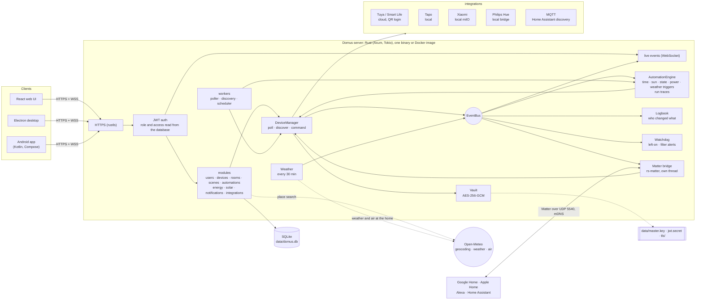
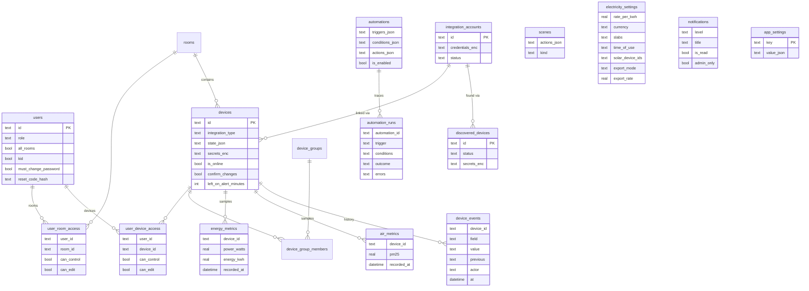

# Domus

<p align="center">
  <b>Translations</b><br>
  <a href="README.md">English</a> ·
  <a href="README.ar.md">العربية</a> ·
  <a href="README.bn.md">বাংলা</a> ·
  <a href="README.de.md">Deutsch</a> ·
  <a href="README.es.md">Español</a> ·
  <a href="README.fr.md">Français</a> ·
  <a href="README.gu.md">ગુજરાતી</a> ·
  <a href="README.hi.md">हिन्दी</a> ·
  <a href="README.id.md">Bahasa Indonesia</a> ·
  <a href="README.it.md">Italiano</a> ·
  <a href="README.ja.md">日本語</a> ·
  <a href="README.kn.md">ಕನ್ನಡ</a> ·
  <a href="README.ko.md">한국어</a> ·
  <a href="README.ml.md">മലയാളം</a> ·
  <a href="README.mr.md">मराठी</a> ·
  <a href="README.pa.md">ਪੰਜਾਬੀ</a> ·
  <a href="README.pl.md">Polski</a> ·
  <a href="README.pt-BR.md">Português (Brasil)</a> ·
  <a href="README.ru.md">Русский</a> ·
  <a href="README.ta.md">தமிழ்</a> ·
  <a href="README.te.md">తెలుగు</a> ·
  <a href="README.th.md">ไทย</a> ·
  <a href="README.tr.md">Türkçe</a> ·
  <a href="README.ur.md">اردو</a> ·
  <a href="README.vi.md">Tiếng Việt</a> ·
  <a href="README.zh-CN.md">简体中文</a> ·
  <a href="README.zh-TW.md">繁體中文</a>
</p>

[](https://github.com/aiyu-ayaan/Domus-Rust/actions/workflows/release.yml)
[](https://github.com/aiyu-ayaan/Domus-Rust/releases)
[](LICENSE)
[](https://github.com/aiyu-ayaan/Domus-Rust/commits/master)
[](https://hub.docker.com/r/aiyuayaan/domus)
[](https://hub.docker.com/r/aiyuayaan/domus)


Pusat kendali smart home yang mengutamakan jaringan lokal (local-first) untuk server rumah Anda. Backend Rust, SQLite,
UI web React (dengan shell desktop Electron), dan integrasi siap pasang untuk
**Tuya / Smart Life** (masuk via kode QR, tanpa akun pengembang), **TP-Link Tapo**
(lokal), **Xiaomi Mi Home** (lokal, token dari akun Mi Anda), **Philips Hue**
(bridge lokal), dan **MQTT** (Zigbee2MQTT, ESPHome, dan apa pun yang mendukung
Home Assistant discovery). **Matter bridge** bawaan memungkinkan Google Home, Apple Home, Alexa, dan Home
Assistant menyalakan, meredupkan, dan mengubah warna perangkat tersebut melalui jaringan lokal Anda sendiri.

- Penemuan otomatis untuk perangkat baru, dengan kotak masuk atau tambah otomatis
- Dasbor langsung: konsumsi daya, perkiraan tagihan berjalan dan proyeksi tagihan, kualitas udara, pembacaan gerakan / pintu / kebocoran / baterai
- Ruangan, grup perangkat, skenario, dan otomasi; pemicu berdasarkan waktu, saat **matahari terbit atau terbenam** (dengan penyesuaian waktu), perubahan perangkat, level daya (juga *di atas X selama N menit*), perangkat offline, atau **cuaca luar ruangan**
- **Jalannya otomasi**: setiap otomasi menyimpan 50 riwayat eksekusi terakhirnya, lengkap dengan pemicu yang mengaktifkannya dan kondisi penahan jika tertahan
- **Riwayat perangkat**: setiap perubahan perangkat dan siapa yang melakukannya (seseorang dan aplikasi yang digunakan, otomasi, Matter, atau perangkat itu sendiri)
- **Peringatan** tanpa perlu menulis otomasi: perangkat dibiarkan menyala terlalu lama, sisa masa pakai filter pembersih udara hampir habis
- **Matter bridge**: bagikan perangkat yang Anda pilih ke Google Home, Apple Home, Alexa, atau Home Assistant secara lokal, tanpa akun cloud
- **Cuaca dan udara luar ruangan** di lokasi rumah (Open-Meteo, tanpa kunci API) di dasbor, bersanding dengan pembacaan dalam ruangan
- **Tanyakan sebelum mengubah**: tandai sakelar utama dan setiap aplikasi, grup, skenario, serta eksekusi manual otomasi akan meminta konfirmasi sebelum dinyalakan atau dimatikan
- Tagihan listrik dengan tarif flat, bertingkat, dan **berdasarkan waktu penggunaan** dalam mata uang apa pun, **biaya siaga** per perangkat, dan **tenaga surya**: pembangkitan, ekspor, serta net metering atau tarif feed-in
- Multi-pengguna dengan peran admin / anggota / tamu serta hak akses per ruangan atau per perangkat (hanya lihat, kendali, atau edit)
- Web, desktop Electron (Linux, Windows), dan aplikasi Android native, yang selalu sinkron secara langsung
- **27 bahasa** di aplikasi web, desktop, dan Android, mengikuti bahasa sistem Anda dengan pilihan di Pengaturan; tata letak dari kanan ke kiri (RTL) untuk bahasa Arab dan Urdu
- Halaman Pembaruan dengan catatan rilis (Markdown, tabel, dan gambar) di setiap aplikasi
- HTTPS secara default; kredensial dan kunci perangkat dienkripsi saat tersimpan; cadangan dan pemulihan satu file

Arsitektur dan diagram: [`development/docs/ARCHITECTURE.md`](development/docs/ARCHITECTURE.md), diringkas [di bawah](#cara-kerjanya).  
Profil desain UI: [`design-system/domus/MASTER.md`](design-system/domus/MASTER.md).  
Kemajuan pengembangan: [`development/TODO.md`](development/TODO.md).

## Cara kerjanya



Klien hanya berkomunikasi dengan server; server berkomunikasi dengan perangkat Anda (secara lokal jika vendor mendukungnya) dan menyimpan seluruh data dalam satu file SQLite. Cloud hanya digunakan apabila vendor tidak menyediakan kontrol lokal (Tuya) atau untuk mengambil token perangkat (Xiaomi), ditambah pencarian opsional: pencarian tempat, cuaca, dan udara luar ruangan untuk lokasi rumah (Open-Meteo, hanya setelah lokasi disetel) dan GitHub untuk memeriksa pembaruan. Matter bridge beroperasi hanya di dalam jaringan lokal.

### Model data



Kredensial dan kunci perangkat disimpan tersegel (`*_enc`) di bawah `data/master.key`, yang tidak tersimpan di dalam database. Seluruh diagram lengkap untuk setiap fitur tersedia di [`development/docs`](development/docs).

## Tangkapan Layar

<p align="center"></p>

**Desktop** (Electron dan web)

<p>
  
  
  
  
  
  
</p>

**Android**

<p>
  
  
  
  
  
</p>

**Tablet Android** (dua kolom mulai dari 840dp, Pengaturan dalam bentuk daftar dan detail)

<p>
  
  
  
  
  
</p>

**Web Seluler**

<p>
  
  
  
  
  
</p>

Semua tangkapan layar tersedia di [`res/screenshots`](res/screenshots); video demo walkthrough kualitas penuh ada di [`res/domus.mp4`](res/domus.mp4).

## Unduhan

| | |
|---|---|
| Server (Docker) | `aiyuayaan/domus` di Docker Hub, amd64 dan arm64 |
| Android | `Domus-<version>.apk` dari [rilis terbaru](https://github.com/aiyu-ayaan/Domus-Rust/releases) |
| Desktop Linux | installer satu baris di bawah, atau file `.deb` / `.AppImage` dari halaman rilis |
| Desktop Windows | `Domus-<version>-Setup.exe` dari halaman rilis |

### Server

Host hanya memerlukan satu file:

```bash
mkdir domus && cd domus
wget https://raw.githubusercontent.com/aiyu-ayaan/Domus-Rust/master/docker-compose.yml
docker compose up -d
```

Buka `https://<server-ip>:8443` dan buat akun administrator. Perintah `docker compose logs domus` menampilkan fingerprint sertifikat yang diminta untuk dikonfirmasi oleh aplikasi.

```bash
docker compose pull && docker compose up -d      # perbarui
DOMUS_VERSION=beta docker compose up -d          # ikuti kanal tertentu: latest (default), beta, alpha, atau 0.0.1
TZ=Asia/Kolkata DOMUS_PORT=9443 docker compose up -d
docker compose --profile mqtt up -d              # jalankan juga broker Mosquitto opsional
```

Simpan `DOMUS_VERSION`, `TZ`, dan `DOMUS_PORT` di dalam file `.env` di sebelah file compose untuk menyimpannya secara permanen.

### Aplikasi Desktop Linux

Memasang rilis terbaru untuk pengguna saat ini (x86_64, tanpa root): AppImage, entri menu dengan ikon Domus, dan perintah `domus`. Aplikasi kemudian akan memperbarui dirinya sendiri secara otomatis.

```bash
curl -fsSL https://raw.githubusercontent.com/aiyu-ayaan/Domus-Rust/master/scripts/install-linux.sh | sh
# ... | sh -s -- --channel beta     untuk build beta juga (atau alpha)
# ... | sh -s -- --uninstall        copot pemasangan; pengaturan tetap disimpan
```

### Android

Unduh APK dari halaman rilis dan buka. Pembaruan selanjutnya akan ditawarkan saat aplikasi dibuka dan di Pengaturan → Pembaruan, pada kanal Stable, Beta, atau Alpha, serta dipasang langsung dari sana; Android akan meminta izin sekali untuk mengizinkan Domus memasangnya.

Halaman **Pembaruan** (Pengaturan → Pembaruan di Android, Pengaturan → Tentang → Pembaruan di web dan desktop) menampilkan versi yang sedang Anda jalankan, rilis terbaru di kanal Anda, beserta catatan rilisnya yang ditulis dalam Markdown.

Informasi rilis, nomor versi, dan kanal pembaruan: [development/docs/RELEASE.md](development/docs/RELEASE.md).

## Persyaratan

- Rust 1.80+ (`cargo`)
- Node.js 18+ dan `pnpm`

## Menjalankan di Lingkungan Pengembangan

```bash
pnpm install
npm run dev            # backend (https://127.0.0.1:8443) + web (http://localhost:3000)

npm run dev:backend    # hanya backend
npm run dev:web        # hanya web (meneruskan /api ke backend)
npm run dev:desktop    # Electron; pilih server di halaman koneksinya
```

Buka http://localhost:3000. Kunjungan pertama akan meminta Anda membuat akun administrator.

## Menjalankan di Server Rumah

```bash
pnpm build:web                     # membangun apps/web/dist, yang disajikan oleh backend
APP_ENV=production cargo run --release --manifest-path backend/Cargo.toml
```

Kemudian buka `https://<server-ip>:8443`. Saat diaktifkan, Matter bridge juga menggunakan port UDP 5540 (`[matter] port`) dan mDNS di jaringan lokal (LAN).

Atau bangun Docker image langsung dari repositori ini (host networking, data di volume `domus_data`):

```bash
docker compose -f docker-compose.local.yml up -d --build
```

Akses jarak jauh melalui Cloudflare Tunnel, alamat rumah/jarak jauh yang dialihkan oleh aplikasi, dan paket instalasi desktop (`pnpm build:desktop`) dijelaskan di [development/docs/DEPLOYMENT.md](development/docs/DEPLOYMENT.md).

Pada saat pertama kali dijalankan, Domus membuat folder `data/` yang berisi:

| File | Kegunaan |
|---|---|
| `domus.db` | Database SQLite |
| `master.key` | mengenkripsi kredensial integrasi dan kunci perangkat — **cadangkan file ini** |
| `jwt.secret` | penandatangan sesi pengguna |
| `tls/` | sertifikat yang ditandatangani sendiri (ganti via `tls.cert_path` / `tls.key_path`) |

Pengaturan disimpan di `config/default.toml`; setiap kunci dapat ditimpa dengan variabel lingkungan `DOMUS__SECTION__KEY` (lihat `.env.example`).

## Cadangan dan Pemulihan

Semua data tersimpan di `data/`. Cadangkan seluruh folder, atau buat cadangan satu file:

**Cadangkan.** Masuk sebagai administrator → Pengaturan → **Cadangan** → *Unduh cadangan*. File ini merupakan salinan database yang memuat master key di dalamnya, sehingga akun-akun tertaut di dalamnya dapat langsung dibuka kembali setelah pemulihan. Pencadangan dibuat saat server tetap berjalan. Jaga kerahasiaannya: siapa pun yang memiliki file tersebut dapat mengakses akun-akun tersebut. JWT secret dan sertifikat TLS tidak disertakan di dalamnya.

**Pulihkan.** Hentikan server terlebih dahulu, lalu:

```bash
# Docker
docker compose cp domus-backup-2026-10-11.db domus:/app/data/restore.db
docker compose stop domus
docker compose run --rm domus domus-backend restore data/restore.db
docker compose start domus

# Tanpa Docker, dari direktori utama repositori (menggunakan ./data)
domus-backend restore ~/Downloads/domus-backup-2026-10-11.db
```

Data lama yang ada sebelumnya akan tetap disimpan di sampingnya dengan nama `*.before-restore`. Setelah pemulihan di komputer baru, pengguna akan masuk kembali dan aplikasi akan meminta persetujuan untuk memercayai sertifikat baru. Jika Anda menyetel kunci dengan `DOMUS_MASTER_KEY`, file cadangan tidak menyimpan kunci dan server yang dipulihkan memerlukan variabel lingkungan yang sama. Pelajari lebih lanjut di [development/docs/DEPLOYMENT.md](development/docs/DEPLOYMENT.md#backup-and-restore).

## Lupa Kata Sandi Administrator?

Domus tidak memiliki mail server bawaan, sehingga tidak ada yang dikirim melalui email. Berdasarkan tingkat kemudahannya:

1. **Administrator lain** membuka Pengaturan → Orang dan akses, mengaktifkan *Kode reset* untuk Anda dan memberitahukan 8 digit kode tersebut (berlaku selama 30 menit dan maksimal 5 kali percobaan salah). Di layar masuk, pilih *Lupa kata sandi?*, masukkan nama pengguna Anda, lalu masukkan kode tersebut.
2. **Langsung dari server**, yang dapat dilakukan saat Domus berjalan atau dihentikan dan tidak memerlukan login:

   ```bash
   docker compose exec domus domus-backend reset-password <username>              # mencetak kata sandi acak baru
   docker compose exec domus domus-backend reset-password <username> 'new-pass'   # atau tentukan sendiri (8+ karakter)
   domus-backend reset-password <username>                                        # tanpa Docker, dari root repositori
   ```

   Masuklah dengan kata sandi tersebut lalu ubah di Pengaturan → Kata sandi.

Lima kali salah memasukkan kata sandi untuk satu nama pengguna akan mengunci akun tersebut selama 15 menit di lingkungan produksi (kunci dapat dibuka dengan memulai ulang server, dan dinonaktifkan di lingkungan pengembangan). Rincian aturan kata sandi acak dan akun anak: [development/docs/ACCOUNTS.md](development/docs/ACCOUNTS.md).

## Bahasa

Bahasa Inggris, Hindi, Spanyol, Portugis (Brasil), Indonesia, Arab, Prancis, Rusia, Jerman, Turki, Jepang, Korea,
Italia, Vietnam, Thai, Mandarin (Sederhana dan Tradisional), Polandia, Bengali, Tamil, Telugu, Marathi, Gujarati,
Kannada, Malayalam, Punjabi, dan Urdu. Bahasa Arab dan Urdu memiliki tata letak dari kanan ke kiri (RTL).

Setiap aplikasi mengikuti bahasa browser atau sistem operasi Anda, dan menampilkan bahasa Inggris jika belum tersedia terjemahan. Untuk memilih bahasa lain, buka Pengaturan > Bahasa (Tampilan di web dan desktop); opsi *Default sistem* akan kembali mengikuti bahasa sistem. Pada Android 13 dan yang lebih baru, opsi ini juga muncul di menu Pengaturan ponsel > Aplikasi > Domus > Bahasa.

Terjemahan dibuat secara otomatis menggunakan mesin dan belum ditinjau oleh penutur asli, sehingga susunan kalimat mungkin terasa kurang tepat. Perbaikan dapat dilakukan hanya dengan mengubah satu baris di berkas katalog bahasa yang sesuai. Cara kerja bahasa, cara menambahkan bahasa baru, dan aturan untuk teks baru: [development/docs/LOCALIZATION.md](development/docs/LOCALIZATION.md).

## Menghubungkan Perangkat

| Merek | Cara Menghubungkan |
|---|---|
| Tuya / Smart Life | Integrasi → *Tautkan dengan kode QR*. Masukkan **Kode Pengguna** dari aplikasi Smart Life (Saya → Pengaturan → Akun dan Keamanan → Kode Pengguna), lalu pindai kode QR di aplikasi. |
| Tapo | Integrasi → *Tautkan akun* dengan TP-Link ID Anda. Perangkat di LAN akan ditemukan secara otomatis dan dikontrol secara lokal. Hub H100 turut menyertakan sensor, sakelar, dan termostatnya. Kamera sudah terdaftar tetapi belum didukung saat ini. |
| Xiaomi | Integrasi → *Tautkan akun* dengan akun Mi dan wilayah server Anda. Jika Xiaomi meminta verifikasi dua langkah, masukkan kode yang dikirimkan melalui email atau SMS di panel yang sama. Akun bisa berupa email, nomor telepon dengan kode negara (`+91…`), atau Xiaomi ID. Token hanya diambil satu kali; kontrol sepenuhnya lokal. Perangkat juga dapat ditambahkan langsung menggunakan token. |
| Philips Hue | Tekan tombol bundar pada bridge, lalu buka Integrasi → Philips Hue → *Tautkan* dalam waktu 30 detik. Kosongkan alamat agar bridge ditemukan secara otomatis. Lampu dan steker pintar Hue dikontrol secara lokal. |
| MQTT | Integrasi → MQTT → *Tautkan* dengan alamat broker, port, dan info masuk Anda. Perangkat yang mengumumkan dirinya melalui Home Assistant MQTT discovery (Zigbee2MQTT, ESPHome, …) akan muncul di bagian Ditemukan: lampu, sakelar, steker, kipas, dan sensor. Jika menggunakan broker bawaan (`--profile mqtt`), alamatnya adalah `mqtt`, port `1883`. |

Lihat `development/docs/INTEGRATIONS.md` untuk mengetahui apa saja yang didukung oleh setiap integrasi.

## Paket Listrik

Energi → *Paket listrik*: pilih mata uang apa saja, dan tentukan harga flat per
kWh atau **tarif bertingkat (slabs)** untuk tarif berbasis kuota pemakaian (misalnya 0–100 unit dengan satu tarif, 101–300 unit dengan tarif berikutnya, dan seterusnya). Tagihan dihitung per siklus tagihan, ditambah biaya langganan bulanan tetap.

Tarif juga dapat memiliki rentang waktu **berdasarkan waktu penggunaan**: jam-jam tertentu (pada jam lokal rumah, berlaku juga melewati tengah malam) di mana biaya per unit lebih mahal atau lebih murah, seperti potongan harga malam hari atau biaya tambahan beban puncak, di atas tarif flat maupun bertingkat.

Perangkat baru muncul di **Perangkat → Ditemukan**. Aktifkan *Tambahkan perangkat baru secara otomatis* di sana untuk melewati kotak masuk.

## Matahari Terbit dan Terbenam

Tentukan lokasi rumah di Pengaturan → **Lokasi rumah**: gunakan lokasi ponsel atau browser saat ini, cari nama kota (server meminta layanan geocoder gratis Open-Meteo; hanya nama yang Anda ketik yang dikirim keluar rumah), atau ketik koordinat lintang dan bujur secara manual. Koordinat dibulatkan hingga sekitar satu kilometer dan tetap tersimpan di server Anda. Otomasi kemudian dapat dijalankan saat matahari terbit atau terbenam, beberapa menit sebelum atau sesudahnya. Tanpa pengaturan lokasi, pemicu matahari tidak akan pernah aktif.

## Tanyakan Sebelum Mengubah

Sakelar utama yang memutus daya ke semua perangkat yang terhubung sangat mudah dimatikan secara tidak sengaja. Buka perangkat tersebut dan aktifkan **Tanyakan sebelum mengubah**: setiap aplikasi akan meminta konfirmasi sebelum menyalakan atau mematikannya, begitu juga aksi ruangan *Semua nyala / Semua mati*, grup perangkat, skenario (termasuk skenario di dalam skenario), dan tombol *Jalankan* manual dari otomasi yang akan mengubahnya. Pengaturan ini disimpan di server, sehingga berlaku sama di web, desktop, dan Android. Otomasi yang terpicu secara mandiri tidak akan meminta konfirmasi dan tetap berjalan sesuai aturan, serta tindakan di luar Domus (aplikasi vendor, sakelar dinding fisik) tidak terpengaruh.

## Matter (Google Home, Apple Home, Alexa)

Pengaturan → **Matter** (administrator): aktifkan fitur ini, centang perangkat yang ingin dibagikan, lalu pindai kode QR atau ketik kode penyambungan di Google Home, Apple Home, Alexa, atau Home Assistant. Lampu akan terdeteksi sebagai lampu warna atau lampu redup, sedangkan perangkat lain yang memiliki sakelar on/off akan terdeteksi sebagai steker/stopkontak; kontrol nyala/mati, peredupan, dan pengaturan warna berfungsi dengan baik, serta perubahan yang dibuat di Domus (nyala/mati, kecerahan) akan langsung tampak di aplikasi pengontrol. Opsi "Izinkan penyambungan selama 15 menit" memungkinkan penambahan ekosistem kedua; "Lupakan semua sambungan" akan memulai ulang proses dengan kode baru.

Bridge ini belum tersertifikasi resmi (menggunakan sertifikat pengujian Matter test attestation), sehingga aplikasi akan meminta konfirmasi saat menambahkannya, dan Google Home hanya menerimanya setelah bridge ditambahkan sebagai perangkat uji coba di Google Home Developer Console. Rincian selengkapnya: [`development/docs/MATTER.md`](development/docs/MATTER.md).

## Riwayat, Jalannya Otomasi, dan Peringatan

- **Riwayat** di lembar info setiap perangkat: apa yang berubah, kapan, dan siapa yang melakukannya (*Oleh Ayaan · Android*, *Otomasi "Mode malam"*, *Matter*, *Pada perangkat*). Disimpan selama riwayat energi disimpan.
- **Jalannya** setiap otomasi: *Berjalan*, *Gagal* disertai pesan error, atau *Dilewati* disertai kondisi yang menahannya, sehingga pertanyaan "mengapa ini tidak aktif?" memiliki jawaban yang jelas.
- **Beri tahu jika dibiarkan menyala** di lembar perangkat (30 menit hingga 12 jam): administrator menerima pemberitahuan. Perangkat yang berdaya terukur di atas 10 W dianggap menyala, sehingga TV dalam mode siaga dianggap mati.
- **Sisa masa pakai filter hampir habis**: pemberitahuan saat sisa filter pembersih udara turun hingga 10%.

## Cuaca, Mode Siaga, dan Tenaga Surya

- Dengan lokasi rumah yang sudah diatur, dasbor akan menampilkan **cuaca dan PM2.5 luar ruangan** di sebelah pembacaan dalam ruangan, dan otomasi dapat memanfaatkannya (*saat PM2.5 luar ruangan naik di atas 35*, *hanya jika suhu luar ruangan di bawah 20*).
- Energi → **Siaga** mencantumkan daya yang dikonsumsi setiap perangkat saat tidak digunakan oleh siapa pun (jam pemakaian terendah minggu ini) dan berapa estimasi biayanya per bulan.
- Energi → *Paket listrik* → **Surya**: centang stopkontak yang mengukur pembangkitan tenaga surya, lalu pilih net metering atau tarif feed-in. Tagihan kemudian hanya menghitung daya yang Anda beli dari jaringan listrik (PLN), dan kartu Surya menampilkan daya yang dihasilkan, daya yang digunakan di rumah, daya yang diekspor, dan pendapatan yang diperoleh. Aliran daya jaringan dihitung setiap 15 menit dari perangkat berdaya terukur, sehingga peralatan tanpa pengukur akan membuat angka ekspor tampak lebih tinggi.

Rencana pengembangan dan diagram arsitektur: [`development/docs/ROADMAP.md`](development/docs/ROADMAP.md).

## Lisensi

Domus dirilis di bawah [Lisensi MIT](LICENSE). Pustaka pihak ketiga tetap mempertahankan lisensi masing-masing; daftarnya dapat dilihat di bagian Tentang → Ucapan Terima Kasih pada setiap aplikasi.

## Pengujian

```bash
cargo test --workspace
pnpm --filter @domus/web exec tsc -b
```

Perintah `cargo test --workspace` mencakup pengujian `backend/tests/matter_bridge.rs`, yang menyambungkan pengontrol Matter dengan bridge melalui UDP dan menguji fungsi sakelar, peredupan, dan pengaturan warna perangkat (membutuhkan antarmuka jaringan dengan dukungan IPv4).
