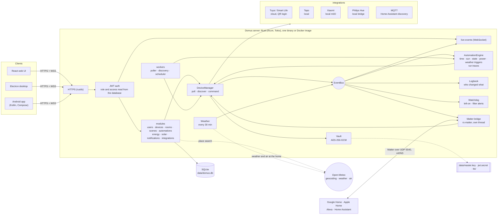
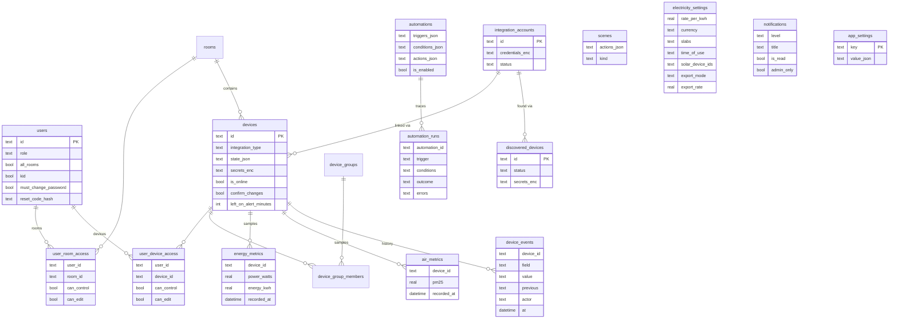

# Domus

<p align="center">
  <b>Translations</b><br>
  <a href="README.md">English</a> ·
  <a href="README.ar.md">العربية</a> ·
  <a href="README.bn.md">বাংলা</a> ·
  <a href="README.de.md">Deutsch</a> ·
  <a href="README.es.md">Español</a> ·
  <a href="README.fr.md">Français</a> ·
  <a href="README.gu.md">ગુજરાતી</a> ·
  <a href="README.hi.md">हिन्दी</a> ·
  <a href="README.id.md">Bahasa Indonesia</a> ·
  <a href="README.it.md">Italiano</a> ·
  <a href="README.ja.md">日本語</a> ·
  <a href="README.kn.md">ಕನ್ನಡ</a> ·
  <a href="README.ko.md">한국어</a> ·
  <a href="README.ml.md">മലയാളം</a> ·
  <a href="README.mr.md">मराठी</a> ·
  <a href="README.pa.md">ਪੰਜਾਬੀ</a> ·
  <a href="README.pl.md">Polski</a> ·
  <a href="README.pt-BR.md">Português (Brasil)</a> ·
  <a href="README.ru.md">Русский</a> ·
  <a href="README.ta.md">தமிழ்</a> ·
  <a href="README.te.md">తెలుగు</a> ·
  <a href="README.th.md">ไทย</a> ·
  <a href="README.tr.md">Türkçe</a> ·
  <a href="README.ur.md">اردو</a> ·
  <a href="README.vi.md">Tiếng Việt</a> ·
  <a href="README.zh-CN.md">简体中文</a> ·
  <a href="README.zh-TW.md">繁體中文</a>
</p>

[](https://github.com/aiyu-ayaan/Domus-Rust/actions/workflows/release.yml)
[](https://github.com/aiyu-ayaan/Domus-Rust/releases)
[](LICENSE)
[](https://github.com/aiyu-ayaan/Domus-Rust/commits/master)
[](https://hub.docker.com/r/aiyuayaan/domus)
[](https://hub.docker.com/r/aiyuayaan/domus)


[](https://ghloc.dev/aiyu-ayaan/Domus)


Un hub domotico locale per il tuo server domestico. Backend in Rust, SQLite, interfaccia Web in React (con applicazione desktop Electron) e integrazioni modulari per **Tuya / Smart Life** (accesso tramite codice QR, nessun account sviluppatore necessario), **TP-Link Tapo** (locale), **Xiaomi Mi Home** (locale, token recuperati dal tuo account Mi), **Philips Hue** (bridge locale) e **MQTT** (Zigbee2MQTT, ESPHome e qualsiasi dispositivo con rilevamento Home Assistant). Un **bridge Matter** integrato consente a Google Home, Apple Home, Alexa e Home Assistant di accendere, regolare e cambiare il colore di questi dispositivi direttamente sulla tua rete locale.

- Rilevamento automatico dei nuovi dispositivi, con posta in arrivo o aggiunta automatica
- Dashboard in tempo reale: assorbimento elettrico, spesa attuale e bolletta stimata, qualità dell'aria, rilevamenti di movimento, porte, perdite e livello di carica delle batterie
- Stanze, gruppi di dispositivi, scene e automazioni; trigger a orari prestabiliti, all'**alba o al tramonto** (con scostamento in minuti), al variare dello stato di un dispositivo, livello di potenza (anche *sopra X W per N minuti*), disconnessione o **condizioni meteo esterne**
- **Esecuzioni delle automazioni**: ogni automazione registra le sue ultime 50 esecuzioni, con il trigger attivato e l'eventuale condizione che ne ha impedito l'avvio
- **Cronologia del dispositivo**: ogni modifica di stato di un dispositivo e chi l'ha effettuata (una persona e l'app usata, un'automazione, Matter o il dispositivo stesso)
- **Avvisi integrati** senza bisogno di creare automazioni: dispositivo rimasto acceso troppo a lungo o filtro del purificatore d'aria in esaurimento
- **Bridge Matter**: condividi i dispositivi scelti con Google Home, Apple Home, Alexa o Home Assistant, localmente e senza alcun account cloud
- **Meteo e qualità dell'aria esterna** per la posizione dell'abitazione (Open-Meteo, nessuna chiave API richiesta) nella dashboard, a fianco dei valori interni
- **Chiedi prima di commutare**: contrassegna un interruttore principale e ogni app, gruppo, scena o avvio manuale chiederà conferma prima di accenderlo o spegnerlo
- Tariffazione dell'energia elettrica con tariffe fisse, a scaglioni e **a fasce orarie** (F1/F2/F3) in qualsiasi valuta, costo in **standby** per dispositivo e modulo **Solare**: produzione, immissione in rete, scambio sul posto o tariffa di cessione
- Più utenti con ruoli amministratore, membro o ospite e permessi per stanza o per dispositivo (sola visualizzazione, controllo o modifica)
- App Web, desktop Electron (Linux, Windows) e app nativa per Android, sincronizzate in tempo reale
- **27 lingue** nelle app Web, desktop e Android, con rilevamento automatico della lingua di sistema e selettore in Impostazioni; supporto da destra a sinistra per arabo e urdu
- Pagina Aggiornamenti con note di rilascio formattate in Markdown (con tabelle e immagini) integrata in ogni app
- HTTPS attivo di default; credenziali e chiavi dei dispositivi crittografate a riposo; backup e ripristino in un singolo file

Architettura e diagrammi: [`development/docs/ARCHITECTURE.md`](development/docs/ARCHITECTURE.md), riassunti [più in basso](#come-si-collega-il-tutto).
Profilo di design dell'interfaccia: [`design-system/domus/MASTER.md`](design-system/domus/MASTER.md).
Stato di avanzamento: [`development/TODO.md`](development/TODO.md).

## Come si collega il tutto



I client comunicano unicamente con il server; il server interagisce con i tuoi dispositivi (localmente quando il produttore lo consente) e archivia tutto in un unico file SQLite. Il cloud viene utilizzato solo nei casi in cui il produttore non offra controllo locale (Tuya) o per ottenere i token dei dispositivi (Xiaomi), oltre alle interrogazioni opzionali: ricerca di località, meteo e aria esterna per la posizione dell'abitazione (Open-Meteo, solo una volta impostata una posizione) e GitHub per il controllo degli aggiornamenti. Il bridge Matter opera esclusivamente sulla rete locale.

### Modello dei dati



Credenziali e chiavi dei dispositivi sono conservate sigillate (`*_enc`) tramite `data/master.key`, salvato al di fuori del database. L'elenco completo dei diagrammi, per ciascuna funzionalità, è consultabile in [`development/docs`](development/docs).

## Screenshot

<p align="center"></p>

**Desktop** (Electron e Web)

<p>
  
  
  
  
  
  
</p>

**Android**

<p>
  
  
  
  
  
</p>

**Tablet Android** (due colonne a partire da 840dp, Impostazioni con vista elenco e dettagli)

<p>
  
  
  
  
  
</p>

**Web mobile**

<p>
  
  
  
  
  
</p>

Tutti gli screenshot sono disponibili in [`res/screenshots`](res/screenshots); il video dimostrativo completo è visibile su [`res/domus.mp4`](res/domus.mp4).

## Download

| | |
|---|---|
| Server (Docker) | `aiyuayaan/domus` su Docker Hub, amd64 e arm64 |
| Android | `Domus-<version>.apk` dalle [ultime release pubblicate](https://github.com/aiyu-ayaan/Domus-Rust/releases) |
| Desktop Linux | Script di installazione in riga singola qui sotto, oppure file `.deb` / `.AppImage` della release |
| Desktop Windows | `Domus-<version>-Setup.exe` dalla pagina delle release |

### Server

Un solo file è tutto ciò che serve sull'host:

```bash
mkdir domus && cd domus
wget https://raw.githubusercontent.com/aiyu-ayaan/Domus-Rust/master/docker-compose.yml
docker compose up -d
```

Apri `https://<server-ip>:8443` e configura l'account amministratore. Con `docker compose logs domus` puoi visualizzare l'impronta digitale del certificato che le app ti chiederanno di verificare.

```bash
docker compose pull && docker compose up -d      # aggiorna
DOMUS_VERSION=beta docker compose up -d          # segui un canale: latest (predefinito), beta, alpha o 0.0.1
TZ=Asia/Kolkata DOMUS_PORT=9443 docker compose up -d
docker compose --profile mqtt up -d              # avvia anche il broker Mosquitto opzionale
```

Salva `DOMUS_VERSION`, `TZ` e `DOMUS_PORT` in un file `.env` accanto al file compose per renderli persistenti.

### Applicazione desktop per Linux

Installa l'ultima versione per l'utente corrente (x86_64, senza privilegi di root): il pacchetto AppImage, una voce nel menu delle applicazioni con l'icona di Domus e il comando di sistema `domus`. L'applicazione provvederà poi ad aggiornarsi autonomamente.

```bash
curl -fsSL https://raw.githubusercontent.com/aiyu-ayaan/Domus-Rust/master/scripts/install-linux.sh | sh
# ... | sh -s -- --channel beta     installa versioni beta (o alpha)
# ... | sh -s -- --uninstall        disinstalla; le impostazioni vengono mantenute
```

### Android

Scarica l'APK dalla pagina delle release e aprilo per installarlo. Gli aggiornamenti successivi verranno proposti all'avvio dell'app e in Impostazioni → Aggiornamenti sui canali Stabile, Beta o Alpha, e installati direttamente; Android chiederà una sola volta l'autorizzazione per consentire a Domus di eseguire l'installazione.

La schermata **Aggiornamenti** (Impostazioni → Aggiornamenti su Android; Impostazioni → Informazioni → Aggiornamenti su Web e desktop) mostra la versione in uso, la release più recente disponibile sul tuo canale e le note di versione formattate in Markdown.

Dettagli su rilasci, numerazione delle versioni e canali di aggiornamento: [development/docs/RELEASE.md](development/docs/RELEASE.md).

## Requisiti

- Rust 1.80+ (`cargo`)
- Node.js 18+ e `pnpm`

## Esecuzione in sviluppo

```bash
pnpm install
npm run dev            # backend (https://127.0.0.1:8443) + web (http://localhost:3000)

npm run dev:backend    # solo backend
npm run dev:web        # solo web (inoltra le chiamate /api al backend)
npm run dev:desktop    # Electron; seleziona il server nella pagina di connessione
```

Apri http://localhost:3000. Al primo accesso verrà richiesta la creazione dell'account amministratore.

## Esecuzione sul server domestico

```bash
pnpm build:web                     # compila apps/web/dist, servito dal backend
APP_ENV=production cargo run --release --manifest-path backend/Cargo.toml
```

Quindi apri `https://<server-ip>:8443`. Quando il bridge Matter è attivo, impiega anche la porta UDP 5540 (`[matter] port`) e mDNS sulla rete locale.

In alternativa, compila l'immagine Docker direttamente da questo repository (rete host, dati memorizzati nel volume `domus_data`):

```bash
docker compose -f docker-compose.local.yml up -d --build
```

L'accesso remoto tramite Cloudflare Tunnel, il cambio automatico tra indirizzo locale e remoto nelle app e la creazione dei pacchetti per desktop (`pnpm build:desktop`) sono descritti in [development/docs/DEPLOYMENT.md](development/docs/DEPLOYMENT.md).

Al primo avvio Domus crea la cartella `data/` contenente:

| File | Scopo |
|---|---|
| `domus.db` | Database SQLite |
| `master.key` | Cifra le credenziali delle integrazioni e le chiavi dei dispositivi — **conservane una copia** |
| `jwt.secret` | Firma le sessioni utente |
| `tls/` | Certificato autofirmato (sostituibile con `tls.cert_path` / `tls.key_path`) |

La configurazione si trova in `config/default.toml`; qualsiasi parametro può essere sovrascritto tramite variabili d'ambiente `DOMUS__SEZIONE__CHIAVE` (vedere `.env.example`).

## Backup e ripristino

Tutti i dati risiedono in `data/`. È possibile copiare l'intera cartella o utilizzare la procedura di backup in un singolo file:

**Backup:** Accedi come amministratore → Impostazioni → **Backup** → *Scarica backup*. Il file generato è una copia del database contenente al suo interno la chiave master, consentendo di ripristinare e riaprire le integrazioni collegate. Il backup viene creato con il server regolarmente in esecuzione. Conservalo con cura: chiunque lo possieda può accedere agli account delle integrazioni connesse. Il segreto JWT e il certificato TLS non sono inclusi.

**Ripristino:** Arresta il server, quindi esegui:

```bash
# Docker
docker compose cp domus-backup-2026-10-11.db domus:/app/data/restore.db
docker compose stop domus
docker compose run --rm domus domus-backend restore data/restore.db
docker compose start domus

# Senza Docker, dalla directory principale del repository (utilizza ./data)
domus-backend restore ~/Downloads/domus-backup-2026-10-11.db
```

Lo stato precedente viene archiviato a lato come `*.before-restore`. Dopo il ripristino su una nuova macchina, gli utenti effettuano nuovamente l'accesso e le app richiederanno di autorizzare il nuovo certificato. Se la chiave era stata configurata tramite `DOMUS_MASTER_KEY`, il file di backup non include alcuna chiave e il nuovo server dovrà impostare la medesima variabile. Ulteriori dettagli in [development/docs/DEPLOYMENT.md](development/docs/DEPLOYMENT.md#backup-and-restore).

## Password amministratore dimenticata

Domus non integra un server di posta e non invia alcuna e-mail. In ordine di semplicità:

1. **Un altro amministratore** accede a Impostazioni → Persone e accessi, abilita la funzione *Codice di reimpostazione* per il tuo utente e ti comunica il codice a 8 cifre (valido per 30 minuti e 5 tentativi errati). Nella schermata di accesso seleziona *Password dimenticata?*, inserisci il tuo nome utente e quindi il codice.
2. **Dal server**, utilizzabile sia con Domus in esecuzione che arrestato, senza necessità di autenticazione:

   ```bash
   docker compose exec domus domus-backend reset-password <username>              # genera e visualizza una nuova password casuale
   docker compose exec domus domus-backend reset-password <username> 'new-pass'   # oppure impostane una a scelta (minimo 8 caratteri)
   domus-backend reset-password <username>                                        # senza Docker, dalla radice del repository
   ```

   Accedi con la nuova password e modificala in Impostazioni → Password.

Cinque tentativi consecutivi di password errata bloccano quell'utenza per 15 minuti in ambiente di produzione (il blocco si azzera riavviando il server, ed è disabilitato in modalità di sviluppo). Dettagli e policy relative alle password generate e agli account per minori: [development/docs/ACCOUNTS.md](development/docs/ACCOUNTS.md).

## Lingue

Inglese, hindi, spagnolo, portoghese (Brasile), indonesiano, arabo, francese, russo, tedesco, turco, giapponese, coreano, italiano, vietnamita, thailandese, cinese (semplificato e tradizionale), polacco, bengalese, tamil, telugu, marathi, gujarati, kannada, malayalam, punjabi e urdu. L'arabo e l'urdu presentano impaginazione da destra a sinistra.

Ciascuna app si conforma automaticamente alla lingua del browser o del sistema operativo, tornando all'inglese quando non è disponibile una traduzione specifica. Per selezionare un'altra lingua, apri Impostazioni > Lingua (Aspetto su Web e desktop); la voce *Predefinita di sistema* ripristina il rilevamento automatico. Su Android 13 e successivi, l'opzione è raggiungibile anche dalle impostazioni dello smartphone in Impostazioni > App > Domus > Lingua.

Le traduzioni sono state generate in modo automatico e non sono state completamente revisionate da madrelingua, pertanto alcuni termini potrebbero risultare migliorabili. Qualsiasi correzione richiede la modifica di una sola riga nel catalogo corrispondente. Come funzionano le localizzazioni, come aggiungere nuove lingue e le convenzioni per i testi: [development/docs/LOCALIZATION.md](development/docs/LOCALIZATION.md).

## Connessione dei dispositivi

| Marchio | Istruzioni |
|---|---|
| Tuya / Smart Life | Integrazioni → *Collega con codice QR*. Inserisci il **Codice utente** dell'app Smart Life (Profilo → Impostazioni → Account e sicurezza → Codice utente), quindi scansiona il codice QR nell'app. |
| Tapo | Integrazioni → *Collega account* con il tuo ID TP-Link. I dispositivi presenti sulla LAN vengono individuati automaticamente e gestiti localmente. Un hub H100 importa direttamente sensori, interruttori e termostati ad esso associati. Le telecamere vengono mostrate in elenco ma non sono ancora supportate. |
| Xiaomi | Integrazioni → *Collega account* con il tuo account Mi e la regione del server. Se Xiaomi richiede la verifica in due passaggi, inserisci il codice ricevuto per email o SMS nel riquadro. L'account può essere una mail, un numero di telefono con prefisso (`+39…`) o un ID Xiaomi. I token vengono recuperati una sola volta; la gestione successiva è puramente locale. È possibile aggiungere dispositivi anche fornendo direttamente il loro token. |
| Philips Hue | Premi il pulsante circolare sul bridge, quindi seleziona Integrazioni → Philips Hue → *Collega* entro 30 secondi. Lascia vuoto il campo dell'indirizzo per rilevare automaticamente il bridge. Le lampadine e le prese intelligenti Hue vengono controllate localmente. |
| MQTT | Integrazioni → MQTT → *Collega* inserendo indirizzo, porta e credenziali del tuo broker. I dispositivi che si annunciano tramite il discovery MQTT di Home Assistant (Zigbee2MQTT, ESPHome, ecc.) compaiono in Rilevati: luci, interruttori, prese, ventilatori e sensori. Utilizzando il broker integrato (`--profile mqtt`), l'indirizzo è `mqtt`, porta `1883`. |

Consulta `development/docs/INTEGRATIONS.md` per l'elenco completo delle funzionalità coperte da ogni integrazione.

## Tariffazione dell'elettricità

Energia → *Piano elettrico*: scegli qualsiasi valuta e imposta una tariffa fissa a kWh oppure definisci **scaglioni** di consumo a tariffa variabile (ad esempio: 0–100 unità a un prezzo, 101–300 a quello successivo e così via). La spesa viene calcolata in base al ciclo di fatturazione, con l'aggiunta della quota fissa mensile.

I piani tariffari supportano anche finestre a **fasce orarie**: orari (secondo l'orologio dell'abitazione, con supporto a intervalli che superano la mezzanotte) in cui il costo dell'unità viene maggiorato o scontato di un importo fisso rispetto al prezzo base o a scaglioni.

I nuovi dispositivi rilevati compaiono in **Dispositivi → Rilevati**. Attiva l'opzione *Aggiungi nuovi dispositivi automaticamente* per saltare la casella di posta in arrivo.

## Alba e tramonto

Imposta la posizione geografica della casa in Impostazioni → **Posizione della casa**: rileva la posizione attuale del telefono o del browser, cerca il comune (il server consulta il servizio di geocodifica gratuito di Open-Meteo; solo il nome digitato esce dalla tua rete) oppure inserisci manualmente latitudine e longitudine. Le coordinate vengono approssimate a circa un chilometro e restano esclusivamente sul tuo server. Le automazioni potranno così attivarsi all'alba o al tramonto, con anticipo o ritardo in minuti. In assenza di coordinate, i trigger basati sul sole non vengono eseguiti.

## Chiedi prima di commutare

Un interruttore principale che alimenta utenze importanti può essere spento per errore. Apri la scheda del dispositivo e attiva **Chiedi prima di commutare**: ogni applicazione chiederà conferma prima di accenderlo o spegnerlo. Questo controllo si applica anche ai comandi di stanza *Tutto acceso / Tutto spento*, ai gruppi di dispositivi, alle scene (comprese le scene nidificate) e all'esecuzione manuale (*Esegui*) di automazioni che ne modificherebbero lo stato. L'impostazione è salvata sul server ed è pertanto identica su Web, desktop e Android. Le automazioni pianificate autonome non richiedono conferma ed eseguono le loro istruzioni; i comandi esterni a Domus (app proprietarie dei costruttori, interruttori a parete fisici) non vengono intercettati.

## Matter (Google Home, Apple Home, Alexa)

Impostazioni → **Matter** (riservato agli amministratori): abilitalo, seleziona i dispositivi da condividere, quindi scansiona il codice QR o inserisci il codice di accoppiamento in Google Home, Apple Home, Alexa o Home Assistant. Le luci vengono riconosciute come lampade dimmerabili o a colori, e tutti gli altri apparati commutabili come prese; accensione/spegnimento, regolazione e selezione dei colori funzionano regolarmente, e le modifiche apportate su Domus si riflettono istantaneamente nel controller. L'opzione «Consenti associazione per 15 minuti» permette di collegare un secondo ecosistema; «Dimentica tutte le associazioni» reimposta il bridge generando un nuovo codice.

Il bridge non possiede una certificazione commerciale (impiega l'attestazione di test ufficiale Matter), pertanto le applicazioni mostreranno una richiesta di conferma all'aggiunta. In Google Home, è necessario aggiungere preventivamente il bridge come dispositivo di test nella Google Home Developer Console. Informazioni complete: [`development/docs/MATTER.md`](development/docs/MATTER.md).

## Cronologia, esecuzioni delle automazioni e avvisi

- **Cronologia** nella scheda di ogni dispositivo: cosa è cambiato, quando e chi l'ha modificato (*Da Ayaan · Android*, *Automazione "Modalità notte"*, *Matter*, *Sul dispositivo*). Mantenuta per la stessa durata dello storico energetico.
- **Esecuzioni** di ciascuna automazione: *Eseguita*, *Non riuscita* con il relativo errore, o *Saltata* indicando quale condizione ne ha impedito l'esecuzione, offrendo una spiegazione chiara del perché una regola non è scattata.
- **Avvisa se resta acceso** nella scheda del dispositivo (da 30 minuti a 12 ore): gli amministratori ricevono una notifica. Un apparato con misurazione dei consumi è considerato acceso al di sopra di 10 W, quindi una TV in standby risulta spenta.
- **Filtro in esaurimento**: notifica tempestiva quando la vita residua del filtro di un purificatore d'aria scende al 10%.

## Meteo, standby e solare

- Con la posizione dell'abitazione impostata, la dashboard visualizza **meteo e PM2.5 esterno** a fianco dei valori interni, e le automazioni possono utilizzarli come condizioni o attivatori (*quando il PM2.5 esterno sale oltre 35*, *solo se la temperatura esterna è inferiore a 20*).
- Energia → **Standby** elenca l'assorbimento di ciascun dispositivo nei momenti di inattività (l'ora con il consumo minore registrata questa settimana) e il rispettivo costo mensile stimato.
- Energia → *Piano elettrico* → **Solare**: seleziona le prese con monitoraggio che misurano la produzione dei pannelli fotovoltaici, quindi scegli tra scambio sul posto (net metering) o tariffa di immissione. Il conteggio della bolletta calcolerà solo l'energia prelevata dalla rete, e la scheda Solare mostrerà l'energia generata, l'autoconsumo domestico, l'energia immessa e il risparmio economico conseguito. I flussi della rete elettrica vengono ricalcolati ogni 15 minuti sui dispositivi misurati; carichi privi di monitoraggio possono causare una stima dell'immissione superiore a quella reale.

Piano di sviluppo e architettura: [`development/docs/ROADMAP.md`](development/docs/ROADMAP.md).

## Licenza

Domus è distribuito con [Licenza MIT](LICENSE). Le librerie di terze parti conservano le rispettive licenze, elencate in Informazioni → Riconoscimenti in ciascuna app.

## Test

```bash
cargo test --workspace
pnpm --filter @domus/web exec tsc -b
```

La suite `cargo test --workspace` include `backend/tests/matter_bridge.rs`, che associa via UDP un controller Matter al bridge e ne comanda accensione, dimmerazione e cambio colori dei dispositivi (richiede un'interfaccia di rete con IPv4).
