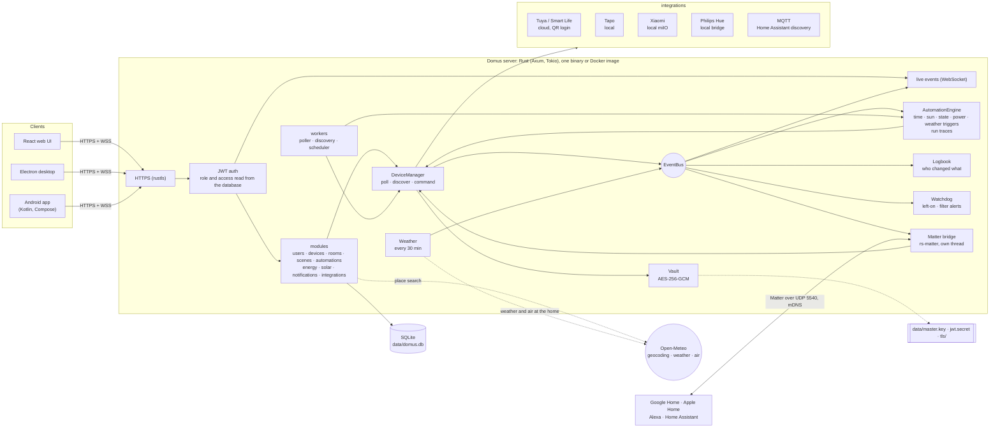
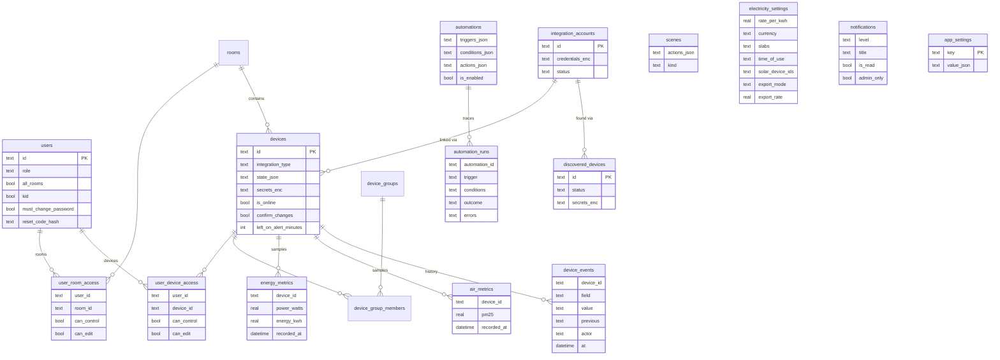

<p align="center">
  <b>Translations</b><br>
  <a href="README.md">English</a> ·
  <a href="README.ar.md">العربية</a> ·
  <a href="README.bn.md">বাংলা</a> ·
  <a href="README.de.md">Deutsch</a> ·
  <a href="README.es.md">Español</a> ·
  <a href="README.fr.md">Français</a> ·
  <a href="README.gu.md">ગુજરાતી</a> ·
  <a href="README.hi.md">हिन्दी</a> ·
  <a href="README.id.md">Bahasa Indonesia</a> ·
  <a href="README.it.md">Italiano</a> ·
  <a href="README.ja.md">日本語</a> ·
  <a href="README.kn.md">ಕನ್ನಡ</a> ·
  <a href="README.ko.md">한국어</a> ·
  <a href="README.ml.md">മലയാളം</a> ·
  <a href="README.mr.md">मराठी</a> ·
  <a href="README.pa.md">ਪੰਜਾਬੀ</a> ·
  <a href="README.pl.md">Polski</a> ·
  <a href="README.pt-BR.md">Português (Brasil)</a> ·
  <a href="README.ru.md">Русский</a> ·
  <a href="README.ta.md">தமிழ்</a> ·
  <a href="README.te.md">తెలుగు</a> ·
  <a href="README.th.md">ไทย</a> ·
  <a href="README.tr.md">Türkçe</a> ·
  <a href="README.ur.md">اردو</a> ·
  <a href="README.vi.md">Tiếng Việt</a> ·
  <a href="README.zh-CN.md">简体中文</a> ·
  <a href="README.zh-TW.md">繁體中文</a>
</p>


# Domus

[](https://github.com/aiyu-ayaan/Domus-Rust/actions/workflows/release.yml)
[](https://github.com/aiyu-ayaan/Domus-Rust/releases)
[](LICENSE)
[](https://github.com/aiyu-ayaan/Domus-Rust/commits/master)
[](https://hub.docker.com/r/aiyuayaan/domus)
[](https://hub.docker.com/r/aiyuayaan/domus)


自宅のホームサーバー向けに設計された、ローカルファーストのスマートホームハブです。Rust バックエンド、SQLite、React ウェブ UI（および Electron デスクトップシェル）を採用し、**Tuya / Smart Life**（開発者アカウント不要の QR コードログイン）、**TP-Link Tapo**（ローカル制御）、**Xiaomi Mi Home**（ローカル制御、Mi アカウントからトークン取得）、**Philips Hue**（ローカルブリッジ）、**MQTT**（Zigbee2MQTT、ESPHome、および Home Assistant 自動検出に対応したあらゆるデバイス）などのプラグイン型連携をサポートしています。内蔵の **Matter ブリッジ** により、Google Home、Apple Home、Alexa、Home Assistant から、自宅のローカルネットワーク経由でこれらのデバイスの電源オン・オフ、調光、調色を行えます。

- 新しいデバイスの自動検出（受信トレイで確認、または自動追加に対応）
- リアルタイムダッシュボード：現在の消費電力、これまでの電気代と予測請求額、空気質、人感・ドア・漏水・バッテリーの測定値
- 部屋、デバイスグループ、シーン、オートメーションに対応。特定時刻、**日の出・日の入り**（オフセット設定可能）、デバイスの状態変化、電力レベル（*X W 以上が N 分間継続した場合*など）、オフライン検知、**屋外の気象情報**によるトリガー
- **オートメーション実行履歴**：各オートメーションの直近 50 回の実行ログ（作動させたトリガーや実行を止めた条件）を保持
- **デバイス履歴**：デバイスのすべての状態変更履歴と変更者（操作者と使用アプリ、オートメーション、Matter、またはデバイス本体）
- オートメーションを作成することなく使える**スマートアラート**：長時間の電源付けっぱなし警告、空気清浄機フィルター残量低下アラート
- **Matter ブリッジ**：選択したデバイスを Google Home、Apple Home、Alexa、Home Assistant にクラウド不要でローカル共有
- 自宅所在地の**屋外の天気と大気質**（Open-Meteo 経由、API キー不要）をダッシュボードに表示し、室内の測定値と並べて比較
- **切り替える前に確認する**：主電源スイッチなどを誤操作から保護。すべてのアプリ、グループ、シーン、手動実行オートメーションでオン／オフを切り替える前に確認ダイアログを表示
- 電気料金計算：任意の通貨に対応し、一律単価、従量段階料金（スラブ）、**時間帯別料金（Time-of-day）**、デバイスごとの**待機電力コスト**、および**太陽光発電**（発電量、売電量、ネットメータリングまたは売電単価）に対応
- 複数ユーザー対応：管理者／メンバー／ゲストのロール設定、部屋単位またはデバイス単位のアクセス権限（表示のみ、操作、編集）
- ウェブ、Electron デスクトップ（Linux、Windows）、ネイティブ Android アプリの間でリアルタイム同期
- ウェブ、デスクトップ、Android アプリで **27 言語** に対応。システム言語に自動追従するほか、設定から手動切替可能。アラビア語・ウルドゥー語の右横書き（RTL）に対応
- 全アプリに Markdown、表、画像に対応したリリースノートを表示する「アップデート」ページを内蔵
- デフォルトで HTTPS 通信。認証情報とデバイス暗号化キーは保存時に暗号化。単一ファイルでのバックアップと復元に対応

アーキテクチャと構成図：[`development/docs/ARCHITECTURE.md`](development/docs/ARCHITECTURE.md)（概要は[下記](#how-it-fits-together)を参照）。
UI デザイン仕様：[`design-system/domus/MASTER.md`](design-system/domus/MASTER.md)。
開発進捗：[`development/TODO.md`](development/TODO.md)。

<a id="how-it-fits-together"></a>
## システム構成と仕組み



クライアントはサーバーとのみ通信します。サーバーはデバイスと通信し（ベンダーが許可している場合はローカル通信）、すべてのデータを 1 つの SQLite ファイルに保持します。クラウドが使用されるのは、ベンダーがローカル制御を提供していない場合（Tuya）、デバイスキーを取得する場合（Xiaomi）、およびオプションの問い合わせ（位置情報検索、自宅所在地の気象・大気質情報 [Open-Meteo、位置設定時のみ]、GitHub による更新確認）のみです。Matter ブリッジはローカルネットワーク内でのみ動作します。

### データモデル



認証情報およびデバイスキーは、データベース外にある `data/master.key` のもとで暗号化（`*_enc`）されて保存されます。機能ごとの完全な構成図は [`development/docs`](development/docs) にあります。

## スクリーンショット

<p align="center"></p>

**デスクトップ**（Electron およびウェブ）

<p>
  
  
  
  
  
  
</p>

**Android ネイティブアプリ**

<p>
  
  
  
  
  
</p>

**Android タブレット**（840dp 以上で 2 カラム表示、「設定」はリストと詳細ビュー）

<p>
  
  
  
  
  
</p>

**モバイルウェブ**

<p>
  
  
  
  
  
</p>

すべてのスクリーンショット画像は [`res/screenshots`](res/screenshots) にあります。高画質のデモ動画は [`res/domus.mp4`](res/domus.mp4) をご覧ください。

## ダウンロード

| プラットフォーム | 入手方法 |
|---|---|
| サーバー (Docker) | Docker Hub の `aiyuayaan/domus`（amd64 および arm64 対応） |
| Android | [最新リリース](https://github.com/aiyu-ayaan/Domus-Rust/releases) から `Domus-<version>.apk` をダウンロード |
| Linux デスクトップ | 下記の 1 行インストーラー、またはリリース記載の `.deb` / `.AppImage` |
| Windows デスクトップ | リリース記載の `Domus-<version>-Setup.exe` |

### サーバー

ホストマシンに必要なのは 1 つの compose ファイルのみです：

```bash
mkdir domus && cd domus
wget https://raw.githubusercontent.com/aiyu-ayaan/Domus-Rust/master/docker-compose.yml
docker compose up -d
```

ブラウザで `https://<server-ip>:8443` を開き、管理者アカウントを作成します。`docker compose logs domus` を実行すると、アプリ初回接続時に確認を求められる証明書フィンガープリントが表示されます。

```bash
docker compose pull && docker compose up -d      # アップデート
DOMUS_VERSION=beta docker compose up -d          # チャンネルを指定：latest（デフォルト）、beta、alpha、または 0.0.1
TZ=Asia/Tokyo DOMUS_PORT=9443 docker compose up -d
docker compose --profile mqtt up -d              # オプションの Mosquitto ブローカーも起動
```

設定を保持するには、compose ファイルと同じディレクトリ内の `.env` ファイルに `DOMUS_VERSION`、`TZ`、`DOMUS_PORT` を記述してください。

### Linux デスクトップアプリ

現在のユーザー向けに最新リリースをインストールします（x86_64、root 権限不要）：AppImage、Domus アイコン付きメニューエントリ、および `domus` コマンドが設定されます。インストール後はアプリ自身が自動で最新状態を維持します。

```bash
curl -fsSL https://raw.githubusercontent.com/aiyu-ayaan/Domus-Rust/master/scripts/install-linux.sh | sh
# ... | sh -s -- --channel beta     ベータ版（またはアルファ版）も含める
# ... | sh -s -- --uninstall        アンインストール（設定は保持）
```

### Android

リリース一覧ページから APK をダウンロードして開きます。以降の更新は、アプリ起動時および「設定 → アップデート」画面で通知され、安定版 (Stable)、ベータ版 (Beta)、アルファ版 (Alpha) の各チャンネルから選択してインストールできます。Android から 1 回だけ Domus によるアプリインストールを許可するよう求められます。

**アップデート** ページ（Android では「設定 → アップデート」、ウェブおよびデスクトップでは「設定 → 詳細情報 → アップデート」）には、現在実行中のバージョン、選択チャンネルの最新リリース、Markdown で書かれたリリースノートが表示されます。

リリース、バージョン番号、および更新チャンネルの詳細については [development/docs/RELEASE.md](development/docs/RELEASE.md) を参照してください。

## 動作要件

- Rust 1.80 以上 (`cargo`)
- Node.js 18 以上および `pnpm`

## 開発環境での実行

```bash
pnpm install
npm run dev            # バックエンド (https://127.0.0.1:8443) + ウェブ (http://localhost:3000)

npm run dev:backend    # バックエンドのみ実行
npm run dev:web        # ウェブフロントエンドのみ実行（/api をバックエンドへプロキシ）
npm run dev:desktop    # Electron を実行。接続ページでサーバーを選択
```

http://localhost:3000 を開きます。初回アクセス時に管理者アカウントの作成が求められます。

## ホームサーバーでの運用

```bash
pnpm build:web                     # apps/web/dist をビルド（バックエンドから配信）
APP_ENV=production cargo run --release --manifest-path backend/Cargo.toml
```

ブラウザで `https://<server-ip>:8443` を開きます。Matter ブリッジを有効にした場合、LAN 上で UDP 5540（`[matter] port`）と mDNS も使用されます。

または、本リポジトリから Docker イメージをビルドして実行します（ホストネットワーク、データは `domus_data` ボリュームに保存）：

```bash
docker compose -f docker-compose.local.yml up -d --build
```

Cloudflare Tunnel 経由のリモートアクセス、アプリが自動で切り替える自宅／リモートアドレス、デスクトップパッケージのビルド（`pnpm build:desktop`）については [development/docs/DEPLOYMENT.md](development/docs/DEPLOYMENT.md) を参照してください。

初回の起動時に、Domus は `data/` 配下に以下のファイルを作成します：

| ファイル | 用途 |
|---|---|
| `domus.db` | SQLite データベース |
| `master.key` | 連携認証情報およびデバイス暗号化キーを保護 —— **必ずバックアップしてください** |
| `jwt.secret` | セッショントークンの署名 |
| `tls/` | 自己署名証明書（`tls.cert_path` / `tls.key_path` で独自証明書へ差し替え可能） |

設定は `config/default.toml` にあります。すべての項目は `DOMUS__SECTION__KEY` 形式の環境変数で上書き可能です（`.env.example` 参照）。

## バックアップと復元

すべてのデータは `data/` に保存されます。フォルダ全体をバックアップするか、単一ファイルバックアップ機能をご利用ください：

**バックアップ：** 管理者としてログイン → 設定 → **バックアップ** → *バックアップをダウンロード*。生成されるファイルはマスターキーを含んだデータベースの完全なコピーであり、復元後も連携アカウントをそのまま復号して利用できます。サーバー稼働中にオンラインで作成可能です。ファイル保持者は連携アカウントを開くことができるため、取り扱いにはご注意ください。JWT シークレットと TLS 証明書は含まれません。

**復元：** サーバーを停止し、以下のコマンドを実行します：

```bash
# Docker 環境
docker compose cp domus-backup-2026-10-11.db domus:/app/data/restore.db
docker compose stop domus
docker compose run --rm domus domus-backend restore data/restore.db
docker compose start domus

# Docker を使わない場合（リポジトリのルートで実行、./data を対象とします）
domus-backend restore ~/Downloads/domus-backup-2026-10-11.db
```

既存のファイルは `*.before-restore` として安全に退避されます。新しいマシンに復元した後は再度ログインが必要となり、アプリは新しい証明書の信頼確認を表示します。環境変数 `DOMUS_MASTER_KEY` でキーを設定していた場合、バックアップにキーは含まれないため、復元先サーバーでも同じ環境変数を設定してください。詳細は [development/docs/DEPLOYMENT.md](development/docs/DEPLOYMENT.md#backup-and-restore) を参照してください。

## 管理者パスワードをお忘れの場合

Domus にはメールサーバー機能がないため、再設定メールは送信されません。状況に応じて以下の手順をお試しください：

1. **別の管理者がいる場合**：設定 → メンバーとアクセス権 を開き、対象ユーザーの*リセットコード*を有効化して 8 桁のコードを伝えます（有効期限 30 分、5 回の誤入力まで有効）。サインイン画面で*パスワードをお忘れですか？* を選択し、ユーザー名とリセットコードを入力します。
2. **サーバーのコンソールから操作する場合**（Domus の稼働中・停止中を問わず動作し、ログイン不要）：

   ```bash
   docker compose exec domus domus-backend reset-password <username>              # ランダムに生成された新しいパスワードを表示
   docker compose exec domus domus-backend reset-password <username> 'new-pass'   # または指定のパスワード（8文字以上）に設定
   domus-backend reset-password <username>                                        # Docker を使わない場合、リポジトリルートで実行
   ```

   そのパスワードでサインインし、設定 → パスワード から変更してください。

本番環境では、同一ユーザー名に対してパスワード入力を 5 回連続で失敗すると 15 分間アカウントがロックされます（サーバーを再起動すると解除されます。開発環境では無効化されています）。自動生成パスワードの仕様や子供用アカウントについては [development/docs/ACCOUNTS.md](development/docs/ACCOUNTS.md) を参照してください。

## 多言語対応

英語、ヒンディー語、スペイン語、ポルトガル語（ブラジル）、インドネシア語、アラビア語、フランス語、ロシア語、ドイツ語、トルコ語、日本語、韓国語、イタリア語、ベトナム語、タイ語、中国語（簡体字および繁体字）、ポーランド語、ベンガル語、タミル語、テルグ語、マラーティー語、グジャラート語、カンナダ語、マラヤーラム語、パンジャブ語、ウルドゥー語に対応しています。アラビア語とウルドゥー語は右横書き (RTL) で表示されます。

各アプリはブラウザまたはシステムの言語設定に従い、未翻訳の言語の場合は英語で表示されます。別の言語を選ぶには、設定 > 言語（ウェブおよびデスクトップでは「外観」配下）を開きます。*システムのデフォルト* を選ぶとシステム設定に従う状態に戻ります。Android 13 以降では、OS の 設定 > アプリ > Domus > 言語 からも個別に選択できます。

翻訳は機械翻訳によって生成されたものであり、ネイティブスピーカーによる校正は行われていないため、一部不自然な表現が含まれる場合があります。言語カタログの該当行を 1 行修正するだけで簡単に改善できます。多言語化の仕組み、新しい言語の追加方法、文言追加のルールは [development/docs/LOCALIZATION.md](development/docs/LOCALIZATION.md) をご覧ください。

## デバイスの接続

| ブランド | 接続手順 |
|---|---|
| Tuya / Smart Life | 連携 → *QR コードでリンク* を選択。Smart Life アプリのユーザーコード (User Code)（プロフィール → 設定 → アカウントとセキュリティ → ユーザーコード）を入力し、アプリで画面上の QR コードをスキャンします。 |
| Tapo | 連携 → TP-Link ID で *アカウントをリンク*。LAN 上のデバイスが自動検出され、ローカルで制御されます。H100 ハブ配下のセンサー、スイッチ、サーモスタットもまとめて追加されます。カメラは一覧に表示されますが、現時点では制御未対応です。 |
| Xiaomi | 連携 → Mi アカウントとサーバー地域で *アカウントをリンク*。2 段階認証を求められた場合は、メールまたは SMS で届いた認証コードを同一パネルに入力します。アカウントにはメールアドレス、国番号付き電話番号（`+81…`）、または Xiaomi ID を使用できます。トークンは初回のみ取得され、制御は完全にローカルで行われます。トークンを直接入力して個別追加することも可能です。 |
| Philips Hue | ブリッジ天面の丸いボタンを押し、30 秒以内に 連携 → Philips Hue → *リンク* をクリックします。アドレスを空欄にしておくと、同一 LAN 内のブリッジを自動検索します。ライトおよび Hue スマートプラグはローカルで直接制御されます。 |
| MQTT | 連携 → MQTT → ブローカーのアドレス、ポート、ログイン情報を入力して *リンク* をクリック。Home Assistant MQTT 自動検出（Zigbee2MQTT、ESPHome など）に対応したデバイスが「検出済み」に表示されます（照明、スイッチ、プラグ、ファン、センサーに対応）。同梱のブローカー（`--profile mqtt`）を使用する場合、アドレスは `mqtt`、ポートは `1883` です。 |

各連携が対応している詳細なデバイス一覧は `development/docs/INTEGRATIONS.md` を参照してください。

## 電気料金プランの管理

エネルギー → *電気料金プラン*：任意の通貨を選択し、kWh あたりの一律単価、または段階従量制の**スラブ料金（Slabs）**（例：0〜100 kWh は第 1 段階、101〜300 kWh は第 2 段階など）を設定できます。請求サイクルごとに合計金額が計算され、月額の基本料金も加算されます。

さらに**時間帯別料金（Time-of-day）** の設定枠にも対応しています。家庭の現地時間（深夜をまたぐ設定も可能）に基づいて、特定の時間帯について一律またはスラブ単価に対して加算・減算（例：深夜割引やピーク時間帯の追加料金）を設定できます。

新しく検出されたデバイスは **デバイス → 検出済み** に表示されます。*新しいデバイスを自動的に追加* をオンにすると、受信トレイでの承認を省略して直接追加できます。

## 日の出と日の入り

設定 → **ホームの位置情報** で自宅の位置を設定します。現在のスマートフォンやブラウザの位置情報を使用するか、都市名で検索（無料の Open-Meteo ジオコーダーを使用。入力した地名のみが送信されます）、あるいは緯度と経度を直接入力します。座標は約 1km 精度に丸められ、ローカルサーバー内に保持されます。設定完了後は、日の出・日の入りの時刻（およびその前後数分）をトリガーとしてオートメーションを実行できます。位置情報が未設定の場合、太陽トリガーは動作しません。

## 切り替える前に確認する

電化製品の主電源スイッチなどは、誤ってオフにしてしまうと影響が大きくなります。デバイスの詳細画面を開き、**切り替える前に確認する** をオンにします。これにより、すべてのアプリでオン／オフの操作時に確認ダイアログが表示されるようになります。部屋ごとの *すべてオン / すべてオフ*、デバイスグループ、シーン（入れ子のシーンを含む）、および該当デバイスを切り替えるオートメーションの手動 *実行* でも同様に確認が求められます。この設定はサーバー側に保存されるため、ウェブ、デスクトップ、Android のすべてで一貫して適用されます。自動で実行されるオートメーションは確認を行わずスケジュール通り動作し、Domus の管理外の操作（ベンダー公式アプリ、壁の物理スイッチなど）は対象外です。

## Matter 対応（Google Home、Apple Home、Alexa）

設定 → **Matter**（管理者専用）：機能を有効化し、共有するデバイスにチェックを入れて、Google Home、Apple Home、Alexa、Home Assistant で QR コードをスキャンするかペアリングコードを入力します。照明はカラーまたは調光ライトとして、オン／オフスイッチを持つその他のデバイスはスマートプラグとして認識されます。スイッチ操作、調光、調色に対応し、Domus 側で行った変更（オン／オフ、明るさなど）はリアルタイムにコントローラーへ反映されます。「15分間ペアリングを許可」を使うと 2 つ目のスマートホームプラットフォームを追加でき、「すべてのペアリングを解除」を選択すると新しいコードで初期化されます。

本ブリッジは公式認証を取得していないため（Matter テスト証明書を使用）、アプリ側で追加の確認が求められます。また Google Home で利用するには、Google Home Developer Console にテストデバイスとしてブリッジをあらかじめ登録する必要があります。詳細：[`development/docs/MATTER.md`](development/docs/MATTER.md)。

## 履歴、オートメーション実行ログ、アラート

- 各デバイスの詳細シートの**履歴**：いつ、何が変更され、誰が操作したか（*Ayaan による操作 · Android*、*オートメーション "おやすみモード"*、*Matter*、*デバイス本体での操作*）を表示。エネルギー履歴と同じ期間保存されます。
- 各オートメーションの**実行履歴**：*実行完了*、エラー詳細付きの*失敗*、または作動を抑止した条件を示す*スキップ*が記録され、「なぜ動かなかったのか？」の原因を特定できます。
- デバイス詳細シートの**付けっぱなしアラート**（30 分〜12 時間）：指定時間以上オンのままになっている場合に管理者に通知します。電力計測対応デバイスの場合、10 W 以上を「オン」とみなすため、待機状態のテレビなどで誤通知することはありません。
- **フィルター残量低下通知**：空気清浄機のフィルター残量が 10% を下回った際に通知します。

## 天気、待機電力、太陽光発電

- ホームの位置情報を設定すると、ダッシュボード上に室内の測定値と並んで**屋外の天気と大気質 (PM2.5)** が表示され、オートメーションの条件として利用できます（例：*屋外の PM2.5 が 35 を超えたとき*、*屋外の気温が 20 度未満の場合のみ*）。
- エネルギー → **待機電力**：誰も使用していない時間帯（今週で最も消費電力が低かった 1 時間）の各デバイスの消費電力と、それにかかる月額コストを一覧表示します。
- エネルギー → *電気料金プラン* → **太陽光**：太陽光発電量を計測しているプラグにチェックを入れ、ネットメータリングまたは売電単価を選択します。これにより請求額は買電分のみの計算となり、「太陽光」カードに発電量、自宅消費量、売電量、獲得金額が表示されます。電力の流れは計測デバイスをもとに 15 分ごとに算出されるため、メーター未接続の家電製品がある場合、売電量の計算値が高めに表示されることがあります。

今後の計画と構成図：[`development/docs/ROADMAP.md`](development/docs/ROADMAP.md)。

## ライセンス

Domus は [MIT License](LICENSE) のもとで公開されています。使用しているサードパーティ製ライブラリはそれぞれのライセンスを保持しており、各アプリの 詳細情報 → 謝辞 に一覧が記載されています。

## テストの実行

```bash
cargo test --workspace
pnpm --filter @domus/web exec tsc -b
```

`cargo test --workspace` には、UDP 経由で Matter コントローラーをブリッジとペアリングし、デバイスのスイッチ、調光、調色をテストする `backend/tests/matter_bridge.rs` が含まれます（IPv4 に対応したネットワークインターフェースが必要です）。
