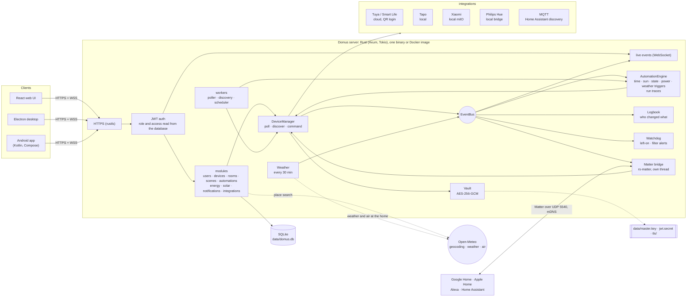
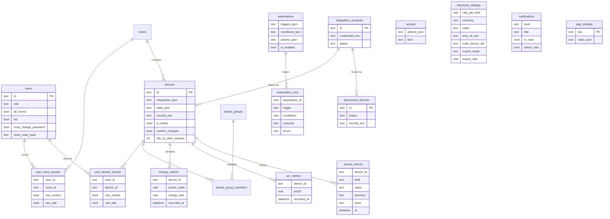

# Domus

<p align="center">
  <b>Translations</b><br>
  <a href="README.md">English</a> ·
  <a href="README.ar.md">العربية</a> ·
  <a href="README.bn.md">বাংলা</a> ·
  <a href="README.de.md">Deutsch</a> ·
  <a href="README.es.md">Español</a> ·
  <a href="README.fr.md">Français</a> ·
  <a href="README.gu.md">ગુજરાતી</a> ·
  <a href="README.hi.md">हिन्दी</a> ·
  <a href="README.id.md">Bahasa Indonesia</a> ·
  <a href="README.it.md">Italiano</a> ·
  <a href="README.ja.md">日本語</a> ·
  <a href="README.kn.md">ಕನ್ನಡ</a> ·
  <a href="README.ko.md">한국어</a> ·
  <a href="README.ml.md">മലയാളം</a> ·
  <a href="README.mr.md">മराठी</a> ·
  <a href="README.pa.md">ਪੰਜਾਬੀ</a> ·
  <a href="README.pl.md">Polski</a> ·
  <a href="README.pt-BR.md">Português (Brasil)</a> ·
  <a href="README.ru.md">Русский</a> ·
  <a href="README.ta.md">தமிழ்</a> ·
  <a href="README.te.md">తెలుగు</a> ·
  <a href="README.th.md">ไทย</a> ·
  <a href="README.tr.md">Türkçe</a> ·
  <a href="README.ur.md">اردو</a> ·
  <a href="README.vi.md">Tiếng Việt</a> ·
  <a href="README.zh-CN.md">简体中文</a> ·
  <a href="README.zh-TW.md">繁體中文</a>
</p>

[](https://github.com/aiyu-ayaan/Domus-Rust/actions/workflows/release.yml)
[](https://github.com/aiyu-ayaan/Domus-Rust/releases)
[](LICENSE)
[](https://github.com/aiyu-ayaan/Domus-Rust/commits/master)
[](https://hub.docker.com/r/aiyuayaan/domus)
[](https://hub.docker.com/r/aiyuayaan/domus)


[](https://ghloc.dev/aiyu-ayaan/Domus)


ನಿಮ್ಮ ಹೋಮ್ ಸರ್ವರ್‌ಗಾಗಿ ಲೋಕಲ್-ಫಸ್ಟ್ ಸ್ಮಾರ್ಟ್-ಹೋಮ್ ಹಬ್. Rust ಬ್ಯಾಕೆಂಡ್, SQLite, React ವೆಬ್ UI (Electron ಡೆಸ್ಕ್‌ಟಾಪ್ ಶೆಲ್‌ನೊಂದಿಗೆ), ಮತ್ತು **Tuya / Smart Life** (QR-ಕೋಡ್ ಲಾಗಿನ್, ಡೆವಲಪರ್ ಖಾತೆಯ ಅಗತ್ಯವಿಲ್ಲ), **TP-Link Tapo** (ಸ್ಥಳೀಯ), **Xiaomi Mi Home** (ಸ್ಥಳೀಯ, ನಿಮ್ಮ Mi ಖಾತೆಯಿಂದ ಟೋಕನ್‌ಗಳು), **Philips Hue** (ಸ್ಥಳೀಯ ಬ್ರಿಡ್ಜ್) ಮತ್ತು **MQTT** (Zigbee2MQTT, ESPHome ಮತ್ತು Home Assistant discovery ಬೆಂಬಲಿಸುವ ಇತರ ಸಾಧನಗಳು) ಗಾಗಿ ಪ್ಲಗ್ ಮಾಡಬಹುದಾದ ಇಂಟಿಗ್ರೇಷನ್‌ಗಳು. ಅಂತರ್ನಿರ್ಮಿತ **Matter ಬ್ರಿಡ್ಜ್** ಮೂಲಕ Google Home, Apple Home, Alexa ಮತ್ತು Home Assistant ನಿಮ್ಮದೇ ಆದ ಸ್ಥಳೀಯ ನೆಟ್‌ವರ್ಕ್‌ನಲ್ಲಿ ಈ ಸಾಧನಗಳನ್ನು ಆನ್/ಆಫ್ ಮಾಡಲು, ಡಿಮ್ ಮಾಡಲು ಮತ್ತು ಬಣ್ಣ ಬದಲಾಯಿಸಲು ಅನುಮತಿಸುತ್ತದೆ.

- ಹೊಸ ಸಾಧನಗಳ ಸ್ವಯಂಚಾಲಿತ ಪತ್ತೆ (Automatic discovery), ಇನ್‌ಬಾಕ್ಸ್ ಅಥವಾ ಸ್ವಯಂ-ಸೇರ್ಪಡೆ (auto-add) ಆಯ್ಕೆಯೊಂದಿಗೆ
- ಲೈವ್ ಡ್ಯಾಶ್‌ಬೋರ್ಡ್: ವಿದ್ಯುತ್ ಬಳಕೆ, ಇದುವರೆಗಿನ ಬಿಲ್ ಮತ್ತು ಅಂದಾಜು ಬಿಲ್, ಗಾಳಿಯ ಗುಣಮಟ್ಟ, ಚಲನೆ / ಬಾಗಿಲು / ಸೋರಿಕೆ / ಬ್ಯಾಟರಿ ರೀಡಿಂಗ್‌ಗಳು
- ಕೊಠಡಿಗಳು, ಸಾಧನ ಗುಂಪುಗಳು (device groups), ಸೀನ್‌ಗಳು ಮತ್ತು ಆಟೊಮೇಷನ್‌ಗಳು; ನಿರ್ದಿಷ್ಟ ಸಮಯದಲ್ಲಿ, **ಸೂರ್ಯೋದಯ ಅಥವಾ ಸೂರ್ಯಾಸ್ತದ** ಸಮಯದಲ್ಲಿ (ಆಫ್‌ಸೆಟ್‌ನೊಂದಿಗೆ), ಸಾಧನದ ಸ್ಥಿತಿ ಬದಲಾವಣೆಯಾದಾಗ, ವಿದ್ಯುತ್ ಬಳಕೆಯ ಮಟ್ಟದಲ್ಲಿ (*N ನಿಮಿಷಗಳ ಕಾಲ X ಗಿಂತ ಹೆಚ್ಚಿರುವುದು ಸೇರಿದಂತೆ*), ಆಫ್‌ಲೈನ್‌ಗೆ ಹೋದಾಗ ಅಥವಾ **ಹೊರಾಂಗಣ ಹವಾಮಾನದ** ಆಧಾರದ ಮೇಲೆ ಟ್ರಿಗ್ಗರ್‌ಗಳು
- **ಆಟೊಮೇಷನ್ ರನ್ ಇತಿಹಾಸ (Automation runs)**: ಪ್ರತಿಯೊಂದು ಆಟೊಮೇಷನ್ ತನ್ನ ಕೊನೆಯ 50 ರನ್‌ಗಳ ದಾಖಲೆಯನ್ನು ಇರಿಸುತ್ತದೆ, ಅದನ್ನು ಪ್ರಚೋದಿಸಿದ ಟ್ರಿಗ್ಗರ್ ಮತ್ತು ಅದನ್ನು ತಡೆಹಿಡಿದ ಷರತ್ತುಗಳ ಸಂಪೂರ್ಣ ವಿವರಗಳೊಂದಿಗೆ
- **ಸಾಧನದ ಇತಿಹಾಸ (Device history)**: ಸಾಧನದಲ್ಲಿ ಆದ ಪ್ರತಿಯೊಂದು ಬದಲಾವಣೆ ಮತ್ತು ಅದನ್ನು ಯಾರು ಮಾಡಿದರು ಎಂಬ ವಿವರ (ಒಬ್ಬ ವ್ಯಕ್ತಿ ಮತ್ತು ಅವರು ಬಳಸಿದ ಆ್ಯಪ್, ಆಟೊಮೇಷನ್, Matter, ಅಥವಾ ಸ್ವತಃ ಸಾಧನವೇ)
- ಆಟೊಮೇಷನ್ ಕೋಡ್ ಬರೆಯದೆಯೇ **ಎಚ್ಚರಿಕೆಗಳು (Alerts)**: ಸಾಧನವು ಹೆಚ್ಚು ಸಮಯ ಆನ್ ಆಗಿಯೇ ಉಳಿದಾಗ, ಏರ್ ಪ್ಯೂರಿಫೈಯರ್ ಫಿಲ್ಟರ್ ಕಡಿಮೆಯಾದಾಗ
- **Matter ಬ್ರಿಡ್ಜ್**: ನೀವು ಆಯ್ಕೆಮಾಡಿದ ಸಾಧನಗಳನ್ನು ಯಾವುದೇ ಕ್ಲೌಡ್ ಖಾತೆಯಿಲ್ಲದೆ ಸ್ಥಳೀಯವಾಗಿ Google Home, Apple Home, Alexa ಅಥವಾ Home Assistant ನೊಂದಿಗೆ ಹಂಚಿಕೊಳ್ಳಿ
- ಮನೆಯ ಸ್ಥಳದ **ಹೊರಾಂಗಣ ಹವಾಮಾನ ಮತ್ತು ಗಾಳಿಯ ಗುಣಮಟ್ಟ** (Open-Meteo, API ಕೀ ಅಗತ್ಯವಿಲ್ಲ) ಒಳಾಂಗಣ ರೀಡಿಂಗ್ ಪಕ್ಕದಲ್ಲಿ ಡ್ಯಾಶ್‌ಬೋರ್ಡ್‌ನಲ್ಲಿ ಪ್ರದರ್ಶನ
- **ಸ್ವಿಚ್ ಮಾಡುವ ಮೊದಲು ಕೇಳಿ (Ask before switching)**: ಮುಖ್ಯ ಸ್ವಿಚ್ ಅನ್ನು ಗುರುತಿಸಿ, ಇದರಿಂದ ಪ್ರತಿಯೊಂದು ಆ್ಯಪ್, ಗುಂಪು, ಸೀನ್ ಮತ್ತು ಮ್ಯಾನ್ಯುವಲ್ ಆಟೊಮೇಷನ್ ರನ್ ಅದನ್ನು ಆನ್ ಅಥವಾ ಆಫ್ ಮಾಡುವ ಮೊದಲು ಎಚ್ಚರಿಸಿ ದೃಢೀಕರಣ ಕೇಳುತ್ತದೆ
- ಯಾವುದೇ ಕರೆನ್ಸಿಯಲ್ಲಿ ಫ್ಲಾಟ್, ಸ್ಲ್ಯಾಬ್ ಮತ್ತು **ದಿನದ ಸಮಯ (time-of-day)** ದರಗಳೊಂದಿಗೆ ವಿದ್ಯುತ್ ಬಿಲ್ಲಿಂಗ್, ಪ್ರತಿ ಸಾಧನಕ್ಕೆ **ಸ್ಟ್ಯಾಂಡ್‌ಬೈ ವೆಚ್ಚ**, ಮತ್ತು **ಸೌರಶಕ್ತಿ (solar)**: ಉತ್ಪಾದನೆ, ರಫ್ತು ಮತ್ತು ನೆಟ್ ಮೀಟರಿಂಗ್ ಅಥವಾ ಫೀಡ್-ಇನ್ ದರ
- ಅಡ್ಮಿನ್ / ಸದಸ್ಯ / ಅತಿಥಿ ಪಾತ್ರಗಳೊಂದಿಗೆ ಬಹು ಬಳಕೆದಾರರು ಮತ್ತು ಕೊಠಡಿ ಅಥವಾ ಸಾಧನದ ಪ್ರಕಾರ ಕೇವಲ ವೀಕ್ಷಣೆ (see-only), ನಿಯಂತ್ರಣ (control) ಅಥವಾ ತಿದ್ದುಪಡಿ (edit) ಪ್ರವೇಶ
- ವೆಬ್, Electron ಡೆಸ್ಕ್‌ಟಾಪ್ (Linux, Windows) ಮತ್ತು ಸ್ಥಳೀಯ Android ಆ್ಯಪ್, ಇವೆಲ್ಲವೂ ರಿಯಲ್-ಟೈಮ್‌ನಲ್ಲಿ ಸಿಂಕ್ ಆಗಿರುತ್ತವೆ
- ವೆಬ್, ಡೆಸ್ಕ್‌ಟಾಪ್ ಮತ್ತು Android ಆ್ಯಪ್‌ಗಳಲ್ಲಿ **27 ಭಾಷೆಗಳು**, ಸೆಟ್ಟಿಂಗ್‌ಗಳಲ್ಲಿ ಆಯ್ಕೆಯೊಂದಿಗೆ ನಿಮ್ಮ ಸಿಸ್ಟಂ ಭಾಷೆಯನ್ನು ಅನುಸರಿಸುತ್ತವೆ; ಅರೇಬಿಕ್ ಮತ್ತು ಉರ್ದು ಭಾಷೆಗಳಿಗೆ ಬಲದಿಂದ ಎಡಕ್ಕೆ (RTL) ವಿನ್ಯಾಸ
- ಪ್ರತಿ ಆ್ಯಪ್‌ನಲ್ಲೂ ಬಿಡುಗಡೆ ಟಿಪ್ಪಣಿಗಳೊಂದಿಗೆ (Markdown, ಕೋಷ್ಟಕಗಳು ಮತ್ತು ಚಿತ್ರಗಳು) ನವೀಕರಣಗಳ (Updates) ಪುಟ
- ಪೂರ್ವನಿಯೋಜಿತವಾಗಿ HTTPS ಭದ್ರತೆ; ರುಜುವಾತುಗಳು ಮತ್ತು ಸಾಧನದ ಕೀಗಳು ಸುರಕ್ಷಿತವಾಗಿ ಎನ್‌ಕ್ರಿಪ್ಟ್ ಆಗಿರುತ್ತವೆ; ಏಕ-ಫೈಲ್ ಬ್ಯಾಕಪ್ ಮತ್ತು ಮರುಸ್ಥಾಪನೆ

ವಾಸ್ತುಶಿಲ್ಪ ಮತ್ತು ರೇಖಾಚಿತ್ರಗಳು: [`development/docs/ARCHITECTURE.md`](development/docs/ARCHITECTURE.md), [ಕೆಳಗೆ ಸಾರಾಂಶ ನೀಡಲಾಗಿದೆ](#ಇದು-ಒಟ್ಟಾಗಿ-ಹೇಗೆ-ಕೆಲಸ-ಮಾಡುತ್ತದೆ).
UI ವಿನ್ಯಾಸ ಪ್ರೊಫೈಲ್: [`design-system/domus/MASTER.md`](design-system/domus/MASTER.md).
ಪ್ರಗತಿ: [`development/TODO.md`](development/TODO.md).

## ಇದು ಒಟ್ಟಾಗಿ ಹೇಗೆ ಕೆಲಸ ಮಾಡುತ್ತದೆ



ಕ್ಲೈಂಟ್‌ಗಳು ಸರ್ವರ್‌ನೊಂದಿಗೆ ಮಾತ್ರ ಸಂವಹನ ನಡೆಸುತ್ತವೆ; ಸರ್ವರ್ ನಿಮ್ಮ ಸಾಧನಗಳೊಂದಿಗೆ ನೇರವಾಗಿ ಸಂವಹನ ನಡೆಸುತ್ತದೆ (ಮಾರಾಟಗಾರರು ಅನುಮತಿಸುವ ಸ್ಥಳಗಳಲ್ಲಿ ಸ್ಥಳೀಯವಾಗಿ) ಮತ್ತು ಎಲ್ಲವನ್ನೂ ಒಂದೇ SQLite ಫೈಲ್‌ನಲ್ಲಿ ಇಡುತ್ತದೆ. ಮಾರಾಟಗಾರರು ಯಾವುದೇ ಸ್ಥಳೀಯ ನಿಯಂತ್ರಣವನ್ನು ನೀಡದಿದ್ದಾಗ ಮಾತ್ರ ಕ್ಲೌಡ್ ಬಳಸಲಾಗುತ್ತದೆ (Tuya) ಅಥವಾ ಸಾಧನ ಟೋಕನ್‌ಗಳನ್ನು ಪಡೆಯಲು (Xiaomi), ಹೆಚ್ಚುವರಿಯಾಗಿ ಐಚ್ಛಿಕ ಹುಡುಕಾಟಗಳು: ಸ್ಥಳ ಹುಡುಕಾಟ, ಮನೆಯ ಸ್ಥಳದ ಹವಾಮಾನ ಮತ್ತು ಹೊರಾಂಗಣ ಗಾಳಿಯ ಗುಣಮಟ್ಟ (Open-Meteo, ಸ್ಥಳವನ್ನು ಹೊಂದಿಸಿದ ನಂತರ ಮಾತ್ರ) ಮತ್ತು ಅಪ್‌ಡೇಟ್‌ಗಳನ್ನು ಪರಿಶೀಲಿಸಲು GitHub. Matter ಬ್ರಿಡ್ಜ್ ಸ್ಥಳೀಯ ನೆಟ್‌ವರ್ಕ್‌ನಲ್ಲಿ ಮಾತ್ರ ಕಾರ್ಯನಿರ್ವಹಿಸುತ್ತದೆ.

### ಡೇಟಾ ಮಾದರಿ (Data model)



ರುಜುವಾತುಗಳು ಮತ್ತು ಸಾಧನದ ಕೀಗಳು ಡೇಟಾಬೇಸ್‌ನಿಂದ ಹೊರಗೆ `data/master.key` ಅಡಿಯಲ್ಲಿ ಸುರಕ್ಷಿತವಾಗಿ (`*_enc`) ಸಂಗ್ರಹಿಸಲ್ಪಡುತ್ತವೆ. ಪ್ರತಿಯೊಂದು ವೈಶಿಷ್ಟ್ಯದ ಸಂಪೂರ್ಣ ರೇಖಾಚಿತ್ರಗಳ ಸಂಗ್ರಹವು [`development/docs`](development/docs) ನಲ್ಲಿದೆ.

## ಸ್ಕ್ರೀನ್‌ಶಾಟ್‌ಗಳು (Screenshots)

<p align="center"></p>

**ಡೆಸ್ಕ್‌ಟಾಪ್** (Electron ಮತ್ತು ವೆಬ್)

<p>
  
  
  
  
  
  
</p>

**Android**

<p>
  
  
  
  
  
</p>

**Android ಟ್ಯಾಬ್ಲೆಟ್** (840dp ಯಿಂದ ಎರಡು ಕಾಲಮ್‌ಗಳು, ಸೆಟ್ಟಿಂಗ್‌ಗಳು ಪಟ್ಟಿ ಮತ್ತು ವಿವರವಾಗಿ)

<p>
  
  
  
  
  
</p>

**ಮೊಬೈಲ್ ವೆಬ್**

<p>
  
  
  
  
  
</p>

ಎಲ್ಲಾ ಚಿತ್ರಗಳು [`res/screenshots`](res/screenshots) ನಲ್ಲಿದೆ; ಸಂಪೂರ್ಣ ಗುಣಮಟ್ಟದ ವೀಡಿಯೊ [`res/domus.mp4`](res/domus.mp4) ನಲ್ಲಿದೆ.

## ಡೌನ್‌ಲೋಡ್ (Download)

| | |
|---|---|
| ಸರ್ವರ್ (Docker) | Docker Hub ನಲ್ಲಿ `aiyuayaan/domus`, amd64 ಮತ್ತು arm64 |
| Android | [ಇತ್ತೀಚಿನ ಬಿಡುಗಡೆಯಿಂದ](https://github.com/aiyu-ayaan/Domus-Rust/releases) `Domus-<version>.apk` |
| Linux ಡೆಸ್ಕ್‌ಟಾಪ್ | ಕೆಳಗಿನ ಒನ್-ಲೈನ್ ಇನ್‌ಸ್ಟಾಲರ್, ಅಥವಾ ಬಿಡುಗಡೆಯಿಂದ `.deb` / `.AppImage` |
| Windows ಡೆಸ್ಕ್‌ಟಾಪ್ | ಬಿಡುಗಡೆಯಿಂದ `Domus-<version>-Setup.exe` |

### ಸರ್ವರ್

ಹೋಸ್ಟ್‌ಗೆ ಒಂದೇ ಒಂದು ಫೈಲ್ ಅಗತ್ಯವಿದೆ:

```bash
mkdir domus && cd domus
wget https://raw.githubusercontent.com/aiyu-ayaan/Domus-Rust/master/docker-compose.yml
docker compose up -d
```

`https://<server-ip>:8443` ತೆರೆಯಿರಿ ಮತ್ತು ನಿರ್ವಾಹಕ ಖಾತೆಯನ್ನು ರಚಿಸಿ. ಆ್ಯಪ್‌ಗಳು ದೃಢೀಕರಿಸಲು ಕೇಳುವ ಪ್ರಮಾಣಪತ್ರ ಫಿಂಗರ್‌ಪ್ರಿಂಟ್ (certificate fingerprint) ನೋಡಲು `docker compose logs domus` ಬಳಸಿ.

```bash
docker compose pull && docker compose up -d      # ಅಪ್‌ಡೇಟ್ ಮಾಡಲು
DOMUS_VERSION=beta docker compose up -d          # ಚಾನಲ್ ಅನುಸರಿಸಿ: latest (ಡೀಫಾಲ್ಟ್), beta, alpha, ಅಥವಾ 0.0.1
TZ=Asia/Kolkata DOMUS_PORT=9443 docker compose up -d
docker compose --profile mqtt up -d              # ಐಚ್ಛಿಕ Mosquitto ಬ್ರೋಕರ್ ಅನ್ನು ಸಹ ಪ್ರಾರಂಭಿಸಲು
```

ಅವುಗಳನ್ನು ಶಾಶ್ವತವಾಗಿ ಇರಿಸಲು ಕಂಪೋಸ್ ಫೈಲ್ ಪಕ್ಕದಲ್ಲಿರುವ `.env` ಫೈಲ್‌ನಲ್ಲಿ `DOMUS_VERSION`, `TZ` ಮತ್ತು `DOMUS_PORT` ಅನ್ನು ಇರಿಸಿ.

### Linux ಡೆಸ್ಕ್‌ಟಾಪ್ ಆ್ಯಪ್

ಪ್ರಸ್ತುತ ಬಳಕೆದಾರರಿಗಾಗಿ ಹೊಸ ಬಿಡುಗಡೆಯನ್ನು ಇನ್‌ಸ್ಟಾಲ್ ಮಾಡುತ್ತದೆ (x86_64, root ಅಗತ್ಯವಿಲ್ಲ): AppImage, Domus ಐಕಾನ್‌ನೊಂದಿಗೆ ಮೆನು ನಮೂದು ಮತ್ತು `domus` ಕಮಾಂಡ್. ನಂತರ ಆ್ಯಪ್ ಸ್ವತಃ ನವೀಕರಿಸಲ್ಪಡುತ್ತದೆ.

```bash
curl -fsSL https://raw.githubusercontent.com/aiyu-ayaan/Domus-Rust/master/scripts/install-linux.sh | sh
# ... | sh -s -- --channel beta     ಬೀಟಾ ಬಿಲ್ಡ್‌ಗಳಿಗೂ (ಅಥವಾ alpha)
# ... | sh -s -- --uninstall        ತೆಗೆದುಹಾಕಲು; ಸೆಟ್ಟಿಂಗ್‌ಗಳನ್ನು ಉಳಿಸಿಕೊಳ್ಳಲಾಗುತ್ತದೆ
```

### Android

ಬಿಡುಗಡೆ ಪುಟದಿಂದ APK ಡೌನ್‌ಲೋಡ್ ಮಾಡಿ ತೆರೆಯಿರಿ. ಆ್ಯಪ್ ತೆರೆದಾಗ ಮತ್ತು ಸೆಟ್ಟಿಂಗ್‌ಗಳು → ನವೀಕರಣಗಳು (Settings → Updates) ನಲ್ಲಿ Stable, Beta ಅಥವಾ Alpha ಚಾನಲ್‌ನಲ್ಲಿ ಮುಂದಿನ ಅಪ್‌ಡೇಟ್‌ಗಳು ಲಭ್ಯವಿರುತ್ತವೆ; ಅವುಗಳನ್ನು ಸ್ಥಾಪಿಸಲು ಅನುಮತಿಸಲು Android ಒಮ್ಮೆ ಕೇಳುತ್ತದೆ.

**ನವೀಕರಣಗಳ** ಪುಟ (Android ನಲ್ಲಿ ಸೆಟ್ಟಿಂಗ್‌ಗಳು → ನವೀಕರಣಗಳು; ವೆಬ್ ಮತ್ತು ಡೆಸ್ಕ್‌ಟಾಪ್‌ನಲ್ಲಿ ಸೆಟ್ಟಿಂಗ್‌ಗಳು → ಕುರಿತು → ನವೀಕರಣಗಳು) ನೀವು ಚಾಲನೆ ಮಾಡುತ್ತಿರುವ ಆವೃತ್ತಿ, ನಿಮ್ಮ ಚಾನಲ್‌ನಲ್ಲಿನ ಹೊಸ ಬಿಡುಗಡೆ ಮತ್ತು Markdown ನಲ್ಲಿ ಬರೆಯಲಾದ ಬಿಡುಗಡೆ ಟಿಪ್ಪಣಿಗಳನ್ನು ತೋರಿಸುತ್ತದೆ.

ಬಿಡುಗಡೆಗಳು, ಆವೃತ್ತಿ ಸಂಖ್ಯೆಗಳು ಮತ್ತು ನವೀಕರಣ ಚಾನಲ್‌ಗಳು: [development/docs/RELEASE.md](development/docs/RELEASE.md).

## ಅಗತ್ಯತೆಗಳು (Requirements)

- Rust 1.80+ (`cargo`)
- Node.js 18+ ಮತ್ತು `pnpm`

## ಡೆವಲಪ್‌ಮೆಂಟ್‌ನಲ್ಲಿ ರನ್ ಮಾಡಿ (Run in development)

```bash
pnpm install
npm run dev            # backend (https://127.0.0.1:8443) + web (http://localhost:3000)

npm run dev:backend    # backend ಮಾತ್ರ
npm run dev:web        # web ಮಾತ್ರ (API ಅನ್ನು backend ಗೆ ಪ್ರಾಕ್ಸಿ ಮಾಡುತ್ತದೆ)
npm run dev:desktop    # Electron; ಅದರ ಕನೆಕ್ಟ್ ಪುಟದಲ್ಲಿ ಸರ್ವರ್ ಅನ್ನು ಆಯ್ಕೆಮಾಡಿ
```

http://localhost:3000 ತೆರೆಯಿರಿ. ಮೊದಲ ಭೇಟಿಯಲ್ಲಿ ನಿರ್ವಾಹಕ ಖಾತೆಯನ್ನು ರಚಿಸಲು ಕೇಳುತ್ತದೆ.

## ಹೋಮ್ ಸರ್ವರ್‌ನಲ್ಲಿ ರನ್ ಮಾಡಿ (Run on the home server)

```bash
pnpm build:web                     # ಬ್ಯಾಕೆಂಡ್‌ನಿಂದ ಒದಗಿಸಲಾದ apps/web/dist ಅನ್ನು ನಿರ್ಮಿಸುತ್ತದೆ
APP_ENV=production cargo run --release --manifest-path backend/Cargo.toml
```

ನಂತರ `https://<server-ip>:8443` ತೆರೆಯಿರಿ. Matter ಬ್ರಿಡ್ಜ್ ಆನ್ ಆಗಿರುವಾಗ LAN ನಲ್ಲಿ UDP 5540 (`[matter] port`) ಮತ್ತು mDNS ಅನ್ನು ಸಹ ಬಳಸುತ್ತದೆ.

ಅಥವಾ ಈ ಚೆಕ್‌ಔಟ್‌ನಿಂದಲೇ Docker ಇಮೇಜ್ ನಿರ್ಮಿಸಿ (host networking, `domus_data` ವಾಲ್ಯೂಮ್‌ನಲ್ಲಿ ಡೇಟಾ):

```bash
docker compose -f docker-compose.local.yml up -d --build
```

Cloudflare Tunnel ಮೂಲಕ ರಿಮೋಟ್ ಪ್ರವೇಶ, ಆ್ಯಪ್‌ಗಳು ಬದಲಾಯಿಸುವ ಸ್ಥಳೀಯ/ರಿಮೋಟ್ ವಿಳಾಸ ಮತ್ತು ಡೆಸ್ಕ್‌ಟಾಪ್ ಪ್ಯಾಕೇಜ್‌ಗಳು (`pnpm build:desktop`) [development/docs/DEPLOYMENT.md](development/docs/DEPLOYMENT.md) ನಲ್ಲಿ ವಿವರಿಸಲಾಗಿದೆ.

ಮೊದಲ ಪ್ರಾರಂಭದಲ್ಲಿ Domus ಈ ಕೆಳಗಿನವುಗಳೊಂದಿಗೆ `data/` ಅನ್ನು ರಚಿಸುತ್ತದೆ:

| ಫೈಲ್ | ಉದ್ದೇಶ |
|---|---|
| `domus.db` | SQLite ಡೇಟಾಬೇಸ್ |
| `master.key` | ಇಂಟಿಗ್ರೇಷನ್ ರುಜುವಾತುಗಳು ಮತ್ತು ಸಾಧನ ಕೀಗಳನ್ನು ಎನ್‌ಕ್ರಿಪ್ಟ್ ಮಾಡುತ್ತದೆ — **ಇದನ್ನು ಬ್ಯಾಕಪ್ ಮಾಡಿ** |
| `jwt.secret` | ಸೆಷನ್‌ಗಳನ್ನು ಸೈನ್ ಮಾಡುತ್ತದೆ |
| `tls/` | ಸೆಲ್ಫ್-ಸೈನ್ಡ್ ಪ್ರಮಾಣಪತ್ರ (`tls.cert_path` / `tls.key_path` ಮೂಲಕ ಬದಲಾಯಿಸಬಹುದು) |

ಸೆಟ್ಟಿಂಗ್‌ಗಳು `config/default.toml` ನಲ್ಲಿದೆ; ಯಾವುದೇ ಸೆಟ್ಟಿಂಗ್ ಅನ್ನು `DOMUS__SECTION__KEY` ಪರಿಸರ ವೇರಿಯಬಲ್‌ಗಳೊಂದಿಗೆ ಬದಲಾಯಿಸಬಹುದು (`.env.example` ನೋಡಿ).

## ಬ್ಯಾಕಪ್ ಮತ್ತು ಮರುಸ್ಥಾಪನೆ (Backup and restore)

ಪ್ರತಿಯೊಂದೂ `data/` ನಲ್ಲಿದೆ. ಸಂಪೂರ್ಣ ಫೋಲ್ಡರ್ ಬ್ಯಾಕಪ್ ಮಾಡಿ ಅಥವಾ ಏಕ-ಫೈಲ್ ಬ್ಯಾಕಪ್ ತೆಗೆದುಕೊಳ್ಳಿ:

**ಬ್ಯಾಕಪ್ ಮಾಡುವುದು.** ಅಡ್ಮಿನಿಸ್ಟ್ರೇಟರ್ ಆಗಿ ಸೈನ್ ಇನ್ ಮಾಡಿ → ಸೆಟ್ಟಿಂಗ್‌ಗಳು (Settings) → **ಬ್ಯಾಕಪ್ (Backup)** → *ಬ್ಯಾಕಪ್ ಡೌನ್‌ಲೋಡ್ ಮಾಡಿ (Download backup)*. ಈ ಫೈಲ್ ಡೇಟಾಬೇಸ್‌ನ ನಕಲಾಗಿದೆ ಮತ್ತು ಅದರೊಳಗೆ ಮಾಸ್ಟರ್ ಕೀಯನ್ನು ಸಹ ಸಂಗ್ರಹಿಸಲಾಗಿರುತ್ತದೆ, ಆದ್ದರಿಂದ ಮರುಸ್ಥಾಪನೆಯ ನಂತರವೂ ಲಿಂಕ್ ಮಾಡಲಾದ ಖಾತೆಗಳನ್ನು ತೆರೆಯಬಹುದು. ಸರ್ವರ್ ಚಾಲನೆಯಲ್ಲಿರುವಾಗಲೇ ಇದನ್ನು ರಚಿಸಲಾಗುತ್ತದೆ. ಇದನ್ನು ಖಾಸಗಿಯಾಗಿ ಇರಿಸಿ: ಇದನ್ನು ಹೊಂದಿರುವ ಯಾರಾದರೂ ಆ ಖಾತೆಗಳನ್ನು ತೆರೆಯಬಹುದು. JWT ಸೀಕ್ರೆಟ್ ಮತ್ತು TLS ಪ್ರಮಾಣಪತ್ರವು ಇದರಲ್ಲಿ ಇರುವುದಿಲ್ಲ.

**ಮರುಸ್ಥಾಪನೆ ಮಾಡುವುದು.** ಸರ್ವರ್ ಅನ್ನು ನಿಲ್ಲಿಸಿದ ನಂತರ:

```bash
# Docker
docker compose cp domus-backup-2026-10-11.db domus:/app/data/restore.db
docker compose stop domus
docker compose run --rm domus domus-backend restore data/restore.db
docker compose start domus

# Docker ಇಲ್ಲದೆ, ರೆಪೊಸಿಟರಿ ಮೂಲದಿಂದ (./data ಬಳಸುತ್ತದೆ)
domus-backend restore ~/Downloads/domus-backup-2026-10-11.db
```

ಹಿಂದೆ ಇದ್ದದ್ದನ್ನು ಅದರ ಪಕ್ಕದಲ್ಲೇ `*.before-restore` ಆಗಿ ಇರಿಸಲಾಗುತ್ತದೆ. ಹೊಸ ಯಂತ್ರದಲ್ಲಿ ಮರುಸ್ಥಾಪಿಸಿದ ನಂತರ ಬಳಕೆದಾರರು ಮತ್ತೊಮ್ಮೆ ಸೈನ್ ಇನ್ ಮಾಡಬೇಕು ಮತ್ತು ಆ್ಯಪ್‌ಗಳು ಹೊಸ ಪ್ರಮಾಣಪತ್ರವನ್ನು ನಂಬಲು ಕೇಳುತ್ತವೆ. ನೀವು ಕೀಯನ್ನು `DOMUS_MASTER_KEY` ಮೂಲಕ ಹೊಂದಿಸಿದ್ದರೆ, ಬ್ಯಾಕಪ್‌ನಲ್ಲಿ ಯಾವುದೇ ಕೀ ಇರುವುದಿಲ್ಲ ಮತ್ತು ಮರುಸ್ಥಾಪಿಸಲಾದ ಸರ್ವರ್‌ಗೆ ಅದೇ ವೇರಿಯಬಲ್ ಅಗತ್ಯವಿರುತ್ತದೆ. ಹೆಚ್ಚಿನ ವಿವರಗಳು [development/docs/DEPLOYMENT.md](development/docs/DEPLOYMENT.md#backup-and-restore) ನಲ್ಲಿದೆ.

## ನಿರ್ವಾಹಕರ ಪಾಸ್‌ವರ್ಡ್ ಮರೆತಿರುವಿರಾ (Forgot the administrator password)

Domus ಮೇಲ್ ಸರ್ವರ್ ಹೊಂದಿಲ್ಲ, ಆದ್ದರಿಂದ ಇಮೇಲ್ ಮೂಲಕ ಏನನ್ನೂ ಕಳುಹಿಸಲಾಗುವುದಿಲ್ಲ. ಪ್ರಯತ್ನಿಸಬೇಕಾದ ಕ್ರಮಗಳು:

1. **ಇನ್ನೊಬ್ಬ ನಿರ್ವಾಹಕರು** ಸೆಟ್ಟಿಂಗ್‌ಗಳು → ಜನರು (Settings → People) ತೆರೆದು, ನಿಮಗಾಗಿ *ರೀಸೆಟ್ ಕೋಡ್ (Reset code)* ಆನ್ ಮಾಡಿ 8-ಅಂಕಿಯ ಕೋಡ್ ಅನ್ನು ನಿಮಗೆ ತಿಳಿಸುತ್ತಾರೆ (ಇದು 30 ನಿಮಿಷಗಳು ಮತ್ತು 5 ತಪ್ಪು ಪ್ರಯತ್ನಗಳಿಗೆ ಮಾನ್ಯವಾಗಿರುತ್ತದೆ). ಸೈನ್-ಇನ್ ಪರದೆಯಲ್ಲಿ *ಪಾಸ್‌ವರ್ಡ್ ಮರೆತಿರುವಿರಾ? (Forgot password?)* ಆಯ್ಕೆಮಾಡಿ, ನಿಮ್ಮ ಬಳಕೆದಾರಹೆಸರು ಮತ್ತು ನಂತರ ಕೋಡ್ ಅನ್ನು ನಮೂದಿಸಿ.
2. **ಸರ್ವರ್‌ನಿಂದ ನೇರವಾಗಿ**, ಇದು Domus ಚಾಲನೆಯಲ್ಲಿರುವಾಗ ಅಥವಾ ನಿಂತಿರುವಾಗ ಕಾರ್ಯನಿರ್ವಹಿಸುತ್ತದೆ ಮತ್ತು ಯಾವುದೇ ಸೈನ್-ಇನ್ ಅಗತ್ಯವಿಲ್ಲ:

   ```bash
   docker compose exec domus domus-backend reset-password <username>              # ಹೊಸ ಯಾದೃಚ್ಛಿಕ ಪಾಸ್‌ವರ್ಡ್ ಮುದ್ರಿಸುತ್ತದೆ
   docker compose exec domus domus-backend reset-password <username> 'new-pass'   # ಅಥವಾ ಒಂದನ್ನು ನೀವೇ ಆಯ್ಕೆಮಾಡಿ (8+ ಅಕ್ಷರಗಳು)
   domus-backend reset-password <username>                                        # Docker ಇಲ್ಲದೆ, ರೆಪೊಸಿಟರಿ ಮೂಲದಿಂದ
   ```

   ಅದರೊಂದಿಗೆ ಸೈನ್ ಇನ್ ಮಾಡಿ ಮತ್ತು ಸೆಟ್ಟಿಂಗ್‌ಗಳು → ಪಾಸ್‌ವರ್ಡ್ (Settings → Password) ನಲ್ಲಿ ಅದನ್ನು ಬದಲಾಯಿಸಿ.

ಒಂದು ಬಳಕೆದಾರಹೆಸರಿಗೆ ಸತತ 5 ತಪ್ಪು ಪಾಸ್‌ವರ್ಡ್‌ಗಳನ್ನು ನಮೂದಿಸಿದರೆ, ಪ್ರೊಡಕ್ಷನ್‌ನಲ್ಲಿ ಆ ಹೆಸರನ್ನು 15 ನಿಮಿಷಗಳ ಕಾಲ ಲಾಕ್ ಮಾಡಲಾಗುತ್ತದೆ (ಸರ್ವರ್ ಅನ್ನು ಮರುಪ್ರಾರಂಭಿಸುವ ಮೂಲಕ ಲಾಕ್ ತೆಗೆದುಹಾಕಲಾಗುತ್ತದೆ ಮತ್ತು ಡೆವಲಪ್‌ಮೆಂಟ್‌ನಲ್ಲಿ ಇದು ಆಫ್ ಆಗಿರುತ್ತದೆ). ಹೆಚ್ಚಿನ ವಿವರಗಳು ಮತ್ತು ನಿಯಮಗಳು: [development/docs/ACCOUNTS.md](development/docs/ACCOUNTS.md).

## ಭಾಷೆಗಳು (Languages)

ಇಂಗ್ಲಿಷ್, ಹಿಂದಿ, ಸ್ಪ್ಯಾನಿಷ್, ಪೋರ್ಚುಗೀಸ್ (ಬ್ರೆಜಿಲ್), ಇಂಡೋನೇಷಿಯನ್, ಅರೇಬಿಕ್, ಫ್ರೆಂಚ್, ರಷ್ಯನ್, ಜರ್ಮನ್, ಟರ್ಕಿಶ್, ಜಪಾನೀಸ್, ಕೊರಿಯನ್, ಇಟಾಲಿಯನ್, ವಿಯೆಟ್ನಾಮೀಸ್, ಥಾಯ್, ಚೈನೀಸ್ (ಸರಳೀಕೃತ ಮತ್ತು ಸಾಂಪ್ರದಾಯಿಕ), ಪೋಲಿಷ್, ಬೆಂಗಾಲಿ, ತಮಿಳು, ತೆಲುಗು, ಮರಾಠಿ, ಗುಜರಾತಿ, ಕನ್ನಡ, ಮಲಯಾಳಂ, ಪಂಜಾಬಿ ಮತ್ತು ಉರ್ದು. ಅರೇಬಿಕ್ ಮತ್ತು ಉರ್ದು ಭಾಷೆಗಳಿಗೆ ಬಲದಿಂದ ಎಡಕ್ಕೆ (RTL) ಲೇಔಟ್ ಇದೆ.

ಪ್ರತಿಯೊಂದು ಆ್ಯಪ್ ನಿಮ್ಮ ಬ್ರೌಸರ್ ಅಥವಾ ಸಿಸ್ಟಂ ಭಾಷೆಯನ್ನು ಅನುಸರಿಸುತ್ತದೆ ಮತ್ತು ಅನುವಾದವಿಲ್ಲದಿದ್ದಾಗ ಇಂಗ್ಲಿಷ್ ಅನ್ನು ತೋರಿಸುತ್ತದೆ. ಇನ್ನೊಂದನ್ನು ಆಯ್ಕೆ ಮಾಡಲು ಸೆಟ್ಟಿಂಗ್‌ಗಳು > ಭಾಷೆ (ವೆಬ್ ಮತ್ತು ಡೆಸ್ಕ್‌ಟಾಪ್‌ನಲ್ಲಿ ಸೆಟ್ಟಿಂಗ್‌ಗಳು > ನೋಟ) ತೆರೆಯಿರಿ; *ಸಿಸ್ಟಮ್ ಡೀಫಾಲ್ಟ್ (System default)* ಮತ್ತೆ ಸಿಸ್ಟಂ ಭಾಷೆಯನ್ನು ಅನುಸರಿಸಲು ಮರಳುತ್ತದೆ. Android 13 ಮತ್ತು ನಂತರದ ಆವೃತ್ತಿಗಳಲ್ಲಿ ಇದು ಫೋನ್‌ನ ಸೆಟ್ಟಿಂಗ್‌ಗಳು > ಆ್ಯಪ್‌ಗಳು > Domus > ಭಾಷೆ ಅಡಿಯಲ್ಲಿಯೂ ಕಾಣಿಸಿಕೊಳ್ಳುತ್ತದೆ.

ಅನುವಾದಗಳನ್ನು ಯಂತ್ರದ ಮೂಲಕ ರಚಿಸಲಾಗಿದೆ ಮತ್ತು ಸ್ಥಳೀಯ ಭಾಷಿಕರಿಂದ ಪರಿಶೀಲಿಸಲಾಗಿಲ್ಲ, ಆದ್ದರಿಂದ ಪದಗಳು ಸ್ವಲ್ಪ ಬದಲಾಗಬಹುದು. ಸಣ್ಣ ತಿದ್ದುಪಡಿಯನ್ನು ಭಾಷೆಯ ಕ್ಯಾಟಲಾಗ್‌ನಲ್ಲಿ ಒಂದು-ಸಾಲಿನ ಬದಲಾವಣೆಯಿಂದ ಮಾಡಬಹುದು. ಭಾಷೆಗಳು ಹೇಗೆ ಕಾರ್ಯನಿರ್ವಹಿಸುತ್ತವೆ ಮತ್ತು ಹೊಸ ಪಠ್ಯಕ್ಕಾಗಿ ನಿಯಮಗಳು: [development/docs/LOCALIZATION.md](development/docs/LOCALIZATION.md).

## ಸಾಧನಗಳನ್ನು ಸಂಪರ್ಕಿಸುವುದು (Connecting devices)

| ಬ್ರ್ಯಾಂಡ್ | ಹೇಗೆ ಸಂಪರ್ಕಿಸುವುದು |
|---|---|
| Tuya / Smart Life | ಇಂಟಿಗ್ರೇಷನ್‌ಗಳು → *QR ಕೋಡ್‌ನೊಂದಿಗೆ ಲಿಂಕ್ ಮಾಡಿ (Link with QR code)*. Smart Life ನಿಂದ **User Code** ಅನ್ನು ನಮೂದಿಸಿ (Me → Settings → Account and Security → User Code), ನಂತರ ಆ್ಯಪ್‌ನಲ್ಲಿ QR ಅನ್ನು ಸ್ಕ್ಯಾನ್ ಮಾಡಿ. |
| Tapo | ಇಂಟಿಗ್ರೇಷನ್‌ಗಳು → ನಿಮ್ಮ TP-Link ID ಯೊಂದಿಗೆ *ಖಾತೆಯನ್ನು ಲಿಂಕ್ ಮಾಡಿ (Link account)*. LAN ನಲ್ಲಿರುವ ಸಾಧನಗಳು ಸ್ವಯಂಚಾಲಿತವಾಗಿ ಪತ್ತೆಯಾಗುತ್ತವೆ ಮತ್ತು ಸ್ಥಳೀಯವಾಗಿ ನಿಯಂತ್ರಿಸಲ್ಪಡುತ್ತವೆ. H100 ಹಬ್ ತನ್ನ ಸಂವೇದಕಗಳು, ಸ್ವಿಚ್‌ಗಳು ಮತ್ತು ಥರ್ಮೋಸ್ಟಾಟ್‌ಗಳನ್ನು ತನ್ನೊಂದಿಗೆ ತರುತ್ತದೆ. ಕ್ಯಾಮೆರಾಗಳು ಪಟ್ಟಿಯಲ್ಲಿದೆ ಆದರೆ ಇನ್ನೂ ಬೆಂಬಲವಿಲ್ಲ. |
| Xiaomi | ಇಂಟಿಗ್ರೇಷನ್‌ಗಳು → ನಿಮ್ಮ Mi ಖಾತೆ ಮತ್ತು ಸರ್ವರ್ ಪ್ರದೇಶದೊಂದಿಗೆ *ಖಾತೆಯನ್ನು ಲಿಂಕ್ ಮಾಡಿ (Link account)*. Xiaomi ಎರಡು-ಹಂತದ ಪರಿಶೀಲನೆಯನ್ನು ಕೇಳಿದರೆ, ಅದು ನಿಮಗೆ ಇಮೇಲ್ ಅಥವಾ ಸಂದೇಶ ಕಳುಹಿಸುವ ಕೋಡ್ ಅನ್ನು ಅದೇ ಪ್ಯಾನೆಲ್‌ನಲ್ಲಿ ನಮೂದಿಸಿ. ಖಾತೆಯು ಇಮೇಲ್, ದೇಶದ ಕೋಡ್ ಹೊಂದಿರುವ ಫೋನ್ ಸಂಖ್ಯೆ (`+91…`) ಅಥವಾ Xiaomi ID ಆಗಿರಬಹುದು. ಟೋಕನ್‌ಗಳನ್ನು ಒಮ್ಮೆ ಪಡೆಯಲಾಗುತ್ತದೆ; ನಿಯಂತ್ರಣ ಸ್ಥಳೀಯವಾಗಿರುತ್ತದೆ. ಸಾಧನಗಳನ್ನು ಟೋಕನ್ ಮೂಲಕವೂ ಸೇರಿಸಬಹುದು. |
| Philips Hue | ಬ್ರಿಡ್ಜ್‌ನಲ್ಲಿರುವ ದುಂಡಗಿನ ಬಟನ್ ಒತ್ತಿ, ನಂತರ 30 ಸೆಕೆಂಡುಗಳ ಒಳಗೆ ಇಂಟಿಗ್ರೇಷನ್‌ಗಳು → Philips Hue → *ಲಿಂಕ್ (Link)* ಒತ್ತಿ. ಬ್ರಿಡ್ಜ್ ಅನ್ನು ಸ್ವಯಂಚಾಲಿತವಾಗಿ ಹುಡುಕಲು ವಿಳಾಸವನ್ನು ಖಾಲಿ ಬಿಡಿ. ದೀಪಗಳು ಮತ್ತು Hue ಸ್ಮಾರ್ಟ್ ಪ್ಲಗ್‌ಗಳನ್ನು ಸ್ಥಳೀಯವಾಗಿ ನಿಯಂತ್ರಿಸಲಾಗುತ್ತದೆ. |
| MQTT | ಇಂಟಿಗ್ರೇಷನ್‌ಗಳು → MQTT → ನಿಮ್ಮ ಬ್ರೋಕರ್‌ನ ವಿಳಾಸ, ಪೋರ್ಟ್ ಮತ್ತು ಲಾಗಿನ್‌ನೊಂದಿಗೆ *ಲಿಂಕ್ (Link)* ಮಾಡಿ. Home Assistant MQTT discovery (Zigbee2MQTT, ESPHome, …) ಮೂಲಕ ತಮ್ಮನ್ನು ಘೋಷಿಸಿಕೊಳ್ಳುವ ಸಾಧನಗಳು ಪತ್ತೆಯಾದವು (Discovered) ಅಡಿಯಲ್ಲಿ ಗೋಚರಿಸುತ್ತವೆ: ದೀಪಗಳು, ಸ್ವಿಚ್‌ಗಳು, ಪ್ಲಗ್‌ಗಳು, ಫ್ಯಾನ್‌ಗಳು ಮತ್ತು ಸಂವೇದಕಗಳು. ಒಳಗೊಂಡಿರುವ ಬ್ರೋಕರ್‌ನೊಂದಿಗೆ (`--profile mqtt`) ವಿಳಾಸ `mqtt`, ಪೋರ್ಟ್ `1883`. |

ಪ್ರತಿಯೊಂದು ಇಂಟಿಗ್ರೇಷನ್ ಏನನ್ನು ಒಳಗೊಂಡಿದೆ ಎಂಬುದನ್ನು ನೋಡಲು `development/docs/INTEGRATIONS.md` ನೋಡಿ.

## ವಿದ್ಯುತ್ ಬಿಲ್ಲಿಂಗ್ (Electricity billing)

ವಿದ್ಯುತ್ (Energy) → *ವಿದ್ಯುತ್ ಯೋಜನೆ (Electricity plan)*: ಯಾವುದೇ ಕರೆನ್ಸಿಯನ್ನು ಆಯ್ಕೆಮಾಡಿ ಮತ್ತು ಪ್ರತಿ kWh ಗೆ ಫ್ಲಾಟ್ ಬೆಲೆ ಅಥವಾ ಯೂನಿಟ್ ಆಧಾರಿತ ಸುಂಕಗಳಿಗಾಗಿ **ಸ್ಲ್ಯಾಬ್‌ಗಳನ್ನು (slabs)** ಆಯ್ಕೆಮಾಡಿ (ಉದಾ. Pune/MSEDCL: 0–100 ಯೂನಿಟ್‌ಗಳು ಒಂದು ದರದಲ್ಲಿ, 101–300 ಮುಂದಿನ ದರದಲ್ಲಿ, ಇತ್ಯಾದಿ). ಪ್ರತಿ ಬಿಲ್ಲಿಂಗ್ ಚಕ್ರಕ್ಕೆ ನಿಗದಿತ ಮಾಸಿಕ ಶುಲ್ಕದೊಂದಿಗೆ ಬಿಲ್ ಅನ್ನು ಲೆಕ್ಕಹಾಕಲಾಗುತ್ತದೆ.

ದರಗಳು **ದಿನದ ಸಮಯ (time-of-day)** ವಿಂಡೋಗಳನ್ನು ಸಹ ಹೊಂದಿರಬಹುದು: ಮನೆಯ ಗಡಿಯಾರದ ಪ್ರಕಾರ ನಿರ್ದಿಷ್ಟ ಗಂಟೆಗಳಲ್ಲಿ (ಮಧ್ಯರಾತ್ರಿ ಮೀರಿದ ಸಮಯವೂ ಅನುಮತಿಸಲಾಗಿದೆ) ಯೂನಿಟ್‌ಗಳ ಬೆಲೆಯು ಫ್ಲಾಟ್ ಅಥವಾ ಸ್ಲ್ಯಾಬ್ ಬೆಲೆಗಿಂತ ನಿಗದಿತ ಮೊತ್ತ ಹೆಚ್ಚು ಅಥವಾ ಕಡಿಮೆಯಾಗಿರುತ್ತದೆ (ಉದಾಹರಣೆಗೆ ರಾತ್ರಿ ರಿಯಾಯಿತಿ ಅಥವಾ ಗರಿಷ್ಠ ಸಮಯದ ಹೆಚ್ಚುವರಿ ಶುಲ್ಕ).

ಹೊಸ ಸಾಧನಗಳು **ಸಾಧನಗಳು → ಪತ್ತೆಯಾದವು (Devices → Discovered)** ಅಡಿಯಲ್ಲಿ ಗೋಚರಿಸುತ್ತವೆ. ಇನ್‌ಬಾಕ್ಸ್ ಅನ್ನು ಸ್ಕಿಪ್ ಮಾಡಲು ಅಲ್ಲಿ *ಹೊಸ ಸಾಧನಗಳನ್ನು ಸ್ವಯಂಚಾಲಿತವಾಗಿ ಸೇರಿಸಿ (Add new devices automatically)* ಅನ್ನು ಆನ್ ಮಾಡಿ.

## ಸೂರ್ಯೋದಯ ಮತ್ತು ಸೂರ್ಯಾಸ್ತ (Sunrise and sunset)

ಮನೆ ಎಲ್ಲಿದೆ ಎಂಬುದನ್ನು ಸೆಟ್ಟಿಂಗ್‌ಗಳು → **ಮನೆಯ ಸ್ಥಳ (Home location)** ದಲ್ಲಿ ಹೊಂದಿಸಿ: ಈ ಫೋನ್ ಅಥವಾ ಬ್ರೌಸರ್‌ನ ಸ್ಥಳವನ್ನು ಬಳಸಿ, ಪಟ್ಟಣಕ್ಕಾಗಿ ಹುಡುಕಿ (ಸರ್ವರ್ ಉಚಿತ Open-Meteo ಜಿಯೋಕೋಡರ್ ಅನ್ನು ಕೇಳುತ್ತದೆ; ನೀವು ಟೈಪ್ ಮಾಡುವ ಹೆಸರು ಮಾತ್ರ ಮನೆಯಿಂದ ಹೊರಹೋಗುತ್ತದೆ), ಅಥವಾ ಅಕ್ಷಾಂಶ ಮತ್ತು ರೇಖಾಂಶವನ್ನು ಟೈಪ್ ಮಾಡಿ. ಕೋಆರ್ಡಿನೇಟ್‌ಗಳನ್ನು ಸರಿಸುಮಾರು ಒಂದು ಕಿಲೋಮೀಟರ್‌ಗೆ ಪೂರ್ಣಗೊಳಿಸಲಾಗುತ್ತದೆ ಮತ್ತು ನಿಮ್ಮ ಸರ್ವರ್‌ನಲ್ಲೇ ಉಳಿಯುತ್ತದೆ. ಒಂದು ಆಟೊಮೇಷನ್ ಸೂರ್ಯೋದಯ ಅಥವಾ ಸೂರ್ಯಾಸ್ತದ ಸಮಯದಲ್ಲಿ, ಕೆಲವು ನಿಮಿಷಗಳ ಮೊದಲು ಅಥವಾ ನಂತರ ಚಾಲನೆಯಾಗಬಹುದು. ಸ್ಥಳವಿಲ್ಲದೆ, ಸೂರ್ಯನ ಆಧಾರಿತ ಟ್ರಿಗ್ಗರ್ ಎಂದಿಗೂ ಪ್ರಚೋದಿಸುವುದಿಲ್ಲ.

## ಸ್ವಿಚ್ ಮಾಡುವ ಮೊದಲು ಕೇಳಿ (Ask before switching)

ಅದಕ್ಕೆ ಸಂಪರ್ಕಗೊಂಡಿರುವ ಎಲ್ಲದಕ್ಕೂ ವಿದ್ಯುತ್ ಕಡಿತಗೊಳಿಸುವ ಮುಖ್ಯ ಸ್ವಿಚ್ ಅನ್ನು ಆಕಸ್ಮಿಕವಾಗಿ ಆಫ್ ಮಾಡುವುದು ಸುಲಭ. ಸಾಧನವನ್ನು ತೆರೆಯಿರಿ ಮತ್ತು **ಸ್ವಿಚ್ ಮಾಡುವ ಮೊದಲು ಕೇಳಿ (Ask before switching)** ಅನ್ನು ಆನ್ ಮಾಡಿ: ಪ್ರತಿಯೊಂದು ಆ್ಯಪ್ ಅದನ್ನು ಆನ್ ಅಥವಾ ಆಫ್ ಮಾಡುವ ಮೊದಲು ದೃಢೀಕರಣವನ್ನು ಕೇಳುತ್ತದೆ; ಹಾಗೆಯೇ ಕೊಠಡಿಯ *ಎಲ್ಲವೂ ಆನ್ / ಎಲ್ಲವೂ ಆಫ್ (All on / All off)*, ಸಾಧನ ಗುಂಪುಗಳು, ಸೀನ್‌ಗಳು (ಸೀನ್‌ಗಳೊಳಗಿನ ಸೀನ್‌ಗಳು ಸೇರಿದಂತೆ) ಮತ್ತು ಅದನ್ನು ಬದಲಾಯಿಸುವ ಆಟೊಮೇಷನ್‌ನ ಹಸ್ತಚಾಲಿತ *ರನ್ (Run)* ಸಹ ದೃಢೀಕರಣ ಕೇಳುತ್ತವೆ. ಈ ಸೆಟ್ಟಿಂಗ್ ಅನ್ನು ಸರ್ವರ್‌ನಲ್ಲಿ ಇರಿಸಲಾಗುತ್ತದೆ, ಆದ್ದರಿಂದ ಇದು ವೆಬ್, ಡೆಸ್ಕ್‌ಟಾಪ್ ಮತ್ತು Android ನಲ್ಲಿ ಒಂದೇ ಆಗಿರುತ್ತದೆ. ಸ್ವಯಂಚಾಲಿತವಾಗಿ ಪ್ರಚೋದಿಸಲ್ಪಡುವ ಆಟೊಮೇಷನ್‌ಗಳು ಕೇಳಲು ಸಾಧ್ಯವಿಲ್ಲ ಮತ್ತು ಬರೆದಂತೆಯೇ ಚಾಲನೆಯಾಗುತ್ತವೆ; ಮತ್ತು Domus ನ ಹೊರಗಿನ ಯಾವುದೂ (ಮಾರಾಟಗಾರರ ಆ್ಯಪ್, ಗೋಡೆಯ ಸ್ವಿಚ್) ಇದರ ವ್ಯಾಪ್ತಿಗೆ ಬರುವುದಿಲ್ಲ.

## Matter (Google Home, Apple Home, Alexa)

ಸೆಟ್ಟಿಂಗ್‌ಗಳು → **Matter** (ನಿರ್ವಾಹಕರು): ಅದನ್ನು ಆನ್ ಮಾಡಿ, ಹಂಚಿಕೊಳ್ಳಬೇಕಾದ ಸಾಧನಗಳನ್ನು ಆಯ್ಕೆಮಾಡಿ, ನಂತರ Google Home, Apple Home, Alexa ಅಥವಾ Home Assistant ನಲ್ಲಿ QR ಸ್ಕ್ಯಾನ್ ಮಾಡಿ ಅಥವಾ ಜೋಡಿಸುವ ಕೋಡ್ ಅನ್ನು ಟೈಪ್ ಮಾಡಿ. ದೀಪಗಳು ಬಣ್ಣ ಅಥವಾ ಡಿಮ್ ಮಾಡಬಹುದಾದ ದೀಪಗಳಾಗಿ ಮತ್ತು ಆನ್/ಆಫ್ ಸ್ವಿಚ್ ಹೊಂದಿರುವ ಇತರ ಎಲ್ಲ ಸಾಧನಗಳು ಪ್ಲಗ್‌ಗಳಾಗಿ ಬರುತ್ತವೆ; ಸ್ವಿಚಿಂಗ್, ಡಿಮ್ಮಿಂಗ್ ಮತ್ತು ಬಣ್ಣ ಬದಲಾವಣೆ ಕಾರ್ಯನಿರ್ವಹಿಸುತ್ತವೆ ಮತ್ತು Domus ನಲ್ಲಿ ಮಾಡಿದ ಬದಲಾವಣೆಗಳು ಕಂಟ್ರೋಲರ್‌ನಲ್ಲಿ ಗೋಚರಿಸುತ್ತವೆ. "15 ನಿಮಿಷಗಳವರೆಗೆ ಜೋಡಣೆಗೆ ಅನುಮತಿಸಿ (Allow pairing for 15 minutes)" ಎರಡನೇ ಪರಿಸರ ವ್ಯವಸ್ಥೆಯನ್ನು (ecosystem) ಸೇರಿಸುತ್ತದೆ; "ಎಲ್ಲಾ ಜೋಡಣೆಗಳನ್ನು ಮರೆತುಬಿಡಿ (Forget all pairings)" ಹೊಸ ಕೋಡ್‌ನೊಂದಿಗೆ ಹೊಸದಾಗಿ ಪ್ರಾರಂಭಿಸುತ್ತದೆ.

ಬ್ರಿಡ್ಜ್ ಪ್ರಮಾಣೀಕರಿಸಲ್ಪಟ್ಟಿಲ್ಲ (ಇದು Matter ಪರೀಕ್ಷಾ ದೃಢೀಕರಣವನ್ನು ಬಳಸುತ್ತದೆ), ಆದ್ದರಿಂದ ಅದನ್ನು ಸೇರಿಸುವ ಮೊದಲು ದೃಢೀಕರಿಸಲು ಅಪ್ಲಿಕೇಶನ್‌ಗಳು ಕೇಳುತ್ತವೆ, ಮತ್ತು Google Home Developer Console ನಲ್ಲಿ ಪರೀಕ್ಷಾ ಸಾಧನವಾಗಿ ಬ್ರಿಡ್ಜ್ ಅನ್ನು ಸೇರಿಸಿದ ನಂತರವೇ Google Home ಅದನ್ನು ಸ್ವೀಕರಿಸುತ್ತದೆ. ವಿವರಗಳು: [`development/docs/MATTER.md`](development/docs/MATTER.md).

## ಇತಿಹಾಸ, ಆಟೊಮೇಷನ್ ರನ್‌ಗಳು ಮತ್ತು ಎಚ್ಚರಿಕೆಗಳು (History, automation runs and alerts)

- ಪ್ರತಿ ಸಾಧನದ ಶೀಟ್‌ನಲ್ಲಿ **ಇತಿಹಾಸ (History)**: ಏನು ಬದಲಾಗಿದೆ, ಯಾವಾಗ, ಮತ್ತು ಯಾರು ಮಾಡಿದ್ದಾರೆ (*Ayaan ಅವರಿಂದ · Android*, *ಆಟೊಮೇಷನ್ "ರಾತ್ರಿ ಮೋಡ್"*, *Matter*, *ಸಾಧನದಲ್ಲಿಯೇ*). ಶಕ್ತಿಯ ಇತಿಹಾಸ ಇರುವವರೆಗೂ ಇದನ್ನು ಇರಿಸಲಾಗುತ್ತದೆ.
- ಪ್ರತಿ ಆಟೊಮೇಷನ್‌ನ **ರನ್‌ಗಳು (Runs)**: *ಚಾಲನೆಯಾಗಿದೆ (Ran)*, ದೋಷದೊಂದಿಗೆ *ವಿಫಲವಾಗಿದೆ (Failed)*, ಅಥವಾ ಅದನ್ನು ತಡೆಹಿಡಿದ ಷರತ್ತಿನೊಂದಿಗೆ *ಬಿಟ್ಟುಬಿಡಲಾಗಿದೆ (Skipped)*, ಆದ್ದರಿಂದ "ಇದು ಏಕೆ ಚಾಲನೆಯಾಗಲಿಲ್ಲ?" ಎಂಬ ಪ್ರಶ್ನೆಗೆ ಉತ್ತರ ಸಿಗುತ್ತದೆ.
- ಸಾಧನದ ಶೀಟ್‌ನಲ್ಲಿ **ಆನ್ ಆಗಿಯೇ ಇದ್ದರೆ ಎಚ್ಚರಿಸಿ (Alert when left on)** (30 ನಿಮಿಷಗಳಿಂದ 12 ಗಂಟೆಗಳವರೆಗೆ): ನಿರ್ವಾಹಕರಿಗೆ ಅಧಿಸೂಚನೆ ಬರುತ್ತದೆ. ಮೀಟರ್ ಹೊಂದಿರುವ ಸಾಧನವು 10 W ಗಿಂತ ಹೆಚ್ಚಿದ್ದರೆ ಮಾತ್ರ ಆನ್ ಎಂದು ಪರಿಗಣಿಸಲಾಗುತ್ತದೆ, ಆದ್ದರಿಂದ ಸ್ಟ್ಯಾಂಡ್‌ಬೈನಲ್ಲಿರುವ ಟಿವಿ ಆಫ್ ಎಂದೇ ಅರ್ಥ.
- **ಫಿಲ್ಟರ್ ಕಡಿಮೆಯಾಗಿದೆ (Filter running low)**: ಏರ್ ಪ್ಯೂರಿಫೈಯರ್ ಫಿಲ್ಟರ್ 10% ಗೆ ಇಳಿದಾಗ ಅಧಿಸೂಚನೆ ಬರುತ್ತದೆ.

## ಹವಾಮಾನ, ಸ್ಟ್ಯಾಂಡ್‌ಬೈ ಮತ್ತು ಸೌರಶಕ್ತಿ (Weather, standby and solar)

- ಮನೆಯ ಸ್ಥಳವನ್ನು ಹೊಂದಿಸಿದ್ದರೆ, ಡ್ಯಾಶ್‌ಬೋರ್ಡ್ ಒಳಾಂಗಣ ರೀಡಿಂಗ್ ಪಕ್ಕದಲ್ಲಿ **ಹವಾಮಾನ ಮತ್ತು ಹೊರಾಂಗಣ PM2.5** ಅನ್ನು ತೋರಿಸುತ್ತದೆ ಮತ್ತು ಆಟೊಮೇಷನ್‌ಗಳು ಅವುಗಳನ್ನು ಬಳಸಬಹುದು (*ಹೊರಾಂಗಣ PM2.5 35 ಕ್ಕಿಂತ ಹೆಚ್ಚಾದಾಗ*, *ಹೊರಾಂಗಣ ತಾಪಮಾನ 20 ಕ್ಕಿಂತ ಕಡಿಮೆಯಿದ್ದರೆ ಮಾತ್ರ*).
- ವಿದ್ಯುತ್ (Energy) → **ಸ್ಟ್ಯಾಂಡ್‌ಬೈ (Standby)** ಯಾರೂ ಬಳಸದಿದ್ದಾಗ ಪ್ರತಿ ಸಾಧನವು ಎಷ್ಟು ವಿದ್ಯುತ್ ಬಳಸುತ್ತದೆ (ಈ ವಾರದಲ್ಲಿ ಅದರ ಕನಿಷ್ಠ ಗಂಟೆ) ಮತ್ತು ತಿಂಗಳಿಗೆ ಎಷ್ಟು ವೆಚ್ಚವಾಗುತ್ತದೆ ಎಂಬುದನ್ನು ಪಟ್ಟಿ ಮಾಡುತ್ತದೆ.
- ವಿದ್ಯುತ್ (Energy) → *ವಿದ್ಯುತ್ ಯೋಜನೆ (Electricity plan)* → **ಸೌರಶಕ್ತಿ (Solar)**: ಸೌರ ಉತ್ಪಾದನೆಯನ್ನು ಅಳೆಯುವ ಪ್ಲಗ್‌ಗಳನ್ನು ಆಯ್ಕೆಮಾಡಿ, ನಂತರ ನೆಟ್ ಮೀಟರಿಂಗ್ ಅಥವಾ ಫೀಡ್-ಇನ್ ದರವನ್ನು ಆಯ್ಕೆಮಾಡಿ. ಬಿಲ್ ನಂತರ ನೀವು ಗ್ರಿಡ್‌ನಿಂದ ಖರೀದಿಸುವುದನ್ನು ಮಾತ್ರ ಲೆಕ್ಕಹಾಕುತ್ತದೆ ಮತ್ತು ಸೋಲಾರ್ ಕಾರ್ಡ್ ಉತ್ಪಾದಿಸಿದ, ಮನೆಯಲ್ಲಿ ಬಳಸಿದ, ರಫ್ತು ಮಾಡಿದ ಮತ್ತು ಗಳಿಸಿದ ಮೊತ್ತವನ್ನು ತೋರಿಸುತ್ತದೆ. ಮೀಟರ್ ಹೊಂದಿರುವ ಸಾಧನಗಳಿಂದ ಪ್ರತಿ 15 ನಿಮಿಷಗಳಿಗೊಮ್ಮೆ ಗ್ರಿಡ್ ಹರಿವನ್ನು ಲೆಕ್ಕಹಾಕಲಾಗುತ್ತದೆ, ಆದ್ದರಿಂದ ಮೀಟರ್ ಇಲ್ಲದ ಉಪಕರಣಗಳಿದ್ದರೆ ರಫ್ತು ರೀಡಿಂಗ್ ಅಧಿಕವಾಗಿ ಕಾಣಿಸಬಹುದು.

ಯೋಜನೆ ಮತ್ತು ರೇಖಾಚಿತ್ರಗಳು: [`development/docs/ROADMAP.md`](development/docs/ROADMAP.md).

## ಪರವಾನಗಿ (License)

Domus [MIT ಪರವಾನಗಿ](LICENSE) ಅಡಿಯಲ್ಲಿ ಬಿಡುಗಡೆಯಾಗಿದೆ. ತೃತೀಯ-ಪಕ್ಷದ ಲೈಬ್ರರಿಗಳು ತಮ್ಮದೇ ಆದ ಪರವಾನಗಿಗಳನ್ನು ಉಳಿಸಿಕೊಂಡಿವೆ; ಅವುಗಳನ್ನು ಪ್ರತಿ ಆ್ಯಪ್‌ನಲ್ಲಿ ಕುರಿತು → ಕೃತಜ್ಞತೆಗಳು (About → Acknowledgements) ಅಡಿಯಲ್ಲಿ ಪಟ್ಟಿ ಮಾಡಲಾಗಿದೆ.

## ಪರೀಕ್ಷೆಗಳು (Tests)

```bash
cargo test --workspace
pnpm --filter @domus/web exec tsc -b
```

`cargo test --workspace` ಕಮಾಂಡ್ `backend/tests/matter_bridge.rs` ಅನ್ನು ಒಳಗೊಂಡಿದೆ, ಇದು UDP ಮೂಲಕ Matter ಕಂಟ್ರೋಲರ್ ಅನ್ನು ಬ್ರಿಡ್ಜ್‌ನೊಂದಿಗೆ ಜೋಡಿಸುತ್ತದೆ ಮತ್ತು ಅದರ ಸಾಧನಗಳನ್ನು ಆನ್/ಆಫ್ ಮಾಡುತ್ತದೆ, ಡಿಮ್ ಮಾಡುತ್ತದೆ ಮತ್ತು ಬಣ್ಣ ಬದಲಾಯಿಸುತ್ತದೆ (ಇದಕ್ಕೆ IPv4 ಹೊಂದಿರುವ ನೆಟ್‌ವರ್ಕ್ ಇಂಟರ್ಫೇಸ್ ಅಗತ್ಯವಿದೆ).
