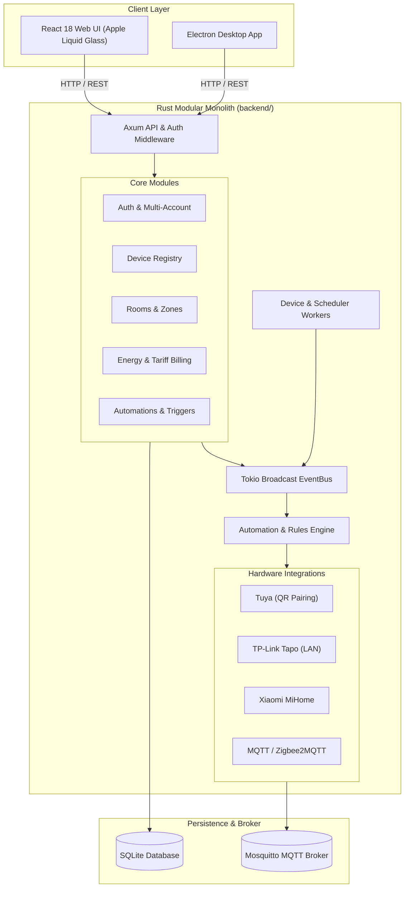

# Docus Smart Home Assistant

Docus is a high-performance smart home assistant platform built with Rust, SQLite, MQTT, React, and Electron. Designed for local-first execution on home servers, Docus brings pluggable integrations for Tuya (via zero-admin QR pairing), Xiaomi, and Tapo, coupled with an Apple Liquid Glass user interface.

## Tech Stack

- **Backend**: Rust (Axum, SQLx, Tokio, Rumqttc, Argon2, JWT)
- **Shared Logic**: `crates/home-core` (Domain models, device abstractions, traits)
- **Frontend**: React 18 + TypeScript + Vite + Tailwind CSS (Apple Liquid Glass styling)
- **Desktop**: Electron wrapper (`apps/desktop`)
- **Database**: SQLite (local encrypted storage)
- **Message Broker**: Embedded / Mosquitto MQTT

## Architecture Overview



## Getting Started

### Prerequisites

- Node.js (v18+)
- `pnpm` (v9+)
- Rust toolchain (`cargo` 1.80+)

### Setup

```bash
# Install frontend dependencies
pnpm install

# Build & verify backend
cargo check
```

### Running in Development

```bash
# Run both backend and frontend concurrently
pnpm run dev

# Or run individually:
pnpm run dev:backend   # Rust server on http://127.0.0.1:8080
pnpm run dev:web       # React web app on http://localhost:3000
pnpm run dev:desktop   # Electron desktop app
```

### Configuration

Copy `.env.example` to `.env`:
```bash
cp .env.example .env
```
Config files are located in `config/default.toml` and `config/development.toml`.
