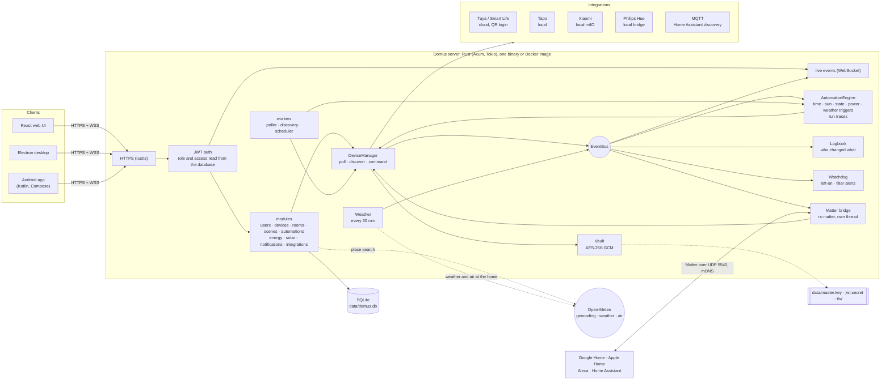
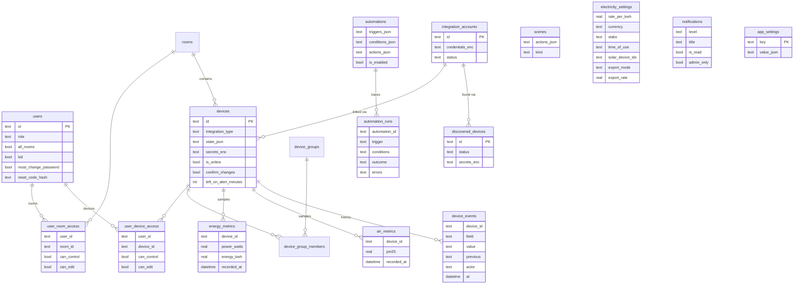

# Domus

<p align="center">
  <b>Translations</b><br>
  <a href="README.md">English</a> ·
  <a href="README.ar.md">العربية</a> ·
  <a href="README.bn.md">বাংলা</a> ·
  <a href="README.de.md">Deutsch</a> ·
  <a href="README.es.md">Español</a> ·
  <a href="README.fr.md">Français</a> ·
  <a href="README.gu.md">ગુજરાતી</a> ·
  <a href="README.hi.md">हिन्दी</a> ·
  <a href="README.id.md">Bahasa Indonesia</a> ·
  <a href="README.it.md">Italiano</a> ·
  <a href="README.ja.md">日本語</a> ·
  <a href="README.kn.md">ಕನ್ನಡ</a> ·
  <a href="README.ko.md">한국어</a> ·
  <a href="README.ml.md">മലയാളം</a> ·
  <a href="README.mr.md">मराठी</a> ·
  <a href="README.pa.md">ਪੰਜਾਬੀ</a> ·
  <a href="README.pl.md">Polski</a> ·
  <a href="README.pt-BR.md">Português (Brasil)</a> ·
  <a href="README.ru.md">Русский</a> ·
  <a href="README.ta.md">தமிழ்</a> ·
  <a href="README.te.md">తెలుగు</a> ·
  <a href="README.th.md">ไทย</a> ·
  <a href="README.tr.md">Türkçe</a> ·
  <a href="README.ur.md">اردو</a> ·
  <a href="README.vi.md">Tiếng Việt</a> ·
  <a href="README.zh-CN.md">简体中文</a> ·
  <a href="README.zh-TW.md">繁體中文</a>
</p>

[](https://github.com/aiyu-ayaan/Domus-Rust/actions/workflows/release.yml)
[](https://github.com/aiyu-ayaan/Domus-Rust/releases)
[](LICENSE)
[](https://github.com/aiyu-ayaan/Domus-Rust/commits/master)
[](https://hub.docker.com/r/aiyuayaan/domus)
[](https://hub.docker.com/r/aiyuayaan/domus)


A local-first smart-home hub for your home server. Rust backend, SQLite,
React web UI (with an Electron desktop shell), and pluggable integrations for
**Tuya / Smart Life** (QR-code login, no developer account), **TP-Link Tapo**
(local), **Xiaomi Mi Home** (local, tokens from your Mi account), **Philips Hue**
(local bridge) and **MQTT** (Zigbee2MQTT, ESPHome and anything else that speaks
Home Assistant discovery). A built-in **Matter bridge** lets Google Home, Apple Home, Alexa and Home
Assistant switch, dim and colour those devices over your own network.

- Automatic discovery of new devices, with an inbox or auto-add
- Live dashboard: power draw, bill so far and projected bill, air quality, motion / door / leak / battery readings
- Rooms, device groups, scenes and automations; triggers at a time, at **sunrise or sunset** (with an offset), on a device change, power level (also *above X for N minutes*), going offline or the **outdoor weather**
- **Automation runs**: each automation keeps its last 50 runs, with the trigger that fired it and the condition that held it back
- **Device history**: every change of a device and who made it (a person and the app they used, an automation, Matter, or the device itself)
- **Alerts** without writing an automation: a device left on too long, an air purifier filter running low
- **Matter bridge**: share the devices you pick with Google Home, Apple Home, Alexa or Home Assistant, locally, with no cloud account
- **Outdoor weather and air** at the home (Open-Meteo, no key) on the dashboard, beside the indoor reading
- **Ask before switching**: mark a main switch and every app, group, scene and manual automation run warns before it is turned on or off
- Electricity billing with flat, slab and **time-of-day** tariffs in any currency, **standby cost** per device, and **solar**: generation, export, and net metering or a feed-in rate
- Multiple users with admin / member / guest roles and access per room or per device, each see-only, control or edit
- Web, Electron desktop (Linux, Windows) and a native Android app, kept in sync live
- **27 languages** in the web, desktop and Android apps, following your system's language with a picker in Settings; right to left for Arabic and Urdu
- An Updates page with the release notes (Markdown, tables and images) in every app
- HTTPS by default; credentials and device keys encrypted at rest; one-file backup and restore

Architecture and diagrams: [`development/docs/ARCHITECTURE.md`](development/docs/ARCHITECTURE.md), summarised [below](#how-it-fits-together).
UI design profile: [`design-system/domus/MASTER.md`](design-system/domus/MASTER.md).
Progress: [`development/TODO.md`](development/TODO.md).

## How it fits together



Clients talk only to the server; the server talks to your devices (locally where the vendor allows it)
and keeps everything in one SQLite file. The cloud is used only where a vendor offers no local control
(Tuya) or to fetch device keys (Xiaomi), plus optional lookups: place search, weather and outdoor air for
the home location (Open-Meteo, only once a location is set) and GitHub for update checks. The Matter bridge
works on the local network only.

### Data model



Credentials and device keys are stored sealed (`*_enc`) under `data/master.key`, which is not in the
database. The full set of diagrams, one per feature, is in
[`development/docs`](development/docs).

## Screenshots

<p align="center"></p>

**Desktop** (Electron and web)

<p>
  
  
  
  
  
  
</p>

**Android**

<p>
  
  
  
  
  
</p>

**Android tablet** (two columns from 840dp, Settings as list and detail)

<p>
  
  
  
  
  
</p>

**Mobile web**

<p>
  
  
  
  
  
</p>

All captures are in [`res/screenshots`](res/screenshots); the full-quality walkthrough is [`res/domus.mp4`](res/domus.mp4).

## Download

| | |
|---|---|
| Server (Docker) | `aiyuayaan/domus` on Docker Hub, amd64 and arm64 |
| Android | `Domus-<version>.apk` from the [latest release](https://github.com/aiyu-ayaan/Domus-Rust/releases) |
| Linux desktop | the one-line installer below, or the `.deb` / `.AppImage` from the release |
| Windows desktop | `Domus-<version>-Setup.exe` from the release |

### Server

One file is all the host needs:

```bash
mkdir domus && cd domus
wget https://raw.githubusercontent.com/aiyu-ayaan/Domus-Rust/master/docker-compose.yml
docker compose up -d
```

Open `https://<server-ip>:8443` and create the administrator account. `docker compose logs domus`
shows the certificate fingerprint the apps ask you to confirm.

```bash
docker compose pull && docker compose up -d      # update
DOMUS_VERSION=beta docker compose up -d          # follow a channel: latest (default), beta, alpha, or 0.0.1
TZ=Asia/Kolkata DOMUS_PORT=9443 docker compose up -d
docker compose --profile mqtt up -d              # also start the optional Mosquitto broker
```

Put `DOMUS_VERSION`, `TZ` and `DOMUS_PORT` in a `.env` file next to the compose file to keep them.

### Linux desktop app

Installs the newest release for the current user (x86_64, no root): the AppImage, a menu entry with
the Domus icon and a `domus` command. The app then keeps itself up to date.

```bash
curl -fsSL https://raw.githubusercontent.com/aiyu-ayaan/Domus-Rust/master/scripts/install-linux.sh | sh
# ... | sh -s -- --channel beta     beta builds too (or alpha)
# ... | sh -s -- --uninstall        remove it; settings are kept
```

### Android

Download the APK from the release page and open it. Later updates are offered when the app opens and in
Settings → Updates, on the Stable, Beta or Alpha channel, and installed from there; Android asks
once to allow Domus to install them.

The **Updates** page (Settings → Updates on Android, Settings → About → Updates on web and desktop) shows
what you run, the newest release on your channel and its release notes, which are written in Markdown.

Releases, version numbers and the update channels: [development/docs/RELEASE.md](development/docs/RELEASE.md).

## Requirements

- Rust 1.80+ (`cargo`)
- Node.js 18+ and `pnpm`

## Run in development

```bash
pnpm install
npm run dev            # backend (https://127.0.0.1:8443) + web (http://localhost:3000)

npm run dev:backend    # backend only
npm run dev:web        # web only (proxies /api to the backend)
npm run dev:desktop    # Electron; pick the server on its connect page
```

Open http://localhost:3000. The first visit asks you to create the
administrator account.

## Run on the home server

```bash
pnpm build:web                     # builds apps/web/dist, served by the backend
APP_ENV=production cargo run --release --manifest-path backend/Cargo.toml
```

Then open `https://<server-ip>:8443`. The Matter bridge, when turned on, also uses UDP 5540
(`[matter] port`) and mDNS on the LAN.

Or build the Docker image from this checkout (host networking, data in the `domus_data` volume):

```bash
docker compose -f docker-compose.local.yml up -d --build
```

Remote access through a Cloudflare Tunnel, the home/remote address the apps switch between, and the
desktop packages (`pnpm build:desktop`) are described in
[development/docs/DEPLOYMENT.md](development/docs/DEPLOYMENT.md).

On first start Domus creates `data/` with:

| File | Purpose |
|---|---|
| `domus.db` | SQLite database |
| `master.key` | encrypts integration credentials and device keys — **back it up** |
| `jwt.secret` | signs sessions |
| `tls/` | self-signed certificate (replace via `tls.cert_path` / `tls.key_path`) |

Settings live in `config/default.toml`; any key can be overridden with
`DOMUS__SECTION__KEY` environment variables (see `.env.example`).

## Backup and restore

Everything lives in `data/`. Back up the whole folder, or take the one-file backup:

**Back up.** Sign in as an administrator → Settings → **Backup** → *Download backup*. The file is a copy of the
database with the master key stored inside, so the linked accounts in it can still be opened after a restore.
It is made while the server runs. Keep it private: whoever holds it can open those accounts. The JWT secret
and the TLS certificate are not in it.

**Restore.** Stop the server, then:

```bash
# Docker
docker compose cp domus-backup-2026-10-11.db domus:/app/data/restore.db
docker compose stop domus
docker compose run --rm domus domus-backend restore data/restore.db
docker compose start domus

# Without Docker, from the repo root (uses ./data)
domus-backend restore ~/Downloads/domus-backup-2026-10-11.db
```

What was there is kept next to it as `*.before-restore`. After a restore on a new machine people sign in
again and the apps ask to trust the new certificate. If you set the key with `DOMUS_MASTER_KEY`, the backup
holds no key and the restored server needs the same variable. More in
[development/docs/DEPLOYMENT.md](development/docs/DEPLOYMENT.md#backup-and-restore).

## Forgot the administrator password

Domus has no mail server, so nothing is sent by email. In order of effort:

1. **Another administrator** opens Settings → People, turns on *Reset code* for you and tells you the 8-digit
   code (good for 30 minutes and 5 wrong tries). On the sign-in screen choose *Forgot password?*, enter your
   username and then the code.
2. **From the server**, which works while Domus runs or is stopped and needs no sign-in:

   ```bash
   docker compose exec domus domus-backend reset-password <username>              # prints a new random password
   docker compose exec domus domus-backend reset-password <username> 'new-pass'   # or choose one (8+ characters)
   domus-backend reset-password <username>                                        # without Docker, from the repo root
   ```

   Sign in with it and change it in Settings → Password.

Five wrong passwords for a username lock that name for 15 minutes in production (the lock is lifted by
restarting the server, and is off in development). Details and the rules for generated passwords and kid's
accounts: [development/docs/ACCOUNTS.md](development/docs/ACCOUNTS.md).

## Languages

English, Hindi, Spanish, Portuguese (Brazil), Indonesian, Arabic, French, Russian, German, Turkish, Japanese, Korean,
Italian, Vietnamese, Thai, Chinese (Simplified and Traditional), Polish, Bengali, Tamil, Telugu, Marathi, Gujarati,
Kannada, Malayalam, Punjabi and Urdu. Arabic and Urdu are laid out right to left.

Each app follows the language of your browser or system, and shows English when it has no translation for it. To choose
another one, open Settings > Language (Appearance on web and desktop); *System default* goes back to following the system.
On Android 13 and later it also appears under the phone's Settings > Apps > Domus > Language.

The translations are machine-made and have not been reviewed by native speakers, so wording may be off. A fix is a one-line
change in the language's catalog. How the languages work, how to add one and the rules for new text:
[development/docs/LOCALIZATION.md](development/docs/LOCALIZATION.md).

## Connecting devices

| Brand | How |
|---|---|
| Tuya / Smart Life | Integrations → *Link with QR code*. Enter the **User Code** from Smart Life (Me → Settings → Account and Security → User Code), then scan the QR in the app. |
| Tapo | Integrations → *Link account* with your TP-Link ID. Devices on the LAN are found automatically and controlled locally. An H100 hub brings its sensors, switches and thermostats with it. Cameras are listed but not supported yet. |
| Xiaomi | Integrations → *Link account* with your Mi account and server region. If Xiaomi asks for two-step verification, enter the code it emails or texts you in the same panel. The account can be an email, a phone number with country code (`+91…`) or a Xiaomi ID. Tokens are fetched once; control is local. Devices can also be added with a token. |
| Philips Hue | Press the round button on the bridge, then Integrations → Philips Hue → *Link* within 30 seconds. Leave the address empty to find the bridge automatically. Lights and Hue smart plugs are controlled locally. |
| MQTT | Integrations → MQTT → *Link* with your broker's address, port and login. Devices that announce themselves through Home Assistant MQTT discovery (Zigbee2MQTT, ESPHome, …) appear under Discovered: lights, switches, plugs, fans and sensors. With the bundled broker (`--profile mqtt`) the address is `mqtt`, port `1883`. |

See `development/docs/INTEGRATIONS.md` for what each integration covers.

## Electricity billing

Energy → *Electricity plan*: pick any currency, and choose a flat price per
kWh or **slabs** for unit-based tariffs (e.g. Pune/MSEDCL: 0–100 units at one
rate, 101–300 at the next, and so on). The bill is calculated per billing
cycle, plus the fixed monthly charge.

Tariffs can also carry **time-of-day** windows: hours (on the home's clock, past midnight allowed) whose
units cost a set amount more or less, for example a night rebate or a peak surcharge, on top of the flat or
slab price.

New devices appear under **Devices → Discovered**. Turn on *Add new devices
automatically* there to skip the inbox.

## Sunrise and sunset

Set where the home is in Settings → **Home location**: use this phone's or browser's location, search for
the town (the server asks the free Open-Meteo geocoder; only the name you type leaves the home), or type the
latitude and longitude. The coordinates are rounded to about a kilometre and stay on your server. An
automation can then run at sunrise or sunset, minutes before or after. Without a location, a sun trigger
never fires.

## Ask before switching

A main switch that cuts power to everything plugged into it is easy to turn off by mistake. Open the device
and turn on **Ask before switching**: every app then asks before turning it on or off, and so do room
*All on / All off*, device groups, scenes (including scenes inside scenes) and a manual *Run* of an
automation that would switch it. The setting is kept on the server, so it is the same on web, desktop and
Android. Automations that fire on their own cannot ask and run as written, and nothing outside Domus (a
vendor app, a wall switch) is covered.

## Matter (Google Home, Apple Home, Alexa)

Settings → **Matter** (administrators): turn it on, tick the devices to share, then scan the QR or type the
pairing code in Google Home, Apple Home, Alexa or Home Assistant. Lights come through as colour or dimmable
lights, everything else with an on/off switch as a plug; switching, dimming and colour work, and changes made
in Domus (on/off, brightness) show up in the controller. "Allow pairing for 15 minutes" adds a second
ecosystem; "Forget all pairings" starts over with a new code.

The bridge is not certified (it uses the Matter test attestation), so apps ask you to confirm adding it, and
Google Home only accepts it after the bridge is added as a test device in the Google Home Developer
Console. Details: [`development/docs/MATTER.md`](development/docs/MATTER.md).

## History, automation runs and alerts

- **History** in every device sheet: what changed, when, and who did it (*By Ayaan · Android*,
  *Automation "Night mode"*, *Matter*, *On the device*). Kept as long as the energy history.
- **Runs** of each automation: *Ran*, *Failed* with the error, or *Skipped* with the condition that held
  it back, so "why didn't this fire?" has an answer.
- **Alert when left on** in the device sheet (30 minutes to 12 hours): administrators get a notification.
  A metered device counts as on above 10 W, so a TV in standby is off.
- **Filter running low**: a notification when an air purifier's filter drops to 10%.

## Weather, standby and solar

- With a home location set, the dashboard shows the **weather and outdoor PM2.5** next to the indoor
  reading, and automations can use them (*when outdoor PM2.5 rises above 35*, *only if outdoor
  temperature is below 20*).
- Energy → **Standby** lists what each device draws when nobody uses it (its lowest hour this week) and
  what that costs a month.
- Energy → *Electricity plan* → **Solar**: tick the plugs that measure solar generation, then choose net
  metering or a feed-in rate. The bill then counts only what you buy from the grid, and the Solar card
  shows generated, used at home, exported and earned. Grid flows are worked out every 15 minutes from
  metered devices, so appliances without a meter make the export read high.

Plan and diagrams: [`development/docs/ROADMAP.md`](development/docs/ROADMAP.md).

## License

Domus is released under the [MIT License](LICENSE). Third-party libraries keep their own licenses; they are
listed under About → Acknowledgements in every app.

## Tests

```bash
cargo test --workspace
pnpm --filter @domus/web exec tsc -b
```

`cargo test --workspace` includes `backend/tests/matter_bridge.rs`, which pairs a Matter controller with the
bridge over UDP and switches, dims and colours its devices (it needs a network interface with IPv4).
