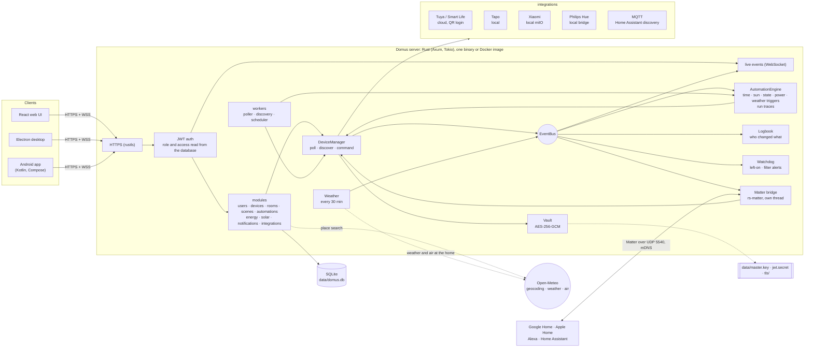
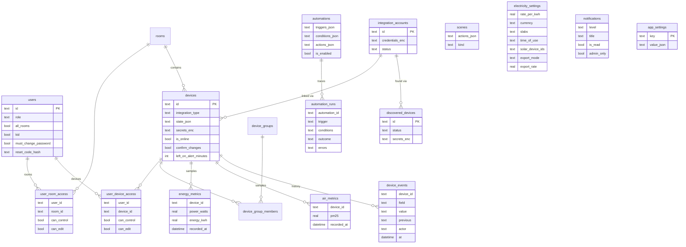

# Domus

<p align="center">
  <b>Translations</b><br>
  <a href="README.md">English</a> ·
  <a href="README.ar.md">العربية</a> ·
  <a href="README.bn.md">বাংলা</a> ·
  <a href="README.de.md">Deutsch</a> ·
  <a href="README.es.md">Español</a> ·
  <a href="README.fr.md">Français</a> ·
  <a href="README.gu.md">ગુજરાતી</a> ·
  <a href="README.hi.md">हिन्दी</a> ·
  <a href="README.id.md">Bahasa Indonesia</a> ·
  <a href="README.it.md">Italiano</a> ·
  <a href="README.ja.md">日本語</a> ·
  <a href="README.kn.md">ಕನ್ನಡ</a> ·
  <a href="README.ko.md">한국어</a> ·
  <a href="README.ml.md">മലയാളം</a> ·
  <a href="README.mr.md">मराठी</a> ·
  <a href="README.pa.md">ਪੰਜਾਬੀ</a> ·
  <a href="README.pl.md">Polski</a> ·
  <a href="README.pt-BR.md">Português (Brasil)</a> ·
  <a href="README.ru.md">Русский</a> ·
  <a href="README.ta.md">தமிழ்</a> ·
  <a href="README.te.md">తెలుగు</a> ·
  <a href="README.th.md">ไทย</a> ·
  <a href="README.tr.md">Türkçe</a> ·
  <a href="README.ur.md">اردو</a> ·
  <a href="README.vi.md">Tiếng Việt</a> ·
  <a href="README.zh-CN.md">简体中文</a> ·
  <a href="README.zh-TW.md">繁體中文</a>
</p>

[](https://github.com/aiyu-ayaan/Domus-Rust/actions/workflows/release.yml)
[](https://github.com/aiyu-ayaan/Domus-Rust/releases)
[](LICENSE)
[](https://github.com/aiyu-ayaan/Domus-Rust/commits/master)
[](https://hub.docker.com/r/aiyuayaan/domus)
[](https://hub.docker.com/r/aiyuayaan/domus)


നിങ്ങളുടെ ഹോം സെർവറിനായുള്ള ലോക്കൽ-ഫസ്റ്റ് സ്മാർട്ട്-ഹോം ഹബ്. Rust ബാക്കെൻഡ്, SQLite, React വെബ് UI (Electron ഡെസ്ക്ടോപ്പ് ഷെല്ലോടെ), കൂടാതെ **Tuya / Smart Life** (QR-കോഡ് ലോഗിൻ, ഡെവലപ്പർ അക്കൗണ്ട് ആവശ്യമില്ല), **TP-Link Tapo** (ലോക്കൽ), **Xiaomi Mi Home** (ലോക്കൽ, നിങ്ങളുടെ Mi അക്കൗണ്ടിൽ നിന്നുള്ള ടോക്കണുകൾ), **Philips Hue** (ലോക്കൽ ബ്രിഡ്ജ്), **MQTT** (Zigbee2MQTT, ESPHome കൂടാതെ Home Assistant ഡിസ്കവറി പിന്തുണയ്ക്കുന്ന മറ്റേതൊരു ഉപകരണവും) എന്നിവയ്ക്കായുള്ള പ്ലഗ് ചെയ്യാവുന്ന ഇന്റഗ്രേഷനുകൾ. അന്തർനിർമ്മിത **Matter ബ്രിഡ്ജ്** വഴി Google Home, Apple Home, Alexa, Home Assistant എന്നിവയ്ക്ക് നിങ്ങളുടെ സ്വന്തം ലോക്കൽ നെറ്റ്‌വർക്കിൽ തന്നെ ഈ ഉപകരണങ്ങൾ സ്വിച്ച് ചെയ്യാനും, തെളിച്ചം കൂട്ടാനും കുറയ്ക്കാനും, നിറങ്ങൾ മാറ്റാനും കഴിയും.

- പുതിയ ഉപകരണങ്ങൾ സ്വയമേവ കണ്ടെത്തൽ (Automatic discovery), ഇൻബോക്സ് അല്ലെങ്കിൽ സ്വയം ചേർക്കൽ (auto-add) ഓപ്ഷനോടെ
- ലൈവ് ഡാഷ്‌ബോർഡ്: വൈദ്യുതി ഉപഭോഗം, ഇതുവരെയുള്ള ബില്ലും പ്രതീക്ഷിക്കുന്ന ബില്ലും, വായു ഗുണനിലവാരം, ചലനം / വാതിൽ / ചോർച്ച / ബാറ്ററി റീഡിംഗുകൾ
- മുറികൾ, ഉപകരണ ഗ്രൂപ്പുകൾ (device groups), സീനുകൾ, ഓട്ടോമേഷനുകൾ; നിശ്ചിത സമയത്ത്, **സൂര്യോദയത്തിലോ സൂര്യാസ്തമയത്തിലോ** (ഓഫ്‌സെറ്റോടെ), ഉപകരണത്തിന്റെ അവസ്ഥ മാറുമ്പോൾ, വൈദ്യുതി ഉപഭോഗത്തിന്റെ തോത് അനുസരിച്ച് (*N മിനിറ്റ് നേരത്തേക്ക് X-ൽ കൂടുതലായിരിക്കുന്നത് ഉൾപ്പെടെ*), ഓഫ്‌ലൈനാകുമ്പോൾ അല്ലെങ്കിൽ **പുറത്തെ കാലാവസ്ഥയുടെ** അടിസ്ഥാനത്തിലുള്ള ട്രിഗറുകൾ
- **ഓട്ടോമേഷൻ പ്രവർത്തന ചരിത്രം (Automation runs)**: ഓരോ ഓട്ടോമേഷനും അതിന്റെ അവസാനത്തെ 50 പ്രവർത്തനങ്ങളുടെ വിവരങ്ങൾ സൂക്ഷിക്കുന്നു, അതിനെ ട്രിഗർ ചെയ്ത കാര്യങ്ങളും തടഞ്ഞുവെച്ച നിബന്ധനകളും ഉൾപ്പെടെ
- **ഉപകരണ ചരിത്രം (Device history)**: ഒരു ഉപകരണത്തിൽ ഉണ്ടായ ഓരോ മാറ്റവും അത് ആര് വരുത്തി എന്ന വിവരവും (ഒരു വ്യക്തിയും അവർ ഉപയോഗിച്ച ആപ്പും, ഒരു ഓട്ടോമേഷൻ, Matter, അല്ലെങ്കിൽ ഉപകരണം സ്വയം ചെയ്തത്)
- ഓട്ടോമേഷൻ കോഡ് എഴുതാതെ തന്നെ **മുന്നറിയിപ്പുകൾ (Alerts)**: ഉപകരണം കൂടുതൽ സമയം ഓണായി കിടന്നാൽ, എയർ പ്യൂരിഫയർ ഫിൽട്ടർ കുറയുമ്പോൾ
- **Matter ബ്രിഡ്ജ്**: നിങ്ങൾ തിരഞ്ഞെടുക്കുന്ന ഉപകരണങ്ങൾ ഒരു ക്ലൗഡ് അക്കൗണ്ടും കൂടാതെ തന്നെ നിങ്ങളുടെ ലോക്കൽ നെറ്റ്‌വർക്കിൽ Google Home, Apple Home, Alexa അല്ലെങ്കിൽ Home Assistant എന്നിവയുമായി പങ്കിടുക
- വീടിന്റെ സ്ഥാനത്തെ **പുറത്തെ കാലാവസ്ഥയും വായുവും** (Open-Meteo, API കീ ആവശ്യമില്ല) ഇൻഡോർ റീഡിംഗിനൊപ്പം ഡാഷ്‌ബോർഡിൽ കാണാം
- **സ്വിച്ച് ചെയ്യുന്നതിന് മുമ്പ് ചോദിക്കുക (Ask before switching)**: ഒരു പ്രധാന സ്വിച്ച് അടയാളപ്പെടുത്തുക, തുടർന്ന് ഓരോ ആപ്പും, ഗ്രൂപ്പും, സീനും, മാനുവൽ ഓട്ടോമേഷൻ റണ്ണും അത് ഓണാക്കുന്നതിനോ ഓഫാക്കുന്നതിനോ മുമ്പ് സ്ഥിരീകരണം ചോദിക്കും
- ഏത് കറൻസിയിലും ഫ്ലാറ്റ്, സ്ലാബ്, **ദിവസത്തിന്റെ സമയം (time-of-day)** താരിഫുകൾ ഉപയോഗിച്ചുള്ള വൈദ്യുതി ബില്ലിംഗ്, ഉപകരണ അടിസ്ഥാനത്തിലുള്ള **സ്റ്റാൻഡ്‌ബൈ ചെലവ്**, കൂടാതെ **സൗരോർജ്ജം (solar)**: ഉൽപ്പാദനം, കയറ്റുമതി, നെറ്റ് മീറ്ററിംഗ് അല്ലെങ്കിൽ ഫീഡ്-ഇൻ നിരക്ക്
- അഡ്മിൻ / അംഗം / അതിഥി റോളുകളുള്ള ഒന്നിലധികം ഉപയോക്താക്കൾ, കൂടാതെ മുറി അല്ലെങ്കിൽ ഉപകരണം അടിസ്ഥാനത്തിൽ കാണാൻ മാത്രം (see-only), നിയന്ത്രിക്കുക (control), എഡിറ്റ് ചെയ്യുക (edit) എന്നീ ആക്സസുകൾ
- വെബ്, Electron ഡെസ്ക്ടോപ്പ് (Linux, Windows), നേറ്റീവ് Android ആപ്പ് എന്നിവ തത്സമയം സമന്വയിപ്പിച്ചിരിക്കുന്നു (live sync)
- വെബ്, ഡെസ്ക്ടോപ്പ്, Android ആപ്പുകളിൽ **27 ഭാഷകൾ**, ക്രമീകരണങ്ങളിലെ പിക്കർ ഉപയോഗിച്ച് നിങ്ങളുടെ സിസ്റ്റത്തിന്റെ ഭാഷ പിന്തുടരുന്നു; അറബിക്, ഉറുദു ഭാഷകൾക്കായി വലത്തുനിന്ന് ഇടത്തോട്ടുള്ള (RTL) ലേഔട്ട്
- ഓരോ ആപ്പിലും റിലീസ് കുറിപ്പുകളുള്ള (Markdown, ടേബിളുകൾ, ഇമേജുകൾ) അപ്ഡേറ്റ് പേജ്
- സ്വതവേ HTTPS സുരക്ഷ; ക്രെഡൻഷ്യലുകളും ഉപകരണ കീകളും എൻക്രിപ്റ്റ് ചെയ്ത് സൂക്ഷിക്കുന്നു; സിംഗിൾ-ഫയൽ ബാക്കപ്പും പുനഃസ്ഥാപിക്കലും

ആർക്കിടെക്ചറും ഡയഗ്രമുകളും: [`development/docs/ARCHITECTURE.md`](development/docs/ARCHITECTURE.md), [താഴെ സംഗ്രഹിച്ചിരിക്കുന്നു](#ഇതെല്ലാം-ഒരുമിച്ച്-എങ്ങനെ-പ്രവർത്തിക്കുന്നു).
UI ഡിസൈൻ പ്രൊഫൈൽ: [`design-system/domus/MASTER.md`](design-system/domus/MASTER.md).
പുരോഗതി: [`development/TODO.md`](development/TODO.md).

## ഇതെല്ലാം ഒരുമിച്ച് എങ്ങനെ പ്രവർത്തിക്കുന്നു



ക്ലയന്റുകൾ സെർവറുമായി മാത്രമേ സംസാരിക്കൂ; സെർവർ നിങ്ങളുടെ ഉപകരണങ്ങളുമായി നേരിട്ട് സംസാരിക്കുകയും (വെണ്ടർ അനുവദിക്കുന്നിടത്ത് ലോക്കലായി) എല്ലാം ഒരൊറ്റ SQLite ഫയലിൽ സൂക്ഷിക്കുകയും ചെയ്യുന്നു. വെണ്ടർ പ്രാദേശിക നിയന്ത്രണം നൽകാത്തയിടത്ത് മാത്രമേ ക്ലൗഡ് ഉപയോഗിക്കുന്നുള്ളൂ (Tuya) അല്ലെങ്കിൽ ഉപകരണ ടോക്കണുകൾ ലഭ്യമാക്കാൻ (Xiaomi), കൂടാതെ ചില ഓപ്ഷണൽ തിരച്ചിലുകൾക്ക്: സ്ഥല തിരച്ചിൽ, വീടിന്റെ സ്ഥാനത്തെ കാലാവസ്ഥയും പുറത്തെ വായുവും (Open-Meteo, ലൊക്കേഷൻ സജ്ജമാക്കിയ ശേഷം മാത്രം), അപ്ഡേറ്റുകൾ പരിശോധിക്കാൻ GitHub എന്നിവ. Matter ബ്രിഡ്ജ് ലോക്കൽ നെറ്റ്‌വർക്കിൽ മാത്രമേ പ്രവർത്തിക്കൂ.

### ഡാറ്റ മോഡൽ (Data model)



വിവരങ്ങളും ഉപകരണ കീകളും ഡാറ്റാബേസിന് പുറത്ത് `data/master.key`-ൽ സുരക്ഷിതമായി (`*_enc`) സൂക്ഷിക്കുന്നു. ഓരോ ഫീച്ചറിന്റെയും പൂർണ്ണമായ ഡയഗ്രമുകൾ [`development/docs`](development/docs)-ൽ ലഭ്യമാണ്.

## സ്ക്രീൻഷോട്ടുകൾ (Screenshots)

<p align="center"></p>

**ഡെസ്ക്ടോപ്പ്** (Electron കൂടാതെ വെബ്)

<p>
  
  
  
  
  
  
</p>

**Android**

<p>
  
  
  
  
  
</p>

**Android ടാബ്‌ലെറ്റ്** (840dp മുതൽ രണ്ട് നിരകൾ, ക്രമീകരണങ്ങൾ ലിസ്റ്റായും വിശദമായും)

<p>
  
  
  
  
  
</p>

**മൊബൈൽ വെബ്**

<p>
  
  
  
  
  
</p>

എല്ലാ ചിത്രങ്ങളും [`res/screenshots`](res/screenshots)-ൽ ഉണ്ട്; പൂർണ്ണ റെസല്യൂഷനിലുള്ള വീഡിയോ [`res/domus.mp4`](res/domus.mp4) ആണ്.

## ഡൗൺലോഡ് (Download)

| | |
|---|---|
| സെർവർ (Docker) | Docker Hub-ൽ `aiyuayaan/domus`, amd64 കൂടാതെ arm64 |
| Android | [ഏറ്റവും പുതിയ റിലീസിൽ നിന്ന്](https://github.com/aiyu-ayaan/Domus-Rust/releases) `Domus-<version>.apk` |
| Linux ഡെസ്ക്ടോപ്പ് | താഴെയുള്ള വൺ-ലൈൻ ഇൻസ്റ്റാളർ, അല്ലെങ്കിൽ റിലീസിൽ നിന്നുള്ള `.deb` / `.AppImage` |
| Windows ഡെസ്ക്ടോപ്പ് | റിലീസിൽ നിന്നുള്ള `Domus-<version>-Setup.exe` |

### സെർവർ

ഹോസ്റ്റ് മെഷീന് ഒരൊറ്റ ഫയൽ മാത്രം മതി:

```bash
mkdir domus && cd domus
wget https://raw.githubusercontent.com/aiyu-ayaan/Domus-Rust/master/docker-compose.yml
docker compose up -d
```

`https://<server-ip>:8443` തുറന്ന് അഡ്മിനിസ്ട്രേറ്റർ അക്കൗണ്ട് സൃഷ്ടിക്കുക. ആപ്പുകൾ സ്ഥിരീകരിക്കാൻ ആവശ്യപ്പെടുന്ന സർട്ടിഫിക്കറ്റ് ഫിംഗർപ്രിന്റ് കാണാൻ `docker compose logs domus` ഉപയോഗിക്കുക.

```bash
docker compose pull && docker compose up -d      # അപ്ഡേറ്റ് ചെയ്യാൻ
DOMUS_VERSION=beta docker compose up -d          # ചാനൽ പിന്തുടരുക: latest (സ്ഥിരസ്ഥിതി), beta, alpha, അല്ലെങ്കിൽ 0.0.1
TZ=Asia/Kolkata DOMUS_PORT=9443 docker compose up -d
docker compose --profile mqtt up -d              # ഓപ്ഷണൽ Mosquitto ബ്രോക്കറും ആരംഭിക്കാൻ
```

അവ സ്ഥിരമായി നിലനിർത്താൻ കമ്പോസ് ഫയലിന് സമീപമുള്ള `.env` ഫയലിൽ `DOMUS_VERSION`, `TZ`, `DOMUS_PORT` എന്നിവ ചേർക്കുക.

### Linux ഡെസ്ക്ടോപ്പ് ആപ്പ്

നിലവിലെ ഉപയോക്താവിനായി ഏറ്റവും പുതിയ പതിപ്പ് ഇൻസ്റ്റാൾ ചെയ്യുന്നു (x86_64, root ആവശ്യമില്ല): AppImage, Domus ഐക്കണുള്ള മെനു എൻട്രി, `domus` കമാൻഡ്. തുടർന്ന് ആപ്പ് സ്വയം അപ്ഡേറ്റ് നിലനിർത്തുന്നു.

```bash
curl -fsSL https://raw.githubusercontent.com/aiyu-ayaan/Domus-Rust/master/scripts/install-linux.sh | sh
# ... | sh -s -- --channel beta     ബീറ്റ ബിൽഡുകൾക്കും (അല്ലെങ്കിൽ alpha)
# ... | sh -s -- --uninstall        നീക്കം ചെയ്യാൻ; ക്രമീകരണങ്ങൾ സൂക്ഷിക്കും
```

### Android

റിലീസ് പേജിൽ നിന്ന് APK ഡൗൺലോഡ് ചെയ്ത് തുറക്കുക. ആപ്പ് തുറക്കുമ്പോഴും ക്രമീകരണങ്ങൾ → അപ്ഡേറ്റുകൾ (Settings → Updates) വഴിയും Stable, Beta അല്ലെങ്കിൽ Alpha ചാനലിൽ പുതിയ അപ്ഡേറ്റുകൾ ലഭിക്കും; അവ ഇൻസ്റ്റാൾ ചെയ്യാൻ അനുവദിക്കാൻ Android ഒരിക്കൽ ചോദിക്കും.

**അപ്ഡേറ്റുകൾ** പേജ് (Android-ൽ ക്രമീകരണങ്ങൾ → അപ്ഡേറ്റുകൾ; വെബിലും ഡെസ്ക്ടോപ്പിലും ക്രമീകരണങ്ങൾ → വിവരങ്ങൾ → അപ്ഡേറ്റുകൾ) നിങ്ങൾ പ്രവർത്തിപ്പിക്കുന്ന പതിപ്പും നിങ്ങളുടെ ചാനലിലെ പുതിയ റിലീസും Markdown-ൽ എഴുതിയ റിലീസ് കുറിപ്പുകളും കാണിക്കുന്നു.

റിലീസുകൾ, പതിപ്പ് നമ്പറുകൾ, അപ്ഡേറ്റ് ചാനലുകൾ എന്നിവയെക്കുറിച്ച് കൂടുതൽ അറിയാൻ: [development/docs/RELEASE.md](development/docs/RELEASE.md).

## ആവശ്യകതകൾ (Requirements)

- Rust 1.80+ (`cargo`)
- Node.js 18+ കൂടാതെ `pnpm`

## ഡെവലപ്‌മെന്റിൽ പ്രവർത്തിപ്പിക്കുക (Run in development)

```bash
pnpm install
npm run dev            # backend (https://127.0.0.1:8443) + web (http://localhost:3000)

npm run dev:backend    # backend മാത്രം
npm run dev:web        # web മാത്രം (API ബാക്കെൻഡിലേക്ക് പ്രോക്സി ചെയ്യുന്നു)
npm run dev:desktop    # Electron; കണക്റ്റ് പേജിൽ സെർവർ തിരഞ്ഞെടുക്കുക
```

http://localhost:3000 തുറക്കുക. ആദ്യ സന്ദർശനത്തിൽ അഡ്മിനിസ്ട്രേറ്റർ അക്കൗണ്ട് സൃഷ്ടിക്കാൻ ആവശ്യപ്പെടും.

## ഹോം സെർവറിൽ പ്രവർത്തിപ്പിക്കുക (Run on the home server)

```bash
pnpm build:web                     # ബാക്കെൻഡ് നൽകുന്ന apps/web/dist നിർമ്മിക്കുന്നു
APP_ENV=production cargo run --release --manifest-path backend/Cargo.toml
```

തുടർന്ന് `https://<server-ip>:8443` തുറക്കുക. Matter ബ്രിഡ്ജ് ഓണാക്കുമ്പോൾ LAN-ൽ UDP 5540 (`[matter] port`), mDNS എന്നിവയും ഉപയോഗിക്കുന്നു.

അല്ലെങ്കിൽ ഈ ശേഖരത്തിൽ നിന്ന് തന്നെ Docker ഇമേജ് നിർമ്മിക്കുക (host networking, ഡാറ്റ `domus_data` വോള്യത്തിൽ):

```bash
docker compose -f docker-compose.local.yml up -d --build
```

Cloudflare Tunnel വഴിയുള്ള റിമോട്ട് ആക്സസ്, ആപ്പുകൾ സ്വയം മാറുന്ന ലോക്കൽ/റിമോട്ട് വിലാസം, ഡെസ്ക്ടോപ്പ് പാക്കേജുകൾ (`pnpm build:desktop`) എന്നിവ [development/docs/DEPLOYMENT.md](development/docs/DEPLOYMENT.md)-ൽ വിവരിച്ചിരിക്കുന്നു.

ആദ്യ തുടക്കത്തിൽ Domus ഇനിപ്പറയുന്നവ അടങ്ങിയ `data/` ഫോൾഡർ സൃഷ്ടിക്കുന്നു:

| ഫയൽ | ഉദ്ദേശ്യം |
|---|---|
| `domus.db` | SQLite ഡാറ്റാബേസ് |
| `master.key` | ഇന്റഗ്രേഷൻ വിവരങ്ങളും ഉപകരണ കീകളും എൻക്രിപ്റ്റ് ചെയ്യുന്നു — **ഇത് ബാക്കപ്പ് ചെയ്യുക** |
| `jwt.secret` | സെഷനുകൾ ഒപ്പിടുന്നു |
| `tls/` | സ്വയം ഒപ്പിട്ട സർട്ടിഫിക്കറ്റ് (`tls.cert_path` / `tls.key_path` വഴി മാറ്റാം) |

ക്രമീകരണങ്ങൾ `config/default.toml`-ൽ ലഭ്യമാണ്; ഏത് ക്രമീകരണവും `DOMUS__SECTION__KEY` എൻവയോൺമെന്റ് വേരിയബിളുകൾ ഉപയോഗിച്ച് മാറ്റിയെഴുതാം (`.env.example` കാണുക).

## ബാക്കപ്പും പുനഃസ്ഥാപിക്കലും (Backup and restore)

എല്ലാം `data/` ഫോൾഡറിലാണ് ഉള്ളത്. മുഴുവൻ ഫോൾഡറും ബാക്കപ്പ് ചെയ്യാം അല്ലെങ്കിൽ ഒരൊറ്റ ഫയൽ ബാക്കപ്പ് എടുക്കാം:

**ബാക്കപ്പ് എടുക്കൽ.** അഡ്മിനിസ്ട്രേറ്ററായി സൈൻ ഇൻ ചെയ്യുക → ക്രമീകരണങ്ങൾ (Settings) → **ബാക്കപ്പ് (Backup)** → *ബാക്കപ്പ് ഡൗൺലോഡ് ചെയ്യുക (Download backup)*. ഈ ഫയൽ ഡാറ്റാബേസിന്റെ ഒരു പകർപ്പാണ്, അതിൽ മാസ്റ്റർ കീയും അടങ്ങിയിരിക്കുന്നു, അതിനാൽ പുനഃസ്ഥാപിച്ച ശേഷവും ലിങ്ക് ചെയ്ത അക്കൗണ്ടുകൾ തുറക്കാനാകും. സെർവർ പ്രവർത്തിക്കുമ്പോൾ തന്നെയാണ് ഇത് നിർമ്മിക്കുന്നത്. ഇത് സ്വകാര്യമായി സൂക്ഷിക്കുക: ഇത് കൈവശമുള്ള ആർക്കും ആ അക്കൗണ്ടുകൾ തുറക്കാനാകും. JWT സീക്രട്ടും TLS സർട്ടിഫിക്കറ്റും ഇതിൽ ഉൾപ്പെടുന്നില്ല.

**പുനഃസ്ഥാപിക്കൽ.** സെർവർ നിർത്തിയ ശേഷം:

```bash
# Docker
docker compose cp domus-backup-2026-10-11.db domus:/app/data/restore.db
docker compose stop domus
docker compose run --rm domus domus-backend restore data/restore.db
docker compose start domus

# Docker ഇല്ലാതെ, റിപ്പോയുടെ റൂട്ടിൽ നിന്ന് (./data ഉപയോഗിക്കുന്നു)
domus-backend restore ~/Downloads/domus-backup-2026-10-11.db
```

മുമ്പ് ഉണ്ടായിരുന്നത് അതിന്റെ അടുത്ത് തന്നെ `*.before-restore` ആയി സൂക്ഷിക്കുന്നു. ഒരു പുതിയ മെഷീനിൽ പുനഃസ്ഥാപിച്ച ശേഷം ആളുകൾ വീണ്ടും സൈൻ ഇൻ ചെയ്യണം, കൂടാതെ പുതിയ സർട്ടിഫിക്കറ്റ് വിശ്വസിക്കാൻ ആപ്പുകൾ ആവശ്യപ്പെടും. നിങ്ങൾ `DOMUS_MASTER_KEY` ഉപയോഗിച്ച് കീ സജ്ജീകരിച്ചിട്ടുണ്ടെങ്കിൽ, ബാക്കപ്പിൽ കീ ഉണ്ടാകില്ല, പുനഃസ്ഥാപിച്ച സെർവറിന് അതേ വേരിയബിൾ ആവശ്യമാണ്. കൂടുതൽ വിവരങ്ങൾ [development/docs/DEPLOYMENT.md](development/docs/DEPLOYMENT.md#backup-and-restore)-ൽ.

## അഡ്മിനിസ്ട്രേറ്റർ പാസ്‌വേഡ് മറന്നുപോയോ (Forgot the administrator password)

Domus-ൽ മെയിൽ സെർവർ ഇല്ല, അതിനാൽ ഇമെയിൽ വഴി ഒന്നും അയക്കില്ല. ശ്രമിക്കേണ്ട വഴികൾ:

1. **മറ്റൊരു അഡ്മിനിസ്ട്രേറ്റർ** ക്രമീകരണങ്ങൾ → ആളുകൾ (Settings → People) തുറന്ന്, നിങ്ങൾക്കായി *റീസെറ്റ് കോഡ് (Reset code)* ഓണാക്കി 8 അക്ക കോഡ് നിങ്ങളോട് പറയുന്നു (ഇത് 30 മിനിറ്റും 5 തെറ്റായ ശ്രമങ്ങളും വരെ സാധുവാണ്). സൈൻ-ഇൻ സ്ക്രീനിൽ *പാസ്‌വേഡ് മറന്നോ? (Forgot password?)* തിരഞ്ഞെടുത്ത് നിങ്ങളുടെ ഉപയോക്തൃനാമവും തുടർന്ന് കോഡും നൽകുക.
2. **സെർവറിൽ നിന്ന് നേരിട്ട്**, ഇത് Domus പ്രവർത്തിക്കുമ്പോഴോ നിർത്തുമ്പോഴോ പ്രവർത്തിക്കും, സൈൻ-ഇൻ ആവശ്യമില്ല:

   ```bash
   docker compose exec domus domus-backend reset-password <username>              # ഒരു പുതിയ ക്രമരഹിത പാസ്‌വേഡ് നൽകുന്നു
   docker compose exec domus domus-backend reset-password <username> 'new-pass'   # അല്ലെങ്കിൽ നിങ്ങളൊന്ന് തിരഞ്ഞെടുക്കുക (8+ അക്ഷരങ്ങൾ)
   domus-backend reset-password <username>                                        # Docker ഇല്ലാതെ, റിപ്പോയുടെ റൂട്ടിൽ നിന്ന്
   ```

   ഇത് ഉപയോഗിച്ച് സൈൻ ഇൻ ചെയ്ത് ക്രമീകരണങ്ങൾ → പാസ്‌വേഡ് (Settings → Password)-ൽ മാറ്റുക.

ഒരു ഉപയോക്തൃനാമത്തിന് തുടർച്ചയായി 5 തെറ്റായ പാസ്‌വേഡുകൾ നൽകിയാൽ, പ്രൊഡക്ഷനിൽ ആ പേര് 15 മിനിറ്റ് നേരത്തേക്ക് ലോക്ക് ചെയ്യപ്പെടും (സെർവർ പുനരാരംഭിക്കുന്നതിലൂടെ ലോക്ക് ഒഴിവാക്കാം, കൂടാതെ ഡെവലപ്‌മെന്റിൽ ഇത് ഓഫാണ്). കൂടുതൽ വിവരങ്ങളും നിയമങ്ങളും: [development/docs/ACCOUNTS.md](development/docs/ACCOUNTS.md).

## ഭാഷകൾ (Languages)

ഇംഗ്ലീഷ്, ഹിന്ദി, സ്പാനിഷ്, പോർച്ചുഗീസ് (ബ്രസീൽ), ഇന്തോനേഷ്യൻ, അറബിക്, ഫ്രഞ്ച്, റഷ്യൻ, ജർമ്മൻ, ടർക്കിഷ്, ജാപ്പനീസ്, കൊറിയൻ, ഇറ്റാലിയൻ, വിയറ്റ്നാമീസ്, തായ്, ചൈനീസ് (ലളിതവും പരമ്പരാഗതവും), പോളിഷ്, ബംഗാളി, തമിഴ്, തെലുങ്ക്, മറാത്തി, ഗുജറാത്തി, കന്നഡ, മലയാളം, പഞ്ചാബി, ഉറുദു. അറബിക്കും ഉറുദുവും വലത്തുനിന്ന് ഇടത്തോട്ടുള്ള (RTL) രീതിയിലാണ്.

ഓരോ ആപ്പും നിങ്ങളുടെ ബ്രൗസറിന്റെയോ സിസ്റ്റത്തിന്റെയോ ഭാഷ പിന്തുടരുന്നു, വിവർത്തനം ലഭ്യമല്ലെങ്കിൽ ഇംഗ്ലീഷ് കാണിക്കുന്നു. മറ്റൊന്ന് തിരഞ്ഞെടുക്കാൻ ക്രമീകരണങ്ങൾ > ഭാഷ (വെബിലും ഡെസ്ക്ടോപ്പിലും ക്രമീകരണങ്ങൾ > രൂപം) തുറക്കുക; *സിസ്റ്റം സ്ഥിരസ്ഥിതി (System default)* തിരഞ്ഞെടുക്കുന്നത് വീണ്ടും സിസ്റ്റം ഭാഷയിലേക്ക് മടങ്ങുന്നു. Android 13-ലും അതിനുശേഷമുള്ളതിലും ഇത് ഫോണിന്റെ ക്രമീകരണങ്ങൾ > ആപ്പുകൾ > Domus > ഭാഷ എന്നതിന് കീഴിലും ദൃശ്യമാകും.

വിവർത്തനങ്ങൾ മെഷീൻ നിർമ്മിതമാണ്, അതിനാൽ പദപ്രയോഗങ്ങളിൽ വ്യത്യാസമുണ്ടാകാം. ഭാഷയുടെ കാറ്റലോഗിലെ ചെറിയ മാറ്റത്തിലൂടെ ഇത് പരിഹരിക്കാം. ഭാഷകൾ എങ്ങനെ പ്രവർത്തിക്കുന്നു എന്നതിനും പുതിയ ടെക്സ്റ്റിനായുള്ള നിയമങ്ങൾക്കും: [development/docs/LOCALIZATION.md](development/docs/LOCALIZATION.md).

## ഉപകരണങ്ങൾ ബന്ധിപ്പിക്കൽ (Connecting devices)

| ബ്രാൻഡ് | എങ്ങനെ ബന്ധിപ്പിക്കാം |
|---|---|
| Tuya / Smart Life | ഇന്റഗ്രേഷനുകൾ → *QR കോഡ് ഉപയോഗിച്ച് ലിങ്ക് ചെയ്യുക (Link with QR code)*. Smart Life ആപ്പിൽ നിന്ന് **User Code** നൽകുക (Me → Settings → Account and Security → User Code), തുടർന്ന് ആപ്പിലെ QR സ്കാൻ ചെയ്യുക. |
| Tapo | ഇന്റഗ്രേഷനുകൾ → നിങ്ങളുടെ TP-Link ID ഉപയോഗിച്ച് *അക്കൗണ്ട് ലിങ്ക് ചെയ്യുക (Link account)*. LAN-ലെ ഉപകരണങ്ങൾ സ്വയമേവ കണ്ടെത്തുകയും ലോക്കലായി നിയന്ത്രിക്കപ്പെടുകയും ചെയ്യുന്നു. H100 ഹബ് അതിന്റെ സെൻസറുകൾ, സ്വിച്ചുകൾ, തെർമോസ്റ്റാറ്റുകൾ എന്നിവ കൊണ്ടുവരുന്നു. ക്യാമറകൾ ലിസ്റ്റ് ചെയ്തിട്ടുണ്ടെങ്കിലും നിലവിൽ പിന്തുണയ്ക്കുന്നില്ല. |
| Xiaomi | ഇന്റഗ്രേഷനുകൾ → നിങ്ങളുടെ Mi അക്കൗണ്ടും സെർവർ പ്രദേശവും ഉപയോഗിച്ച് *അക്കൗണ്ട് ലിങ്ക് ചെയ്യുക (Link account)*. Xiaomi രണ്ട് ഘട്ട പരിശോധന ആവശ്യപ്പെടുകയാണെങ്കിൽ, അവർ ഇമെയിൽ അല്ലെങ്കിൽ മെസ്സേജ് വഴി അയയ്ക്കുന്ന കോഡ് നൽകുക. അക്കൗണ്ട് ഒരു ഇമെയിൽ, കൺട്രി കോഡുള്ള ഫോൺ നമ്പർ (`+91…`) അല്ലെങ്കിൽ Xiaomi ID ആകാം. ടോക്കണുകൾ ഒരിക്കൽ ലഭ്യമാക്കുന്നു; നിയന്ത്രണം ലോക്കലാണ്. ഉപകരണങ്ങൾ ടോക്കൺ വഴിയും ചേർക്കാം. |
| Philips Hue | ബ്രിഡ്ജിലെ റൗണ്ട് ബട്ടൺ അമർത്തുക, തുടർന്ന് 30 സെക്കൻഡിനുള്ളിൽ ഇന്റഗ്രേഷനുകൾ → Philips Hue → *ലിങ്ക് ചെയ്യുക (Link)* അമർത്തുക. ബ്രിഡ്ജ് സ്വയമേവ കണ്ടെത്താൻ വിലാസം ശൂന്യമായി ഇടുക. ലൈറ്റുകളും Hue സ്മാർട്ട് പ്ലഗുകളും ലോക്കലായി നിയന്ത്രിക്കപ്പെടുന്നു. |
| MQTT | ഇന്റഗ്രേഷനുകൾ → MQTT → നിങ്ങളുടെ ബ്രോക്കറുടെ വിലാസം, പോർട്ട്, ലോഗിൻ എന്നിവ ഉപയോഗിച്ച് *ലിങ്ക് ചെയ്യുക (Link)*. Home Assistant MQTT discovery (Zigbee2MQTT, ESPHome, …) വഴി തങ്ങളെ പ്രഖ്യാപിക്കുന്ന ഉപകരണങ്ങൾ കണ്ടെത്തിയവ (Discovered) എന്നതിന് കീഴിൽ ദൃശ്യമാകും: ലൈറ്റുകൾ, സ്വിച്ചുകൾ, പ്ലഗുകൾ, ഫാനുകൾ, സെൻസറുകൾ. ഉൾപ്പെടുത്തിയിട്ടുള്ള ബ്രോക്കർക്കൊപ്പം (`--profile mqtt`) വിലാസം `mqtt`, പോർട്ട് `1883` ആണ്. |

ഓരോ ഇന്റഗ്രേഷനും എന്തൊക്കെ ഉൾക്കൊള്ളുന്നുവെന്ന് കാണാൻ `development/docs/INTEGRATIONS.md` കാണുക.

## വൈദ്യുതി ബില്ലിംഗ് (Electricity billing)

ഊർജ്ജം (Energy) → *വൈദ്യുതി പ്ലാൻ (Electricity plan)*: ഏത് കറൻസിയും തിരഞ്ഞെടുക്കുക, ഒപ്പം ഒരു kWh-ന് നിശ്ചിത നിരക്ക് അല്ലെങ്കിൽ യൂണിറ്റ് അടിസ്ഥാനമാക്കിയുള്ള താരിഫുകൾക്കായി **സ്ലാബുകൾ (slabs)** തിരഞ്ഞെടുക്കുക (ഉദാഹരണത്തിന് Pune/MSEDCL: 0–100 യൂണിറ്റുകൾ ഒരു നിരക്കിൽ, 101–300 അടുത്ത നിരക്കിൽ, എന്നിങ്ങനെ). ഓരോ ബില്ലിംഗ് സൈക്കിളിലും നിശ്ചിത പ്രതിമാസ ചാർജ് സഹിതം ബിൽ കണക്കാക്കുന്നു.

താരിഫുകളിൽ **ദിവസത്തിന്റെ സമയം (time-of-day)** വിൻഡോകളും ഉണ്ടാകാം: വീടിന്റെ ക്ലോക്ക് അടിസ്ഥാനമാക്കി നിശ്ചിത മണിക്കൂറുകളിൽ (അർദ്ധരാത്രി കഴിഞ്ഞുള്ള സമയവും അനുവദനീയം) യൂണിറ്റുകൾക്ക് ഫ്ലാറ്റ് അല്ലെങ്കിൽ സ്ലാബ് വിലയേക്കാൾ നിശ്ചിത തുക കൂടുതലോ കുറവോ ഈടാക്കാം (ഉദാഹരണത്തിന് രാത്രിയിലെ ഇളവ് അല്ലെങ്കിൽ പീക്ക് സർചാർജ്).

പുതിയ ഉപകരണങ്ങൾ **ഉപകരണങ്ങൾ → കണ്ടെത്തിയവ (Devices → Discovered)** എന്നതിന് കീഴിൽ ദൃശ്യമാകും. ഇൻബോക്സ് ഒഴിവാക്കാൻ അവിടെ *പുതിയ ഉപകരണങ്ങൾ സ്വയമേവ ചേർക്കുക (Add new devices automatically)* ഓണാക്കുക.

## സൂര്യോദയവും സൂര്യാസ്തമയവും (Sunrise and sunset)

വീട് എവിടെയാണെന്ന് ക്രമീകരണങ്ങൾ → **വീടിന്റെ സ്ഥാനം (Home location)** എന്നതിൽ സജ്ജീകരിക്കുക: ഈ ഫോണിന്റെയോ ബ്രൗസറിന്റെയോ ലൊക്കേഷൻ ഉപയോഗിക്കുക, പട്ടണം തിരയുക (സെർവർ സൗജന്യ Open-Meteo ജിയോകോഡറോട് ചോദിക്കുന്നു; നിങ്ങൾ ടൈപ്പ് ചെയ്യുന്ന പേര് മാത്രമേ വീടിന് പുറത്തുപോകൂ), അല്ലെങ്കിൽ അക്ഷാംശവും രേഖാംശവും ടൈപ്പ് ചെയ്യുക. കോർഡിനേറ്റുകൾ ഏകദേശം ഒരു കിലോമീറ്ററിലേക്ക് റൗണ്ട് ചെയ്യപ്പെടുന്നു, വിവരങ്ങൾ നിങ്ങളുടെ സെർവറിൽ തന്നെ തുടരും. ഒരു ഓട്ടോമേഷന് സൂര്യോദയത്തിലോ സൂര്യാസ്തമയത്തിലോ, മിനിറ്റുകൾക്ക് മുമ്പോ ശേഷമോ പ്രവർത്തിക്കാനാകും. ലൊക്കേഷൻ ഇല്ലാതെ സൂര്യനെ അടിസ്ഥാനമാക്കിയുള്ള ട്രിഗർ പ്രവർത്തിക്കില്ല.

## സ്വിച്ച് ചെയ്യുന്നതിന് മുമ്പ് ചോദിക്കുക (Ask before switching)

ബന്ധിപ്പിച്ചിരിക്കുന്ന എല്ലാ ഉപകരണങ്ങളിലേക്കുമുള്ള വൈദ്യുതി വിച്ഛേദിക്കുന്ന ഒരു പ്രധാന സ്വിച്ച് അബദ്ധത്തിൽ ഓഫ് ചെയ്യുന്നത് ഒഴിവാക്കാൻ ഇത് സഹായിക്കുന്നു. ഉപകരണം തുറന്ന് **സ്വിച്ച് ചെയ്യുന്നതിന് മുമ്പ് ചോദിക്കുക (Ask before switching)** ഓണാക്കുക: ഓരോ ആപ്പും അത് ഓണാക്കുന്നതിനോ ഓഫാക്കുന്നതിനോ മുമ്പ് അനുവാദം ചോദിക്കും; കൂടാതെ മുറിയുടെ *എല്ലാം ഓൺ / എല്ലാം ഓഫ് (All on / All off)*, ഉപകരണ ഗ്രൂപ്പുകൾ, സീനുകൾ (സീനുകൾക്കുള്ളിലെ സീനുകൾ ഉൾപ്പെടെ), അത് മാറ്റുന്ന ഓട്ടോമേഷന്റെ മാനുവൽ *പ്രവർത്തനം (Run)* എന്നിവയും സ്ഥിരീകരണം ആവശ്യപ്പെടും. ഈ ക്രമീകരണം സെർവറിലാണ് സൂക്ഷിക്കുന്നത്, അതിനാൽ ഇത് വെബ്, ഡെസ്ക്ടോപ്പ്, Android എന്നിവയിലെല്ലാം ഒരുപോലെയായിരിക്കും. സ്വയമേവ പ്രവർത്തിക്കുന്ന ഓട്ടോമേഷനുകൾക്ക് ചോദിക്കാൻ കഴിയില്ല, അവ നിർവചിച്ചിരിക്കുന്നതുപോലെ പ്രവർത്തിക്കും; കൂടാതെ Domus-ന് പുറത്തുള്ള യാതൊന്നും (വെണ്ടർ ആപ്പ്, വാൾ സ്വിച്ച്) ഇതിൽ ഉൾപ്പെടുന്നില്ല.

## Matter (Google Home, Apple Home, Alexa)

ക്രമീകരണങ്ങൾ → **Matter** (അഡ്മിനിസ്ട്രേറ്റർമാർ): ഇത് ഓണാക്കുക, പങ്കിടേണ്ട ഉപകരണങ്ങൾ ടിക്ക് ചെയ്യുക, തുടർന്ന് Google Home, Apple Home, Alexa അല്ലെങ്കിൽ Home Assistant എന്നിവയിൽ QR സ്കാൻ ചെയ്യുക അല്ലെങ്കിൽ പെയറിംഗ് കോഡ് ടൈപ്പ് ചെയ്യുക. ലൈറ്റുകൾ കളർ അല്ലെങ്കിൽ ഡിമ്മബിൾ ലൈറ്റുകളായും, ഓൺ/ഓഫ് സ്വിച്ചുള്ള മറ്റെല്ലാ ഉപകരണങ്ങളും പ്ലഗുകളായും വരുന്നു; സ്വിച്ചിംഗ്, ഡിമ്മിംഗ്, കളർ മാറ്റങ്ങൾ എന്നിവ പ്രവർത്തിക്കുകയും Domus-ൽ വരുത്തുന്ന മാറ്റങ്ങൾ കൺട്രോളറിൽ ഉടനടി കാണിക്കുകയും ചെയ്യുന്നു. "15 മിനിറ്റത്തേക്ക് പെയറിംഗ് അനുവദിക്കുക (Allow pairing for 15 minutes)" രണ്ടാമതൊരു ഇക്കോസിസ്റ്റം ചേർക്കുന്നു; "എല്ലാ പെയറിംഗുകളും മറക്കുക (Forget all pairings)" ഒരു പുതിയ കോഡുമായി പുതുതായി ആരംഭിക്കുന്നു.

ഈ ബ്രിഡ്ജ് സാക്ഷ്യപ്പെടുത്തിയതല്ല (ഇത് Matter ടെസ്റ്റ് അറ്റസ്റ്റേഷൻ ഉപയോഗിക്കുന്നു), അതിനാൽ ഇത് ചേർക്കുന്നതിന് മുമ്പ് സ്ഥിരീകരിക്കാൻ ആപ്പുകൾ ആവശ്യപ്പെടും; കൂടാതെ Google Home Developer Console-ൽ ബ്രിഡ്ജ് ഒരു ടെസ്റ്റ് ഉപകരണമായി ചേർത്തതിന് ശേഷം മാത്രമേ Google Home ഇത് സ്വീകരിക്കുകയുള്ളൂ. കൂടുതൽ വിവരങ്ങൾ: [`development/docs/MATTER.md`](development/docs/MATTER.md).

## ചരിത്രം, ഓട്ടോമേഷൻ റണ്ണുകൾ, മുന്നറിയിപ്പുകൾ (History, automation runs and alerts)

- ഓരോ ഉപകരണ ഷീറ്റിലും **ചരിത്രം (History)**: എന്ത് മാറി, എപ്പോൾ, ആരാണ് അത് ചെയ്തത് (*Ayaan വഴി · Android*, *ഓട്ടോമേഷൻ "നൈറ്റ് മോഡ്"*, *Matter*, *ഉപകരണത്തിൽ നേരിട്ട്*). ഊർജ്ജ ചരിത്രം ഉള്ളിടത്തോളം കാലം ഇത് സൂക്ഷിക്കുന്നു.
- ഓരോ ഓട്ടോമേഷന്റെയും **പ്രവർത്തനങ്ങൾ (Runs)**: *പ്രവർത്തിച്ചു (Ran)*, പിശകോടെ *പരാജയപ്പെട്ടു (Failed)*, അല്ലെങ്കിൽ അതിനെ തടഞ്ഞ നിബന്ധനയോടെ *ഒഴിവാക്കി (Skipped)*, അതിനാൽ "ഇത് എന്തുകൊണ്ട് പ്രവർത്തിച്ചില്ല?" എന്നതിന് വ്യക്തമായ ഉത്തരം ലഭിക്കും.
- ഉപകരണ ഷീറ്റിൽ **ഓണായി കിടന്നാൽ അറിയിക്കുക (Alert when left on)** (30 മിനിറ്റ് മുതൽ 12 മണിക്കൂർ വരെ): അഡ്മിനിസ്ട്രേറ്റർമാർക്ക് അറിയിപ്പ് ലഭിക്കും. മീറ്ററിംഗ് ഉള്ള ഒരു ഉപകരണം 10 W-ൽ കൂടുതലായാൽ മാത്രമേ ഓണായി കണക്കാക്കൂ, അതിനാൽ സ്റ്റാൻഡ്‌ബൈയിലുള്ള ടിവി ഓഫായിരിക്കും.
- **ഫിൽട്ടർ കുറവാണ് (Filter running low)**: എയർ പ്യൂരിഫയർ ഫിൽട്ടർ 10% ആയി കുറയുമ്പോൾ അറിയിപ്പ് ലഭിക്കും.

## കാലാവസ്ഥ, സ്റ്റാൻഡ്‌ബൈ, സൗരോർജ്ജം (Weather, standby and solar)

- വീടിന്റെ ലൊക്കേഷൻ സജ്ജീകരിച്ചിട്ടുണ്ടെങ്കിൽ, ഡാഷ്‌ബോർഡ് ഇൻഡോർ റീഡിംഗിന് അടുത്തായി **കാലാവസ്ഥയും പുറത്തെ PM2.5-ഉം** കാണിക്കുന്നു, കൂടാതെ ഓട്ടോമേഷനുകൾക്ക് അവ ഉപയോഗിക്കാനാകും (*പുറത്തെ PM2.5 35-ൽ കൂടുമ്പോൾ*, *പുറത്തെ താപനില 20-ൽ താഴെയാണെങ്കിൽ മാത്രം*).
- ഊർജ്ജം (Energy) → **സ്റ്റാൻഡ്‌ബൈ (Standby)** ആരും ഉപയോഗിക്കാത്തപ്പോൾ ഓരോ ഉപകരണവും എത്രമാത്രം വൈദ്യുതി ഉപയോഗിക്കുന്നുവെന്നും (ഈ ആഴ്ചയിലെ അതിന്റെ ഏറ്റവും കുറഞ്ഞ മണിക്കൂർ) അതിന് പ്രതിമാസം എത്ര ചിലവാകുമെന്നും പട്ടികപ്പെടുത്തുന്നു.
- ഊർജ്ജം (Energy) → *വൈദ്യുതി പ്ലാൻ (Electricity plan)* → **സൗരോർജ്ജം (Solar)**: സോളാർ ഉൽപ്പാദനം അളക്കുന്ന പ്ലഗുകൾ ടിക്ക് ചെയ്യുക, തുടർന്ന് നെറ്റ് മീറ്ററിംഗ് അല്ലെങ്കിൽ ഫീഡ്-ഇൻ നിരക്ക് തിരഞ്ഞെടുക്കുക. ബില്ലിൽ നിങ്ങൾ ഗ്രിഡിൽ നിന്ന് വാങ്ങുന്നത് മാത്രം കണക്കാക്കുകയും സോളാർ കാർഡിൽ ഉൽപ്പാദിപ്പിച്ചതും വീട്ടിൽ ഉപയോഗിച്ചതും കയറ്റുമതി ചെയ്തതും ലാഭിച്ചതും കാണിക്കുകയും ചെയ്യുന്നു. മീറ്ററിംഗ് ഉപകരണങ്ങളിൽ നിന്ന് ഓരോ 15 മിനിറ്റിലും ഗ്രിഡ് ഒഴുക്ക് കണക്കാക്കുന്നു, അതിനാൽ മീറ്റർ ഇല്ലാത്ത ഉപകരണങ്ങൾ ഉണ്ടെങ്കിൽ കയറ്റുമതി അളവ് കൂടുതലായി കാണിച്ചേക്കാം.

പദ്ധതിയും ഡയഗ്രമുകളും: [`development/docs/ROADMAP.md`](development/docs/ROADMAP.md).

## ലൈസൻസ് (License)

Domus [MIT ലൈസൻസിന്](LICENSE) കീഴിലാണ് പുറത്തിറക്കിയിരിക്കുന്നത്. മൂന്നാം കക്ഷി ലൈബ്രറികൾ അവയുടെ സ്വന്തം ലൈസൻസുകൾ നിലനിർത്തുന്നു; അവ ഓരോ ആപ്പിലും വിവരങ്ങൾ → കൃതജ്ഞത (About → Acknowledgements) എന്നതിന് കീഴിൽ ലിസ്റ്റ് ചെയ്തിട്ടുണ്ട്.

## ടെസ്റ്റുകൾ (Tests)

```bash
cargo test --workspace
pnpm --filter @domus/web exec tsc -b
```

`cargo test --workspace` കമാൻഡിൽ `backend/tests/matter_bridge.rs` ഉൾപ്പെടുന്നു, ഇത് Matter കൺട്രോളറെ UDP വഴി ബ്രിഡ്ജുമായി പെയർ ചെയ്യുകയും അതിന്റെ ഉപകരണങ്ങൾ സ്വിച്ച് ചെയ്യുകയും ഡിം ചെയ്യുകയും നിറങ്ങൾ മാറ്റുകയും ചെയ്യുന്നു (ഇതിന് IPv4 ഉള്ള നെറ്റ്‌വർക്ക് ഇന്റർഫേസ് ആവശ്യമാണ്).
