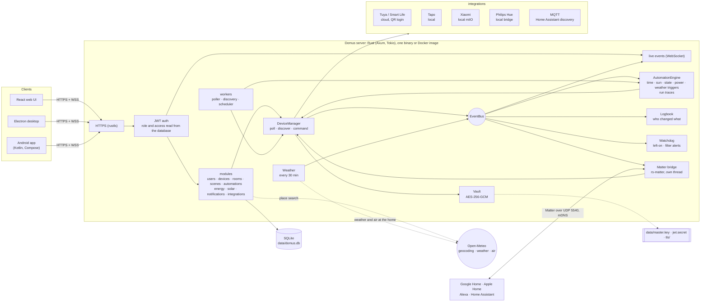
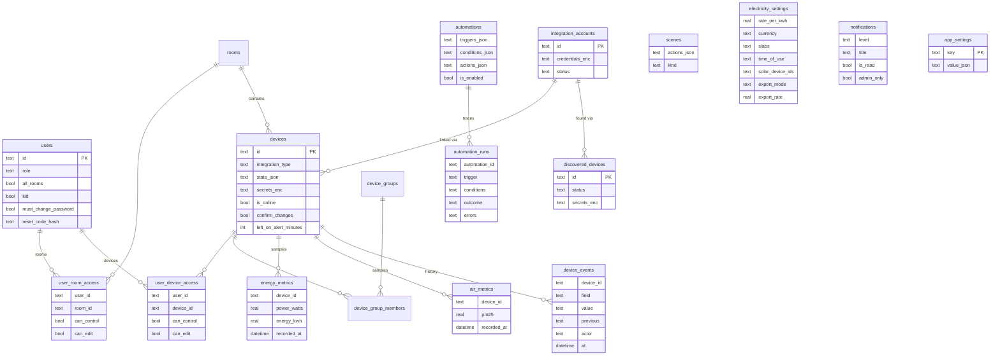

# Domus

<p align="center">
  <b>Translations</b><br>
  <a href="README.md">English</a> ·
  <a href="README.ar.md">العربية</a> ·
  <a href="README.bn.md">বাংলা</a> ·
  <a href="README.de.md">Deutsch</a> ·
  <a href="README.es.md">Español</a> ·
  <a href="README.fr.md">Français</a> ·
  <a href="README.gu.md">ગુજરાતી</a> ·
  <a href="README.hi.md">हिन्दी</a> ·
  <a href="README.id.md">Bahasa Indonesia</a> ·
  <a href="README.it.md">Italiano</a> ·
  <a href="README.ja.md">日本語</a> ·
  <a href="README.kn.md">ಕನ್ನಡ</a> ·
  <a href="README.ko.md">한국어</a> ·
  <a href="README.ml.md">മലയാളം</a> ·
  <a href="README.mr.md">मराठी</a> ·
  <a href="README.pa.md">ਪੰਜਾਬੀ</a> ·
  <a href="README.pl.md">Polski</a> ·
  <a href="README.pt-BR.md">Português (Brasil)</a> ·
  <a href="README.ru.md">Русский</a> ·
  <a href="README.ta.md">தமிழ்</a> ·
  <a href="README.te.md">తెలుగు</a> ·
  <a href="README.th.md">ไทย</a> ·
  <a href="README.tr.md">Türkçe</a> ·
  <a href="README.ur.md">اردو</a> ·
  <a href="README.vi.md">Tiếng Việt</a> ·
  <a href="README.zh-CN.md">简体中文</a> ·
  <a href="README.zh-TW.md">繁體中文</a>
</p>

[](https://github.com/aiyu-ayaan/Domus-Rust/actions/workflows/release.yml)
[](https://github.com/aiyu-ayaan/Domus-Rust/releases)
[](LICENSE)
[](https://github.com/aiyu-ayaan/Domus-Rust/commits/master)
[](https://hub.docker.com/r/aiyuayaan/domus)
[](https://hub.docker.com/r/aiyuayaan/domus)


[](https://ghloc.dev/aiyu-ayaan/Domus)


तुमच्या होम सर्व्हरसाठी एक लोकल-फर्स्ट स्मार्ट-होम हब. रस्ट (Rust) बॅकएंड, SQLite, React वेब UI (Electron डेस्कटॉप शेलसह), आणि **Tuya / Smart Life** (QR-कोड लॉगिन, कोणत्याही डेव्हलपर खात्याची गरज नाही), **TP-Link Tapo** (स्थानिक), **Xiaomi Mi Home** (स्थानिक, तुमच्या Mi खात्यावरून टोकन), **Philips Hue** (स्थानिक ब्रिज) आणि **MQTT** (Zigbee2MQTT, ESPHome आणि Home Assistant डिस्कव्हरी वापरणारे इतर सर्व) साठी प्लगेबल इंटिग्रेशन्स. एक अंगभूत **Matter ब्रिज** Google Home, Apple Home, Alexa आणि Home Assistant ला तुमच्या स्वतःच्या स्थानिक नेटवर्कवर ही उपकरणे चालू/बंद (switch), मंद (dim) आणि त्यांचा रंग बदलण्याची अनुमती देतो.

- नवीन उपकरणांचा स्वयंचलित शोध (Automatic discovery), इनबॉक्स किंवा ऑटो-ॲड पर्यायांसह
- थेट डॅशबोर्ड: विजेचा वापर, आतापर्यंतचे बिल आणि अंदाजित बिल, हवेची गुणवत्ता, मोशन / दरवाजा / गळती (leak) / बॅटरीच्या नोंदी
- खोल्या, उपकरणांचे गट (device groups), सीन्स आणि ऑटोमेशन; ठरावीक वेळेवर, **सूर्योदय किंवा सूर्यास्ताला** (ऑफसेटसह), उपकरणाच्या स्थितीतील बदलावर, विजेच्या पातळीवर (उदा. *N मिनिटांसाठी X पेक्षा जास्त असल्यास*), ऑफलाइन झाल्यावर किंवा **बाहेरील हवामानानुसार** ट्रिगर्स
- **ऑटोमेशन रन इतिहास**: प्रत्येक ऑटोमेशन त्याच्या मागील ५० रन्सची नोंद ठेवते, ज्यामध्ये ट्रिगर आणि रोखणारी अट (condition) स्पष्टपणे नमूद असते
- **उपकरणाचा इतिहास (Device history)**: उपकरणातील प्रत्येक बदल आणि तो कोणी केला (एखादी व्यक्ती आणि त्यांनी वापरलेले ॲप, ऑटोमेशन, Matter किंवा स्वतः ते उपकरण)
- ऑटोमेशन न लिहिता **इशारे (Alerts)**: एखादे उपकरण खूप वेळ चालू राहिल्यास, किंवा एअर प्युरिफायरचा फिल्टर कमी झाल्यास
- **Matter ब्रिज**: कोणत्याही क्लाउड खात्याशिवाय स्थानिक पातळीवर तुमची निवडक उपकरणे Google Home, Apple Home, Alexa किंवा Home Assistant सह शेअर करा
- डॅशबोर्डवर इनडोअर नोंदींसोबतच घराजवळील **बाहेरील हवामान आणि हवा** (Open-Meteo, कोणत्याही API की शिवाय)
- **स्विच करण्यापूर्वी विचारा (Ask before switching)**: मुख्य स्विच चिन्हांकित करा आणि प्रत्येक ॲप, गट, सीन आणि मॅन्युअल ऑटोमेशन रन ते चालू किंवा बंद करण्यापूर्वी पुष्टी मागेल
- कोणत्याही चलनात फ्लॅट, स्लॅब आणि **टाइम-ऑफ-डे (Time-of-Day)** शुल्कासह वीज बिलिंग, प्रति उपकरण **स्टँडबाय खर्च**, आणि **सौरऊर्जा (Solar)**: निर्मिती, निर्यात आणि नेट मीटरिंग किंवा फीड-इन दर
- ॲडमिन / सदस्य / अतिथी भूमिकांसह (roles) एकाधिक वापरकर्ते, आणि खोली किंवा उपकरणानुसार फक्त पाहणे (see-only), नियंत्रण (control) किंवा संपादन (edit) करण्याचा प्रवेश
- वेब, Electron डेस्कटॉप (Linux, Windows) आणि नेटिव्ह Android ॲप, जे रिअल-टाइममध्ये सिंक राहतात
- वेब, डेस्कटॉप आणि Android ॲप्समध्ये **२७ भाषा**, ज्या सेटिंग्जमधील पिकरसह तुमच्या सिस्टमच्या भाषेनुसार बदलतात; अरबी आणि उर्दूसाठी उजवीकडून-डावीकडे (RTL) मांडणी
- प्रत्येक ॲपमध्ये रिलीज नोट्ससह (Markdown, तक्ते आणि प्रतिमा) अपडेट्स (Updates) पान
- डीफॉल्टनुसार HTTPS; क्रेडेन्शियल्स आणि उपकरणांच्या कीज सुरक्षितपणे एन्क्रिप्टेड; सिंगल-फाइल बॅकअप आणि रिस्टोअर

आर्किटेक्चर आणि आकृत्या: [`development/docs/ARCHITECTURE.md`](development/docs/ARCHITECTURE.md), सारांश [खाली पहा](#हे-सर्व-एकत्र-कसे-कार्य-करते).
UI डिझाइन प्रोफाइल: [`design-system/domus/MASTER.md`](design-system/domus/MASTER.md).
प्रगती: [`development/TODO.md`](development/TODO.md).

## हे सर्व एकत्र कसे कार्य करते



क्लायंट फक्त सर्व्हरशी संवाद साधतात; सर्व्हर थेट तुमच्या उपकरणांशी संवाद साधतो (जेथे उत्पादक परवानगी देतो तेथे स्थानिक पातळीवर) आणि सर्व काही एकाच SQLite फाइलमध्ये ठेवतो. क्लाउडचा वापर फक्त तेथेच केला जातो जेथे उत्पादक कोणतेही स्थानिक नियंत्रण देत नाही (Tuya) किंवा उपकरणाचे टोकन मिळवण्यासाठी (Xiaomi), तसेच काही पर्यायी शोधांसाठी: ठिकाण शोध, घराच्या स्थानाचे हवामान आणि बाहेरील हवा (Open-Meteo, स्थान सेट केल्यानंतरच) आणि अपडेट तपासण्यासाठी GitHub. Matter ब्रिज केवळ स्थानिक नेटवर्कवर कार्य करतो.

### डेटा मॉडेल



क्रेडेन्शियल्स आणि उपकरणांच्या कीज `data/master.key` अंतर्गत सुरक्षितपणे एन्क्रिप्ट (`*_enc`) करून साठवल्या जातात, ज्या डेटाबेसमध्ये नसतात. प्रत्येक वैशिष्ट्यासाठी संपूर्ण आकृत्यांचा संच [`development/docs`](development/docs) मध्ये उपलब्ध आहे.

## स्क्रीनशॉट्स

<p align="center"></p>

**डेस्कटॉप** (Electron आणि वेब)

<p>
  
  
  
  
  
  
</p>

**Android**

<p>
  
  
  
  
  
</p>

**Android टॅबलेट** (840dp पासून दोन कॉलम, सेटिंग्ज सूची आणि तपशील म्हणून)

<p>
  
  
  
  
  
</p>

**मोबाइल वेब**

<p>
  
  
  
  
  
</p>

सर्व स्क्रीनशॉट्स [`res/screenshots`](res/screenshots) मध्ये आहेत; संपूर्ण-गुणवत्तेचा वॉकथ्रू व्हिडिओ [`res/domus.mp4`](res/domus.mp4) वर उपलब्ध आहे.

## डाउनलोड

| | |
|---|---|
| सर्व्हर (Docker) | Docker Hub वर `aiyuayaan/domus`, amd64 आणि arm64 |
| Android | [नवीनतम रिलीज](https://github.com/aiyu-ayaan/Domus-Rust/releases) मधून `Domus-<version>.apk` |
| Linux डेस्कटॉप | खालील वन-लाइन इन्स्टॉलर, किंवा रिलीजमधील `.deb` / `.AppImage` |
| Windows डेस्कटॉप | रिलीजमधील `Domus-<version>-Setup.exe` |

### सर्व्हर

होस्टसाठी फक्त एका फाइलची आवश्यकता आहे:

```bash
mkdir domus && cd domus
wget https://raw.githubusercontent.com/aiyu-ayaan/Domus-Rust/master/docker-compose.yml
docker compose up -d
```

`https://<server-ip>:8443` उघडा आणि ॲडमिनिस्ट्रेटर खाते तयार करा. `docker compose logs domus` चालवल्यास प्रमाणपत्राचा फिंगरप्रिंट दिसेल, ज्याची पुष्टी करण्यास ॲप्स तुम्हाला सांगतात.

```bash
docker compose pull && docker compose up -d      # अपडेट करा
DOMUS_VERSION=beta docker compose up -d          # चॅनेल निवडा: latest (डिफॉल्ट), beta, alpha, किंवा 0.0.1
TZ=Asia/Kolkata DOMUS_PORT=9443 docker compose up -d
docker compose --profile mqtt up -d              # पर्यायी Mosquitto ब्रोकरदेखील सुरू करा
```

या सेटिंग्ज कायम ठेवण्यासाठी compose फाइलच्या शेजारील `.env` फाइलमध्ये `DOMUS_VERSION`, `TZ` आणि `DOMUS_PORT` ठेवा.

### Linux डेस्कटॉप ॲप

वर्तमान वापरकर्त्यासाठी नवीनतम रिलीज इन्स्टॉल करते (x86_64, root ची गरज नाही): AppImage, Domus आयकॉनसह मेनू नोंद आणि `domus` कमांड. त्यानंतर हे ॲप स्वतःला अद्ययावत ठेवते.

```bash
curl -fsSL https://raw.githubusercontent.com/aiyu-ayaan/Domus-Rust/master/scripts/install-linux.sh | sh
# ... | sh -s -- --channel beta     बीटा बिल्डसाठी (किंवा अल्फा)
# ... | sh -s -- --uninstall        काढून टाकण्यासाठी; सेटिंग्ज सुरक्षित राहतात
```

### Android

रिलीज पृष्ठावरून APK डाउनलोड करा आणि ते उघडा. ॲप उघडल्यावर आणि सेटिंग्ज → अपडेट्स (Settings → Updates) मध्ये Stable, Beta किंवा Alpha चॅनेलवर पुढील अपडेट्स उपलब्ध होतात, तिथून ते इन्स्टॉल करता येतात; Android एकदा Domus ला ते इन्स्टॉल करण्याची परवानगी देण्यास सांगते.

**अपडेट्स** पान (Android वर सेटिंग्ज → अपडेट्स, वेब आणि डेस्कटॉपवर सेटिंग्ज → बद्दल → अपडेट्स) तुम्ही कोणती आवृत्ती चालवत आहात, तुमच्या चॅनेलवरील नवीनतम रिलीज आणि त्याचे रिलीज नोट्स दाखवते, जे Markdown मध्ये लिहिलेले आहेत.

रिलीज, आवृत्ती क्रमांक आणि अपडेट चॅनेल्स: [development/docs/RELEASE.md](development/docs/RELEASE.md).

## आवश्यकता

- Rust 1.80+ (`cargo`)
- Node.js 18+ आणि `pnpm`

## डेव्हलपमेंटमध्ये चालवा

```bash
pnpm install
npm run dev            # बॅकएंड (https://127.0.0.1:8443) + वेब (http://localhost:3000)

npm run dev:backend    # फक्त बॅकएंड
npm run dev:web        # फक्त वेब (बॅकएंडसाठी /api प्रॉक्सी करते)
npm run dev:desktop    # Electron; याच्या कनेक्ट पानावर सर्व्हर निवडा
```

http://localhost:3000 उघडा. पहिल्या भेटीदरम्यान हे तुम्हाला ॲडमिनिस्ट्रेटर खाते तयार करण्यास सांगेल.

## होम सर्व्हरवर चालवा

```bash
pnpm build:web                     # apps/web/dist तयार करते, जे बॅकएंडद्वारे सर्व्ह केले जाते
APP_ENV=production cargo run --release --manifest-path backend/Cargo.toml
```

त्यानंतर `https://<server-ip>:8443` उघडा. Matter ब्रिज चालू असताना LAN वर UDP 5540 (`[matter] port`) आणि mDNS चा वापर करतो.

किंवा या चेकआउटमधून Docker इमेज तयार करा (होस्ट नेटवर्किंग, डेटा `domus_data` व्हॉल्यूममध्ये):

```bash
docker compose -f docker-compose.local.yml up -d --build
```

Cloudflare टनेलद्वारे रिमोट ॲक्सेस, होम/रिमोट ॲड्रेस ज्या दरम्यान ॲप्स स्विच करतात, आणि डेस्कटॉप पॅकेजेस (`pnpm build:desktop`) यांचे तपशील [development/docs/DEPLOYMENT.md](development/docs/DEPLOYMENT.md) मध्ये दिले आहेत.

पहिल्यांदा सुरू झाल्यावर Domus `data/` फोल्डर तयार करते ज्यामध्ये समाविष्ट आहे:

| फाइल | उद्देश |
|---|---|
| `domus.db` | SQLite डेटाबेस |
| `master.key` | इंटिग्रेशन क्रेडेन्शियल्स आणि उपकरणांच्या कीज एन्क्रिप्ट करते — **याचा बॅकअप ठेवा** |
| `jwt.secret` | सेशन्स साइन करते |
| `tls/` | सेल्फ-साइन केलेले प्रमाणपत्र (`tls.cert_path` / `tls.key_path` द्वारे बदलता येते) |

सेटिंग्ज `config/default.toml` मध्ये असतात; कोणतीही की `DOMUS__SECTION__KEY` एन्व्हायर्नमेंट व्हेरिएबल्ससह ओव्हरराइड केली जाऊ शकते (`.env.example` पहा).

## बॅकअप आणि रिस्टोअर

सर्व काही `data/` मध्ये राहते. संपूर्ण फोल्डरचा बॅकअप घ्या, किंवा सिंगल-फाइल बॅकअप वापरा:

**बॅकअप घ्या.** ॲडमिनिस्ट्रेटर म्हणून साइन इन करा → सेटिंग्ज → **बॅकअप** → *बॅकअप डाउनलोड करा*. ही फाइल मास्टर कीसह (master key) डेटाबेसची एक प्रत असते, जेणेकरून रिस्टोअर केल्यानंतरही त्यातील लिंक केलेली खाती उघडता येतात. सर्व्हर चालू असताना ही फाइल तयार केली जाते. ती सुरक्षित ठेवा: ज्याच्याकडे ही फाइल असेल तो ही खाती उघडू शकतो. यामध्ये JWT सीक्रेट आणि TLS प्रमाणपत्र नसते.

**रिस्टोअर करा.** सर्व्हर थांबवा, नंतर:

```bash
# Docker
docker compose cp domus-backup-2026-10-11.db domus:/app/data/restore.db
docker compose stop domus
docker compose run --rm domus domus-backend restore data/restore.db
docker compose start domus

# Docker शिवाय, रेपो रूटमधून (./data वापरते)
domus-backend restore ~/Downloads/domus-backup-2026-10-11.db
```

तिथे आधीपासून असलेला डेटा `*.before-restore` म्हणून बाजूला सुरक्षित ठेवला जातो. नवीन मशीनवर रिस्टोअर केल्यानंतर युजर्सना पुन्हा साइन इन करावे लागेल आणि ॲप्स नवीन प्रमाणपत्रावर विश्वास ठेवण्यास विचारतील. जर तुम्ही `DOMUS_MASTER_KEY` सह की सेट केली असेल, तर बॅकअपमध्ये कोणतीही की नसते आणि रिस्टोअर केलेल्या सर्व्हरला त्याच व्हेरिएबलची आवश्यकता असते. अधिक माहिती [development/docs/DEPLOYMENT.md](development/docs/DEPLOYMENT.md#backup-and-restore) मध्ये.

## ॲडमिनिस्ट्रेटर पासवर्ड विसरल्यास

Domus मध्ये कोणताही मेल सर्व्हर नाही, त्यामुळे ईमेलद्वारे काहीही पाठवले जात नाही. सोप्यापासून क्रमाक्रमाने:

१. **दुसरा ॲडमिनिस्ट्रेटर** सेटिंग्ज → लोक (Settings → People) उघडतो, तुमच्यासाठी *रीसेट कोड* चालू करतो आणि तुम्हाला ८-अंकी कोड सांगतो (३० मिनिटे आणि ५ चुकीच्या प्रयत्नांसाठी वैध). साइन-इन स्क्रीनवर *पासवर्ड विसरलात?* निवडा, तुमचे वापरकर्तानाव आणि नंतर तो कोड टाका.
२. **सर्व्हरवरून**, जे Domus चालू असताना किंवा बंद असताना काम करते आणि यासाठी कोणत्याही साइन-इनची आवश्यकता नसते:

   ```bash
   docker compose exec domus domus-backend reset-password <username>              # नवीन रँडम पासवर्ड दाखवतो
   docker compose exec domus domus-backend reset-password <username> 'new-pass'   # किंवा स्वतःचा निवडा (८+ अक्षरे)
   domus-backend reset-password <username>                                        # Docker शिवाय, रेपो रूटमधून
   ```

   याचा वापर करून साइन इन करा आणि सेटिंग्ज → पासवर्ड मध्ये जाऊन बदला.

प्रॉडक्शनमध्ये एखाद्या युझरनेमसाठी पाच चुकीचे पासवर्ड टाकल्यास ते नाव १५ मिनिटांसाठी लॉक केले जाते (सर्व्हर रीस्टार्ट केल्यास हे लॉक उठवले जाते, आणि डेव्हलपमेंटमध्ये ते बंद असते). तपशील आणि व्युत्पन्न केलेले पासवर्ड व मुलांच्या खात्यांचे नियम: [development/docs/ACCOUNTS.md](development/docs/ACCOUNTS.md).

## भाषा

इंग्रजी, हिंदी, स्पॅनिश, पोर्तुगीज (ब्राझील), इंडोनेशियन, अरबी, फ्रेंच, रशियन, जर्मन, तुर्की, जपानी, कोरियन, इटालियन, व्हिएतनामी, थाई, चीनी (सरलीकृत आणि पारंपारिक), पोलिश, बंगाली, तमिळ, तेलगू, मराठी, गुजराती, कन्नड, मल्याळम, पंजाबी आणि उर्दू. अरबी आणि उर्दू उजवीकडून-डावीकडे (RTL) मांडणीत आहेत.

प्रत्येक ॲप तुमच्या ब्राउझरच्या किंवा सिस्टमच्या भाषेचे अनुसरण करते आणि भाषांतर उपलब्ध नसल्यास इंग्रजी दाखवते. दुसरी भाषा निवडण्यासाठी सेटिंग्ज > भाषा (वेब आणि डेस्कटॉपवर Appearance) उघडा; *सिस्टम डीफॉल्ट* पुन्हा सिस्टमचे अनुसरण करण्यास सुरुवात करते. Android 13 आणि नंतरच्या आवृत्त्यांवर हे फोनच्या सेटिंग्ज > ॲप्स > Domus > भाषा अंतर्गत देखील दिसते.

भाषांतरे मशीनद्वारे तयार केलेली आहेत आणि स्थानिक भाषिकांद्वारे तपासलेली नाहीत, त्यामुळे काही शब्दांची मांडणी वेगळी वाटू शकते. भाषेच्या कॅटलॉगमध्ये एका ओळीचा बदल करून हे दुरुस्त करता येते. भाषा कशा कार्य करतात, नवीन भाषा कशी जोडावी आणि नवीन मजकुराचे नियम: [development/docs/LOCALIZATION.md](development/docs/LOCALIZATION.md).

## उपकरणे कनेक्ट करणे

| ब्रँड | कृती |
|---|---|
| Tuya / Smart Life | इंटिग्रेशन्स → *QR कोडसह लिंक करा*. Smart Life मधून **वापरकर्ता कोड (User Code)** टाका (मी → सेटिंग्ज → खाते आणि सुरक्षा → वापरकर्ता कोड), नंतर ॲपमध्ये QR स्कॅन करा. |
| Tapo | तुमच्या TP-Link ID सह इंटिग्रेशन्स → *खाते लिंक करा*. LAN वरील उपकरणे स्वयंचलितपणे शोधली जातात आणि स्थानिक पातळीवर नियंत्रित केली जातात. H100 हब आपले सेन्सर्स, स्विचेस आणि थर्मोस्टॅट्स सोबत आणतो. कॅमेरे सूचीबद्ध आहेत पण अजून समर्थित नाहीत. |
| Xiaomi | तुमच्या Mi खात्यासह आणि सर्व्हर प्रदेशासह इंटिग्रेशन्स → *खाते लिंक करा*. Xiaomi ने टू-स्टेप पडताळणी मागितल्यास, त्यांनी ईमेल किंवा एसएमएस केलेला कोड त्याच पॅनेलमध्ये प्रविष्ट करा. खाते हे ईमेल, देशाच्या कोडसह फोन नंबर (`+91…`) किंवा Xiaomi ID असू शकते. टोकन एकदाच आणले जातात; नियंत्रण स्थानिक असते. टोकन वापरूनही उपकरणे जोडली जाऊ शकतात. |
| Philips Hue | ब्रिजवरील गोल बटण दाबा, नंतर ३० सेकंदांच्या आत इंटिग्रेशन्स → Philips Hue → *लिंक करा* वर क्लिक करा. ब्रिज स्वयंचलितपणे शोधण्यासाठी पत्ता रिकामा ठेवा. दिवे आणि Hue स्मार्ट प्लग्ज स्थानिक पातळीवर नियंत्रित केले जातात. |
| MQTT | तुमच्या ब्रोकरचा पत्ता, पोर्ट आणि लॉगिन तपशीलांसह इंटिग्रेशन्स → MQTT → *लिंक करा*. Home Assistant MQTT डिस्कव्हरी (Zigbee2MQTT, ESPHome, …) द्वारे जोडलेली उपकरणे शोधलेली (Discovered) अंतर्गत दिसतात: दिवे, स्विचेस, प्लग्ज, पंखे आणि सेन्सर्स. बंडल केलेल्या ब्रोकरसह (`--profile mqtt`) पत्ता `mqtt`, पोर्ट `1883` असतो. |

प्रत्येक इंटिग्रेशनमध्ये काय समाविष्ट आहे हे पाहण्यासाठी `development/docs/INTEGRATIONS.md` पहा.

## वीज बिलिंग

ऊर्जा (Energy) → *वीज योजना*: कोणतेही चलन निवडा, आणि प्रति किलोवॅट-तास सपाट दर किंवा युनिट-आधारित शुल्कासाठी **स्लॅब (slabs)** निवडा (उदा. पुणे/MSEDCL: ०–१०० युनिट्स एका दराने, १०१–३०० पुढील दराने, इत्यादी). बिलाची गणना बिलिंग सायकलनुसार केली जाते, अधिक निश्चित मासिक शुल्क आकारले जाते.

टॅरिफमध्ये **टाइम-ऑफ-डे (time-of-day)** विंडो देखील असू शकतात: असे तास (घराच्या घड्याळानुसार, मध्यरात्रीनंतरही वैध) ज्यांचे युनिट दर सपाट किंवा स्लॅब दरापेक्षा ठरावीक रकमेने कमी किंवा जास्त असतात, उदाहरणार्थ रात्रीची सवलत किंवा पीक अवर्सचे अतिरिक्त शुल्क.

नवीन उपकरणे **उपकरणे → शोधलेली (Devices → Discovered)** अंतर्गत दिसतात. इनबॉक्स टाळण्यासाठी तिथे *नवीन उपकरणे स्वयंचलितपणे जोडा* चालू करा.

## सूर्योदय आणि सूर्यास्त

घर कुठे आहे ते सेटिंग्ज → **घराचे स्थान (Home location)** मध्ये सेट करा: या फोनचे किंवा ब्राउझरचे स्थान वापरा, शहर शोधा (सर्व्हर मोफत Open-Meteo जिओकोडरला विनंती करतो; फक्त तुम्ही टाइप केलेले नाव घराबाहेर जाते), किंवा अक्षांश आणि रेखांश टाइप करा. निर्देशक सुमारे एक किलोमीटरपर्यंत राऊंड केले जातात आणि तुमच्या सर्व्हरवरच राहतात. त्यानंतर एखादे ऑटोमेशन सूर्योदयाला किंवा सूर्यास्ताला, काही मिनिटे आधी किंवा नंतर चालू शकते. स्थानाशिवाय, सूर्य ट्रिगर कधीही सक्रिय होत नाही.

## स्विच करण्यापूर्वी विचारा

एक मुख्य स्विच जो त्याला जोडलेल्या सर्व उपकरणांचा वीजपुरवठा खंडित करतो, तो चुकून बंद होऊ शकतो. उपकरण उघडा आणि **स्विच करण्यापूर्वी विचारा (Ask before switching)** चालू करा: प्रत्येक ॲप नंतर ते चालू किंवा बंद करण्यापूर्वी पुष्टी मागेल, तसेच खोलीतील *सर्व चालू / सर्व बंद*, उपकरणांचे गट, सीन्स (सीन्स अंतर्गत सीन्ससह) आणि ते स्विच करणाऱ्या ऑटोमेशनचे मॅन्युअल *रन* देखील पुष्टी मागेल. हे सेटिंग सर्व्हरवर ठेवले जाते, त्यामुळे ते वेब, डेस्कटॉप आणि Android वर सारखेच राहते. स्वतःहून सक्रिय होणारी ऑटोमेशन्स विचारू शकत नाहीत आणि ती लिहिलेल्या नियमांनुसार चालतात, आणि Domus बाहेरील कोणतीही गोष्ट (उत्पादक ॲप, वॉल स्विच) याच्या कक्षेत येत नाही.

## Matter (Google Home, Apple Home, Alexa)

सेटिंग्ज → **Matter** (ॲडमिनिस्ट्रेटर): हे चालू करा, शेअर करावयाच्या उपकरणांवर टिक करा, नंतर Google Home, Apple Home, Alexa किंवा Home Assistant मध्ये QR स्कॅन करा किंवा पेअरिंग कोड टाइप करा. दिवे रंगीत किंवा मंद करता येणारे दिवे म्हणून येतात, चालू/बंद स्विच असलेल्या इतर सर्व गोष्टी प्लग म्हणून येतात; स्विच करणे, मंद करणे आणि रंग बदलणे काम करते आणि Domus मध्ये केलेले बदल (चालू/बंद, ब्राइटनेस) कंट्रोलरमध्ये दिसतात. "१५ मिनिटांसाठी पेअरिंगला अनुमती द्या" दुसरी इकोसिस्टम जोडते; "सर्व पेअरिंग्स विसरा" नवीन कोडसह पुन्हा सुरू करते.

हा ब्रिज प्रमाणित नाही (तो Matter टेस्ट अटेस्टेशन वापरतो), त्यामुळे ॲप्स तो जोडण्याची पुष्टी करण्यास सांगतात आणि Google Home डेव्हलपर कन्सोलमध्ये हा ब्रिज टेस्ट डिव्हाइस म्हणून जोडल्यानंतरच Google Home तो स्वीकारतो. तपशील: [`development/docs/MATTER.md`](development/docs/MATTER.md).

## इतिहास, ऑटोमेशन रन्स आणि इशारे

- प्रत्येक डिव्हाइस शीटमध्ये **इतिहास**: काय बदलले, केव्हा आणि कोणी केले (*अयान द्वारे · Android*, *ऑटोमेशन "नाईट मोड"*, *Matter*, *उपकरणावर*). ऊर्जा इतिहासाइतकाच साठवला जातो.
- प्रत्येक ऑटोमेशनचे **रन्स**: *चालवले (Ran)*, त्रुटीसह *अयशस्वी (Failed)*, किंवा ज्या अटीने रोखले तिच्यासह *वगळले (Skipped)*, ज्यामुळे "हे का चालले नाही?" याचे उत्तर मिळते.
- डिव्हाइस शीटमध्ये **चालू राहिल्यावर इशारा** (३० मिनिटे ते १२ तास): ॲडमिनिस्ट्रेटर्सना सूचना मिळते. १० W पेक्षा जास्त वीज वापरणारे मीटर्ड उपकरण चालू मानले जाते, त्यामुळे स्टँडबायवरील टीव्ही बंद मानला जातो.
- **फिल्टर कमी झाल्याचा इशारा**: जेव्हा एअर प्युरिफायरचा फिल्टर १०% पर्यंत खाली येतो तेव्हा सूचना दिली जाते.

## हवामान, स्टँडबाय आणि सौरऊर्जा

- घराचे स्थान सेट केलेले असल्यास, डॅशबोर्ड इनडोअर रीडिंगच्या बाजूला **हवामान आणि बाहेरील PM2.5** दाखवतो, आणि ऑटोमेशन्स त्यांचा वापर करू शकतात (*जेव्हा बाहेरील PM2.5 ३५ च्या वर जाईल*, *फक्त बाहेरील तापमान २० च्या खाली असल्यास*).
- ऊर्जा → **स्टँडबाय** कोणीही वापरत नसताना प्रत्येक उपकरण किती वीज वापरते (या आठवड्यातील सर्वात कमी तासाची नोंद) आणि त्याचा दरमहा किती खर्च येतो याची यादी दाखवतो.
- ऊर्जा → *वीज योजना* → **सौरऊर्जा (Solar)**: सौर निर्मिती मोजणारे प्लग्ज टिक करा, नंतर नेट मीटरिंग किंवा फीड-इन दर निवडा. त्यानंतर बिलामध्ये तुम्ही ग्रिडकडून विकत घेतलेल्या विजेचीच मोजणी होते, आणि सोलर कार्ड तयार झालेली, घरी वापरलेली, निर्यात केलेली आणि मिळवलेली रक्कम दर्शवते. मीटर असलेल्या उपकरणांवरून दर १५ मिनिटांनी ग्रिड प्रवाह मोजला जातो, त्यामुळे मीटर नसलेली उपकरणे निर्यातीची नोंद जास्त दाखवू शकतात.

योजना आणि आकृत्या: [`development/docs/ROADMAP.md`](development/docs/ROADMAP.md).

## परवाना

Domus [MIT परवान्याअंतर्गत](LICENSE) जारी केले आहे. थर्ड-पार्टी लायब्ररी त्यांचे स्वतःचे परवाने राखतात; ते प्रत्येक ॲपमध्ये बद्दल → ऋणनिर्देश (About → Acknowledgements) अंतर्गत सूचीबद्ध आहेत.

## चाचण्या

```bash
cargo test --workspace
pnpm --filter @domus/web exec tsc -b
```

`cargo test --workspace` मध्ये `backend/tests/matter_bridge.rs` समाविष्ट आहे, जे UDP वर Matter कंट्रोलरला ब्रिजसोबत जोडते आणि त्याची उपकरणे चालू/बंद, मंद आणि रंगीत करते (यासाठी IPv4 सह नेटवर्क इंटरफेस आवश्यक आहे).
