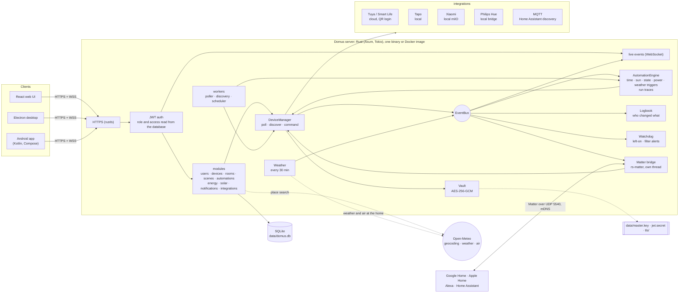
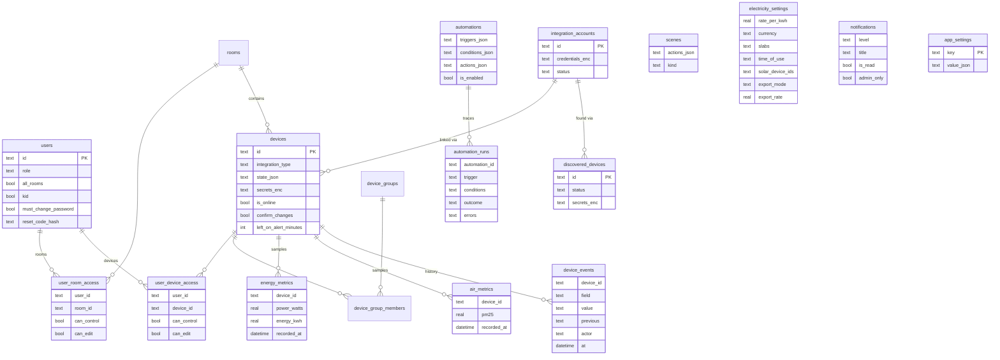

# Domus

<p align="center">
  <b>Translations</b><br>
  <a href="README.md">English</a> ·
  <a href="README.ar.md">العربية</a> ·
  <a href="README.bn.md">বাংলা</a> ·
  <a href="README.de.md">Deutsch</a> ·
  <a href="README.es.md">Español</a> ·
  <a href="README.fr.md">Français</a> ·
  <a href="README.gu.md">ગુજરાતી</a> ·
  <a href="README.hi.md">हिन्दी</a> ·
  <a href="README.id.md">Bahasa Indonesia</a> ·
  <a href="README.it.md">Italiano</a> ·
  <a href="README.ja.md">日本語</a> ·
  <a href="README.kn.md">ಕನ್ನಡ</a> ·
  <a href="README.ko.md">한국어</a> ·
  <a href="README.ml.md">മലയാളം</a> ·
  <a href="README.mr.md">मराठी</a> ·
  <a href="README.pa.md">ਪੰਜਾਬੀ</a> ·
  <a href="README.pl.md">Polski</a> ·
  <a href="README.pt-BR.md">Português (Brasil)</a> ·
  <a href="README.ru.md">Русский</a> ·
  <a href="README.ta.md">தமிழ்</a> ·
  <a href="README.te.md">తెలుగు</a> ·
  <a href="README.th.md">ไทย</a> ·
  <a href="README.tr.md">Türkçe</a> ·
  <a href="README.ur.md">اردو</a> ·
  <a href="README.vi.md">Tiếng Việt</a> ·
  <a href="README.zh-CN.md">简体中文</a> ·
  <a href="README.zh-TW.md">繁體中文</a>
</p>

[](https://github.com/aiyu-ayaan/Domus-Rust/actions/workflows/release.yml)
[](https://github.com/aiyu-ayaan/Domus-Rust/releases)
[](LICENSE)
[](https://github.com/aiyu-ayaan/Domus-Rust/commits/master)
[](https://hub.docker.com/r/aiyuayaan/domus)
[](https://hub.docker.com/r/aiyuayaan/domus)


ਤੁਹਾਡੇ ਹੋਮ ਸਰਵਰ ਲਈ ਇੱਕ ਲੋਕਲ-ਫਰਸਟ ਸਮਾਰਟ-ਹੋਮ ਹੱਬ। ਰਸਟ (Rust) ਬੈਕਐਂਡ, SQLite, React ਵੈੱਬ UI (Electron ਡੈਸਕਟਾਪ ਸ਼ੈੱਲ ਦੇ ਨਾਲ), ਅਤੇ **Tuya / Smart Life** (QR-ਕੋਡ ਲੌਗਇਨ, ਬਿਨਾਂ ਡਿਵੈਲਪਰ ਖਾਤੇ ਦੇ), **TP-Link Tapo** (ਸਥਾਨਕ), **Xiaomi Mi Home** (ਸਥਾਨਕ, ਤੁਹਾਡੇ Mi ਖਾਤੇ ਤੋਂ ਟੋਕਨ), **Philips Hue** (ਸਥਾਨਕ ਬ੍ਰਿਜ) ਅਤੇ **MQTT** (Zigbee2MQTT, ESPHome ਅਤੇ ਹੋਰ ਸਾਰੇ ਡਿਵਾਈਸ ਜੋ Home Assistant ਡਿਸਕਵਰੀ ਦਾ ਸਮਰਥਨ ਕਰਦੇ ਹਨ) ਲਈ ਪਲੱਗੇਬਲ ਇੰਟੀਗ੍ਰੇਸ਼ਨ। ਇੱਕ ਇਨ-ਬਿਲਟ **Matter ਬ੍ਰਿਜ** Google Home, Apple Home, Alexa ਅਤੇ Home Assistant ਨੂੰ ਤੁਹਾਡੇ ਆਪਣੇ ਲੋਕਲ ਨੈੱਟਵਰਕ 'ਤੇ ਇਹਨਾਂ ਡਿਵਾਈਸਾਂ ਨੂੰ ਸਵਿੱਚ, ਮੱਧਮ (dim) ਅਤੇ ਰੰਗ ਬਦਲਣ ਦੀ ਆਗਿਆ ਦਿੰਦਾ ਹੈ।

- ਨਵੀਆਂ ਡਿਵਾਈਸਾਂ ਦੀ ਆਟੋਮੈਟਿਕ ਖੋਜ (Automatic discovery), ਇਨਬਾਕਸ ਜਾਂ ਆਟੋ-ਐਡ ਵਿਕਲਪ ਨਾਲ
- ਲਾਈਵ ਡੈਸ਼ਬੋਰਡ: ਬਿਜਲੀ ਦੀ ਖਪਤ, ਹੁਣ ਤੱਕ ਦਾ ਬਿੱਲ ਅਤੇ ਅਨੁਮਾਨਿਤ ਬਿੱਲ, ਹਵਾ ਦੀ ਗੁਣਵੱਤਾ, ਮੋਸ਼ਨ / ਦਰਵਾਜ਼ਾ / ਲੀਕ / ਬੈਟਰੀ ਰੀਡਿੰਗਜ਼
- ਕਮਰੇ, ਡਿਵਾਈਸ ਗਰੁੱਪ, ਸੀਨ ਅਤੇ ਆਟੋਮੇਸ਼ਨ; ਇੱਕ ਨਿਰਧਾਰਤ ਸਮੇਂ 'ਤੇ, **ਸੂਰਜ ਚੜ੍ਹਨ ਜਾਂ ਸੂਰਜ ਡੁੱਬਣ** 'ਤੇ (ਆਫਸੈੱਟ ਦੇ ਨਾਲ), ਡਿਵਾਈਸ ਦੀ ਸਥਿਤੀ ਬਦਲਣ 'ਤੇ, ਪਾਵਰ ਪੱਧਰ 'ਤੇ (ਜਿਵੇਂ *N ਮਿੰਟਾਂ ਲਈ X ਤੋਂ ਵੱਧ*), ਔਫਲਾਈਨ ਹੋਣ 'ਤੇ ਜਾਂ **ਬਾਹਰੀ ਮੌਸਮ** ਦੇ ਆਧਾਰ 'ਤੇ ਟ੍ਰਿਗਰ
- **ਆਟੋਮੇਸ਼ਨ ਰਨ ਇਤਿਹਾਸ**: ਹਰੇਕ ਆਟੋਮੇਸ਼ਨ ਆਪਣੇ ਪਿਛਲੇ 50 ਰਨ ਦਾ ਰਿਕਾਰਡ ਰੱਖਦੀ ਹੈ, ਜਿਸ ਵਿੱਚ ਇਸਨੂੰ ਚਲਾਉਣ ਵਾਲੇ ਟ੍ਰਿਗਰ ਅਤੇ ਰੋਕਣ ਵਾਲੀ ਸ਼ਰਤ (condition) ਦਾ ਪੂਰਾ ਵੇਰਵਾ ਹੁੰਦਾ ਹੈ
- **ਡਿਵਾਈਸ ਇਤਿਹਾਸ (Device history)**: ਡਿਵਾਈਸ ਵਿੱਚ ਹੋਇਆ ਹਰ ਬਦਲਾਅ ਅਤੇ ਉਹ ਕਿਸਨੇ ਕੀਤਾ (ਕੋਈ ਵਿਅਕਤੀ ਅਤੇ ਉਸਦੀ ਐਪ, ਆਟੋਮੇਸ਼ਨ, Matter, ਜਾਂ ਡਿਵਾਈਸ ਖੁਦ)
- ਬਿਨਾਂ ਆਟੋਮੇਸ਼ਨ ਲਿਖੇ **ਚਿਤਾਵਨੀਆਂ (Alerts)**: ਕੋਈ ਡਿਵਾਈਸ ਬਹੁਤ ਦੇਰ ਤੱਕ ਚੱਲਦੀ ਰਹਿ ਜਾਵੇ, ਜਾਂ ਏਅਰ ਪਿਊਰੀਫਾਇਰ ਦਾ ਫਿਲਟਰ ਘੱਟ ਹੋ ਜਾਵੇ
- **Matter ਬ੍ਰਿਜ**: ਬਿਨਾਂ ਕਿਸੇ ਕਲਾਉਡ ਖਾਤੇ ਦੇ, ਸਥਾਨਕ ਤੌਰ 'ਤੇ Google Home, Apple Home, Alexa ਜਾਂ Home Assistant ਨਾਲ ਆਪਣੀਆਂ ਚੁਣੀਆਂ ਹੋਈਆਂ ਡਿਵਾਈਸਾਂ ਸਾਂਝੀਆਂ ਕਰੋ
- ਘਰ ਦਾ **ਬਾਹਰੀ ਮੌਸਮ ਅਤੇ ਹਵਾ ਦੀ ਗੁਣਵੱਤਾ** (Open-Meteo, ਬਿਨਾਂ API ਕੀ ਦੇ) ਡੈਸ਼ਬੋਰਡ 'ਤੇ ਅੰਦਰੂਨੀ ਰੀਡਿੰਗ ਦੇ ਨਾਲ
- **ਸਵਿੱਚ ਕਰਨ ਤੋਂ ਪਹਿਲਾਂ ਪੁੱਛੋ (Ask before switching)**: ਮੁੱਖ ਸਵਿੱਚ ਨੂੰ ਮਾਰਕ ਕਰੋ ਅਤੇ ਹਰ ਐਪ, ਗਰੁੱਪ, ਸੀਨ ਅਤੇ ਮੈਨੂਅਲ ਆਟੋਮੇਸ਼ਨ ਰਨ ਇਸਨੂੰ ਚਾਲੂ ਜਾਂ ਬੰਦ ਕਰਨ ਤੋਂ ਪਹਿਲਾਂ ਪੁਸ਼ਟੀ ਮੰਗੇਗਾ
- ਕਿਸੇ ਵੀ ਮੁਦਰਾ ਵਿੱਚ ਫਲੈਟ, ਸਲੈਬ ਅਤੇ **ਟਾਈਮ-ਆਫ-ਡੇ (Time-of-Day)** ਟੈਰਿਫ ਨਾਲ ਬਿਜਲੀ ਬਿਲਿੰਗ, ਪ੍ਰਤੀ ਡਿਵਾਈਸ **ਸਟੈਂਡਬਾਏ ਲਾਗਤ**, ਅਤੇ **ਸੋਲਰ (Solar)**: ਉਤਪਾਦਨ, ਨਿਰਯਾਤ ਅਤੇ ਨੈੱਟ ਮੀਟਰਿੰਗ ਜਾਂ ਫੀਡ-ਇਨ ਦਰ
- ਐਡਮਿਨ / ਮੈਂਬਰ / ਮਹਿਮਾਨ ਭੂਮਿਕਾਵਾਂ (roles) ਦੇ ਨਾਲ ਮਲਟੀਪਲ ਉਪਭੋਗਤਾ, ਅਤੇ ਪ੍ਰਤੀ ਕਮਰਾ ਜਾਂ ਪ੍ਰਤੀ ਡਿਵਾਈਸ ਸਿਰਫ਼ ਦੇਖਣ (see-only), ਕੰਟਰੋਲ (control) ਜਾਂ ਸੰਪਾਦਨ (edit) ਦੀ ਪਹੁੰਚ
- ਵੈੱਬ, Electron ਡੈਸਕਟਾਪ (Linux, Windows) ਅਤੇ ਨੇਟਿਵ Android ਐਪ, ਜੋ ਰੀਅਲ-ਟਾਈਮ ਵਿੱਚ ਸਿੰਕ ਰਹਿੰਦੇ ਹਨ
- ਵੈੱਬ, ਡੈਸਕਟਾਪ ਅਤੇ Android ਐਪਾਂ ਵਿੱਚ **27 ਭਾਸ਼ਾਵਾਂ**, ਜੋ ਸੈਟਿੰਗਾਂ ਵਿੱਚ ਚੋਣਕਾਰ ਦੇ ਨਾਲ ਤੁਹਾਡੇ ਸਿਸਟਮ ਦੀ ਭਾਸ਼ਾ ਦੀ ਪਾਲਣਾ ਕਰਦੀਆਂ ਹਨ; ਅਰਬੀ ਅਤੇ ਉਰਦੂ ਲਈ ਸੱਜੇ ਤੋਂ ਖੱਬੇ (RTL) ਖਾਕਾ
- ਹਰੇਕ ਐਪ ਵਿੱਚ ਰਿਲੀਜ਼ ਨੋਟਸ (Markdown, ਟੇਬਲ ਅਤੇ ਚਿੱਤਰ) ਦੇ ਨਾਲ ਅੱਪਡੇਟ (Updates) ਪੰਨਾ
- ਡਿਫੌਲਟ ਤੌਰ 'ਤੇ HTTPS; ਕ੍ਰੈਡੈਂਸ਼ੀਅਲ ਅਤੇ ਡਿਵਾਈਸ ਕੁੰਜੀਆਂ ਸੁਰੱਖਿਅਤ ਢੰਗ ਨਾਲ ਇਨਕ੍ਰਿਪਟਡ; ਸਿੰਗਲ-ਫਾਈਲ ਬੈਕਅੱਪ ਅਤੇ ਰੀਸਟੋਰ

ਆਰਕੀਟੈਕਚਰ ਅਤੇ ਚਿੱਤਰ: [`development/docs/ARCHITECTURE.md`](development/docs/ARCHITECTURE.md), ਸੰਖੇਪ [ਹੇਠਾਂ ਦੇਖੋ](#ਇਹ-ਸਭ-ਇਕੱਠੇ-ਕਿਵੇਂ-ਕੰਮ-ਕਰਦਾ-ਹੈ)।
UI ਡਿਜ਼ਾਈਨ ਪ੍ਰੋਫਾਈਲ: [`design-system/domus/MASTER.md`](design-system/domus/MASTER.md)।
ਤਰੱਕੀ: [`development/TODO.md`](development/TODO.md)।

## ਇਹ ਸਭ ਇਕੱਠੇ ਕਿਵੇਂ ਕੰਮ ਕਰਦਾ ਹੈ



ਕਲਾਇੰਟ ਸਿਰਫ਼ ਸਰਵਰ ਨਾਲ ਗੱਲਬਾਤ ਕਰਦੇ ਹਨ; ਸਰਵਰ ਸਿੱਧਾ ਤੁਹਾਡੀਆਂ ਡਿਵਾਈਸਾਂ ਨਾਲ ਗੱਲ ਕਰਦਾ ਹੈ (ਜਿੱਥੇ ਵਿਕਰੇਤਾ ਇਜਾਜ਼ਤ ਦਿੰਦਾ ਹੈ ਉੱਥੇ ਸਥਾਨਕ ਤੌਰ 'ਤੇ) ਅਤੇ ਸਭ ਕੁਝ ਇੱਕ ਸਿੰਗਲ SQLite ਫਾਈਲ ਵਿੱਚ ਰੱਖਦਾ ਹੈ। ਕਲਾਉਡ ਦੀ ਵਰਤੋਂ ਸਿਰਫ਼ ਉੱਥੇ ਕੀਤੀ ਜਾਂਦੀ ਹੈ ਜਿੱਥੇ ਵਿਕਰੇਤਾ ਕੋਈ ਸਥਾਨਕ ਨਿਯੰਤਰਣ ਨਹੀਂ ਦਿੰਦਾ (Tuya) ਜਾਂ ਡਿਵਾਈਸ ਟੋਕਨ ਪ੍ਰਾਪਤ ਕਰਨ ਲਈ (Xiaomi), ਨਾਲ ਹੀ ਕੁਝ ਵਿਕਲਪਿਕ ਖੋਜਾਂ ਲਈ: ਸਥਾਨ ਖੋਜ, ਘਰ ਦੇ ਸਥਾਨ ਦਾ ਮੌਸਮ ਅਤੇ ਬਾਹਰੀ ਹਵਾ (Open-Meteo, ਸਥਾਨ ਨਿਰਧਾਰਤ ਕਰਨ ਤੋਂ ਬਾਅਦ ਹੀ) ਅਤੇ ਅੱਪਡੇਟ ਜਾਂਚਣ ਲਈ GitHub। Matter ਬ੍ਰਿਜ ਸਿਰਫ਼ ਸਥਾਨਕ ਨੈੱਟਵਰਕ 'ਤੇ ਕੰਮ ਕਰਦਾ ਹੈ।

### ਡਾਟਾ ਮਾਡਲ



ਕ੍ਰੈਡੈਂਸ਼ੀਅਲ ਅਤੇ ਡਿਵਾਈਸ ਕੁੰਜੀਆਂ `data/master.key` ਦੇ ਤਹਿਤ ਸੀਲ (`*_enc`) ਕਰਕੇ ਸਟੋਰ ਕੀਤੀਆਂ ਜਾਂਦੀਆਂ ਹਨ, ਜੋ ਕਿ ਡਾਟਾਬੇਸ ਵਿੱਚ ਨਹੀਂ ਹੁੰਦੀਆਂ। ਹਰੇਕ ਵਿਸ਼ੇਸ਼ਤਾ ਲਈ ਚਿੱਤਰਾਂ ਦਾ ਪੂਰਾ ਸੈੱਟ [`development/docs`](development/docs) ਵਿੱਚ ਉਪਲਬਧ ਹੈ।

## ਸਕ੍ਰੀਨਸ਼ੌਟਸ

<p align="center"></p>

**ਡੈਸਕਟਾਪ** (Electron ਅਤੇ ਵੈੱਬ)

<p>
  
  
  
  
  
  
</p>

**Android**

<p>
  
  
  
  
  
</p>

**Android ਟੈਬਲੇਟ** (840dp ਤੋਂ ਦੋ ਕਾਲਮ, ਸੂਚੀ ਅਤੇ ਵੇਰਵੇ ਵਜੋਂ ਸੈਟਿੰਗਾਂ)

<p>
  
  
  
  
  
</p>

**ਮੋਬਾਈਲ ਵੈੱਬ**

<p>
  
  
  
  
  
</p>

ਸਾਰੇ ਸਕ੍ਰੀਨਸ਼ੌਟਸ [`res/screenshots`](res/screenshots) ਵਿੱਚ ਹਨ; ਪੂਰੀ-ਗੁਣਵੱਤਾ ਵਾਲਾ ਵੀਡੀਓ ਵਾਕਥਰੂ [`res/domus.mp4`](res/domus.mp4) 'ਤੇ ਉਪਲਬਧ ਹੈ।

## ਡਾਊਨਲੋਡ

| | |
|---|---|
| ਸਰਵਰ (Docker) | Docker Hub 'ਤੇ `aiyuayaan/domus`, amd64 ਅਤੇ arm64 |
| Android | [ਨਵੀਨਤਮ ਰਿਲੀਜ਼](https://github.com/aiyu-ayaan/Domus-Rust/releases) ਤੋਂ `Domus-<version>.apk` |
| Linux ਡੈਸਕਟਾਪ | ਹੇਠਾਂ ਦਿੱਤਾ ਇੱਕ-ਲਾਈਨ ਇੰਸਟਾਲਰ, ਜਾਂ ਰਿਲੀਜ਼ ਤੋਂ `.deb` / `.AppImage` |
| Windows ਡੈਸਕਟਾਪ | ਰਿਲੀਜ਼ ਤੋਂ `Domus-<version>-Setup.exe` |

### ਸਰਵਰ

ਹੋਸਟ ਲਈ ਸਿਰਫ਼ ਇੱਕ ਫਾਈਲ ਦੀ ਲੋੜ ਹੈ:

```bash
mkdir domus && cd domus
wget https://raw.githubusercontent.com/aiyu-ayaan/Domus-Rust/master/docker-compose.yml
docker compose up -d
```

`https://<server-ip>:8443` ਖੋਲ੍ਹੋ ਅਤੇ ਪ੍ਰਬੰਧਕ (administrator) ਖਾਤਾ ਬਣਾਓ। `docker compose logs domus` ਸਰਟੀਫਿਕੇਟ ਫਿੰਗਰਪ੍ਰਿੰਟ ਦਿਖਾਉਂਦਾ ਹੈ ਜਿਸਦੀ ਪੁਸ਼ਟੀ ਕਰਨ ਲਈ ਐਪਾਂ ਤੁਹਾਨੂੰ ਕਹਿੰਦੀਆਂ ਹਨ।

```bash
docker compose pull && docker compose up -d      # ਅੱਪਡੇਟ ਕਰੋ
DOMUS_VERSION=beta docker compose up -d          # ਚੈਨਲ ਚੁਣੋ: latest (ਡਿਫੌਲਟ), beta, alpha, ਜਾਂ 0.0.1
TZ=Asia/Kolkata DOMUS_PORT=9443 docker compose up -d
docker compose --profile mqtt up -d              # ਵਿਕਲਪਿਕ Mosquitto ਬ੍ਰੋਕਰ ਵੀ ਸ਼ੁਰੂ ਕਰੋ
```

ਇਹਨਾਂ ਸੰਰਚਨਾਵਾਂ ਨੂੰ ਸੁਰੱਖਿਅਤ ਰੱਖਣ ਲਈ compose ਫਾਈਲ ਦੇ ਕੋਲ ਇੱਕ `.env` ਫਾਈਲ ਵਿੱਚ `DOMUS_VERSION`, `TZ` ਅਤੇ `DOMUS_PORT` ਰੱਖੋ।

### Linux ਡੈਸਕਟਾਪ ਐਪ

ਮੌਜੂਦਾ ਉਪਭੋਗਤਾ ਲਈ ਨਵੀਨਤਮ ਰਿਲੀਜ਼ ਇੰਸਟਾਲ ਕਰਦਾ ਹੈ (x86_64, root ਦੀ ਲੋੜ ਨਹੀਂ): AppImage, Domus ਆਈਕਨ ਵਾਲੀ ਮੀਨੂ ਐਂਟਰੀ ਅਤੇ ਇੱਕ `domus` ਕਮਾਂਡ। ਫਿਰ ਐਪ ਆਪਣੇ ਆਪ ਨੂੰ ਅੱਪ-ਟੂ-ਡੇਟ ਰੱਖਦੀ ਹੈ।

```bash
curl -fsSL https://raw.githubusercontent.com/aiyu-ayaan/Domus-Rust/master/scripts/install-linux.sh | sh
# ... | sh -s -- --channel beta     ਬੀਟਾ ਬਿਲਡਜ਼ ਲਈ ਵੀ (ਜਾਂ ਅਲਫ਼ਾ)
# ... | sh -s -- --uninstall        ਹਟਾਉਣ ਲਈ; ਸੈਟਿੰਗਾਂ ਸੁਰੱਖਿਅਤ ਰਹਿੰਦੀਆਂ ਹਨ
```

### Android

ਰਿਲੀਜ਼ ਪੰਨੇ ਤੋਂ APK ਡਾਊਨਲੋਡ ਕਰੋ ਅਤੇ ਇਸਨੂੰ ਖੋਲ੍ਹੋ। ਬਾਅਦ ਵਿੱਚ ਅੱਪਡੇਟ ਉਦੋਂ ਪੇਸ਼ ਕੀਤੇ ਜਾਂਦੇ ਹਨ ਜਦੋਂ ਐਪ ਖੁੱਲ੍ਹਦੀ ਹੈ ਅਤੇ ਸੈਟਿੰਗਾਂ → ਅੱਪਡੇਟ (Settings → Updates) ਵਿੱਚ Stable, Beta ਜਾਂ Alpha ਚੈਨਲ 'ਤੇ ਉਪਲਬਧ ਹੁੰਦੇ ਹਨ, ਅਤੇ ਉੱਥੋਂ ਹੀ ਇੰਸਟਾਲ ਕੀਤੇ ਜਾ ਸਕਦੇ ਹਨ; Android ਇੱਕ ਵਾਰ Domus ਨੂੰ ਉਹਨਾਂ ਨੂੰ ਇੰਸਟਾਲ ਕਰਨ ਦੀ ਇਜਾਜ਼ਤ ਦੇਣ ਲਈ ਕਹਿੰਦਾ ਹੈ।

**ਅੱਪਡੇਟ** ਪੰਨਾ (Android 'ਤੇ ਸੈਟਿੰਗਾਂ → ਅੱਪਡੇਟ, ਵੈੱਬ ਅਤੇ ਡੈਸਕਟਾਪ 'ਤੇ ਸੈਟਿੰਗਾਂ → ਬਾਰੇ → ਅੱਪਡੇਟ) ਦਿਖਾਉਂਦਾ ਹੈ ਕਿ ਤੁਸੀਂ ਕਿਹੜਾ ਵਰਜਨ ਚਲਾ ਰਹੇ ਹੋ, ਤੁਹਾਡੇ ਚੈਨਲ 'ਤੇ ਨਵੀਨਤਮ ਰਿਲੀਜ਼ ਅਤੇ ਇਸਦੇ ਰਿਲੀਜ਼ ਨੋਟਸ, ਜੋ Markdown ਵਿੱਚ ਲਿਖੇ ਗਏ ਹਨ।

ਰਿਲੀਜ਼, ਵਰਜਨ ਨੰਬਰ ਅਤੇ ਅੱਪਡੇਟ ਚੈਨਲ: [development/docs/RELEASE.md](development/docs/RELEASE.md)।

## ਲੋੜਾਂ

- Rust 1.80+ (`cargo`)
- Node.js 18+ ਅਤੇ `pnpm`

## ਡਿਵੈਲਪਮੈਂਟ ਵਿੱਚ ਚਲਾਓ

```bash
pnpm install
npm run dev            # ਬੈਕਐਂਡ (https://127.0.0.1:8443) + ਵੈੱਬ (http://localhost:3000)

npm run dev:backend    # ਸਿਰਫ਼ ਬੈਕਐਂਡ
npm run dev:web        # ਸਿਰਫ਼ ਵੈੱਬ (ਬੈਕਐਂਡ ਲਈ /api ਪ੍ਰੌਕਸੀ ਕਰਦਾ ਹੈ)
npm run dev:desktop    # Electron; ਇਸਦੇ ਕਨੈਕਟ ਪੰਨੇ 'ਤੇ ਸਰਵਰ ਚੁਣੋ
```

http://localhost:3000 ਖੋਲ੍ਹੋ। ਪਹਿਲੀ ਫੇਰੀ 'ਤੇ ਇਹ ਤੁਹਾਨੂੰ ਪ੍ਰਬੰਧਕ (administrator) ਖਾਤਾ ਬਣਾਉਣ ਲਈ ਕਹੇਗਾ।

## ਹੋਮ ਸਰਵਰ 'ਤੇ ਚਲਾਓ

```bash
pnpm build:web                     # apps/web/dist ਬਣਾਉਂਦਾ ਹੈ, ਜਿਸਨੂੰ ਬੈਕਐਂਡ ਦੁਆਰਾ ਸਰਵ ਕੀਤਾ ਜਾਂਦਾ ਹੈ
APP_ENV=production cargo run --release --manifest-path backend/Cargo.toml
```

ਫਿਰ `https://<server-ip>:8443` ਖੋਲ੍ਹੋ। Matter ਬ੍ਰਿਜ ਚਾਲੂ ਹੋਣ 'ਤੇ LAN 'ਤੇ UDP 5540 (`[matter] port`) ਅਤੇ mDNS ਦੀ ਵਰਤੋਂ ਵੀ ਕਰਦਾ ਹੈ।

ਜਾਂ ਇਸ ਚੈੱਕਆਊਟ ਤੋਂ Docker ਚਿੱਤਰ ਬਣਾਓ (ਹੋਸਟ ਨੈੱਟਵਰਕਿੰਗ, ਡਾਟਾ `domus_data` ਵਾਲੀਅਮ ਵਿੱਚ):

```bash
docker compose -f docker-compose.local.yml up -d --build
```

Cloudflare ਟਨਲ ਰਾਹੀਂ ਰਿਮੋਟ ਪਹੁੰਚ, ਹੋਮ/ਰਿਮੋਟ ਪਤਾ ਜਿਸ ਵਿਚਕਾਰ ਐਪਾਂ ਸਵਿੱਚ ਹੁੰਦੀਆਂ ਹਨ, ਅਤੇ ਡੈਸਕਟਾਪ ਪੈਕੇਜ (`pnpm build:desktop`) [development/docs/DEPLOYMENT.md](development/docs/DEPLOYMENT.md) ਵਿੱਚ ਦੱਸੇ ਗਏ ਹਨ।

ਪਹਿਲੀ ਸ਼ੁਰੂਆਤ 'ਤੇ Domus `data/` ਫੋਲਡਰ ਬਣਾਉਂਦਾ ਹੈ ਜਿਸ ਵਿੱਚ ਸ਼ਾਮਲ ਹਨ:

| ਫਾਈਲ | ਉਦੇਸ਼ |
|---|---|
| `domus.db` | SQLite ਡਾਟਾਬੇਸ |
| `master.key` | ਇੰਟੀਗ੍ਰੇਸ਼ਨ ਕ੍ਰੈਡੈਂਸ਼ੀਅਲ ਅਤੇ ਡਿਵਾਈਸ ਕੁੰਜੀਆਂ ਨੂੰ ਇਨਕ੍ਰਿਪਟ ਕਰਦਾ ਹੈ — **ਇਸਦਾ ਬੈਕਅੱਪ ਰੱਖੋ** |
| `jwt.secret` | ਸੈਸ਼ਨਾਂ 'ਤੇ ਦਸਤਖਤ ਕਰਦਾ ਹੈ |
| `tls/` | ਸਵੈ-ਦਸਤਖਤ ਸਰਟੀਫਿਕੇਟ (`tls.cert_path` / `tls.key_path` ਰਾਹੀਂ ਬਦਲਿਆ ਜਾ ਸਕਦਾ ਹੈ) |

ਸੈਟਿੰਗਾਂ `config/default.toml` ਵਿੱਚ ਹੁੰਦੀਆਂ ਹਨ; ਕਿਸੇ ਵੀ ਕੁੰਜੀ ਨੂੰ `DOMUS__SECTION__KEY` ਵਾਤਾਵਰਣ ਵੇਰੀਏਬਲ ਨਾਲ ਓਵਰਰਾਈਡ ਕੀਤਾ ਜਾ ਸਕਦਾ ਹੈ (`.env.example` ਦੇਖੋ)।

## ਬੈਕਅੱਪ ਅਤੇ ਰੀਸਟੋਰ

ਸਭ ਕੁਝ `data/` ਵਿੱਚ ਰਹਿੰਦਾ ਹੈ। ਪੂਰੇ ਫੋਲਡਰ ਦਾ ਬੈਕਅੱਪ ਲਓ, ਜਾਂ ਸਿੰਗਲ-ਫਾਈਲ ਬੈਕਅੱਪ ਲਓ:

**ਬੈਕਅੱਪ ਲਓ।** ਪ੍ਰਬੰਧਕ ਵਜੋਂ ਸਾਈਨ ਇਨ ਕਰੋ → ਸੈਟਿੰਗਾਂ → **ਬੈਕਅੱਪ** → *ਬੈਕਅੱਪ ਡਾਊਨਲੋਡ ਕਰੋ*। ਫਾਈਲ ਮਾਸਟਰ ਕੁੰਜੀ ਦੇ ਨਾਲ ਡਾਟਾਬੇਸ ਦੀ ਇੱਕ ਕਾਪੀ ਹੁੰਦੀ ਹੈ, ਤਾਂ ਜੋ ਰੀਸਟੋਰ ਕਰਨ ਤੋਂ ਬਾਅਦ ਵੀ ਇਸ ਵਿੱਚ ਮੌਜੂਦ ਲਿੰਕ ਕੀਤੇ ਖਾਤੇ ਖੋਲ੍ਹੇ ਜਾ ਸਕਣ। ਇਹ ਸਰਵਰ ਚੱਲਣ ਦੌਰਾਨ ਬਣਾਈ ਜਾਂਦੀ ਹੈ। ਇਸਨੂੰ ਨਿੱਜੀ ਰੱਖੋ: ਜਿਸ ਕੋਲ ਇਹ ਫਾਈਲ ਹੋਵੇਗੀ ਉਹ ਉਹਨਾਂ ਖਾਤਿਆਂ ਨੂੰ ਖੋਲ੍ਹ ਸਕਦਾ ਹੈ। ਇਸ ਵਿੱਚ JWT ਸੀਕ੍ਰੇਟ ਅਤੇ TLS ਸਰਟੀਫਿਕੇਟ ਸ਼ਾਮਲ ਨਹੀਂ ਹੁੰਦੇ।

**ਰੀਸਟੋਰ ਕਰੋ।** ਸਰਵਰ ਬੰਦ ਕਰੋ, ਫਿਰ:

```bash
# Docker
docker compose cp domus-backup-2026-10-11.db domus:/app/data/restore.db
docker compose stop domus
docker compose run --rm domus domus-backend restore data/restore.db
docker compose start domus

# Docker ਤੋਂ ਬਿਨਾਂ, ਰੈਪੋ ਰੂਟ ਤੋਂ (./data ਵਰਤਦਾ ਹੈ)
domus-backend restore ~/Downloads/domus-backup-2026-10-11.db
```

ਉੱਥੇ ਪਹਿਲਾਂ ਤੋਂ ਮੌਜੂਦ ਡਾਟਾ ਇਸਦੇ ਕੋਲ `*.before-restore` ਵਜੋਂ ਸੁਰੱਖਿਅਤ ਰੱਖਿਆ ਜਾਂਦਾ ਹੈ। ਨਵੀਂ ਮਸ਼ੀਨ 'ਤੇ ਰੀਸਟੋਰ ਕਰਨ ਤੋਂ ਬਾਅਦ ਉਪਭੋਗਤਾਵਾਂ ਨੂੰ ਦੁਬਾਰਾ ਸਾਈਨ ਇਨ ਕਰਨਾ ਹੋਵੇਗਾ ਅਤੇ ਐਪਾਂ ਨਵੇਂ ਸਰਟੀਫਿਕੇਟ 'ਤੇ ਭਰੋਸਾ ਕਰਨ ਲਈ ਕਹਿਣਗੀਆਂ। ਜੇਕਰ ਤੁਸੀਂ `DOMUS_MASTER_KEY` ਨਾਲ ਕੁੰਜੀ ਸੈੱਟ ਕੀਤੀ ਸੀ, ਤਾਂ ਬੈਕਅੱਪ ਵਿੱਚ ਕੋਈ ਕੁੰਜੀ ਨਹੀਂ ਹੁੰਦੀ ਅਤੇ ਰੀਸਟੋਰ ਕੀਤੇ ਸਰਵਰ ਨੂੰ ਉਸੇ ਵੇਰੀਏਬਲ ਦੀ ਲੋੜ ਹੁੰਦੀ ਹੈ। ਵਧੇਰੇ ਜਾਣਕਾਰੀ [development/docs/DEPLOYMENT.md](development/docs/DEPLOYMENT.md#backup-and-restore) ਵਿੱਚ।

## ਪ੍ਰਬੰਧਕ ਪਾਸਵਰਡ ਭੁੱਲ ਗਏ

Domus ਵਿੱਚ ਕੋਈ ਮੇਲ ਸਰਵਰ ਨਹੀਂ ਹੈ, ਇਸ ਲਈ ਈਮੇਲ ਰਾਹੀਂ ਕੁਝ ਵੀ ਨਹੀਂ ਭੇਜਿਆ ਜਾਂਦਾ ਹੈ। ਕੋਸ਼ਿਸ਼ ਦੇ ਕ੍ਰਮ ਵਿੱਚ:

੧. **ਕੋਈ ਹੋਰ ਪ੍ਰਬੰਧਕ** ਸੈਟਿੰਗਾਂ → ਲੋਕ (Settings → People) ਖੋਲ੍ਹਦਾ ਹੈ, ਤੁਹਾਡੇ ਲਈ *ਰੀਸੈੱਟ ਕੋਡ* ਚਾਲੂ ਕਰਦਾ ਹੈ ਅਤੇ ਤੁਹਾਨੂੰ 8-ਅੰਕਾਂ ਦਾ ਕੋਡ ਦੱਸਦਾ ਹੈ (30 ਮਿੰਟ ਅਤੇ 5 ਗਲਤ ਕੋਸ਼ਿਸ਼ਾਂ ਲਈ ਵੈਧ)। ਸਾਈਨ-ਇਨ ਸਕ੍ਰੀਨ 'ਤੇ *ਪਾਸਵਰਡ ਭੁੱਲ ਗਏ?* ਚੁਣੋ, ਆਪਣਾ ਉਪਭੋਗਤਾ ਨਾਮ ਅਤੇ ਫਿਰ ਕੋਡ ਦਰਜ ਕਰੋ।
੨. **ਸਰਵਰ ਤੋਂ**, ਜੋ ਕਿ Domus ਦੇ ਚੱਲਣ ਜਾਂ ਬੰਦ ਹੋਣ ਦੌਰਾਨ ਕੰਮ ਕਰਦਾ ਹੈ ਅਤੇ ਕਿਸੇ ਸਾਈਨ-ਇਨ ਦੀ ਲੋੜ ਨਹੀਂ ਹੁੰਦੀ:

   ```bash
   docker compose exec domus domus-backend reset-password <username>              # ਇੱਕ ਨਵਾਂ ਬੇਤਰਤੀਬ (random) ਪਾਸਵਰਡ ਦਿਖਾਉਂਦਾ ਹੈ
   docker compose exec domus domus-backend reset-password <username> 'new-pass'   # ਜਾਂ ਆਪਣੀ ਪਸੰਦ ਦਾ ਚੁਣੋ (8+ ਅੱਖਰ)
   domus-backend reset-password <username>                                        # Docker ਤੋਂ ਬਿਨਾਂ, ਰੈਪੋ ਰੂਟ ਤੋਂ
   ```

   ਇਸ ਨਾਲ ਸਾਈਨ ਇਨ ਕਰੋ ਅਤੇ ਸੈਟਿੰਗਾਂ → ਪਾਸਵਰਡ ਵਿੱਚ ਇਸਨੂੰ ਬਦਲੋ।

ਪ੍ਰੋਡਕਸ਼ਨ ਵਿੱਚ ਕਿਸੇ ਉਪਭੋਗਤਾ ਨਾਮ ਲਈ ਪੰਜ ਗਲਤ ਪਾਸਵਰਡ ਦਰਜ ਕਰਨ ਨਾਲ ਉਹ ਨਾਮ 15 ਮਿੰਟਾਂ ਲਈ ਲੌਕ ਹੋ ਜਾਂਦਾ ਹੈ (ਸਰਵਰ ਨੂੰ ਰੀਸਟਾਰਟ ਕਰਨ ਨਾਲ ਇਹ ਲੌਕ ਹਟ ਜਾਂਦਾ ਹੈ, ਅਤੇ ਵਿਕਾਸ ਵਿੱਚ ਇਹ ਬੰਦ ਰਹਿੰਦਾ ਹੈ)। ਵੇਰਵੇ ਅਤੇ ਤਿਆਰ ਕੀਤੇ ਪਾਸਵਰਡ ਅਤੇ ਬੱਚਿਆਂ ਦੇ ਖਾਤਿਆਂ ਲਈ ਨਿਯਮ: [development/docs/ACCOUNTS.md](development/docs/ACCOUNTS.md)।

## ਭਾਸ਼ਾਵਾਂ

ਅੰਗਰੇਜ਼ੀ, ਹਿੰਦੀ, ਸਪੈਨਿਸ਼, ਪੁਰਤਗਾਲੀ (ਬ੍ਰਾਜ਼ੀਲ), ਇੰਡੋਨੇਸ਼ੀਆਈ, ਅਰਬੀ, ਫ੍ਰੈਂਚ, ਰੂਸੀ, ਜਰਮਨ, ਤੁਰਕੀ, ਜਾਪਾਨੀ, ਕੋਰੀਅਨ, ਇਤਾਲਵੀ, ਵੀਅਤਨਾਮੀ, ਥਾਈ, ਚੀਨੀ (ਸਰਲ ਅਤੇ ਰਵਾਇਤੀ), ਪੋਲਿਸ਼, ਬੰਗਾਲੀ, ਤਾਮਿਲ, ਤੇਲਗੂ, ਮਰਾਠੀ, ਗੁਜਰਾਤੀ, ਕੰਨੜ, ਮਲਿਆਲਮ, ਪੰਜਾਬੀ ਅਤੇ ਉਰਦੂ। ਅਰਬੀ ਅਤੇ ਉਰਦੂ ਸੱਜੇ ਤੋਂ ਖੱਬੇ (RTL) ਖਾਕੇ ਵਿੱਚ ਹਨ।

ਹਰੇਕ ਐਪ ਤੁਹਾਡੇ ਬ੍ਰਾਊਜ਼ਰ ਜਾਂ ਸਿਸਟਮ ਦੀ ਭਾਸ਼ਾ ਦੀ ਪਾਲਣਾ ਕਰਦੀ ਹੈ, ਅਤੇ ਅਨੁਵਾਦ ਉਪਲਬਧ ਨਾ ਹੋਣ 'ਤੇ ਅੰਗਰੇਜ਼ੀ ਦਿਖਾਉਂਦੀ ਹੈ। ਕੋਈ ਹੋਰ ਭਾਸ਼ਾ ਚੁਣਨ ਲਈ ਸੈਟਿੰਗਾਂ > ਭਾਸ਼ਾ (ਵੈੱਬ ਅਤੇ ਡੈਸਕਟਾਪ 'ਤੇ Appearance) ਖੋਲ੍ਹੋ; *ਸਿਸਟਮ ਡਿਫੌਲਟ* ਵਾਪਸ ਸਿਸਟਮ ਦੀ ਪਾਲਣਾ ਕਰਨ ਲੱਗਦਾ ਹੈ। Android 13 ਅਤੇ ਬਾਅਦ ਦੇ ਵਰਜਨਾਂ 'ਤੇ ਇਹ ਫ਼ੋਨ ਦੀਆਂ ਸੈਟਿੰਗਾਂ > ਐਪਾਂ > Domus > ਭਾਸ਼ਾ ਦੇ ਅਧੀਨ ਵੀ ਦਿਖਾਈ ਦਿੰਦਾ ਹੈ।

ਅਨੁਵਾਦ ਮਸ਼ੀਨ ਦੁਆਰਾ ਤਿਆਰ ਕੀਤੇ ਗਏ ਹਨ ਅਤੇ ਮੂਲ ਬੁਲਾਰਿਆਂ ਦੁਆਰਾ ਸਮੀਖਿਆ ਨਹੀਂ ਕੀਤੀ ਗਈ ਹੈ, ਇਸਲਈ ਸ਼ਬਦਾਵਲੀ ਵਿੱਚ ਗਲਤੀ ਹੋ ਸਕਦੀ ਹੈ। ਕਿਸੇ ਭਾਸ਼ਾ ਦੇ ਕੈਟਾਲਾਗ ਵਿੱਚ ਇੱਕ ਲਾਈਨ ਦਾ ਬਦਲਾਅ ਕਰਕੇ ਇਸਨੂੰ ਠੀਕ ਕੀਤਾ ਜਾ ਸਕਦਾ ਹੈ। ਭਾਸ਼ਾਵਾਂ ਕਿਵੇਂ ਕੰਮ ਕਰਦੀਆਂ ਹਨ, ਨਵੀਂ ਭਾਸ਼ਾ ਕਿਵੇਂ ਜੋੜਨੀ ਹੈ ਅਤੇ ਨਵੇਂ ਟੈਕਸਟ ਦੇ ਨਿਯਮ: [development/docs/LOCALIZATION.md](development/docs/LOCALIZATION.md)।

## ਡਿਵਾਈਸਾਂ ਨੂੰ ਕਨੈਕਟ ਕਰਨਾ

| ਬ੍ਰਾਂਡ | ਤਰੀਕਾ |
|---|---|
| Tuya / Smart Life | ਇੰਟੀਗ੍ਰੇਸ਼ਨ → *QR ਕੋਡ ਨਾਲ ਲਿੰਕ ਕਰੋ*। Smart Life ਤੋਂ **ਉਪਭੋਗਤਾ ਕੋਡ (User Code)** ਦਰਜ ਕਰੋ (ਮੈਂ → ਸੈਟਿੰਗਾਂ → ਖਾਤਾ ਅਤੇ ਸੁਰੱਖਿਆ → ਉਪਭੋਗਤਾ ਕੋਡ), ਫਿਰ ਐਪ ਵਿੱਚ QR ਸਕੈਨ ਕਰੋ। |
| Tapo | ਆਪਣੀ TP-Link ID ਨਾਲ ਇੰਟੀਗ੍ਰੇਸ਼ਨ → *ਖਾਤਾ ਲਿੰਕ ਕਰੋ*। LAN 'ਤੇ ਡਿਵਾਈਸਾਂ ਆਪਣੇ ਆਪ ਖੋਜੀਆਂ ਜਾਂਦੀਆਂ ਹਨ ਅਤੇ ਸਥਾਨਕ ਤੌਰ 'ਤੇ ਨਿਯੰਤਰਿਤ ਹੁੰਦੀਆਂ ਹਨ। ਇੱਕ H100 ਹੱਬ ਆਪਣੇ ਸੈਂਸਰਾਂ, ਸਵਿੱਚਾਂ ਅਤੇ ਥਰਮੋਸਟੈਟਾਂ ਨੂੰ ਨਾਲ ਲਿਆਉਂਦਾ ਹੈ। ਕੈਮਰੇ ਸੂਚੀਬੱਧ ਹਨ ਪਰ ਅਜੇ ਸਮਰਥਿਤ ਨਹੀਂ ਹਨ। |
| Xiaomi | ਆਪਣੇ Mi ਖਾਤੇ ਅਤੇ ਸਰਵਰ ਖੇਤਰ ਨਾਲ ਇੰਟੀਗ੍ਰੇਸ਼ਨ → *ਖਾਤਾ ਲਿੰਕ ਕਰੋ*। ਜੇਕਰ Xiaomi ਦੋ-ਪੜਾਵੀ ਤਸਦੀਕ ਮੰਗਦਾ ਹੈ, ਤਾਂ ਉਸੇ ਪੈਨਲ ਵਿੱਚ ਉਹ ਕੋਡ ਦਰਜ ਕਰੋ ਜੋ ਉਹਨਾਂ ਨੇ ਈਮੇਲ ਜਾਂ ਐਸਐਮਐਸ ਕੀਤਾ ਹੈ। ਖਾਤਾ ਇੱਕ ਈਮੇਲ, ਦੇਸ਼ ਦੇ ਕੋਡ ਨਾਲ ਫ਼ੋਨ ਨੰਬਰ (`+91…`) ਜਾਂ Xiaomi ID ਹੋ ਸਕਦਾ ਹੈ। ਟੋਕਨ ਇੱਕ ਵਾਰ ਪ੍ਰਾਪਤ ਕੀਤੇ ਜਾਂਦੇ ਹਨ; ਕੰਟਰੋਲ ਸਥਾਨਕ ਹੁੰਦਾ ਹੈ। ਡਿਵਾਈਸਾਂ ਨੂੰ ਟੋਕਨ ਨਾਲ ਵੀ ਜੋੜਿਆ ਜਾ ਸਕਦਾ ਹੈ। |
| Philips Hue | ਬ੍ਰਿਜ 'ਤੇ ਗੋਲ ਬਟਨ ਦਬਾਓ, ਫਿਰ 30 ਸਕਿੰਟਾਂ ਦੇ ਅੰਦਰ ਇੰਟੀਗ੍ਰੇਸ਼ਨ → Philips Hue → *ਲਿੰਕ ਕਰੋ* 'ਤੇ ਕਲਿੱਕ ਕਰੋ। ਬ੍ਰਿਜ ਨੂੰ ਆਪਣੇ ਆਪ ਲੱਭਣ ਲਈ ਪਤਾ ਖਾਲੀ ਛੱਡੋ। ਲਾਈਟਾਂ ਅਤੇ Hue ਸਮਾਰਟ ਪਲੱਗ ਸਥਾਨਕ ਤੌਰ 'ਤੇ ਨਿਯੰਤਰਿਤ ਕੀਤੇ ਜਾਂਦੇ ਹਨ। |
| MQTT | ਆਪਣੇ ਬ੍ਰੋਕਰ ਦੇ ਪਤੇ, ਪੋਰਟ ਅਤੇ ਲੌਗਇਨ ਨਾਲ ਇੰਟੀਗ੍ਰੇਸ਼ਨ → MQTT → *ਲਿੰਕ ਕਰੋ*। Home Assistant MQTT ਡਿਸਕਵਰੀ (Zigbee2MQTT, ESPHome, …) ਰਾਹੀਂ ਜੁੜੀਆਂ ਡਿਵਾਈਸਾਂ ਖੋਜੇ ਗਏ (Discovered) ਦੇ ਅਧੀਨ ਦਿਖਾਈ ਦਿੰਦੀਆਂ ਹਨ: ਲਾਈਟਾਂ, ਸਵਿੱਚ, ਪਲੱਗ, ਪੱਖੇ ਅਤੇ ਸੈਂਸਰ। ਬੰਡਲ ਕੀਤੇ ਬ੍ਰੋਕਰ ਨਾਲ (`--profile mqtt`) ਪਤਾ `mqtt`, ਪੋਰਟ `1883` ਹੁੰਦਾ ਹੈ। |

ਹਰੇਕ ਇੰਟੀਗ੍ਰੇਸ਼ਨ ਵਿੱਚ ਕੀ ਸ਼ਾਮਲ ਹੈ, ਇਹ ਦੇਖਣ ਲਈ `development/docs/INTEGRATIONS.md` ਦੇਖੋ।

## ਬਿਜਲੀ ਬਿਲਿੰਗ

ਊਰਜਾ (Energy) → *ਬਿਜਲੀ ਯੋਜਨਾ*: ਕੋਈ ਵੀ ਮੁਦਰਾ ਚੁਣੋ, ਅਤੇ ਪ੍ਰਤੀ kWh ਇੱਕ ਫਲੈਟ ਦਰ ਜਾਂ ਯੂਨਿਟ-ਅਧਾਰਿਤ ਟੈਰਿਫ ਲਈ **ਸਲੈਬ (slabs)** ਚੁਣੋ (ਜਿਵੇਂ ਪੁਣੇ/MSEDCL: 0–100 ਯੂਨਿਟ ਇੱਕ ਦਰ 'ਤੇ, 101–300 ਅਗਲੀ ਦਰ 'ਤੇ, ਆਦਿ)। ਬਿੱਲ ਦੀ ਗਣਨਾ ਬਿਲਿੰਗ ਚੱਕਰ ਦੇ ਅਨੁਸਾਰ ਕੀਤੀ ਜਾਂਦੀ ਹੈ, ਨਾਲ ਹੀ ਨਿਸ਼ਚਿਤ ਮਹੀਨਾਵਾਰ ਖਰਚਾ ਵੀ ਜੋੜਿਆ ਜਾਂਦਾ ਹੈ।

ਟੈਰਿਫ ਵਿੱਚ **ਟਾਈਮ-ਆਫ-ਡੇ (time-of-day)** ਵਿੰਡੋਜ਼ ਵੀ ਹੋ ਸਕਦੀਆਂ ਹਨ: ਅਜਿਹੇ ਘੰਟੇ (ਘਰ ਦੀ ਘੜੀ ਅਨੁਸਾਰ, ਅੱਧੀ ਰਾਤ ਤੋਂ ਬਾਅਦ ਵੀ ਮਨਜ਼ੂਰ) ਜਿਨ੍ਹਾਂ ਦੇ ਯੂਨਿਟ ਦੀ ਕੀਮਤ ਫਲੈਟ ਜਾਂ ਸਲੈਬ ਕੀਮਤ ਨਾਲੋਂ ਇੱਕ ਨਿਸ਼ਚਿਤ ਰਕਮ ਵੱਧ ਜਾਂ ਘੱਟ ਹੁੰਦੀ ਹੈ, ਉਦਾਹਰਣ ਲਈ ਰਾਤ ਦੀ ਛੋਟ ਜਾਂ ਪੀਕ ਸਰਚਾਰਜ।

ਨਵੀਆਂ ਡਿਵਾਈਸਾਂ **ਡਿਵਾਈਸਾਂ → ਖੋਜੇ ਗਏ (Devices → Discovered)** ਦੇ ਅਧੀਨ ਦਿਖਾਈ ਦਿੰਦੀਆਂ ਹਨ। ਇਨਬਾਕਸ ਨੂੰ ਛੱਡਣ ਲਈ ਉੱਥੇ *ਨਵੀਆਂ ਡਿਵਾਈਸਾਂ ਆਟੋਮੈਟਿਕ ਸ਼ਾਮਲ ਕਰੋ* ਚਾਲੂ ਕਰੋ।

## ਸੂਰਜ ਚੜ੍ਹਨਾ ਅਤੇ ਸੂਰਜ ਡੁੱਬਣਾ

ਸੈਟਿੰਗਾਂ → **ਘਰ ਦਾ ਸਥਾਨ (Home location)** ਵਿੱਚ ਸੈੱਟ ਕਰੋ ਕਿ ਘਰ ਕਿੱਥੇ ਹੈ: ਇਸ ਫ਼ੋਨ ਜਾਂ ਬ੍ਰਾਊਜ਼ਰ ਦੇ ਸਥਾਨ ਦੀ ਵਰਤੋਂ ਕਰੋ, ਸ਼ਹਿਰ ਦੀ ਖੋਜ ਕਰੋ (ਸਰਵਰ ਮੁਫ਼ਤ Open-Meteo ਜੀਓਕੋਡਰ ਨੂੰ ਬੇਨਤੀ ਕਰਦਾ ਹੈ; ਸਿਰਫ਼ ਤੁਹਾਡੇ ਦੁਆਰਾ ਟਾਈਪ ਕੀਤਾ ਨਾਮ ਘਰ ਤੋਂ ਬਾਹਰ ਜਾਂਦਾ ਹੈ), ਜਾਂ ਅਕਸ਼ਾਂਸ਼ ਅਤੇ ਰੇਖਾਂਸ਼ ਟਾਈਪ ਕਰੋ। ਨਿਰਦੇਸ਼ਾਂਕ ਲਗਭਗ ਇੱਕ ਕਿਲੋਮੀਟਰ ਤੱਕ ਗੋਲ (round) ਕੀਤੇ ਜਾਂਦੇ ਹਨ ਅਤੇ ਤੁਹਾਡੇ ਸਰਵਰ 'ਤੇ ਹੀ ਰਹਿੰਦੇ ਹਨ। ਇਸ ਤੋਂ ਬਾਅਦ ਕੋਈ ਆਟੋਮੇਸ਼ਨ ਸੂਰਜ ਚੜ੍ਹਨ ਜਾਂ ਸੂਰਜ ਡੁੱਬਣ 'ਤੇ, ਉਸ ਤੋਂ ਕੁਝ ਮਿੰਟ ਪਹਿਲਾਂ ਜਾਂ ਬਾਅਦ ਵਿੱਚ ਚੱਲ ਸਕਦੀ ਹੈ। ਸਥਾਨ ਨਿਰਧਾਰਤ ਕੀਤੇ ਬਿਨਾਂ, ਸੂਰਜ ਆਧਾਰਿਤ ਟ੍ਰਿਗਰ ਕਦੇ ਵੀ ਸਰਗਰਮ ਨਹੀਂ ਹੁੰਦਾ।

## ਸਵਿੱਚ ਕਰਨ ਤੋਂ ਪਹਿਲਾਂ ਪੁੱਛੋ

ਇੱਕ ਮੁੱਖ ਸਵਿੱਚ ਜੋ ਇਸ ਨਾਲ ਜੁੜੀਆਂ ਸਾਰੀਆਂ ਡਿਵਾਈਸਾਂ ਦੀ ਪਾਵਰ ਕੱਟ ਦਿੰਦਾ ਹੈ, ਗਲਤੀ ਨਾਲ ਬੰਦ ਹੋ ਸਕਦਾ ਹੈ। ਡਿਵਾਈਸ ਖੋਲ੍ਹੋ ਅਤੇ **ਸਵਿੱਚ ਕਰਨ ਤੋਂ ਪਹਿਲਾਂ ਪੁੱਛੋ (Ask before switching)** ਚਾਲੂ ਕਰੋ: ਇਸ ਤੋਂ ਬਾਅਦ ਹਰੇਕ ਐਪ ਇਸਨੂੰ ਚਾਲੂ ਜਾਂ ਬੰਦ ਕਰਨ ਤੋਂ ਪਹਿਲਾਂ ਪੁਸ਼ਟੀ ਮੰਗੇਗੀ, ਅਤੇ ਕਮਰੇ ਦਾ *ਸਾਰੇ ਚਾਲੂ / ਸਾਰੇ ਬੰਦ*, ਡਿਵਾਈਸ ਗਰੁੱਪ, ਸੀਨ (ਸੀਨਾਂ ਦੇ ਅੰਦਰ ਸੀਨ ਸਮੇਤ) ਅਤੇ ਅਜਿਹੀ ਆਟੋਮੇਸ਼ਨ ਦਾ ਮੈਨੂਅਲ *ਰਨ* ਜੋ ਇਸਨੂੰ ਸਵਿੱਚ ਕਰੇਗੀ, ਵੀ ਪੁਸ਼ਟੀ ਮੰਗੇਗੀ। ਇਹ ਸੈਟਿੰਗ ਸਰਵਰ 'ਤੇ ਰੱਖੀ ਜਾਂਦੀ ਹੈ, ਇਸ ਲਈ ਇਹ ਵੈੱਬ, ਡੈਸਕਟਾਪ ਅਤੇ Android 'ਤੇ ਇੱਕੋ ਜਿਹੀ ਰਹਿੰਦੀ ਹੈ। ਆਪਣੇ ਆਪ ਚੱਲਣ ਵਾਲੀਆਂ ਆਟੋਮੇਸ਼ਨਾਂ ਪੁੱਛ ਨਹੀਂ ਸਕਦੀਆਂ ਅਤੇ ਲਿਖੇ ਨਿਯਮਾਂ ਅਨੁਸਾਰ ਚੱਲਦੀਆਂ ਹਨ, ਅਤੇ Domus ਤੋਂ ਬਾਹਰ ਦੀ ਕੋਈ ਵੀ ਚੀਜ਼ (ਵਿਕਰੇਤਾ ਐਪ, ਕੰਧ ਸਵਿੱਚ) ਇਸ ਦੇ ਦਾਇਰੇ ਵਿੱਚ ਨਹੀਂ ਆਉਂਦੀ।

## Matter (Google Home, Apple Home, Alexa)

ਸੈਟਿੰਗਾਂ → **Matter** (ਪ੍ਰਬੰਧਕ): ਇਸਨੂੰ ਚਾਲੂ ਕਰੋ, ਸਾਂਝੀਆਂ ਕਰਨ ਵਾਲੀਆਂ ਡਿਵਾਈਸਾਂ 'ਤੇ ਟਿੱਕ ਕਰੋ, ਫਿਰ Google Home, Apple Home, Alexa ਜਾਂ Home Assistant ਵਿੱਚ QR ਸਕੈਨ ਕਰੋ ਜਾਂ ਜੋੜਾ ਬਣਾਉਣ ਵਾਲਾ (pairing) ਕੋਡ ਟਾਈਪ ਕਰੋ। ਲਾਈਟਾਂ ਰੰਗੀਨ ਜਾਂ ਮੱਧਮ ਹੋਣ ਵਾਲੀਆਂ ਲਾਈਟਾਂ ਵਜੋਂ ਆਉਂਦੀਆਂ ਹਨ, ਚਾਲੂ/ਬੰਦ ਸਵਿੱਚ ਵਾਲੀਆਂ ਬਾਕੀ ਸਾਰੀਆਂ ਚੀਜ਼ਾਂ ਪਲੱਗ ਵਜੋਂ ਆਉਂਦੀਆਂ ਹਨ; ਸਵਿੱਚ ਕਰਨਾ, ਮੱਧਮ ਕਰਨਾ ਅਤੇ ਰੰਗ ਬਦਲਣਾ ਕੰਮ ਕਰਦਾ ਹੈ ਅਤੇ Domus ਵਿੱਚ ਕੀਤੇ ਗਏ ਬਦਲਾਅ (ਚਾਲੂ/ਬੰਦ, ਚਮਕ) ਕੰਟਰੋਲਰ ਵਿੱਚ ਦਿਖਾਈ ਦਿੰਦੇ ਹਨ। "15 ਮਿੰਟਾਂ ਲਈ ਪੇਅਰਿੰਗ ਦੀ ਆਗਿਆ ਦਿਓ" ਇੱਕ ਦੂਜਾ ਈਕੋਸਿਸਟਮ ਜੋੜਦਾ ਹੈ; "ਸਾਰੇ ਪੇਅਰਿੰਗ ਭੁੱਲ ਜਾਓ" ਇੱਕ ਨਵੇਂ ਕੋਡ ਨਾਲ ਦੁਬਾਰਾ ਸ਼ੁਰੂ ਕਰਦਾ ਹੈ।

ਬ੍ਰਿਜ ਪ੍ਰਮਾਣਿਤ ਨਹੀਂ ਹੈ (ਇਹ Matter ਟੈਸਟ ਅਟੈਸਟੇਸ਼ਨ ਦੀ ਵਰਤੋਂ ਕਰਦਾ ਹੈ), ਇਸ ਲਈ ਐਪਾਂ ਤੁਹਾਨੂੰ ਇਸਨੂੰ ਜੋੜਨ ਦੀ ਪੁਸ਼ਟੀ ਕਰਨ ਲਈ ਕਹਿੰਦੀਆਂ ਹਨ, ਅਤੇ Google Home ਇਸਨੂੰ ਕੇਵਲ ਤਦ ਹੀ ਸਵੀਕਾਰ ਕਰਦਾ ਹੈ ਜਦੋਂ ਬ੍ਰਿਜ ਨੂੰ Google Home ਡਿਵੈਲਪਰ ਕੰਸੋਲ ਵਿੱਚ ਇੱਕ ਟੈਸਟ ਡਿਵਾਈਸ ਵਜੋਂ ਜੋੜਿਆ ਗਿਆ ਹੋਵੇ। ਵੇਰਵੇ: [`development/docs/MATTER.md`](development/docs/MATTER.md)।

## ਇਤਿਹਾਸ, ਆਟੋਮੇਸ਼ਨ ਰਨ ਅਤੇ ਚਿਤਾਵਨੀਆਂ

- ਹਰੇਕ ਡਿਵਾਈਸ ਸ਼ੀਟ ਵਿੱਚ **ਇਤਿਹਾਸ**: ਕੀ ਬਦਲਿਆ, ਕਦੋਂ ਬਦਲਿਆ, ਅਤੇ ਕਿਸਨੇ ਕੀਤਾ (*ਅਯਾਨ ਦੁਆਰਾ · Android*, *ਆਟੋਮੇਸ਼ਨ "ਨਾਈਟ ਮੋਡ"*, *Matter*, *ਡਿਵਾਈਸ 'ਤੇ*)। ਊਰਜਾ ਇਤਿਹਾਸ ਦੇ ਬਰਾਬਰ ਸਮੇਂ ਤੱਕ ਸਟੋਰ ਕੀਤਾ ਜਾਂਦਾ ਹੈ।
- ਹਰੇਕ ਆਟੋਮੇਸ਼ਨ ਦੇ **ਰਨ**: *ਚਲਾਇਆ ਗਿਆ (Ran)*, ਗਲਤੀ ਨਾਲ *ਅਸਫਲ (Failed)*, ਜਾਂ ਰੋਕਣ ਵਾਲੀ ਸ਼ਰਤ ਨਾਲ *ਛੱਡਿਆ ਗਿਆ (Skipped)*, ਤਾਂ ਜੋ "ਇਹ ਕਿਉਂ ਨਹੀਂ ਚੱਲਿਆ?" ਦਾ ਜਵਾਬ ਮਿਲ ਸਕੇ।
- ਡਿਵਾਈਸ ਸ਼ੀਟ ਵਿੱਚ **ਚੱਲਦੀ ਰਹਿਣ 'ਤੇ ਚਿਤਾਵਨੀ** (30 ਮਿੰਟ ਤੋਂ 12 ਘੰਟੇ): ਪ੍ਰਬੰਧਕਾਂ ਨੂੰ ਇੱਕ ਸੂਚਨਾ ਮਿਲਦੀ ਹੈ। 10 W ਤੋਂ ਵੱਧ ਖਪਤ ਵਾਲੀ ਮੀਟਰ ਵਾਲੀ ਡਿਵਾਈਸ ਨੂੰ ਚਾਲੂ ਮੰਨਿਆ ਜਾਂਦਾ ਹੈ, ਇਸ ਲਈ ਸਟੈਂਡਬਾਏ 'ਤੇ ਟੀਵੀ ਬੰਦ ਮੰਨਿਆ ਜਾਂਦਾ ਹੈ।
- **ਫਿਲਟਰ ਘੱਟ ਹੋਣ ਦੀ ਚਿਤਾਵਨੀ**: ਜਦੋਂ ਏਅਰ ਪਿਊਰੀਫਾਇਰ ਦਾ ਫਿਲਟਰ 10% ਤੱਕ ਘੱਟ ਜਾਂਦਾ ਹੈ ਤਾਂ ਇੱਕ ਸੂਚਨਾ ਭੇਜੀ ਜਾਂਦੀ ਹੈ।

## ਮੌਸਮ, ਸਟੈਂਡਬਾਏ ਅਤੇ ਸੋਲਰ

- ਘਰ ਦਾ ਸਥਾਨ ਸੈੱਟ ਹੋਣ 'ਤੇ, ਡੈਸ਼ਬੋਰਡ ਅੰਦਰੂਨੀ ਰੀਡਿੰਗ ਦੇ ਕੋਲ **ਮੌਸਮ ਅਤੇ ਬਾਹਰੀ PM2.5** ਦਿਖਾਉਂਦਾ ਹੈ, ਅਤੇ ਆਟੋਮੇਸ਼ਨ ਉਹਨਾਂ ਦੀ ਵਰਤੋਂ ਕਰ ਸਕਦੇ ਹਨ (*ਜਦੋਂ ਬਾਹਰੀ PM2.5 35 ਤੋਂ ਉੱਪਰ ਚਲਾ ਜਾਵੇ*, *ਸਿਰਫ਼ ਤਾਂ ਹੀ ਜੇਕਰ ਬਾਹਰੀ ਤਾਪਮਾਨ 20 ਤੋਂ ਘੱਟ ਹੋਵੇ*)।
- ਊਰਜਾ → **ਸਟੈਂਡਬਾਏ** ਉਹਨਾਂ ਡਿਵਾਈਸਾਂ ਦੀ ਸੂਚੀ ਦਿੰਦਾ ਹੈ ਜੋ ਕਿਸੇ ਦੇ ਨਾ ਵਰਤਣ 'ਤੇ ਬਿਜਲੀ ਦੀ ਖਪਤ ਕਰਦੇ ਹਨ (ਇਸ ਹਫ਼ਤੇ ਦਾ ਸਭ ਤੋਂ ਘੱਟ ਘੰਟਾ) ਅਤੇ ਪ੍ਰਤੀ ਮਹੀਨਾ ਇਸਦਾ ਕਿੰਨਾ ਖਰਚਾ ਆਉਂਦਾ ਹੈ।
- ਊਰਜਾ → *ਬਿਜਲੀ ਯੋਜਨਾ* → **ਸੋਲਰ (Solar)**: ਸੂਰਜੀ ਉਤਪਾਦਨ ਨੂੰ ਮਾਪਣ ਵਾਲੇ ਪਲੱਗਾਂ 'ਤੇ ਟਿੱਕ ਕਰੋ, ਫਿਰ ਨੈੱਟ ਮੀਟਰਿੰਗ ਜਾਂ ਫੀਡ-ਇਨ ਦਰ ਚੁਣੋ। ਇਸ ਤੋਂ ਬਾਅਦ ਬਿੱਲ ਵਿੱਚ ਸਿਰਫ਼ ਉਹੀ ਗਿਣਿਆ ਜਾਂਦਾ ਹੈ ਜੋ ਤੁਸੀਂ ਗਰਿੱਡ ਤੋਂ ਖਰੀਦਦੇ ਹੋ, ਅਤੇ ਸੋਲਰ ਕਾਰਡ ਉਤਪੰਨ, ਘਰ ਵਿੱਚ ਵਰਤਿਆ ਗਿਆ, ਨਿਰਯਾਤ ਕੀਤਾ ਗਿਆ ਅਤੇ ਕਮਾਈ ਗਈ ਰਕਮ ਦਿਖਾਉਂਦਾ ਹੈ। ਮੀਟਰ ਵਾਲੀਆਂ ਡਿਵਾਈਸਾਂ ਤੋਂ ਹਰ 15 ਮਿੰਟ ਵਿੱਚ ਗਰਿੱਡ ਪ੍ਰਵਾਹ ਦੀ ਗਣਨਾ ਕੀਤੀ ਜਾਂਦੀ ਹੈ, ਇਸ ਲਈ ਬਿਨਾਂ ਮੀਟਰ ਵਾਲੇ ਉਪਕਰਣ ਨਿਰਯਾਤ ਨੂੰ ਵੱਧ ਦਿਖਾ ਸਕਦੇ ਹਨ।

ਯੋਜਨਾ ਅਤੇ ਚਿੱਤਰ: [`development/docs/ROADMAP.md`](development/docs/ROADMAP.md)।

## ਲਾਇਸੈਂਸ

Domus [MIT ਲਾਇਸੈਂਸ](LICENSE) ਦੇ ਅਧੀਨ ਜਾਰੀ ਕੀਤਾ ਗਿਆ ਹੈ। ਥਰਡ-ਪਾਰਟੀ ਲਾਇਬ੍ਰੇਰੀਆਂ ਆਪਣੇ ਖੁਦ ਦੇ ਲਾਇਸੈਂਸ ਰੱਖਦੀਆਂ ਹਨ; ਉਹ ਹਰੇਕ ਐਪ ਵਿੱਚ ਬਾਰੇ → ਧੰਨਵਾਦ (About → Acknowledgements) ਦੇ ਅਧੀਨ ਸੂਚੀਬੱਧ ਹਨ।

## ਟੈਸਟ

```bash
cargo test --workspace
pnpm --filter @domus/web exec tsc -b
```

`cargo test --workspace` ਵਿੱਚ `backend/tests/matter_bridge.rs` ਸ਼ਾਮਲ ਹੈ, ਜੋ UDP 'ਤੇ ਇੱਕ Matter ਕੰਟਰੋਲਰ ਨੂੰ ਬ੍ਰਿਜ ਨਾਲ ਜੋੜਦਾ ਹੈ ਅਤੇ ਇਸਦੇ ਡਿਵਾਈਸਾਂ ਨੂੰ ਸਵਿੱਚ, ਮੱਧਮ ਅਤੇ ਰੰਗਦਾਰ ਕਰਦਾ ਹੈ (ਇਸਦੇ ਲਈ IPv4 ਵਾਲੇ ਨੈੱਟਵਰਕ ਇੰਟਰਫੇਸ ਦੀ ਲੋੜ ਹੁੰਦੀ ਹੈ)।
