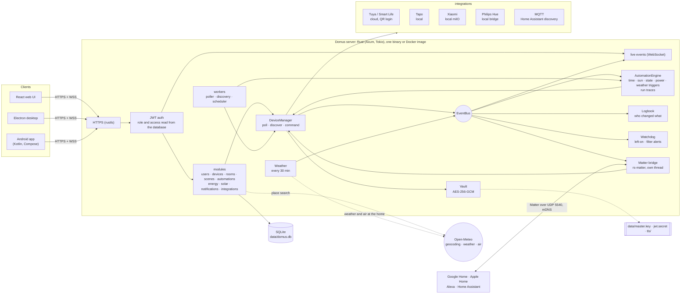
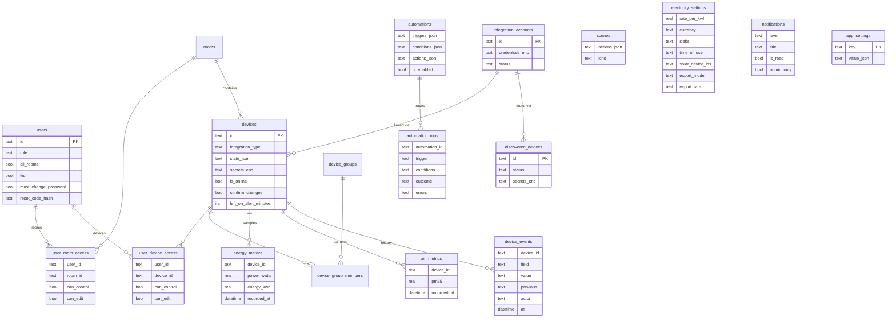

# Domus

<p align="center">
  <b>Translations</b><br>
  <a href="README.md">English</a> ·
  <a href="README.ar.md">العربية</a> ·
  <a href="README.bn.md">বাংলা</a> ·
  <a href="README.de.md">Deutsch</a> ·
  <a href="README.es.md">Español</a> ·
  <a href="README.fr.md">Français</a> ·
  <a href="README.gu.md">ગુજરાતી</a> ·
  <a href="README.hi.md">हिन्दी</a> ·
  <a href="README.id.md">Bahasa Indonesia</a> ·
  <a href="README.it.md">Italiano</a> ·
  <a href="README.ja.md">日本語</a> ·
  <a href="README.kn.md">ಕನ್ನಡ</a> ·
  <a href="README.ko.md">한국어</a> ·
  <a href="README.ml.md">മലയാളം</a> ·
  <a href="README.mr.md">मराठी</a> ·
  <a href="README.pa.md">ਪੰਜਾਬੀ</a> ·
  <a href="README.pl.md">Polski</a> ·
  <a href="README.pt-BR.md">Português (Brasil)</a> ·
  <a href="README.ru.md">Русский</a> ·
  <a href="README.ta.md">தமிழ்</a> ·
  <a href="README.te.md">తెలుగు</a> ·
  <a href="README.th.md">ไทย</a> ·
  <a href="README.tr.md">Türkçe</a> ·
  <a href="README.ur.md">اردو</a> ·
  <a href="README.vi.md">Tiếng Việt</a> ·
  <a href="README.zh-CN.md">简体中文</a> ·
  <a href="README.zh-TW.md">繁體中文</a>
</p>

[](https://github.com/aiyu-ayaan/Domus-Rust/actions/workflows/release.yml)
[](https://github.com/aiyu-ayaan/Domus-Rust/releases)
[](LICENSE)
[](https://github.com/aiyu-ayaan/Domus-Rust/commits/master)
[](https://hub.docker.com/r/aiyuayaan/domus)
[](https://hub.docker.com/r/aiyuayaan/domus)


[](https://ghloc.dev/aiyu-ayaan/Domus)


Lokalna centrala inteligentnego domu na Twój domowy serwer. Backend w języku Rust, baza danych SQLite, interfejs webowy w React (wraz z aplikacją desktopową w Electronie) oraz modułowe integracje dla **Tuya / Smart Life** (logowanie kodem QR, bez konta deweloperskiego), **TP-Link Tapo** (lokalnie), **Xiaomi Mi Home** (lokalnie, tokeny pobierane z konta Mi), **Philips Hue** (lokalny mostek) i **MQTT** (Zigbee2MQTT, ESPHome oraz wszystko wspierające automatyczne wykrywanie Home Assistant). Wbudowany **mostek Matter** pozwala asystentom Google Home, Apple Home, Alexa i Home Assistant na włączanie, ściemnianie oraz zmianę kolorów urządzeń bezpośrednio przez sieć lokalną.

- Automatyczne wykrywanie nowych urządzeń, ze skrzynką odbiorczą lub natychmiastowym dodawaniem
- Pulpit na żywo: pobór mocy, bieżący i prognozowany rachunek, jakość powietrza, odczyty ruchu, otwarcia drzwi, wycieków oraz poziom naładowania baterii
- Pokoje, grupy urządzeń, sceny i automatyzacje; wyzwalacze czasowe, o **wschodzie lub zachodzie słońca** (z przesunięciem minutowym), przy zmianie stanu urządzenia, poziomie mocy (w tym *powyżej X W przez N minut*), utracie łączności lub **pogodzie na zewnątrz**
- **Historia wykonań automatyzacji**: każda automatyzacja przechowuje 50 ostatnich wykonań wraz z wyzwalaczem i warunkiem, który ewentualnie wstrzymał akcję
- **Historia urządzenia**: każda zmiana stanu urządzenia wraz z informacją, kto jej dokonał (osoba i użyta aplikacja, automatyzacja, Matter czy samo urządzenie)
- **Wbudowane alerty** bez konieczności pisania reguł: urządzenie pozostawione zbyt długo włączone lub zużyty filtr w oczyszczaczu powietrza
- **Mostek Matter**: udostępniaj wybrane urządzenia systemom Google Home, Apple Home, Alexa lub Home Assistant w sieci lokalnej, bez konta w chmurze
- **Pogoda i jakość powietrza na zewnątrz** dla lokalizacji domu (Open-Meteo, bez klucza API) na pulpicie obok odczytów wewnętrznych
- **Pytaj przed przełączeniem**: oznacz wyłącznik główny, aby każda aplikacja, grupa, scena oraz ręczne uruchomienie automatyzacji wymagały potwierdzenia przed włączeniem lub wyłączeniem
- Rozliczanie kosztów energii elektrycznej z taryfami stałymi, blokowymi i **strefowymi** (wielotaryfowymi) w dowolnej walucie, koszt **czuwania** dla każdego urządzenia oraz **fotowoltaika**: produkcja, eksport do sieci, net-metering lub taryfa odkupu
- Obsługa wielu użytkowników z rolami administratora, domownika lub gościa oraz uprawnieniami per pokój lub urządzenie (tylko podgląd, sterowanie, edycja)
- Aplikacja Web, wersja desktopowa Electron (Linux, Windows) oraz natywna aplikacja na Androida, synchronizowane na żywo
- **27 języków** w wersjach web, desktop i Android, automatycznie dopasowujących się do języka systemu z możliwością wyboru w Ustawieniach; układ od prawej do lewej dla arabskiego i urdu
- Strona Aktualizacji z informacjami o wydaniu w formacie Markdown (z tabelami i obrazami) w każdej aplikacji
- Domyślnie włączony protokół HTTPS; dane logowania i klucze urządzeń szyfrowane w spoczynku; tworzenie i przywracanie kopii zapasowej z jednego pliku

Architektura i diagramy: [`development/docs/ARCHITECTURE.md`](development/docs/ARCHITECTURE.md), podsumowane [poniżej](#jak-to-ze-sob%C4%85-wsp%C3%B3%C5%82gra).
Profil stylistyczny interfejsu: [`design-system/domus/MASTER.md`](design-system/domus/MASTER.md).
Postęp prac: [`development/TODO.md`](development/TODO.md).

## Jak to ze sobą współgra



Klienci komunikują się wyłącznie z serwerem; serwer łączy się z urządzeniami (lokalnie, wszędzie tam, gdzie pozwala producent) i przechowuje całość w pojedynczym pliku SQLite. Chmura jest wykorzystywana wyłącznie wtedy, gdy producent nie udostępnia lokalnego sterowania (Tuya) lub do pobrania kluczy urządzeń (Xiaomi), a także do zapytań opcjonalnych: wyszukiwania miejscowości, pogody i jakości powietrza dla lokalizacji domu (Open-Meteo, dopiero po zdefiniowaniu położenia) oraz sprawdzania aktualizacji na GitHubie. Mostek Matter działa wyłącznie w sieci lokalnej.

### Model danych



Dane uwierzytelniające i klucze urządzeń są bezpiecznie szyfrowane (`*_enc`) za pomocą pliku `data/master.key`, który nie jest przechowywany w bazie danych. Kompletny zestaw diagramów dla każdej funkcjonalności znajduje się w katalogu [`development/docs`](development/docs).

## Zrzuty ekranu

<p align="center"></p>

**Komputer** (Electron oraz Web)

<p>
  
  
  
  
  
  
</p>

**Android**

<p>
  
  
  
  
  
</p>

**Tablet z Androidem** (dwie kolumny od 840dp, Ustawienia w widoku listy i szczegółów)

<p>
  
  
  
  
  
</p>

**Przeglądarka mobilna**

<p>
  
  
  
  
  
</p>

Wszystkie zrzuty ekranu znajdują się w folderze [`res/screenshots`](res/screenshots); pełne wideo demonstracyjne w wysokiej rozdzielczości dostępne jest w pliku [`res/domus.mp4`](res/domus.mp4).

## Pobieranie

| | |
|---|---|
| Serwer (Docker) | `aiyuayaan/domus` na Docker Hub, amd64 oraz arm64 |
| Android | `Domus-<version>.apk` z zakładki [najnowsze wydania](https://github.com/aiyu-ayaan/Domus-Rust/releases) |
| Aplikacja Linux | Jednolinijkowy instalator poniżej lub pakiety `.deb` / `.AppImage` z wydania |
| Aplikacja Windows | `Domus-<version>-Setup.exe` ze strony wydań |

### Serwer

Host potrzebuje tylko jednego pliku:

```bash
mkdir domus && cd domus
wget https://raw.githubusercontent.com/aiyu-ayaan/Domus-Rust/master/docker-compose.yml
docker compose up -d
```

Otwórz adres `https://<server-ip>:8443` i utwórz konto administratora. Polecenie `docker compose logs domus` wyświetla odcisk palca certyfikatu, o którego zatwierdzenie poproszą aplikacje klienckie.

```bash
docker compose pull && docker compose up -d      # aktualizacja
DOMUS_VERSION=beta docker compose up -d          # wybór kanału: latest (domyślny), beta, alpha lub 0.0.1
TZ=Asia/Kolkata DOMUS_PORT=9443 docker compose up -d
docker compose --profile mqtt up -d              # uruchomienie również opcjonalnego brokera Mosquitto
```

Umieść zmienne `DOMUS_VERSION`, `TZ` oraz `DOMUS_PORT` w pliku `.env` obok pliku compose, aby zachować konfigurację.

### Aplikacja desktopowa na Linuksa

Instaluje najnowszą wersję dla bieżącego użytkownika (architektura x86_64, bez uprawnień roota): pakiet AppImage, skrót w menu aplikacji z ikoną Domus oraz polecenie w powłoce `domus`. Aplikacja dba następnie o własne aktualizacje.

```bash
curl -fsSL https://raw.githubusercontent.com/aiyu-ayaan/Domus-Rust/master/scripts/install-linux.sh | sh
# ... | sh -s -- --channel beta     instalacja wydań testowych beta (lub alpha)
# ... | sh -s -- --uninstall        odinstalowanie; ustawienia zostają zachowane
```

### Android

Pobierz plik APK ze strony wydań i otwórz go, aby zainstalować. Kolejne aktualizacje są proponowane przy uruchomieniu aplikacji oraz w sekcji Ustawienia → Aktualizacje w kanale Stabilnym, Beta lub Alpha i stamtąd instalowane; system Android poprosi jednorazowo o zgodę na instalację przez aplikację Domus.

Ekran **Aktualizacje** (Ustawienia → Aktualizacje na Androidzie; Ustawienia → O programie → Aktualizacje w przeglądarce i aplikacji desktopowej) prezentuje bieżącą wersję, najnowsze wydanie w Twoim kanale oraz listę zmian sformatowaną w Markdown.

Wydania, numeracja wersji oraz kanały aktualizacji: [development/docs/RELEASE.md](development/docs/RELEASE.md).

## Wymagania

- Rust 1.80+ (`cargo`)
- Node.js 18+ oraz `pnpm`

## Uruchomienie deweloperskie

```bash
pnpm install
npm run dev            # backend (https://127.0.0.1:8443) + web (http://localhost:3000)

npm run dev:backend    # tylko backend
npm run dev:web        # tylko web (przekierowuje /api do backendu)
npm run dev:desktop    # Electron; wybierz serwer na ekranie łączenia
```

Otwórz adres http://localhost:3000. Podczas pierwszej wizyty pojawi się formularz konfiguracji konta administratora.

## Uruchomienie na serwerze domowym

```bash
pnpm build:web                     # buduje aplikację w apps/web/dist, serwowaną przez backend
APP_ENV=production cargo run --release --manifest-path backend/Cargo.toml
```

Następnie przejdź pod adres `https://<server-ip>:8443`. Po włączeniu mostek Matter nasłuchuje również na porcie UDP 5540 (`[matter] port`) oraz korzysta z mDNS w sieci LAN.

Możesz także zbudować obraz Dockera bezpośrednio z tego repozytorium (sieć hosta, dane w wolumenie `domus_data`):

```bash
docker compose -f docker-compose.local.yml up -d --build
```

Dostęp zdalny poprzez tunel Cloudflare, automatyczne przełączanie pomiędzy adresem domowym a zdalnym w aplikacjach oraz budowanie instalatorów na komputery (`pnpm build:desktop`) opisano w [development/docs/DEPLOYMENT.md](development/docs/DEPLOYMENT.md).

Przy pierwszym uruchomieniu Domus tworzy katalog `data/` zawierający:

| Plik | Zastosowanie |
|---|---|
| `domus.db` | Baza danych SQLite |
| `master.key` | Szyfruje poświadczenia integracji oraz klucze urządzeń — **zrób kopię zapasową** |
| `jwt.secret` | Podpisuje sesje logowania |
| `tls/` | Certyfikat z podpisem własnym (możliwość podmiany przez `tls.cert_path` / `tls.key_path`) |

Ustawienia konfiguracyjne znajdują się w `config/default.toml`; dowolną wartość można nadpisać za pomocą zmiennych środowiskowych w postaci `DOMUS__SEKCJA__KLUCZ` (szczegóły w `.env.example`).

## Kopia zapasowa i przywracanie

Wszystkie dane znajdują się w katalogu `data/`. Możesz skopiować cały folder lub skorzystać z wygodnej kopii w pojedynczym pliku:

**Kopia zapasowa:** Zaloguj się jako administrator → Ustawienia → **Kopia zapasowa** → *Pobierz kopię zapasową*. Plik stanowi zrzut bazy danych z dołączonym kluczem głównym, co pozwala na bezproblemowy odczyt poświadczeń podłączonych integracji po przywróceniu. Kopia tworzona jest w locie podczas pracy serwera. Chroń ten plik: każdy, kto go uzyska, zyskuje dostęp do powiązanych kont. Sekret JWT i certyfikat TLS nie wchodzą w skład kopii.

**Przywracanie:** Zatrzymaj serwer, a następnie wykonaj polecenia:

```bash
# Docker
docker compose cp domus-backup-2026-10-11.db domus:/app/data/restore.db
docker compose stop domus
docker compose run --rm domus domus-backend restore data/restore.db
docker compose start domus

# Bez Dockera, z poziomu głównego katalogu repozytorium (używa ./data)
domus-backend restore ~/Downloads/domus-backup-2026-10-11.db
```

Dotychczasowa zawartość zostaje zarchiwizowana obok jako `*.before-restore`. Po przywróceniu danych na nowym serwerze użytkownicy logują się ponownie, a aplikacje poproszą o zatwierdzenie nowego certyfikatu. W przypadku ustawienia klucza przez zmienną środowiskową `DOMUS_MASTER_KEY` plik kopii nie zawiera klucza i nowy serwer musi mieć ustawioną identyczną zmienną. Więcej szczegółów w [development/docs/DEPLOYMENT.md](development/docs/DEPLOYMENT.md#backup-and-restore).

## Zapomniane hasło administratora

Domus nie posiada wbudowanego serwera pocztowego, więc hasła nie są wysyłane mailowo. Rozwiązania uszeregowane według nakładu pracy:

1. **Inny administrator** wchodzi w Ustawienia → Osoby i dostęp, włącza opcję *Zażądaj zresetowania kodu* dla Twojego konta i przekazuje Ci 8-cyfrowy kod (ważny przez 30 minut, blokowany po 5 nieudanych próbach). Na ekranie logowania kliknij *Nie pamiętasz hasła?*, wprowadź nazwę użytkownika, a następnie otrzymany kod.
2. **Bezpośrednio z serwera**, działa zarówno przy uruchomionym, jak i zatrzymanym programie Domus, bez konieczności logowania:

   ```bash
   docker compose exec domus domus-backend reset-password <username>              # generuje i wyświetla nowe losowe hasło
   docker compose exec domus domus-backend reset-password <username> 'new-pass'   # lub pozwala zdefiniować własne (min. 8 znaków)
   domus-backend reset-password <username>                                        # bez Dockera, z katalogu głównego projektu
   ```

   Zaloguj się przy użyciu tego hasła i zmień je w Ustawienia → Hasło.

Wprowadzenie pięciu niepoprawnych haseł z rzędu blokuje dane konto na 15 minut w trybie produkcyjnym (blokadę znosi restart serwera; w trybie deweloperskim jest wyłączona). Szczegóły oraz zasady dotyczące generowanych haseł i kont dziecięcych: [development/docs/ACCOUNTS.md](development/docs/ACCOUNTS.md).

## Języki

Angielski, hindi, hiszpański, portugalski (Brazylia), indonezyjski, arabski, francuski, rosyjski, niemiecki, turecki, japoński, koreański, włoski, wietnamski, tajski, chiński (uproszczony i tradycyjny), polski, bengalski, tamilski, telugu, marathi, gudźaracki, kannada, malajalam, pendżabski oraz urdu. Języki arabski i urdu posiadają układ pisma od prawej do lewej (RTL).

Aplikacje automatycznie dopasowują się do języka przeglądarki lub systemu operacyjnego, wyświetlając język angielski w razie braku tłumaczenia. Aby zmienić język, przejdź do Ustawienia > Język (w przeglądarce i aplikacji desktopowej: Wygląd); opcja *Domyślny systemowy* przywraca automatyczne dopasowanie. W systemie Android 13 i nowszych konfiguracja dostępna jest również w menu Ustawienia telefonu > Aplikacje > Domus > Język.

Tłumaczenia zostały wygenerowane maszynowo i nie były jeszcze kompleksowo weryfikowane przez native speakerów, przez co niektóre sformułowania mogą brzmieć nienaturalnie. Korekta sprowadza się do edycji pojedynczej linijki w katalogu danego języka. Zasady działania lokalizacji, instrukcja dodawania języków i konwencje nazewnictwa: [development/docs/LOCALIZATION.md](development/docs/LOCALIZATION.md).

## Podłączanie urządzeń

| Marka | Instrukcja |
|---|---|
| Tuya / Smart Life | Integracje → *Połącz za pomocą kodu QR*. Wpisz **Kod użytkownika** z aplikacji Smart Life (Ja → Ustawienia → Konto i bezpieczeństwo → Kod użytkownika), a następnie zeskanuj kod QR w aplikacji. |
| Tapo | Integracje → *Połącz konto* za pomocą TP-Link ID. Urządzenia obecne w sieci lokalnej zostaną znalezione automatycznie i będą sterowane lokalnie. Hub H100 automatycznie importuje powiązane czujniki, włączniki i termostaty. Kamery są widoczne na liście, lecz nie są jeszcze w pełni obsługiwane. |
| Xiaomi | Integracje → *Połącz konto* danymi konta Mi, wskazując region serwera. Jeśli Xiaomi wymaga weryfikacji dwuetapowej, wprowadź kod z wiadomości e-mail lub SMS w tym samym oknie. Identyfikatorem może być e-mail, numer telefonu z numerem kierunkowym (`+48…`) lub Xiaomi ID. Tokeny są pobierane jednorazowo; dalsze sterowanie odbywa się całkowicie lokalnie. Urządzenia można również dodać ręcznie za pomocą samego tokena. |
| Philips Hue | Naciśnij okrągły przycisk na mostku, a następnie w ciągu 30 sekund kliknij Integracje → Philips Hue → *Połącz*. Pozostaw pole adresu puste, aby mostek został wykryty automatycznie. Źródła światła i gniazdka Hue Smart Plug sterowane są lokalnie. |
| MQTT | Integracje → MQTT → *Połącz*, podając adres, port oraz dane logowania brokera. Urządzenia rozgłaszające się w standardzie Home Assistant MQTT discovery (Zigbee2MQTT, ESPHome itp.) pojawią się w sekcji Wykryte: oświetlenie, przełączniki, gniazdka, wentylatory i czujniki. Przy użyciu wbudowanego brokera (`--profile mqtt`) adresem jest `mqtt`, a portem `1883`. |

Szczegółowy zakres obsługi poszczególnych integracji opisano w `development/docs/INTEGRATIONS.md`.

## Rozliczanie energii elektrycznej

Energia → *Taryfa energii elektrycznej*: wybierz dowolną walutę i zdefiniuj stałą stawkę za kWh lub skonfiguruj **progi zużycia** dla taryf blokowych (np. 0–100 jednostek w jednej stawce, 101–300 w kolejnej itd.). Koszt rachunku jest kalkulowany w zadanym cyklu rozliczeniowym wraz ze stałą opłatą miesięczną.

Taryfy umożliwiają także definiowanie **stref czasowych**: godzin (według zegara domowego, z obsługą przedziałów przekraczających północ), w których energia jest tańsza lub droższa o określoną kwotę (np. taryfa nocna lub szczytowa) względem ceny bazowej bądź blokowej.

Nowo rozpoznane urządzenia pojawiają się w menu **Urządzenia → Wykryte**. Zaznaczenie opcji *Dodawaj nowe urządzenia automatycznie* pozwala pominąć etap zatwierdzania.

## Wschód i zachód słońca

Skonfiguruj położenie domu w Ustawienia → **Lokalizacja domu**: użyj bieżącej lokalizacji z telefonu lub przeglądarki, wyszukaj miasto (serwer korzysta z bezpłatnego serwisu geokodowania Open-Meteo; sieć domową opuszcza wyłącznie wpisana nazwa) lub wpisz szerokość i długość geograficzną ręcznie. Współrzędne są zaokrąglane do około jednego kilometra i pozostają wyłącznie na Twoim serwerze. Automatyzacje mogą dzięki temu uruchamiać się o wschodzie lub zachodzie słońca, z dowolnym wyprzedzeniem lub opóźnieniem w minutach. Bez podanej lokalizacji wyzwalacze słoneczne nie zostaną aktywowane.

## Pytaj przed przełączeniem

Główny przełącznik odcinający zasilanie całego zestawu urządzeń można łatwo wyłączyć przez przypadek. Otwórz kartę urządzenia i włącz funkcję **Pytaj przed przełączeniem**: każda aplikacja poprosi o potwierdzenie przed jego włączeniem lub wyłączeniem. Zabezpieczenie to obejmuje także grupowe akcje w pokojach *Wszystko włączone / Wszystko wyłączone*, grupy urządzeń, sceny (w tym zagnieżdżone) oraz ręczne kliknięcie *Uruchom* w automatyzacji, która miałaby zmienić stan urządzenia. Ustawienie zapisywane jest po stronie serwera i obowiązuje identycznie w przeglądarce, na komputerze i w aplikacji Android. Automatyzacje wyzwalane samoczynnie działają bez pytania zgodnie z konfiguracją; działania poza systemem Domus (aplikacje producentów, fizyczne przyciski ścienne) nie podlegają tej blokadzie.

## Matter (Google Home, Apple Home, Alexa)

Ustawienia → **Matter** (funkcja dla administratorów): aktywuj mostek, zaznacz urządzenia do udostępnienia, a następnie zeskanuj kod QR lub przepisz kod parowania w aplikacji Google Home, Apple Home, Alexa lub Home Assistant. Oświetlenie pojawia się jako lampy ściemnialne lub ze zmianą barwy, a pozostałe urządzenia włączane/wyłączane jako gniazdka; zmiana stanu, regulacja jasności i barwy działają płynnie, a zmiany wprowadzone w Domus natychmiast odzwierciedlane są w zewnętrznym ekosystemie. Opcja „Zezwalaj na parowanie przez 15 minut” pozwala na dodanie kolejnego asystenta; „Zapomnij wszystkie sparowania” resetuje mostek z nowym kodem.

Mostek nie posiada oficjalnego certyfikatu handlowego (wykorzystuje standardową atestację testową Matter), dlatego aplikacje wyświetlają prośbę o zatwierdzenie podczas dodawania. W Google Home mostek wymaga uprzedniego zarejestrowania jako urządzenie testowe w konsoli Google Home Developer Console. Szczegóły techniczne: [`development/docs/MATTER.md`](development/docs/MATTER.md).

## Historia, wykonania automatyzacji i alerty

- **Historia** w karcie każdego urządzenia: co zostało zmienione, kiedy i przez kogo (*Przez: Ayaan · Android*, *Automatyzacja „Tryb nocny”*, *Matter*, *Na urządzeniu*). Przechowywana przez taki sam okres jak historia zużycia energii.
- **Wykonania** każdej automatyzacji: ze statusem *Uruchomiono*, *Błąd* wraz z opisem problemu lub *Pominięto* z podaniem niespełnionego warunku – dzięki czemu od razu wiadomo, dlaczego reguła nie zadziałała.
- **Powiadom, gdy zostanie włączone** w karcie urządzenia (od 30 minut do 12 godzin): administratorzy otrzymują powiadomienie. Urządzenie z pomiarem mocy jest uznawane za włączone przy poborze powyżej 10 W, dzięki czemu telewizor w stanie czuwania traktowany jest jako wyłączony.
- **Zużyty filtr**: powiadomienie informujące, gdy stan wkładu filtrującego w oczyszczaczu powietrza spadnie do 10%.

## Pogoda, czuwanie i fotowoltaika

- Po skonfigurowaniu lokalizacji pulpit prezentuje **pogodę oraz poziom PM2.5 na zewnątrz** tuż obok odczytów domowych, a automatyzacje mogą używać ich w regułach (*gdy zewnętrzne PM2.5 wzrośnie powyżej 35*, *tylko gdy temperatura na zewnątrz spadnie poniżej 20*).
- Energia → **Czuwanie** zestawia pobór mocy każdego urządzenia w momentach bezczynności (jego najniższy pobór godzinowy w tym tygodniu) wraz z przeliczeniem na miesięczny koszt.
- Energia → *Taryfa energii elektrycznej* → **Fotowoltaika**: wskaż gniazdka mierzące produkcję z mikroinstalacji solarnej, a następnie wybierz net-metering lub stawkę odkupu energii. Rachunek uwzględnia wówczas wyłącznie energię pobraną z sieci, a karta Fotowoltaika szczegółowo podsumowuje prąd wyprodukowany, zużyty na miejscu, oddany do sieci oraz wypracowany zysk. Bilans przepływów wyliczany jest co 15 minut na podstawie opomiarowanych urządzeń; odbiorniki niemierzone mogą powodować zawyżenie wyliczonego eksportu.

Plany rozwoju i diagramy: [`development/docs/ROADMAP.md`](development/docs/ROADMAP.md).

## Licencja

Domus jest udostępniany na warunkach [licencji MIT](LICENSE). Biblioteki firm trzecich zachowują swoje własne licencje, wymienione w sekcji O programie → Podziękowania w każdej aplikacji.

## Testy

```bash
cargo test --workspace
pnpm --filter @domus/web exec tsc -b
```

Pakiet testów `cargo test --workspace` obejmuje plik `backend/tests/matter_bridge.rs`, który paruje kontroler Matter z mostkiem przez protokół UDP i weryfikuje przełączanie, ściemnianie oraz zmianę kolorów urządzeń (wymaga interfejsu sieciowego z IPv4).
