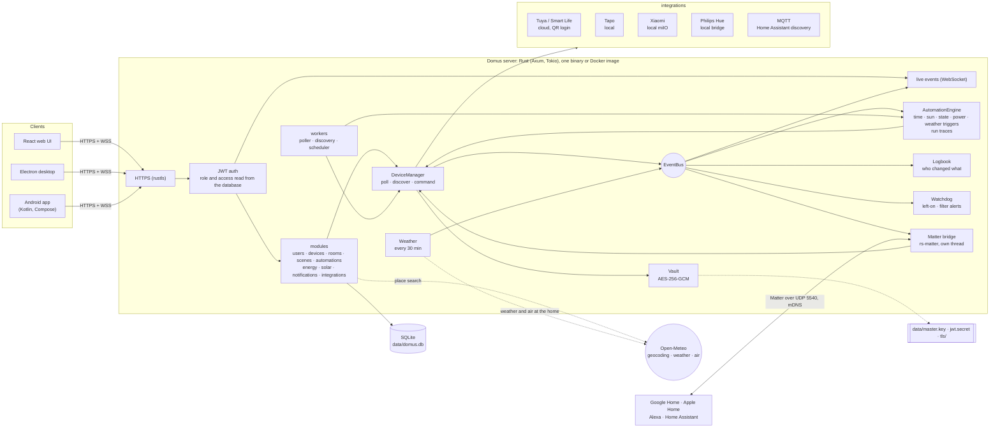
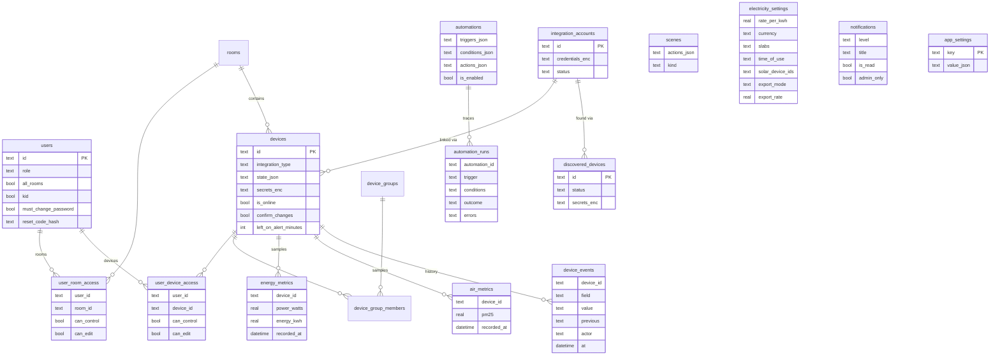

# Domus

<p align="center">
  <b>Translations</b><br>
  <a href="README.md">English</a> ·
  <a href="README.ar.md">العربية</a> ·
  <a href="README.bn.md">বাংলা</a> ·
  <a href="README.de.md">Deutsch</a> ·
  <a href="README.es.md">Español</a> ·
  <a href="README.fr.md">Français</a> ·
  <a href="README.gu.md">ગુજરાતી</a> ·
  <a href="README.hi.md">हिन्दी</a> ·
  <a href="README.id.md">Bahasa Indonesia</a> ·
  <a href="README.it.md">Italiano</a> ·
  <a href="README.ja.md">日本語</a> ·
  <a href="README.kn.md">ಕನ್ನಡ</a> ·
  <a href="README.ko.md">한국어</a> ·
  <a href="README.ml.md">മലയാളം</a> ·
  <a href="README.mr.md">मराठी</a> ·
  <a href="README.pa.md">ਪੰਜਾਬੀ</a> ·
  <a href="README.pl.md">Polski</a> ·
  <a href="README.pt-BR.md">Português (Brasil)</a> ·
  <a href="README.ru.md">Русский</a> ·
  <a href="README.ta.md">தமிழ்</a> ·
  <a href="README.te.md">తెలుగు</a> ·
  <a href="README.th.md">ไทย</a> ·
  <a href="README.tr.md">Türkçe</a> ·
  <a href="README.ur.md">اردو</a> ·
  <a href="README.vi.md">Tiếng Việt</a> ·
  <a href="README.zh-CN.md">简体中文</a> ·
  <a href="README.zh-TW.md">繁體中文</a>
</p>

[](https://github.com/aiyu-ayaan/Domus-Rust/actions/workflows/release.yml)
[](https://github.com/aiyu-ayaan/Domus-Rust/releases)
[](LICENSE)
[](https://github.com/aiyu-ayaan/Domus-Rust/commits/master)
[](https://hub.docker.com/r/aiyuayaan/domus)
[](https://hub.docker.com/r/aiyuayaan/domus)


[](https://ghloc.dev/aiyu-ayaan/Domus)


Um hub de casa inteligente local-first para o seu servidor doméstico. Backend em Rust, SQLite,
interface web em React (com shell de desktop em Electron) e integrações conectáveis para
**Tuya / Smart Life** (login via código QR, sem conta de desenvolvedor), **TP-Link Tapo**
(local), **Xiaomi Mi Home** (local, tokens da sua conta Mi), **Philips Hue**
(bridge local) e **MQTT** (Zigbee2MQTT, ESPHome e qualquer outro que suporte a descoberta
do Home Assistant). Uma **bridge Matter** integrada permite que o Google Home, Apple Home, Alexa e Home
Assistant liguem, dimerizem e controlem as cores desses dispositivos na sua própria rede.

- Descoberta automática de novos dispositivos, com caixa de entrada ou adição automática
- Painel ao vivo: consumo de energia, fatura atual e projeção de gastos, qualidade do ar, leituras de movimento / porta / vazamento / bateria
- Cômodos, grupos de dispositivos, cenas e automações; gatilhos por horário, no **nascer ou pôr do sol** (com deslocamento), na mudança de estado de um dispositivo, nível de consumo (também *acima de X por N minutos*), desconexão ou no **clima externo**
- **Execuções de automações**: cada automação mantém suas últimas 50 execuções, com o gatilho que a disparou e a condição que a bloqueou
- **Histórico de dispositivos**: cada alteração em um dispositivo e quem a fez (uma pessoa e o app usado, uma automação, o Matter ou o próprio dispositivo)
- **Alertas** sem precisar criar uma automação: dispositivo esquecido ligado por muito tempo, filtro do purificador de ar acabando
- **Bridge Matter**: compartilhe os dispositivos que desejar com o Google Home, Apple Home, Alexa ou Home Assistant, localmente, sem conta na nuvem
- **Clima e ar externo** no endereço da casa (Open-Meteo, sem necessidade de chave) no painel, ao lado das leituras internas
- **Perguntar antes de alternar**: marque um interruptor principal e todos os apps, grupos, cenas e execuções manuais de automação avisarão antes que ele seja ligado ou desligado
- Faturamento de eletricidade com tarifas fixa, em faixas e **por horário do dia** em qualquer moeda, **custo em espera** por dispositivo e **energia solar**: geração, exportação e compensação de energia ou tarifa feed-in
- Múltiplos usuários com funções de administrador / membro / convidado e acesso por cômodo ou dispositivo, cada um configurável como apenas visualizar, controlar ou editar
- Web, desktop em Electron (Linux, Windows) e um aplicativo nativo para Android, sincronizados em tempo real
- **27 idiomas** nos aplicativos web, desktop e Android, acompanhando o idioma do seu sistema com seletor nas Configurações; suporte da direita para a esquerda (RTL) para árabe e urdu
- Página de Atualizações com notas de versão (Markdown, tabelas e imagens) em todos os apps
- HTTPS por padrão; credenciais e chaves de dispositivos criptografadas em repouso; backup e restauração em arquivo único

Arquitetura e diagramas: [`development/docs/ARCHITECTURE.md`](development/docs/ARCHITECTURE.md), resumidos [abaixo](#como-tudo-se-encaixa).  
Perfil de design da interface: [`design-system/domus/MASTER.md`](design-system/domus/MASTER.md).  
Progresso: [`development/TODO.md`](development/TODO.md).

## Como tudo se encaixa



Os clientes comunicam-se apenas com o servidor; o servidor conversa com os seus dispositivos (localmente onde o fabricante permite) e mantém tudo em um único arquivo SQLite. A nuvem é utilizada apenas onde o fabricante não oferece controle local (Tuya) ou para obter as chaves dos dispositivos (Xiaomi), além de consultas opcionais: busca de locais, clima e ar externo para a localização da casa (Open-Meteo, apenas após a localização ser definida) e o GitHub para verificação de atualizações. A bridge Matter funciona exclusivamente na rede local.

### Modelo de dados



Credenciais e chaves de dispositivos são armazenadas seladas (`*_enc`) sob `data/master.key`, que não fica no banco de dados. O conjunto completo de diagramas, um para cada recurso, está em [`development/docs`](development/docs).

## Capturas de tela

<p align="center"></p>

**Desktop** (Electron e web)

<p>
  
  
  
  
  
  
</p>

**Android**

<p>
  
  
  
  
  
</p>

**Tablet Android** (duas colunas a partir de 840dp, Configurações como lista e detalhe)

<p>
  
  
  
  
  
</p>

**Web móvel**

<p>
  
  
  
  
  
</p>

Todas as capturas estão em [`res/screenshots`](res/screenshots); o vídeo de demonstração em alta resolução está em [`res/domus.mp4`](res/domus.mp4).

## Download

| | |
|---|---|
| Servidor (Docker) | `aiyuayaan/domus` no Docker Hub, amd64 e arm64 |
| Android | `Domus-<version>.apk` na [última versão](https://github.com/aiyu-ayaan/Domus-Rust/releases) |
| Desktop Linux | o instalador em linha única abaixo, ou o pacote `.deb` / `.AppImage` da versão |
| Desktop Windows | `Domus-<version>-Setup.exe` da versão |

### Servidor

O host precisa de apenas um único arquivo:

```bash
mkdir domus && cd domus
wget https://raw.githubusercontent.com/aiyu-ayaan/Domus-Rust/master/docker-compose.yml
docker compose up -d
```

Abra `https://<server-ip>:8443` e crie a conta de administrador. O comando `docker compose logs domus` mostra a impressão digital do certificado que os aplicativos solicitarão que você confirme.

```bash
docker compose pull && docker compose up -d      # atualizar
DOMUS_VERSION=beta docker compose up -d          # seguir um canal: latest (padrão), beta, alpha ou 0.0.1
TZ=Asia/Kolkata DOMUS_PORT=9443 docker compose up -d
docker compose --profile mqtt up -d              # também inicia o broker Mosquitto opcional
```

Defina `DOMUS_VERSION`, `TZ` e `DOMUS_PORT` em um arquivo `.env` ao lado do arquivo compose para mantê-los configurados.

### Aplicativo de desktop para Linux

Instala a versão mais recente para o usuário atual (x86_64, sem root): o AppImage, uma entrada no menu com o ícone do Domus e o comando `domus`. O próprio aplicativo se mantém atualizado a partir de então.

```bash
curl -fsSL https://raw.githubusercontent.com/aiyu-ayaan/Domus-Rust/master/scripts/install-linux.sh | sh
# ... | sh -s -- --channel beta     compilações beta também (ou alpha)
# ... | sh -s -- --uninstall        remover o aplicativo; configurações são mantidas
```

### Android

Baixe o APK na página de lançamentos e abra-o. As próximas atualizações são oferecidas ao abrir o aplicativo e em Configurações → Atualizações, nos canais Stable, Beta ou Alpha, sendo instaladas a partir de lá; o Android pede autorização uma única vez para permitir que o Domus faça a instalação.

A página **Atualizações** (Configurações → Atualizações no Android, Configurações → Sobre → Atualizações na web e no desktop) exibe a versão em execução, a versão mais recente no seu canal e suas notas de versão, redigidas em Markdown.

Lançamentos, números de versão e canais de atualização: [development/docs/RELEASE.md](development/docs/RELEASE.md).

## Requisitos

- Rust 1.80+ (`cargo`)
- Node.js 18+ e `pnpm`

## Executar em desenvolvimento

```bash
pnpm install
npm run dev            # backend (https://127.0.0.1:8443) + web (http://localhost:3000)

npm run dev:backend    # apenas o backend
npm run dev:web        # apenas a web (redireciona /api para o backend)
npm run dev:desktop    # Electron; escolha o servidor na página de conexão
```

Abra http://localhost:3000. O primeiro acesso solicitará a criação da conta de administrador.

## Executar no servidor doméstico

```bash
pnpm build:web                     # gera apps/web/dist, servido pelo backend
APP_ENV=production cargo run --release --manifest-path backend/Cargo.toml
```

Em seguida, abra `https://<server-ip>:8443`. A bridge Matter, quando ativada, também utiliza a porta UDP 5540 (`[matter] port`) e mDNS na rede local.

Ou construa a imagem Docker a partir deste repositório (rede do host, dados no volume `domus_data`):

```bash
docker compose -f docker-compose.local.yml up -d --build
```

O acesso remoto via Cloudflare Tunnel, os endereços local e remoto alternados pelos aplicativos e a criação de pacotes para desktop (`pnpm build:desktop`) são descritos em [development/docs/DEPLOYMENT.md](development/docs/DEPLOYMENT.md).

Na primeira inicialização, o Domus cria a pasta `data/` contendo:

| Arquivo | Finalidade |
|---|---|
| `domus.db` | Banco de dados SQLite |
| `master.key` | criptografa credenciais de integrações e chaves de dispositivos — **faça backup deste arquivo** |
| `jwt.secret` | assinatura de sessões |
| `tls/` | certificado autoassinado (substitua via `tls.cert_path` / `tls.key_path`) |

As configurações ficam em `config/default.toml`; qualquer chave pode ser substituída pelas variáveis de ambiente `DOMUS__SECTION__KEY` (veja `.env.example`).

## Backup e restauração

Tudo fica armazenado em `data/`. Você pode fazer backup de toda a pasta ou gerar um backup em arquivo único:

**Fazer backup.** Faça login como administrador → Configurações → **Backup** → *Baixar backup*. O arquivo é uma cópia do banco de dados contendo a chave mestra embutida, permitindo reabrir as contas vinculadas após a restauração. Ele é gerado com o servidor em execução. Mantenha-o em segurança: quem tiver esse arquivo terá acesso a essas contas. O segredo JWT e o certificado TLS não são incluídos nele.

**Restaurar.** Pare o servidor e execute:

```bash
# Docker
docker compose cp domus-backup-2026-10-11.db domus:/app/data/restore.db
docker compose stop domus
docker compose run --rm domus domus-backend restore data/restore.db
docker compose start domus

# Sem Docker, a partir da raiz do repositório (utiliza ./data)
domus-backend restore ~/Downloads/domus-backup-2026-10-11.db
```

Os dados existentes anteriormente são preservados ao lado com o sufixo `*.before-restore`. Após uma restauração em uma nova máquina, os usuários realizam login novamente e os aplicativos solicitam confiar no novo certificado. Se você definir a chave através da variável `DOMUS_MASTER_KEY`, o backup não conterá nenhuma chave e o servidor restaurado exigirá essa mesma variável. Mais detalhes em [development/docs/DEPLOYMENT.md](development/docs/DEPLOYMENT.md#backup-and-restore).

## Esqueceu a senha de administrador?

O Domus não possui servidor de e-mail, portanto nada é enviado por mensagem eletrônica. Em ordem de esforço:

1. **Outro administrador** abre Configurações → Pessoas e acesso, ativa o *Código de redefinição* para você e informa o código de 8 dígitos (válido por 30 minutos e 5 tentativas incorretas). Na tela de login, selecione *Esqueceu a senha?*, digite seu nome de usuário e depois o código.
2. **Diretamente do servidor**, o que funciona com o Domus rodando ou parado e não requer login:

   ```bash
   docker compose exec domus domus-backend reset-password <username>              # exibe uma nova senha aleatória
   docker compose exec domus domus-backend reset-password <username> 'nova-senha'  # ou escolha uma (8+ caracteres)
   domus-backend reset-password <username>                                        # sem Docker, da raiz do repositório
   ```

   Faça login com ela e altere-a em Configurações → Senha.

Cinco tentativas incorretas de senha para um nome de usuário bloqueiam a conta por 15 minutos em produção (o bloqueio é desfeito reiniciando o servidor, e é desativado em desenvolvimento). Detalhes e regras para senhas geradas e contas infantis em [development/docs/ACCOUNTS.md](development/docs/ACCOUNTS.md).

## Idiomas

Inglês, hindi, espanhol, português (Brasil), indonésio, árabe, francês, russo, alemão, turco, japonês, coreano, italiano, vietnamita, tailandês, chinês (simplificado e tradicional), polonês, bengali, tâmil, télugo, marata, guzerate, canarês, malaiala, panjabi e urdu. Árabe e urdu possuem layout da direita para a esquerda (RTL).

Cada aplicativo segue o idioma do seu navegador ou sistema operacional e exibe inglês quando não houver tradução disponível. Para escolher outro idioma, abra Configurações > Idioma (Aparência na web e desktop); *Padrão do sistema* volta a acompanhar o sistema operacional. No Android 13 e superior, a opção também aparece em Configurações do telefone > Apps > Domus > Idioma.

As traduções foram geradas automaticamente e não foram revisadas por falantes nativos, portanto alguns termos podem soar estranhos. A correção é uma alteração de apenas uma linha no catálogo do idioma. Como funcionam os idiomas, como adicionar um novo e as regras para novos textos: [development/docs/LOCALIZATION.md](development/docs/LOCALIZATION.md).

## Conectando dispositivos

| Marca | Como conectar |
|---|---|
| Tuya / Smart Life | Integrações → *Vincular com código QR*. Digite o **Código de Usuário** do Smart Life (Eu → Configurações → Conta e Segurança → Código de Usuário), depois escaneie o QR code no aplicativo. |
| Tapo | Integrações → *Vincular conta* com o seu TP-Link ID. Os dispositivos na rede local são descobertos automaticamente e controlados localmente. O hub H100 inclui seus sensores, interruptores e termostatos. As câmeras são listadas, mas ainda não suportadas. |
| Xiaomi | Integrações → *Vincular conta* com a sua conta Mi e a região do servidor. Se a Xiaomi solicitar verificação em duas etapas, digite o código recebido por e-mail ou SMS no mesmo painel. A conta pode ser um e-mail, telefone com código do país (`+91…`) ou Xiaomi ID. Os tokens são obtidos uma única vez; o controle é local. Os dispositivos também podem ser adicionados diretamente com um token. |
| Philips Hue | Pressione o botão redondo na bridge e acesse Integrações → Philips Hue → *Vincular* em até 30 segundos. Deixe o endereço em branco para localizar a bridge automaticamente. Lâmpadas e tomadas inteligentes Hue são controladas localmente. |
| MQTT | Integrações → MQTT → *Vincular* informando o endereço do broker, porta e credenciais. Dispositivos que se anunciam via Home Assistant MQTT discovery (Zigbee2MQTT, ESPHome, …) aparecem em Descobertos: lâmpadas, interruptores, tomadas, ventiladores e sensores. Com o broker integrado (`--profile mqtt`), o endereço é `mqtt` e a porta é `1883`. |

Consulte `development/docs/INTEGRATIONS.md` para ver o que cada integração abrange.

## Plano de energia elétrica

Energia → *Plano de energia elétrica*: escolha qualquer moeda e defina um preço fixo por kWh ou **faixas** para tarifas baseadas em faixas de consumo (por exemplo, 0–100 unidades em uma tarifa, 101–300 na seguinte, e assim por diante). O valor é calculado por ciclo de faturamento, somado à cobrança mensal fixa.

As tarifas também podem conter janelas **por horário do dia**: intervalos de horas (no relógio da residência, incluindo horários após a meia-noite) cujas unidades custam mais ou menos, como desconto noturno ou sobretaxa de ponta, além do valor fixo ou em faixas.

Novos dispositivos aparecem em **Dispositivos → Descobertos**. Ative a opção *Adicionar novos dispositivos automaticamente* para dispensar a caixa de entrada.

## Nascer e pôr do sol

Defina onde a casa está localizada em Configurações → **Localização da casa**: utilize a localização do celular ou navegador, pesquise pela cidade (o servidor consulta o geocodificador gratuito do Open-Meteo; apenas o nome digitado sai da residência) ou insira a latitude e a longitude. As coordenadas são arredondadas para cerca de um quilômetro e permanecem no seu servidor. Uma automação pode então ser executada no nascer ou no pôr do sol, minutos antes ou depois. Sem uma localização configurada, os gatilhos solares não serão disparados.

## Perguntar antes de alternar

Um interruptor principal que corta a energia de tudo conectado a ele pode ser desligado facilmente por engano. Abra o dispositivo e ative **Perguntar antes de alternar**: todos os aplicativos pedirão confirmação antes de ligá-lo ou desligá-lo, assim como as ações do cômodo *Tudo ligado / Tudo desligado*, grupos de dispositivos, cenas (incluindo cenas dentro de cenas) e a execução manual (*Executar*) de qualquer automação que vá alterá-lo. A configuração fica salva no servidor, sendo idêntica na web, desktop e Android. Automações que disparam sozinhas não pedem confirmação e são executadas normalmente, e nada fora do Domus (app do fabricante, interruptor físico de parede) é afetado.

## Matter (Google Home, Apple Home, Alexa)

Configurações → **Matter** (administradores): ative a funcionalidade, selecione os dispositivos a compartilhar e escaneie o código QR ou digite o código de pareamento no Google Home, Apple Home, Alexa ou Home Assistant. Lâmpadas aparecem como lâmpadas coloridas ou dimerizáveis, e tudo com botão liga/desliga surge como tomada; os controles de ligar, desligar, dimerizar e cores funcionam perfeitamente, e as alterações feitas no Domus (ligado/desligado, brilho) são refletidas no controlador. "Permitir pareamento por 15 minutos" adiciona um segundo ecossistema; "Esquecer todos os pareamentos" reinicia tudo com um novo código.

A bridge não possui certificação oficial (utiliza a chave de atestação de teste do Matter), por isso os aplicativos solicitarão que você confirme a inclusão, e o Google Home só a aceita após a bridge ser adicionada como dispositivo de teste no Console de Desenvolvedores do Google Home. Detalhes em [`development/docs/MATTER.md`](development/docs/MATTER.md).

## Histórico, execuções de automações e alertas

- **Histórico** na ficha de cada dispositivo: o que mudou, quando e quem fez a ação (*Por Ayaan · Android*, *Automação "Modo noturno"*, *Matter*, *No próprio dispositivo*). Mantido pelo mesmo período do histórico de energia.
- **Execuções** de cada automação: *Executada*, *Falhou* com a mensagem de erro ou *Ignorada* com a condição que a bloqueou, fornecendo uma resposta clara para "por que isso não disparou?".
- **Avisar se ficar ligado** na ficha do dispositivo (de 30 minutos a 12 horas): os administradores recebem uma notificação. Um dispositivo com medição é considerado ligado acima de 10 W, de modo que uma TV em espera conta como desligada.
- **Filtro acabando**: notificação quando o filtro de um purificador de ar atinge 10%.

## Clima, em espera e energia solar

- Com a localização da casa definida, o painel exibe o **clima e o PM2.5 externo** ao lado da leitura interna, e as automações podem utilizá-los (*quando o PM2.5 externo subir acima de 35*, *apenas se a temperatura externa estiver abaixo de 20*).
- Energia → **Em espera** lista o consumo de cada dispositivo quando ninguém o está utilizando (sua hora de menor consumo nesta semana) e quanto isso custa por mês.
- Energia → *Plano de energia elétrica* → **Solar**: marque as tomadas que medem a geração solar e selecione a compensação de energia ou a tarifa feed-in. A fatura passa a contabilizar apenas a energia comprada da rede, e o card Solar exibe a energia gerada, consumida na residência, exportada e o valor ganho. Os fluxos da rede são calculados a cada 15 minutos a partir de dispositivos com medição, portanto aparelhos sem medição farão a exportação parecer mais alta.

Plano e diagramas: [`development/docs/ROADMAP.md`](development/docs/ROADMAP.md).

## Licença

O Domus é disponibilizado sob a [Licença MIT](LICENSE). Bibliotecas de terceiros mantêm suas respectivas licenças e estão listadas em Sobre → Agradecimentos em todos os aplicativos.

## Testes

```bash
cargo test --workspace
pnpm --filter @domus/web exec tsc -b
```

O comando `cargo test --workspace` inclui o teste `backend/tests/matter_bridge.rs`, que pareia um controlador Matter com a bridge via UDP e liga, desliga, dimeriza e altera as cores dos dispositivos (requer uma interface de rede com suporte a IPv4).
