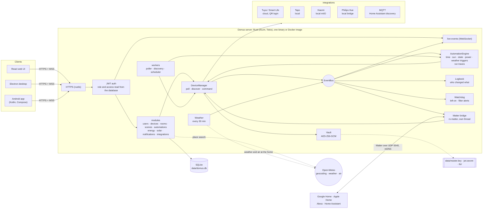
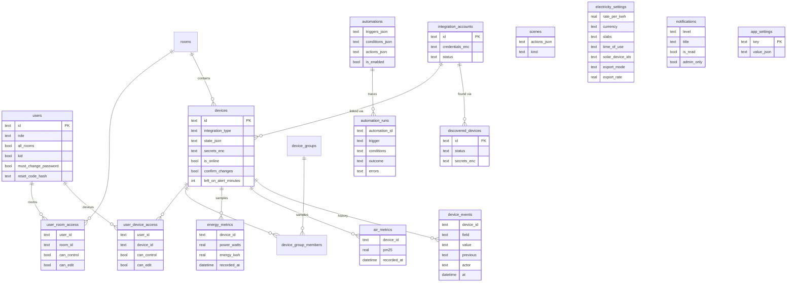

# Domus

<p align="center">
  <b>Translations</b><br>
  <a href="README.md">English</a> ·
  <a href="README.ar.md">العربية</a> ·
  <a href="README.bn.md">বাংলা</a> ·
  <a href="README.de.md">Deutsch</a> ·
  <a href="README.es.md">Español</a> ·
  <a href="README.fr.md">Français</a> ·
  <a href="README.gu.md">ગુજરાતી</a> ·
  <a href="README.hi.md">हिन्दी</a> ·
  <a href="README.id.md">Bahasa Indonesia</a> ·
  <a href="README.it.md">Italiano</a> ·
  <a href="README.ja.md">日本語</a> ·
  <a href="README.kn.md">ಕನ್ನಡ</a> ·
  <a href="README.ko.md">한국어</a> ·
  <a href="README.ml.md">മലയാളം</a> ·
  <a href="README.mr.md">मराठी</a> ·
  <a href="README.pa.md">ਪੰਜਾਬੀ</a> ·
  <a href="README.pl.md">Polski</a> ·
  <a href="README.pt-BR.md">Português (Brasil)</a> ·
  <a href="README.ru.md">Русский</a> ·
  <a href="README.ta.md">தமிழ்</a> ·
  <a href="README.te.md">తెలుగు</a> ·
  <a href="README.th.md">ไทย</a> ·
  <a href="README.tr.md">Türkçe</a> ·
  <a href="README.ur.md">اردو</a> ·
  <a href="README.vi.md">Tiếng Việt</a> ·
  <a href="README.zh-CN.md">简体中文</a> ·
  <a href="README.zh-TW.md">繁體中文</a>
</p>

[](https://github.com/aiyu-ayaan/Domus-Rust/actions/workflows/release.yml)
[](https://github.com/aiyu-ayaan/Domus-Rust/releases)
[](LICENSE)
[](https://github.com/aiyu-ayaan/Domus-Rust/commits/master)
[](https://hub.docker.com/r/aiyuayaan/domus)
[](https://hub.docker.com/r/aiyuayaan/domus)


Автономный локальный центр умного дома для вашего домашнего сервера. Бэкенд на Rust, база данных SQLite, веб-интерфейс на React (вместе с десктопным приложением на Electron) и подключаемые интеграции для **Tuya / Smart Life** (вход по QR-коду, без учетной записи разработчика), **TP-Link Tapo** (локально), **Xiaomi Mi Home** (локально, получение токенов из аккаунта Mi), **Philips Hue** (локальный шлюз) и **MQTT** (Zigbee2MQTT, ESPHome и любые устройства с поддержкой Home Assistant discovery). Встроенный **мост Matter** позволяет экосистемам Google Home, Apple Home, Alexa и Home Assistant переключать, диммировать и менять цвет устройств напрямую по локальной сети.

- Автоматическое обнаружение новых устройств с папкой входящих или мгновенным добавлением
- Панель управления в реальном времени: потребляемая мощность, текущий счет и прогноз расходов, качество воздуха, датчики движения, открытия дверей, протечек и заряд батарей
- Комнаты, группы устройств, сцены и автоматизации; триггеры по расписанию, на **восходе или закате солнца** (со смещением в минутах), по изменению состояния устройств, уровню мощности (включая *выше X Вт в течение N минут*), переходу в офлайн или **погоде на улице**
- **История запусков автоматизаций**: каждая автоматизация сохраняет последние 50 запусков с указанием сработавшего триггера и условий, заблокировавших действие
- **История устройств**: каждое изменение состояния устройства с указанием инициатора (пользователь и приложение, автоматизация, Matter или само устройство)
- **Готовые оповещения** без необходимости писать автоматизации: забытое включенное устройство или необходимость скорой замены фильтра очистителя воздуха
- **Мост Matter**: предоставление доступа к выбранным устройствам для Google Home, Apple Home, Alexa или Home Assistant локально, без облачных аккаунтов
- **Погода и качество воздуха на улице** по местоположению дома (Open-Meteo, ключ API не требуется) на дашборде рядом с данными внутри помещения
- **Спрашивать перед переключением**: выделите главный выключатель, и любое приложение, группа, сцена или ручной запуск автоматизации будут запрашивать подтверждение перед переключением
- Расчет стоимости электроэнергии с поддержкой фиксированных, ступенчатых и **многотарифных** (пик/полупик/ночь) планов в любой валюте, учет стоимости устройств в **режиме ожидания** и блок **Солнечная энергия**: выработка, экспорт в сеть, сальдирование (net metering) или зеленый тариф
- Поддержка нескольких пользователей с ролями администратора, участника или гостя и настройкой прав на уровне комнат или устройств (только просмотр, управление, редактирование)
- Веб-приложение, приложение для ПК на Electron (Linux, Windows) и нативное приложение для Android с синхронизацией в реальном времени
- **27 языков** в веб-, десктопном и Android-приложениях с автоматическим выбором языка системы и возможностью переключения в Настройках; поддержка интерфейса справа налево (RTL) для арабского языка и урду
- Страница обновлений с описанием релизов в формате Markdown (с таблицами и изображениями) в каждом приложении
- HTTPS включен по умолчанию; учетные данные и ключи устройств зашифрованы в базе; резервное копирование и восстановление в один файл

Архитектура и диаграммы: [`development/docs/ARCHITECTURE.md`](development/docs/ARCHITECTURE.md), краткий обзор [ниже](#как-это-устроено).
Профиль дизайн-системы: [`design-system/domus/MASTER.md`](design-system/domus/MASTER.md).
План разработки: [`development/TODO.md`](development/TODO.md).

## Как это устроено



Клиенты взаимодействуют исключительно с сервером; сервер опрашивает устройства и отправляет им команды (локально, где это поддерживается производителем) и хранит все данные в едином файле SQLite. Облачные сервисы используются исключительно там, где производитель не предоставляет локального API (Tuya), либо для получения токенов устройств (Xiaomi), а также для опциональных запросов: поиска населенных пунктов, погоды и чистоты воздуха для домашней локации (Open-Meteo, только после указания координат) и проверки обновлений на GitHub. Мост Matter функционирует строго в локальной сети.

### Модель данных



Учетные данные и ключи устройств хранятся в зашифрованном виде (`*_enc`) с использованием ключа `data/master.key`, находящегося отдельно от базы данных. Полный набор диаграмм для каждого компонента доступен в папке [`development/docs`](development/docs).

## Скриншоты

<p align="center"></p>

**Компьютер** (Electron и веб-интерфейс)

<p>
  
  
  
  
  
  
</p>

**Android**

<p>
  
  
  
  
  
</p>

**Планшет Android** (двухколоночный режим от 840dp, Настройки в виде списка и деталей)

<p>
  
  
  
  
  
</p>

**Мобильный веб-интерфейс**

<p>
  
  
  
  
  
</p>

Все снимки экранов собраны в папке [`res/screenshots`](res/screenshots); полная видеопрезентация в высоком разрешении доступна в файле [`res/domus.mp4`](res/domus.mp4).

## Скачать

| | |
|---|---|
| Сервер (Docker) | `aiyuayaan/domus` на Docker Hub, amd64 и arm64 |
| Android | `Domus-<version>.apk` со страницы [последних релизов](https://github.com/aiyu-ayaan/Domus-Rust/releases) |
| Linux (ПК) | Однострочная команда установки ниже или пакеты `.deb` / `.AppImage` со страницы релиза |
| Windows (ПК) | `Domus-<version>-Setup.exe` со страницы релиза |

### Сервер

На сервере требуется всего один файл:

```bash
mkdir domus && cd domus
wget https://raw.githubusercontent.com/aiyu-ayaan/Domus-Rust/master/docker-compose.yml
docker compose up -d
```

Откройте `https://<server-ip>:8443` и настройте аккаунт администратора. Команда `docker compose logs domus` выведет отпечаток сертификата, который приложения предложат подтвердить при первом подключении.

```bash
docker compose pull && docker compose up -d      # обновление
DOMUS_VERSION=beta docker compose up -d          # выбор ветки: latest (по умолчанию), beta, alpha или 0.0.1
TZ=Asia/Kolkata DOMUS_PORT=9443 docker compose up -d
docker compose --profile mqtt up -d              # запуск вместе с опциональным брокером Mosquitto
```

Для постоянного использования сохраните переменные `DOMUS_VERSION`, `TZ` и `DOMUS_PORT` в файле `.env` рядом с compose-файлом.

### Приложение для Linux (ПК)

Устанавливает актуальную версию для текущего пользователя (x86_64, без прав root): пакет AppImage, пункт в системном меню с иконкой Domus и команду `domus`. В дальнейшем приложение обновляется автоматически.

```bash
curl -fsSL https://raw.githubusercontent.com/aiyu-ayaan/Domus-Rust/master/scripts/install-linux.sh | sh
# ... | sh -s -- --channel beta     установка бета-сборок (или alpha)
# ... | sh -s -- --uninstall        удаление программы с сохранением настроек
```

### Android

Загрузите APK-файл со страницы релизов и откройте его на телефоне. Последующие обновления предлагаются при запуске приложения и в разделе Настройки → Обновления на каналах Stable, Beta или Alpha, откуда устанавливаются напрямую; Android однократно запросит разрешение на установку для Domus.

Раздел **Обновления** (Настройки → Обновления на Android; Настройки → О системе → Обновления в веб-версии и на ПК) отображает установленную версию, последний релиз в выбранном канале и список изменений в формате Markdown.

Сведения о релизах, нумерации версий и каналах обновлений: [development/docs/RELEASE.md](development/docs/RELEASE.md).

## Требования

- Rust 1.80+ (`cargo`)
- Node.js 18+ и `pnpm`

## Запуск в режиме разработки

```bash
pnpm install
npm run dev            # бэкенд (https://127.0.0.1:8443) + веб (http://localhost:3000)

npm run dev:backend    # только бэкенд
npm run dev:web        # только веб-клиент (проксирует запросы /api к бэкенду)
npm run dev:desktop    # Electron; выбор сервера на экране подключения
```

Перейдите по адресу http://localhost:3000. При первом запуске система предложит зарегистрировать учетную запись администратора.

## Запуск на домашнем сервере

```bash
pnpm build:web                     # сборка apps/web/dist, раздаваемого бэкендом
APP_ENV=production cargo run --release --manifest-path backend/Cargo.toml
```

Затем откройте `https://<server-ip>:8443`. При включенном мосте Matter также используются порт UDP 5540 (`[matter] port`) и протокол mDNS в локальной сети.

Либо соберите Docker-образ из локального репозитория (сеть host, данные монтируются в том `domus_data`):

```bash
docker compose -f docker-compose.local.yml up -d --build
```

Настройка удаленного доступа через Cloudflare Tunnel, автоматическое переключение адреса (дома / вне дома) в приложениях и сборка пакетов для десктопа (`pnpm build:desktop`) подробно описаны в [development/docs/DEPLOYMENT.md](development/docs/DEPLOYMENT.md).

При первом старте Domus инициализирует каталог `data/` со следующими файлами:

| Файл | Назначение |
|---|---|
| `domus.db` | База данных SQLite |
| `master.key` | Шифрует учетные данные интеграций и токены устройств — **обязательно сохраните копию** |
| `jwt.secret` | Подписывает пользовательские сессии |
| `tls/` | Самоподписанный сертификат (заменяется через `tls.cert_path` / `tls.key_path`) |

Параметры хранятся в `config/default.toml`; любое значение можно переопределить переменными окружения вида `DOMUS__СЕКЦИЯ__КЛЮЧ` (см. `.env.example`).

## Резервное копирование и восстановление

Все рабочие файлы находятся в папке `data/`. Вы можете сделать резервную копию всей папки или выгрузить резервную копию в один клик:

**Резервное копирование:** Войдите под учетной записью администратора → Настройки → **Резервная копия** → *Скачать резервную копию*. Файл представляет собой снимок базы данных со встроенным мастер-ключом, благодаря чему подключенные интеграции остаются работоспособными после восстановления. Бэкап создается прямо во время работы сервера. Храните файл в надежном месте: любой, у кого он окажется, получит доступ к подключенным аккаунтам. Секрет JWT и TLS-сертификат в архив не включаются.

**Восстановление:** Остановите сервер и выполните команды:

```bash
# Docker
docker compose cp domus-backup-2026-10-11.db domus:/app/data/restore.db
docker compose stop domus
docker compose run --rm domus domus-backend restore data/restore.db
docker compose start domus

# Без Docker, из корня репозитория (использует ./data)
domus-backend restore ~/Downloads/domus-backup-2026-10-11.db
```

Предыдущее состояние сохраняется рядом с суффиксом `*.before-restore`. После восстановления на новой машине пользователям потребуется войти заново, а клиенты предложат подтвердить новый сертификат. Если ключ был задан через переменную `DOMUS_MASTER_KEY`, резервная копия не содержит ключа и на новом сервере необходимо указать ту же переменную. Подробнее: [development/docs/DEPLOYMENT.md](development/docs/DEPLOYMENT.md#backup-and-restore).

## Забыли пароль администратора

В Domus нет собственного почтового сервера, поэтому письма для сброса пароля не отправляются. Способы восстановления в порядке простоты:

1. **Другой администратор** открывает Настройки → Люди и доступ, включает *Код сброса пароля* для вашей учетной записи и сообщает вам 8-значный цифровой код (действует 30 минут, допускает 5 неверных попыток). На экране входа нажмите *Забыли пароль?*, укажите имя пользователя, а затем полученный код.
2. **С сервера**, доступно как при работающем, так и при остановленном сервере Domus и не требует предварительного входа:

   ```bash
   docker compose exec domus domus-backend reset-password <username>              # генерирует и выводит новый случайный пароль
   docker compose exec domus domus-backend reset-password <username> 'new-pass'   # или задайте собственный (не менее 8 символов)
   domus-backend reset-password <username>                                        # без Docker, из корня репозитория
   ```

   Войдите с новым паролем и измените его в разделе Настройки → Пароль.

Пять неверных попыток ввода пароля подряд блокируют учетную запись на 15 минут в производственном режиме (блокировка сбрасывается перезапуском сервера, в режиме разработки выключена). Правила генерации паролей и детские учетные записи описаны в [development/docs/ACCOUNTS.md](development/docs/ACCOUNTS.md).

## Языки

Английский, хинди, испанский, португальский (Бразилия), индонезийский, арабский, французский, русский, немецкий, турецкий, японский, корейский, итальянский, вьетнамский, тайский, китайский (упрощенный и традиционный), польский, бенгальский, тамильский, телугу, маратхи, гуджарати, каннада, малаялам, панджаби и урду. Арабский язык и урду поддерживают направление письма справа налево (RTL).

Каждое приложение автоматически подстраивается под язык системы или браузера, переключаясь на английский при отсутствии перевода. Выбрать язык вручную можно в меню Настройки > Язык (в веб-версии и на ПК: Оформление); пункт *По умолчанию для системы* возвращает автоматический выбор. В Android 13 и новее выбор языка также доступен в системных настройках телефона: Настройки > Приложения > Domus > Язык.

Переводы созданы автоматически и еще не проходили полную вычитку носителями языка, поэтому формулировки могут уточняться. Правка вносится изменением одной строки в языковом каталоге. О том, как устроена локализация, как добавить новый язык и правила оформления текстов: [development/docs/LOCALIZATION.md](development/docs/LOCALIZATION.md).

## Подключение устройств

| Бренд | Инструкция |
|---|---|
| Tuya / Smart Life | Интеграции → *Привязать по QR-коду*. Введите **Код пользователя** из приложения Smart Life (Профиль → Настройки → Аккаунт и безопасность → Код пользователя), затем отсканируйте QR-код в приложении. |
| Tapo | Интеграции → *Связать аккаунт* с учетной записью TP-Link ID. Устройства в локальной сети находятся автоматически и управляются напрямую. Шлюз H100 автоматически подтягивает подключенные датчики, выключатели и термостаты. Камеры отображаются в списке, но пока не поддерживаются. |
| Xiaomi | Интеграции → *Связать аккаунт* с учетной записью Mi и выбором региона сервера. При запросе двухэтапной аутентификации введите проверочный код из письма или SMS в том же окне. Идентификатором аккаунта может служить e-mail, номер телефона с кодом страны (`+7…`) или Xiaomi ID. Токены запрашиваются один раз; последующее управление полностью локальное. Устройства также можно добавлять вручную по токену. |
| Philips Hue | Нажмите круглую кнопку на шлюзе и выберите Интеграции → Philips Hue → *Подключить* в течение 30 секунд. Оставьте поле адреса пустым для автоматического поиска шлюза в сети. Лампы и умные розетки Hue управляются локально. |
| MQTT | Интеграции → MQTT → *Подключить*, указав адрес, порт и учетные данные брокера. Устройства, анонсирующие себя через Home Assistant MQTT discovery (Zigbee2MQTT, ESPHome и др.), появятся в разделе Найденные: освещение, выключатели, розетки, вентиляторы и датчики. При использовании встроенного брокера (`--profile mqtt`) адресом будет `mqtt`, порт `1883`. |

Подробную информацию о поддерживаемых функциях каждой интеграции см. в `development/docs/INTEGRATIONS.md`.

## Расчет стоимости электроэнергии

Энергия → *Тариф на электроэнергию*: выберите любую валюту и задайте фиксированную цену за кВт·ч либо настройте **диапазоны потребления** для дифференцированных тарифов (например: 0–100 кВт·ч по одной цене, 101–300 по следующей и т. д.). Итоговый счет формируется по расчетным периодам с учетом фиксированной абонентской платы.

Тарифы также поддерживают **временные зоны суток**: интервалы времени (по часам домашнего часового пояса, с поддержкой перехода через полночь), в которых стоимость киловатт-часа увеличивается или уменьшается на фиксированную величину (например, ночной тариф или пиковая надбавка) относительно базовой ставки.

Обнаруженные устройства появляются в меню **Устройства → Найденные**. Включите опцию *Добавлять новые устройства автоматически*, чтобы не подтверждать каждое устройство вручную.

## Восход и закат солнца

Укажите координаты дома в Настройки → **Местоположение дома**: определите текущую геопозицию с телефона или браузера, найдите населенный пункт через поиск (сервер обращается к бесплатному геокодеру Open-Meteo; за пределы вашей сети уходит только введенное название) или введите широту и долготу вручную. Координаты округляются примерно до одного километра и хранятся строго на вашем сервере. После этого автоматизации смогут запускаться точно на рассвете или закате, либо со смещением на нужное количество минут до или после. Без указания местоположения солнечные триггеры не срабатывают.

## Спрашивать перед переключением

Главный рубильник или удлинитель, питающий критически важные приборы, легко выключить по ошибке. Откройте карточку устройства и включите параметр **Спрашивать перед переключением**: после этого любое приложение запросит подтверждение перед его включением или выключением. Это правило распространяется также на групповые действия в комнатах *Включить всё / Выключить всё*, группы устройств, сцены (включая вложенные) и ручной запуск (*Запустить*) автоматизаций, управляющих этим устройством. Настройка хранится на сервере и действует одинаково в веб-интерфейсе, на ПК и в Android. Автоматизации, запускающиеся автономно по расписанию или триггерам, выполняются без подтверждения; внешнее управление (приложения производителей, физические настенные клавиши) данным правилом не перехватывается.

## Matter (Google Home, Apple Home, Alexa)

Настройки → **Matter** (доступно администраторам): включите мост, отметьте галочками устройства для экспорта, затем отсканируйте QR-код или введите код сопряжения в приложении Google Home, Apple Home, Alexa или Home Assistant. Осветительные приборы распознаются как лампы с диммированием или сменой цвета, остальные переключаемые устройства — как умные розетки; включение/выключение, диммирование и выбор цвета работают стабильно, а изменения из Domus сразу отображаются на контроллере. Кнопка «Разрешить сопряжение на 15 минут» позволяет подключить вторую платформу; «Забыть все сопряжения» сбрасывает мост с новым кодом.

Поскольку мост не имеет коммерческой сертификации (он использует официальный тестовый сертификат аттестации Matter), экосистемы запросят подтверждение доверия при добавлении. Для Google Home мост предварительно необходимо зарегистрировать как тестовое устройство в Google Home Developer Console. Технические подробности: [`development/docs/MATTER.md`](development/docs/MATTER.md).

## История, запуски автоматизаций и оповещения

- **История** в карточке каждого устройства: что изменилось, время и инициатор (*Пользователь: Ayaan · Android*, *Автоматизация «Ночной режим»*, *Matter*, *На устройстве*). Хранится столько же, сколько и статистика энергопотребления.
- **Запуски** каждой автоматизации: со статусом *Выполнено*, *Ошибка* с текстом сбоя или *Пропущено* с указанием невыполненного условия — благодаря чему всегда понятно, почему правило не сработало.
- **Предупреждать, если оставлено включённым** в карточке устройства (от 30 минут до 12 часов): администраторам отправляется уведомление. Устройство с мониторингом мощности считается включенным при потреблении более 10 Вт, поэтому телевизор в режиме ожидания считается выключенным.
- **Ресурс фильтра заканчивается**: автоматическое уведомление, когда остаточный ресурс фильтра в очистителе воздуха опускается до 10%.

## Погода, режим ожидания и солнечная энергия

- При сохраненных координатах на дашборде выводятся **погода и уличный уровень PM2.5** рядом с комнатными датчиками, а автоматизации могут использовать их в сценариях (*когда уличный PM2.5 превышает 35*, *только если температура на улице ниже 20 °C*).
- Энергия → **Режим ожидания** отображает мощность, потребляемую каждым прибором в моменты простоя (минимальное часовое значение за текущую неделю), и расчетную стоимость этих фоновых потерь в месяц.
- Энергия → *Тариф на электроэнергию* → **Солнечная энергия**: отметьте розетки с энергомониторингом, замеряющие генерацию солнечных панелей, и выберите режим: взаимозачет (net metering) или зеленый тариф на продажу в сеть. Счет будет учитывать только электроэнергию, закупленную из сети, а блок Солнечная энергия наглядно покажет выработанный объем, собственное потребление, объем экспорта и полученную выгоду. Сетевые потоки пересчитываются каждые 15 минут по приборам с мониторингом; неучтенные электроприборы могут приводить к завышенным расчетным показателям экспорта.

Планы развития и архитектурные схемы: [`development/docs/ROADMAP.md`](development/docs/ROADMAP.md).

## Лицензия

Domus распространяется под [лицензией MIT](LICENSE). Сторонние библиотеки сохраняют свои оригинальные лицензии, которые перечислены в разделе О системе → Благодарности в каждом приложении.

## Тесты

```bash
cargo test --workspace
pnpm --filter @domus/web exec tsc -b
```

Команда `cargo test --workspace` включает интеграционный тест `backend/tests/matter_bridge.rs`, который сопрягает тестовый контроллер Matter с мостом по протоколу UDP и проверяет переключение, диммирование и смену цвета устройств (требуется сетевой интерфейс с адресом IPv4).
