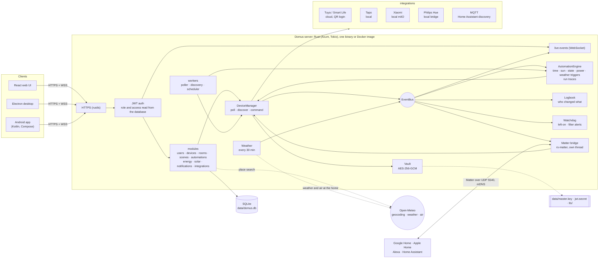
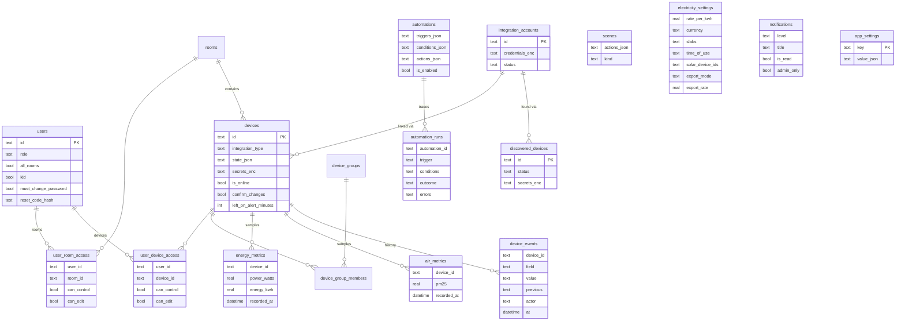

# Domus

<p align="center">
  <b>Translations</b><br>
  <a href="README.md">English</a> ·
  <a href="README.ar.md">العربية</a> ·
  <a href="README.bn.md">বাংলা</a> ·
  <a href="README.de.md">Deutsch</a> ·
  <a href="README.es.md">Español</a> ·
  <a href="README.fr.md">Français</a> ·
  <a href="README.gu.md">ગુજરાતી</a> ·
  <a href="README.hi.md">हिन्दी</a> ·
  <a href="README.id.md">Bahasa Indonesia</a> ·
  <a href="README.it.md">Italiano</a> ·
  <a href="README.ja.md">日本語</a> ·
  <a href="README.kn.md">ಕನ್ನಡ</a> ·
  <a href="README.ko.md">한국어</a> ·
  <a href="README.ml.md">മലയാളം</a> ·
  <a href="README.mr.md">मराठी</a> ·
  <a href="README.pa.md">ਪੰਜਾਬੀ</a> ·
  <a href="README.pl.md">Polski</a> ·
  <a href="README.pt-BR.md">Português (Brasil)</a> ·
  <a href="README.ru.md">Русский</a> ·
  <a href="README.ta.md">தமிழ்</a> ·
  <a href="README.te.md">తెలుగు</a> ·
  <a href="README.th.md">ไทย</a> ·
  <a href="README.tr.md">Türkçe</a> ·
  <a href="README.ur.md">اردو</a> ·
  <a href="README.vi.md">Tiếng Việt</a> ·
  <a href="README.zh-CN.md">简体中文</a> ·
  <a href="README.zh-TW.md">繁體中文</a>
</p>

[](https://github.com/aiyu-ayaan/Domus-Rust/actions/workflows/release.yml)
[](https://github.com/aiyu-ayaan/Domus-Rust/releases)
[](LICENSE)
[](https://github.com/aiyu-ayaan/Domus-Rust/commits/master)
[](https://hub.docker.com/r/aiyuayaan/domus)
[](https://hub.docker.com/r/aiyuayaan/domus)


[](https://ghloc.dev/aiyu-ayaan/Domus)


உங்கள் சொந்த ஹோம் சர்வர்க்கான லோக்கல்-ஃபர்ஸ்ட் ஸ்மார்ட் ஹோம் ஹப். Rust பின்தளம் (backend), SQLite, React வலை UI (Electron டெஸ்க்டாப் ஷெல் உடன்), மற்றும் **Tuya / Smart Life** (QR-குறியீடு உள்நுழைவு, டெவலப்பர் கணக்கு தேவையில்லை), **TP-Link Tapo** (உள்ளூர்/local), **Xiaomi Mi Home** (உள்ளூர், உங்கள் Mi கணக்கிலிருந்து டோக்கன்கள்), **Philips Hue** (உள்ளூர் பிரிட்ஜ்) மற்றும் **MQTT** (Zigbee2MQTT, ESPHome மற்றும் Home Assistant discovery ஆதரிக்கும் பிற சாதனங்கள்) ஆகியவற்றிற்கான செருகுநிரல் ஒருங்கிணைப்புகள் (pluggable integrations). உள்ளமைக்கப்பட்ட **Matter பிரிட்ஜ்** மூலம் Google Home, Apple Home, Alexa மற்றும் Home Assistant ஆகியவை உங்கள் சொந்த உள்ளூர் நெட்வொர்க்கிலேயே இந்தச் சாதனங்களை இயக்கவும், ஒளியைக் கூட்ட/குறைக்கவும் மற்றும் வண்ணங்களை மாற்றவும் உதவுகிறது.

- புதிய சாதனங்களை தானாகக் கண்டறிதல் (Automatic discovery), இன்பாக்ஸ் அல்லது தானாகச் சேர்க்கும் (auto-add) வசதியுடன்
- நேரலை டாஷ்போர்டு: மின் நுகர்வு, இதுவரை ஆன கட்டணம் மற்றும் கணிக்கப்பட்ட பில், காற்றின் தரம், இயக்கம் / கதவு / கசிவு / பேட்டரி அளவீடுகள்
- அறைகள், சாதனக் குழுக்கள், காட்சிகள் (scenes) மற்றும் தானியங்கிகள் (automations); குறிப்பிட்ட நேரத்தில், **சூரிய உதயம் அல்லது சூரிய அஸ்தமனத்தில்** (ஆஃப்செட் உடன்), சாதன நிலை மாற்றத்தில், மின் நுகர்வு அளவில் (*N நிமிடங்களுக்கு X-க்கு மேல் இருப்பது உட்பட*), சாதனம் ஆஃப்லைனில் போகும்போது அல்லது **வெளிப்புற வானிலையின்** அடிப்படையில் தூண்டுதல்கள் (triggers)
- **தானியங்கி இயக்க வரலாறு (Automation runs)**: ஒவ்வொரு தானியங்கியும் அதன் கடைசி 50 இயக்கங்களின் பதிவுகளை வைத்திருக்கும், அதில் அதைத் தூண்டிய நிகழ்வு மற்றும் அதைத் தடுத்த நிபந்தனை ஆகியவை அடங்கும்
- **சாதன வரலாறு (Device history)**: ஒரு சாதனத்தில் ஏற்பட்ட ஒவ்வொரு மாற்றமும் அதை யார் செய்தது என்ற விவரமும் (ஒரு நபர் மற்றும் அவர் பயன்படுத்திய செயலி, ஒரு தானியங்கி, Matter அல்லது சாதனமே நேரடியாகச் செய்தது)
- தானியங்கிக் குறியீடு எழுதாமலேயே **எச்சரிக்கைகள் (Alerts)**: சாதனம் அதிக நேரம் இயங்கியபடியே விடப்பட்டால், காற்று சுத்திகரிப்பானின் வடிகட்டி ஆயுள் குறைவாக இருக்கும்போது
- **Matter பிரிட்ஜ்**: நீங்கள் தேர்ந்தெடுக்கும் சாதனங்களை எந்தவொரு கிளவுட் கணக்கும் இல்லாமல் உள்ளூர் நெட்வொர்க்கிலேயே Google Home, Apple Home, Alexa அல்லது Home Assistant உடன் பகிருங்கள்
- வீட்டின் இருப்பிடத்திற்கான **வெளிப்புற வானிலை மற்றும் காற்று** (Open-Meteo, API சாவி தேவையில்லை) டாஷ்போர்டில் உட்புற அளவீட்டுக்கு அருகிலேயே காட்டப்படும்
- **மாற்றுவதற்கு முன் கேள் (Ask before switching)**: ஒரு முதன்மை சுவிட்சைக் குறித்துவிட்டால், ஒவ்வொரு செயலி, குழு, காட்சி மற்றும் கைமுறை தானியங்கி இயக்கமும் அதை ஆன் அல்லது ஆஃப் செய்வதற்கு முன் எச்சரித்து உறுதிப்படுத்தும்
- எந்த நாணயத்திலும் நிலையான (flat), அடுக்கு (slab) மற்றும் **நாளின் நேரம் (time-of-day)** கட்டண விகிதங்களுடன் மின் கட்டணக் கணக்கீடு, சாதனம் வாரியாக **காத்திருப்புச் செலவு (standby cost)**, மற்றும் **சூரிய ஆற்றல் (solar)**: உற்பத்தி, ஏற்றுமதி, நெட் மீட்டரிங் அல்லது ஃபீட்-இன் கட்டண விகிதம்
- நிர்வாகி / உறுப்பினர் / விருந்தினர் பொறுப்புகளுடன் கூடிய பல பயனர்கள் மற்றும் அறை வாரியாக அல்லது சாதனம் வாரியாக பார்க்க மட்டும் (see-only), கட்டுப்பாடு (control) அல்லது திருத்துதல் (edit) அணுகல்
- வலை (Web), Electron டெஸ்க்டாப் (Linux, Windows) மற்றும் நேட்டிவ் Android செயலி, அனைத்தும் நிகழ்நேரத்தில் ஒத்திசைவில் இருக்கும்
- வலை, டெஸ்க்டாப் மற்றும் Android செயலிகளில் **27 மொழிகள்**, அமைப்புகளில் மொழி மாற்றும் வசதியுடன் உங்கள் கணினியின் மொழியைப் பின்பற்றும்; அரபு மற்றும் உருது மொழிகளுக்கு வலமிருந்து இடமாக (RTL) அமைப்பு
- ஒவ்வொரு செயலியிலும் வெளியீட்டுக் குறிப்புகளுடன் கூடிய புதுப்பிப்புகள் பக்கம் (Markdown, அட்டவணைகள் மற்றும் படங்கள்)
- இயல்பாகவே HTTPS பாதுகாப்பு; உள்நுழைவுத் தகவல்களும் சாதனச் சாவிகளும் என்க்ரிப்ட் செய்யப்பட்டுப் பாதுகாக்கப்படும்; ஒரே கோப்பிலான காப்புப்பிரதி (backup) மற்றும் மீட்டமைத்தல் (restore)

கட்டமைப்பு மற்றும் வரைபடங்கள்: [`development/docs/ARCHITECTURE.md`](development/docs/ARCHITECTURE.md), [கீழே சுருக்கப்பட்டுள்ளது](#இது-ஒன்றாக-எவ்வாறு-செயல்படுகிறது).
UI வடிவமைப்பு விவரக்குறிப்பு: [`design-system/domus/MASTER.md`](design-system/domus/MASTER.md).
முன்னேற்றம்: [`development/TODO.md`](development/TODO.md).

## இது ஒன்றாக எவ்வாறு செயல்படுகிறது



கிளையண்டுகள் சேவையகத்துடன் (server) மட்டுமே பேசும்; சேவையகம் உங்கள் சாதனங்களுடன் நேரடியாகப் பேசுகிறது (விற்பனையாளர் அனுமதிக்கும் இடங்களில் உள்ளூரில்) மற்றும் அனைத்தையும் ஒரே SQLite கோப்பில் வைத்திருக்கிறது. விற்பனையாளர் உள்ளூர் கட்டுப்பாட்டை வழங்காத இடங்களில் மட்டுமே கிளவுட் பயன்படுத்தப்படுகிறது (Tuya) அல்லது சாதன டோக்கன்களைப் பெறுவதற்கு (Xiaomi), மேலும் சில விருப்பத் தேடல்களுக்கு: இடத் தேடல், வீட்டின் இருப்பிடத்திற்கான வானிலை மற்றும் வெளிப்புறக் காற்று (Open-Meteo, இருப்பிடம் அமைக்கப்பட்ட பின்னரே) மற்றும் புதுப்பிப்புகளைச் சரிபார்க்க GitHub. Matter பிரிட்ஜ் உள்ளூர் நெட்வொர்க்கில் மட்டுமே செயல்படும்.

### தரவு மாதிரி (Data model)



சான்றுகளும் சாதனச் சாவிகளும் டேட்டாபேஸில் சேமிக்கப்படாமல் `data/master.key` கீழ் பாதுகாப்பாக (`*_enc`) சேமிக்கப்படுகின்றன. ஒவ்வொரு அம்சத்திற்குமான முழுமையான வரைபடத் தொகுப்பு [`development/docs`](development/docs) இல் உள்ளது.

## திரைக்காட்சிகள் (Screenshots)

<p align="center"></p>

**டெஸ்க்டாப்** (Electron மற்றும் வெப்)

<p>
  
  
  
  
  
  
</p>

**Android**

<p>
  
  
  
  
  
</p>

**Android டேப்லெட்** (840dp முதல் இரண்டு நெடுவரிசைகள், அமைப்புகள் பட்டியல் மற்றும் விவரங்களாகக் காட்டப்படும்)

<p>
  
  
  
  
  
</p>

**மொபைல் வெப்**

<p>
  
  
  
  
  
</p>

அனைத்துப் படங்களும் [`res/screenshots`](res/screenshots) இல் உள்ளன; முழுத் தெளிவுத்திறன் கொண்ட வீடியோ வழிகாட்டி [`res/domus.mp4`](res/domus.mp4) ஆகும்.

## பதிவிறக்கம் (Download)

| | |
|---|---|
| சர்வர் (Docker) | Docker Hub இல் `aiyuayaan/domus`, amd64 மற்றும் arm64 |
| Android | [சமீபத்திய வெளியீட்டிலிருந்து](https://github.com/aiyu-ayaan/Domus-Rust/releases) `Domus-<version>.apk` |
| Linux டெஸ்க்டாப் | கீழே உள்ள ஒரு-வரி நிறுவி (installer), அல்லது வெளியீட்டிலிருந்து `.deb` / `.AppImage` |
| Windows டெஸ்க்டாப் | வெளியீட்டிலிருந்து `Domus-<version>-Setup.exe` |

### சர்வர்

ஹோஸ்டுக்கு ஒரு கோப்பு மட்டுமே போதுமானது:

```bash
mkdir domus && cd domus
wget https://raw.githubusercontent.com/aiyu-ayaan/Domus-Rust/master/docker-compose.yml
docker compose up -d
```

`https://<server-ip>:8443` பக்கத்தைத் திறந்து நிர்வாகி கணக்கை உருவாக்கவும். செயலிகள் உறுதிப்படுத்தக் கோரும் சான்றிதழ் கைரேகையை (certificate fingerprint) பார்க்க `docker compose logs domus` கட்டளையைப் பயன்படுத்தவும்.

```bash
docker compose pull && docker compose up -d      # புதுப்பிக்க
DOMUS_VERSION=beta docker compose up -d          # சேனலைப் பின்தொடர: latest (இயல்புநிலை), beta, alpha, அல்லது 0.0.1
TZ=Asia/Kolkata DOMUS_PORT=9443 docker compose up -d
docker compose --profile mqtt up -d              # விருப்பத்தேர்வான Mosquitto புரோக்கரையும் தொடங்க
```

அவற்றை நிரந்தரமாக வைத்திருக்க `DOMUS_VERSION`, `TZ` மற்றும் `DOMUS_PORT` மாறிகளை கம்போஸ் கோப்பின் அருகிலுள்ள `.env` கோப்பில் வைக்கவும்.

### Linux டெஸ்க்டாப் செயலி

தற்போதைய பயனருக்கான புதிய வெளியீட்டை நிறுவுகிறது (x86_64, root தேவையில்லை): AppImage, Domus ஐகானுடன் கூடிய மெனு உள்ளீடு மற்றும் `domus` கட்டளை. செயலி பின்னர் தன்னைத் தானே புதுப்பித்துக் கொள்ளும்.

```bash
curl -fsSL https://raw.githubusercontent.com/aiyu-ayaan/Domus-Rust/master/scripts/install-linux.sh | sh
# ... | sh -s -- --channel beta     பீட்டா கட்டமைப்புகளுக்கும் (அல்லது alpha)
# ... | sh -s -- --uninstall        அகற்ற; அமைப்புகள் பாதுகாக்கப்படும்
```

### Android

வெளியீட்டுப் பக்கத்திலிருந்து APK-வை பதிவிறக்கம் செய்து திறக்கவும். பிற்காலப் புதுப்பிப்புகள் செயலி திறக்கப்படும்போதும் அமைப்புகள் → புதுப்பிப்புகள் (Settings → Updates) பகுதியிலும் Stable, Beta அல்லது Alpha சேனல்களில் கிடைக்கும்; Domus அவற்றை நிறுவ அனுமதிக்க Android ஒருமுறை கேட்கும்.

**புதுப்பிப்புகள்** பக்கம் (Android இல் அமைப்புகள் → புதுப்பிப்புகள்; வெப் மற்றும் டெஸ்க்டாப்பில் அமைப்புகள் → பற்றி → புதுப்பிப்புகள்) நீங்கள் இயக்கும் பதிப்பு, உங்கள் சேனலில் உள்ள புதிய வெளியீடு மற்றும் அதன் Markdown வெளியீட்டுக் குறிப்புகளைக் காட்டுகிறது.

வெளியீடுகள், பதிப்பு எண்கள் மற்றும் புதுப்பிப்பு சேனல்கள் பற்றிய விவரங்கள்: [development/docs/RELEASE.md](development/docs/RELEASE.md).

## தேவைகள் (Requirements)

- Rust 1.80+ (`cargo`)
- Node.js 18+ மற்றும் `pnpm`

## மேம்பாட்டில் இயக்குதல் (Run in development)

```bash
pnpm install
npm run dev            # backend (https://127.0.0.1:8443) + web (http://localhost:3000)

npm run dev:backend    # backend மட்டும்
npm run dev:web        # web மட்டும் (API-யை backend-க்கு பிரதிநிதித்துவம் செய்கிறது)
npm run dev:desktop    # Electron; அதன் இணைப்புப் பக்கத்தில் சேவையகத்தைத் தேர்ந்தெடுக்கவும்
```

http://localhost:3000 பக்கத்தைத் திறக்கவும். முதல் முறை பார்வையிடும்போது நிர்வாகி கணக்கை உருவாக்கக் கேட்கும்.

## ஹோம் சர்வரில் இயக்குதல் (Run on the home server)

```bash
pnpm build:web                     # பின்தளத்தால் வழங்கப்படும் apps/web/dist கட்டமைப்பை உருவாக்குகிறது
APP_ENV=production cargo run --release --manifest-path backend/Cargo.toml
```

பின்னர் `https://<server-ip>:8443` பக்கத்தைத் திறக்கவும். Matter பிரிட்ஜ் இயக்கப்படும்போது LAN-இல் UDP 5540 (`[matter] port`) மற்றும் mDNS-ஐயும் பயன்படுத்துகிறது.

அல்லது இந்தக் குறியீட்டு களஞ்சியத்திலிருந்து Docker இமேஜை உருவாக்கவும் (host networking, `domus_data` வால்யூமில் தரவு):

```bash
docker compose -f docker-compose.local.yml up -d --build
```

Cloudflare Tunnel வழியாக தொலைநிலை அணுகல், செயலிகள் தானாக மாறும் உள்ளூர்/தொலைநிலை முகவரி மற்றும் டெஸ்க்டாப் தொகுப்புகள் (`pnpm build:desktop`) [development/docs/DEPLOYMENT.md](development/docs/DEPLOYMENT.md) ஆவணத்தில் விவரிக்கப்பட்டுள்ளன.

முதல் தொடக்கத்தில் Domus பின்வருவனவற்றுடன் `data/` கோப்பகத்தை உருவாக்குகிறது:

| கோப்பு | நோக்கம் |
|---|---|
| `domus.db` | SQLite தரவுத்தளம் |
| `master.key` | ஒருங்கிணைப்பு நற்சான்றிதழ்கள் மற்றும் சாதனச் சாவிகளை என்க்ரிப்ட் செய்கிறது — **இதை காப்புப்பிரதி எடுக்கவும்** |
| `jwt.secret` | அமர்வுகளைக் கையொப்பமிடுகிறது |
| `tls/` | சுயமாகக் கையொப்பமிடப்பட்ட சான்றிதழ் (`tls.cert_path` / `tls.key_path` மூலம் மாற்றலாம்) |

அமைப்புகள் `config/default.toml` கோப்பில் உள்ளன; எந்த அமைப்பையும் `DOMUS__SECTION__KEY` சூழல் மாறிகள் மூலம் மாற்றியமைக்கலாம் (`.env.example` பார்க்கவும்).

## காப்புப்பிரதியும் மீட்டமைத்தலும் (Backup and restore)

அனைத்தும் `data/` கோப்பகத்தில் உள்ளது. முழுக் கோப்புறையையும் காப்புப்பிரதி எடுக்கலாம் அல்லது ஒரே கோப்பிலான காப்புப்பிரதியை உருவாக்கலாம்:

**காப்புப்பிரதி எடுத்தல்.** நிர்வாகியாக உள்நுழையவும் → அமைப்புகள் (Settings) → **காப்புப்பிரதி (Backup)** → *காப்புப்பிரதியைப் பதிவிறக்கு (Download backup)*. இந்தக் கோப்பு தரவுத்தளத்தின் நகலாகும், மேலும் மாஸ்டர் சாவியும் இதில் சேமிக்கப்பட்டுள்ளதால் மீட்டமைத்த பிறகும் இணைக்கப்பட்ட கணக்குகளைத் திறக்க முடியும். சர்வர் இயங்கிக் கொண்டிருக்கும்போதே இது உருவாக்கப்படும். இதை ரகசியமாக வைத்திருக்கவும்: இந்தக் கோப்பைப் பெறுபவர் அந்தக் கணக்குகளைத் திறக்க முடியும். JWT ரகசியமும் TLS சான்றிதழும் இதில் சேர்க்கப்படவில்லை.

**மீட்டமைத்தல்.** சர்வரை நிறுத்திய பின்:

```bash
# Docker
docker compose cp domus-backup-2026-10-11.db domus:/app/data/restore.db
docker compose stop domus
docker compose run --rm domus domus-backend restore data/restore.db
docker compose start domus

# Docker இல்லாமல், களஞ்சியத்தின் மூலத்திலிருந்து (./data பயன்படுத்துகிறது)
domus-backend restore ~/Downloads/domus-backup-2026-10-11.db
```

ஏற்கனவே இருந்தவை `*.before-restore` ஆக அதன் அருகிலேயே வைக்கப்படும். ஒரு புதிய கணினியில் மீட்டமைத்த பிறகு பயனர்கள் மீண்டும் உள்நுழைய வேண்டும், மேலும் செயலிகள் புதிய சான்றிதழை நம்பும்படி கேட்கும். நீங்கள் சாவியை `DOMUS_MASTER_KEY` மூலம் அமைத்திருந்தால், காப்புப்பிரதியில் சாவி இருக்காது, மேலும் மீட்டமைக்கப்பட்ட சர்வருக்கு அதே மாறி தேவைப்படும். கூடுதல் விவரங்கள் [development/docs/DEPLOYMENT.md](development/docs/DEPLOYMENT.md#backup-and-restore) இல் உள்ளன.

## நிர்வாகி கடவுச்சொல்லை மறந்துவிட்டால் (Forgot the administrator password)

Domus-இல் அஞ்சல் சேவையகம் இல்லை, எனவே மின்னஞ்சல் மூலம் எதுவும் அனுப்பப்படாது. முயற்சிக்க வேண்டிய வழிகள்:

1. **மற்றொரு நிர்வாகி** அமைப்புகள் → நபர்கள் (Settings → People) பக்கத்தைத் திறந்து, உங்களுக்காக *மீட்டமைப்புக் குறியீட்டை (Reset code)* இயக்கி, 8 இலக்கக் குறியீட்டை உங்களுக்குத் தெரிவிக்கிறார் (இது 30 நிமிடங்கள் மற்றும் 5 தவறான முயற்சிகளுக்கு மட்டுமே செல்லும்). உள்நுழைவுத் திரையில் *கடவுச்சொல் மறந்துவிட்டதா? (Forgot password?)* என்பதைத் தேர்ந்தெடுத்து, உங்கள் பயனர்பெயரையும் பின்னர் குறியீட்டையும் உள்ளிடவும்.
2. **சர்வரிலிருந்து நேரடியாக**, இது Domus இயங்கும்போது அல்லது நிறுத்தப்பட்டிருக்கும்போது வேலை செய்யும் மற்றும் உள்நுழைவு தேவையில்லை:

   ```bash
   docker compose exec domus domus-backend reset-password <username>              # புதிய சீரற்ற கடவுச்சொல்லை அச்சிடும்
   docker compose exec domus domus-backend reset-password <username> 'new-pass'   # அல்லது நீங்களே ஒன்றைத் தேர்ந்தெடுக்கவும் (8+ எழுத்துகள்)
   domus-backend reset-password <username>                                        # Docker இல்லாமல், களஞ்சிய மூலத்திலிருந்து
   ```

   அதைக் கொண்டு உள்நுழைந்து அமைப்புகள் → கடவுச்சொல் (Settings → Password) பகுதியில் அதை மாற்றவும்.

ஒரு பயனர்பெயருக்கு தொடர்ந்து 5 தவறான கடவுச்சொற்கள் அளிக்கப்பட்டால், தயாரிப்புச் சூழலில் (production) அந்தப் பெயர் 15 நிமிடங்களுக்குப் பூட்டப்படும் (சர்வரை மறுதொடக்கம் செய்வதன் மூலம் பூட்டு நீக்கப்படும், மேலும் மேம்பாட்டுச் சூழலில் இது முடக்கப்பட்டிருக்கும்). கூடுதல் விவரங்கள் மற்றும் விதிகளுக்கு: [development/docs/ACCOUNTS.md](development/docs/ACCOUNTS.md).

## மொழிகள் (Languages)

ஆங்கிலம், இந்தி, ஸ்பானிஷ், போர்த்துகீசியம் (பிரேசில்), இந்தோனேசியன், அரபு, பிரெஞ்சு, ரஷ்யன், ஜெர்மன், துருக்கியம், ஜப்பானியம், கொரியன், இத்தாலியன், வியட்நாமியம், தாய், சீனம் (எளிமைப்படுத்தப்பட்ட மற்றும் பாரம்பரிய), போலிஷ், பெங்காலி, தமிழ், தெலுங்கு, மராத்தி, குஜராத்தி, கன்னடம், மலையாளம், பஞ்சாபி மற்றும் உருது. அரபு மற்றும் உருது மொழிகள் வலமிருந்து இடமாக (RTL) அமைக்கப்பட்டுள்ளன.

ஒவ்வொரு செயலியும் உங்கள் உலாவி அல்லது கணினியின் மொழியைப் பின்பற்றுகிறது, மொழிபெயர்ப்பு இல்லாதபோது ஆங்கிலத்தைக் காட்டுகிறது. வேறொரு மொழியைத் தேர்ந்தெடுக்க அமைப்புகள் > மொழி (அமைப்புகள் > தோற்றம் வலை மற்றும் டெஸ்க்டாப்பில்) என்பதைத் திறக்கவும்; *கணினி இயல்புநிலை (System default)* மீண்டும் கணினியின் மொழியைப் பின்பற்றும். Android 13 மற்றும் அதற்குப் பிந்தைய பதிப்புகளில் இது போனின் அமைப்புகள் > செயலிகள் > Domus > மொழி என்பதன் கீழும் தோன்றும்.

மொழிபெயர்ப்புகள் தானியங்கு முறையில் உருவாக்கப்பட்டவை மற்றும் தாய்மொழியாளர்களால் மதிப்பாய்வு செய்யப்படாதவை, எனவே சொற்கள் சற்று மாறுபடலாம். ஒரு திருத்தம் என்பது அந்த மொழியின் கோப்பகத்தில் ஒரு-வரி மாற்றமாகும். மொழிகள் எவ்வாறு செயல்படுகின்றன மற்றும் புதிய உரைகளுக்கான விதிகள்: [development/docs/LOCALIZATION.md](development/docs/LOCALIZATION.md).

## சாதனங்களை இணைத்தல் (Connecting devices)

| பிராண்ட் | எவ்வாறு இணைப்பது |
|---|---|
| Tuya / Smart Life | ஒருங்கிணைப்புகள் → *QR குறியீட்டுடன் இணை (Link with QR code)*. Smart Life செயலியிலிருந்து **User Code** ஐ உள்ளிடவும் (Me → Settings → Account and Security → User Code), பின்னர் செயலியில் QR-ஐ ஸ்கேன் செய்யவும். |
| Tapo | ஒருங்கிணைப்புகள் → உங்கள் TP-Link ID மூலம் *கணக்கை இணை (Link account)*. LAN-இல் உள்ள சாதனங்கள் தானாகக் கண்டறியப்பட்டு உள்ளூரிலேயே கட்டுப்படுத்தப்படுகின்றன. H100 ஹப் அதன் சென்சார்கள், சுவிட்சுகள் மற்றும் தெர்மோஸ்டாட்களை அதனுடன் கொண்டுவருகிறது. கேமராக்கள் பட்டியலிடப்பட்டுள்ளன, ஆனால் இன்னும் ஆதரிக்கப்படவில்லை. |
| Xiaomi | ஒருங்கிணைப்புகள் → உங்கள் Mi கணக்கு மற்றும் சர்வர் பிராந்தியத்துடன் *கணக்கை இணை (Link account)*. Xiaomi இருபடி சரிபார்ப்பைக் (two-step verification) கேட்டால், அது உங்களுக்கு மின்னஞ்சல் அல்லது குறுஞ்செய்தி அனுப்பும் குறியீட்டை அதே பேனலில் உள்ளிடவும். கணக்கு என்பது மின்னஞ்சல், நாட்டின் குறியீட்டுடன் கூடிய தொலைபேசி எண் (`+91…`) அல்லது Xiaomi ID ஆக இருக்கலாம். டோக்கன்கள் ஒருமுறை பெறப்படுகின்றன; கட்டுப்பாடு உள்ளூர் சார்ந்தது. சாதனங்களை டோக்கன் மூலமாகவும் சேர்க்கலாம். |
| Philips Hue | பிரிட்ஜில் உள்ள வட்ட பொத்தானை அழுத்தவும், பின்னர் 30 வினாடிகளுக்குள் ஒருங்கிணைப்புகள் → Philips Hue → *இணை (Link)* என்பதை அழுத்தவும். பிரிட்ஜைத் தானாகக் கண்டறிய முகவரியைக் காலியாக விடவும். விளக்குகள் மற்றும் Hue ஸ்மார்ட் பிளக்குகள் உள்ளூரிலேயே கட்டுப்படுத்தப்படுகின்றன. |
| MQTT | ஒருங்கிணைப்புகள் → MQTT → உங்கள் புரோக்கரின் முகவரி, போர்ட் மற்றும் உள்நுழைவுடன் *இணை (Link)*. Home Assistant MQTT discovery (Zigbee2MQTT, ESPHome, …) மூலம் தங்களை அறிவிக்கும் சாதனங்கள் கண்டறியப்பட்டவை (Discovered) என்பதன் கீழ் தோன்றும்: விளக்குகள், சுவிட்சுகள், பிளக்குகள், ஃபேன்கள் மற்றும் சென்சார்கள். சேர்க்கப்பட்ட புரோக்கருடன் (`--profile mqtt`) முகவரி `mqtt`, போர்ட் `1883` ஆகும். |

ஒவ்வொரு ஒருங்கிணைப்பும் எவற்றை உள்ளடக்கியது என்பதை அறிய `development/docs/INTEGRATIONS.md` ஐப் பார்க்கவும்.

## மின்சார பில்லிங் (Electricity billing)

ஆற்றல் (Energy) → *மின்சாரத் திட்டம் (Electricity plan)*: எந்த நாணயத்தையும் தேர்ந்தெடுத்து, ஒரு kWh-க்கான நிலையான விலை அல்லது யூனிட் அடிப்படையிலான கட்டணங்களுக்கு **அடுக்குகளை (slabs)** தேர்வு செய்யவும் (எ.கா. Pune/MSEDCL: 0–100 யூனிட்டுகள் ஒரு கட்டணம், 101–300 அடுத்த கட்டணம், மற்றும் பல). பில் ஒவ்வொரு பில்லிங் சுழற்சிக்கும் நிலையான மாதாந்திர கட்டணத்துடன் கணக்கிடப்படுகிறது.

கட்டண விகிதங்கள் **நாளின் நேரம் (time-of-day)** சாளரங்களையும் கொண்டிருக்கலாம்: வீட்டின் கடிகாரத்தின்படி சில குறிப்பிட்ட மணிநேரங்களில் (நள்ளிரவைத் தாண்டிய நேரமும் அனுமதிக்கப்படுகிறது) யூனிட்டுகளின் விலை நிலையான அல்லது அடுக்கு விலைக்கு மேல் நிர்ணயிக்கப்பட்ட தொகையை விடக் கூடுதலாகவோ குறைவாகவோ இருக்கும் (எடுத்துக்காட்டாக இரவு நேரத் தள்ளுபடி அல்லது உச்ச நேரக் கூடுதல் கட்டணம்).

புதிய சாதனங்கள் **சாதனங்கள் → கண்டறியப்பட்டவை (Devices → Discovered)** என்பதன் கீழ் தோன்றும். இன்பாக்ஸைத் தவிர்க்க அங்கே *புதிய சாதனங்களைத் தானாகச் சேர் (Add new devices automatically)* என்பதை இயக்கவும்.

## சூரிய உதயம் மற்றும் சூரிய அஸ்தமனம் (Sunrise and sunset)

வீடு எங்குள்ளது என்பதை அமைப்புகள் → **வீட்டின் இருப்பிடம் (Home location)** என்பதில் அமைக்கவும்: இந்த மொபைல் அல்லது உலாவியின் இருப்பிடத்தைப் பயன்படுத்தவும், ஊரைத் தேடவும் (சர்வர் இலவச Open-Meteo ஜியோகோடரிடம் கேட்கும்; நீங்கள் தட்டச்சு செய்யும் பெயர் மட்டுமே வீட்டை விட்டு வெளியே செல்லும்), அல்லது அட்சரேகை மற்றும் தீர்க்கரேகையைத் தட்டச்சு செய்யவும். ஒருங்கிணைப்புகள் சுமார் ஒரு கிலோமீட்டருக்கு முழுமையாக்கப்பட்டு உங்கள் சர்வரிலேயே இருக்கும். ஒரு தானியங்கி சூரிய உதயம் அல்லது சூரிய அஸ்தமனத்தில், அல்லது அதற்கு சில நிமிடங்கள் முன்னதாகவோ பின்னதாகவோ இயங்க முடியும். இருப்பிடம் இல்லாமல் சூரியன் சார்ந்த தூண்டுதல் ஒருபோதும் இயங்காது.

## மாற்றுவதற்கு முன் கேள் (Ask before switching)

அதனுடன் இணைக்கப்பட்டுள்ள அனைத்து சாதனங்களுக்கும் மின்சாரத்தை துண்டிக்கும் பிரதான சுவிட்சை தவறுதலாக அணைப்பது எளிது. சாதனத்தைத் திறந்து **மாற்றுவதற்கு முன் கேள் (Ask before switching)** என்பதை இயக்கவும்: ஒவ்வொரு செயலியும் அதை ஆன் அல்லது ஆஃப் செய்வதற்கு முன் அனுமதி கேட்கும்; மேலும் அறையின் *அனைத்தும் ஆன் / அனைத்தும் ஆஃப் (All on / All off)*, சாதனக் குழுக்கள், காட்சிகள் (காட்சிகளுக்குள் இருக்கும் காட்சிகள் உட்பட) மற்றும் அதை மாற்றக்கூடிய தானியங்கியின் கைமுறை *இயக்கம் (Run)* ஆகியவையும் உறுதிப்படுத்தக் கேட்கும். இந்த அமைப்பு சர்வரில் வைக்கப்பட்டுள்ளதால், இது வலை, டெஸ்க்டாப் மற்றும் Android அனைத்திலும் ஒரே மாதிரியாக இருக்கும். தானாக இயங்கும் தானியங்கிகள் உறுதிப்படுத்தல் கேட்க முடியாது, அவை எழுதப்பட்டபடியே இயங்கும்; மேலும் Domus-க்கு வெளியே உள்ளவை (விற்பனையாளர் செயலி, சுவர் சுவிட்ச்) இதில் கட்டுப்படாது.

## Matter (Google Home, Apple Home, Alexa)

அமைப்புகள் → **Matter** (நிர்வாகிகள்): அதை இயக்கி, பகிர வேண்டிய சாதனங்களைத் தேர்ந்தெடுத்து, பின்னர் Google Home, Apple Home, Alexa அல்லது Home Assistant செயலியில் QR-ஐ ஸ்கேன் செய்யவும் அல்லது இணைக்கும் குறியீட்டைத் தட்டச்சு செய்யவும். விளக்குகள் வண்ண அல்லது ஒளியைக் கூட்ட/குறைக்கக்கூடிய விளக்குகளாகவும், ஆன்/ஆஃப் சுவிட்ச் கொண்ட பிற அனைத்தும் பிளக்குகளாகவும் வந்து சேரும்; ஆன்/ஆஃப், பிரகாசம் மற்றும் வண்ணக் கட்டுப்பாடு வேலை செய்யும், மேலும் Domus-இல் செய்யப்படும் மாற்றங்கள் கன்ட்ரோலரிலும் உடனடியாகத் தோன்றும். "15 நிமிடங்களுக்கு இணைக்க அனுமதி (Allow pairing for 15 minutes)" இரண்டாவது சுற்றுச்சூழல் அமைப்பை (ecosystem) சேர்க்கிறது; "அனைத்து இணைப்புகளையும் மற (Forget all pairings)" புதிய குறியீட்டுடன் புதிதாகத் தொடங்குகிறது.

இந்த பிரிட்ஜ் அதிகாரப்பூர்வமாக சான்றளிக்கப்படவில்லை (இது Matter சோதனை சான்றளிப்பைப் பயன்படுத்துகிறது), எனவே அதைச் சேர்க்கும்போது உறுதிப்படுத்துமாறு பயன்பாடுகள் கேட்கும்; மேலும் Google Home-இல் Google Home Developer Console-இல் சோதனைச் சாதனமாகச் சேர்த்த பின்னரே இது ஏற்றுக்கொள்ளப்படும். விவரங்கள்: [`development/docs/MATTER.md`](development/docs/MATTER.md).

## வரலாறு, தானியங்கி இயக்கங்கள் மற்றும் எச்சரிக்கைகள் (History, automation runs and alerts)

- ஒவ்வொரு சாதனப் பக்கத்திலும் **வரலாறு (History)**: என்ன மாறியது, எப்போது, அதை யார் செய்தது (*Ayaan · Android மூலம்*, *தானியங்கி "இரவு முறை"*, *Matter*, *சாதனத்தில் நேரடியாக*). மின்சார வரலாற்றுத் தரவு இருக்கும் வரை இதுவும் பராமரிக்கப்படும்.
- ஒவ்வொரு தானியங்கியின் **இயக்கங்கள் (Runs)**: *இயங்கியது (Ran)*, பிழையுடன் *தோல்வியடைந்தது (Failed)*, அல்லது அதைத் தடுத்த நிபந்தனையுடன் *தவிர்க்கப்பட்டது (Skipped)*, இதனால் "இது ஏன் இயங்கவில்லை?" என்ற கேள்விக்குப் பதில் கிடைக்கும்.
- சாதனப் பக்கத்தில் **இயங்கியபடியே விடப்பட்டால் எச்சரிக்கை (Alert when left on)** (30 நிமிடங்கள் முதல் 12 மணிநேரம் வரை): நிர்வாகிகளுக்கு அறிவிப்பு வரும். மீட்டரிங் கொண்ட சாதனம் 10 W-க்கு மேல் மின்சாரம் எடுத்தால் மட்டுமே ஆன் எனக் கருதப்படும், எனவே காத்திருப்பில் (standby) உள்ள டிவி ஆஃப் எனக் கருதப்படும்.
- **வடிகட்டி குறைவாக இயங்குகிறது (Filter running low)**: காற்று சுத்திகரிப்பானின் வடிகட்டி அளவு 10%-க்குக் குறையும்போது அறிவிப்பு வரும்.

## வானிலை, காத்திருப்பு மற்றும் சூரிய ஆற்றல் (Weather, standby and solar)

- வீட்டின் இருப்பிடம் அமைக்கப்பட்டிருந்தால், டாஷ்போர்டு உட்புற அளவீட்டுக்கு அருகில் **வானிலை மற்றும் வெளிப்புற PM2.5** அளவைக் காட்டுகிறது, மேலும் தானியங்கிகள் அவற்றைப் பயன்படுத்தலாம் (*வெளிப்புற PM2.5 35-க்கு மேல் உயரும்போது*, *வெளிப்புற வெப்பநிலை 20-க்குக் குறைவாக இருந்தால் மட்டுமே*).
- ஆற்றல் (Energy) → **காத்திருப்பு (Standby)** என்பது யாரும் பயன்படுத்தாதபோது ஒவ்வொரு சாதனமும் எவ்வளவு மின்சாரம் எடுக்கிறது (இந்த வாரத்தின் அதன் மிகக் குறைந்த மணிநேரம்) மற்றும் அதற்கு ஒரு மாதத்திற்கு எவ்வளவு செலவாகும் என்பதைப் பட்டியலிடுகிறது.
- ஆற்றல் (Energy) → *மின்சாரத் திட்டம் (Electricity plan)* → **சூரிய ஆற்றல் (Solar)**: சூரிய மின் உற்பத்தியை அளவிடும் பிளக்குகளைத் தேர்வுசெய்து, பின்னர் நெட் மீட்டரிங் அல்லது ஃபீட்-இன் கட்டண விகிதத்தைத் தேர்வுசெய்யவும். பில் பின்னர் கட்டத்திலிருந்து (grid) நீங்கள் வாங்குவதை மட்டுமே கணக்கிடும், மேலும் சோலார் கார்டு உற்பத்தி செய்யப்பட்டது, வீட்டில் பயன்படுத்தப்பட்டது, ஏற்றுமதி செய்யப்பட்டது மற்றும் சம்பாதித்த தொகையைக் காட்டும். கட்டப் பாய்வுகள் (grid flows) மீட்டரிங் சாதனங்களிலிருந்து ஒவ்வொரு 15 நிமிடங்களுக்கும் கணக்கிடப்படுகின்றன, எனவே மீட்டர் இல்லாத சாதனங்கள் இருந்தால் ஏற்றுமதி அளவு கூடுதலாகத் தெரியலாம்.

திட்டம் மற்றும் வரைபடங்கள்: [`development/docs/ROADMAP.md`](development/docs/ROADMAP.md).

## உரிமம் (License)

Domus [MIT உரிமத்தின்](LICENSE) கீழ் வெளியிடப்பட்டுள்ளது. மூன்றாம் தரப்பு நூலகங்கள் தங்களின் சொந்த உரிமங்களைத் தக்கவைத்துக்கொள்கின்றன; அவை ஒவ்வொரு செயலியிலும் பற்றி → நன்றியுரைகள் (About → Acknowledgements) என்பதன் கீழ் பட்டியலிடப்பட்டுள்ளன.

## சோதனைகள் (Tests)

```bash
cargo test --workspace
pnpm --filter @domus/web exec tsc -b
```

`cargo test --workspace` கட்டளையானது `backend/tests/matter_bridge.rs` ஐயும் உள்ளடக்கியது, இது ஒரு Matter கன்ட்ரோலரை UDP வழியாக பிரிட்ஜுடன் இணைத்து அதன் சாதனங்களை இயக்குகிறது, பிரகாசத்தை மாற்றுகிறது மற்றும் வண்ணங்களை மாற்றுகிறது (இதற்கு IPv4 உடன் கூடிய நெட்வொர்க் இடைமுகம் தேவை).
