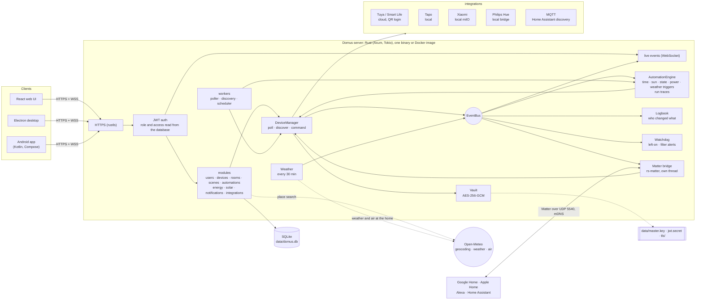
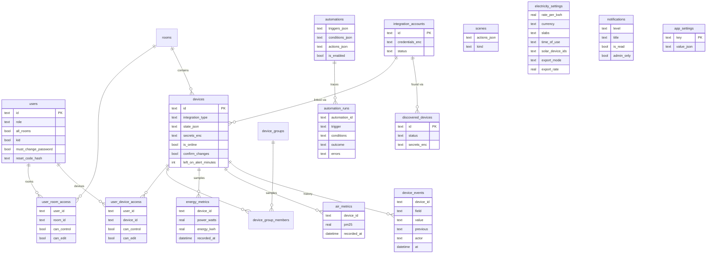

# Domus

<p align="center">
  <b>Translations</b><br>
  <a href="README.md">English</a> ·
  <a href="README.ar.md">العربية</a> ·
  <a href="README.bn.md">বাংলা</a> ·
  <a href="README.de.md">Deutsch</a> ·
  <a href="README.es.md">Español</a> ·
  <a href="README.fr.md">Français</a> ·
  <a href="README.gu.md">ગુજરાતી</a> ·
  <a href="README.hi.md">हिन्दी</a> ·
  <a href="README.id.md">Bahasa Indonesia</a> ·
  <a href="README.it.md">Italiano</a> ·
  <a href="README.ja.md">日本語</a> ·
  <a href="README.kn.md">ಕನ್ನಡ</a> ·
  <a href="README.ko.md">한국어</a> ·
  <a href="README.ml.md">മലയാളം</a> ·
  <a href="README.mr.md">मराठी</a> ·
  <a href="README.pa.md">ਪੰਜਾਬੀ</a> ·
  <a href="README.pl.md">Polski</a> ·
  <a href="README.pt-BR.md">Português (Brasil)</a> ·
  <a href="README.ru.md">Русский</a> ·
  <a href="README.ta.md">தமிழ்</a> ·
  <a href="README.te.md">తెలుగు</a> ·
  <a href="README.th.md">ไทย</a> ·
  <a href="README.tr.md">Türkçe</a> ·
  <a href="README.ur.md">اردو</a> ·
  <a href="README.vi.md">Tiếng Việt</a> ·
  <a href="README.zh-CN.md">简体中文</a> ·
  <a href="README.zh-TW.md">繁體中文</a>
</p>

[](https://github.com/aiyu-ayaan/Domus-Rust/actions/workflows/release.yml)
[](https://github.com/aiyu-ayaan/Domus-Rust/releases)
[](LICENSE)
[](https://github.com/aiyu-ayaan/Domus-Rust/commits/master)
[](https://hub.docker.com/r/aiyuayaan/domus)
[](https://hub.docker.com/r/aiyuayaan/domus)


[](https://ghloc.dev/aiyu-ayaan/Domus)


మీ హోమ్ సర్వర్ కోసం లోకల్-ఫస్ట్ స్మార్ట్-హోమ్ హబ్. Rust బ్యాకెండ్, SQLite, React వెబ్ UI (Electron డెస్క్‌టాప్ షెల్‌తో), మరియు **Tuya / Smart Life** (QR-కోడ్ లాగిన్, డెవలపర్ ఖాతా అవసరం లేదు), **TP-Link Tapo** (లోకల్), **Xiaomi Mi Home** (లోకల్, మీ Mi ఖాతా నుండి టోకెన్లు), **Philips Hue** (లోకల్ బ్రిడ్జ్) మరియు **MQTT** (Zigbee2MQTT, ESPHome మరియు Home Assistant డిస్కవరీని సపోర్ట్ చేసే ఏదైనా పరికరం) కోసం ప్లగ్ చేయగల ఇంటిగ్రేషన్లు. అంతర్నిర్మిత **Matter బ్రిడ్జ్** ద్వారా Google Home, Apple Home, Alexa మరియు Home Assistant మీ స్వంత లోకల్ నెట్‌వర్క్‌లోనే ఈ పరికరాలను స్విచ్ చేయడం, డిమ్ చేయడం మరియు రంగులను మార్చడం వంటివి చేయగలవు.

- కొత్త పరికరాలను స్వయంచాలకంగా గుర్తించడం (Automatic discovery), ఇన్‌బాక్స్ లేదా ఆటో-యాడ్ ఎంపికతో
- లైవ్ డాష్‌బోర్డ్: విద్యుత్ వినియోగం, ఇప్పటివరకు బిల్లు మరియు అంచనా వేసిన బిల్లు, గాలి నాణ్యత, మోషన్ / తలుపు / లీకేజ్ / బ్యాటరీ రీడింగ్‌లు
- గదులు, పరికర సమూహాలు (device groups), దృశ్యాలు (scenes) మరియు ఆటోమేషన్‌లు; నిర్దిష్ట సమయానికి, **సూర్యోదయం లేదా సూర్యాస్తమయం** వద్ద (ఆఫ్‌సెట్‌తో), పరికర స్థితి మార్పుపై, విద్యుత్ వినియోగ స్థాయిపై (*N నిమిషాల పాటు X కంటే ఎక్కువగా ఉండటం కూడా*), ఆఫ్‌లైన్‌కు వెళ్లినప్పుడు లేదా **బయటి వాతావరణం** ఆధారంగా ట్రిగ్గర్లు
- **ఆటోమేషన్ రన్ చరిత్ర (Automation runs)**: ప్రతి ఆటోమేషన్ దాని చివరి 50 రన్‌ల రికార్డును ఉంచుతుంది, దాన్ని ట్రిగ్గర్ చేసిన అంశం మరియు దాన్ని నిలువరించిన నిబంధన వివరాలతో సహా
- **పరికర చరిత్ర (Device history)**: పరికరంలో జరిగిన ప్రతి మార్పు మరియు దాన్ని ఎవరు చేశారనే వివరాలు (ఒక వ్యక్తి మరియు వారు ఉపయోగించిన యాప్, ఒక ఆటోమేషన్, Matter లేదా స్వయంగా పరికరమే)
- ఆటోమేషన్ కోడ్ రాయకుండానే **హెచ్చరికలు (Alerts)**: పరికరం ఎక్కువసేపు ఆన్‌లోనే ఉండిపోయినప్పుడు, ఎయిర్ ప్యూరిఫైయర్ ఫిల్టర్ తక్కువగా ఉన్నప్పుడు
- **Matter బ్రిడ్జ్**: మీరు ఎంచుకున్న పరికరాలను ఎటువంటి క్లౌడ్ ఖాతా లేకుండా మీ స్వంత నెట్‌వర్క్‌లోనే Google Home, Apple Home, Alexa లేదా Home Assistant తో షేర్ చేయండి
- ఇంటి వద్ద **బయటి వాతావరణం మరియు గాలి నాణ్యత** (Open-Meteo, API కీ అవసరం లేదు) డాష్‌బోర్డ్‌పై ఇండోర్ రీడింగ్‌తో పాటు ప్రదర్శించబడుతుంది
- **మార్చే ముందు అడుగు (Ask before switching)**: మెయిన్ స్విచ్‌ను గుర్తించండి, తద్వారా ప్రతి యాప్, సమూహం, దృశ్యం మరియు మాన్యువల్ ఆటోమేషన్ రన్ దాన్ని ఆన్ లేదా ఆఫ్ చేసే ముందు హెచ్చరిస్తుంది
- ఏదైనా కరెన్సీలో ఫ్లాట్, స్లాబ్ మరియు **రోజు సమయం (time-of-day)** టారిఫ్‌లతో విద్యుత్ బిల్లింగ్, పరికరం వారీగా **స్టాండ్‌బై ఖర్చు**, మరియు **సౌర శక్తి (solar)**: ఉత్పత్తి, ఎగుమతి మరియు నెట్ మీటరింగ్ లేదా ఫీడ్-ఇన్ రేటు
- అడ్మిన్ / సభ్యుడు / గెస్ట్ పాత్రలతో బహుళ వినియోగదారులు, మరియు గది వారీగా లేదా పరికరం వారీగా చూడటానికి మాత్రమే (see-only), నియంత్రణ (control) లేదా సవరణ (edit) యాక్సెస్
- వెబ్, Electron డెస్క్‌టాప్ (Linux, Windows) మరియు స్థానిక Android యాప్, అన్నీ లైవ్‌లో సింక్‌లో ఉంటాయి
- వెబ్, డెస్క్‌టాప్ మరియు Android యాప్‌లలో **27 భాషలు**, సెట్టింగ్‌లలో పికర్‌తో మీ సిస్టమ్ భాషను అనుసరిస్తాయి; అరబిక్ మరియు ఉర్దూ కోసం కుడి నుండి ఎడమకు (RTL) లేఅవుట్
- ప్రతి యాప్‌లో విడుదల గమనికలతో కూడిన అప్‌డేట్‌ల పేజీ (Markdown, పట్టికలు మరియు చిత్రాలు)
- డిఫాల్ట్‌గా HTTPS భద్రత; ఆధారాలు మరియు పరికర కీలు సురక్షితంగా ఎన్‌క్రిప్ట్ చేయబడతాయి; ఒకే ఫైల్ బ్యాకప్ మరియు పునరుద్ధరణ

ఆర్కిటెక్చర్ మరియు రేఖాచిత్రాలు: [`development/docs/ARCHITECTURE.md`](development/docs/ARCHITECTURE.md), [క్రింద సంగ్రహించబడింది](#ఇది-అంతా-కలిసి-ఎలా-పనిచేస్తుంది).
UI డిజైన్ ప్రొఫైల్: [`design-system/domus/MASTER.md`](design-system/domus/MASTER.md).
పురోగతి: [`development/TODO.md`](development/TODO.md).

## ఇది అంతా కలిసి ఎలా పనిచేస్తుంది



క్లయింట్లు సర్వర్‌తో మాత్రమే మాట్లాడతాయి; సర్వర్ మీ పరికరాలతో నేరుగా మాట్లాడుతుంది (విక్రేత అనుమతించిన చోట స్థానికంగా) మరియు ప్రతిదాన్ని ఒకే SQLite ఫైల్‌లో ఉంచుతుంది. విక్రేత స్థానిక నియంత్రణను అందించని చోట మాత్రమే క్లౌడ్ ఉపయోగించబడుతుంది (Tuya) లేదా పరికర టోకెన్‌లను పొందడానికి (Xiaomi), అదనంగా ఐచ్ఛిక శోధనలు: ప్రదేశ శోధన, ఇంటి స్థానం వద్ద వాతావరణం మరియు బహిరంగ గాలి నాణ్యత (Open-Meteo, లొకేషన్ సెట్ చేసిన తర్వాత మాత్రమే) మరియు అప్‌డేట్‌లను తనిఖీ చేయడానికి GitHub. Matter బ్రిడ్జ్ స్థానిక నెట్‌వర్క్‌లో మాత్రమే పనిచేస్తుంది.

### డేటా మోడల్ (Data model)



రుజువులు మరియు పరికర కీలు డేటాబేస్ వెలుపల `data/master.key` కింద సురక్షితంగా (`*_enc`) నిల్వ చేయబడతాయి. ప్రతి ఫీచర్ కోసం పూర్తి రేఖాచిత్రాల సమితి [`development/docs`](development/docs) లో ఉంది.

## స్క్రీన్‌షాట్‌లు (Screenshots)

<p align="center"></p>

**డెస్క్‌టాప్** (Electron మరియు వెబ్)

<p>
  
  
  
  
  
  
</p>

**Android**

<p>
  
  
  
  
  
</p>

**Android టాబ్లెట్** (840dp నుండి రెండు నిలువు వరుసలు, సెట్టింగ్‌లు జాబితా మరియు వివరాలుగా)

<p>
  
  
  
  
  
</p>

**మొబైల్ వెబ్**

<p>
  
  
  
  
  
</p>

అన్ని క్యాప్చర్‌లు [`res/screenshots`](res/screenshots) లో ఉన్నాయి; పూర్తి నాణ్యత గల వీడియో [`res/domus.mp4`](res/domus.mp4) లో ఉంది.

## డౌన్‌లోడ్ (Download)

| | |
|---|---|
| సర్వర్ (Docker) | Docker Hub లో `aiyuayaan/domus`, amd64 మరియు arm64 |
| Android | [తాజా విడుదల నుండి](https://github.com/aiyu-ayaan/Domus-Rust/releases) `Domus-<version>.apk` |
| Linux డెస్క్‌టాప్ | క్రింద ఉన్న వన్-లైన్ ఇన్‌స్టాలర్, లేదా విడుదల నుండి `.deb` / `.AppImage` |
| Windows డెస్క్‌టాప్ | విడుదల నుండి `Domus-<version>-Setup.exe` |

### సర్వర్

హోస్ట్ మెషీన్‌కు ఒకే ఫైల్ సరిపోతుంది:

```bash
mkdir domus && cd domus
wget https://raw.githubusercontent.com/aiyu-ayaan/Domus-Rust/master/docker-compose.yml
docker compose up -d
```

`https://<server-ip>:8443` ను తెరిచి నిర్వాహక ఖాతాను సృష్టించండి. యాప్‌లు నిర్ధారించమని అడిగే సర్టిఫికెట్ వేలిముద్రను (certificate fingerprint) చూడటానికి `docker compose logs domus` ఉపయోగించండి.

```bash
docker compose pull && docker compose up -d      # అప్‌డేట్ చేయడానికి
DOMUS_VERSION=beta docker compose up -d          # ఛానెల్‌ను అనుసరించండి: latest (డిఫాల్ట్), beta, alpha, లేదా 0.0.1
TZ=Asia/Kolkata DOMUS_PORT=9443 docker compose up -d
docker compose --profile mqtt up -d              # ఐచ్ఛిక Mosquitto బ్రోకర్‌ను కూడా ప్రారంభించడానికి
```

వాటిని శాశ్వతంగా ఉంచడానికి కంపోజ్ ఫైల్ పక్కన ఉన్న `.env` ఫైల్‌లో `DOMUS_VERSION`, `TZ` మరియు `DOMUS_PORT` లను ఉంచండి.

### Linux డెస్క్‌టాప్ యాప్

ప్రస్తుత వినియోగదారు కోసం సరికొత్త విడుదలను ఇన్‌స్టాల్ చేస్తుంది (x86_64, root అవసరం లేదు): AppImage, Domus చిహ్నంతో కూడిన మెను ఎంట్రీ మరియు `domus` కమాండ్. ఆ తర్వాత యాప్ స్వయంగా అప్‌డేట్ అవుతుంది.

```bash
curl -fsSL https://raw.githubusercontent.com/aiyu-ayaan/Domus-Rust/master/scripts/install-linux.sh | sh
# ... | sh -s -- --channel beta     బీటా బిల్డ్‌ల కోసం కూడా (లేదా alpha)
# ... | sh -s -- --uninstall        తీసివేయడానికి; సెట్టింగ్‌లు అలాగే ఉంటాయి
```

### Android

విడుదల పేజీ నుండి APKని డౌన్‌లోడ్ చేసి తెరవండి. యాప్ తెరిచినప్పుడు మరియు సెట్టింగ్‌లు → అప్‌డేట్‌లు (Settings → Updates) లో Stable, Beta లేదా Alpha ఛానెల్‌లో భవిష్యత్ అప్‌డేట్‌లు అందించబడతాయి; వాటిని ఇన్‌స్టాల్ చేయడానికి అనుమతించమని Android ఒక్కసారి అడుగుతుంది.

**అప్‌డేట్‌లు** పేజీ (Android లో సెట్టింగ్‌లు → అప్‌డేట్‌లు; వెబ్ మరియు డెస్క్‌టాప్‌లో సెట్టింగ్‌లు → గురించి → అప్‌డేట్‌లు) మీరు రన్ చేస్తున్న వెర్షన్, మీ ఛానెల్‌లోని తాజా విడుదల మరియు Markdown లో వ్రాయబడిన విడుదల గమనికలను చూపుతుంది.

విడుదలలు, వెర్షన్ నంబర్లు మరియు అప్‌డేట్ ఛానెల్‌లు: [development/docs/RELEASE.md](development/docs/RELEASE.md).

## అవసరాలు (Requirements)

- Rust 1.80+ (`cargo`)
- Node.js 18+ మరియు `pnpm`

## డెవలప్‌మెంట్‌లో రన్ చేయడం (Run in development)

```bash
pnpm install
npm run dev            # backend (https://127.0.0.1:8443) + web (http://localhost:3000)

npm run dev:backend    # backend మాత్రమే
npm run dev:web        # web మాత్రమే (APIని backend కి ప్రాక్సీ చేస్తుంది)
npm run dev:desktop    # Electron; దాని కనెక్ట్ పేజీలో సర్వర్‌ను ఎంచుకోండి
```

http://localhost:3000 ను తెరవండి. మొదటి సందర్శనలో నిర్వాహక ఖాతాను సృష్టించమని అడుగుతుంది.

## హోమ్ సర్వర్‌లో రన్ చేయడం (Run on the home server)

```bash
pnpm build:web                     # బ్యాకెండ్ ద్వారా అందించబడే apps/web/dist ను నిర్మిస్తుంది
APP_ENV=production cargo run --release --manifest-path backend/Cargo.toml
```

ఆపై `https://<server-ip>:8443` ను తెరవండి. Matter బ్రిడ్జ్ ప్రారంభించబడినప్పుడు LAN లో UDP 5540 (`[matter] port`) మరియు mDNS ని కూడా ఉపయోగిస్తుంది.

లేదా ఈ చెక్‌అవుట్ నుండి Docker ఇమేజ్‌ను నిర్మించండి (host networking, `domus_data` వాల్యూమ్‌లో డేటా):

```bash
docker compose -f docker-compose.local.yml up -d --build
```

Cloudflare Tunnel ద్వారా రిమోట్ యాక్సెస్, యాప్‌లు మారే స్థానిక/రిమోట్ చిరునామా మరియు డెస్క్‌టాప్ ప్యాకేజీలు (`pnpm build:desktop`) [development/docs/DEPLOYMENT.md](development/docs/DEPLOYMENT.md) లో వివరించబడ్డాయి.

మొదటి ప్రారంభంలో Domus క్రింది వాటితో `data/` ను సృష్టిస్తుంది:

| ఫైల్ | ఉద్దేశ్యం |
|---|---|
| `domus.db` | SQLite డేటాబేస్ |
| `master.key` | ఇంటిగ్రేషన్ ఆధారాలు మరియు పరికర కీలను ఎన్‌క్రిప్ట్ చేస్తుంది — **దీన్ని బ్యాకప్ చేయండి** |
| `jwt.secret` | సెషన్‌లపై సంతకం చేస్తుంది |
| `tls/` | సెల్ఫ్-సైన్డ్ సర్టిఫికెట్ (`tls.cert_path` / `tls.key_path` ద్వారా భర్తీ చేయవచ్చు) |

సెట్టింగ్‌లు `config/default.toml` లో ఉంటాయి; ఏదైనా సెట్టింగ్‌ను `DOMUS__SECTION__KEY` ఎన్విరాన్‌మెంట్ వేరియబుల్స్‌తో భర్తీ చేయవచ్చు (`.env.example` చూడండి).

## బ్యాకప్ మరియు పునరుద్ధరణ (Backup and restore)

ప్రతిదీ `data/` లో ఉంటుంది. మొత్తం ఫోల్డర్‌ను బ్యాకప్ చేయండి లేదా సింగిల్-ఫైల్ బ్యాకప్ తీసుకోండి:

**బ్యాకప్ చేయడం.** అడ్మినిస్ట్రేటర్‌గా సైన్ ఇన్ చేయండి → సెట్టింగ్‌లు (Settings) → **బ్యాకప్ (Backup)** → *బ్యాకప్ డౌన్‌లోడ్ చేయండి (Download backup)*. ఈ ఫైల్ డేటాబేస్ యొక్క కాపీ, దీనిలో మాస్టర్ కీ కూడా నిల్వ చేయబడి ఉంటుంది, తద్వారా పునరుద్ధరించిన తర్వాత కూడా లింక్ చేయబడిన ఖాతాలను తెరవవచ్చు. సర్వర్ రన్ అవుతున్నప్పుడే ఇది సృష్టించబడుతుంది. దీన్ని ప్రైవేట్‌గా ఉంచండి: దీన్ని కలిగి ఉన్న ఎవరైనా ఆ ఖాతాలను తెరవగలరు. JWT సీక్రెట్ మరియు TLS సర్టిఫికెట్ ఇందులో చేర్చబడవు.

**పునరుద్ధరించడం.** సర్వర్‌ను ఆపివేసిన తర్వాత:

```bash
# Docker
docker compose cp domus-backup-2026-10-11.db domus:/app/data/restore.db
docker compose stop domus
docker compose run --rm domus domus-backend restore data/restore.db
docker compose start domus

# Docker లేకుండా, రెపో రూట్ నుండి (./data ఉపయోగిస్తుంది)
domus-backend restore ~/Downloads/domus-backup-2026-10-11.db
```

అక్కడ మునుపు ఉన్నవి దాని పక్కనే `*.before-restore` గా భద్రపరచబడతాయి. కొత్త మెషీన్‌లో పునరుద్ధరించిన తర్వాత వినియోగదారులు మళ్లీ సైన్ ఇన్ చేయాలి మరియు యాప్‌లు కొత్త సర్టిఫికెట్‌ను విశ్వసించమని అడుగుతాయి. మీరు కీని `DOMUS_MASTER_KEY` తో సెట్ చేసి ఉంటే, బ్యాకప్‌లో కీ ఉండదు మరియు పునరుద్ధరించబడిన సర్వర్‌కు అదే వేరియబుల్ అవసరం అవుతుంది. మరిన్ని వివరాలు [development/docs/DEPLOYMENT.md](development/docs/DEPLOYMENT.md#backup-and-restore) లో ఉన్నాయి.

## అడ్మినిస్ట్రేటర్ పాస్‌వర్డ్ మర్చిపోయారా (Forgot the administrator password)

Domus లో మెయిల్ సర్వర్ లేదు, కాబట్టి ఇమెయిల్ ద్వారా ఏదీ పంపబడదు. ప్రయత్నించాల్సిన పద్ధతులు:

1. **మరొక అడ్మినిస్ట్రేటర్** సెట్టింగ్‌లు → వ్యక్తులు (Settings → People) తెరిచి, మీ కోసం *రీసెట్ కోడ్ (Reset code)* ని ఆన్ చేసి, 8 అంకెల కోడ్‌ను మీకు తెలియజేస్తారు (ఇది 30 నిమిషాలు మరియు 5 తప్పుడు ప్రయత్నాలకు చెల్లుబాటు అవుతుంది). సైన్-ఇన్ స్క్రీన్‌పై *పాస్‌వర్డ్ మర్చిపోయారా? (Forgot password?)* ఎంచుకుని, మీ యూజర్‌నేమ్ మరియు కోడ్‌ను నమోదు చేయండి.
2. **సర్వర్ నుండి నేరుగా**, ఇది Domus రన్ అవుతున్నప్పుడు లేదా ఆగిపోయినప్పుడు పనిచేస్తుంది మరియు సైన్-ఇన్ అవసరం లేదు:

   ```bash
   docker compose exec domus domus-backend reset-password <username>              # కొత్త రాండమ్ పాస్‌వర్డ్‌ను ప్రింట్ చేస్తుంది
   docker compose exec domus domus-backend reset-password <username> 'new-pass'   # లేదా మీరే ఒకదాన్ని ఎంచుకోండి (8+ అక్షరాలు)
   domus-backend reset-password <username>                                        # Docker లేకుండా, రెపో రూట్ నుండి
   ```

   దానితో సైన్ ఇన్ చేసి, సెట్టింగ్‌లు → పాస్‌వర్డ్ (Settings → Password) లో దాన్ని మార్చండి.

ఒక యూజర్‌నేమ్ కోసం వరుసగా 5 తప్పుడు పాస్‌వర్డ్‌లు నమోదు చేస్తే, ప్రొడక్షన్‌లో ఆ పేరు 15 నిమిషాల పాటు లాక్ చేయబడుతుంది (సర్వర్‌ను రీస్టార్ట్ చేయడం ద్వారా లాక్ తీసివేయబడుతుంది, మరియు డెవలప్‌మెంట్‌లో ఇది నిలిపివేయబడుతుంది). పూర్తి వివరాలు మరియు నియమాలు: [development/docs/ACCOUNTS.md](development/docs/ACCOUNTS.md).

## భాషలు (Languages)

ఇంగ్లీష్, హిందీ, స్పానిష్, పోర్చుగీస్ (బ్రెజిల్), ఇండోనేషియన్, అరబిక్, ఫ్రెంచ్, రష్యన్, జర్మన్, టర్కిష్, జపనీస్, కొరియన్, ఇటాలియన్, వియత్నామీస్, థాయ్, చైనీస్ (సరళీకృత మరియు సాంప్రదాయ), పోలిష్, బెంగాలీ, తమిళం, తెలుగు, మరాఠీ, గుజరాతీ, కన్నడ, మలయాళం, పంజాబీ మరియు ఉర్దూ. అరబిక్ మరియు ఉర్దూ కుడి నుండి ఎడమకు (RTL) అమర్చబడ్డాయి.

ప్రతి యాప్ మీ బ్రౌజర్ లేదా సిస్టమ్ భాషను అనుసరిస్తుంది మరియు అనువాదం లేనప్పుడు ఇంగ్లీష్ చూపిస్తుంది. వేరేదాన్ని ఎంచుకోవడానికి సెట్టింగ్‌లు > భాష (వెబ్ మరియు డెస్క్‌టాప్‌లో సెట్టింగ్‌లు > రూపం) తెరవండి; *సిస్టమ్ డిఫాల్ట్ (System default)* ఎంచుకుంటే మళ్లీ సిస్టమ్ భాషను అనుసరిస్తుంది. Android 13 మరియు ఆ తర్వాతి వెర్షన్‌లలో ఇది ఫోన్ సెట్టింగ్‌లు > యాప్‌లు > Domus > భాష క్రింద కూడా కనిపిస్తుంది.

అనువాదాలు యంత్రం ద్వారా తయారు చేయబడ్డాయి మరియు స్థానిక భాషా నిపుణులచే సమీక్షించబడలేదు, కాబట్టి పదజాలం కొద్దిగా మారవచ్చు. భాషా కేటలాగ్‌లో చిన్న మార్పుతో సరిచేయవచ్చు. భాషలు ఎలా పనిచేస్తాయి మరియు కొత్త టెక్స్ట్ కోసం నియమాలు: [development/docs/LOCALIZATION.md](development/docs/LOCALIZATION.md).

## పరికరాలను కనెక్ట్ చేయడం (Connecting devices)

| బ్రాండ్ | ఎలా కనెక్ట్ చేయాలి |
|---|---|
| Tuya / Smart Life | ఇంటిగ్రేషన్లు → *QR కోడ్‌తో లింక్ చేయండి (Link with QR code)*. Smart Life యాప్ నుండి **User Code** నమోదు చేయండి (Me → Settings → Account and Security → User Code), ఆపై యాప్‌లో QR ని స్కాన్ చేయండి. |
| Tapo | ఇంటిగ్రేషన్లు → మీ TP-Link ID తో *ఖాతాను లింక్ చేయండి (Link account)*. LAN లోని పరికరాలు స్వయంచాలకంగా గుర్తించబడతాయి మరియు స్థానికంగా నియంత్రించబడతాయి. H100 హబ్ దాని సెన్సార్లు, స్విచ్‌లు మరియు థర్మోస్టాట్‌లను తనతో పాటు తెస్తుంది. కెమెరాలు జాబితా చేయబడ్డాయి కానీ ఇంకా మద్దతు లేదు. |
| Xiaomi | ఇంటిగ్రేషన్లు → మీ Mi ఖాతా మరియు సర్వర్ ప్రాంతంతో *ఖాతాను లింక్ చేయండి (Link account)*. Xiaomi రెండు-దశల ధృవీకరణను అడిగితే, అది మీకు ఇమెయిల్ లేదా మెసేజ్ ద్వారా పంపిన కోడ్‌ను అదే ప్యానెల్‌లో నమోదు చేయండి. ఖాతా అనేది ఇమెయిల్, దేశం కోడ్‌తో కూడిన ఫోన్ నంబర్ (`+91…`) లేదా Xiaomi ID కావచ్చు. టోకెన్లు ఒకసారి పొందబడతాయి; నియంత్రణ స్థానికంగా ఉంటుంది. పరికరాలను టోకెన్‌తో కూడా జోడించవచ్చు. |
| Philips Hue | బ్రిడ్జ్‌పై ఉన్న గుండ్రని బటన్‌ను నొక్కండి, ఆపై 30 సెకన్లలోపు ఇంటిగ్రేషన్లు → Philips Hue → *లింక్ (Link)* నొక్కండి. బ్రిడ్జ్‌ను స్వయంచాలకంగా కనుగొనడానికి చిరునామాను ఖాళీగా ఉంచండి. లైట్లు మరియు Hue స్మార్ట్ ప్లగ్‌లు స్థానికంగా నియంత్రించబడతాయి. |
| MQTT | ఇంటిగ్రేషన్లు → MQTT → మీ బ్రోకర్ చిరునామా, పోర్ట్ మరియు లాగిన్‌తో *లింక్ (Link)* చేయండి. Home Assistant MQTT discovery (Zigbee2MQTT, ESPHome, …) ద్వారా తమను ప్రకటించుకునే పరికరాలు కనుగొనబడినవి (Discovered) క్రింద కనిపిస్తాయి: లైట్లు, స్విచ్‌లు, ప్లగ్‌లు, ఫ్యాన్లు మరియు సెన్సార్లు. బండిల్ చేయబడిన బ్రోకర్‌తో (`--profile mqtt`) చిరునామా `mqtt`, పోర్ట్ `1883`. |

ప్రతి ఇంటిగ్రేషన్ వేటిని కవర్ చేస్తుందో చూడటానికి `development/docs/INTEGRATIONS.md` చూడండి.

## విద్యుత్ బిల్లింగ్ (Electricity billing)

శక్తి (Energy) → *విద్యుత్ ప్లాన్ (Electricity plan)*: ఏదైనా కరెన్సీని ఎంచుకోండి, మరియు యూనిట్ ఆధారిత టారిఫ్‌ల కోసం ఒక kWh కి ఫ్లాట్ ధర లేదా **స్లాబ్‌లను (slabs)** ఎంచుకోండి (ఉదా. Pune/MSEDCL: 0–100 యూనిట్లు ఒక రేటు, 101–300 తదుపరి రేటు, మొదలైనవి). ప్రతి బిల్లింగ్ సైకిల్‌కు నిర్ణీత నెలవారీ ఛార్జీతో కలిపి బిల్లు లెక్కించబడుతుంది.

టారిఫ్‌లు **రోజు సమయం (time-of-day)** విండోలను కూడా కలిగి ఉంటాయి: ఇంటి గడియారం ప్రకారం నిర్దిష్ట గంటలలో (అర్ధరాత్రి దాటిన సమయం కూడా అనుమతించబడుతుంది) యూనిట్ ధర ఫ్లాట్ లేదా స్లాబ్ ధర కంటే నిర్ణీత మొత్తం ఎక్కువ లేదా తక్కువగా ఉంటుంది (ఉదాహరణకు రాత్రి రాయితీ లేదా పీక్ సర్ఛార్జ్).

కొత్త పరికరాలు **పరికరాలు → కనుగొనబడినవి (Devices → Discovered)** క్రింద కనిపిస్తాయి. ఇన్‌బాక్స్‌ను దాటవేయడానికి అక్కడ *కొత్త పరికరాలను స్వయంచాలకంగా జోడించు (Add new devices automatically)* ను ఆన్ చేయండి.

## సూర్యోదయం మరియు సూర్యాస్తమయం (Sunrise and sunset)

ఇల్లు ఎక్కడ ఉందో సెట్టింగ్‌లు → **ఇంటి లొకేషన్ (Home location)** లో సెట్ చేయండి: ఈ ఫోన్ లేదా బ్రౌజర్ లొకేషన్‌ను ఉపయోగించండి, పట్టణం కోసం శోధించండి (సర్వర్ ఉచిత Open-Meteo జియోకోడర్‌ను అడుగుతుంది; మీరు టైప్ చేసిన పేరు మాత్రమే ఇంటి నుండి బయటకు వెళుతుంది), లేదా అక్షాంశం మరియు రేఖాంశాన్ని టైప్ చేయండి. కోఆర్డినేట్‌లు దాదాపు ఒక కిలోమీటర్‌కు రౌండ్ చేయబడి మీ సర్వర్‌లోనే ఉంటాయి. ఒక ఆటోమేషన్ సూర్యోదయం లేదా సూర్యాస్తమయం సమయానికి, కొన్ని నిమిషాల ముందు లేదా తర్వాత అమలు కాగలదు. స్థానం లేకుండా, సూర్యుడి ట్రిగ్గర్ ఎప్పటికీ అమలు కాదు.

## మార్చే ముందు అడుగు (Ask before switching)

దానికి కనెక్ట్ చేయబడిన ప్రతిదానికీ పవర్‌ను నిలిపివేసే మెయిన్ స్విచ్‌ను పొరపాటున ఆఫ్ చేయడం చాలా సులభం. పరికరాన్ని తెరిచి **మార్చే ముందు అడుగు (Ask before switching)** ఆన్ చేయండి: ప్రతి యాప్ దాన్ని ఆన్ లేదా ఆఫ్ చేసే ముందు నిర్ధారణ అడుగుతుంది; అలాగే గదిలోని *అన్నీ ఆన్ / అన్నీ ఆఫ్ (All on / All off)*, పరికర సమూహాలు, దృశ్యాలు (దృశ్యాల లోపల ఉన్న దృశ్యాలతో సహా) మరియు దాన్ని మార్చే ఆటోమేషన్ యొక్క మాన్యువల్ *రన్ (Run)* కూడా నిర్ధారణ కోరతాయి. ఈ సెట్టింగ్ సర్వర్‌లో ఉంచబడుతుంది, కాబట్టి ఇది వెబ్, డెస్క్‌టాప్ మరియు Android లో సమానంగా ఉంటుంది. స్వయంగా ట్రిగ్గర్ అయ్యే ఆటోమేషన్‌లు అడగలేవు మరియు వ్రాసినట్లే అమలవుతాయి; మరియు Domus వెలుపల ఉన్నవి (విక్రేత యాప్, గోడ స్విచ్) దీని పరిధిలోకి రావు.

## Matter (Google Home, Apple Home, Alexa)

సెట్టింగ్‌లు → **Matter** (నిర్వాహకులు): దాన్ని ఆన్ చేసి, భాగస్వామ్యం చేయాల్సిన పరికరాలను ఎంచుకోండి, ఆపై Google Home, Apple Home, Alexa లేదా Home Assistant లో QR ని స్కాన్ చేయండి లేదా జత చేసే కోడ్‌ను టైప్ చేయండి. లైట్లు రంగు లేదా డిమ్ చేయదగిన లైట్లుగా మరియు ఆన్/ఆఫ్ స్విచ్ ఉన్న ప్రతి ఇతర పరికరం ప్లగ్‌గా గుర్తించబడతాయి; స్విచింగ్, డిమ్మింగ్ మరియు రంగు మార్చడం పనిచేస్తాయి మరియు Domus లో చేసిన మార్పులు కంట్రోలర్‌లో కనిపిస్తాయి. "15 నిమిషాల పాటు జత చేయడాన్ని అనుమతించు (Allow pairing for 15 minutes)" రెండవ ఎకోసిస్టమ్‌ను జోడిస్తుంది; "అన్ని జతలను మర్చిపో (Forget all pairings)" కొత్త కోడ్‌తో కొత్తగా ప్రారంభిస్తుంది.

ఈ బ్రిడ్జ్ సర్టిఫైడ్ కాలేదు (ఇది Matter టెస్ట్ అటెస్టేషన్‌ను ఉపయోగిస్తుంది), కాబట్టి దాన్ని జోడించే ముందు నిర్ధారించమని యాప్‌లు అడుగుతాయి, మరియు Google Home Developer Console లో బ్రిడ్జ్ టెస్ట్ డివైజ్‌గా జోడించబడిన తర్వాతే Google Home దీన్ని అంగీకరిస్తుంది. వివరాలు: [`development/docs/MATTER.md`](development/docs/MATTER.md).

## చరిత్ర, ఆటోమేషన్ రన్‌లు మరియు హెచ్చరికలు (History, automation runs and alerts)

- ప్రతి పరికర షీట్‌లో **చరిత్ర (History)**: ఏమి మారింది, ఎప్పుడు, మరియు ఎవరు చేశారు (*Ayaan ద్వారా · Android*, *ఆటోమేషన్ "రాత్రి మోడ్"*, *Matter*, *పరికరంలో నేరుగా*). విద్యుత్ చరిత్ర ఉన్నంత కాలం ఇది ఉంచబడుతుంది.
- ప్రతి ఆటోమేషన్ యొక్క **రన్‌లు (Runs)**: *రన్ అయింది (Ran)*, లోపంతో *విఫలమైంది (Failed)*, లేదా దాన్ని నిలువరించిన షరతుతో *దాటవేయబడింది (Skipped)*, కాబట్టి "ఇది ఎందుకు రన్ కాలేదు?" అనే ప్రశ్నకు సమాధానం ఉంటుంది.
- పరికర షీట్‌లో **ఆన్‌లోనే ఉంటే హెచ్చరించు (Alert when left on)** (30 నిమిషాల నుండి 12 గంటల వరకు): నిర్వాహకులకు నోటిఫికేషన్ వస్తుంది. మీటర్ చేయబడిన పరికరం 10 W కంటే ఎక్కువ ఉంటేనే ఆన్‌లో ఉన్నట్లు పరిగణించబడుతుంది, కాబట్టి స్టాండ్‌బైలో ఉన్న టీవీ ఆఫ్ అయినట్లే.
- **ఫిల్టర్ తక్కువగా ఉంది (Filter running low)**: ఎయిర్ ప్యూరిఫైయర్ ఫిల్టర్ 10% కి పడిపోయినప్పుడు నోటిఫికేషన్ వస్తుంది.

## వాతావరణం, స్టాండ్‌బై మరియు సౌర శక్తి (Weather, standby and solar)

- ఇంటి లొకేషన్ సెట్ చేయబడితే, డాష్‌బోర్డ్ ఇండోర్ రీడింగ్ పక్కన **వాతావరణం మరియు బహిరంగ PM2.5** ను చూపుతుంది, మరియు ఆటోమేషన్‌లు వాటిని ఉపయోగించవచ్చు (*బహిరంగ PM2.5 35 కంటే పెరిగినప్పుడు*, *బయటి ఉష్ణోగ్రత 20 కంటే తక్కువగా ఉంటేనే*).
- శక్తి (Energy) → **స్టాండ్‌బై (Standby)** ఎవరూ ఉపయోగించనప్పుడు ప్రతి పరికరం ఎంత విద్యుత్ తీసుకుంటుందో (ఈ వారంలో దాని అతి తక్కువ గంట) మరియు నెలకు ఎంత ఖర్చవుతుందో జాబితా చేస్తుంది.
- శక్తి (Energy) → *విద్యుత్ ప్లాన్ (Electricity plan)* → **సౌర శక్తి (Solar)**: సౌర ఉత్పత్తిని కొలిచే ప్లగ్‌లను ఎంచుకోండి, ఆపై నెట్ మీటరింగ్ లేదా ఫీడ్-ఇన్ రేటును ఎంచుకోండి. బిల్లు అప్పుడు మీరు గ్రిడ్ నుండి కొనుగోలు చేసేదాన్ని మాత్రమే లెక్కిస్తుంది మరియు సోలార్ కార్డ్ ఉత్పత్తి చేయబడినది, ఇంట్లో ఉపయోగించినది, ఎగుమతి చేయబడినది మరియు సంపాదించినది చూపుతుంది. మీటర్ చేయబడిన పరికరాల నుండి ప్రతి 15 నిమిషాలకు గ్రిడ్ ప్రవాహాలు లెక్కించబడతాయి, కాబట్టి మీటర్ లేని ఉపకరణాలు ఉంటే ఎగుమతి రీడింగ్ ఎక్కువగా కనిపించవచ్చు.

ప్రణాళిక మరియు రేఖాచిత్రాలు: [`development/docs/ROADMAP.md`](development/docs/ROADMAP.md).

## లైసెన్స్ (License)

Domus [MIT లైసెన్స్](LICENSE) క్రింద విడుదల చేయబడింది. థర్డ్-పార్టీ లైబ్రరీలు వాటి స్వంత లైసెన్స్‌లను కలిగి ఉంటాయి; అవి ప్రతి యాప్‌లో గురించి → కృతజ్ఞతలు (About → Acknowledgements) క్రింద జాబితా చేయబడ్డాయి.

## పరీక్షలు (Tests)

```bash
cargo test --workspace
pnpm --filter @domus/web exec tsc -b
```

`cargo test --workspace` కమాండ్ `backend/tests/matter_bridge.rs` ను కూడా కలిగి ఉంటుంది, ఇది Matter కంట్రోలర్‌ను UDP ద్వారా బ్రిడ్జ్‌తో జత చేస్తుంది మరియు దాని పరికరాలను స్విచ్ చేస్తుంది, డిమ్ చేస్తుంది మరియు రంగులు మారుస్తుంది (దీనికి IPv4 తో కూడిన నెట్‌వర్క్ ఇంటర్‌ఫేస్ అవసరం).
