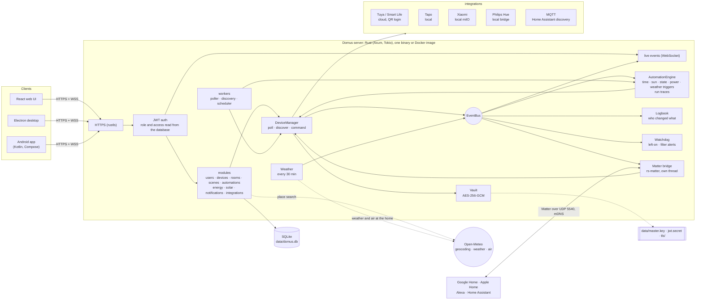
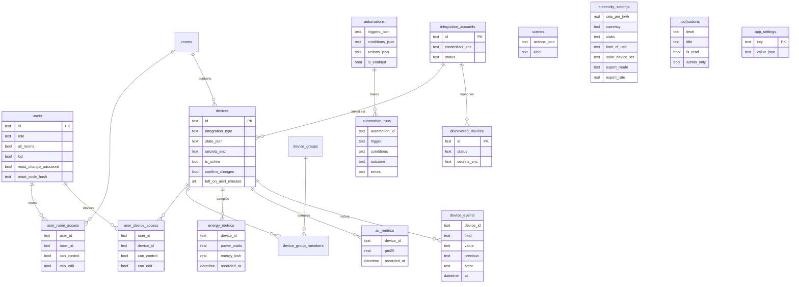

# Domus

<p align="center">
  <b>Translations</b><br>
  <a href="README.md">English</a> ·
  <a href="README.ar.md">العربية</a> ·
  <a href="README.bn.md">বাংলা</a> ·
  <a href="README.de.md">Deutsch</a> ·
  <a href="README.es.md">Español</a> ·
  <a href="README.fr.md">Français</a> ·
  <a href="README.gu.md">ગુજરાતી</a> ·
  <a href="README.hi.md">हिन्दी</a> ·
  <a href="README.id.md">Bahasa Indonesia</a> ·
  <a href="README.it.md">Italiano</a> ·
  <a href="README.ja.md">日本語</a> ·
  <a href="README.kn.md">ಕನ್ನಡ</a> ·
  <a href="README.ko.md">한국어</a> ·
  <a href="README.ml.md">മലയാളം</a> ·
  <a href="README.mr.md">मराठी</a> ·
  <a href="README.pa.md">ਪੰਜਾਬੀ</a> ·
  <a href="README.pl.md">Polski</a> ·
  <a href="README.pt-BR.md">Português (Brasil)</a> ·
  <a href="README.ru.md">Русский</a> ·
  <a href="README.ta.md">தமிழ்</a> ·
  <a href="README.te.md">తెలుగు</a> ·
  <a href="README.th.md">ไทย</a> ·
  <a href="README.tr.md">Türkçe</a> ·
  <a href="README.ur.md">اردو</a> ·
  <a href="README.vi.md">Tiếng Việt</a> ·
  <a href="README.zh-CN.md">简体中文</a> ·
  <a href="README.zh-TW.md">繁體中文</a>
</p>

[](https://github.com/aiyu-ayaan/Domus-Rust/actions/workflows/release.yml)
[](https://github.com/aiyu-ayaan/Domus-Rust/releases)
[](LICENSE)
[](https://github.com/aiyu-ayaan/Domus-Rust/commits/master)
[](https://hub.docker.com/r/aiyuayaan/domus)
[](https://hub.docker.com/r/aiyuayaan/domus)


[](https://ghloc.dev/aiyu-ayaan/Domus)


ศูนย์กลางสมาร์ทโฮมแบบเน้นทำงานในเครื่อง (Local-first) สำหรับโฮมเซิร์ฟเวอร์ของคุณ พัฒนาด้วยแบ็กเอนด์ Rust, ฐานข้อมูล SQLite, เว็บ UI ด้วย React (พร้อมโครงสร้างเดสก์ท็อป Electron) และระบบปลั๊กอินเชื่อมต่อที่รองรับ **Tuya / Smart Life** (เข้าสู่ระบบด้วยรหัส QR โดยไม่ต้องมีบัญชีนักพัฒนา), **TP-Link Tapo** (ควบคุมในวงแลนโดยตรง), **Xiaomi Mi Home** (ควบคุมในเครื่อง ดึงโทเค็นจากบัญชี Mi), **Philips Hue** (บริดจ์ในเครื่อง) และ **MQTT** (Zigbee2MQTT, ESPHome และอุปกรณ์ใดก็ตามที่รองรับการตรวจหาของ Home Assistant) มาพร้อม **Matter บริดจ์** ในตัว ช่วยให้ Google Home, Apple Home, Alexa และ Home Assistant สามารถสั่งเปิดปิด หรี่ไฟ และเปลี่ยนสีอุปกรณ์เหล่านั้นผ่านเครือข่ายภายในบ้านของคุณได้ทันที

- ค้นหาอุปกรณ์ใหม่อัตโนมัติ พร้อมกล่องข้อความสำหรับตรวจสอบหรือเลือกเพิ่มอัตโนมัติ
- แดชบอร์ดแบบเรียลไทม์: กำลังไฟฟ้าที่ใช้ ค่าไฟปัจจุบันและค่าไฟคาดการณ์ คุณภาพอากาศ ค่าเซนเซอร์ตรวจจับความเคลื่อนไหว / ประตูหน้าต่าง / การรั่วไหล / ระดับแบตเตอรี่
- ห้อง กลุ่มอุปกรณ์ ซีน และการทำงานอัตโนมัติ: สั่งงานตามเวลา, **เวลาพระอาทิตย์ขึ้นหรือพระอาทิตย์ตก** (กำหนดช่วงเหลื่อมเวลาได้), เมื่อสถานะอุปกรณ์เปลี่ยน, ระดับกำลังไฟฟ้า (*มากกว่า X วัตต์ ติดต่อกัน N นาที*), เมื่ออุปกรณ์ออฟไลน์ หรือตาม**สภาพอากาศภายนอก**
- **ประวัติการทำงานอัตโนมัติ**: บันทึกการทำงาน 50 ครั้งล่าสุดของแต่ละระบบอัตโนมัติ พร้อมระบุเงื่อนไขที่สั่งทำงานและเงื่อนไขที่ระงับการทำงานไว้
- **ประวัติอุปกรณ์**: บันทึกทุกการเปลี่ยนแปลงสถานะและผู้ที่สั่งงาน (บุคคลและแอปที่ใช้ ระบบอัตโนมัติ Matter หรือการกดที่ตัวอุปกรณ์เอง)
- **การแจ้งเตือนอัจฉริยะ** โดยไม่ต้องเขียนระบบอัตโนมัติ: แจ้งเตือนเมื่อเปิดอุปกรณ์ทิ้งไว้นานเกินไป แจ้งเตือนเมื่อไส้กรองเครื่องฟอกอากาศใกล้หมด
- **Matter บริดจ์**: แชร์อุปกรณ์ที่คุณเลือกไปยัง Google Home, Apple Home, Alexa หรือ Home Assistant ในวงแลนได้โดยไม่ต้องมีบัญชีคลาวด์
- แสดง**สภาพอากาศและคุณภาพอากาศภายนอก** ณ ตำแหน่งบ้าน (ผ่าน Open-Meteo โดยไม่ต้องใช้คีย์) บนแดชบอร์ดเคียงข้างค่าตรวจวัดในบ้าน
- **ถามก่อนสลับสถานะ**: กำหนดสวิตช์หลักเพื่อป้องกันความผิดพลาด ทุกแอป กลุ่ม ซีน และการสั่งรันระบบอัตโนมัติด้วยตนเองจะแสดงข้อความยืนยันก่อนเปิดหรือปิด
- การคิดค่าไฟฟ้า: กำหนดสกุลเงินได้อิสระ รองรับอัตราคงที่ อัตราก้าวหน้าตามหน่วย (**Slabs**) และ**ช่วงเวลาของวัน (Time-of-day)**, คำนวณ**ค่าไฟฟ้าสแตนด์บาย**ต่ออุปกรณ์ และระบบ**โซลาร์**: พลังงานที่ผลิต ส่งออก และระบบ Net metering หรืออัตรา Feed-in tariff
- รองรับผู้ใช้หลายคนพร้อมบทบาท แอดมิน / สมาชิก / แขก และกำหนดสิทธิ์รายห้องหรือรายอุปกรณ์ (ดูได้อย่างเดียว ควบคุม หรือแก้ไข)
- รองรับเว็บ เดสก์ท็อป Electron (Linux, Windows) และแอปเนทีฟ Android พร้อมซิงค์ข้อมูลสดแบบเรียลไทม์
- รองรับ **27 ภาษา** ในแอปเว็บ เดสก์ท็อป และ Android ปรับตามภาษาของระบบอัตโนมัติพร้อมตัวเลือกเปลี่ยนใน การตั้งค่า; รองรับการจัดข้อความจากขวาไปซ้าย (RTL) สำหรับภาษาอาหรับและอูรดู
- หน้า การอัปเดต แสดงบันทึกประจำรุ่น (พร้อมรูปแบบ Markdown ตาราง และรูปภาพ) ภายในทุกแอป
- เปิดใช้ HTTPS เป็นค่าเริ่มต้น; เข้ารหัสข้อมูลรับรองและคีย์อุปกรณ์เมื่อจัดเก็บ; สำรองและกู้คืนข้อมูลได้ง่ายด้วยไฟล์เดียว

รายละเอียดสถาปัตยกรรมและไดอะแกรม: [`development/docs/ARCHITECTURE.md`](development/docs/ARCHITECTURE.md) (สรุปย่อดูได้ที่[ด้านล่าง](#how-it-fits-together))
โปรไฟล์การออกแบบ UI: [`design-system/domus/MASTER.md`](design-system/domus/MASTER.md)
ความคืบหน้าการพัฒนา: [`development/TODO.md`](development/TODO.md)

<a id="how-it-fits-together"></a>
## สถาปัตยกรรมและหลักการทำงาน



แอปพลิเคชันฝั่งไคลเอนต์จะสื่อสารกับเซิร์ฟเวอร์เท่านั้น เซิร์ฟเวอร์จะสื่อสารกับอุปกรณ์ของคุณ (ในวงแลนโดยตรงเมื่อผู้ผลิตรองรับ) และจัดเก็บข้อมูลทั้งหมดไว้ในไฟล์ SQLite เพียงไฟล์เดียว การใช้งานคลาวด์จะมีเฉพาะเมื่อผู้ผลิตไม่มีระบบควบคุมภายในเครื่อง (Tuya) หรือเพื่อดึงคีย์อุปกรณ์ (Xiaomi) รวมถึงการค้นหาเสริม: การค้นหาชื่อสถานที่ สภาพอากาศและมลพิษภายนอกสำหรับตำแหน่งบ้าน (Open-Meteo เมื่อมีการตั้งค่าตำแหน่งที่ตั้งไว้แล้วเท่านั้น) และการตรวจสอบเวอร์ชันใหม่จาก GitHub ส่วน Matter บริดจ์จะทำงานเฉพาะในเครือข่ายภายในบ้านเท่านั้น

### โมเดลข้อมูล



ข้อมูลการลงชื่อเข้าใช้และคีย์อุปกรณ์จะถูกจัดเก็บแบบเข้ารหัสอย่างแน่นหนา (`*_enc`) ภายใต้คีย์หลัก `data/master.key` ซึ่งอยู่นอกฐานข้อมูล ดูแผนผังระบบฉบับเต็มแยกตามแต่ละฟีเจอร์ได้ที่ [`development/docs`](development/docs)

## ภาพหน้าจอ

<p align="center"></p>

**เดสก์ท็อป** (Electron และ Web)

<p>
  
  
  
  
  
  
</p>

**Android**

<p>
  
  
  
  
  
</p>

**แท็บเล็ต Android** (จัดวางสองคอลัมน์ตั้งแต่ขนาด 840dp ขึ้นไป หน้าการตั้งค่าแสดงรายการและรายละเอียด)

<p>
  
  
  
  
  
</p>

**เก็บบราวเซอร์บนมือถือ**

<p>
  
  
  
  
  
</p>

ไฟล์รูปภาพหน้าจอทั้งหมดรวบรวมไว้ที่ [`res/screenshots`](res/screenshots); สามารถรับชมวิดีโอสาธิตฉบับเต็มได้ที่ [`res/domus.mp4`](res/domus.mp4)

## ดาวน์โหลด

| แพลตฟอร์ม | ช่องทางการดาวน์โหลดและติดตั้ง |
|---|---|
| เซิร์ฟเวอร์ (Docker) | `aiyuayaan/domus` บน Docker Hub รองรับ amd64 และ arm64 |
| Android | ไฟล์ `Domus-<version>.apk` จาก[หน้ารุ่นเผยแพร่ล่าสุด](https://github.com/aiyu-ayaan/Domus-Rust/releases) |
| เดสก์ท็อป Linux | สคริปต์ติดตั้งบรรทัดเดียวด้านล่างนี้ หรือดาวน์โหลด `.deb` / `.AppImage` จากหน้ารุ่นเผยแพร่ |
| เดสก์ท็อป Windows | ไฟล์ `Domus-<version>-Setup.exe` จากหน้ารุ่นเผยแพร่ |

### เซิร์ฟเวอร์

โฮสต์ต้องการเพียงไฟล์ compose ไฟล์เดียวก็พร้อมใช้งาน:

```bash
mkdir domus && cd domus
wget https://raw.githubusercontent.com/aiyu-ayaan/Domus-Rust/master/docker-compose.yml
docker compose up -d
```

เปิดเบราว์เซอร์ไปที่ `https://<server-ip>:8443` แล้วสร้างบัญชีผู้ดูแลระบบ คำสั่ง `docker compose logs domus` จะแสดงลายนิ้วมือของใบรับรองที่แอปจะขอให้คุณยืนยันเมื่อเชื่อมต่อครั้งแรก

```bash
docker compose pull && docker compose up -d      # อัปเดตเวอร์ชัน
DOMUS_VERSION=beta docker compose up -d          # ติดตามช่องทางเผยแพร่: latest (ค่าเริ่มต้น), beta, alpha หรือระบุ 0.0.1
TZ=Asia/Bangkok DOMUS_PORT=9443 docker compose up -d
docker compose --profile mqtt up -d              # เริ่มใช้งาน Mosquitto โบรกเกอร์ที่เป็นส่วนเสริมได้ด้วย
```

ใส่ตัวแปร `DOMUS_VERSION`, `TZ` และ `DOMUS_PORT` ไว้ในไฟล์ `.env` ข้างๆ ไฟล์ compose เพื่อบันทึกค่าไว้ใช้งานต่อเนื่อง

### แอปพลิเคชันเดสก์ท็อป Linux

ติดตั้งเวอร์ชันล่าสุดสำหรับผู้ใช้ปัจจุบัน (x86_64 โดยไม่ต้องใช้สิทธิ์ root): ติดตั้ง AppImage, สร้างเมนูแอปพร้อมไอคอน Domus และคำสั่ง `domus` หลังจากนั้นแอปจะคอยอัปเดตตัวเองให้เป็นปัจจุบันเสมอ

```bash
curl -fsSL https://raw.githubusercontent.com/aiyu-ayaan/Domus-Rust/master/scripts/install-linux.sh | sh
# ... | sh -s -- --channel beta     รวมถึงรุ่นเบต้า (หรือ alpha)
# ... | sh -s -- --uninstall        ถอนการติดตั้ง โดยยังคงรักษาการตั้งค่าไว้
```

### Android

ดาวน์โหลดไฟล์ APK จากหน้ารุ่นเผยแพร่แล้วเปิดติดตั้ง เมื่อมีเวอร์ชันใหม่จะมีการแจ้งเตือนเมื่อเปิดแอปและใน การตั้งค่า → การอัปเดต โดยเลือกช่องทาง Stable, Beta หรือ Alpha และกดติดตั้งจากในแอปได้ทันที ระบบ Android จะขออนุญาตให้ Domus ติดตั้งแอปพลิเคชันเพียงครั้งเดียว

หน้า **การอัปเดต** (การตั้งค่า → การอัปเดต บน Android, การตั้งค่า → เกี่ยวกับ → การอัปเดต บนเว็บและเดสก์ท็อป) จะแสดงเวอร์ชันที่คุณใช้งาน เวอร์ชันล่าสุดบนช่องทางของคุณ และบันทึกประจำรุ่นในรูปแบบ Markdown

รายละเอียดเกี่ยวกับรุ่นเผยแพร่ หมายเลขเวอร์ชัน และช่องทางการอัปเดต: [development/docs/RELEASE.md](development/docs/RELEASE.md)

## ความต้องการของระบบ

- Rust 1.80 ขึ้นไป (`cargo`)
- Node.js 18 ขึ้นไป และ `pnpm`

## รันในสภาพแวดล้อมการพัฒนา

```bash
pnpm install
npm run dev            # แบ็กเอนด์ (https://127.0.0.1:8443) + เว็บ (http://localhost:3000)

npm run dev:backend    # รันเฉพาะแบ็กเอนด์
npm run dev:web        # รันเฉพาะหน้าเว็บ (พร็อกซี /api ไปยังแบ็กเอนด์)
npm run dev:desktop    # รัน Electron โดยเลือกเซิร์ฟเวอร์ที่ต้องการเชื่อมต่อ
```

เปิด http://localhost:3000 ในเบราว์เซอร์ การเข้าใช้งานครั้งแรกจะแนะนำให้คุณสร้างบัญชีผู้ดูแลระบบ

## รันบนโฮมเซิร์ฟเวอร์

```bash
pnpm build:web                     # บิลด์ apps/web/dist ซึ่งจะให้บริการโดยแบ็กเอนด์
APP_ENV=production cargo run --release --manifest-path backend/Cargo.toml
```

จากนั้นเปิด `https://<server-ip>:8443` เมื่อเปิดใช้งาน Matter บริดจ์ จะมีการใช้งานพอร์ต UDP 5540 (`[matter] port`) และ mDNS บนเครือข่าย LAN เพิ่มเติม

หรือบิลด์ Docker อิมเมจโดยตรงจากซอร์สโค้ดนี้ (โหมดเครือข่ายแบบ host, ข้อมูลจัดเก็บในโวลุ่ม `domus_data`):

```bash
docker compose -f docker-compose.local.yml up -d --build
```

การเข้าถึงจากระยะไกลผ่าน Cloudflare Tunnel, การสลับที่อยู่ภายใน/ภายนอกบ้านอัตโนมัติ และการแพ็กเกจเดสก์ท็อป (`pnpm build:desktop`) มีอธิบายไว้ใน [development/docs/DEPLOYMENT.md](development/docs/DEPLOYMENT.md)

เมื่อเริ่มต้นใช้งานครั้งแรก Domus จะสร้างโฟลเดอร์ `data/` ซึ่งประกอบด้วย:

| ไฟล์ | วัตถุประสงค์ |
|---|---|
| `domus.db` | ฐานข้อมูล SQLite |
| `master.key` | กุญแจเข้ารหัสข้อมูลรับรองการเชื่อมต่อและคีย์อุปกรณ์ — **โปรดสำรองไฟล์นี้ไว้เสมอ** |
| `jwt.secret` | คีย์สำหรับลงชื่อเซสชันผู้ใช้งาน |
| `tls/` | ใบรับรองแบบรับรองตนเอง (แทนที่ได้ผ่าน `tls.cert_path` / `tls.key_path`) |

การกำหนดค่าอยู่ใน `config/default.toml` โดยสามารถแทนที่ค่าใดๆ ได้ด้วยตัวแปรสภาพแวดล้อมในรูปแบบ `DOMUS__SECTION__KEY` (ดูตัวอย่างใน `.env.example`)

## การสำรองข้อมูลและการกู้คืน

ข้อมูลทั้งหมดจะอยู่ใน `data/` คุณสามารถสำรองข้อมูลทั้งโฟลเดอร์ หรือใช้ระบบสำรองข้อมูลไฟล์เดียวได้:

**การสำรองข้อมูล:** เข้าสู่ระบบในฐานะผู้ดูแลระบบ → การตั้งค่า → **การสำรองข้อมูล** → *ดาวน์โหลดไฟล์สำรองข้อมูล* ไฟล์ที่ได้คือสำเนาของฐานข้อมูลที่มีกุญแจหลักบรรจุอยู่ภายใน ทำให้สามารถเปิดใช้งานบัญชีที่เชื่อมต่อไว้ได้ทันทีหลังจากการกู้คืน สามารถสำรองข้อมูลได้ในขณะที่เซิร์ฟเวอร์กำลังทำงาน โปรดเก็บรักษาไฟล์นี้ให้ปลอดภัย เนื่องจากผู้ที่มีไฟล์นี้จะสามารถเข้าถึงบัญชีที่ผูกไว้ได้ ทั้งนี้ JWT secret และใบรับรอง TLS จะไม่รวมอยู่ในไฟล์สำรองข้อมูล

**การกู้คืน:** หยุดการทำงานของเซิร์ฟเวอร์ จากนั้นสั่งรันคำสั่ง:

```bash
# บน Docker
docker compose cp domus-backup-2026-10-11.db domus:/app/data/restore.db
docker compose stop domus
docker compose run --rm domus domus-backend restore data/restore.db
docker compose start domus

# กรณีไม่ได้ใช้ Docker ให้รันจากรูทของโฟลเดอร์โปรเจกต์ (ทำงานกับโฟลเดอร์ ./data)
domus-backend restore ~/Downloads/domus-backup-2026-10-11.db
```

ไฟล์เดิมที่มีอยู่จะถูกเก็บสำรองไว้ข้างเคียงในชื่อ `*.before-restore` หลังจากการกู้คืนบนเครื่องใหม่ ผู้ใช้จะต้องลงชื่อเข้าใช้อีกครั้ง และแอปจะแจ้งเตือนให้ยืนยันความเชื่อถือในใบรับรองใหม่ หากคุณกำหนดคีย์ผ่านตัวแปรสภาพแวดล้อม `DOMUS_MASTER_KEY` ไฟล์สำรองจะไม่มีคีย์บรรจุอยู่ และเซิร์ฟเวอร์ที่กู้คืนจะต้องตั้งค่าตัวแปรเดียวกัน ดูข้อมูลเพิ่มเติมได้ที่ [development/docs/DEPLOYMENT.md](development/docs/DEPLOYMENT.md#backup-and-restore)

## ลืมรหัสผ่านผู้ดูแลระบบ

Domus ไม่มีเมลเซิร์ฟเวอร์ในตัว จึงไม่มีการส่งอีเมลรีเซ็ตรหัสผ่าน โดยสามารถกู้คืนได้ตามลำดับดังนี้:

1. **ให้ผู้ดูแลระบบอีกท่านช่วย**: เปิด การตั้งค่า → ผู้คนและสิทธิ์การเข้าถึง เปิดใช้งาน *รหัสรีเซ็ต* ให้กับคุณ และแจ้งรหัส 8 หลักให้ทราบ (รหัสมีอายุ 30 นาที และกรอกผิดได้ไม่เกิน 5 ครั้ง) ที่หน้าจอลงชื่อเข้าใช้ ให้เลือก *ลืมรหัสผ่าน?* ป้อนชื่อผู้ใช้ แล้วป้อนรหัสรีเซ็ตดังกล่าว
2. **จัดการจากหน้าเซิร์ฟเวอร์โดยตรง** (ทำได้ทั้งในขณะที่ Domus กำลังทำงานหรือหยุดทำงานอยู่ และไม่ต้องลงชื่อเข้าใช้):

   ```bash
   docker compose exec domus domus-backend reset-password <username>              # สุ่มสร้างและแสดงรหัสผ่านใหม่
   docker compose exec domus domus-backend reset-password <username> 'new-pass'   # หรือกำหนดรหัสผ่านเอง (8 ตัวอักษรขึ้นไป)
   domus-backend reset-password <username>                                        # กรณีไม่ใช้ Docker ให้รันจากรูทโฟลเดอร์
   ```

   นำรหัสผ่านที่ได้ไปลงชื่อเข้าใช้ แล้วเปลี่ยนรหัสผ่านใหม่ใน การตั้งค่า → รหัสผ่าน

ในโหมดการทำงานจริง การใส่รหัสผ่านผิดติดต่อกัน 5 ครั้งสำหรับชื่อผู้ใช้หนึ่งๆ จะส่งผลให้ชื่อผู้ใช้นั้นถูกล็อคเป็นเวลา 15 นาที (ปลดล็อคได้ทันทีด้วยการรีสตาร์ทเซิร์ฟเวอร์ และระบบล็อคนี้จะปิดไว้ในโหมดพัฒนา) รายละเอียดและข้อกำหนดสำหรับรหัสผ่านที่ระบบสร้างขึ้นและบัญชีเด็ก: [development/docs/ACCOUNTS.md](development/docs/ACCOUNTS.md)

## ภาษาที่รองรับ

รองรับภาษาอังกฤษ, ฮินดี, สเปน, โปรตุเกส (บราซิล), อินโดนีเซีย, อาหรับ, ฝรั่งเศส, รัสเซีย, เยอรมัน, ตุรกี, ญี่ปุ่น, เกาหลี, อิตาลี, เวียดนาม, ไทย, จีน (ตัวย่อและตัวเต็ม), โปแลนด์, เบงกาลี, ทมิฬ, เตลูกู, มราฐี, คุชราต, กันนาดา, มาลายาลัม, ปัญจาบี และอูรดู สำหรับภาษาอาหรับและอูรดูจะแสดงผลแบบขวาไปซ้าย (RTL)

แต่ละแอปจะทำงานตามการตั้งค่าภาษาของเบราว์เซอร์หรือระบบปฏิบัติการของคุณ และจะแสดงผลเป็นภาษาอังกฤษหากยังไม่มีคำแปล หากต้องการเปลี่ยนภาษา ให้ไปที่ การตั้งค่า > ภาษา (ในการแสดงผลบนเว็บและเดสก์ท็อป); ตัวเลือก *ค่าเริ่มต้นระบบ* จะเปลี่ยนกลับไปตามภาษาของระบบ บน Android 13 ขึ้นไป สามารถปรับเปลี่ยนได้จาก การตั้งค่าเครื่อง > แอป > Domus > ภาษา

การแปลภาษาเป็นการแปลด้วยระบบอัตโนมัติและยังไม่ได้รับการตรวจสอบโดยเจ้าของภาษา จึงอาจมีบางสำนวนที่ไม่เป็นธรรมชาติ การแก้ไขทำได้ง่ายเพียงแก้คำในไฟล์ภาษาบรรทัดเดียว หลักการทำงานของระบบหลายภาษา วิธีเพิ่มภาษาใหม่ และข้อกำหนดสำหรับข้อความใหม่: [development/docs/LOCALIZATION.md](development/docs/LOCALIZATION.md)

## การเชื่อมต่ออุปกรณ์

| แบรนด์ | วิธีการเชื่อมต่อ |
|---|---|
| Tuya / Smart Life | การเชื่อมต่อ → *เชื่อมต่อด้วยรหัส QR* ป้อน **User Code** จากแอป Smart Life (ฉัน → การตั้งค่า → บัญชีและความปลอดภัย → User Code) จากนั้นสแกนรหัส QR ในแอป |
| Tapo | การเชื่อมต่อ → *เชื่อมต่อบัญชี* ด้วย TP-Link ID ของคุณ อุปกรณ์ในวง LAN จะถูกตรวจพบอัตโนมัติและควบคุมได้จากในเครื่อง สำหรับเกตเวย์ H100 จะนำเซนเซอร์ สวิตช์ และตัวควบคุมอุณหภูมิที่เชื่อมต่อเข้ามาด้วย กล้องวงจรปิดจะแสดงในรายการแต่ยังไม่รองรับการควบคุมเต็มรูปแบบในขณะนี้ |
| Xiaomi | การเชื่อมต่อ → *เชื่อมต่อบัญชี* ด้วยบัญชี Mi และภูมิภาคเซิร์ฟเวอร์ หาก Xiaomi ขอการยืนยันแบบ 2 ขั้นตอน ให้ป้อนรหัสที่ได้รับจากอีเมลหรือ SMS ในหน้าต่างเดียวกัน บัญชีสามารถใช้อีเมล หมายเลขโทรศัพท์พร้อมรหัสประเทศ (`+66…`) หรือ Xiaomi ID ก็ได้ โทเค็นจะถูกดึงมาเพียงครั้งเดียวและการควบคุมจะเป็นแบบในเครื่องทั้งหมด นอกจากนี้ยังสามารถเพิ่มอุปกรณ์ด้วยโทเค็นได้โดยตรง |
| Philips Hue | กดปุ่มกลมบนบริดจ์ จากนั้นไปที่ การเชื่อมต่อ → Philips Hue → *เชื่อมต่อ* ภายใน 30 วินาที เว้นช่องที่อยู่ว่างไว้เพื่อค้นหาบริดจ์ในวงแลนโดยอัตโนมัติ หลอดไฟและปลั๊กอัจฉริยะ Hue จะถูกควบคุมในเครื่องโดยตรง |
| MQTT | การเชื่อมต่อ → MQTT → *เชื่อมต่อ* โดยระบุที่อยู่โบรกเกอร์ พอร์ต และข้อมูลเข้าสู่ระบบ อุปกรณ์ที่ประกาศตนเองผ่านระบบ Home Assistant MQTT discovery (Zigbee2MQTT, ESPHome, …) จะปรากฏในหมวด ตรวจพบ: รองรับไฟ สวิตช์ ปลั๊ก พัดลม และเซนเซอร์ หากใช้โบรกเกอร์ที่ให้มาพร้อมระบบ (`--profile mqtt`) ที่อยู่จะเป็น `mqtt` และพอร์ตคือ `1883` |

ดูรายละเอียดอุปกรณ์ที่รองรับในแต่ละระบบเชื่อมต่อได้ที่ `development/docs/INTEGRATIONS.md`

## แผนค่าไฟฟ้า

พลังงาน → *แผนค่าไฟฟ้า*: เลือกสกุลเงินที่ต้องการ และเลือกได้ทั้งราคาคงที่ต่อหน่วย (kWh) หรือคิดตาม**ขั้นบันได (Slabs)** สำหรับอัตราค่าไฟตามปริมาณการใช้งาน (เช่น การคิดแบบก้าวหน้า 0–100 หน่วยอัตราหนึ่ง, 101–300 หน่วยอีกอัตราหนึ่ง เป็นต้น) โดยระบบจะคำนวณตามรอบบิลพร้อมบวกค่าบริการรายเดือนคงที่

นอกจากนี้ยังรองรับการกำหนด**ช่วงเวลาของวัน (Time-of-day)**: กำหนดชั่วโมง (ตามเวลาของบ้าน รองรับการข้ามเที่ยงคืน) ที่มีอัตราค่าไฟฟ้าเพิ่มขึ้นหรือลดลงจากราคาปกติ เช่น ส่วนลดช่วงเวลากลางคืน หรือค่าบริการส่วนเพิ่มช่วงที่มีการใช้ไฟฟ้าสูง (Peak) เสริมจากราคาอัตราคงที่หรือขั้นบันได

อุปกรณ์ใหม่ที่ตรวจพบจะแสดงใน **อุปกรณ์ → ตรวจพบ** สามารถเปิด *เพิ่มอุปกรณ์ใหม่อัตโนมัติ* ที่นั่นเพื่อข้ามขั้นตอนการตรวจสอบในกล่องข้อความได้

## เวลาพระอาทิตย์ขึ้นและพระอาทิตย์ตก

ตั้งค่าตำแหน่งที่ตั้งบ้านใน การตั้งค่า → **ตำแหน่งที่ตั้งบ้าน**: ใช้ตำแหน่งของโทรศัพท์หรือเบราว์เซอร์นี้ ค้นหาชื่อเมือง (เซิร์ฟเวอร์จะสอบถามบริการ geocoder ฟรีของ Open-Meteo โดยส่งเฉพาะชื่อเมืองที่คุณพิมพ์ออกไปเท่านั้น) หรือพิมพ์ระบุละติจูดและลองจิจูดโดยตรง พิกัดจะถูกปัดเศษในระยะประมาณหนึ่งกิโลเมตรและจัดเก็บไว้บนเซิร์ฟเวอร์ของคุณ จากนั้นระบบอัตโนมัติจะสามารถสั่งทำงานตามเวลาพระอาทิตย์ขึ้นหรือพระอาทิตย์ตกได้ พร้อมทั้งระบุเวลาก่อนหน้าหรือหลังจากนั้นเป็นนาทีได้ หากไม่ได้ตั้งค่าตำแหน่งบ้านไว้ เงื่อนไขการทำงานเกี่ยวกับดวงอาทิตย์จะไม่ทำงาน

## ถามก่อนสลับสถานะ

สวิตช์หลักที่ควบคุมการจ่ายไฟให้อุปกรณ์หลายตัวมีความเสี่ยงที่จะถูกกดปิดโดยไม่ได้ตั้งใจ เปิดดูรายละเอียดอุปกรณ์นั้นแล้วเปิดใช้งาน **ถามก่อนสลับสถานะ**: ทุกแอปจะแสดงข้อความถามเพื่อยืนยันก่อนเปิดหรือปิด รวมถึงการสั่ง *เปิดทั้งหมด / ปิดทั้งหมด* ของห้อง, กลุ่มอุปกรณ์, ซีน (รวมถึงซีนที่ซ้อนอยู่ในซีนอื่น) และการกดสั่ง *รัน* ระบบอัตโนมัติที่จะสลับสถานะสวิตช์นั้นด้วยตนเอง การตั้งค่านี้บันทึกอยู่บนเซิร์ฟเวอร์ จึงทำงานเหมือนกันทั้งบนเว็บ เดสก์ท็อป และ Android สำหรับระบบอัตโนมัติที่ทำงานตามกำหนดการจะไม่สามารถถามได้และจะทำงานตามคำสั่งที่ตั้งไว้ ทั้งนี้การควบคุมภายนอก Domus (เช่น แอปทางการของผู้ผลิต หรือสวิตช์จริงบนผนัง) จะไม่ครอบคลุม

## Matter (Google Home, Apple Home, Alexa)

การตั้งค่า → **Matter** (สำหรับผู้ดูแลระบบ): เปิดใช้งาน เลือกทำเครื่องหมายอุปกรณ์ที่ต้องการแชร์ จากนั้นสแกนรหัส QR หรือป้อนรหัสจับคู่ใน Google Home, Apple Home, Alexa หรือ Home Assistant หลอดไฟจะแสดงเป็นไฟแบบปรับสีหรือไฟหรี่ได้ ส่วนอุปกรณ์อื่นที่มีสวิตช์เปิดปิดจะแสดงเป็นปลั๊ก รองรับทั้งการเปิดปิด หรี่ไฟ และเปลี่ยนสี และเมื่อมีการเปลี่ยนสถานะใน Domus (เปิด/ปิด ความสว่าง) ก็จะแสดงผลบนตัวควบคุมภายนอกด้วย ปุ่ม "อนุญาตให้จับคู่ 15 นาที" ใช้สำหรับเพิ่มไปยังระบบสมาร์ทโฮมระบบที่สอง และปุ่ม "ลืมการจับคู่ทั้งหมด" จะเป็นการรีเซ็ตและสร้างรหัสใหม่

เนื่องจากบริดจ์นี้ยังไม่ได้รับการรับรองอย่างเป็นทางการ (ใช้ใบรับรองการทดสอบของ Matter) แอปต่างๆ จะขอให้คุณยืนยันก่อนเพิ่ม และสำหรับ Google Home จะยอมรับหลังจากเพิ่มบริดจ์เป็นอุปกรณ์ทดสอบใน Google Home Developer Console แล้วเท่านั้น ดูรายละเอียดเพิ่มเติม: [`development/docs/MATTER.md`](development/docs/MATTER.md)

## ประวัติ บันทึกการทำงานอัตโนมัติ และการแจ้งเตือน

- **ประวัติ** ในหน้าต่างอุปกรณ์แต่ละตัว: แสดงว่าอะไรเปลี่ยน เมื่อใด และใครเป็นผู้ทำ (*โดย Ayaan · Android*, *ระบบอัตโนมัติ "โหมดกลางคืน"*, *Matter*, *กดที่ตัวอุปกรณ์*) โดยจัดเก็บไว้นานเท่ากับประวัติการใช้พลังงาน
- **ประวัติการทำงาน** ของแต่ละระบบอัตโนมัติ: บันทึกสถานะ *ทำงานแล้ว*, *ล้มเหลว* พร้อมระบุข้อผิดพลาด หรือ *ข้ามไป* พร้อมระบุเงื่อนไขที่ระงับไว้ ช่วยให้ตอบได้ชัดเจนว่า "ทำไมคำสั่งนี้ถึงไม่ทำงาน"
- **แจ้งเตือนเมื่อเปิดทิ้งไว้** ในหน้าต่างอุปกรณ์ (ตั้งเวลาได้ตั้งแต่ 30 นาทีถึง 12 ชั่วโมง): ผู้ดูแลระบบจะได้รับการแจ้งเตือน อุปกรณ์ที่มีมิเตอร์วัดไฟจะนับว่าเปิดอยู่เมื่อใช้ไฟเกิน 10 W เพื่อไม่ให้ทีวีในโหมดสแตนด์บายส่งสัญญาณเตือนผิดพลาด
- **ไส้กรองใกล้หมด**: แจ้งเตือนเมื่ออายุการใช้งานไส้กรองของเครื่องฟอกอากาศลดลงเหลือ 10%

## สภาพอากาศ สแตนด์บาย และโซลาร์

- เมื่อตั้งค่าตำแหน่งบ้านแล้ว แดชบอร์ดจะแสดง**สภาพอากาศและค่า PM2.5 ภายนอก**ควบคู่กับค่าที่วัดได้ภายในบ้าน และระบบอัตโนมัติสามารถนำค่าเหล่านี้ไปใช้เป็นเงื่อนไขได้ (*เมื่อ PM2.5 ภายนอกสูงเกิน 35*, *เฉพาะเมื่ออุณหภูมิภายนอกต่ำกว่า 20°C*)
- พลังงาน → **สแตนด์บาย**: แสดงรายการกำลังไฟฟ้าที่แต่ละอุปกรณ์ใช้ในเวลาที่ไม่มีการเปิดใช้งาน (ชั่วโมงที่มีการใช้ไฟต่ำสุดในสัปดาห์นี้) พร้อมคำนวณเป็นค่าไฟรายเดือน
- พลังงาน → *แผนค่าไฟฟ้า* → **โซลาร์**: เลือกปลั๊กที่ใช้วัดการผลิตไฟฟ้าจากโซลาร์เซลล์ จากนั้นเลือกระบบ Net metering หรืออัตรา Feed-in tariff บิลค่าไฟจะคำนวณเฉพาะไฟฟ้าที่คุณซื้อจากการไฟฟ้า และการ์ดโซลาร์จะแสดงสถิติพลังงานที่ผลิตได้ ใช้เองในบ้าน ส่งออก และรายได้ที่ได้รับ การไหลของกระแสไฟฟ้าจะคำนวณทุก 15 นาทีจากอุปกรณ์ที่มีการตรวจวัด ดังนั้นเครื่องใช้ไฟฟ้าที่ไม่มีมิเตอร์อาจทำให้ตัวเลขการส่งออกแสดงค่าสูงกว่าความเป็นจริง

แผนการพัฒนาและไดอะแกรม: [`development/docs/ROADMAP.md`](development/docs/ROADMAP.md)

## ใบอนุญาต

Domus เผยแพร่ภายใต้ [ใบอนุญาต MIT](LICENSE) ไลบรารีภายนอกยังคงใช้ใบอนุญาตเดิมของตนเอง โดยมีรายละเอียดแสดงไว้ในส่วน เกี่ยวกับ → ข้อความขอบคุณ ในทุกแอป

## การทดสอบ

```bash
cargo test --workspace
pnpm --filter @domus/web exec tsc -b
```

คำสั่ง `cargo test --workspace` จะครอบคลุมการทดสอบ `backend/tests/matter_bridge.rs` ซึ่งจะจับคู่ Matter คอนโทรลเลอร์กับบริดจ์ผ่าน UDP เพื่อทดสอบการเปิดปิด หรี่ไฟ และเปลี่ยนสีอุปกรณ์ (ต้องใช้อินเทอร์เฟซเครือข่ายที่รองรับ IPv4)
