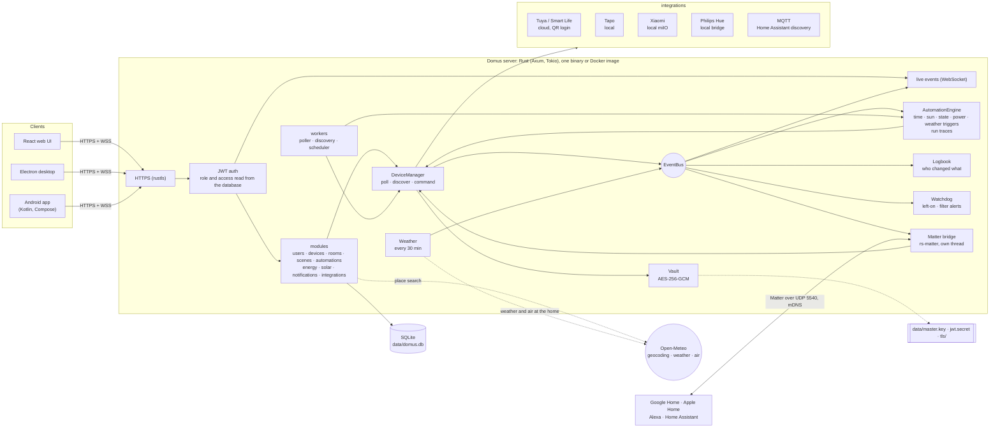
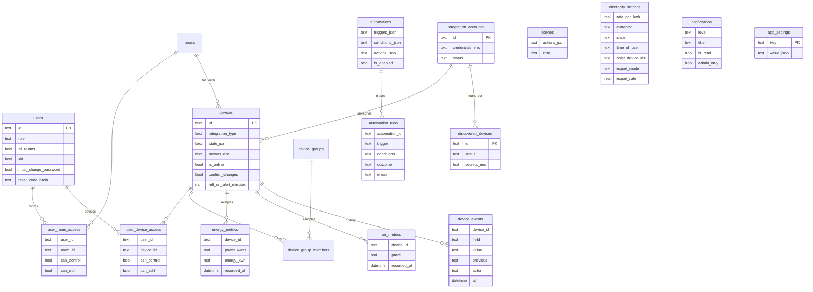

# Domus

<p align="center">
  <b>Translations</b><br>
  <a href="README.md">English</a> ·
  <a href="README.ar.md">العربية</a> ·
  <a href="README.bn.md">বাংলা</a> ·
  <a href="README.de.md">Deutsch</a> ·
  <a href="README.es.md">Español</a> ·
  <a href="README.fr.md">Français</a> ·
  <a href="README.gu.md">ગુજરાતી</a> ·
  <a href="README.hi.md">हिन्दी</a> ·
  <a href="README.id.md">Bahasa Indonesia</a> ·
  <a href="README.it.md">Italiano</a> ·
  <a href="README.ja.md">日本語</a> ·
  <a href="README.kn.md">ಕನ್ನಡ</a> ·
  <a href="README.ko.md">한국어</a> ·
  <a href="README.ml.md">മലയാളം</a> ·
  <a href="README.mr.md">मराठी</a> ·
  <a href="README.pa.md">ਪੰਜਾਬੀ</a> ·
  <a href="README.pl.md">Polski</a> ·
  <a href="README.pt-BR.md">Português (Brasil)</a> ·
  <a href="README.ru.md">Русский</a> ·
  <a href="README.ta.md">தமிழ்</a> ·
  <a href="README.te.md">తెలుగు</a> ·
  <a href="README.th.md">ไทย</a> ·
  <a href="README.tr.md">Türkçe</a> ·
  <a href="README.ur.md">اردو</a> ·
  <a href="README.vi.md">Tiếng Việt</a> ·
  <a href="README.zh-CN.md">简体中文</a> ·
  <a href="README.zh-TW.md">繁體中文</a>
</p>

[](https://github.com/aiyu-ayaan/Domus-Rust/actions/workflows/release.yml)
[](https://github.com/aiyu-ayaan/Domus-Rust/releases)
[](LICENSE)
[](https://github.com/aiyu-ayaan/Domus-Rust/commits/master)
[](https://hub.docker.com/r/aiyuayaan/domus)
[](https://hub.docker.com/r/aiyuayaan/domus)


Ev sunucunuz için yerel öncelikli (local-first) bir akıllı ev merkezi. Rust arka ucu, SQLite,
React web arayüzü (Electron masaüstü kabuğu ile) ve **Tuya / Smart Life**
(QR kodu ile giriş, geliştirici hesabı gerektirmez), **TP-Link Tapo** (yerel),
**Xiaomi Mi Home** (yerel, Mi hesabınızdan tokenlar), **Philips Hue** (yerel köprü)
ve **MQTT** (Zigbee2MQTT, ESPHome ve Home Assistant discovery protokolünü konuşan her şey)
için takılabilir entegrasyonlar. Dahili **Matter köprüsü**, Google Home, Apple Home, Alexa ve
Home Assistant'ın bu cihazları doğrudan kendi yerel ağınız üzerinden açıp kapatmasını, karartmasını ve renklerini değiştirmesini sağlar.

- Yeni cihazların otomatik keşfi, gelen kutusu veya otomatik ekleme seçeneği ile
- Canlı gösterge paneli: güç tüketimi, mevcut fatura ve tahmini fatura, hava kalitesi, hareket / kapı / sızıntı / pil değerleri
- Odalar, cihaz grupları, sahneler ve otomasyonlar; belirli bir saatte, **gün doğumu veya gün batımında** (zaman farkı ile), cihaz durumu değişiminde, güç seviyesinde (ayrıca *N dakika boyunca X değerinin üzerinde*), çevrimdışı kalındığında veya **dış hava durumunda** tetiklemeler
- **Otomasyon çalıştırmaları**: her otomasyon son 50 çalıştırmasını, tetikleyen nedeni ve engellenmesine yol açan koşulu saklar
- **Cihaz geçmişi**: bir cihazdaki her değişiklik ve bunu kimin yaptığı (bir kişi ve kullandığı uygulama, bir otomasyon, Matter veya cihazın kendisi)
- **Otomasyon yazmadan uyarılar**: cihaz çok uzun süre açık kaldığında veya hava temizleyici filtresi azaldığında uyarı
- **Matter köprüsü**: seçtiğiniz cihazları Google Home, Apple Home, Alexa veya Home Assistant ile herhangi bir bulut hesabı olmadan yerel olarak paylaşın
- Gösterge panelinde iç mekan ölçümlerinin yanında evin konumundaki **dış hava durumu ve hava kalitesi** (Open-Meteo, API anahtarı gerekmez)
- **Değiştirmeden önce sor**: bir ana şalteri işaretleyin; her uygulama, grup, sahne ve manuel otomasyon çalıştırması açılmadan veya kapatılmadan önce uyarsın
- Her para biriminde sabit, kademeli ve **günün saatine göre (tarife)** elektrik faturalandırması, cihaz başına **bekleme maliyeti** ve **güneş enerjisi**: üretim, dışa aktarım, mahsuplaşma (net metering) veya şebekeye besleme tarifesi
- Yönetici / üye / misafir rolleri ve oda veya cihaz başına erişim (yalnızca görüntüleme, denetleme veya düzenleme) ile çoklu kullanıcı desteği
- Web, Electron masaüstü (Linux, Windows) ve yerel bir Android uygulaması, anlık olarak canlı senkronize edilir
- Web, masaüstü ve Android uygulamalarında **27 dil**, sistem dilinize uyum sağlar ve Ayarlar'da bir dil seçici içerir; Arapça ve Urduca için sağdan sola (RTL) düzen
- Her uygulamada sürüm notlarını (Markdown, tablolar ve resimler) içeren bir Güncellemeler sayfası
- Varsayılan olarak HTTPS; kimlik bilgileri ve cihaz anahtarları beklemede şifrelenir; tek dosya ile yedekleme ve geri yükleme

Mimari ve şemalar: [`development/docs/ARCHITECTURE.md`](development/docs/ARCHITECTURE.md), [aşağıda](#bilesenlerin-birlikte-calismasi) özetlenmiştir.  
Kullanıcı arayüzü tasarım profili: [`design-system/domus/MASTER.md`](design-system/domus/MASTER.md).  
İlerleme durumu: [`development/TODO.md`](development/TODO.md).

## Bileşenlerin birlikte çalışması



İstemciler yalnızca sunucuyla iletişim kurar; sunucu cihazlarınızla görüşür (üreticinin izin verdiği durumlarda yerel olarak) ve her şeyi tek bir SQLite dosyasında saklar. Bulut, yalnızca üreticinin yerel denetim sunmadığı durumlarda (Tuya) veya cihaz anahtarlarını almak için (Xiaomi) kullanılır; ayrıca isteğe bağlı sorgular için geçerlidir: ev konumu için yer arama, hava durumu ve dış ortam havası (Open-Meteo, yalnızca bir konum ayarlandığında) ve güncelleme kontrolleri için GitHub. Matter köprüsü yalnızca yerel ağda çalışır.

### Veri modeli



Kimlik bilgileri ve cihaz anahtarları, veritabanında yer almayan `data/master.key` altında mühürlü (`*_enc`) olarak saklanır. Her bir özelliğe ait şemaların tamamı [`development/docs`](development/docs) dizinindedir.

## Ekran Görüntüleri

<p align="center"></p>

**Masaüstü** (Electron ve web)

<p>
  
  
  
  
  
  
</p>

**Android**

<p>
  
  
  
  
  
</p>

**Android tablet** (840dp'den itibaren iki sütun, Ayarlar liste ve ayrıntı olarak)

<p>
  
  
  
  
  
</p>

**Mobil web**

<p>
  
  
  
  
  
</p>

Tüm ekran görüntüleri [`res/screenshots`](res/screenshots) dizininde yer almaktadır; tam kaliteli tanıtım videosu [`res/domus.mp4`](res/domus.mp4) dosyasındadır.

## İndirme

| | |
|---|---|
| Sunucu (Docker) | Docker Hub üzerinde `aiyuayaan/domus`, amd64 ve arm64 |
| Android | [En son sürüm](https://github.com/aiyu-ayaan/Domus-Rust/releases) sayfasından `Domus-<version>.apk` |
| Linux masaüstü | Aşağıdaki tek satırlık yükleyici veya sürüm sayfasındaki `.deb` / `.AppImage` dosyası |
| Windows masaüstü | Sürüm sayfasından `Domus-<version>-Setup.exe` |

### Sunucu

Ana makinenin ihtiyaç duyduğu tek şey bir dosyadır:

```bash
mkdir domus && cd domus
wget https://raw.githubusercontent.com/aiyu-ayaan/Domus-Rust/master/docker-compose.yml
docker compose up -d
```

`https://<server-ip>:8443` adresini açın ve yönetici hesabını oluşturun. `docker compose logs domus` komutu, uygulamaların doğrulamanızı isteyeceği sertifika parmak izini gösterir.

```bash
docker compose pull && docker compose up -d      # güncelleme
DOMUS_VERSION=beta docker compose up -d          # bir kanalı takip etme: latest (varsayılan), beta, alpha veya 0.0.1
TZ=Asia/Kolkata DOMUS_PORT=9443 docker compose up -d
docker compose --profile mqtt up -d              # isteğe bağlı Mosquitto aracısını da başlatır
```

`DOMUS_VERSION`, `TZ` ve `DOMUS_PORT` değişkenlerini kalıcı kılmak için compose dosyasının yanındaki bir `.env` dosyasına yerleştirin.

### Linux masaüstü uygulaması

Geçerli kullanıcı için en son sürümü yükler (x86_64, root gerektirmez): AppImage, Domus simgeli bir menü girişi ve bir `domus` komutu. Uygulama bundan sonra kendi kendini güncel tutar.

```bash
curl -fsSL https://raw.githubusercontent.com/aiyu-ayaan/Domus-Rust/master/scripts/install-linux.sh | sh
# ... | sh -s -- --channel beta     beta sürümleri de yüklemek için (veya alpha)
# ... | sh -s -- --uninstall        kaldırmak için; ayarlar korunur
```

### Android

APK dosyasını sürüm sayfasından indirin ve açın. Sonraki güncellemeler uygulama açıldığında ve Ayarlar → Güncellemeler menüsünde Kararlı (Stable), Beta veya Alpha kanalında sunulur ve oradan yüklenir; Android, Domus'un bunları yüklemesine izin vermeniz için bir kez onay ister.

**Güncellemeler** sayfası (Android'de Ayarlar → Güncellemeler, web ve masaüstünde Ayarlar → Hakkında → Güncellemeler) çalıştırdığınız sürümü, kanalınızdaki en yeni sürümü ve Markdown ile yazılmış sürüm notlarını gösterir.

Sürümler, sürüm numaraları ve güncelleme kanalları: [development/docs/RELEASE.md](development/docs/RELEASE.md).

## Gereksinimler

- Rust 1.80+ (`cargo`)
- Node.js 18+ ve `pnpm`

## Geliştirme ortamında çalıştırma

```bash
pnpm install
npm run dev            # backend (https://127.0.0.1:8443) + web (http://localhost:3000)

npm run dev:backend    # yalnızca backend
npm run dev:web        # yalnızca web (/api isteklerini backend'e yönlendirir)
npm run dev:desktop    # Electron; bağlantı sayfasından sunucuyu seçin
```

http://localhost:3000 adresini açın. İlk ziyaret yönetici hesabını oluşturmanızı isteyecektir.

## Ev sunucusunda çalıştırma

```bash
pnpm build:web                     # backend tarafından sunulan apps/web/dist derlemesini yapar
APP_ENV=production cargo run --release --manifest-path backend/Cargo.toml
```

Ardından `https://<server-ip>:8443` adresini açın. Matter köprüsü açıldığında, yerel ağda UDP 5540 (`[matter] port`) ve mDNS protokollerini de kullanır.

Veya Docker imajını bu depodan doğrudan derleyin (ana makine ağı, veriler `domus_data` biriminde):

```bash
docker compose -f docker-compose.local.yml up -d --build
```

Cloudflare Tunnel üzerinden uzaktan erişim, uygulamaların aralarında geçiş yaptığı ev/uzak adres ve masaüstü paketleri (`pnpm build:desktop`), [development/docs/DEPLOYMENT.md](development/docs/DEPLOYMENT.md) belgesinde açıklanmıştır.

İlk başlatmada Domus, aşağıdaki içeriklerle `data/` dizinini oluşturur:

| Dosya | Amaç |
|---|---|
| `domus.db` | SQLite veritabanı |
| `master.key` | entegrasyon kimlik bilgilerini ve cihaz anahtarlarını şifreler — **bunu yedekleyin** |
| `jwt.secret` | kullanıcı oturumlarını imzalar |
| `tls/` | kendinden imzalı sertifika (`tls.cert_path` / `tls.key_path` ile değiştirilebilir) |

Ayarlar `config/default.toml` dosyasında yer alır; herhangi bir anahtar `DOMUS__SECTION__KEY` ortam değişkenleriyle geçersiz kılınabilir (bkz. `.env.example`).

## Yedekleme ve geri yükleme

Her şey `data/` içinde bulunur. Tüm klasörü yedekleyebilir veya tek dosyalık yedeği alabilirsiniz:

**Yedekleme.** Yönetici olarak giriş yapın → Ayarlar → **Yedekleme** → *Yedeği indir*. Dosya, ana anahtar içine yerleştirilmiş bir veritabanı kopyasıdır; böylece geri yüklemeden sonra içindeki bağlı hesaplar yeniden açılabilir. Sunucu çalışırken oluşturulur. Dosyayı gizli tutun: dosyaya sahip olan herkes bu hesaplara erişebilir. JWT sırrı ve TLS sertifikası bu dosyada bulunmaz.

**Geri yükleme.** Sunucuyu durdurun, ardından:

```bash
# Docker
docker compose cp domus-backup-2026-10-11.db domus:/app/data/restore.db
docker compose stop domus
docker compose run --rm domus domus-backend restore data/restore.db
docker compose start domus

# Docker olmadan, depo kök dizininden (./data kullanır)
domus-backend restore ~/Downloads/domus-backup-2026-10-11.db
```

Mevcut veriler yanlarında `*.before-restore` olarak saklanır. Yeni bir makinede geri yükleme yapıldıktan sonra kullanıcılar yeniden giriş yapar ve uygulamalar yeni sertifikaya güvenmeyi ister. Anahtarı `DOMUS_MASTER_KEY` ile ayarladıysanız, yedek hiçbir anahtar içermez ve geri yüklenen sunucu aynı değişkene ihtiyaç duyar. Daha fazlası [development/docs/DEPLOYMENT.md](development/docs/DEPLOYMENT.md#backup-and-restore) belgesindedir.

## Yönetici parolasını mı unuttunuz?

Domus'un bir e-posta sunucusu yoktur, bu nedenle e-posta ile hiçbir şey gönderilmez. Kolaylık sırasına göre:

1. **Başka bir yönetici** Ayarlar → Kişiler ve erişim bölümünü açar, sizin için *Sıfırlama kodu* seçeneğini etkinleştirir ve 8 haneli kodu size iletir (30 dakika ve 5 yanlış deneme için geçerlidir). Giriş ekranında *Parolanızı mı unuttunuz?* seçeneğini belirleyin, kullanıcı adınızı ve ardından kodu girin.
2. **Doğrudan sunucudan**, Domus çalışırken veya durdurulmuşken yapılabilir ve giriş gerektirmez:

   ```bash
   docker compose exec domus domus-backend reset-password <username>              # yeni rastgele bir parola yazdırır
   docker compose exec domus domus-backend reset-password <username> 'new-pass'   # veya bir tane belirleyin (8+ karakter)
   domus-backend reset-password <username>                                        # Docker olmadan, depo kökünden
   ```

   Bu parolayla giriş yapın ve Ayarlar → Parola bölümünden değiştirin.

Bir kullanıcı adı için 5 yanlış parola girilmesi, canlı ortamda (production) bu hesabın 15 dakika kilitlenmesine neden olur (kilit sunucu yeniden başlatılarak kaldırılabilir, geliştirme ortamında devre dışıdır). Ayrıntılar, oluşturulan parolalar ve çocuk hesapları için kurallar: [development/docs/ACCOUNTS.md](development/docs/ACCOUNTS.md).

## Diller

İngilizce, Hintçe, İspanyolca, Portekizce (Brezilya), Endonezce, Arapça, Fransızca, Rusça, Almanca, Türkçe, Japonca, Korece,
İtalyanca, Vietnamca, Tayca, Çince (Basitleştirilmiş ve Geleneksel), Lehçe, Bengalce, Tamilce, Telugu dili, Marathi, Gujarati,
Kannada, Malayalam, Pencapça ve Urduca. Arapça ve Urduca sağdan sola (RTL) düzenlenmiştir.

Her uygulama tarayıcınızın veya sisteminizin dilini takip eder ve çevirisi bulunmadığında İngilizce gösterir. Başka bir dil seçmek için Ayarlar > Dil (web ve masaüstünde Görünüm) bölümünü açın; *Sistem varsayılanı* seçeneği sistem dilini takip etmeye geri döner. Android 13 ve sonraki sürümlerde telefonun Ayarlar > Uygulamalar > Domus > Dil menüsü altında da görünür.

Çeviriler makine tarafından yapılmıştır ve anadili olan kişiler tarafından gözden geçirilmemiştir, bu nedenle bazı ifadeler hatalı olabilir. Düzeltme, ilgili dilin kataloğunda tek satırlık bir değişiklikten ibarettir. Dillerin işleyişi, yeni bir dil ekleme ve yeni metin kuralları: [development/docs/LOCALIZATION.md](development/docs/LOCALIZATION.md).

## Cihazları bağlama

| Marka | Nasıl bağlanır |
|---|---|
| Tuya / Smart Life | Entegrasyonlar → *QR kodu ile bağla*. Smart Life uygulamasındaki **Kullanıcı Kodu** bilgisini girin (Ben → Ayarlar → Hesap ve Güvenlik → Kullanıcı Kodu), ardından uygulamadaki QR kodunu tarayın. |
| Tapo | Entegrasyonlar → TP-Link ID'niz ile *Hesap bağla*. Yerel ağdaki (LAN) cihazlar otomatik olarak bulunur ve yerel olarak denetlenir. Bir H100 hub, sensörlerini, anahtarlarını ve termostatlarını beraberinde getirir. Kameralar listelenir ancak henüz desteklenmemektedir. |
| Xiaomi | Entegrasyonlar → Mi hesabınız ve sunucu bölgeniz ile *Hesap bağla*. Xiaomi iki adımlı doğrulama isterse, e-posta veya SMS ile gönderdiği kodu aynı panelde girin. Hesap bir e-posta, ülke kodlu bir telefon numarası (`+91…`) veya bir Xiaomi ID olabilir. Tokenlar bir kez alınır; denetim yereldir. Cihazlar doğrudan bir token ile de eklenebilir. |
| Philips Hue | Köprü üzerindeki yuvarlak düğmeye basın, ardından 30 saniye içinde Entegrasyonlar → Philips Hue → *Bağla* seçeneğine tıklayın. Köprüyü otomatik bulmak için adresi boş bırakın. Işıklar ve Hue akıllı prizler yerel olarak denetlenir. |
| MQTT | Entegrasyonlar → MQTT → aracı adresiniz, bağlantı noktanız ve giriş bilgileriniz ile *Bağla*. Home Assistant MQTT discovery (Zigbee2MQTT, ESPHome, …) aracılığıyla kendini duyuran cihazlar Keşfedilenler altında görünür: ışıklar, anahtarlar, prizler, fanlar ve sensörler. Birlikte gelen aracıda (`--profile mqtt`) adres `mqtt`, bağlantı noktası `1883`'tür. |

Her entegrasyonun neleri kapsadığı için `development/docs/INTEGRATIONS.md` belgesine bakın.

## Elektrik planı

Enerji → *Elektrik planı*: dilediğiniz para birimini seçin ve kWh başına sabit bir fiyat veya birim bazlı tarifeler için **kademeler** (slabs) belirleyin (örneğin: 0–100 birim belirli bir fiyattan, 101–300 birim sonraki fiyattan vb.). Fatura, faturalandırma dönemi başına hesaplanır ve sabit aylık ücret eklenir.

Tarifeler ayrıca **günün saatine göre** pencereler de içerebilir: sabit veya kademeli fiyata ek olarak, gece indirimi veya yoğun saat ek ücreti gibi birimlerin belirli bir miktar daha pahalı veya ucuz olduğu saatler (evin saatine göre, gece yarısını geçen süreler dahil).

Yeni cihazlar **Cihazlar → Keşfedilenler** altında görünür. Gelen kutusunu atlamak için oradaki *Yeni cihazları otomatik olarak ekle* seçeneğini açın.

## Gün doğumu ve gün batımı

Evin nerede olduğunu Ayarlar → **Ev konumu** bölümünden ayarlayın: bu telefonun veya tarayıcının konumunu kullanın, şehri arayın (sunucu ücretsiz Open-Meteo coğrafi kodlayıcısına danışır; evden yalnızca yazdığınız isim çıkar) veya enlem ve boylamı girin. Koordinatlar yaklaşık bir kilometreye yuvarlanır ve sunucunuzda kalır. Bir otomasyon daha sonra gün doğumu veya gün batımında, dakikalar önce veya sonra çalışabilir. Bir konum belirlenmediğinde güneş tetikleyicisi asla çalışmaz.

## Değiştirmeden önce sor

Bağlı olan her şeyin gücünü kesen bir ana şalteri yanlışlıkla kapatmak kolaydır. Cihazı açın ve **Değiştirmeden önce sor** seçeneğini etkinleştirin: her uygulama açmadan veya kapatmadan önce onay ister; oda düzeyindeki *Tümü açık / Tümü kapalı*, cihaz grupları, sahneler (iç içe sahneler dahil) ve onu değiştirecek bir otomasyonun manuel *Çalıştır* işlemi de onay gerektirir. Ayar sunucuda saklanır, bu nedenle web, masaüstü ve Android'de aynıdır. Kendi kendine çalışan otomasyonlar onay isteyemez ve yazıldığı gibi çalışır; Domus dışındaki hiçbir şey (üretici uygulaması, fiziksel duvar anahtarı) bu kapsama dahil değildir.

## Matter (Google Home, Apple Home, Alexa)

Ayarlar → **Matter** (yöneticiler): özelliği açın, paylaşılacak cihazları işaretleyin, ardından QR kodunu tarayın veya eşleme kodunu Google Home, Apple Home, Alexa veya Home Assistant'a girin. Işıklar renkli veya karartılabilir ışıklar olarak, açma/kapama düğmesi olan diğer her şey priz olarak aktarılır; açma/kapama, karartma ve renk ayarları çalışır ve Domus'ta yapılan değişiklikler (açık/kapalı, parlaklık) denetleyicide görünür. "15 dakika eşlemeye izin ver" ikinci bir ekosistem ekler; "Tüm eşlemeleri unut" yeni bir kodla her şeyi baştan başlatır.

Köprü resmi olarak onaylı değildir (Matter test onayını kullanır), bu nedenle uygulamalar eklerken onayınızı ister ve Google Home bunu ancak köprü Google Home Developer Console'a bir test cihazı olarak eklendikten sonra kabul eder. Ayrıntılar: [`development/docs/MATTER.md`](development/docs/MATTER.md).

## Geçmiş, otomasyon çalıştırmaları ve uyarılar

- Her cihaz sayfasında **Geçmiş**: ne değişti, ne zaman değişti ve bunu kim yaptı (*Ayaan tarafından · Android*, *Otomasyon "Gece modu"*, *Matter*, *Cihaz üzerinden*). Enerji geçmişi kadar uzun süre saklanır.
- Her otomasyonun **Çalıştırmaları**: *Çalıştı*, hatayla birlikte *Başarısız* veya engelleyen koşulla birlikte *Atlandı*; böylece "bu neden çalışmadı?" sorusunun net bir cevabı olur.
- Cihaz sayfasında **Açık kalırsa uyar** (30 dakikadan 12 saate kadar): yöneticiler bir bildirim alır. Ölçümlü bir cihaz 10 W üzerinde açık sayılır, bu nedenle beklemedeki bir televizyon kapalı kabul edilir.
- **Filtre azalıyor**: bir hava temizleyicinin filtresi %10'a düştüğünde bildirim gönderilir.

## Hava durumu, bekleme ve güneş enerjisi

- Bir ev konumu ayarlandığında, gösterge paneli iç mekan okumasının yanında **hava durumunu ve dış mekan PM2.5** değerini gösterir ve otomasyonlar bunları kullanabilir (*dış mekan PM2.5 35'in üzerine çıktığında*, *yalnızca dış mekan sıcaklığı 20'nin altındaysa*).
- Enerji → **Bekleme**, kimse kullanmadığında her bir cihazın ne kadar güç çektiğini (bu haftaki en düşük saati) ve bunun aylık maliyetini listeler.
- Enerji → *Elektrik planı* → **Güneş enerjisi**: güneş enerjisi üretimini ölçen prizleri işaretleyin, ardından mahsuplaşmayı veya şebekeye besleme tarifesini seçin. Fatura yalnızca şebekeden satın aldığınız elektriği hesaba katar ve Güneş kartı üretilen, evde kullanılan, dışa aktarılan ve kazanılan miktarı gösterir. Şebeke akışları ölçümlü cihazlardan her 15 dakikada bir hesaplanır, bu nedenle sayacı olmayan cihazlar dışa aktarım değerinin yüksek görünmesine yol açabilir.

Plan ve diyagramlar: [`development/docs/ROADMAP.md`](development/docs/ROADMAP.md).

## Lisans

Domus, [MIT Lisansı](LICENSE) kapsamında yayımlanmıştır. Üçüncü taraf kütüphaneler kendi lisanslarını korur; her uygulamada Hakkında → Teşekkürler altında listelenmiştir.

## Testler

```bash
cargo test --workspace
pnpm --filter @domus/web exec tsc -b
```

`cargo test --workspace` komutu, bir Matter denetleyicisini UDP üzerinden köprüyle eşleyen ve cihazlarını açıp kapatan, karartan ve renklendiren `backend/tests/matter_bridge.rs` testini içerir (IPv4 destekli bir ağ arayüzü gerektirir).
