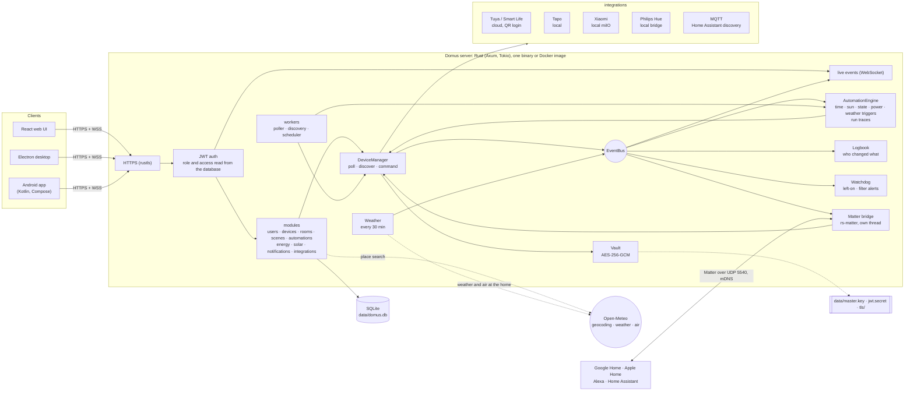
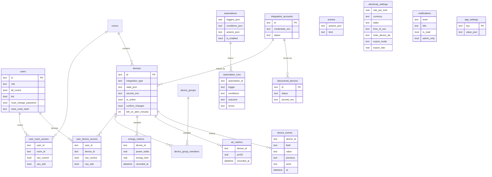

# Domus

<p align="center">
  <b>Translations</b><br>
  <a href="README.md">English</a> ·
  <a href="README.ar.md">العربية</a> ·
  <a href="README.bn.md">বাংলা</a> ·
  <a href="README.de.md">Deutsch</a> ·
  <a href="README.es.md">Español</a> ·
  <a href="README.fr.md">Français</a> ·
  <a href="README.gu.md">ગુજરાતી</a> ·
  <a href="README.hi.md">हिन्दी</a> ·
  <a href="README.id.md">Bahasa Indonesia</a> ·
  <a href="README.it.md">Italiano</a> ·
  <a href="README.ja.md">日本語</a> ·
  <a href="README.kn.md">ಕನ್ನಡ</a> ·
  <a href="README.ko.md">한국어</a> ·
  <a href="README.ml.md">മലയാളം</a> ·
  <a href="README.mr.md">मराठी</a> ·
  <a href="README.pa.md">ਪੰਜਾਬੀ</a> ·
  <a href="README.pl.md">Polski</a> ·
  <a href="README.pt-BR.md">Português (Brasil)</a> ·
  <a href="README.ru.md">Русский</a> ·
  <a href="README.ta.md">தமிழ்</a> ·
  <a href="README.te.md">తెలుగు</a> ·
  <a href="README.th.md">ไทย</a> ·
  <a href="README.tr.md">Türkçe</a> ·
  <a href="README.ur.md">اردو</a> ·
  <a href="README.vi.md">Tiếng Việt</a> ·
  <a href="README.zh-CN.md">简体中文</a> ·
  <a href="README.zh-TW.md">繁體中文</a>
</p>

[](https://github.com/aiyu-ayaan/Domus-Rust/actions/workflows/release.yml)
[](https://github.com/aiyu-ayaan/Domus-Rust/releases)
[](LICENSE)
[](https://github.com/aiyu-ayaan/Domus-Rust/commits/master)
[](https://hub.docker.com/r/aiyuayaan/domus)
[](https://hub.docker.com/r/aiyuayaan/domus)


[](https://ghloc.dev/aiyu-ayaan/Domus)


آپ کے ہوم سرور کے لیے ایک لوکل فرسٹ اسمارٹ ہوم ہب۔ Rust بیک اینڈ، SQLite، React ویب UI (Electron ڈیسک ٹاپ شیل کے ساتھ)، اور **Tuya / Smart Life** (کیو آر کوڈ لاگ ان، کسی ڈویلپر اکاؤنٹ کی ضرورت نہیں)، **TP-Link Tapo** (مقامی)، **Xiaomi Mi Home** (مقامی، آپ کے Mi اکاؤنٹ سے ٹوکنز)، **Philips Hue** (لوکل برج) اور **MQTT** (Zigbee2MQTT، ESPHome اور Home Assistant ڈسکوری کی حمایت کرنے والے دیگر آلات) کے لیے پلگ ایبل انٹیگریشنز۔ اندرونی ساختہ **Matter برج** کے ذریعے Google Home، Apple Home، Alexa اور Home Assistant آپ کے اپنے لوکل نیٹ ورک پر ان آلات کو آن/آف، مدہم (dim) اور ان کے رنگ تبدیل کر سکتے ہیں۔

- نئے آلات کی خودکار دریافت (Automatic discovery)، ان باکس یا خودکار شمولیت (auto-add) کے آپشن کے ساتھ
- لائیو ڈیش بورڈ: بجلی کا استعمال، اب تک کا بل اور متوقع بل، ہوا کا معیار، حرکت / دروازہ / لیکیج / بیٹری ریڈنگز
- کمرے، آلات کے گروپس، مناظر (scenes) اور آٹومیشنز؛ مخصوص وقت پر، **طلوع آفتاب یا غروب آفتاب** پر (آفسیٹ کے ساتھ)، آلہ کی حالت میں تبدیلی پر، بجلی کی کھپت کی سطح پر (*N منٹ کے لیے X سے زیادہ ہونا بھی شامل ہے*)، آف لائن ہونے پر یا **بیرونی موسم** کی بنیاد پر ٹریگرز
- **آٹومیشن کارکردگی کا ریکارڈ (Automation runs)**: ہر آٹومیشن اپنے پچھلے 50 رن کا ریکارڈ رکھتی ہے، اس ٹریگر کی تفصیل کے ساتھ جس نے اسے چلایا اور اس شرط کے ساتھ جس نے اسے روکا
- **آلہ کا تاریخچہ (Device history)**: کسی آلے میں ہر تبدیلی اور یہ کہ وہ کس نے کی (ایک فرد اور ان کی استعمال کردہ ایپ، کوئی آٹومیشن، Matter، یا خود آلہ)
- بغیر کسی آٹومیشن کوڈ کے **انتباہات (Alerts)**: آلہ ضرورت سے زیادہ دیر چالو رہ جائے، ایئر پیوریفائر کا فلٹر کم ہو جائے
- **Matter برج**: اپنے منتخب کردہ آلات کو بغیر کسی کلاؤڈ اکاؤنٹ کے، مقامی طور پر Google Home، Apple Home، Alexa یا Home Assistant کے ساتھ شیئر کریں
- گھر کے مقام پر **بیرونی موسم اور ہوا کا معیار** (Open-Meteo، بغیر API کلید کے) ڈیش بورڈ پر اندرونی ریڈنگ کے ساتھ دکھایا جاتا ہے
- **سوئچ کرنے سے پہلے پوچھیں (Ask before switching)**: مین سوئچ کو نشان زد کریں اور ہر ایپ، گروپ، منظر اور دستی آٹومیشن رن اسے آن یا آف کرنے سے پہلے تصدیق طلب کرے گا
- فلیٹ، سلیب اور **دن کے وقت (time-of-day)** کے ٹیرف کے ساتھ کسی بھی کرنسی میں بجلی کا بل، فی آلہ **اسٹینڈ بائی لاگت**، اور **شمسی توانائی (solar)**: پیداوار، برآمد اور نیٹ میٹرنگ یا فیڈ ان ریٹ
- ایڈمن / ممبر / مہمان کے کرداروں (roles) کے ساتھ کثیر صارفین اور فی کمرہ یا فی آلہ صرف دیکھنے (see-only)، کنٹرول (control) یا ترمیم (edit) کی رسائی
- ویب، Electron ڈیسک ٹاپ (Linux، Windows) اور مقامی Android ایپ، سب لائیو ہم آہنگ رہتے ہیں
- ویب، ڈیسک ٹاپ اور Android ایپس میں **27 زبانیں**، سیٹنگز میں منتخب کنندہ کے ساتھ آپ کے سسٹم کی زبان کی پیروی کرتی ہیں؛ عربی اور اردو کے لیے دائیں سے بائیں (RTL) لے آؤٹ
- ہر ایپ میں ریلیز نوٹس (Markdown، ٹیبلز اور تصاویر) کے ساتھ اپ ڈیٹس کا صفحہ
- پہلے سے طے شدہ طور پر HTTPS؛ اسناد اور آلات کی چابیاں محفوظ طریقے سے انکرپٹڈ؛ سنگل فائل بیک اپ اور بحالی

آرکیٹیکچر اور خاکے: [`development/docs/ARCHITECTURE.md`](development/docs/ARCHITECTURE.md)، [نیچے خلاصہ ملاحظہ کریں](#یہ-سب-ایک-ساتھ-کیسے-کام-کرتا-ہے)۔
UI ڈیزائن پروفائل: [`design-system/domus/MASTER.md`](design-system/domus/MASTER.md)۔
پیشرفت: [`development/TODO.md`](development/TODO.md)۔

## یہ سب ایک ساتھ کیسے کام کرتا ہے



کلائنٹس صرف سرور سے بات کرتے ہیں؛ سرور آپ کے آلات سے براہ راست بات کرتا ہے (جہاں وینڈر اجازت دے وہاں مقامی طور پر) اور سب کچھ ایک ہی SQLite فائل میں محفوظ رکھتا ہے۔ کلاؤڈ کا استعمال صرف وہاں کیا جاتا ہے جہاں کوئی وینڈر مقامی کنٹرول فراہم نہیں کرتا (Tuya) یا آلہ کے ٹوکنز حاصل کرنے کے لیے (Xiaomi)، مزید اختیاری تلاشیں: مقام کی تلاش، گھر کے مقام کا موسم اور بیرونی ہوا (Open-Meteo، صرف مقام سیٹ ہونے کے بعد) اور اپ ڈیٹس چیک کرنے کے لیے GitHub۔ Matter برج صرف لوکل نیٹ ورک پر کام کرتا ہے۔

### ڈیٹا ماڈل (Data model)



اسناد اور آلات کی چابیاں ڈیٹا بیس سے باہر `data/master.key` کے تحت محفوظ طریقے سے (`*_enc`) محفوظ کی جاتی ہیں۔ ہر فیچر کے خاکوں کا مکمل مجموعہ [`development/docs`](development/docs) میں ہے۔

## اسکرین شاٹس (Screenshots)

<p align="center"></p>

**ڈیسک ٹاپ** (Electron اور ویب)

<p>
  
  
  
  
  
  
</p>

**Android**

<p>
  
  
  
  
  
</p>

**Android ٹیبلیٹ** (840dp سے دو کالم، ترتیبات بطور فہرست اور تفصیل)

<p>
  
  
  
  
  
</p>

**موبائل ویب**

<p>
  
  
  
  
  
</p>

تمام تصاویر [`res/screenshots`](res/screenshots) میں ہیں؛ مکمل ویڈیو واک تھرو [`res/domus.mp4`](res/domus.mp4) میں ہے۔

## ڈاؤن لوڈ (Download)

| | |
|---|---|
| سرور (Docker) | Docker Hub پر `aiyuayaan/domus`، amd64 اور arm64 |
| Android | [تازہ ترین ریلیز سے](https://github.com/aiyu-ayaan/Domus-Rust/releases) `Domus-<version>.apk` |
| Linux ڈیسک ٹاپ | نیچے دیا گیا ون لائن انسٹالر، یا ریلیز سے `.deb` / `.AppImage` |
| Windows ڈیسک ٹاپ | ریلیز سے `Domus-<version>-Setup.exe` |

### سرور

میزبان مشین کے لیے صرف ایک فائل درکار ہے:

```bash
mkdir domus && cd domus
wget https://raw.githubusercontent.com/aiyu-ayaan/Domus-Rust/master/docker-compose.yml
docker compose up -d
```

`https://<server-ip>:8443` کھولیں اور ایڈمنسٹریٹر اکاؤنٹ بنائیں۔ سرٹیفکیٹ فنگر پرنٹ (certificate fingerprint) دیکھنے کے لیے `docker compose logs domus` استعمال کریں جس کی تصدیق ایپس مانگتی ہیں۔

```bash
docker compose pull && docker compose up -d      # اپ ڈیٹ کرنے کے لیے
DOMUS_VERSION=beta docker compose up -d          # چینل فالو کریں: latest (پہلے سے طے شدہ)، beta، alpha، یا 0.0.1
TZ=Asia/Kolkata DOMUS_PORT=9443 docker compose up -d
docker compose --profile mqtt up -d              # اختیاری Mosquitto بروکر بھی شروع کرنے کے لیے
```

ان متغیرات کو برقرار رکھنے کے لیے کمپوز فائل کے ساتھ ایک `.env` فائل میں `DOMUS_VERSION`، `TZ` اور `DOMUS_PORT` رکھیں۔

### Linux ڈیسک ٹاپ ایپ

موجودہ صارف کے لیے تازہ ترین ریلیز انسٹال کرتا ہے (x86_64، روٹ کی ضرورت نہیں): AppImage، Domus آئیکن کے ساتھ مینو انٹری، اور `domus` کمانڈ۔ ایپ بعد میں خود کو اپ ڈیٹ رکھتی ہے۔

```bash
curl -fsSL https://raw.githubusercontent.com/aiyu-ayaan/Domus-Rust/master/scripts/install-linux.sh | sh
# ... | sh -s -- --channel beta     بیٹا بلڈز کے لیے بھی (یا alpha)
# ... | sh -s -- --uninstall        ہٹانے کے لیے؛ ترتیبات محفوظ رہیں گی
```

### Android

ریلیز کے صفحے سے APK ڈاؤن لوڈ کر کے کھولیں۔ جب ایپ کھلے گی تو سیٹنگز → اپ ڈیٹس (Settings → Updates) میں Stable، Beta یا Alpha چینل پر اپ ڈیٹس ملیں گی؛ Android انہیں انسٹال کرنے کی اجازت ایک بار طلب کرے گا۔

**اپ ڈیٹس** کا صفحہ (Android پر سیٹنگز → اپ ڈیٹس؛ ویب اور ڈیسک ٹاپ پر ترتیبات → کے بارے میں → اپ ڈیٹس) آپ کا ورژن، آپ کے چینل پر نئی ریلیز اور Markdown میں ریلیز نوٹس دکھاتا ہے۔

ریلیزز، ورژن نمبرز اور اپ ڈیٹ چینلز: [development/docs/RELEASE.md](development/docs/RELEASE.md)۔

## تقاضے (Requirements)

- Rust 1.80+ (`cargo`)
- Node.js 18+ اور `pnpm`

## ڈیولپمنٹ میں چلائیں (Run in development)

```bash
pnpm install
npm run dev            # backend (https://127.0.0.1:8443) + web (http://localhost:3000)

npm run dev:backend    # صرف backend
npm run dev:web        # صرف web (API کو backend پر پراکسی کرتا ہے)
npm run dev:desktop    # Electron؛ کنیکٹ پیج پر سرور منتخب کریں
```

http://localhost:3000 کھولیں۔ پہلے وزٹ پر ایڈمنسٹریٹر اکاؤنٹ بنانے کی درخواست کی جائے گی۔

## ہوم سرور پر چلائیں (Run on the home server)

```bash
pnpm build:web                     # بیک اینڈ سے پیش کی جانے والی apps/web/dist بناتا ہے
APP_ENV=production cargo run --release --manifest-path backend/Cargo.toml
```

پھر `https://<server-ip>:8443` کھولیں۔ Matter برج آن ہونے پر LAN پر UDP 5540 (`[matter] port`) اور mDNS بھی استعمال کرتا ہے۔

یا اس ریپوزٹری سے ڈوکر امیج بنائیں (host networking، ڈیٹا `domus_data` والیوم میں):

```bash
docker compose -f docker-compose.local.yml up -d --build
```

Cloudflare Tunnel کے ذریعے ریموٹ رسائی، وہ لوکل/ریموٹ ایڈریس جس کے درمیان ایپس خود سوئچ کرتی ہیں، اور ڈیسک ٹاپ پیکجز (`pnpm build:desktop`) [development/docs/DEPLOYMENT.md](development/docs/DEPLOYMENT.md) میں بیان کیے گئے ہیں۔

پہلی شروعات پر Domus درج ذیل کے ساتھ `data/` فولڈر بناتا ہے:

| فائل | مقصد |
|---|---|
| `domus.db` | SQLite ڈیٹا بیس |
| `master.key` | انٹیگریشن اسناد اور آلہ کیز کو انکرپٹ کرتا ہے — **اس کا بیک اپ لیں** |
| `jwt.secret` | سیشنز پر دستخط کرتا ہے |
| `tls/` | سیلف سائنڈ سرٹیفکیٹ (`tls.cert_path` / `tls.key_path` کے ذریعے تبدیل کیا جا سکتا ہے) |

ترتیبات `config/default.toml` میں ہیں؛ کسی بھی ترتیب کو `DOMUS__SECTION__KEY` ماحولیاتی متغیرات کے ساتھ اوور رائڈ کیا جا سکتا ہے (`.env.example` دیکھیں)۔

## بیک اپ اور بحالی (Backup and restore)

سب کچھ `data/` فولڈر میں ہے۔ پورے فولڈر کا بیک اپ لیں، یا ایک فائل کا بیک اپ حاصل کریں:

**بیک اپ لینا۔** بطور ایڈمنسٹریٹر سائن ان کریں → ترتیبات (Settings) → **بیک اپ (Backup)** → *بیک اپ ڈاؤن لوڈ کریں (Download backup)*۔ یہ فائل ڈیٹا بیس کی کاپی ہے جس میں ماسٹر کلید اندر موجود ہے، تاکہ بحالی کے بعد بھی منسلک اکاؤنٹس کو کھولا جا سکے۔ یہ سرور کے چلتے ہوئے بنائی جاتی ہے۔ اسے نجی رکھیں: جس کے پاس بھی یہ ہو وہ ان اکاؤنٹس کو کھول سکتا ہے۔ JWT خفیہ اور TLS سرٹیفکیٹ اس میں شامل نہیں ہیں۔

**بحال کرنا۔** سرور روکنے کے بعد:

```bash
# Docker
docker compose cp domus-backup-2026-10-11.db domus:/app/data/restore.db
docker compose stop domus
docker compose run --rm domus domus-backend restore data/restore.db
docker compose start domus

# بغیر Docker کے، ریپوزٹری کے روٹ سے (./data استعمال کرتا ہے)
domus-backend restore ~/Downloads/domus-backup-2026-10-11.db
```

وہاں جو کچھ پہلے سے تھا اسے ساتھ ہی `*.before-restore` کے طور پر محفوظ کیا جاتا ہے۔ نئی مشین پر بحالی کے بعد لوگ دوبارہ سائن ان کرتے ہیں اور ایپس نئے سرٹیفکیٹ پر بھروسہ کرنے کو کہتی ہیں۔ اگر آپ نے کلید کو `DOMUS_MASTER_KEY` کے ذریعے سیٹ کیا ہے تو بیک اپ میں کوئی کلید نہیں ہوگی اور بحال شدہ سرور کو اسی متغیر کی ضرورت ہوگی۔ مزید تفصیلات [development/docs/DEPLOYMENT.md](development/docs/DEPLOYMENT.md#backup-and-restore) میں ہیں۔

## ایڈمنسٹریٹر کا پاس ورڈ بھول گئے؟ (Forgot the administrator password)

Domus میں میل سرور نہیں ہے، اس لیے ای میل کے ذریعے کچھ نہیں بھیجا جاتا۔ کوشش کرنے کے طریقے:

1. **دوسرا ایڈمنسٹریٹر** ترتیبات → لوگ (Settings → People) کھولتا ہے، آپ کے لیے *ری سیٹ کوڈ (Reset code)* آن کرتا ہے اور آپ کو 8 ہندسوں کا کوڈ بتاتا ہے (یہ 30 منٹ اور 5 غلط کوششوں کے لیے کارآمد ہے)۔ سائن ان اسکرین پر *پاس ورڈ بھول گئے؟ (Forgot password?)* منتخب کریں، اپنا صارف نام اور پھر کوڈ درج کریں۔
2. **سرور سے براہ راست**، جو Domus کے چلتے ہوئے یا بند ہونے پر کام کرتا ہے اور سائن ان کی ضرورت نہیں ہے:

   ```bash
   docker compose exec domus domus-backend reset-password <username>              # نیا بے ترتیب پاس ورڈ پرنٹ کرتا ہے
   docker compose exec domus domus-backend reset-password <username> 'new-pass'   # یا خود منتخب کریں (8+ حروف)
   domus-backend reset-password <username>                                        # Docker کے بغیر، ریپو روٹ سے
   ```

   اس کے ساتھ سائن ان کریں اور ترتیبات → پاس ورڈ (Settings → Password) میں اسے تبدیل کریں۔

کسی صارف نام کے لیے مسلسل 5 غلط پاس ورڈز پروڈکشن میں اس نام کو 15 منٹ کے لیے لاک کر دیتے ہیں (سرور کو دوبارہ شروع کرنے سے لاک ہٹ جاتا ہے، اور ڈیولپمنٹ میں یہ بند ہوتا ہے)۔ مکمل تفصیلات اور قواعد: [development/docs/ACCOUNTS.md](development/docs/ACCOUNTS.md)۔

## زبانیں (Languages)

انگریزی، ہندی، ہسپانوی، پرتگالی (برازیل)، انڈونیشین، عربی، فرانسیسی، روسی، جرمن، ترکی، جاپانی، کورین، اطالوی، ویتنامی، تھائی، چینی (آسان اور روایتی)، پولش، بنگالی، تامل، تیلگو، مراٹھی، گجراتی، کنڑ، ملیالم، پنجابی اور اردو۔ عربی اور اردو دائیں سے بائیں (RTL) انداز میں ترتیب دی گئی ہیں۔

ہر ایپ آپ کے براؤزر یا سسٹم کی زبان کی پیروی کرتی ہے، اور ترجمہ نہ ہونے پر انگریزی دکھاتی ہے۔ دوسری زبان منتخب کرنے کے لیے ترتیبات > زبان (ویب اور ڈیسک ٹاپ پر ترتیبات > ظاہری شکل) کھولیں؛ *سسٹم ڈیفالٹ (System default)* واپس سسٹم کی زبان پر آ جائے گا۔ Android 13 اور بعد کے ورژنز پر یہ فون کی سیٹنگز > ایپس > Domus > زبان میں بھی نظر آتا ہے۔

ترجمے خودکار نظام کے ذریعے تیار کیے گئے ہیں اور مقامی بولنے والوں نے ان کا جائزہ نہیں لیا ہے، اس لیے الفاظ میں کچھ فرق ہو سکتا ہے۔ زبان کے کیٹلاگ میں ایک سطر کی تبدیلی سے تصحیح کی جا سکتی ہے۔ زبانیں کیسے کام کرتی ہیں اور نئے متن کے قواعد: [development/docs/LOCALIZATION.md](development/docs/LOCALIZATION.md)۔

## آلات کو جوڑنا (Connecting devices)

| برانڈ | جوڑنے کا طریقہ |
|---|---|
| Tuya / Smart Life | انٹیگریشنز → *QR کوڈ کے ساتھ لنک کریں (Link with QR code)*۔ Smart Life ایپ سے **User Code** درج کریں (Me → Settings → Account and Security → User Code)، پھر ایپ میں کیو آر کوڈ اسکین کریں۔ |
| Tapo | انٹیگریشنز → اپنی TP-Link ID کے ساتھ *اکاؤنٹ لنک کریں (Link account)*۔ LAN پر موجود آلات خود بخود دریافت ہو جاتے ہیں اور مقامی طور پر کنٹرول ہوتے ہیں۔ H100 ہب اپنے سینسرز، سوئچز اور تھرموسٹیٹس ساتھ لاتا ہے۔ کیمرے فہرست میں ہیں لیکن ابھی تعاون یافتہ نہیں ہیں۔ |
| Xiaomi | انٹیگریشنز → اپنے Mi اکاؤنٹ اور سرور کے علاقے کے ساتھ *اکاؤنٹ لنک کریں (Link account)*۔ اگر Xiaomi دو قدمی تصدیق کا کہے، تو وہ کوڈ درج کریں جو وہ اسی پینل میں آپ کو ای میل یا میسج کرتا ہے۔ اکاؤنٹ ای میل، ملک کے کوڈ کے ساتھ فون نمبر (`+91…`) یا Xiaomi ID ہو سکتا ہے۔ ٹوکن ایک بار لیے جاتے ہیں؛ کنٹرول مقامی ہے۔ آلات کو ٹوکن کے ساتھ بھی شامل کیا جا سکتا ہے۔ |
| Philips Hue | برج پر گول بٹن دبائیں، پھر 30 سیکنڈ کے اندر انٹیگریشنز → Philips Hue → *لنک (Link)* دبائیں۔ برج کو خودکار طور پر تلاش کرنے کے لیے پتہ خالی چھوڑ دیں۔ لائٹس اور Hue اسمارٹ پلگ مقامی طور پر کنٹرول ہوتے ہیں۔ |
| MQTT | انٹیگریشنز → MQTT → اپنے بروکر کے پتے، پورٹ اور لاگ ان کے ساتھ *لنک (Link)* کریں۔ وہ آلات جو Home Assistant MQTT discovery (Zigbee2MQTT، ESPHome، …) کے ذریعے خود کا اعلان کرتے ہیں وہ دریافت شدہ (Discovered) کے تحت ظاہر ہوتے ہیں: لائٹس، سوئچز، پلگ، پنکھے اور سینسرز۔ بنڈل بروکر کے ساتھ (`--profile mqtt`) پتہ `mqtt` اور پورٹ `1883` ہے۔ |

ہر انٹیگریشن کیا کور کرتا ہے یہ دیکھنے کے لیے `development/docs/INTEGRATIONS.md` ملاحظہ کریں۔

## بجلی کا بل (Electricity billing)

توانائی (Energy) → *بجلی کا پلان (Electricity plan)*: کوئی بھی کرنسی منتخب کریں، اور فی kWh فلیٹ ریٹ یا یونٹ پر مبنی ٹیرف کے لیے **سلیبز (slabs)** منتخب کریں (مثلاً Pune/MSEDCL: 0–100 یونٹس ایک ریٹ پر، 101–300 اگلے ریٹ پر، وغیرہ)۔ بل کا حساب ہر بلنگ سائیکل میں مقررہ ماہانہ چارج کے ساتھ لگایا جاتا ہے۔

ٹیرف میں **دن کے وقت (time-of-day)** کی ونڈوز بھی ہو سکتی ہیں: گھر کی گھڑی کے مطابق وہ اوقات (آدھی رات کے بعد کا وقت بھی جائز ہے) جن کے یونٹس فلیٹ یا سلیب قیمت سے زیادہ یا کم لاگت رکھتے ہیں (مثال کے طور پر رات کی رعایت یا پیک اوقات کا سرچارج)۔

نئے آلات **آلات → دریافت شدہ (Devices → Discovered)** کے تحت ظاہر ہوتے ہیں۔ ان باکس کو چھوڑنے کے لیے وہاں *نئے آلات خودکار طور پر شامل کریں (Add new devices automatically)* آن کریں۔

## طلوع آفتاب اور غروب آفتاب (Sunrise and sunset)

گھر کہاں ہے اس کا تعین ترتیبات → **گھر کا مقام (Home location)** میں کریں: اس فون یا براؤزر کا مقام استعمال کریں، قصبے کی تلاش کریں (سرور مفت Open-Meteo جیوکوڈر سے پوچھتا ہے؛ صرف وہی نام گھر سے باہر جاتا ہے جو آپ ٹائپ کرتے ہیں)، یا عرض البلد اور طول البلد ٹائپ کریں۔ کوآرڈینیٹس تقریباً ایک کلومیٹر تک راؤنڈ کیے جاتے ہیں اور آپ کے سرور پر رہتے ہیں۔ ایک آٹومیشن طلوع آفتاب یا غروب آفتاب پر، چند منٹ پہلے یا بعد میں چل سکتی ہے۔ مقام کے بغیر، سورج کا ٹریگر کبھی نہیں چلتا۔

## سوئچ کرنے سے پہلے پوچھیں (Ask before switching)

ایک مین سوئچ جو اس سے جڑی ہر چیز کی بجلی بند کر دیتا ہے، غلطی سے بند ہو سکتا ہے۔ آلہ کھولیں اور **سوئچ کرنے سے پہلے پوچھیں (Ask before switching)** آن کریں: ہر ایپ اسے آن یا آف کرنے سے پہلے تصدیق مانگے گی؛ اسی طرح کمرے کا *سب آن / سب آف (All on / All off)*، آلات کے گروپس، مناظر (مناظر کے اندر مناظر سمیت) اور دستی آٹومیشن *رن (Run)* بھی تصدیق مانگیں گے۔ یہ ترتیب سرور پر محفوظ ہوتی ہے، اس لیے یہ ویب، ڈیسک ٹاپ اور Android پر یکساں ہے۔ خودکار طور پر چلنے والی آٹومیشنز پوچھ نہیں سکتیں اور لکھی گئی ترتیب کے مطابق چلیں گی؛ اور Domus سے باہر کی کوئی چیز (وینڈر ایپ، دیوار کا سوئچ) اس میں شامل نہیں ہے۔

## Matter (Google Home, Apple Home, Alexa)

ترتیبات → **Matter** (ایڈمنسٹریٹرز): اسے آن کریں، شیئر کرنے کے لیے آلات منتخب کریں، پھر Google Home، Apple Home، Alexa یا Home Assistant میں کیو آر اسکین کریں یا پیئرنگ کوڈ درج کریں۔ لائٹس کلر یا مدہم ہونے والی لائٹس کے طور پر آئیں گی اور آن/آف سوئچ والا ہر دوسرا آلہ پلگ کے طور پر آئے گا؛ آن/آف، برائٹنس اور رنگ تبدیل کرنا کام کرے گا اور Domus میں کی گئی تبدیلیاں فوری طور پر کنٹرولر میں ظاہر ہوں گی۔ "15 منٹ کے لیے پیئرنگ کی اجازت دیں (Allow pairing for 15 minutes)" ایک دوسرا ایکو سسٹم شامل کرتا ہے؛ "تمام پیئرنگز بھول جائیں (Forget all pairings)" نئے کوڈ کے ساتھ دوبارہ شروع کرتا ہے۔

یہ برج سرٹیفائیڈ نہیں ہے (یہ Matter ٹیسٹ اٹیسٹیشن استعمال کرتا ہے)، اس لیے ایپس اسے شامل کرنے سے پہلے تصدیق کی درخواست کریں گی، اور Google Home صرف اس وقت قبول کرے گا جب برج کو Google Home Developer Console میں بطور ٹیسٹ ڈیوائس شامل کیا جائے گا۔ تفصیلات: [`development/docs/MATTER.md`](development/docs/MATTER.md)۔

## تاریخچہ، آٹومیشن رن اور الرٹس (History, automation runs and alerts)

- ہر آلہ کی شیٹ میں **تاریخچہ (History)**: کیا تبدیل ہوا، کب، اور کس نے کیا (*Ayaan کے ذریعے · Android*، *آٹومیشن "نائٹ موڈ"*، *Matter*، *براہ راست آلہ پر*)۔ یہ ریکارڈ اس وقت تک رہتا ہے جب تک توانائی کی تاریخ محفوظ رہتی ہے۔
- ہر آٹومیشن کے **رن (Runs)**: *چلی (Ran)*، خرابی کے ساتھ *ناکام ہوئی (Failed)*، یا اس شرط کے ساتھ *چھوڑ دی گئی (Skipped)* جس نے اسے روکا، تا کہ اس سوال کا جواب مل سکے کہ "یہ کیوں نہیں چلی؟"۔
- آلہ کی شیٹ میں **چالو رہ جانے پر اطلاع دیں (Alert when left on)** (30 منٹ سے 12 گھنٹے): ایڈمنسٹریٹرز کو نوٹیفکیشن ملتا ہے۔ میٹر والا آلہ 10 W سے اوپر چالو شمار ہوتا ہے، اس لیے اسٹینڈ بائی پر موجود ٹی وی بند تصور ہوگا۔
- **فلٹر کم ہو رہا ہے (Filter running low)**: جب ایئر پیوریفائر کا فلٹر 10% رہ جائے تو اطلاع ملتی ہے۔

## موسم، اسٹینڈ بائی اور شمسی توانائی (Weather, standby and solar)

- گھر کا مقام سیٹ ہونے پر، ڈیش بورڈ اندرونی ریڈنگ کے ساتھ **موسم اور بیرونی PM2.5** دکھاتا ہے، اور آٹومیشنز ان کا استعمال کر سکتی ہیں (*جب بیرونی PM2.5 35 سے اوپر جائے*، *صرف اس صورت میں جب بیرونی درجہ حرارت 20 سے کم ہو*)۔
- توانائی (Energy) → **اسٹینڈ بائی (Standby)** فہرست دیتا ہے کہ جب کوئی استعمال نہ کر رہا ہو تو ہر آلہ کتنی بجلی کھینچتا ہے (اس ہفتے اس کا سب سے کم گھنٹہ) اور اس پر ماہانہ کتنا خرچ آتا ہے۔
- توانائی (Energy) → *بجلی کا پلان (Electricity plan)* → **شمسی توانائی (Solar)**: شمسی پیداوار کی پیمائش کرنے والے پلگ منتخب کریں، پھر نیٹ میٹرنگ یا فیڈ ان ریٹ کا انتخاب کریں۔ بل پھر صرف وہی شمار کرتا ہے جو آپ گرڈ سے خریدتے ہیں، اور سولر کارڈ پیدا کردہ، گھر میں استعمال شدہ، برآمد شدہ اور حاصل کردہ رقم دکھاتا ہے۔ میٹر والے آلات سے ہر 15 منٹ میں گرڈ کے بہاؤ کا حساب لگایا جاتا ہے، اس لیے بغیر میٹر کے آلات کی موجودگی میں برآمد زیادہ دکھ سکتی ہے۔

منصوبہ اور خاکے: [`development/docs/ROADMAP.md`](development/docs/ROADMAP.md)۔

## لائسنس (License)

Domus [MIT لائسنس](LICENSE) کے تحت جاری کیا گیا ہے۔ تھرڈ پارٹی لائبریریاں اپنے لائسنس برقرار رکھتی ہیں؛ وہ ہر ایپ میں کے بارے میں → تشکرات (About → Acknowledgements) کے تحت درج ہیں۔

## ٹیسٹس (Tests)

```bash
cargo test --workspace
pnpm --filter @domus/web exec tsc -b
```

`cargo test --workspace` کمانڈ میں `backend/tests/matter_bridge.rs` بھی شامل ہے، جو UDP پر Matter کنٹرولر کو برج کے ساتھ جوڑتا ہے اور اس کے آلات کو آن/آف، مدہم اور رنگ تبدیل کرتا ہے (اس کے لیے IPv4 والے نیٹ ورک انٹرفیس کی ضرورت ہوتی ہے)۔
