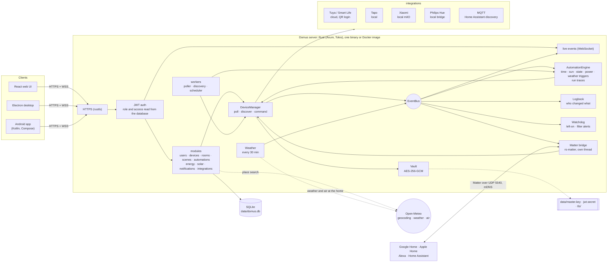
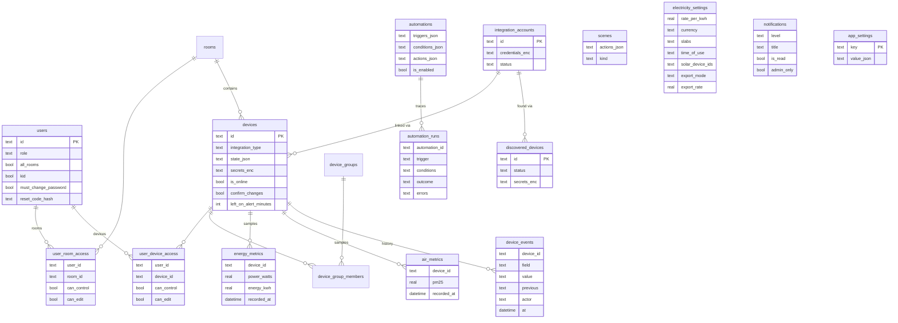

<p align="center">
  <b>Translations</b><br>
  <a href="README.md">English</a> ·
  <a href="README.ar.md">العربية</a> ·
  <a href="README.bn.md">বাংলা</a> ·
  <a href="README.de.md">Deutsch</a> ·
  <a href="README.es.md">Español</a> ·
  <a href="README.fr.md">Français</a> ·
  <a href="README.gu.md">ગુજરાતી</a> ·
  <a href="README.hi.md">हिन्दी</a> ·
  <a href="README.id.md">Bahasa Indonesia</a> ·
  <a href="README.it.md">Italiano</a> ·
  <a href="README.ja.md">日本語</a> ·
  <a href="README.kn.md">ಕನ್ನಡ</a> ·
  <a href="README.ko.md">한국어</a> ·
  <a href="README.ml.md">മലയാളം</a> ·
  <a href="README.mr.md">मराठी</a> ·
  <a href="README.pa.md">ਪੰਜਾਬੀ</a> ·
  <a href="README.pl.md">Polski</a> ·
  <a href="README.pt-BR.md">Português (Brasil)</a> ·
  <a href="README.ru.md">Русский</a> ·
  <a href="README.ta.md">தமிழ்</a> ·
  <a href="README.te.md">తెలుగు</a> ·
  <a href="README.th.md">ไทย</a> ·
  <a href="README.tr.md">Türkçe</a> ·
  <a href="README.ur.md">اردو</a> ·
  <a href="README.vi.md">Tiếng Việt</a> ·
  <a href="README.zh-CN.md">简体中文</a> ·
  <a href="README.zh-TW.md">繁體中文</a>
</p>


# Domus

[](https://github.com/aiyu-ayaan/Domus-Rust/actions/workflows/release.yml)
[](https://github.com/aiyu-ayaan/Domus-Rust/releases)
[](LICENSE)
[](https://github.com/aiyu-ayaan/Domus-Rust/commits/master)
[](https://hub.docker.com/r/aiyuayaan/domus)
[](https://hub.docker.com/r/aiyuayaan/domus)


Trung tâm nhà thông minh ưu tiên cục bộ (local-first) dành cho máy chủ gia đình của bạn. Sử dụng backend bằng Rust, SQLite, giao diện web React (cùng vỏ bọc máy tính để bàn Electron), tích hợp mô-đun linh hoạt cho **Tuya / Smart Life** (đăng nhập bằng mã QR, không cần tài khoản nhà phát triển), **TP-Link Tapo** (điều khiển cục bộ), **Xiaomi Mi Home** (cục bộ, lấy token từ tài khoản Mi của bạn), **Philips Hue** (cầu nối cục bộ) và **MQTT** (Zigbee2MQTT, ESPHome và bất kỳ thiết bị nào hỗ trợ cơ chế phát hiện của Home Assistant). **Cầu nối Matter** tích hợp sẵn cho phép Google Home, Apple Home, Alexa và Home Assistant bật tắt, điều chỉnh độ sáng và đổi màu các thiết bị đó trực tiếp qua mạng nội bộ của bạn.

- Tự động phát hiện thiết bị mới, hỗ trợ hộp thư đến xét duyệt hoặc tự động thêm
- Bảng điều khiển trực tiếp: công suất tiêu thụ, tiền điện hiện tại và dự kiến, chất lượng không khí, cảm biến chuyển động / cửa / rò rỉ nước / pin
- Quản lý phòng, nhóm thiết bị, ngữ cảnh và tự động hóa; kích hoạt theo thời gian, theo **bình minh hoặc hoàng hôn** (có thể chỉnh độ lệch thời gian), khi trạng thái thiết bị thay đổi, mức công suất (*vượt quá X W trong N phút*), khi mất kết nối mạng hoặc theo **thời tiết ngoài trời**
- **Lịch sử chạy tự động hóa**: mỗi kịch bản tự động hóa lưu lại 50 lần chạy gần nhất, kèm theo trigger kích hoạt và điều kiện đã ngăn chặn thực thi
- **Lịch sử thiết bị**: từng thay đổi của thiết bị kèm đối tượng thực hiện (người dùng và ứng dụng họ sử dụng, kịch bản tự động hóa, Matter, hoặc thao tác trực tiếp trên thiết bị)
- **Cảnh báo thông minh** không cần viết kịch bản: thiết bị bật quá lâu, màng lọc máy lọc không khí sắp hết hạn
- **Cầu nối Matter**: chia sẻ các thiết bị bạn chọn tới Google Home, Apple Home, Alexa hoặc Home Assistant ngay trên mạng cục bộ, không cần tài khoản đám mây
- Hiển thị **thời tiết và chất lượng không khí ngoài trời** tại nhà (qua Open-Meteo, không cần API key) trên bảng điều khiển, ngay cạnh số đo trong nhà
- **Hỏi trước khi chuyển mạch**: chỉ định công tắc chính để mọi ứng dụng, nhóm thiết bị, ngữ cảnh và lệnh chạy thủ công tự động hóa đều hiển thị cảnh báo xác nhận trước khi bật hoặc tắt
- Tính toán tiền điện với giá cố định, bậc thang và **giá theo thời điểm trong ngày (Time-of-day)** bằng bất kỳ loại tiền tệ nào, chi phí **chờ (standby)** của từng thiết bị, và **điện mặt trời**: lượng điện phát, phát ngược lên lưới, cơ chế bù trừ điện năng (net metering) hoặc biểu giá mua điện (feed-in rate)
- Hỗ trợ nhiều người dùng với các vai trò quản trị viên / thành viên / khách, phân quyền chi tiết theo từng phòng hoặc từng thiết bị (chỉ xem, điều khiển hoặc chỉnh sửa)
- Ứng dụng web, ứng dụng máy tính Electron (Linux, Windows) và ứng dụng Android gốc, đồng bộ hóa thời gian thực
- **27 ngôn ngữ** trên giao diện web, ứng dụng máy tính và Android, tự động theo ngôn ngữ hệ thống kèm bộ chọn trong Cài đặt; hỗ trợ bố cục từ phải sang trái (RTL) cho tiếng Ả Rập và tiếng Urdu
- Trang Cập nhật tích hợp hiển thị ghi chú phát hành (định dạng Markdown, bảng biểu và hình ảnh) trong mọi ứng dụng
- Bật HTTPS theo mặc định; thông tin xác thực và khóa thiết bị được mã hóa khi lưu trữ; sao lưu và khôi phục tiện lợi bằng một tệp duy nhất

Tài liệu kiến trúc và sơ đồ chi tiết: [`development/docs/ARCHITECTURE.md`](development/docs/ARCHITECTURE.md), tóm tắt [bên dưới](#how-it-fits-together).
Hồ sơ thiết kế giao diện: [`design-system/domus/MASTER.md`](design-system/domus/MASTER.md).
Tiến độ phát triển: [`development/TODO.md`](development/TODO.md).

<a id="how-it-fits-together"></a>
## Kiến trúc và cách thức hoạt động



Các ứng dụng khách chỉ giao tiếp trực tiếp với máy chủ; máy chủ kết nối với thiết bị của bạn (hoàn toàn cục bộ khi nhà sản xuất hỗ trợ) và lưu trữ toàn bộ dữ liệu trong một tệp SQLite duy nhất. Đám mây chỉ được sử dụng khi nhà sản xuất không cung cấp giao thức điều khiển cục bộ (Tuya) hoặc để lấy khóa thiết bị (Xiaomi), cùng các truy vấn bổ sung: tìm kiếm địa điểm, dữ liệu thời tiết và chất lượng không khí ngoài trời cho ngôi nhà (Open-Meteo, chỉ sau khi đã cấu hình vị trí) và kiểm tra bản cập nhật mới trên GitHub. Cầu nối Matter hoạt động hoàn toàn trong mạng cục bộ.

### Mô hình dữ liệu



Thông tin đăng nhập tài khoản và khóa thiết bị được lưu trữ mã hóa (`*_enc`) với khóa chính `data/master.key`, nằm ngoài cơ sở dữ liệu. Bộ sơ đồ kiến trúc đầy đủ cho từng tính năng có sẵn tại [`development/docs`](development/docs).

## Ảnh chụp màn hình

<p align="center"></p>

**Giao diện máy tính để bàn** (Electron và Web)

<p>
  
  
  
  
  
  
</p>

**Ứng dụng Android gốc**

<p>
  
  
  
  
  
</p>

**Máy tính bảng Android** (giao diện 2 cột từ 840dp, Cài đặt dạng danh sách và chi tiết)

<p>
  
  
  
  
  
</p>

**Giao diện web di động**

<p>
  
  
  
  
  
</p>

Tất cả hình ảnh chụp màn hình được lưu trong [`res/screenshots`](res/screenshots); video trình diễn đầy đủ có tại [`res/domus.mp4`](res/domus.mp4).

## Tải xuống và Cài đặt

| Nền tảng | Cách tải và cài đặt |
|---|---|
| Máy chủ (Docker) | `aiyuayaan/domus` trên Docker Hub, hỗ trợ amd64 và arm64 |
| Android | Tệp `Domus-<version>.apk` từ [trang phát hành mới nhất](https://github.com/aiyu-ayaan/Domus-Rust/releases) |
| Máy tính Linux | Trình cài đặt một dòng lệnh bên dưới, hoặc tệp `.deb` / `.AppImage` từ bản phát hành |
| Máy tính Windows | Tệp `Domus-<version>-Setup.exe` từ trang phát hành |

### Máy chủ

Tất cả những gì máy chủ lưu trữ cần chỉ là một tệp compose:

```bash
mkdir domus && cd domus
wget https://raw.githubusercontent.com/aiyu-ayaan/Domus-Rust/master/docker-compose.yml
docker compose up -d
```

Truy cập `https://<server-ip>:8443` trong trình duyệt và tạo tài khoản quản trị viên. Lệnh `docker compose logs domus` hiển thị vân tay chứng chỉ SSL để bạn xác nhận khi ứng dụng kết nối lần đầu.

```bash
docker compose pull && docker compose up -d      # Cập nhật phiên bản mới
DOMUS_VERSION=beta docker compose up -d          # Theo dõi kênh phát hành: latest (mặc định), beta, alpha hoặc 0.0.1
TZ=Asia/Ho_Chi_Minh DOMUS_PORT=9443 docker compose up -d
docker compose --profile mqtt up -d              # Khởi động kèm broker Mosquitto tùy chọn
```

Đặt các biến `DOMUS_VERSION`, `TZ` và `DOMUS_PORT` vào tệp `.env` cạnh tệp compose để lưu giữ cấu hình.

### Ứng dụng máy tính Linux

Cài đặt bản phát hành mới nhất cho người dùng hiện tại (x86_64, không yêu cầu root): gói AppImage, mục menu hệ thống kèm biểu tượng Domus và lệnh `domus`. Ứng dụng sau đó sẽ tự động duy trì cập nhật.

```bash
curl -fsSL https://raw.githubusercontent.com/aiyu-ayaan/Domus-Rust/master/scripts/install-linux.sh | sh
# ... | sh -s -- --channel beta     Cài đặt cả các bản thử nghiệm beta (hoặc alpha)
# ... | sh -s -- --uninstall        Gỡ cài đặt; các cài đặt cấu hình vẫn được giữ lại
```

### Android

Tải xuống tệp APK từ trang phát hành và mở để cài đặt. Các bản cập nhật tiếp theo sẽ được thông báo khi mở ứng dụng hoặc trong Cài đặt → Cập nhật, hỗ trợ các kênh Stable (Ổn định), Beta hoặc Alpha, và được cài đặt trực tiếp từ đó; hệ điều hành Android sẽ yêu cầu cấp quyền cho phép Domus cài đặt ứng dụng một lần duy nhất.

Trang **Cập nhật** (Cài đặt → Cập nhật trên Android, Cài đặt → Giới thiệu → Cập nhật trên web và máy tính) hiển thị phiên bản đang chạy, bản phát hành mới nhất trên kênh của bạn và ghi chú phát hành bằng Markdown.

Thông tin chi tiết về các bản phát hành, quy chuẩn phiên bản và các kênh cập nhật: [development/docs/RELEASE.md](development/docs/RELEASE.md).

## Yêu cầu hệ thống

- Rust 1.80+ (`cargo`)
- Node.js 18+ và `pnpm`

## Chạy trong môi trường phát triển

```bash
pnpm install
npm run dev            # backend (https://127.0.0.1:8443) + web (http://localhost:3000)

npm run dev:backend    # chỉ chạy backend
npm run dev:web        # chỉ chạy web frontend (chuyển tiếp proxy /api tới backend)
npm run dev:desktop    # chạy Electron; chọn máy chủ trên màn hình kết nối
```

Mở http://localhost:3000. Lần truy cập đầu tiên sẽ yêu cầu bạn tạo tài khoản quản trị viên.

## Triển khai trên máy chủ gia đình

```bash
pnpm build:web                     # biên dịch apps/web/dist, được phục vụ bởi backend
APP_ENV=production cargo run --release --manifest-path backend/Cargo.toml
```

Sau đó mở `https://<server-ip>:8443`. Cầu nối Matter khi được bật sẽ sử dụng thêm cổng UDP 5540 (`[matter] port`) và mDNS trong mạng LAN.

Hoặc biên dịch ảnh Docker trực tiếp từ mã nguồn này (chế độ mạng host, dữ liệu lưu trong volume `domus_data`):

```bash
docker compose -f docker-compose.local.yml up -d --build
```

Chi tiết về truy cập từ xa qua Cloudflare Tunnel, cơ chế tự động chuyển đổi giữa địa chỉ cục bộ và từ xa của ứng dụng, cũng như quy trình đóng gói máy tính để bàn (`pnpm build:desktop`) được mô tả trong [development/docs/DEPLOYMENT.md](development/docs/DEPLOYMENT.md).

Khi khởi động lần đầu, Domus sẽ tạo thư mục `data/` chứa các tệp sau:

| Tệp | Mục đích |
|---|---|
| `domus.db` | Cơ sở dữ liệu SQLite |
| `master.key` | Mã hóa thông tin đăng nhập tích hợp và khóa thiết bị — **hãy sao lưu tệp này** |
| `jwt.secret` | Ký xác thực phiên làm việc người dùng |
| `tls/` | Chứng chỉ tự ký (thay thế qua `tls.cert_path` / `tls.key_path`) |

Cấu hình mặc định nằm trong `config/default.toml`; mọi khóa cấu hình đều có thể ghi đè bằng các biến môi trường dạng `DOMUS__SECTION__KEY` (xem `.env.example`).

## Sao lưu và khôi phục

Toàn bộ dữ liệu được lưu trữ trong `data/`. Bạn có thể sao lưu toàn bộ thư mục hoặc sử dụng tính năng sao lưu một tệp duy nhất:

**Sao lưu:** Đăng nhập với quyền quản trị viên → Cài đặt → **Sao lưu** → *Tải xuống bản sao lưu*. Tệp này là bản sao hoàn chỉnh của cơ sở dữ liệu có chứa khóa chính bên trong, nhờ đó các tài khoản tích hợp đã liên kết vẫn có thể mở được sau khi khôi phục. Bản sao lưu có thể được tạo trực tuyến trong khi máy chủ đang hoạt động. Hãy bảo mật tệp cẩn thận: bất kỳ ai có tệp này đều có thể giải mã các tài khoản đã liên kết. Khóa bí mật JWT và chứng chỉ TLS không nằm trong tệp sao lưu.

**Khôi phục:** Dừng máy chủ, sau đó thực hiện:

```bash
# Môi trường Docker
docker compose cp domus-backup-2026-10-11.db domus:/app/data/restore.db
docker compose stop domus
docker compose run --rm domus domus-backend restore data/restore.db
docker compose start domus

# Khi không dùng Docker, thực thi từ thư mục gốc của repo (thao tác với ./data)
domus-backend restore ~/Downloads/domus-backup-2026-10-11.db
```

Dữ liệu cũ hiện tại sẽ được đổi tên lưu bên cạnh dạng `*.before-restore`. Sau khi khôi phục trên máy mới, người dùng cần đăng nhập lại và các ứng dụng sẽ yêu cầu xác nhận tin cậy chứng chỉ mới. Nếu bạn thiết lập khóa thông qua biến môi trường `DOMUS_MASTER_KEY`, tệp sao lưu sẽ không chứa khóa và máy chủ được khôi phục cần khai báo cùng biến môi trường đó. Xem thêm tại [development/docs/DEPLOYMENT.md](development/docs/DEPLOYMENT.md#backup-and-restore).

## Quên mật khẩu quản trị viên

Domus không có máy chủ gửi thư tích hợp, do đó không có email đặt lại nào được gửi đi. Tùy theo điều kiện thực tế, bạn có thể áp dụng các cách sau:

1. **Nhờ một quản trị viên khác**: mở Cài đặt → Người dùng và quyền truy cập, bật *Mã đặt lại* cho tài khoản của bạn và báo cho bạn mã gồm 8 chữ số (hiệu lực trong 30 phút và tối đa 5 lần nhập sai). Trên màn hình đăng nhập, chọn *Quên mật khẩu?*, nhập tên người dùng rồi nhập mã đó.
2. **Thực hiện trực tiếp trên máy chủ** (hoạt động kể cả khi Domus đang chạy hoặc đang dừng, không cần đăng nhập):

   ```bash
   docker compose exec domus domus-backend reset-password <username>              # In ra mật khẩu ngẫu nhiên mới
   docker compose exec domus domus-backend reset-password <username> 'new-pass'   # Hoặc chỉ định mật khẩu mới (từ 8 ký tự trở lên)
   domus-backend reset-password <username>                                        # Không dùng Docker, chạy từ thư mục gốc repo
   ```

   Đăng nhập bằng mật khẩu mới này rồi đổi lại trong Cài đặt → Mật khẩu.

Trong môi trường sản xuất, nhập sai mật khẩu 5 lần cho cùng một tên người dùng sẽ tạm khóa tài khoản đó trong 15 phút (khởi động lại máy chủ sẽ mở khóa ngay lập tức; tính năng khóa này tắt trong môi trường phát triển). Chi tiết về quy tắc mật khẩu tự sinh và tài khoản trẻ em: [development/docs/ACCOUNTS.md](development/docs/ACCOUNTS.md).

## Đa ngôn ngữ

Hỗ trợ tiếng Anh, tiếng Hindi, tiếng Tây Ban Nha, tiếng Bồ Đào Nha (Brazil), tiếng Indonesia, tiếng Ả Rập, tiếng Pháp, tiếng Nga, tiếng Đức, tiếng Thổ Nhĩ Kỳ, tiếng Nhật, tiếng Hàn, tiếng Ý, tiếng Việt, tiếng Thái, tiếng Trung (Giản thể và Phồn thể), tiếng Ba Lan, tiếng Bengal, tiếng Tamil, tiếng Telugu, tiếng Marathi, tiếng Gujarati, tiếng Kannada, tiếng Malayalam, tiếng Punjabi và tiếng Urdu. Tiếng Ả Rập và tiếng Urdu được thiết kế giao diện theo hướng từ phải sang trái.

Mỗi ứng dụng tự động hiển thị theo ngôn ngữ của trình duyệt hoặc hệ điều hành của bạn, và sẽ quay về tiếng Anh nếu chưa có bản dịch tương ứng. Để chọn ngôn ngữ khác, hãy mở Cài đặt > Ngôn ngữ (nằm trong mục Giao diện trên web và máy tính); tùy chọn *Mặc định hệ thống* sẽ chuyển lại theo hệ điều hành. Trên Android 13 trở lên, bạn cũng có thể tùy chỉnh tại Cài đặt > Ứng dụng > Domus > Ngôn ngữ của điện thoại.

Các bản dịch được tạo bằng công cụ dịch máy và chưa được người bản ngữ hiệu đính hoàn toàn, do đó một số câu từ có thể chưa thật chuẩn xác. Bạn có thể đóng góp chỉnh sửa chỉ bằng một dòng thay đổi trong danh mục ngôn ngữ tương ứng. Cách thức vận hành đa ngôn ngữ, cách thêm ngôn ngữ mới và quy tắc bổ sung văn bản: [development/docs/LOCALIZATION.md](development/docs/LOCALIZATION.md).

## Kết nối thiết bị

| Thương hiệu | Cách kết nối |
|---|---|
| Tuya / Smart Life | Tích hợp → *Liên kết bằng mã QR*. Nhập **Mã người dùng (User Code)** từ ứng dụng Smart Life (Tôi → Cài đặt → Tài khoản và bảo mật → Mã người dùng), sau đó quét mã QR hiển thị trên màn hình. |
| Tapo | Tích hợp → *Liên kết tài khoản* bằng TP-Link ID của bạn. Các thiết bị trên mạng LAN sẽ được tự động tìm kiếm và điều khiển cục bộ. Hub H100 sẽ mang theo các cảm biến, công tắc và bộ điều nhiệt đi kèm. Camera hiện chỉ liệt kê và chưa hỗ trợ điều khiển chi tiết. |
| Xiaomi | Tích hợp → *Liên kết tài khoản* bằng tài khoản Mi và khu vực máy chủ của bạn. Nếu Xiaomi yêu cầu xác minh hai bước, hãy nhập mã gửi qua email hoặc tin nhắn SMS vào cùng bảng điều khiển. Tài khoản có thể là email, số điện thoại kèm mã quốc gia (`+84…`) hoặc ID Xiaomi. Token chỉ cần lấy một lần; quá trình điều khiển sau đó là hoàn toàn cục bộ. Bạn cũng có thể thêm thiết bị thủ công bằng token. |
| Philips Hue | Nhấn nút tròn trên bridge, sau đó chọn Tích hợp → Philips Hue → *Liên kết* trong vòng 30 giây. Để trống địa chỉ IP để tự động quét tìm bridge trên mạng LAN. Đèn và phích cắm thông minh Hue được điều khiển hoàn toàn cục bộ. |
| MQTT | Tích hợp → MQTT → *Liên kết* với địa chỉ broker, cổng và thông tin đăng nhập của bạn. Các thiết bị tự công bố qua giao thức Home Assistant MQTT discovery (Zigbee2MQTT, ESPHome, …) sẽ xuất hiện trong mục Đã phát hiện: hỗ trợ đèn, công tắc, phích cắm, quạt và cảm biến. Với broker đi kèm (`--profile mqtt`), địa chỉ là `mqtt`, cổng `1883`. |

Xem `development/docs/INTEGRATIONS.md` để biết chi tiết các thiết bị được hỗ trợ cho từng tích hợp.

## Quản lý gói giá điện

Điện năng → *Gói giá điện*: chọn bất kỳ loại tiền tệ nào, hỗ trợ biểu giá cố định cho mỗi kWh hoặc biểu giá theo **bậc thang (Slabs)** cho các mức tính lũy tiến (ví dụ: bậc 1 cho 0–100 số điện, bậc 2 cho 101–300 số, v.v.). Hóa đơn được tính tự động theo từng chu kỳ thanh toán, cộng thêm phí cố định hàng tháng nếu có.

Biểu giá cũng hỗ trợ các khung giờ **theo thời điểm trong ngày (Time-of-day)**: các khung giờ (theo đồng hồ tại nhà, cho phép qua nửa đêm) có giá mỗi số điện chênh lệch tăng hoặc giảm, ví dụ như chiết khấu giá điện ban đêm hoặc phụ phí giờ cao điểm, cộng dồn vào mức giá cố định hoặc bậc thang.

Các thiết bị mới quét được sẽ xuất hiện trong mục **Thiết bị → Đã phát hiện**. Bật tính năng *Tự động thêm thiết bị mới* tại đây để bỏ qua bước xét duyệt thủ công.

## Bình minh và hoàng hôn

Cài đặt vị trí ngôi nhà trong Cài đặt → **Vị trí ngôi nhà**: sử dụng định vị của điện thoại hoặc trình duyệt này, tìm kiếm theo tên thị trấn/thành phố (máy chủ truy vấn dịch vụ miễn phí của Open-Meteo; chỉ tên bạn nhập mới gửi ra ngoài), hoặc nhập thủ công vĩ độ và kinh độ. Tọa độ được làm tròn tới khoảng một kilômét và chỉ lưu trên máy chủ của bạn. Khi đó kịch bản tự động hóa có thể kích hoạt lúc bình minh hoặc hoàng hôn, trước hoặc sau bao nhiêu phút tùy chỉnh. Nếu chưa thiết lập vị trí, các trigger mặt trời sẽ không bao giờ kích hoạt.

## Hỏi trước khi chuyển mạch

Một công tắc tổng cấp nguồn cho nhiều thiết bị rất dễ bị bấm tắt do sơ ý. Hãy mở bảng chi tiết của thiết bị đó và bật **Hỏi trước khi chuyển mạch**: khi đó mọi ứng dụng sẽ hiển thị hộp thoại xác nhận trước khi bật hoặc tắt, tương tự như với tính năng *Bật tất cả / Tắt tất cả* của phòng, nhóm thiết bị, ngữ cảnh (bao gồm cả ngữ cảnh lồng nhau) và nút *Chạy* thủ công của kịch bản tự động hóa liên quan. Cài đặt này được lưu trên máy chủ nên hoạt động đồng nhất trên web, máy tính và Android. Các kịch bản tự động hóa kích hoạt độc lập theo lịch sẽ chạy trực tiếp theo kịch bản mà không hỏi, và các thao tác ngoài hệ thống Domus (ứng dụng của hãng, công tắc vật lý trên tường) không chịu ảnh hưởng.

## Hỗ trợ Matter (Google Home, Apple Home, Alexa)

Cài đặt → **Matter** (dành cho quản trị viên): bật tính năng, tích chọn các thiết bị muốn chia sẻ, sau đó quét mã QR hoặc nhập mã ghép nối trong ứng dụng Google Home, Apple Home, Alexa hoặc Home Assistant. Đèn sẽ được nhận diện là đèn đổi màu hoặc đèn điều chỉnh độ sáng, mọi thiết bị có công tắc bật/tắt khác sẽ được xem như phích cắm thông minh; các thao tác bật/tắt, làm mờ và đổi màu đều hoạt động chuẩn xác, và các thay đổi thực hiện từ Domus (bật/tắt, độ sáng) sẽ đồng bộ trực tiếp tới bộ điều khiển trung tâm. Nút "Cho phép ghép nối trong 15 phút" dùng để thêm hệ sinh thái thứ hai; "Quên mọi ghép nối" sẽ làm mới và tạo mã ghép nối hoàn toàn mới.

Cầu nối này hiện chưa có chứng chỉ thương mại chính thức (sử dụng chứng chỉ thử nghiệm của Matter), vì vậy các ứng dụng bên thứ ba sẽ yêu cầu bạn xác nhận thêm, và Google Home chỉ chấp nhận sau khi cầu nối được thêm dưới dạng thiết bị thử nghiệm trong Google Home Developer Console. Chi tiết xem tại: [`development/docs/MATTER.md`](development/docs/MATTER.md).

## Lịch sử thiết bị, nhật ký tự động hóa và cảnh báo

- **Lịch sử** trên bảng chi tiết mỗi thiết bị: xem điều gì đã thay đổi, thời gian và ai đã thực hiện (*Bởi Ayaan · Android*, *Tự động hóa "Chế độ ban đêm"*, *Matter*, *Thao tác trên thiết bị*). Được lưu giữ cùng khoảng thời gian với lịch sử năng lượng.
- **Lịch sử chạy** của từng kịch bản tự động hóa: ghi nhận trạng thái *Đã chạy*, *Thất bại* kèm mã lỗi, hoặc *Đã bỏ qua* kèm điều kiện ngăn cản, giúp bạn giải đáp chính xác câu hỏi "tại sao kịch bản không chạy?".
- **Cảnh báo khi bật quá lâu** trong bảng chi tiết thiết bị (từ 30 phút đến 12 giờ): gửi thông báo cho quản trị viên. Thiết bị có đo công suất được tính là đang bật khi công suất trên 10 W, tránh cảnh báo nhầm khi tivi ở chế độ chờ.
- **Màng lọc sắp hết hạn**: gửi thông báo khi tuổi thọ màng lọc của máy lọc không khí giảm xuống còn 10%.

## Thời tiết, công suất chờ và điện mặt trời

- Khi đã thiết lập vị trí ngôi nhà, bảng điều khiển sẽ hiển thị **thời tiết và chỉ số bụi mịn PM2.5 ngoài trời** bên cạnh số đo trong nhà, và các kịch bản tự động hóa có thể sử dụng các số liệu này (*khi PM2.5 ngoài trời vượt quá 35*, *chỉ khi nhiệt độ ngoài trời dưới 20°C*).
- Điện năng → **Chờ**: liệt kê lượng điện mỗi thiết bị tiêu thụ khi không có người sử dụng (giờ có công suất thấp nhất trong tuần này) và chi phí ước tính mỗi tháng.
- Điện năng → *Gói giá điện* → **Điện mặt trời**: tích chọn các phích cắm đo sản lượng điện mặt trời phát ra, sau đó chọn cơ chế bù trừ điện năng (net metering) hoặc biểu giá mua điện (feed-in rate). Hóa đơn tiền điện khi đó sẽ chỉ tính phần điện bạn mua từ lưới, và thẻ Điện mặt trời sẽ hiển thị rõ ràng lượng điện sản xuất, tự dùng tại nhà, phát lên lưới và số tiền kiếm được. Dòng điện lưới được tính toán 15 phút một lần từ các thiết bị có đo lường, do đó các thiết bị không có cảm biến đo có thể khiến chỉ số điện phát lên lưới hiển thị cao hơn thực tế.

Kế hoạch phát triển và sơ đồ: [`development/docs/ROADMAP.md`](development/docs/ROADMAP.md).

## Giấy phép

Domus được phát hành theo [Giấy phép MIT](LICENSE). Các thư viện của bên thứ ba giữ nguyên giấy phép ban đầu tương ứng; danh sách chi tiết có tại mục Giới thiệu → Lời cảm ơn trong từng ứng dụng.

## Kiểm thử

```bash
cargo test --workspace
pnpm --filter @domus/web exec tsc -b
```

Lệnh `cargo test --workspace` bao gồm cả bài kiểm tra tích hợp `backend/tests/matter_bridge.rs`, thực hiện ghép nối bộ điều khiển Matter với cầu nối qua UDP và kiểm tra khả năng bật tắt, làm mờ và đổi màu thiết bị (yêu cầu giao diện mạng hỗ trợ IPv4).
