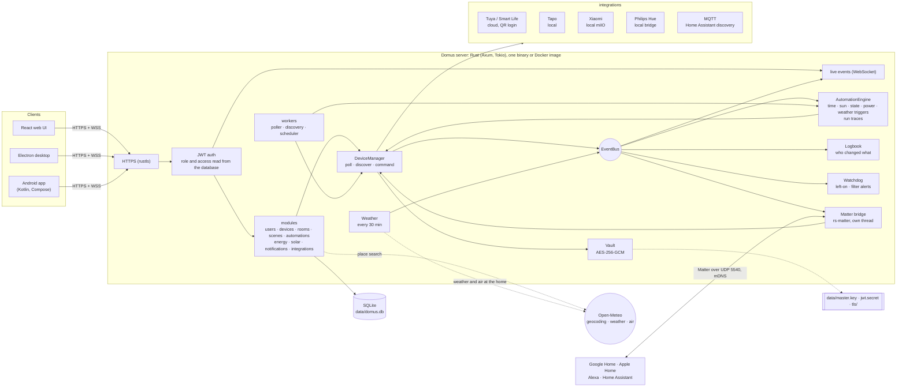
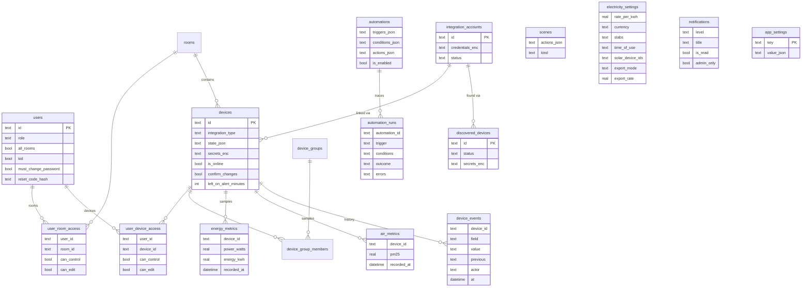

# Domus

<p align="center">
  <b>Translations</b><br>
  <a href="README.md">English</a> ·
  <a href="README.ar.md">العربية</a> ·
  <a href="README.bn.md">বাংলা</a> ·
  <a href="README.de.md">Deutsch</a> ·
  <a href="README.es.md">Español</a> ·
  <a href="README.fr.md">Français</a> ·
  <a href="README.gu.md">ગુજરાતી</a> ·
  <a href="README.hi.md">हिन्दी</a> ·
  <a href="README.id.md">Bahasa Indonesia</a> ·
  <a href="README.it.md">Italiano</a> ·
  <a href="README.ja.md">日本語</a> ·
  <a href="README.kn.md">ಕನ್ನಡ</a> ·
  <a href="README.ko.md">한국어</a> ·
  <a href="README.ml.md">മലയാളം</a> ·
  <a href="README.mr.md">मराठी</a> ·
  <a href="README.pa.md">ਪੰਜਾਬੀ</a> ·
  <a href="README.pl.md">Polski</a> ·
  <a href="README.pt-BR.md">Português (Brasil)</a> ·
  <a href="README.ru.md">Русский</a> ·
  <a href="README.ta.md">தமிழ்</a> ·
  <a href="README.te.md">తెలుగు</a> ·
  <a href="README.th.md">ไทย</a> ·
  <a href="README.tr.md">Türkçe</a> ·
  <a href="README.ur.md">اردو</a> ·
  <a href="README.vi.md">Tiếng Việt</a> ·
  <a href="README.zh-CN.md">简体中文</a> ·
  <a href="README.zh-TW.md">繁體中文</a>
</p>

[](https://github.com/aiyu-ayaan/Domus-Rust/actions/workflows/release.yml)
[](https://github.com/aiyu-ayaan/Domus-Rust/releases)
[](LICENSE)
[](https://github.com/aiyu-ayaan/Domus-Rust/commits/master)
[](https://hub.docker.com/r/aiyuayaan/domus)
[](https://hub.docker.com/r/aiyuayaan/domus)


[](https://ghloc.dev/aiyu-ayaan/Domus)


专为您的家庭服务器打造的本地优先（Local-First）智能家居中心。采用 Rust 后端、SQLite、React 网页界面（以及 Electron 桌面应用外壳），并提供可插拔式集成，支持 **Tuya / 智能生活**（二维码扫码登录，无需开发者账号）、**TP-Link Tapo**（局域网本地控制）、**小米米家 (Xiaomi Mi Home)**（本地控制，从您的小米账号获取 Token）、**飞利浦 Hue (Philips Hue)**（本地网桥）以及 **MQTT**（Zigbee2MQTT、ESPHome 以及任何支持 Home Assistant 发现协议的设备）。内置 **Matter 网桥**，让 Google Home、Apple Home、Alexa 和 Home Assistant 能够通过您自己的局域网控制这些设备的开关、调光和调色。

- 自动发现新设备，支持收件箱审核或自动添加
- 实时仪表盘：实时功耗、当前账单与预计电费、空气质量、人体移动 / 门窗 / 漏水 / 电池读数
- 房间、设备群组、场景与自动化；支持定时触发、**日出或日落**（可设偏移）、设备状态变化、功率水平（包括*持续超 X 瓦达 N 分钟*）、离线提醒或**室外天气**
- **自动化运行记录**：每个自动化保留最近 50 次运行记录，包含触发条件以及阻止其执行的限制条件
- **设备历史记录**：设备的每一次状态变更以及操作者（具体用户及其使用的客户端应用、自动化、Matter 还是设备本身）
- 无需编写自动化即可使用的**智能告警**：设备开启过久提醒、空气净化器滤芯耗尽预警
- **Matter 网桥**：将选定的设备本地共享给 Google Home、Apple Home、Alexa 或 Home Assistant，无需任何云端账户
- 仪表盘展示家庭所在地的**室外天气与空气质量**（通过 Open-Meteo，无需 API 密钥），与室内读数并排对比
- **切换前询问**：为主开关设置防误触保护，所有客户端应用、群组、场景及手动运行自动化在开关它之前都会弹出确认提示
- 电费计量：支持任意货币的固定电价、阶梯电价与**分时电价 (Time-of-day)**，设备**待机成本**分析，以及**太阳能**：发电量、上网电量、净计量电价 (Net metering) 或上网标杆电价 (Feed-in rate)
- 多用户支持：具备管理员 / 成员 / 访客角色，支持细化至每个房间或每个设备的权限控制（仅查看、控制或编辑）
- 网页端、Electron 桌面端（Linux、Windows）与原生 Android 应用，全平台实时双向同步
- 网页、桌面和 Android 应用支持 **27 种语言**，默认跟随系统语言，也可在“设置”中手动切换；阿拉伯语和乌尔都语支持从右到左 (RTL) 排版
- 各应用均内置“更新”页面，展示格式精美的版本更新说明（包含 Markdown、表格与图片）
- 默认启用 HTTPS；凭据与设备密钥在静态存储中加密；支持单文件一键备份与恢复

系统架构与图表详情请参阅 [`development/docs/ARCHITECTURE.md`](development/docs/ARCHITECTURE.md)，简要说明见[下方](#how-it-fits-together)。
UI 设计规范：[`design-system/domus/MASTER.md`](design-system/domus/MASTER.md)。
开发进度：[`development/TODO.md`](development/TODO.md)。

<a id="how-it-fits-together"></a>
## 系统架构与工作原理



客户端仅与服务器通信；服务器与您的设备通信（在厂商支持的情况下完全走本地通信），并将所有数据集中保存在单个 SQLite 数据库文件中。仅在厂商未提供本地控制接口（Tuya）或提取设备密钥（Xiaomi）时才会使用云端，此外还用于可选的查询：家庭所在地的地点搜索、天气和室外空气质量（Open-Meteo，仅在设定了位置后生效）以及检查 GitHub 更新。Matter 网桥则仅在局域网内运行。

### 数据模型



账户凭据和设备密钥以加密密封形式（`*_enc`）保存在 `data/master.key` 密钥保护下，该主密钥不存储在数据库中。完整的功能架构图请参阅 [`development/docs`](development/docs)。

## 界面截图

<p align="center"></p>

**桌面端**（Electron 与网页端）

<p>
  
  
  
  
  
  
</p>

**Android 原生应用**

<p>
  
  
  
  
  
</p>

**Android 平板端**（840dp 以上双栏布局，“设置”采用列表与详情视图）

<p>
  
  
  
  
  
</p>

**移动端网页**

<p>
  
  
  
  
  
</p>

所有截图原图均收录于 [`res/screenshots`](res/screenshots)；高清完整演示视频请参阅 [`res/domus.mp4`](res/domus.mp4)。

## 下载与安装

| 平台 | 下载与获取方式 |
|---|---|
| 服务器端 (Docker) | Docker Hub 上的 `aiyuayaan/domus`，支持 amd64 与 arm64 |
| Android | 从[最新 Release 发布页面](https://github.com/aiyu-ayaan/Domus-Rust/releases)下载 `Domus-<version>.apk` |
| Linux 桌面端 | 运行下方的单行安装脚本，或从 Release 下载 `.deb` / `.AppImage` |
| Windows 桌面端 | 从 Release 下载 `Domus-<version>-Setup.exe` |

### 服务器端

宿主机只需一个 compose 文件即可快速启动：

```bash
mkdir domus && cd domus
wget https://raw.githubusercontent.com/aiyu-ayaan/Domus-Rust/master/docker-compose.yml
docker compose up -d
```

打开 `https://<server-ip>:8443` 并创建管理员账号。运行 `docker compose logs domus` 可以查看证书指纹，客户端在首次连接时会提示您确认该指纹。

```bash
docker compose pull && docker compose up -d      # 更新版本
DOMUS_VERSION=beta docker compose up -d          # 跟踪更新通道：latest (默认)、beta、alpha 或指定 0.0.1
TZ=Asia/Shanghai DOMUS_PORT=9443 docker compose up -d
docker compose --profile mqtt up -d              # 同时启动可选的 Mosquitto MQTT Broker
```

您可以将 `DOMUS_VERSION`、`TZ` 和 `DOMUS_PORT` 写入 compose 文件同目录下的 `.env` 文件以便持久保留配置。

### Linux 桌面端应用

为当前用户安装最新版本（x86_64，无需 root 权限）：包含 AppImage、带有 Domus 图标的系统桌面菜单项以及 `domus` 终端命令。应用安装后将自动保持更新。

```bash
curl -fsSL https://raw.githubusercontent.com/aiyu-ayaan/Domus-Rust/master/scripts/install-linux.sh | sh
# ... | sh -s -- --channel beta     同时获取 beta 测试版本（或 alpha）
# ... | sh -s -- --uninstall        卸载应用；个人配置保留
```

### Android 移动端

从 Release 页面下载 APK 并打开安装。后续更新会在打开应用时或在“设置 → 更新”中提示，支持选择 Stable（稳定版）、Beta 或 Alpha 通道并在应用内直接安装；Android 系统仅需授权一次允许 Domus 安装应用即可。

**更新**页面（Android 位于“设置 → 更新”，网页与桌面端位于“设置 → 关于 → 更新”）会显示当前运行版本、所选通道中的最新版本以及格式化的 Markdown 发行说明。

有关版本发布、版本号规范及更新通道的详细信息，请参阅 [development/docs/RELEASE.md](development/docs/RELEASE.md)。

## 环境要求

- Rust 1.80+ (`cargo`)
- Node.js 18+ 与 `pnpm`

## 本地开发运行

```bash
pnpm install
npm run dev            # 后端 (https://127.0.0.1:8443) + 网页端 (http://localhost:3000)

npm run dev:backend    # 仅运行后端
npm run dev:web        # 仅运行前端网页（将 /api 代理转发至后端）
npm run dev:desktop    # 运行 Electron；在连接页面选择服务器地址
```

打开 http://localhost:3000。首次访问会提示您创建管理员账户。

## 在家庭服务器上部署运行

```bash
pnpm build:web                     # 构建 apps/web/dist，由后端静态托管
APP_ENV=production cargo run --release --manifest-path backend/Cargo.toml
```

然后在浏览器中打开 `https://<server-ip>:8443`。Matter 网桥启用后，还会在局域网内使用 UDP 5540（`[matter] port`）和 mDNS。

或者从源码构建 Docker 镜像（使用 host 网络模式，数据持久化于 `domus_data` 卷）：

```bash
docker compose -f docker-compose.local.yml up -d --build
```

关于通过 Cloudflare Tunnel 实现远程访问、客户端自动切换内外网地址，以及桌面端打包命令（`pnpm build:desktop`），请参阅 [development/docs/DEPLOYMENT.md](development/docs/DEPLOYMENT.md)。

首次启动时，Domus 会在 `data/` 目录下创建以下文件：

| 文件 | 用途说明 |
|---|---|
| `domus.db` | SQLite 数据库文件 |
| `master.key` | 加密第三方集成凭据和设备密钥的主密钥 —— **务必做好备份** |
| `jwt.secret` | 用于签名用户会话 Token |
| `tls/` | 自签名 SSL 证书（可通过 `tls.cert_path` / `tls.key_path` 替换为自定义证书） |

默认配置位于 `config/default.toml`；任何配置项都可以通过 `DOMUS__SECTION__KEY` 环境变量进行覆盖（可参考 `.env.example`）。

## 备份与恢复

所有运行数据均保存在 `data/` 目录中。您可以备份整个目录，也可以使用单文件备份功能：

**备份：** 以管理员身份登录 → 设置 → **备份** → *下载备份*。导出的备份文件是包含主密钥的数据库完整副本，因此在恢复后已关联的第三方账户依然能够正常解密打开。备份可在服务器运行期间在线生成。请妥善保管该文件：任何拥有此文件的人都可以解密相关账户。JWT 密钥和 TLS 证书不会包含在备份中。

**恢复：** 停止服务器，然后执行：

```bash
# Docker 容器环境
docker compose cp domus-backup-2026-10-11.db domus:/app/data/restore.db
docker compose stop domus
docker compose run --rm domus domus-backend restore data/restore.db
docker compose start domus

# 非 Docker 环境，在仓库根目录执行（默认操作 ./data）
domus-backend restore ~/Downloads/domus-backup-2026-10-11.db
```

原有的旧文件将被备份保存在旁边并命名为 `*.before-restore`。在新机器上恢复后，用户需要重新登录，各客户端应用会提示信任新的 SSL 证书。如果您之前是通过环境变量 `DOMUS_MASTER_KEY` 指定的主密钥，则备份文件中不会包含密钥，恢复后的新服务器需要配置相同的环境变量。详情参阅 [development/docs/DEPLOYMENT.md](development/docs/DEPLOYMENT.md#backup-and-restore)。

## 忘记管理员密码

Domus 内置不包含邮件发送服务，因此不会发送找回邮件。可根据情况选用以下两种方式：

1. **由另一位管理员协助**：打开 设置 → 成员与权限，为您启用*重置码*并告知您生成的 8 位数字验证码（有效期 30 分钟，最多允许 5 次错误尝试）。在登录界面点击*忘记密码？*，输入您的用户名以及该重置码即可。
2. **在服务器终端重置**（在 Domus 运行或停止状态下均可，无需登录）：

   ```bash
   docker compose exec domus domus-backend reset-password <username>              # 输出生成的随机新密码
   docker compose exec domus domus-backend reset-password <username> 'new-pass'   # 或直接指定新密码（8 位以上）
   domus-backend reset-password <username>                                        # 非 Docker 环境，在仓库根目录执行
   ```

   使用重置后的密码登录，并在 设置 → 密码 中修改密码。

在生产环境中，连续输错 5 次密码将锁定该用户名 15 分钟（重启服务器可立即解除锁定，开发环境下此限制默认关闭）。有关自动生成密码规则和儿童账户权限的详细信息，请参阅 [development/docs/ACCOUNTS.md](development/docs/ACCOUNTS.md)。

## 多语言支持

支持英语、印地语、西班牙语、葡萄牙语（巴西）、印度尼西亚语、阿拉伯语、法语、俄语、德语、土耳其语、日语、韩语、意大利语、越南语、泰语、中文（简体和繁体）、波兰语、孟加拉语、泰米尔语、泰卢固语、马拉地语、古吉拉特语、卡纳达语、马拉雅拉姆语、旁遮普语和乌尔都语。阿拉伯语与乌尔都语采用从右到左 (RTL) 的界面排版。

各客户端会自动跟随浏览器或操作系统的语言设置；若当前系统语言暂无对应翻译，则回退显示为英语。如需切换语言，可前往 设置 > 语言（网页与桌面端位于“外观”中）；选择*系统默认*即可恢复跟随系统。在 Android 13 及更高版本上，也可以在手机系统的“设置 > 应用 > Domus > 语言”中单独设置。

翻译内容由机器翻译生成，未经母语者逐字审校，可能存在表述不够精准之处。修复翻译只需在对应语言的语言包目录中修改对应单行即可。关于多语言机制、如何添加新语言以及新增文案的规范，请参阅 [development/docs/LOCALIZATION.md](development/docs/LOCALIZATION.md)。

## 设备连接与集成

| 品牌 / 协议 | 连接方式 |
|---|---|
| Tuya / 智能生活 (Smart Life) | 集成 → *使用 QR 码关联*。输入来自 Smart Life 应用的用户代码 (User Code)（我的 → 设置 → 账号与安全 → 用户代码），然后在手机应用中扫描屏幕上的二维码。 |
| Tapo | 集成 → 使用您的 TP-Link ID *关联账户*。局域网内的设备将被自动发现并实现本地控制。支持 H100 网关及其下属的传感器、开关与温控器。摄像头目前仅列表展示，暂未完全支持。 |
| 小米 (Xiaomi) | 集成 → 使用您的小米账号及服务器区域*关联账户*。如果小米提示两步验证，请在弹出的面板中输入收到的短信或邮件验证码。账号支持填写邮箱、带国家代码的手机号（`+86…`）或小米 ID。Token 仅需获取一次，后续为完全本地控制。也支持直接通过 Token 手动添加设备。 |
| 飞利浦 Hue (Philips Hue) | 按下 Hue 桥接器上的圆形大按钮，然后在 30 秒内点击 集成 → Philips Hue → *关联*。留空 IP 地址可自动搜索局域网网桥。灯光与 Hue 智能插座均通过本地直接控制。 |
| MQTT | 集成 → MQTT → 输入 Broker 地址、端口和登录信息点击*关联*。通过 Home Assistant MQTT 自动发现协议（Zigbee2MQTT、ESPHome 等）广播的设备将显示在“已发现”列表中：支持灯光、开关、插座、风扇和传感器。使用内置 Broker（`--profile mqtt`）时，地址填写 `mqtt`，端口为 `1883`。 |

各项集成支持的具体设备类型详见 `development/docs/INTEGRATIONS.md`。

## 电费与计费方案

能源 → *电价方案*：可自由选择任意货币，支持按 kWh 统一计费的固定电价，或按用电度数阶梯递增的**阶梯电价 (Slabs)**（例如：0–100 度为第一档费率，101–300 度为第二档，以此类推）。系统按账单周期计算总电费，并可计入每月固定基本电费。

费率还支持配置**分时电价 (Time-of-day)** 窗口：按家庭本地时间设置特定时段（支持跨午夜），在固定或阶梯基础价格上按每度电叠加浮动加价或优惠（例如夜间谷时折扣或高峰时段附加费）。

新扫描到的设备会出现在**设备 → 已发现**中。在此开启*自动添加新设备*可跳过收件箱直接添加。

## 日出与日落

在 设置 → **家庭位置** 中配置家庭所在地：可直接使用当前手机或浏览器的定位，搜索所在城镇名称（服务器向免费的 Open-Meteo 地理编码服务发起请求；只有您输入的地点名称离开局域网），或者手动输入经纬度。坐标会自动模糊舍入至约 1 公里精度，并保存在本地服务器中。配置后，自动化即可在日出或日落前后的指定分钟数自动触发。未设置家庭位置时，日出日落触发器将不会生效。

## 切换前询问

对于为重要电器供电的主开关，很容易因误触而不小心关闭。打开设备详情页并启用**切换前询问**：之后所有客户端在打开或关闭该设备前都会弹出确认提示；房间的*全开 / 全关*、设备群组、场景（包括嵌套调用的子场景）以及手动*运行*包含该设备开关操作的自动化时同样会进行询问提示。该配置存储在服务器端，在网页、桌面端和 Android 端完全统一。自动定时触发执行的自动化不会弹出询问并按既定规则运行，Domus 系统之外的操作（如厂商官方 App、物理墙壁开关）不受此限制。

## Matter 支持（Google Home、Apple Home、Alexa）

设置 → **Matter**（需要管理员权限）：开启功能，勾选需要共享的设备，然后在 Google Home、Apple Home、Alexa 或 Home Assistant 中扫描二维码或输入配对码。灯具将映射为彩光或可调光灯，所有带开关功能的其他设备将映射为智能插座；支持开关、调光和调色，且在 Domus 中进行的状态调整（开关、亮度）会实时同步至外部中控器。“允许配对 15 分钟”可用于添加第二个智能家居生态平台；“忘记所有配对”则会重置并生成全新的配对码。

该网桥目前未经 Matter 官方商业认证（采用 Matter 测试认证凭据），因此添加时第三方应用会提示您确认，且 Google Home 需要先在 Google Home Developer Console 中将网桥添加为测试设备后方可接受。详情参阅 [`development/docs/MATTER.md`](development/docs/MATTER.md)。

## 历史记录、自动化运行日志与警报

- 设备详情页中的**历史记录**：展示设备属性的每一次变化、发生时间以及触发者（*由 Ayaan 操作 · Android*、*自动化 "夜间模式"*、*Matter*、*在设备上操作*）。保存时长与能源统计历史一致。
- 自动化**运行记录**：清晰记录每次触发的结果为*已运行*、带错误详情的*已失败*、或显示具体阻断条件的*已跳过*，让“为什么没有触发”一目了然。
- 设备详情页中的**开启过久提醒**（可设 30 分钟至 12 小时）：超时未关闭时向管理员推送通知。对于具备功率计量的设备，功率大于 10 W 视为开启，待机状态的电视不会触发误报。
- **滤芯耗尽预警**：当空气净化器滤芯寿命降至 10% 时自动发送通知。

## 天气、待机能耗与太阳能

- 设置家庭位置后，仪表盘会在室内空气数据旁展示室外的**实时天气与户外 PM2.5 读数**，自动化亦可直接调用这些数据（例如：*当室外 PM2.5 超过 35 时*、*仅当室外气温低于 20 度时*）。
- 能源 → **待机**：列出每个设备在无人使用时的空闲功耗（取本周最低一小时读数）以及换算出的每月待机耗电成本。
- 能源 → *电价方案* → **太阳能**：勾选用于计量太阳能发电量的智能插座，然后选择净计量 (Net metering) 或上网标杆电价 (Feed-in rate)。电费账单将仅计算从电网购入的电量，同时“太阳能”卡片会完整展示总发电量、自用电量、上网电量与发电收益。电网潮流每 15 分钟根据计量设备汇总计算，因此未接入计量的电器的耗电可能会使计算出的上网电量偏高。

开发计划与设计图：[`development/docs/ROADMAP.md`](development/docs/ROADMAP.md)。

## 开源许可证

Domus 基于 [MIT License](LICENSE) 开源发布。所引用的第三方开源库保留各自的开源协议；各客户端的“关于 → 致谢”页面中列出了完整的依赖许可清单。

## 测试

```bash
cargo test --workspace
pnpm --filter @domus/web exec tsc -b
```

`cargo test --workspace` 包含 `backend/tests/matter_bridge.rs` 测试用例，该测试通过 UDP 将 Matter 控制器与网桥配对，并测试设备的开关、调光和调色功能（需要可用的 IPv4 网络接口）。
