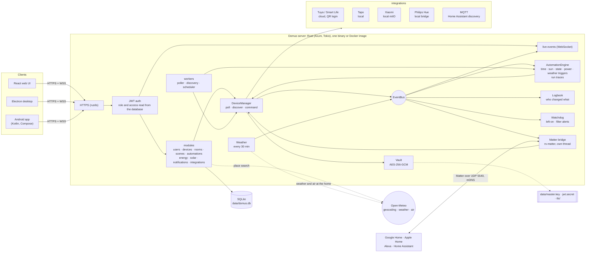
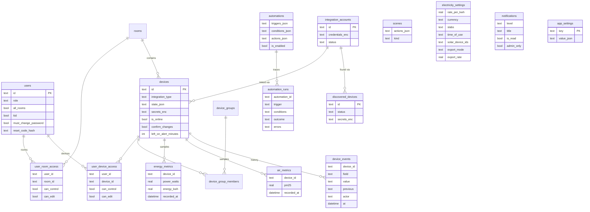

# Domus

<p align="center">
  <b>Translations</b><br>
  <a href="README.md">English</a> ·
  <a href="README.ar.md">العربية</a> ·
  <a href="README.bn.md">বাংলা</a> ·
  <a href="README.de.md">Deutsch</a> ·
  <a href="README.es.md">Español</a> ·
  <a href="README.fr.md">Français</a> ·
  <a href="README.gu.md">ગુજરાતી</a> ·
  <a href="README.hi.md">हिन्दी</a> ·
  <a href="README.id.md">Bahasa Indonesia</a> ·
  <a href="README.it.md">Italiano</a> ·
  <a href="README.ja.md">日本語</a> ·
  <a href="README.kn.md">ಕನ್ನಡ</a> ·
  <a href="README.ko.md">한국어</a> ·
  <a href="README.ml.md">മലയാളം</a> ·
  <a href="README.mr.md">मराठी</a> ·
  <a href="README.pa.md">ਪੰਜਾਬੀ</a> ·
  <a href="README.pl.md">Polski</a> ·
  <a href="README.pt-BR.md">Português (Brasil)</a> ·
  <a href="README.ru.md">Русский</a> ·
  <a href="README.ta.md">தமிழ்</a> ·
  <a href="README.te.md">తెలుగు</a> ·
  <a href="README.th.md">ไทย</a> ·
  <a href="README.tr.md">Türkçe</a> ·
  <a href="README.ur.md">اردو</a> ·
  <a href="README.vi.md">Tiếng Việt</a> ·
  <a href="README.zh-CN.md">简体中文</a> ·
  <a href="README.zh-TW.md">繁體中文</a>
</p>

[](https://github.com/aiyu-ayaan/Domus-Rust/actions/workflows/release.yml)
[](https://github.com/aiyu-ayaan/Domus-Rust/releases)
[](LICENSE)
[](https://github.com/aiyu-ayaan/Domus-Rust/commits/master)
[](https://hub.docker.com/r/aiyuayaan/domus)
[](https://hub.docker.com/r/aiyuayaan/domus)


專為您的家用伺服器打造的本地優先（Local-First）智慧家庭中樞。採用 Rust 後端、SQLite、React 網頁介面（以及 Electron 桌面應用外殼），並提供可插拔式整合，支援 **Tuya / 智慧生活 (Smart Life)**（QR 碼掃描登入，無需開發者帳號）、**TP-Link Tapo**（區域網路本地控制）、**小米米家 (Xiaomi Mi Home)**（本地控制，從您的小米帳號取得權杖）、**飛利浦 Hue (Philips Hue)**（本地橋接器）以及 **MQTT**（Zigbee2MQTT、ESPHome 及任何支援 Home Assistant 自動探索協議的裝置）。內建 **Matter 橋接器**，讓 Google Home、Apple Home、Alexa 與 Home Assistant 能夠透過您自己的區域網路控制這些裝置的開關、調光與調色。

- 自動探索新裝置，支援收件匣審核或自動新增
- 即時儀表板：即時功耗、當期帳單與預估電費、空氣品質、人體感應 / 門窗 / 漏水 / 電池讀數
- 房間、裝置群組、情境與自動化；支援定時觸發、**日出或日落**（可設偏移時間）、裝置狀態變更、功率水平（包括*持續超過 X 瓦達 N 分鐘*）、離線提醒或**室外天氣**
- **自動化執行記錄**：每個自動化保留最近 50 次執行記錄，包含觸發條件以及阻止其執行的限制條件
- **裝置歷史記錄**：裝置的每一次狀態變更與操作者（具體使用者及其使用的客戶端應用、自動化、Matter 還是裝置本身）
- 無需撰寫自動化即可使用的**智慧警報**：裝置開啟過久提醒、空氣清淨機濾網耗盡預警
- **Matter 橋接器**：將選定的裝置本地分享給 Google Home、Apple Home、Alexa 或 Home Assistant，無需任何雲端帳號
- 儀表板展示家庭所在地的**室外天氣與空氣品質**（透過 Open-Meteo，無需 API 金鑰），與室內讀數並列對比
- **切換前詢問**：為主開關設定防誤觸保護，所有客戶端應用、群組、情境及手動執行自動化在開關它之前都會彈出確認提示
- 電費計算：支援任意貨幣的單一費率、累進階梯費率與**時間電價 (Time-of-day)**，裝置**待機成本**分析，以及**太陽能**：發電量、躉售/上網電量、淨計量電價 (Net metering) 或躉購費率 (Feed-in rate)
- 多使用者支援：具備管理員 / 成員 / 訪客角色，支援細化至每個房間或每個裝置的權限控制（僅檢視、控制或編輯）
- 網頁端、Electron 桌面端（Linux、Windows）與原生 Android 應用，跨平台即時同步
- 網頁、桌面和 Android 應用支援 **27 種語言**，預設跟隨系統語言，也可在「設定」中手動切換；阿拉伯語與烏爾都語支援從右至左 (RTL) 排版
- 各應用均內建「更新」頁面，展示格式完整的版本發行說明（包含 Markdown、表格與圖片）
- 預設啟用 HTTPS；認證憑證與裝置金鑰在靜態儲存中加密；支援單一檔案備份與還原

系統架構與圖表詳情請參閱 [`development/docs/ARCHITECTURE.md`](development/docs/ARCHITECTURE.md)，摘要說明見[下方](#how-it-fits-together)。
UI 設計規範：[`design-system/domus/MASTER.md`](design-system/domus/MASTER.md)。
開發進度：[`development/TODO.md`](development/TODO.md)。

<a id="how-it-fits-together"></a>
## 系統架構與運作原理



客戶端僅與伺服器通訊；伺服器與您的裝置通訊（在廠商支援的情況下完全走本地連線），並將所有資料集中存放在單一 SQLite 資料庫檔案中。僅在廠商未提供本地控制介面（Tuya）或擷取裝置金鑰（Xiaomi）時才會使用雲端，此外還用於可選的查詢：家庭所在地的地點搜尋、天氣和室外空氣品質（Open-Meteo，僅在設定位置後生效）以及檢查 GitHub 更新。Matter 橋接器則僅在區域網路內運作。

### 資料模型



帳號憑證與裝置金鑰均以加密形式（`*_enc`）儲存於 `data/master.key` 的保護下，該主金鑰不存放於資料庫中。完整的功能架構圖請參閱 [`development/docs`](development/docs)。

## 螢幕截圖

<p align="center"></p>

**桌面端**（Electron 與網頁端）

<p>
  
  
  
  
  
  
</p>

**Android 原生應用**

<p>
  
  
  
  
  
</p>

**Android 平板端**（840dp 以上雙欄版面配置，「設定」採清單與詳細資訊檢視）

<p>
  
  
  
  
  
</p>

**行動端網頁**

<p>
  
  
  
  
  
</p>

所有截圖原始圖檔均收錄於 [`res/screenshots`](res/screenshots)；高畫質完整示範影片請參閱 [`res/domus.mp4`](res/domus.mp4)。

## 下載與安裝

| 平台 | 下載與安裝方式 |
|---|---|
| 伺服器端 (Docker) | Docker Hub 上的 `aiyuayaan/domus`，支援 amd64 與 arm64 |
| Android | 從[最新 Release 發行頁面](https://github.com/aiyu-ayaan/Domus-Rust/releases)下載 `Domus-<version>.apk` |
| Linux 桌面端 | 執行下方的單行安裝指令碼，或從 Release 下載 `.deb` / `.AppImage` |
| Windows 桌面端 | 從 Release 下載 `Domus-<version>-Setup.exe` |

### 伺服器端

主機端只需一個 compose 檔案即可快速啟動：

```bash
mkdir domus && cd domus
wget https://raw.githubusercontent.com/aiyu-ayaan/Domus-Rust/master/docker-compose.yml
docker compose up -d
```

開啟 `https://<server-ip>:8443` 並建立管理員帳號。執行 `docker compose logs domus` 可以檢視憑證指紋，各應用程式在首次連線時會提示您確認該指紋。

```bash
docker compose pull && docker compose up -d      # 更新版本
DOMUS_VERSION=beta docker compose up -d          # 追蹤更新通道：latest (預設)、beta、alpha 或指定 0.0.1
TZ=Asia/Taipei DOMUS_PORT=9443 docker compose up -d
docker compose --profile mqtt up -d              # 同時啟動選用的 Mosquitto MQTT Broker
```

您可以將 `DOMUS_VERSION`、`TZ` 與 `DOMUS_PORT` 寫入 compose 檔案同目錄下的 `.env` 檔案以保留設定。

### Linux 桌面端應用

為目前使用者安裝最新版本（x86_64，無需 root 權限）：包含 AppImage、帶有 Domus 圖示的桌面選單項目以及 `domus` 終端機指令。應用程式安裝後將自動保持最新狀態。

```bash
curl -fsSL https://raw.githubusercontent.com/aiyu-ayaan/Domus-Rust/master/scripts/install-linux.sh | sh
# ... | sh -s -- --channel beta     同時取得 beta 測試版本（或 alpha）
# ... | sh -s -- --uninstall        解除安裝；個人設定保留
```

### Android 行動端

從 Release 頁面下載 APK 並開啟安裝。後續更新會在開啟應用程式時或在「設定 → 更新」中提示，支援選擇 Stable（穩定版）、Beta 或 Alpha 通道並直接在應用內安裝；Android 系統僅需授權一次允許 Domus 安裝應用程式即可。

**更新**頁面（Android 位於「設定 → 更新」，網頁與桌面端位於「設定 → 關於 → 更新」）會顯示目前執行的版本、所選通道中的最新版本以及格式化的 Markdown 發行說明。

關於版本發行、版本號規範及更新通道的詳細資訊，請參閱 [development/docs/RELEASE.md](development/docs/RELEASE.md)。

## 環境需求

- Rust 1.80+ (`cargo`)
- Node.js 18+ 與 `pnpm`

## 本地開發執行

```bash
pnpm install
npm run dev            # 後端 (https://127.0.0.1:8443) + 網頁端 (http://localhost:3000)

npm run dev:backend    # 僅執行後端
npm run dev:web        # 僅執行前端網頁（將 /api 代理轉發至後端）
npm run dev:desktop    # 執行 Electron；在連線頁面選擇伺服器位址
```

開啟 http://localhost:3000。首次造訪會提示您建立管理員帳號。

## 在家用伺服器上部署執行

```bash
pnpm build:web                     # 建置 apps/web/dist，由後端託管提供服務
APP_ENV=production cargo run --release --manifest-path backend/Cargo.toml
```

然後在瀏覽器中開啟 `https://<server-ip>:8443`。Matter 橋接器啟用後，還會在區域網路上使用 UDP 5540（`[matter] port`）與 mDNS。

或從原始碼建置 Docker 映像檔（使用 host 網路模式，資料保留於 `domus_data` 磁碟區）：

```bash
docker compose -f docker-compose.local.yml up -d --build
```

關於透過 Cloudflare Tunnel 實現遠端存取、應用程式自動切換內外網位址，以及桌面端打包指令（`pnpm build:desktop`），請參閱 [development/docs/DEPLOYMENT.md](development/docs/DEPLOYMENT.md)。

首次啟動時，Domus 會在 `data/` 目錄下建立以下檔案：

| 檔案 | 用途說明 |
|---|---|
| `domus.db` | SQLite 資料庫檔案 |
| `master.key` | 加密第三方整合認證與裝置金鑰的主金鑰 —— **務必做好備份** |
| `jwt.secret` | 用於簽署使用者工作階段 Token |
| `tls/` | 自簽名 SSL 憑證（可透過 `tls.cert_path` / `tls.key_path` 替換為自訂憑證） |

預設設定位於 `config/default.toml`；任何設定項目均可透過 `DOMUS__SECTION__KEY` 環境變數進行覆寫（請參考 `.env.example`）。

## 備份與還原

所有執行資料皆存放在 `data/` 目錄中。您可以備份整個資料夾，或使用單一檔案備份功能：

**備份：** 以管理員身分登入 → 設定 → **備份** → *下載備份*。匯出的備份檔案是包含主金鑰的資料庫完整複本，因此在還原後已連結的第三方帳號依然能夠正常解密開啟。備份可在伺服器執行期間在線上生成。請妥善保管該檔案：任何擁有此檔案的人都能開啟相關帳號。JWT 密鑰與 TLS 憑證不會包含在備份中。

**還原：** 停止伺服器，然後執行：

```bash
# Docker 容器環境
docker compose cp domus-backup-2026-10-11.db domus:/app/data/restore.db
docker compose stop domus
docker compose run --rm domus domus-backend restore data/restore.db
docker compose start domus

# 非 Docker 環境，在儲存庫根目錄執行（預設操作 ./data）
domus-backend restore ~/Downloads/domus-backup-2026-10-11.db
```

原有的舊檔案會被備份儲存在旁邊並命名為 `*.before-restore`。在新機器上還原後，使用者需要重新登入，各應用程式會提示信任新的憑證。如果您先前是透過環境變數 `DOMUS_MASTER_KEY` 設定主金鑰，則備份檔案中不含金鑰，還原後的伺服器需要設定相同的環境變數。詳情請參閱 [development/docs/DEPLOYMENT.md](development/docs/DEPLOYMENT.md#backup-and-restore)。

## 忘記管理員密碼

Domus 內部未包含郵件伺服器，因此不會發送電子郵件。可依方便程度選擇以下方式：

1. **由另一位管理員協助**：開啟 設定 → 成員與權限，為您啟用*重設碼*並告知您產生的 8 位數代碼（有效期 30 分鐘，最多允許 5 次錯誤嘗試）。在登入畫面選擇*忘記密碼？*，輸入您的使用者名稱以及該重設碼。
2. **在伺服器端重設**（在 Domus 執行中或停止狀態下均可，無需登入）：

   ```bash
   docker compose exec domus domus-backend reset-password <username>              # 印出產生的隨機新密碼
   docker compose exec domus domus-backend reset-password <username> 'new-pass'   # 或自行指定新密碼（8 個字元以上）
   domus-backend reset-password <username>                                        # 非 Docker 環境，在儲存庫根目錄執行
   ```

   使用該密碼登入後，在 設定 → 密碼 中變更密碼。

在正式環境中，針對同一個使用者名稱連續輸入錯誤密碼 5 次將鎖定該帳號 15 分鐘（重新啟動伺服器可立即解除鎖定，開發環境中此限制預設關閉）。有關自動產生密碼規則與兒童帳號的詳細說明，請參閱 [development/docs/ACCOUNTS.md](development/docs/ACCOUNTS.md)。

## 多語言支援

支援英語、印地語、西班牙語、葡萄牙語（巴西）、印尼語、阿拉伯語、法語、俄語、德語、土耳其語、日語、韓語、義大利語、越南語、泰語、中文（簡體與繁體）、波蘭語、孟加拉語、坦米爾語、泰盧固語、馬拉地語、古吉拉特語、卡納達語、馬拉雅拉姆語、旁遮普語和烏爾都語。阿拉伯語與烏爾都語採從右至左 (RTL) 版面配置。

各應用程式會自動跟隨瀏覽器或作業系統的語言設定；若當前系統語言尚無對應翻譯，則回退顯示為英語。如需切換語言，請開啟 設定 > 語言（網頁與桌面端位於「外觀」中）；選擇*系統預設*即可恢復跟隨系統。在 Android 13 及更新版本上，亦可於手機系統的「設定 > 應用程式 > Domus > 語言」中獨立指定。

翻譯內容由機器翻譯生成，未經母語人士逐字審校，用詞可能存在微小出入。如需修正，只需在該語言的語言包中修改單行即可。關於多語言機制、如何新增語言及新增文字的規範，請參閱 [development/docs/LOCALIZATION.md](development/docs/LOCALIZATION.md)。

## 連線與整合裝置

| 品牌 / 協定 | 連線方式 |
|---|---|
| Tuya / 智慧生活 (Smart Life) | 整合 → *使用 QR 碼連結*。輸入來自 Smart Life 應用的使用者代碼 (User Code)（我的 → 設定 → 帳號與安全 → 使用者代碼），然後在應用中掃描 QR 碼。 |
| Tapo | 整合 → 使用您的 TP-Link ID *連結帳號*。區域網路內的裝置將被自動探索並於本地直接控制。支援 H100 智慧網關及其感應器、開關與溫控器。攝影機目前僅列出，暫不支援完整控制。 |
| 小米 (Xiaomi) | 整合 → 使用您的小米帳號與伺服器區域*連結帳號*。若小米要求兩步驟驗證，請在同一面板中輸入收到的簡訊或電子郵件驗證碼。帳號可填寫電子郵件、含國碼的手機號碼（`+886…`）或小米 ID。權杖只需取得一次；控制完全走本地連線。亦支援直接透過權杖手動新增裝置。 |
| 飛利浦 Hue (Philips Hue) | 按下 Hue 橋接器上的圓形按鈕，然後在 30 秒內前往 整合 → Philips Hue → *連結*。將位址留空即可自動尋找區域網路橋接器。燈光與 Hue 智慧插座均可本地控制。 |
| MQTT | 整合 → MQTT → 輸入 Broker 位址、連接埠與登入資訊並點擊*連結*。透過 Home Assistant MQTT 探索協定（Zigbee2MQTT、ESPHome 等）宣告的裝置將出現在「已探索」清單中：支援燈光、開關、插座、風扇與感應器。若使用內建 Broker（`--profile mqtt`），位址為 `mqtt`，連接埠為 `1883`。 |

各項整合涵蓋的裝置細節請參閱 `development/docs/INTEGRATIONS.md`。

## 電費計算與方案

能源 → *電價方案*：可自訂選擇任何貨幣，支援每度 (kWh) 單一價格的固定費率，或按用電度數區間計算的**階梯費率 (Slabs)**（例如：0–100 度為第一階費率，101–300 度為第二階，依此類推）。系統按計費週期計算電費總額，並可加上每月固定基本費用。

費率方案亦支援設定**時間電價 (Time-of-day)** 區間：以家庭本地時間設定特定時段（允許跨越午夜），在單一或階梯基礎價格之上加上指定金額的浮動加價或折扣（例如離峰夜間折扣或尖峰附加費）。

新掃描到的裝置會出現在**裝置 → 已探索**中。在該處啟用*自動新增新裝置*即可跳過收件匣直接加入。

## 日出與日落

在 設定 → **家庭位置** 中設定家庭所在位置：可直接使用目前手機或瀏覽器的定位，搜尋城鎮名稱（伺服器向免費的 Open-Meteo 地理編碼服務發送請求；僅您輸入的地點名稱會傳出家庭網路），或直接輸入緯度與經度。座標會四捨五入至約 1 公里精度並保留在伺服器上。設定後，自動化即可在日出或日落前後的指定分鐘數觸發執行。若未設定位置，日照觸發條件將不會生效。

## 切換前詢問

直接切斷所接電器電源的主開關很容易因誤觸而關閉。開啟裝置詳細資訊並啟用**切換前詢問**：之後所有應用程式在開啟或關閉該裝置前都會跳出確認對話方塊，房間的*全部開啟 / 全部關閉*、裝置群組、情境（包括嵌套在情境內的情境）以及手動*執行*會切換該裝置的自動化時亦同。此設定保存在伺服器端，在網頁、桌面端與 Android 之間完全同步。由系統自動觸發執行的自動化無法詢問，會按原訂規則直接執行；Domus 外部的操作（如廠商原生 App、實體牆面開關）不受此限制。

## Matter 支援（Google Home、Apple Home、Alexa）

設定 → **Matter**（需要管理員權限）：開啟功能，勾選要分享的裝置，然後在 Google Home、Apple Home、Alexa 或 Home Assistant 中掃描 QR 碼或輸入配對碼。燈具將對應為彩光或可調光燈，所有具備開關功能的其他裝置將對應為智慧插座；支援開關、調光與色彩調整，在 Domus 中進行的狀態調整（開關、亮度）會即時同步至外部控制器。「允許配對 15 分鐘」可用於新增第二個生態系統；「忘記所有配對」則會重置並以新配對碼重新開始。

該橋接器目前未經 Matter 官方認證（使用 Matter 測試認證憑證），因此新增時第三方應用程式會提示您確認，且 Google Home 需先在 Google Home Developer Console 中將橋接器新增為測試裝置後方可接受。詳情請參閱 [`development/docs/MATTER.md`](development/docs/MATTER.md)。

## 歷史記錄、自動化執行記錄與警報

- 裝置面板中的**歷史記錄**：顯示變更內容、發生時間以及操作者（*由 Ayaan 操作 · Android*、*自動化 "夜間模式"*、*Matter*、*在裝置上操作*）。保留時間與能源統計歷史相同。
- 每個自動化的**執行記錄**：清楚標記每次觸發的結果為*已執行*、附帶錯誤訊息的*失敗*、或指出具體限制條件的*已略過*，讓「為什麼沒有觸發？」一目了然。
- 裝置面板中的**開啟過久警報**（可設定 30 分鐘至 12 小時）：逾時未關閉時向管理員發送通知。對於具備電量計量的裝置，功率高於 10 W 視為開啟，待機狀態的電視不會誤報。
- **濾網耗盡預警**：空氣清淨機濾網壽命降至 10% 時發送通知。

## 天氣、待機耗電與太陽能

- 設定家庭位置後，儀表板會在室內讀數旁顯示**即時天氣與室外 PM2.5**，自動化亦可直接使用這些數據（*當室外 PM2.5 超過 35 時*、*僅當室外溫度低於 20 度時*）。
- 能源 → **待機**：列出每個裝置在無人使用時的閒置功耗（取本週最低一小時讀數）以及換算出的每月待機電費成本。
- 能源 → *電價方案* → **太陽能**：勾選用於測量太陽能發電量的插座，然後選擇淨計量 (Net metering) 或躉購費率 (Feed-in rate)。帳單將僅計算從電網購買的電量，同時「太陽能」卡片會清楚顯示總發電量、自發自用電量、上網電量與發電收益。電網潮流每 15 分鐘根據計量裝置匯總計算，因此未接入計量的電器耗電可能會使計算出的上網電量偏高。

開發規劃與設計圖：[`development/docs/ROADMAP.md`](development/docs/ROADMAP.md)。

## 授權條款

Domus 採用 [MIT License](LICENSE) 條款開放原始碼。所引用的第三方函式庫保留各自的授權條款；在各應用程式的 關於 → 致謝 中均有詳細列出。

## 測試

```bash
cargo test --workspace
pnpm --filter @domus/web exec tsc -b
```

`cargo test --workspace` 包含 `backend/tests/matter_bridge.rs` 測試，該測試透過 UDP 將 Matter 控制器與橋接器配對，並測試裝置的開關、調光與色彩切換（需要支援 IPv4 的網路介面）。
