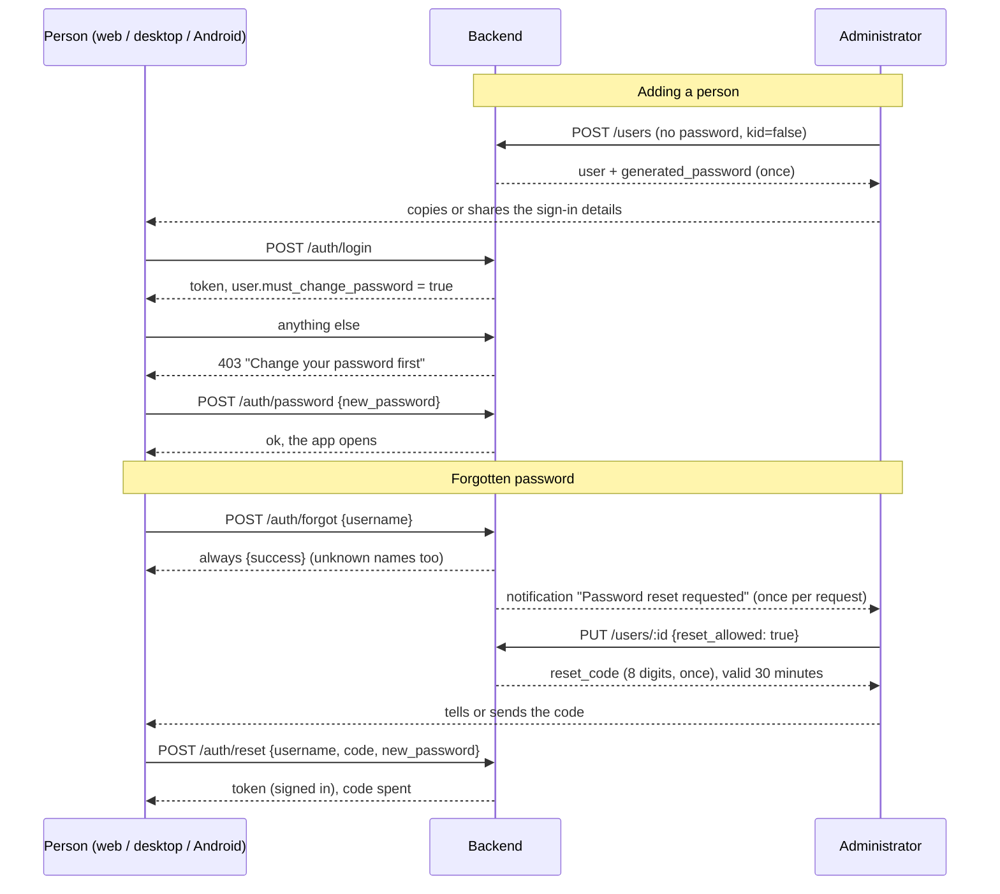

# Accounts: passwords, first sign-in and recovery

Domus has no mail server, so nothing about an account travels by email. An administrator is the way in and
the way back in. The rules are enforced by the backend; web, desktop and Android only show them.

## Who knows which password

| Account | Password at creation | First sign-in |
| --- | --- | --- |
| First administrator (setup) | typed by them | straight in |
| Anyone an administrator adds | generated by the server (12 characters, no look-alikes), shown once to copy or share | must choose their own before anything else works |
| Kid's account (`kid`) | typed by the administrator | straight in; the password stays until an administrator changes it |

An administrator never types another adult's password. "Generate a new password" on an existing person works
like creation: shown once, and it has to be changed at the next sign-in.

## Flows

## Rules the backend enforces

- **Forced change** (`users.must_change_password`): `auth_middleware` answers 403 to everything except
  `/auth/me` and `/auth/password`. `POST /auth/password` needs no `current_password` while the flag is set,
  and never accepts the password the account already has.
- **Reset code** (`reset_code_hash`, `reset_allowed_until`, `reset_attempts`): stored as an Argon2 hash, good
  for `RESET_MINUTES` (30) and `RESET_TRIES` (5) wrong guesses, then it is thrown away. It is spent by the
  reset, by a normal sign-in, by any password an administrator sets, and by switching it off. Knowing the
  username is not enough to reset anything; that was the flaw of the plain on/off switch this replaced.
- **No account discovery**: `/auth/forgot` answers the same for known and unknown usernames; it and a wrong
  code are slowed by 600 ms like a failed sign-in.
- **Sign-in lockout** (`LoginThrottle` in `auth/mod.rs`): `LOGIN_TRIES` (5) wrong passwords for one username
  refuse every further sign-in for that name with 429 for `LOGIN_LOCK` (15 minutes), the right password
  included. It is checked before the password, so parallel requests cannot outrun it, and it counts unknown
  names too, so a lock does not reveal which accounts exist. A correct sign-in or a redeemed reset code clears
  it. The count lives in memory: restarting the server lifts every lock.
- **Administrator alerts** (`notifications.admin_only`, `Notifier::notify_admins`): "Password reset
  requested", discovery and failing automations are listed, pushed over the live stream, marked read and
  deleted only for administrators. What an automation sends on purpose goes to everyone.
- **Secrets are returned once**: `generated_password` and `reset_code` appear only in the answer to the
  request that made them. Lists and `/auth/me` never carry them.
- A password an administrator sets on their own account does not force a change.

Schema: `migrations/0009_account_recovery.sql`. Logic: `backend/src/modules/auth/mod.rs`
(`UserRecord::redeem_reset_code`, `set_password`, tested there), `auth/routes.rs` (`forgot`, `reset`,
`change_password`), `users/mod.rs` (`create`, `update`).

## Screens

- **Web / desktop** — `features/auth/AuthScreen.tsx`: sign in, "Forgot password?" (username, then code and
  new password) and `ChangePasswordScreen`, which `App.tsx` shows instead of the app while
  `must_change_password` is set. `SettingsView.tsx`: the person sheet has a "Kid's account" switch, a "Reset
  code" switch and "Generate a new password"; `Handover` shows the secret once with Copy and Share.
- **Android** — `ConnectScreens.kt`: `AuthScreen` hosts three pages (sign in → name the account → code and
  new password) with `sharedAxisX` and the predictive back gesture; `ChangePasswordScreen` is its own step in
  `DomusRoot`. `Manage.kt`: the same switches in `PersonForm`, and `Handover` (dialog with Copy and the system
  share sheet; the clip is marked sensitive).

## Known limits

- Read and deleted state of a notification is shared by everyone who can see it; there is no inbox per person.
- A kid cannot change their own password in the Android app (it has no change-password page yet); on the web they can.
- Anyone who can reach the sign-in page can lock a name out for 15 minutes by guessing wrong five times.
- `domus-backend reset-password <username>` still works from the server's shell when every administrator is locked out.
