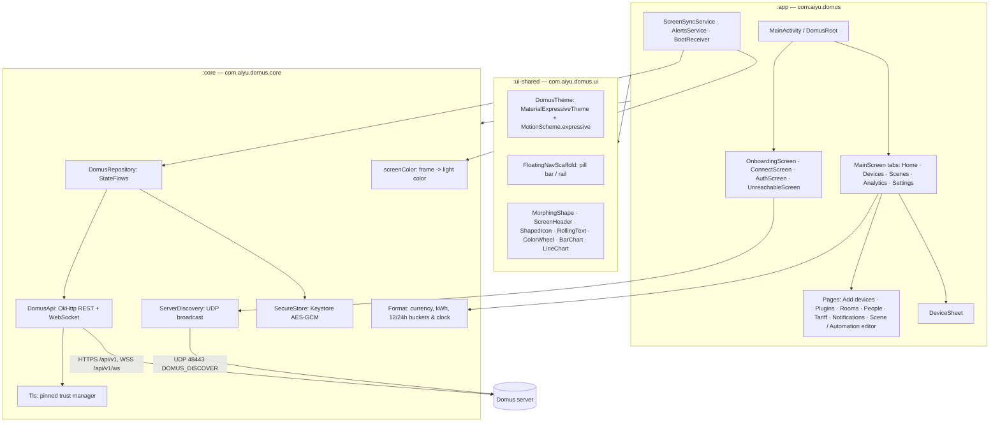
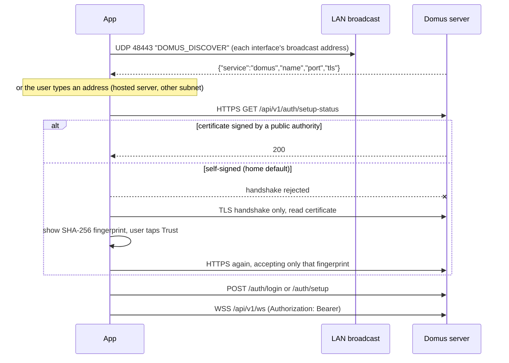
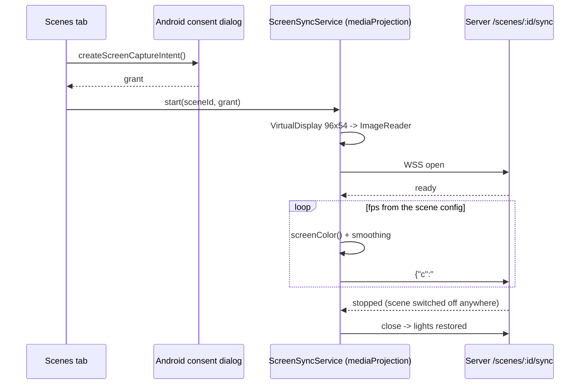

# Android app (`apps/android`)

Native client for the Domus server. Package `com.aiyu.domus`, Jetpack Compose, Material 3 Expressive.
It does what the web app does: control, onboarding (plugins, discovery, adoption), rooms, people, tariff,
scenes and automations, analytics, and Screen Sync from the phone's own screen. Both clients talk to the same
server, so a device added in one appears in the other through the event stream.

## 1. Modules



| Module | Depends on | Holds |
|---|---|---|
| `app` | `core`, `ui-shared` | Screens and the session-driven root. No networking code. |
| `core` | — (no Compose) | Models, API client, TLS trust, discovery, encrypted store, `DomusRepository`. |
| `ui-shared` | — (no `core`) | Theme, motion and components. Knows nothing about Domus data. |

There is no DI framework and no navigation library: one `DomusRepository` lives in `DomusApp`, and the
screen shown is a function of `Session` (`Loading → NoServer → SignedOut → SignedIn`, or `Unreachable`).

## 2. Finding and trusting the server



- **Discovery** — `backend/src/infrastructure/beacon.rs` answers the probe on UDP 48443. The reply is a hint
  only; it carries no secret and the certificate is still checked. Servers with TLS off are ignored.
- **Custom URL** — `normalizeServerUrl` accepts `host`, `host:port` or `https://…`. `http://` is refused and
  the manifest sets `usesCleartextTraffic="false"`: every request is encrypted. A bare IP gets port 8443, a
  host name 443.
- **Trust** — the server logs `TLS certificate SHA-256 fingerprint: …` at startup; the app shows the same
  value before the user approves it. After that `Tls.PinnedTrustManager` accepts system authorities plus that
  one certificate. If the certificate changes, requests fail and the app asks to connect again.
- **At rest** — server URL, pinned fingerprint and JWT are AES-GCM encrypted with an Android Keystore key
  (`SecureStore`). `allowBackup` is off.
- **Home and remote** — once signed in the app reads the server's home and remote address and uses whichever
  answers, home first, without another sign-in. See `DEPLOYMENT.md` sections 4 and 6.

## 3. State and live updates

`DomusRepository` loads devices, rooms, scenes, automations and the energy overview after sign-in and keeps
them in `StateFlow`s. While the app is on screen (`onStart`/`onStop`) it holds the WebSocket open and applies
events the same way the web app does (`apps/web/src/lib/live.ts`): `device_state_changed` patches one device,
structural events refetch, `notification` becomes a snackbar. Reconnects back off from 1s to 32s.

Commands are optimistic: the tile shows the new state at once, the server's answer replaces it, and a failure
restores the old state and shows the server's message.

### Staying in sync with the web app

`DomusRepository.revision` counts server-side changes the repository does not hold itself (`device_discovered`,
`discovery_finished`, `integrations_changed`, `notification`, device add/remove). Pages that list such things
(Add devices, Plugins, Notifications, Home's activity) reload when it moves. Adopting a device on the web makes
it leave the phone's "found" list and appear under Devices, and the other way round.

### Editors

Triggers, conditions and actions are kept as the JSON objects the server stores (`Scene.actions`,
`Automation.triggers` …). The app builds the common kinds and passes every other object through untouched, so
a rule written on the web (group commands, color actions) survives being saved from the phone.

### Screen Sync on the phone



### Alerts while closed

A self-hosted server has no cloud push channel. `AlertsService` (opt-in in Settings, foreground service of type
`specialUse`) sets `DomusRepository.keepLive`, which keeps the event stream open off screen, and turns
`notification` events into system notifications. `BootReceiver` restarts it after a reboot or update.

## 4. UI

- **Navigation** — `FloatingNavScaffold` is the Rewire bar: a floating pill on phones whose selected tab grows
  into icon + label and which tucks away while scrolling down; a floating rail from 600dp. Tabs switch with
  the M3 fade-through.
- **Expressive** — `MaterialExpressiveTheme` with `MotionScheme.expressive()` (springs for every component),
  increased corner scale, emphasized type, `MaterialShapes` badges, the morphing brand mark,
  `LoadingIndicator`, `LinearWavyProgressIndicator`, shape-morphing `ToggleButton`, tiles that change color
  and corner radius when a device turns on, staggered entrances, rolling numbers.
- **Before sign-in** — a three-page introduction on first run (`HorizontalPager`, shapes that turn away as a
  page leaves), then connect and sign-in on a raised panel over drifting tonal shapes.
- **Home** — live stat cards (only for what the home measures), scene cards, what is on, rooms, recent activity.
- **Analytics** — the tab exists only when a device measures power or air, and shows Electricity, Air quality,
  or a switch between the two. Electricity: live use, today / cycle, history bars, insights (peak hour, daily
  average, today vs average, top device), billing-cycle progress, per-device share. Air quality: PM2.5 with a
  WHO scale, purifier / filter / climate facts, a trend line (PM2.5, temperature, humidity) from
  `GET /air/history`, insights, purifier tiles, sensors. Charts select a bucket by tap or drag and print its
  value as text.
- **Clock format** — `rememberIs24HourFormat()` reads `DateFormat.is24HourFormat(context)` and refreshes on
  `ON_RESUME`, so chart bucket labels (`formatBucket`), rule trigger/condition summaries (`formatClockTime`),
  and Material 3 `TimeInput` pickers follow the device's 12/24-hour system setting immediately. Web and desktop
  similarly format timestamps and `"HH:mm"` strings with `formatTime` / `formatClockTime` / `formatBucket`
  (`apps/web/src/lib/format.ts`), with Electron bridging the OS 12/24-hour setting (`window.domus.hour12`).
- **Haptics** — `Haptics.kt` (ui-shared): `DomusTheme` provides `LocalIndication` as the M3 ripple plus a `VirtualKey` tick on press release, so every button, chip, `clickable` and list row ticks with no per-call code (a cancelled press stays silent). `Switch` draws no indication, so use `HapticSwitch` (on/off ticks) instead of `Switch` when it has its own `onCheckedChange`; a `Switch` with `onCheckedChange = null` inside a clickable row already ticks via the row. Don't pass `indication = null` on a clickable you want to tick.
- **Color** — wallpaper colors on Android 12+, a green fallback scheme otherwise; light/dark/system.
- **Accessibility** — decorative motion stops when system animations are off; controls are 48dp+, switches
  and swatches carry descriptions; content is capped at 840dp on wide windows.

### Navigation and back

- Every page opened over the tabs (`MainScreen.page`) and the plugin link flow (`Onboard.kt`: list → link page → steps such as the Xiaomi code) change with the same shared-axis X transition, `sharedAxisX` in `PredictiveBack.kt`. New screens should use it rather than swapping content without motion.
- **Predictive back** (`android:enableOnBackInvokedCallback="true"`): `rememberPredictiveBack(enabled, onBack)` drives the live preview, and `Modifier.predictiveBackEffect` shrinks the screen to 90 % with rounded corners while the gesture is held. It is used for pages, the tab → Home step, the plugin link page and the intro pager. Dialogs and `ModalBottomSheet` handle the gesture themselves. Do not add plain `BackHandler`s.
- **Scroll survives back**: `AnimatedContent` drops the `rememberSaveable` state of the screen it removes, so both hosts wrap each screen in a `SaveableStateHolder` — `MainScreen` per page (key `tabs` for the tab host) and `FloatingNavScaffold` per tab. Going back restores the screen underneath where it was scrolled; `open(key)` clears that page's kept state first, so a page opened again starts at the top. A new `AnimatedContent` host with scrolling screens needs the same wrap.

## 5. Build and run

```bash
cd apps/android
./gradlew :app:assembleDebug          # app/build/outputs/apk/debug/app-debug.apk
./gradlew :core:testDebugUnitTest     # URL rules, beacon parsing, formatting
./gradlew :app:assembleRelease        # minified; signed when keystore.properties exists
```

From the repository root:

```bash
pnpm dev          # backend + web + gateway
pnpm gateway      # the gateway alone
pnpm android:dev  # build, install on the connected phone / emulator (starts one if needed), open the app
pnpm android:profile  # re-record the baseline profile (sign in on the device first)
```

Release builds ship a baseline + startup profile recorded by the `:baselineprofile` module, so launch and the
main tabs are compiled at install. How it works and when to re-record it: `PERFORMANCE.md`.

The dev server listens on `127.0.0.1` only. `scripts/gateway.mjs` forwards each LAN address (same port, raw TCP
so TLS stays end to end) to it and keeps `adb reverse tcp:8443` set. A phone on Wi-Fi then finds the server by
broadcast; an emulator or USB phone, where broadcasts don't arrive, finds it at `localhost:8443` (discovery
probes that and `10.0.2.2` when the broadcast finds nothing).

## 6. Not in the app yet

Device groups (create / command), discovery settings (interval, auto-adopt), changing your own password,
editing a trigger / condition / action in place (remove it and add it again), color and group actions in the
editors (kept if they exist, not creatable), Screen Sync smoothing / fps / brightness-range settings (stored
values are kept), ignored-device restore.
