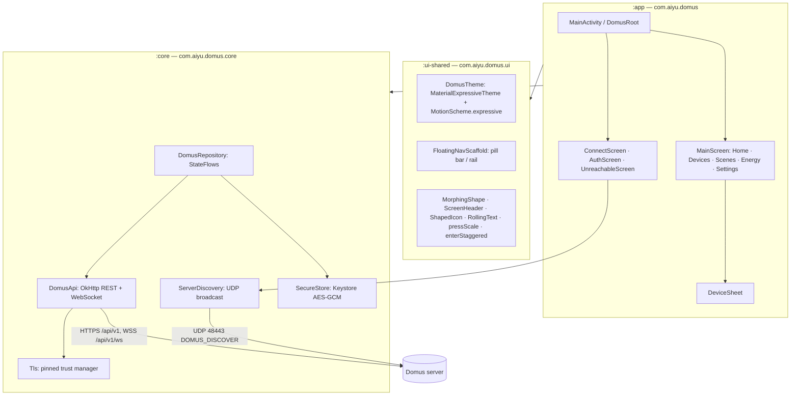
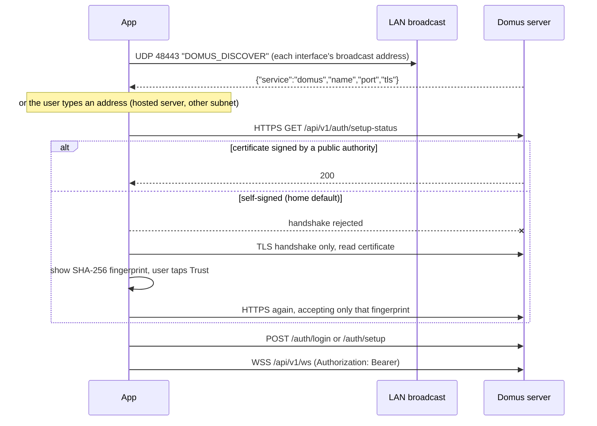

# Android app (`apps/android`)

Native client for the Domus server. Package `com.aiyu.domus`, Jetpack Compose, Material 3 Expressive.
It is a remote for the home: it shows and controls what the server manages. Linking integrations and
building scenes or automations stays in the web app.

## 1. Modules



| Module | Depends on | Holds |
|---|---|---|
| `app` | `core`, `ui-shared` | Screens and the session-driven root. No networking code. |
| `core` | — (no Compose) | Models, API client, TLS trust, discovery, encrypted store, `DomusRepository`. |
| `ui-shared` | — (no `core`) | Theme, motion and components. Knows nothing about Domus data. |

There is no DI framework and no navigation library: one `DomusRepository` lives in `DomusApp`, and the
screen shown is a function of `Session` (`Loading → NoServer → SignedOut → SignedIn`, or `Unreachable`).

## 2. Finding and trusting the server



- **Discovery** — `backend/src/infrastructure/beacon.rs` answers the probe on UDP 48443. The reply is a hint
  only; it carries no secret and the certificate is still checked. Servers with TLS off are ignored.
- **Custom URL** — `normalizeServerUrl` accepts `host`, `host:port` or `https://…`. `http://` is refused and
  the manifest sets `usesCleartextTraffic="false"`: every request is encrypted. A bare IP gets port 8443, a
  host name 443.
- **Trust** — the server logs `TLS certificate SHA-256 fingerprint: …` at startup; the app shows the same
  value before the user approves it. After that `Tls.PinnedTrustManager` accepts system authorities plus that
  one certificate. If the certificate changes, requests fail and the app asks to connect again.
- **At rest** — server URL, pinned fingerprint and JWT are AES-GCM encrypted with an Android Keystore key
  (`SecureStore`). `allowBackup` is off.

## 3. State and live updates

`DomusRepository` loads devices, rooms, scenes, automations and the energy overview after sign-in and keeps
them in `StateFlow`s. While the app is on screen (`onStart`/`onStop`) it holds the WebSocket open and applies
events the same way the web app does (`apps/web/src/lib/live.ts`): `device_state_changed` patches one device,
structural events refetch, `notification` becomes a snackbar. Reconnects back off from 1s to 32s.

Commands are optimistic: the tile shows the new state at once, the server's answer replaces it, and a failure
restores the old state and shows the server's message.

## 4. UI

- **Navigation** — `FloatingNavScaffold` is the Rewire bar: a floating pill on phones whose selected tab grows
  into icon + label and which tucks away while scrolling down; a floating rail from 600dp. Tabs switch with
  the M3 fade-through.
- **Expressive** — `MaterialExpressiveTheme` with `MotionScheme.expressive()` (springs for every component),
  increased corner scale, emphasized type, `MaterialShapes` badges, the morphing brand mark,
  `LoadingIndicator`, `LinearWavyProgressIndicator`, shape-morphing `ToggleButton`, tiles that change color
  and corner radius when a device turns on, staggered entrances, rolling numbers.
- **Color** — wallpaper colors on Android 12+, a green fallback scheme otherwise; light/dark/system.
- **Accessibility** — decorative motion stops when system animations are off; controls are 48dp+, switches
  and swatches carry descriptions; content is capped at 840dp on wide windows.

## 5. Build and run

```bash
cd apps/android
./gradlew :app:assembleDebug          # app/build/outputs/apk/debug/app-debug.apk
./gradlew :core:testDebugUnitTest     # URL rules, beacon parsing, formatting
./gradlew :app:assembleRelease        # minified; signed when keystore.properties exists
```

Emulator: the host's server is `10.0.2.2:8443` (broadcast discovery does not cross the emulator's NAT).

## 6. Not in the app yet

Linking integrations (Tuya QR, Tapo, Xiaomi), adopting discovered devices, creating or editing rooms, groups,
scenes and automations, user management, electricity tariff settings, starting Screen Sync (needs a screen to
capture), a free color wheel, push notifications while the app is closed.
