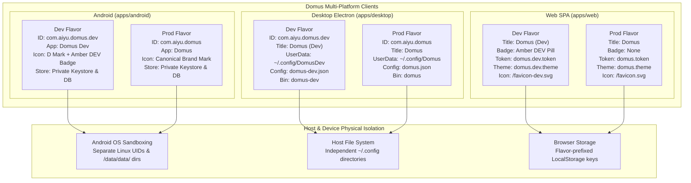

# App Flavors Architecture (Web, Desktop, Android)

This document specifies the multi-platform flavor architecture designed to allow development (`dev`) and production (`prod`) versions of Domus to run, build, and coexist simultaneously on the same machine or device without data collision, configuration clobbering, or session interruption.

---

## 1. Architecture & Isolation Overview



---

## 2. Flavor Matrix Comparison

| Platform | Dimension | Development (`dev`) | Production (`prod`) |
|---|---|---|---|
| **Android** | Package / Application ID | `com.aiyu.domus.dev` | `com.aiyu.domus` |
| | App Label / Title | `Domus Dev` | `Domus` |
| | Version Suffix | `-dev` | *(none)* |
| | Launcher Icon | Adaptive D mark with amber `DEV` pill badge | Canonical D mark |
| | Keystore / Storage | Sandboxed to `com.aiyu.domus.dev` | Sandboxed to `com.aiyu.domus` |
| | Side-by-side Install | **Yes** (different package ID) | **Yes** (different package ID) |
| **Desktop** | App ID (`appId`) | `com.aiyu.domus.dev` | `com.aiyu.domus` |
| | Product Name | `Domus Dev` | `Domus` |
| | Executable Name | `domus-dev` | `domus` |
| | Linux Package (`.deb`) | `domus-dev_${version}_${arch}.deb` (`/opt/Domus Dev`) | `domus_${version}_${arch}.deb` (`/opt/Domus`) |
| | User Data Path | `~/.config/DomusDev` (`app.setPath('userData', ...)`) | `~/.config/Domus` |
| | Config File | `domus-dev.json` | `domus.json` |
| | Window Title | `Domus (Dev)` | `Domus` |
| | WMClass / Launcher | `Domus Dev` (`icon-dev.png`) | `Domus` (`icon.png`) |
| | Side-by-side Install | **Yes** (separate `/opt/` and binaries) | **Yes** (separate `/opt/` and binaries) |
| **Web** | Application Name | `Domus (Dev)` | `Domus` |
| | Document Title | `Domus (Dev)` | `Domus` |
| | Favicon / PWA Icon | `/favicon-dev.svg` / `/icon-dev-*.png` | `/favicon.svg` / `/icon-*.png` |
| | Web Manifest | `/manifest.dev.webmanifest` | `/manifest.webmanifest` |
| | Auth Token Key | `domus.dev.token` | `domus.token` |
| | Theme Storage Key | `domus.dev.theme` | `domus.theme` |
| | Visual In-App Badge | Amber `DEV` hairline chip in header & rail | None (clean minimal brand) |

---

## 3. Platform Details

### 3.1 Android (`apps/android`)

Flavors are configured using Gradle `flavorDimensions += "environment"`:
- `dev`:
  - `applicationIdSuffix = ".dev"`
  - `versionNameSuffix = "-dev"`
  - String resource `@string/app_name` = `"Domus Dev"` (in `src/dev/res/values/strings.xml`)
  - Icon overlay `ic_launcher_foreground.xml` (in `src/dev/res/drawable/`) with the brand mark and a sharp amber `DEV` pill badge.
- `prod`:
  - Canonical package `com.aiyu.domus`
  - String resource `@string/app_name` = `"Domus"` (in `src/prod/res/values/strings.xml`)
  - Canonical brand launcher icon.

Because Android isolates apps by application ID, `com.aiyu.domus.dev` and `com.aiyu.domus` run as completely separate Linux user IDs with separate Keystores, SharedPreferences, SQLite files, and notification channels.

### 3.2 Desktop (`apps/desktop`)

Electron isolates runtime state based on `process.env.DOMUS_FLAVOR`:
1. When running unpackaged (`pnpm dev:desktop`) or with `DOMUS_FLAVOR=dev`:
   - `app.setPath('userData', path.join(appData, 'DomusDev'))`
   - Config file is saved to `domus-dev.json`.
   - Window title is locked to `Domus (Dev)`.
   - Desktop icon loaded is `build/icon-dev.png`.
2. Packaging:
   - `pnpm build:desktop:dev`: Uses `electron-builder.dev.json` to produce `domus-dev` deb and AppImage.
   - `pnpm build:desktop:prod`: Uses `electron-builder.prod.json` to produce `domus` deb and AppImage.
   - The post-install script `build/after-install.sh` detects both `/opt/Domus Dev` and `/opt/Domus`, setting up appropriate symlinks (`/usr/bin/domus-dev` and `/usr/bin/domus`) without overwriting one another.

### 3.3 Web (`apps/web`)

Web uses `apps/web/src/lib/flavor.ts`:
- Checks `import.meta.env.VITE_APP_FLAVOR`, the desktop bridge (`window.domus?.flavor`), or Vite dev mode (`import.meta.env.DEV`).
- Storage key isolation:
  - Auth token: `domus.dev.token` vs `domus.token`.
  - Theme preference: `domus.dev.theme` vs `domus.theme`.
- DOM Head updates:
  - Updates `<title>` and `<link rel="icon">` dynamically to point to `/favicon-dev.svg` and `/manifest.dev.webmanifest`.
- In-App UI Badge:
  - Renders a subtle `DEV` indicator in the floating pill dock and mobile navigation header.

---

## 4. Commands & Workflows

### Android
```bash
pnpm android:dev        # Builds, installs and launches Domus Dev on phone/emulator
pnpm android:prod       # Builds, installs and launches Domus Prod
pnpm android:build:dev  # Assembles devDebug APK
pnpm android:build:prod # Assembles prodRelease APK
```

### Desktop
```bash
pnpm dev:desktop          # Runs Electron in dev flavor (~/.config/DomusDev)
pnpm dev:desktop:prod     # Runs Electron in prod flavor (~/.config/Domus)
pnpm build:desktop:dev    # Builds domus-dev (.deb & AppImage)
pnpm build:desktop:prod   # Builds domus (.deb & AppImage)
```

### Web
```bash
pnpm dev:web              # Runs Vite dev server (dev flavor)
pnpm build:web:dev        # Builds SPA in dev mode
pnpm build:web:prod       # Builds SPA in production mode
```
