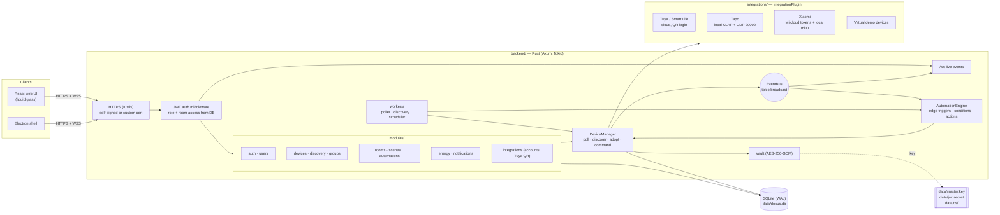
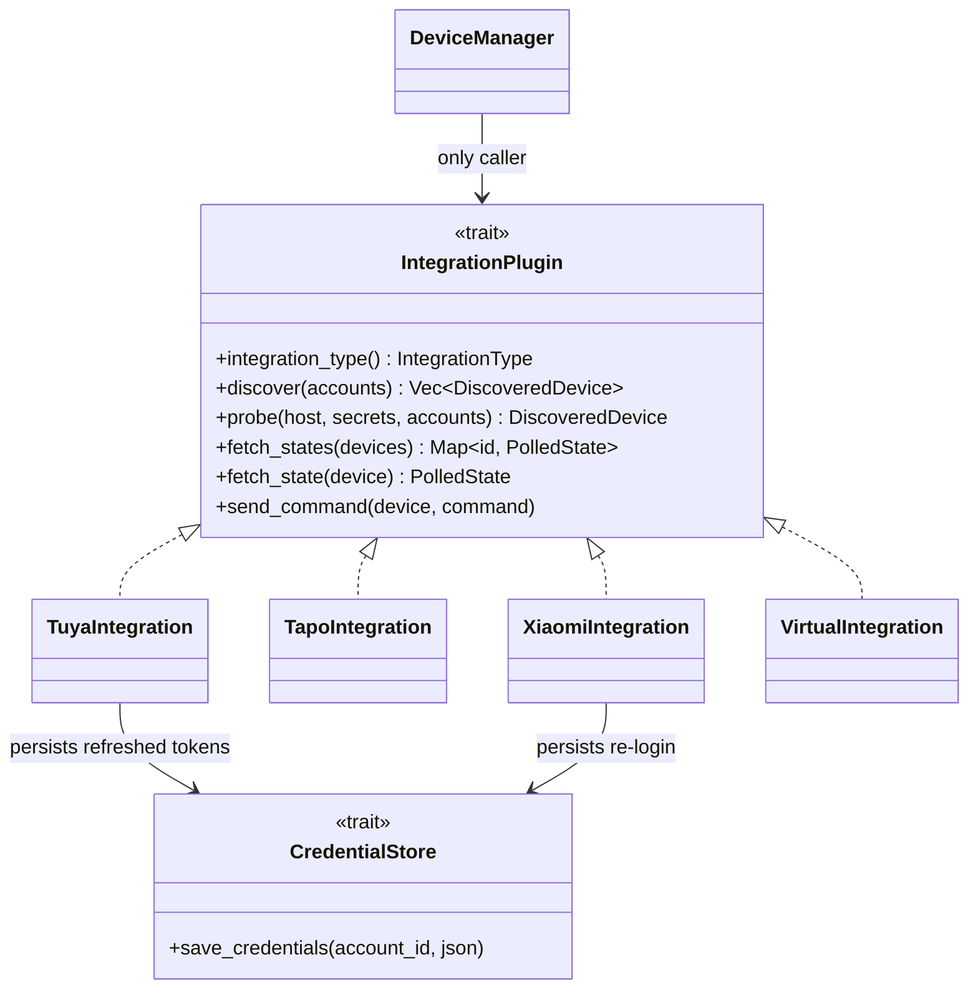
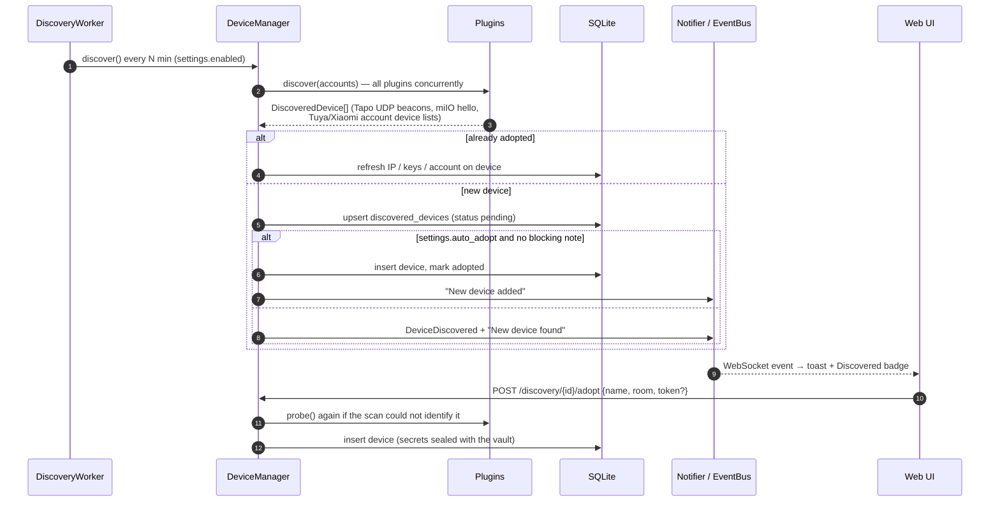
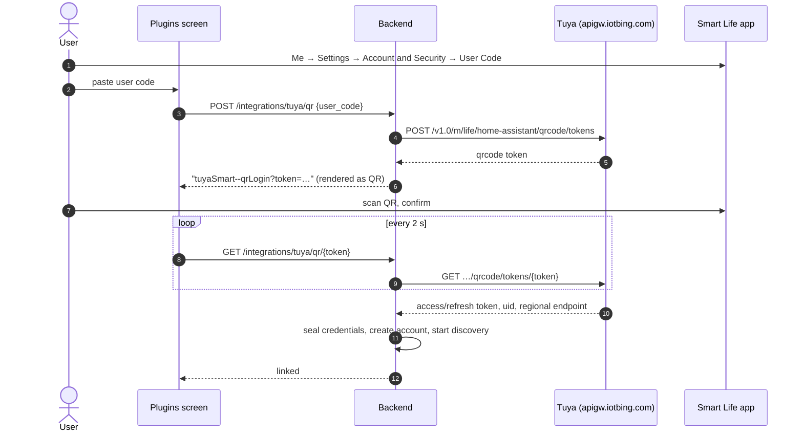
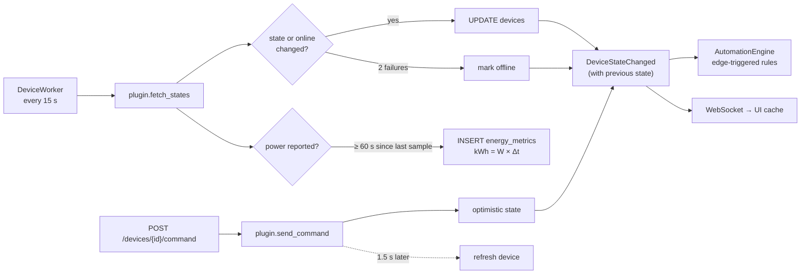
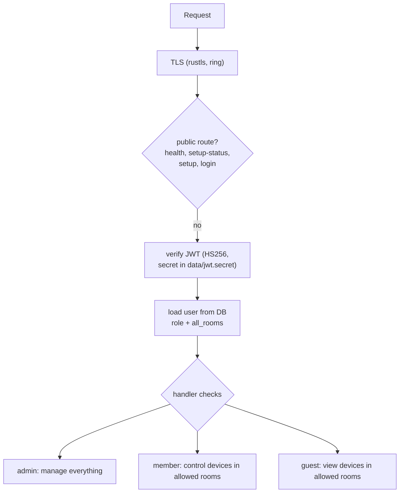
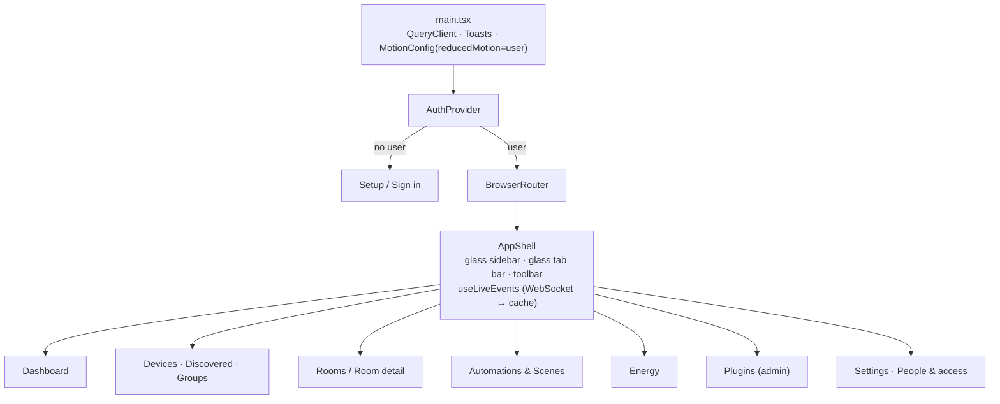

# Docus System Architecture

Docus is a local-first smart-home hub: a Rust modular monolith with SQLite,
a React web UI (also wrapped by Electron), and pluggable device integrations.
Everything runs on the home server; cloud APIs are used only where a vendor
offers no local alternative (Tuya) or to fetch device keys (Xiaomi).

## 1. Component overview



`crates/home-core` holds the shared domain model: `DeviceState`,
`DeviceCommand`, `DiscoveredDevice`, automation `Trigger`/`Condition`/`Action`,
and the `IntegrationPlugin` contract every integration implements.

## 2. Integration plugin contract



Plugins never touch the database. The `DeviceManager` decrypts credentials and
device secrets, builds a `DeviceContext`, and stores whatever comes back.
`fetch_states` is batched so cloud plugins (Tuya) answer a whole home in one call.

## 3. Discovery and adoption



Ignored devices stay ignored across scans; removing a device deletes its
discovery entry so it can be found again.

## 4. Tuya QR login (same flow as Home Assistant)



Afterwards every request to the regional endpoint is signed (HMAC-SHA256 over
headers + encrypted payload) and query/body/result are AES-128-GCM encrypted.
Tokens refresh automatically and are written back through `CredentialStore`.

## 5. Local protocols

| Integration | Discovery | Control | Secrets |
|---|---|---|---|
| Tapo | UDP broadcast to :20002 | KLAP v2/v1 over HTTP: handshake proves both sides know the account hash, then AES-128-CBC with per-request sequence IV and SHA-256 signature | TP-Link email/password (sealed) |
| Xiaomi | Mi cloud device list (token + LAN IP) and miIO hello broadcast on :54321 | miIO UDP, AES-128-CBC keyed by MD5(token); MIoT `get/set_properties` mapped from miot-spec.org | Account password + device tokens (sealed) |
| Tuya | Smart Life homes → devices → DP specifications | Cloud commands on DP codes, scaled using the DP spec | OAuth tokens + local keys (sealed) |

## 6. State, events and energy



Energy samples store *incremental* kWh, so bills are plain sums: today, the
current billing cycle (custom start day), a projection to cycle end, budget
usage, and per-device breakdown. History is bucketed in 15-minute UTC slots so
half-hour time zones (e.g. IST) aggregate correctly into local hours.

## 7. Security model



- **Transport:** HTTPS/WSS by default; a self-signed certificate covering
  localhost, the hostname and LAN IP is generated on first start. Electron
  trusts that certificate for the Docus origin only.
- **At rest:** integration credentials and device secrets (Tuya local keys,
  miIO tokens) are sealed with AES-256-GCM. The master key is kept outside the
  database (`DOCUS_MASTER_KEY` or `data/master.key`, mode 0600). Passwords use Argon2.
- **Accounts:** first-run setup creates the admin and then locks; only admins
  create users. Roles and room access are re-read on every request, so changes
  apply immediately. Device and WebSocket data are filtered by room access.

## 8. Web UI structure



Design rules (from the Liquid Glass guidance): glass is reserved for the
navigation/control layer (sidebar, tab bar, toolbar, sheets, segmented
controls); content uses calm surfaces. Selection pills morph between items
via shared layout IDs, the web counterpart of `glassEffectID`. Reduced
transparency swaps glass for solid surfaces; reduced motion disables springs
and the ambient backdrop drift.

## 9. Data model

```mermaid
erDiagram
    users ||--o{ user_room_access : "allowed rooms"
    rooms ||--o{ user_room_access : ""
    rooms ||--o{ devices : contains
    integration_accounts ||--o{ devices : "linked via"
    integration_accounts ||--o{ discovered_devices : "found via"
    devices ||--o{ device_group_members : ""
    device_groups ||--o{ device_group_members : ""
    devices ||--o{ energy_metrics : samples
    users { text id PK; text role; bool all_rooms }
    devices { text id PK; text integration_type; text external_id; text state_json; text secrets_enc; bool is_online }
    discovered_devices { text id PK; text status; text note; text secrets_enc }
    integration_accounts { text id PK; text credentials_enc; text status }
    energy_metrics { text device_id; real power_watts; real energy_kwh; datetime recorded_at }
    automations { text triggers_json; text conditions_json; text actions_json; bool is_enabled }
    scenes { text actions_json }
    electricity_settings { real rate_per_kwh; text currency; real monthly_budget; int billing_cycle_day; real fixed_monthly_charge }
    notifications { text level; text title; bool is_read }
    app_settings { text key PK; text value_json }
```

Migrations live in `migrations/` and run at startup (`sqlx::migrate!`).
