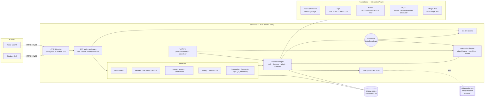
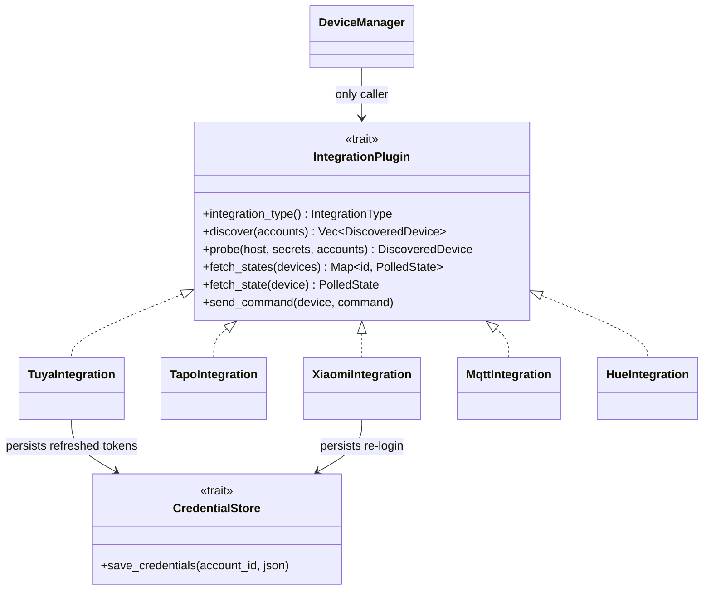
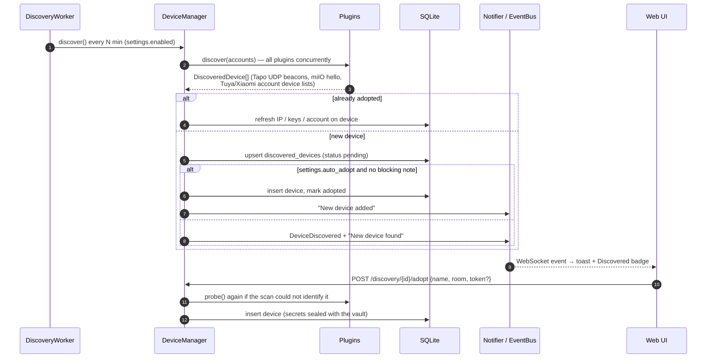
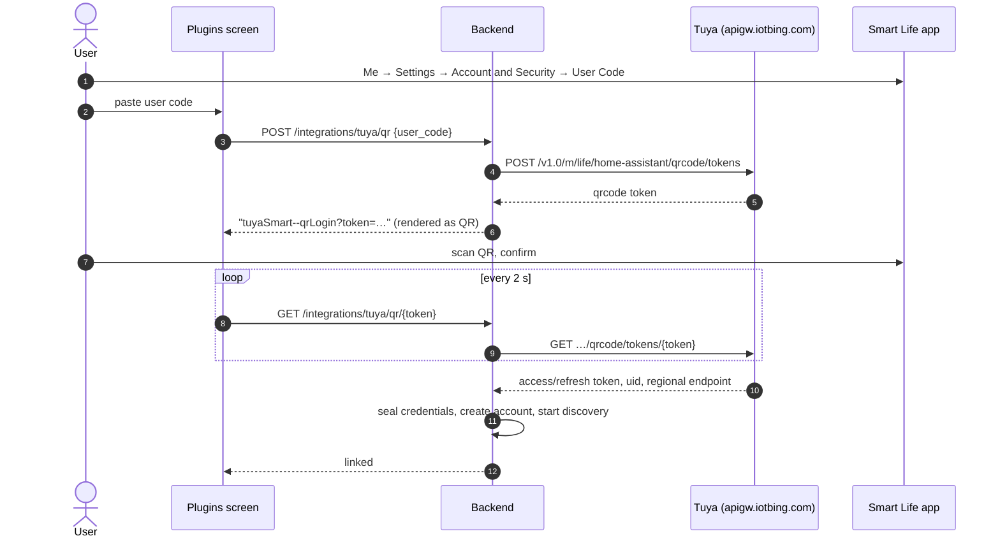
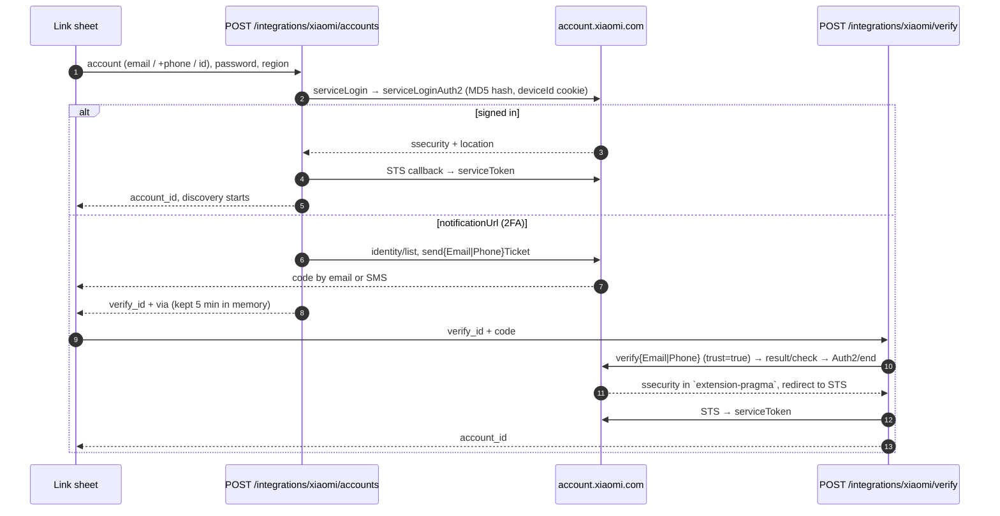
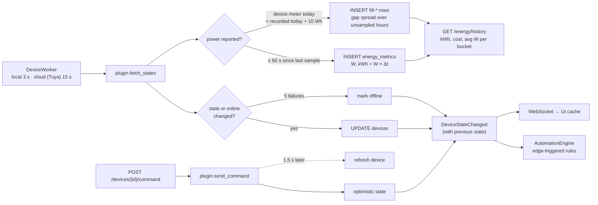
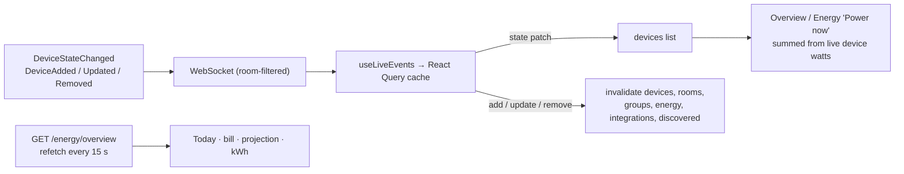
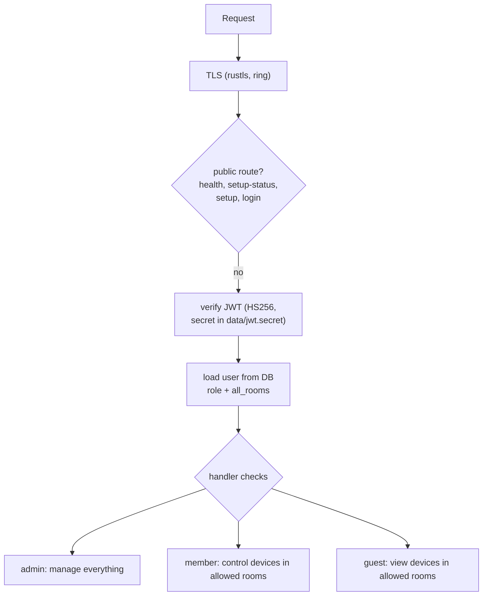
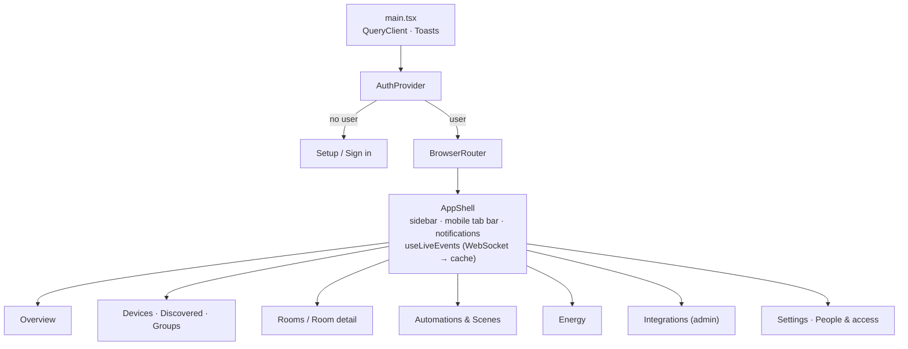

# Domus System Architecture

Domus is a local-first smart-home hub: a Rust modular monolith with SQLite,
a React web UI (also wrapped by Electron), and pluggable device integrations.
Everything runs on the home server; cloud APIs are used only where a vendor
offers no local alternative (Tuya) or to fetch device keys (Xiaomi).

## 1. Component overview



`crates/home-core` holds the shared domain model: `DeviceState`,
`DeviceCommand`, `DiscoveredDevice`, automation `Trigger`/`Condition`/`Action`,
and the `IntegrationPlugin` contract every integration implements.

## 2. Integration plugin contract



Plugins never touch the database. The `DeviceManager` decrypts credentials and
device secrets, builds a `DeviceContext`, and stores whatever comes back.
`fetch_states` is batched so cloud plugins (Tuya) answer a whole home in one call;
Hue and Tapo hubs use it for one request per bridge or hub. The `DeviceContext`
also carries the last stored state, which MQTT lays its cached messages over.
What each plugin covers and how it is linked is in `INTEGRATIONS.md`.

## 3. Discovery and adoption



Ignored devices stay ignored across scans; removing a device deletes its
discovery entry so it can be found again.

## 4. Tuya QR login (same flow as Home Assistant)



Afterwards every request to the regional endpoint is signed (HMAC-SHA256 over
headers + encrypted payload) and query/body/result are AES-128-GCM encrypted.
Tokens refresh automatically and are written back through `CredentialStore`.

## 4b. Xiaomi sign-in and two-step verification

Mi cloud is only used once to fetch device tokens and LAN IPs; control is
local. Xiaomi asks for a code whenever it sees an unknown device id, so Domus
generates one device id per account, stores it with the credentials, and asks
Xiaomi to trust it. Later automatic re-logins then skip the code.



Cookies are kept in a per-login jar, because the identity pages set several
session cookies. A captcha challenge is reported as an error; sign in once in
the Mi Home app or a browser and retry.

## 5. Local protocols

| Integration | Discovery | Control | Secrets |
|---|---|---|---|
| Tapo | UDP broadcast to :20002 | KLAP v2/v1 over HTTP: handshake proves both sides know the account hash, then AES-128-CBC with per-request sequence IV and SHA-256 signature. Device firmware ("SHIP 2.0") answers `400` to lowercase header names, so the client sends title-case headers | TP-Link email/password (sealed) |
| Xiaomi | Mi cloud device list (token + LAN IP) and miIO hello broadcast on :54321 | miIO UDP, AES-128-CBC keyed by MD5(token); MIoT `get/set_properties` mapped from miot-spec.org | Account password + device tokens (sealed) |
| MQTT | Home Assistant discovery configs retained under `homeassistant/` | Publish to the entity's command topics; state comes from a cache of subscribed topics | Broker address and login (sealed) |
| Hue | Lights listed by the bridge | Bridge API v1 over HTTPS on the LAN | Bridge address and app key (sealed) |
| Tuya | Smart Life homes → devices → DP specifications | Cloud commands on DP codes, scaled using the DP spec | OAuth tokens + local keys (sealed) |

## 6. State, events and energy



Energy samples store *incremental* kWh, so usage is a plain sum: today, the
current billing cycle (custom start day), a projection to cycle end, budget
usage, and per-device breakdown. History is bucketed in 15-minute UTC slots so
half-hour time zones (e.g. IST) aggregate correctly into local hours.

**One source for "today".** Samples only exist while the server polls, so a restart or an outage
used to leave the server's total below the plug's own. A device that reports its own daily meter
(`today_energy_kwh`, Tapo) is now reconciled on every sample: when the meter is more than 10 Wh
ahead of today's recorded sum, `catch_up_rows` (`modules/energy`) stores the difference as rows
with id `fill-…`, spread over today's hours that have no row (or at "now" when every hour has
one). Nothing is added in the 15 minutes after midnight, while the meter may still hold
yesterday. Web and Android both show `today_kwh` / `today_cost` from `GET /energy/overview` and
never recompute it from device state. The meter is assumed to reset at the server's local
midnight (set the same time zone on the plug).

**Power history.** Every sample stores the measured `power_watts`. `GET /energy/history` returns
`watts` per bucket: each device's average over its real samples (fill rows are excluded), summed
across devices, `null` where nothing was measured. The clients draw it as a line chart next to
the kWh bars (`EnergyChart` + `TrendChart` on the web, `LineChart` on Android).

### Notifications

One shared inbox. `DELETE /notifications/{id}`, `DELETE /notifications` (all), and the read calls publish a
`notifications_changed` event on the WebSocket; the web invalidates its inbox query and Android bumps its
`revision`, so a delete, swipe or "Delete all" in any client empties the same row everywhere within a second.
Android: swipe a row either way (Home "Recent activity" and the Notifications page); web: trash icon per row and a
two-step "Delete all" in the sheet.

### Tariffs and currency

`electricity_settings` holds any 3-letter ISO currency (the UI lists every
currency the browser knows) and either a flat `rate_per_kwh` or ordered
**slabs** (telescopic billing, e.g. MSEDCL / Pune: 0–100 units, 101–300, …).
`ElectricitySettings::energy_cost(kwh)` bills each slab for the units that fall
inside it, per billing cycle; the last slab may be open-ended. Cycle bill =
slab cost + fixed monthly charge; the projection runs the projected units
through the same slabs. Today's cost is the cycle cost minus the cost of the
units before today (so it lands in the highest slab reached). Per-device cost
and the history chart use the average rate (an approximation for history ranges
shorter than a cycle).

### How the UI stays live



Instantaneous power (the "Power now" tiles and per-device watts) is summed on
the client from the live device list, so it moves with every poll. Local
devices (Tapo, Xiaomi) are polled every 3 s (`workers.poll_interval_secs`);
Tuya goes through the rate-limited cloud API and is polled every 15 s
(`workers.cloud_poll_interval_secs`). A device is marked offline after 5
consecutive failed polls. Accumulated values (kWh, cost) come from the energy
query, refetched every 5 s. Linking or adopting a device refreshes every dependent view without
a reload.

## 7. Security model



- **Transport:** HTTPS/WSS by default; a self-signed certificate covering
  localhost, the hostname and LAN IP is generated on first start. Electron
  trusts that certificate for the Domus origin only.
- **At rest:** integration credentials and device secrets (Tuya local keys,
  miIO tokens) are sealed with AES-256-GCM. The master key is kept outside the
  database (`DOMUS_MASTER_KEY` or `data/master.key`, mode 0600). Passwords use Argon2.
- **Accounts:** first-run setup creates the admin and then locks; only admins
  create users. Roles and room access are re-read on every request, so changes
  apply immediately. Device and WebSocket data are filtered by room access.

### Air quality history

Devices that report PM2.5 are sampled every five energy intervals into `air_metrics` (with temperature and
humidity when present). `GET /air/history?range=day|week|month` returns per-bucket averages, `null` where
nothing was measured; retention follows `energy_retention_days`.

### Clients finding the server

The server answers `DOMUS_DISCOVER` on UDP 48443 (`infrastructure/beacon.rs`) with its API port, and logs its
certificate's SHA-256 fingerprint at startup so a client can pin a self-signed certificate after the owner
compares the two. See `ANDROID_APP.md` for the full flow and diagram.

The server also keeps a home and a remote address (`modules/server.rs`, `GET/PUT /server/links`). Apps use
the home one on the home network and the remote one elsewhere, with one session for both. Docker, the
Cloudflare Tunnel setup, the desktop app and the diagrams for all of it are in `DEPLOYMENT.md`.

## 8. Web UI structure



Visual design follows the persisted profile in
[`design-system/domus/MASTER.md`](../../design-system/domus/MASTER.md)
(Minimalism & Swiss, generated with `ui-ux-pro-max`): neutral zinc palette,
green only for "on/live", Inter, 6/10px radii, hairline borders, 150ms fades.
Side panels (`Sheet`) keep their close handler in a ref so inline handlers
never re-run the focus logic and steal focus from inputs while typing.
Translucent blur is limited to the sticky mobile top bar and tab bar.

## 9. Data model

```mermaid
erDiagram
    users ||--o{ user_room_access : "allowed rooms"
    rooms ||--o{ user_room_access : ""
    rooms ||--o{ devices : contains
    integration_accounts ||--o{ devices : "linked via"
    integration_accounts ||--o{ discovered_devices : "found via"
    devices ||--o{ device_group_members : ""
    device_groups ||--o{ device_group_members : ""
    devices ||--o{ energy_metrics : samples
    users { text id PK; text role; bool all_rooms }
    devices { text id PK; text integration_type; text external_id; text state_json; text secrets_enc; bool is_online }
    discovered_devices { text id PK; text status; text note; text secrets_enc }
    integration_accounts { text id PK; text credentials_enc; text status }
    energy_metrics { text device_id; real power_watts; real energy_kwh; datetime recorded_at }
    automations { text triggers_json; text conditions_json; text actions_json; bool is_enabled }
    scenes { text actions_json }
    electricity_settings { real rate_per_kwh; text currency; real monthly_budget; int billing_cycle_day; real fixed_monthly_charge; text slabs }
    notifications { text level; text title; bool is_read }
    app_settings { text key PK; text value_json }
```

`electricity_settings` also carries `slabs` (JSON array of
`{up_to_kwh, rate}`, added in `0003_tariff_slabs.sql`).

Migrations live in `migrations/` and run at startup (`sqlx::migrate!`).
