# Domus System Architecture

Domus is a local-first smart-home hub: a Rust modular monolith with SQLite,
a React web UI (also wrapped by Electron), and pluggable device integrations.
Everything runs on the home server; cloud APIs are used only where a vendor
offers no local alternative (Tuya) or to fetch device keys (Xiaomi).

## 1. Component overview

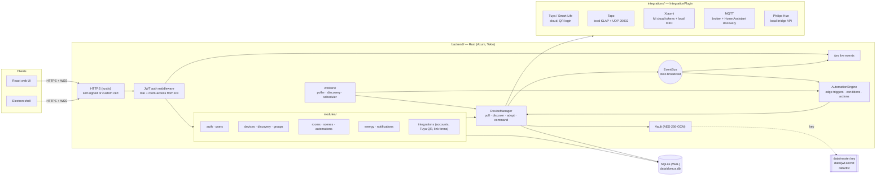

`crates/home-core` holds the shared domain model: `DeviceState`,
`DeviceCommand`, `DiscoveredDevice`, automation `Trigger`/`Condition`/`Action`,
and the `IntegrationPlugin` contract every integration implements.

## 2. Integration plugin contract

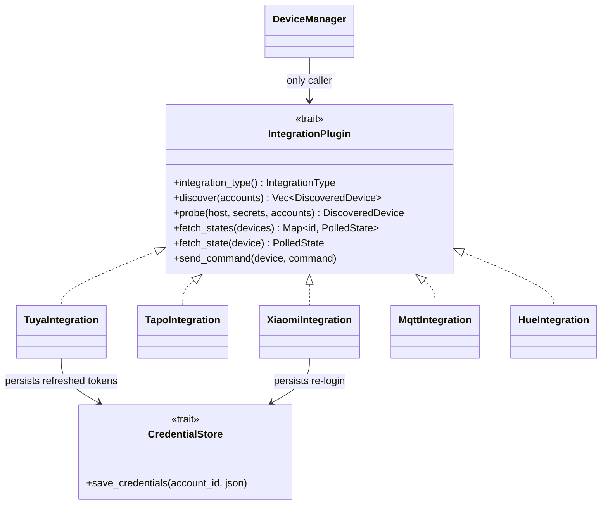

Plugins never touch the database. The `DeviceManager` decrypts credentials and
device secrets, builds a `DeviceContext`, and stores whatever comes back.
`fetch_states` is batched so cloud plugins (Tuya) answer a whole home in one call;
Hue and Tapo hubs use it for one request per bridge or hub. The `DeviceContext`
also carries the last stored state, which MQTT lays its cached messages over.
What each plugin covers and how it is linked is in `INTEGRATIONS.md`.

## 3. Discovery and adoption

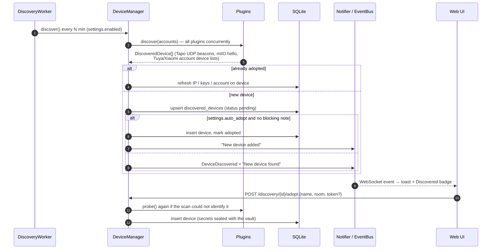

Ignored devices stay ignored across scans; removing a device deletes its
discovery entry so it can be found again.

## 4. Tuya QR login (same flow as Home Assistant)

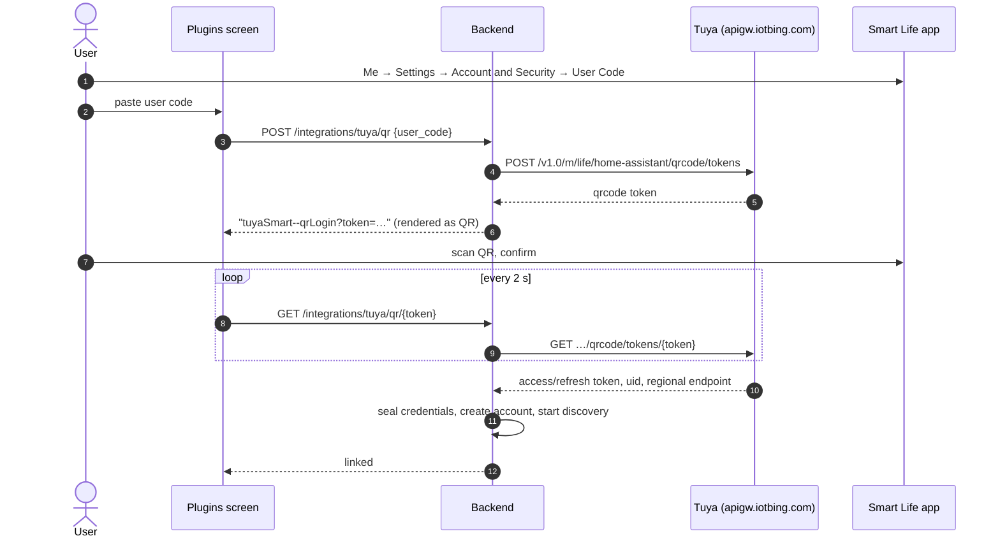

Afterwards every request to the regional endpoint is signed (HMAC-SHA256 over
headers + encrypted payload) and query/body/result are AES-128-GCM encrypted.
Tokens refresh automatically and are written back through `CredentialStore`.

## 4b. Xiaomi sign-in and two-step verification

Mi cloud is only used once to fetch device tokens and LAN IPs; control is
local. Xiaomi asks for a code whenever it sees an unknown device id, so Domus
generates one device id per account, stores it with the credentials, and asks
Xiaomi to trust it. Later automatic re-logins then skip the code.

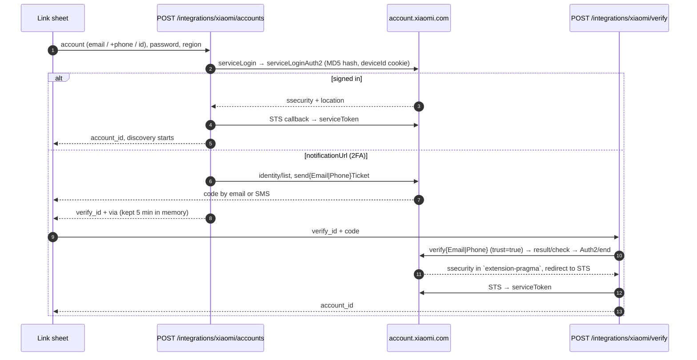

Cookies are kept in a per-login jar, because the identity pages set several
session cookies. A captcha challenge is reported as an error; sign in once in
the Mi Home app or a browser and retry.

## 5. Local protocols

| Integration | Discovery | Control | Secrets |
|---|---|---|---|
| Tapo | UDP broadcast to :20002 | KLAP v2/v1 over HTTP: handshake proves both sides know the account hash, then AES-128-CBC with per-request sequence IV and SHA-256 signature. Device firmware ("SHIP 2.0") answers `400` to lowercase header names, so the client sends title-case headers | TP-Link email/password (sealed) |
| Xiaomi | Mi cloud device list (token + LAN IP) and miIO hello broadcast on :54321 | miIO UDP, AES-128-CBC keyed by MD5(token); MIoT `get/set_properties` mapped from miot-spec.org | Account password + device tokens (sealed) |
| MQTT | Home Assistant discovery configs retained under `homeassistant/` | Publish to the entity's command topics; state comes from a cache of subscribed topics | Broker address and login (sealed) |
| Hue | Lights listed by the bridge | Bridge API v1 over HTTPS on the LAN | Bridge address and app key (sealed) |
| Tuya | Smart Life homes → devices → DP specifications | Cloud commands on DP codes, scaled using the DP spec | OAuth tokens + local keys (sealed) |

## 6. State, events and energy

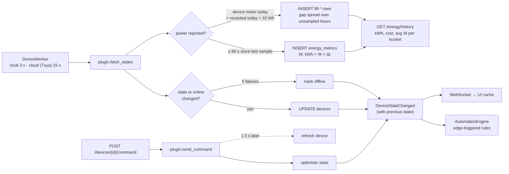

Energy samples store *incremental* kWh, so usage is a plain sum: today, the
current billing cycle (custom start day), a projection to cycle end, budget
usage, and per-device breakdown. History is bucketed in 15-minute UTC slots so
half-hour time zones (e.g. IST) aggregate correctly into local hours.

**One source for "today".** Samples only exist while the server polls, so a restart or an outage
used to leave the server's total below the plug's own. A device that reports its own daily meter
(`today_energy_kwh`, Tapo) is now reconciled on every sample: when the meter is more than 10 Wh
ahead of today's recorded sum, `catch_up_rows` (`modules/energy`) stores the difference as rows
with id `fill-…`, spread over today's hours that have no row (or at "now" when every hour has
one). Nothing is added in the 15 minutes after midnight, while the meter may still hold
yesterday. Web and Android both show `today_kwh` / `today_cost` from `GET /energy/overview` and
never recompute it from device state. The meter is assumed to reset at the server's local
midnight (set the same time zone on the plug).

**Power history.** Every sample stores the measured `power_watts`. `GET /energy/history` returns
`watts` per bucket: each device's average over its real samples (fill rows are excluded), summed
across devices, `null` where nothing was measured. The clients draw it as a line chart next to
the kWh bars (`EnergyChart` + `TrendChart` on the web, `LineChart` on Android).

### Notifications

One shared inbox. `DELETE /notifications/{id}`, `DELETE /notifications` (all), and the read calls publish a
`notifications_changed` event on the WebSocket; the web invalidates its inbox query and Android bumps its
`revision`, so a delete, swipe or "Delete all" in any client empties the same row everywhere within a second.
Android: swipe a row either way (Home "Recent activity" and the Notifications page); web: trash icon per row and a
two-step "Delete all" in the sheet.

### Ask before switching

A device can be marked **Ask before switching** (`devices.confirm_changes`, `0012_device_confirm.sql`; the
switch on the device page of every app, for administrators and anyone with edit access). The flag lives on
the server, so setting it on the web is the same on desktop and Android. Its point is a main switch whose
off cuts power to everything plugged into it.

Where the warning appears:

| Switched from | Who asks | How |
| --- | --- | --- |
| The device's own switch or sheet, a room's All on / All off | the app | checks `confirm_changes` before sending |
| A device group, a scene (on, off, toggle, nested scenes) or a manual "Run" of an automation | the server | answers **428** `{ error: { confirm: [names] } }` while any device it would switch asks first; the app shows the dialog and sends the same request again with `?confirmed=true` |
| A scheduled or triggered automation | nobody | runs as written: there is no one to ask. Nothing outside Domus (the Tapo app, a wall switch) is covered either |

Only commands that set power (`is_on`) are guarded; brightness, color and the like are not. Source:
`AutomationEngine::guarded` / `require_confirmed` (`automation_engine/executor.rs`), `ApiError::Confirm`,
web `components/devices/ConfirmSwitch.tsx` (`ConfirmHost` answers 428 inside `lib/api.ts`), Android
`DomusRepository.confirmation` and `ConfirmSwitchDialog`.

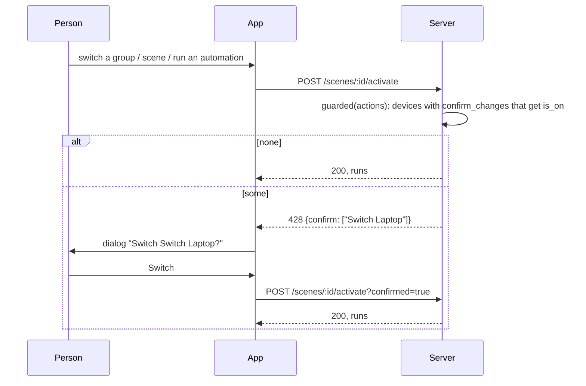

### Time and sun triggers

`SchedulerWorker` calls `AutomationEngine::tick` once a minute. A `time` trigger compares the minute with its
`at`; a `sun` trigger (`event`: `sunrise` / `sunset`, `offset_minutes` up to six hours either way, optional
`days`) compares it with today's sunrise or sunset at the home's location. The times come from
`home_core::sun_times` (the sunrise equation, about a minute off at most), so nothing is asked of the
internet. The location is the `location` setting (`GET/PUT /server/location`, set in Settings > Home location
on web and Android); the answer carries today's sunrise and sunset so the editors can show them. Without a
location, or on a day the sun does not rise or set there, a sun trigger does not fire.

Three ways to set it, all ending in the same two numbers rounded to two decimals (about a kilometre):

- **This device**: the browser's geolocation on the web, `ACCESS_COARSE_LOCATION` on Android (asked when
  "Use this phone's location" is tapped, read once through `LocationManagerCompat`, no Play Services). The
  desktop app has no location service, so it does not offer this.
- **Find a place**: `GET /server/location/search?q=` (administrators). The server asks Open-Meteo's free
  geocoder, which needs no key, and answers `name, latitude, longitude`; the apps talk to nothing but the
  server. Only the typed name leaves the home. Without internet it answers 502 and the fields below still work.
- **Typing** latitude and longitude.

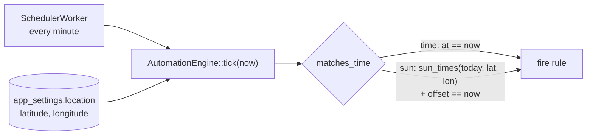

### Tariffs and currency

`electricity_settings` holds any 3-letter ISO currency (the UI lists every
currency the browser knows) and either a flat `rate_per_kwh` or ordered
**slabs** (telescopic billing, e.g. MSEDCL / Pune: 0–100 units, 101–300, …).
`ElectricitySettings::energy_cost(kwh)` bills each slab for the units that fall
inside it, per billing cycle; the last slab may be open-ended. Cycle bill =
slab cost + fixed monthly charge; the projection runs the projected units
through the same slabs. Today's cost is the cycle cost minus the cost of the
units before today (so it lands in the highest slab reached). Per-device cost
and the history chart use the average rate (an approximation for history ranges
shorter than a cycle).

**Time of use** (`time_of_use`, `0011_time_of_use.sql`) sits on top of either: windows of the day on the
home's clock, each with an amount added to every unit used inside it (`+1.10` peak, `-1.50` night; a window
may run past midnight, windows may not overlap). This is how MSEDCL's ToD charges work, and a plain
peak / off-peak plan is the flat rate plus one window. The units are not re-metered: the samples already in
`energy_metrics` are summed per device and quarter hour, and each quarter is priced by the window it starts in.

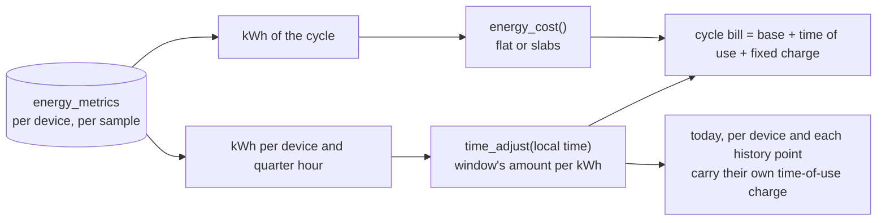

The projection assumes the rest of the cycle is used at the same times of day as the part so far.

### How the UI stays live

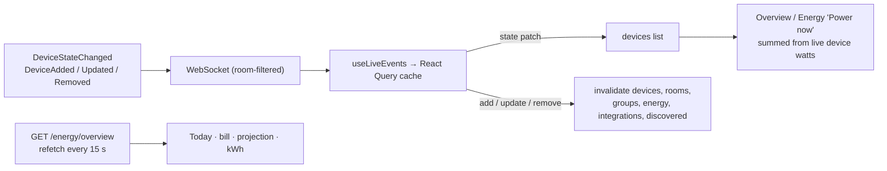

Instantaneous power (the "Power now" tiles and per-device watts) is summed on
the client from the live device list, so it moves with every poll. Local
devices (Tapo, Xiaomi) are polled every 3 s (`workers.poll_interval_secs`);
Tuya goes through the rate-limited cloud API and is polled every 15 s
(`workers.cloud_poll_interval_secs`). A device is marked offline after 5
consecutive failed polls. Accumulated values (kWh, cost) come from the energy
query, refetched every 5 s. Linking or adopting a device refreshes every dependent view without
a reload.

## 7. Security model

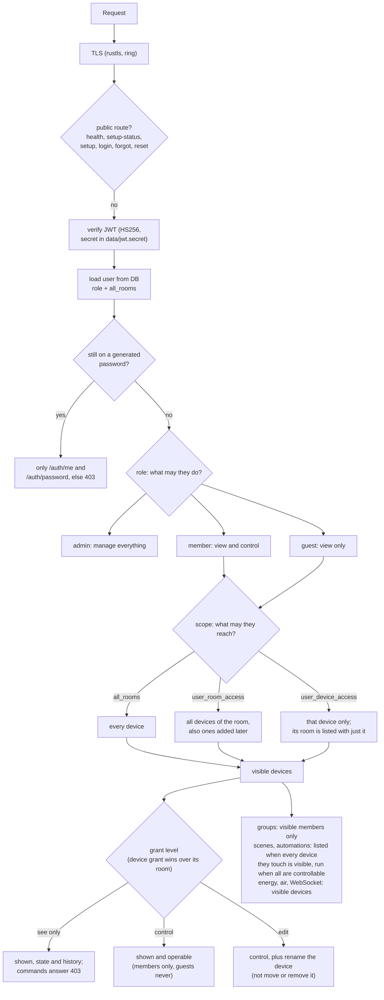

Passwords, the forced change at first sign-in and recovery with a one-time code are in `ACCOUNTS.md`.

### Access model

A user has a **role** (what they may do) and a **scope** (what they may reach).
Admins ignore scope. For members and guests the scope is either the whole home
(`users.all_rooms`) or a set of grants:

| Grant | Table | Reaches |
|---|---|---|
| Room | `user_room_access` | Every device in the room, including ones added later |
| Device | `user_device_access` | That device, wherever it is moved; also devices without a room |

Every grant has a level: **see only** (state and history, no commands),
**control**, or **edit** (control, plus renaming the device; moving it to another
room and removing it stay administrator-only). A device grant wins over the grant
of its room, so one device can be see-only in a controllable room, or the reverse.
Each device in the API carries `can_control` and `can_edit` for the user asking,
which is what the clients use to disable controls and offer Rename. Whole-home
users (`all_rooms`) control everything but do not edit: edit needs custom access.

Everything else follows from the devices (`modules/devices/service.rs`):
a group shows only its visible members and commands only the controllable ones,
and a scene or automation is listed when the user can see every device it
touches (through groups and nested scenes too) and can be run when they can
control all of them. Hidden items answer 404, so ids are not confirmed;
see-only ones answer 403.

On the users API `room_ids` and `device_ids` list the grants, and
`view_only_*` and `edit_*` the subsets at those levels. A client that sends only
the ids keeps the marks of the grants that stay; see only wins over edit.

Addresses: `GET /users/email/check` says whether an address is free and
`GET /users/email/suggest` returns the first free one for a username
(`john.doe@domus.home`, `johndoe@domus.home`, `john.doe2@domus.home` ...). Email
is unique, compared without case, and a duplicate answers 409.
The WebSocket re-reads the user's access when users or rooms change and closes
when the account is deleted.

- **Transport:** HTTPS/WSS by default; a self-signed certificate covering
  localhost, the hostname and LAN IP is generated on first start. Electron
  trusts that certificate for the Domus origin only.
- **At rest:** integration credentials and device secrets (Tuya local keys,
  miIO tokens) are sealed with AES-256-GCM. The master key is kept outside the
  database (`DOMUS_MASTER_KEY` or `data/master.key`, mode 0600). Passwords use Argon2.
- **Accounts:** first-run setup creates the admin and then locks; only admins
  create users. Roles and grants are re-read on every request, so changes
  apply immediately. See the access model above.

### Air quality history

Devices that report PM2.5 are sampled every five energy intervals into `air_metrics` (with temperature and
humidity when present). `GET /air/history?range=day|week|month` returns per-bucket averages, `null` where
nothing was measured; retention follows `energy_retention_days`.

### History buckets and time zones

`GET /energy/history` and `GET /air/history` share `Buckets` (`modules/energy`): `hour` is 60 one-minute
buckets (energy only: air is sampled too coarsely for it), `day` 24 clock hours, `week` 7 days, `month` 30 days. Clients send `tz`, their IANA zone
(`Asia/Kolkata`, resolved with `chrono-tz`), so an hour is a clock hour and a day starts at midnight where
the viewer is, across DST changes too; the published image
runs in UTC unless `TZ` is set, so without `tz` the buckets follow the server. Clients print bucket times in
the device's zone and label an hourly bucket as its span ("12 am – 1 am"). The pickers call `hour` "1 min".

The **Live** range next to them never reaches these endpoints: each client samples the device state it
already receives over the WebSocket every 5 seconds while the page is open and keeps the last 5 minutes
(`useLive` in `apps/web/src/lib/liveSamples.ts`, `rememberLive` in Android's `Analytics.kt`).

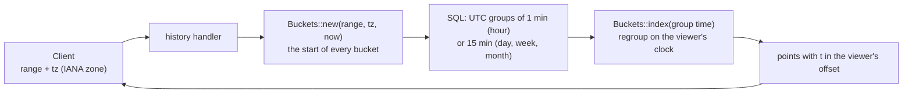

### Clients finding the server

The server answers `DOMUS_DISCOVER` on UDP 48443 (`infrastructure/beacon.rs`) with its API port, and logs its
certificate's SHA-256 fingerprint at startup so a client can pin a self-signed certificate after the owner
compares the two. See `ANDROID_APP.md` for the full flow and diagram.

The server also keeps a home and a remote address (`modules/server.rs`, `GET/PUT /server/links`). Apps use
the home one on the home network and the remote one elsewhere, with one session for both. Docker, the
Cloudflare Tunnel setup, the desktop app and the diagrams for all of it are in `DEPLOYMENT.md`.

## 8. Web UI structure

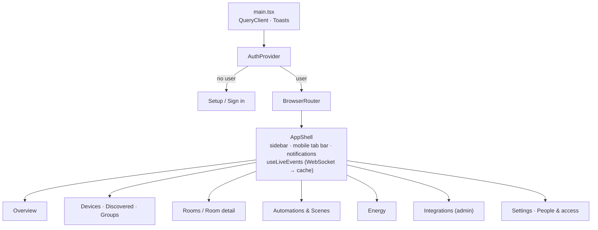

Visual design follows the persisted profile in
[`design-system/domus/MASTER.md`](../../design-system/domus/MASTER.md)
(Minimalism & Swiss, generated with `ui-ux-pro-max`): neutral zinc palette,
green only for "on/live", Inter, 6/10px radii, hairline borders, 150ms fades.
Side panels (`Sheet`) keep their close handler in a ref so inline handlers
never re-run the focus logic and steal focus from inputs while typing.
Translucent blur is limited to the sticky mobile top bar and tab bar.

## 9. Data model

```mermaid
erDiagram
    users ||--o{ user_room_access : "allowed rooms"
    rooms ||--o{ user_room_access : ""
    users ||--o{ user_device_access : "allowed devices"
    devices ||--o{ user_device_access : ""
    rooms ||--o{ devices : contains
    integration_accounts ||--o{ devices : "linked via"
    integration_accounts ||--o{ discovered_devices : "found via"
    devices ||--o{ device_group_members : ""
    device_groups ||--o{ device_group_members : ""
    devices ||--o{ energy_metrics : samples
    users { text id PK; text role; bool all_rooms }
    user_room_access { text user_id; text room_id; bool can_control; bool can_edit }
    user_device_access { text user_id; text device_id; bool can_control; bool can_edit }
    devices { text id PK; text integration_type; text external_id; text state_json; text secrets_enc; bool is_online }
    discovered_devices { text id PK; text status; text note; text secrets_enc }
    integration_accounts { text id PK; text credentials_enc; text status }
    energy_metrics { text device_id; real power_watts; real energy_kwh; datetime recorded_at }
    automations { text triggers_json; text conditions_json; text actions_json; bool is_enabled }
    scenes { text actions_json }
    electricity_settings { real rate_per_kwh; text currency; real monthly_budget; int billing_cycle_day; real fixed_monthly_charge; text slabs }
    notifications { text level; text title; bool is_read }
    app_settings { text key PK; text value_json }
```

`electricity_settings` also carries `slabs` (JSON array of
`{up_to_kwh, rate}`, added in `0003_tariff_slabs.sql`).

Migrations live in `migrations/` and run at startup (`sqlx::migrate!`).
