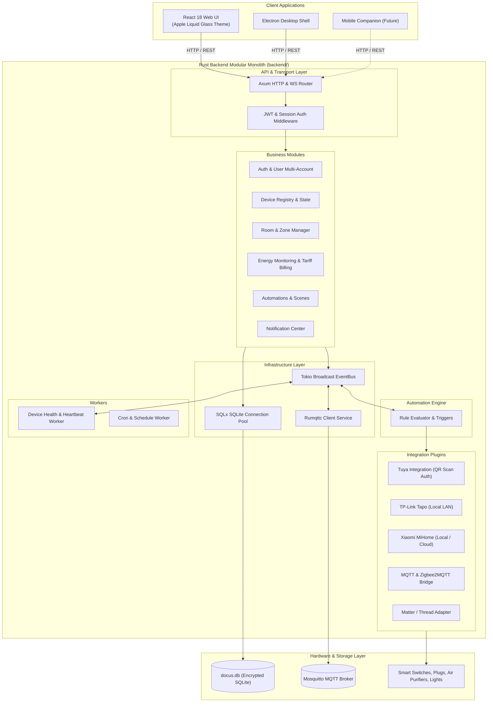
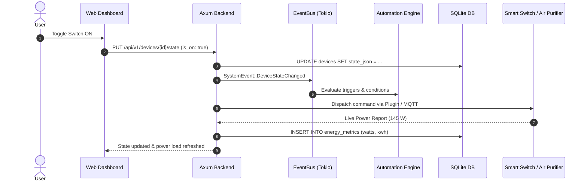

# Docus System Architecture

## Overview

Docus is designed as a local-first, privacy-respecting, high-performance smart home platform. The system operates as a modular monolith in Rust coupled with an asynchronous event bus, an embedded/external SQLite database, and an MQTT broker.

## High-Level Architecture Diagram

## Data Flow: Device State & Energy Metering

## Architecture Invariants
1. **Local Independence**: Operations function completely offline on the home server.
2. **Modular Decoupling**: Each module exposes clear route contracts and domain boundaries.
3. **Pluggable Integrations**: All device ecosystems adhere to `home_core::IntegrationPlugin`.
4. **Encrypted Persistence**: All credentials, tokens, and telemetry are stored encrypted in SQLite.
