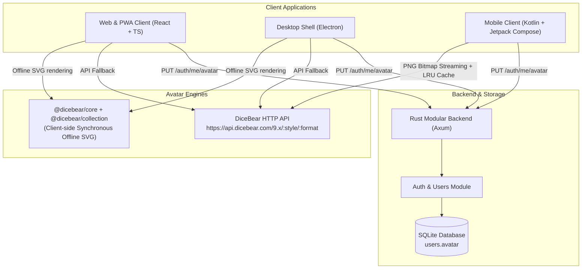

# DiceBear Avatar Architecture & Cross-Device System

Docus provides customizable avatars powered by [DiceBear](https://github.com/dicebear/dicebear), allowing any user to generate random avatars, select diverse avatar collections, customize seeds, and have changes instantly synced and rendered across all devices (Web, Desktop Electron, and Android).

## Architecture Diagram

## Avatar Specification Format

Avatars are stored and exchanged as clean, canonical spec strings:

`dicebear:{style}:{seed}`

Examples:
- `dicebear:bottts:Aiyu`
- `dicebear:adventurer:CosmicExplorer42`
- `dicebear:lorelei:Luna`
- `dicebear:pixelArt:RetroBot`

If a user has no avatar set (or upon first creation), a deterministic fallback is generated automatically from their username: `dicebear:bottts:{username}`.

## Supported Avatar Collections

The studio supports 15 DiceBear collections:
1. **Robots** (`bottts`): Playful robotic characters
2. **Lorelei** (`lorelei`): Clean modern illustrated figures
3. **Avataaars** (`avataaars`): Classic cartoon humans
4. **Adventurer** (`adventurer`): Fantasy RPG adventurers
5. **Micah** (`micah`): Contemporary illustrated portraits
6. **Notionists** (`notionists`): Hand-drawn minimalist sketches
7. **Pixel Art** (`pixelArt`): Retro 8-bit gaming avatars
8. **Fun Emoji** (`funEmoji`): Whimsical emoji expressions
9. **Thumbs** (`thumbs`): Cute thumb-shaped characters
10. **Shapes** (`shapes`): Abstract geometric art
11. **Rings** (`rings`): Cybernetic orbital patterns
12. **Identicon** (`identicon`): Cryptographic identicons
13. **Personas** (`personas`): Stylized character portraits
14. **Open Peeps** (`openPeeps`): Diverse hand-drawn figures
15. **Big Smile** (`bigSmile`): Cheerful cartoon faces

## Cross-Device Implementation

### 1. Web & Desktop (`apps/web`, `apps/desktop`)
- Bundles `@dicebear/core` and `@dicebear/collection` for instantaneous, zero-network, 100% offline SVG rendering via data URIs.
- Fallback to `api.dicebear.com/9.x` if offline rendering encounters unknown formats.
- **Components**:
  - `Avatar.tsx`: Reusable liquid glass avatar with responsive sizes (`xs`, `sm`, `md`, `lg`, `xl`, `2xl`) and loading states.
  - `AvatarPickerModal.tsx`: Interactive Liquid Glass Avatar Studio with real-time preview, 🎲 full random roll, 🎲 seed roll, collection picker, and custom seed input.
- **Placements**:
  - Floating pill navigation sidebar (collapsed & expanded modes)
  - Mobile header & mobile slide-out menu
  - Overview dashboard header with quick access
  - Settings account profile card with 1-click Quick Roll button & full studio modal
  - Household People list & UserSheet for admin management
  - Initial setup screen (`AuthScreen.tsx`)

### 2. Android (`apps/android`)
- Converts spec to DiceBear PNG stream: `https://api.dicebear.com/9.x/{style}/png?seed={seed}&size={size}`.
- High-performance `UserAvatar` Compose component with in-memory `LruCache` and graceful initials fallback.
- `AvatarPickerDialog` supporting real-time preview, style switching, seed rolling, and custom seed entry.
- Integrated into:
  - Settings screen profile hero card
  - Home dashboard greeting header
  - Manage People user list and edit dialog

### 3. Backend (`backend`)
- SQLite migration `0006_user_avatar.sql`: adds `avatar TEXT` to `users` table.
- Model updates: `UserRecord` and `UserDto` include `avatar`.
- Dedicated endpoint `PUT /api/v1/auth/me/avatar` allowing any authenticated member/admin to update their own avatar.
- User management `POST /users` and `PUT /users/:id` allow admins to manage avatars for all household members.
