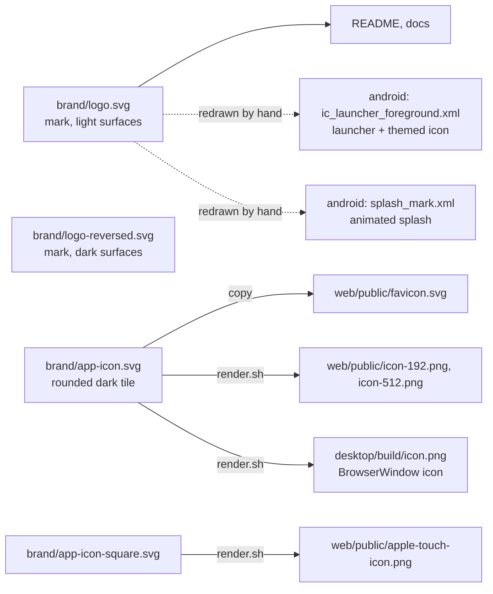

# Brand mark

A **D built from three modules, one switched on**. The modules stand for the plugin system
(integrations slot in); the green one is the design system's `on` colour — green means live, same
rule as the UI. Designed with `/logo-design:logo-design`. No house, no gradients.

| | Light surface | Dark surface |
|---|---|---|
| Modules | `#09090B` | `#FAFAFA` |
| On module | `#16A34A` | `#22C55E` |

Geometry (256 box): two 80×80 squares and a half-disc of radius 88, 16 gaps, 12 outer radius. In the
app icons the mark sits 10/256 right of the box centre — the bowl is lighter than the squares, so a
box-centred mark looks pushed left. Keep that nudge when re-exporting.

## Where each file comes from

Masters live in `design-system/docus/brand/`. `render.sh` (needs Chrome) rewrites the PNGs. The two
Android drawables are vector copies of the same path data, scaled 0.25 into the 108dp canvas — edit
them by hand if the mark changes.

## Android splash

Android 12+ only (`values-v31`, `values-night-v31`); older versions go straight to the canvas colour.
`splash_mark.xml` is an animated vector: the three modules scale and fade in 90ms apart, then the
last one turns from neutral to `on`. 980ms in total, under the platform's 1000ms cap.
`MainActivity.holdSplash` holds the first frame on a cold start so the system doesn't cut it short.

## Not done

- `.ico` / `.icns` installer icons — add with the packaged Electron build.
- A wordmark / lockup; the mark is used alone.
