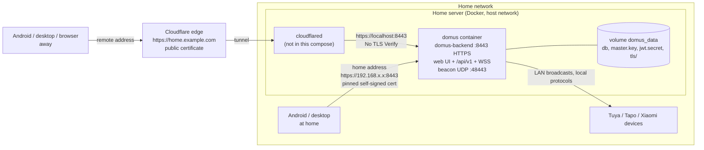
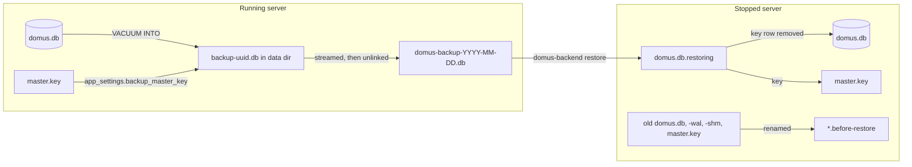
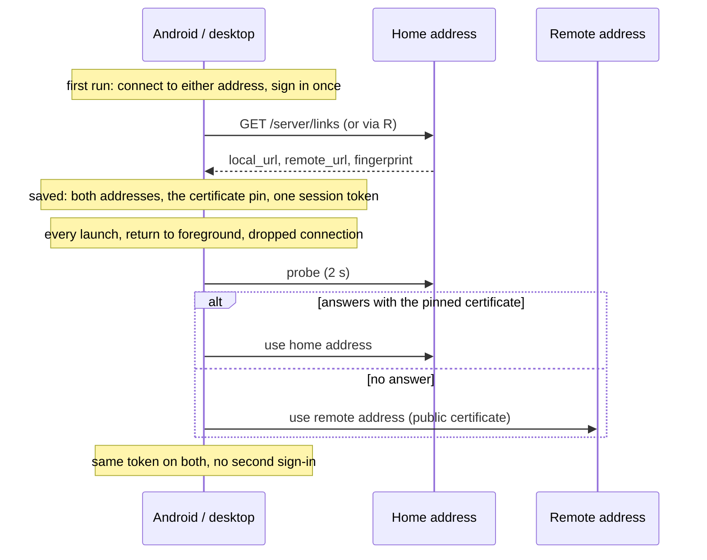
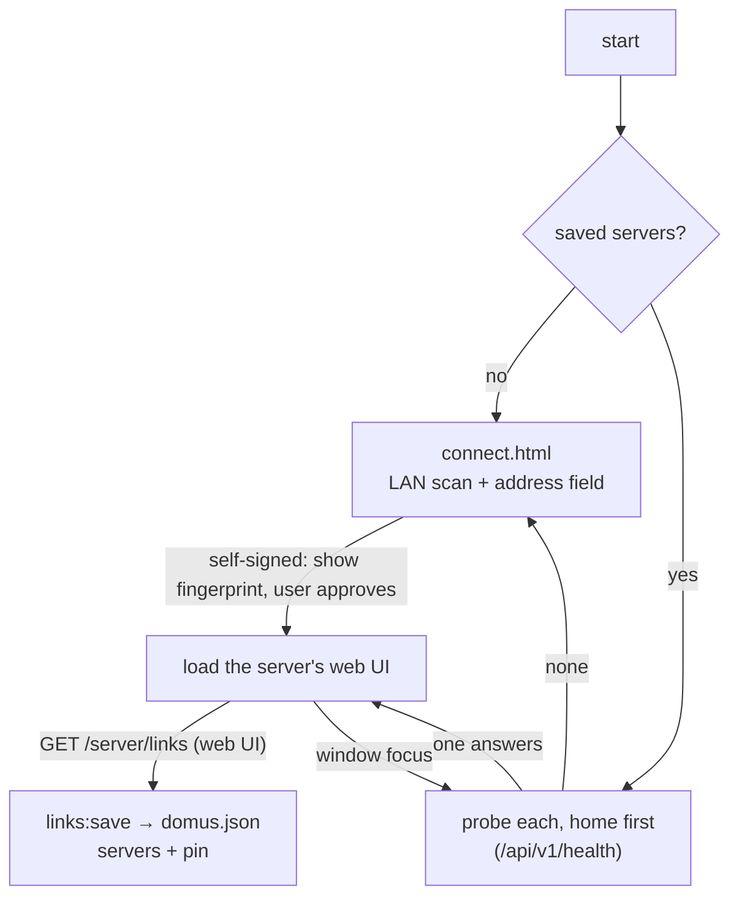

# Deployment: Docker, remote access and the apps

How the home server is run, how it is reached from outside, and how the Android and desktop apps choose
between the home and the remote address.

## 1. Overview



One process serves everything on one port: the web UI, the REST API and the WebSockets. That is why a
tunnel needs a single public hostname and no path rules.

## 2. Docker

Two compose files:

| File | Image | For |
|---|---|---|
| `docker-compose.yml` | `aiyuayaan/domus:${DOMUS_VERSION:-latest}` from Docker Hub | a home server; the only file it needs (the Mosquitto config is inline) |
| `docker-compose.local.yml` | built from this checkout (`domus:local`) | development and testing the Dockerfile |

```bash
docker compose up -d                                        # published image
docker compose pull && docker compose up -d                 # update it
DOMUS_VERSION=alpha docker compose up -d                    # a channel or an exact version
docker compose -f docker-compose.local.yml up -d --build    # build here instead
docker compose logs -f domus      # shows the TLS certificate fingerprint on start
DOMUS_PORT=9443 TZ=Asia/Kolkata docker compose up -d        # another port, local time for schedules
docker compose --profile mqtt up -d    # also start the optional Mosquitto broker (link it under Integrations as host mqtt, port 1883)
```

| | |
|---|---|
| Image | `Dockerfile`: Node stage builds `apps/web`, Rust stage builds `domus-backend`, runtime is `gcr.io/distroless/cc-debian12` (glibc, CA certificates, tzdata, no shell), uid 1000 |
| Network | `network_mode: host`. Tapo and Xiaomi discovery and the app beacon are LAN broadcasts; they do not reach a bridged container |
| Data | Named volume `domus_data` at `/app/data`. It holds the database, the master key that decrypts integration credentials, the JWT secret and the TLS certificate. Back it up (Settings > Backup, see below); losing `master.key` loses every linked account |
| Config | `APP_ENV=production` (listens on `0.0.0.0`). Any key of `config/default.toml` as `DOMUS__<SECTION>__<KEY>` in `environment:` |

The release binary is stripped and built with thin LTO (`[profile.release]` in `Cargo.toml`); `.dockerignore` is an allow-list, so the build context is only what the Dockerfile copies. The image has no shell: `docker exec` cannot open one, use `docker compose logs`. Published images and their tags are described in `RELEASE.md`.

The build uses BuildKit cache mounts for the Cargo registry and `target/`. `COPY` keeps source mtimes, so the
Dockerfile touches the workspace sources before `cargo build`; without that a cached, older binary is shipped.

### Forgot the password

`domus-backend reset-password <username> [new-password]` sets a new password straight in the database. Without a password it generates one and prints it. It works while the server runs and needs no shell in the image, because `exec` starts the binary itself:

```bash
docker compose exec domus domus-backend reset-password aiyu            # random password, printed
docker compose exec domus domus-backend reset-password aiyu 'new-pass' # your own (8+ characters)
docker compose -f docker-compose.local.yml exec domus domus-backend reset-password aiyu
domus-backend reset-password aiyu                                      # outside Docker, from the repo root (uses ./data)
```

Existing sessions stay valid until their token expires; the new password applies to the next sign-in. Source: `backend/src/cli.rs`.

### Backup and restore

An administrator downloads the whole home as one file from **Settings > Backup** (`GET /api/v1/server/backup`).
It is a SQLite copy of the database (`VACUUM INTO`, so it is consistent while the server runs) with the master
key stored inside it, because the linked accounts in the database are sealed with that key. Whoever holds the
file can open those accounts: keep it private. The JWT secret and the TLS certificate are not in it; after a
restore on a new machine people sign in again and the apps ask to trust the new certificate.



Restore with the server stopped. What was there is kept as `*.before-restore` in the data directory.

```bash
# Docker
docker compose cp domus-backup-2026-10-11.db domus:/app/data/restore.db
docker compose stop domus
docker compose run --rm domus domus-backend restore data/restore.db
docker compose start domus

# Outside Docker, from the repo root (uses ./data)
domus-backend restore ~/Downloads/domus-backup-2026-10-11.db
```

When the key comes from `DOMUS_MASTER_KEY` instead of `master.key`, the backup holds no key and the restored
server needs the same variable. Source: `backend/src/infrastructure/backup.rs`, `modules/server.rs`, `cli.rs`.

A `Request failed (500)` on sign-in is a server error, not a wrong password (that is a 401): check `docker compose logs domus`.

## 3. Cloudflare Tunnel

`cloudflared` runs outside this compose file (on the host or in its own container with host networking).
In the tunnel's public hostname settings:

- **Service**: `https://localhost:8443`
- **TLS → No TLS Verify**: on. The origin certificate is self-signed; the hop is on the same machine.

Keep TLS enabled on the server. The apps on the home network talk to it directly and only speak HTTPS.
WebSockets (`/api/v1/ws`, Screen Sync) pass through Cloudflare without extra settings. Then save the public
hostname as the **Remote** address (Settings → Server addresses).

Checked against the container: API calls and the WebSocket upgrade succeed with a foreign `Host` / `Origin`
header, as a tunnel sends them. Not checked against a real tunnel.

## 4. Home and remote address

The server stores two addresses in `app_settings` (`server_links`):

| | Default | Set by |
|---|---|---|
| `local_url` | `https://<LAN IP>:<port>`, detected at start | admin, to override |
| `remote_url` | empty | admin (the tunnel hostname) |

`GET /api/v1/server/links` (any signed-in user) returns both plus the SHA-256 fingerprint of the server's
own certificate. `PUT` is admin only. They can be edited from the web UI, the desktop app or Android; every
client reads them from the server, so a change made on the phone reaches the desktop the next time it opens
or regains focus.



Why no second sign-in: the JWT is signed by the server's `jwt.secret`, not bound to a hostname, so it is
valid on either address. The apps keep one token for the server instead of one per address.

Why the fingerprint is in the answer: an app that first connected through the remote address has never seen
the self-signed local certificate. The server reports its fingerprint over a connection the app already
trusts, and the app pins it. A certificate that does not match the pin is still refused.

## 5. Desktop app (`apps/desktop`)

Electron shell around the web UI served by the server.



- **State**: `domus.json` in the app's user-data directory (`~/.config/Domus`): server list, certificate pins,
  session token (encrypted with the OS keyring through `safeStorage` when one is available, mode `0600`).
- **Token**: web storage is per origin, so the page asks the app for the token (`window.domus.token`,
  `preload.js`). Home and remote address then share one sign-in.
- **Certificates**: `session.setCertificateVerifyProc` accepts a failing certificate only when its
  fingerprint is pinned. A verify proc rather than `certificate-error`, because the latter does not cover
  WebSockets.
- **Window**: no native title bar or menu. The page draws a 36px bar that drags the window
  (`html.desktop` in `apps/web/src/index.css`, `--titlebar` offsets everything pinned to the top) and
  Electron overlays the window buttons on its right end, coloured from the theme chosen in Settings.
- **Change server**: Settings → Server addresses → Change server.
- **Development**: `DOMUS_URL=http://localhost:3000 pnpm dev:desktop` skips the connect page.

### Linux

`pnpm dev:desktop` runs Electron with `--no-sandbox`. Chromium's sandbox needs either unprivileged user
namespaces (blocked by AppArmor on Ubuntu 24.04+) or a setuid-root `chrome-sandbox`, and a setuid bit
cannot exist inside `node_modules` on a `nosuid` mount such as this NTFS drive. The flag is for development
only; the window loads nothing but the Domus server.

`pnpm build:desktop` (electron-builder) writes `apps/desktop/dist/`:

- `domus_<version>_amd64.deb`: installs to `/opt/Domus`, with a desktop entry and the icon under
  `/usr/share/icons/hicolor`. Its post-install script (`build/after-install.sh`) makes `chrome-sandbox`
  setuid, so the installed app runs sandboxed. electron-builder's default script skips that when user
  namespaces work for root, which is the case on Ubuntu 24.04+ even though they are blocked for users.
  This is the recommended package: `sudo apt install ./domus_<version>_amd64.deb`.
- `Domus-<version>.AppImage`: portable; on Ubuntu 24.04+ it needs `--no-sandbox` for the reason above.

The launcher icon comes from the desktop entry. It matches the running window because `productName`
(`Domus`) gives the window class `Domus` and the entry declares `StartupWMClass=Domus`. The icon source is
`apps/desktop/build/icon.png` (see `BRAND.md`).

## 6. Android

`DomusRepository` keeps `local`, `remote` and the last used `server` in the encrypted store. `restore()`,
`onForeground()` and the live-socket retry loop call the same pick: first address that answers a trusted
`setup-status` within two seconds, home first. Settings → Server addresses shows both; admins edit them.

## 7. Not done

- A real Cloudflare Tunnel run (section 3 was simulated).
- Live push of address changes; clients read them on launch, on focus and on each refresh.
- Container healthcheck (the runtime image has no HTTP client).
- macOS / Windows packages, and code signing.
