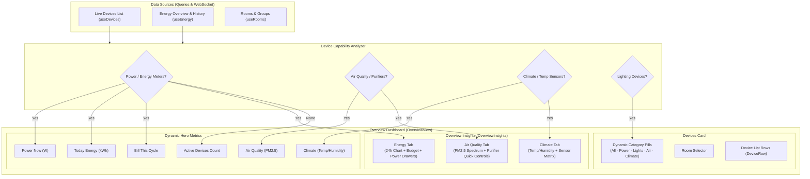

# Dynamic Overview Dashboard Architecture & Specification

## Overview

The Docus Overview dashboard provides real-time monitoring and control of smart home devices. Rather than rendering hardcoded metrics and widgets that assume every home has electricity meters or specific sensors, the dashboard dynamically adapts to the devices actually registered in the system:
1. **Device-Based Hero Metrics**: Power, Energy, Bill, Air Quality, and Climate cards render if and only if devices reporting those metrics are present.
2. **Dynamic Insights Tabs**: The secondary analytics section provides tabbed monitoring (`Energy`, `Air quality`, `Climate`) that only includes tabs for device types actually installed. If no analytical devices are installed, the section automatically hides so the layout remains clean.
3. **Device Category Filters**: The Devices card provides dynamic filtering chips (`All`, `Power`, `Lights`, `Air quality`, `Climate`) that automatically detect device capabilities and hide categories with zero devices.

---

## Architecture Diagram

---

## Components

### 1. `OverviewInsights` ([OverviewInsights.tsx](file:///media/aiyu/550E85595197DBEC/development/domus/apps/web/src/features/overview/OverviewInsights.tsx))
- **Dedicated Section Cards**:
  - `Air quality`: Rendered directly when air quality devices (air purifiers or PM2.5 sensors) exist. Displays PM2.5 reading, WHO 4-segment visual indicator, interactive purifier controls (power switch, mode, fan speed, HEPA filter life bar), and direct navigation link to `/air-quality`.
  - `Energy · 24 hours`: Rendered directly when power-metering devices exist. Displays 24h consumption chart, monthly budget progress bar, active power consumers, and direct navigation link to `/energy`.
  - Auto-hides any section whose device type is not present in the home.

### 2. `AirQualityView` ([AirQualityView.tsx](file:///media/aiyu/550E85595197DBEC/development/domus/apps/web/src/features/airquality/AirQualityView.tsx))
- Dedicated full-page view accessible via `/air-quality` (mirroring the `/energy` view).
- Real-time PM2.5 metric cards, purifier status, HEPA filter health percentage, and temperature/humidity.
- Comprehensive Air Purifier controls (power toggle, operational modes, fan speed, filter life progress).
- WHO Air Quality Scale breakdown and multi-room sensor readings matrix.

### 3. Dynamic App Navigation ([AppShell.tsx](file:///media/aiyu/550E85595197DBEC/development/domus/apps/web/src/components/AppShell.tsx))
- Sidebar navigation and mobile tab bar dynamically evaluate device presence:
  - `Air quality` navigation tab is included only when air quality / purifier devices are registered.
  - `Energy` navigation tab is included only when electronic power / energy devices are registered.

### 2. `OverviewView` ([OverviewView.tsx](file:///media/aiyu/550E85595197DBEC/development/domus/apps/web/src/features/overview/OverviewView.tsx))
- Computes dynamic categories (`Power`, `Lights`, `Air quality`, `Climate`, `All`) and shows filter chips only for active categories.
- Dynamically scales top metric grid (`grid-cols-1`, `grid-cols-2`, `sm:grid-cols-3`, `lg:grid-cols-4`).
- Supports seamless combined filtering by room and category.

### 3. `format.ts` ([format.ts](file:///media/aiyu/550E85595197DBEC/development/domus/apps/web/src/lib/format.ts))
- Formats PM2.5 air quality levels with standard token-based tones (`text-on`, `text-warn`, `text-danger`).

---

## Scene & Group One-Touch Toggling

### Backend Implementation (`backend/src/modules/scenes/mod.rs`)
- Added `/scenes/:id/deactivate` to invert scene commands (sets `is_on: false` for all targeted devices and device groups).
- Added `/scenes/:id/toggle` supporting optional payload `{ "on": bool }`. If omitted, automatically checks live device states to flip them on or off cleanly.
- Updates scene `is_active` state in the database while broadcasting realtime device status updates.

### Frontend Integration (`apps/web/src/features/overview/OverviewView.tsx` & `AutomationsView.tsx`)
- **Real-Time State Detection (`isSceneActive`)**: Computes whether member devices of a scene or group are powered on from live WebSocket/query devices.
- **Overview Quick Control**: Shows a segmented switcher between Scenes and Groups when both are present. Each item includes a direct one-touch `<Switch>` and action feedback toasts.
- **Automations View**: Each scene row features an interactive `<Switch>` alongside the manual `Run` button for instant group/scene power on and off.

---

## Design System Compliance (`ui-ux-pro-max`)

Following the design profile in [MASTER.md](file:///media/aiyu/550E85595197DBEC/development/domus/design-system/docus/MASTER.md):
- **Minimalism & Swiss Style**: Hairline borders (`border-border`), tabular numbers (`tabular`), no cartoonish gradients or oversized badges.
- **State Semantics**: Green (`on`) indicates healthy air or live status; Amber (`warn`) indicates moderate air quality or filter warning; Red (`danger`) indicates poor air or offline devices.
- **Accessibility**: Screen reader labels on switches and segmented controls; contrast ratio ≥ 4.5:1.
