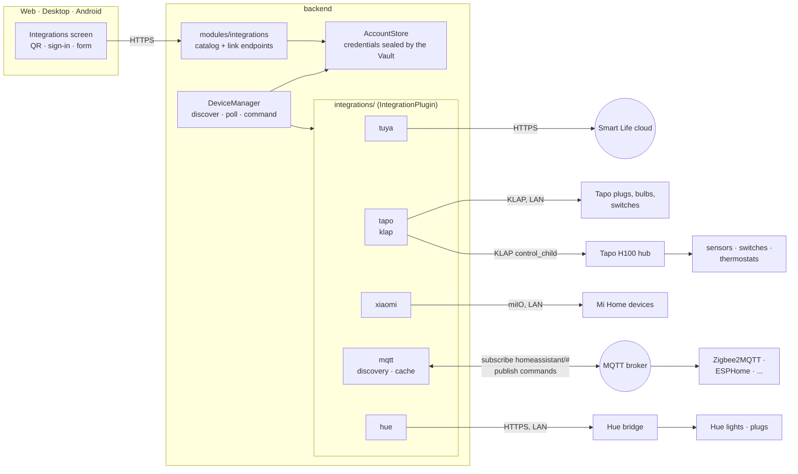
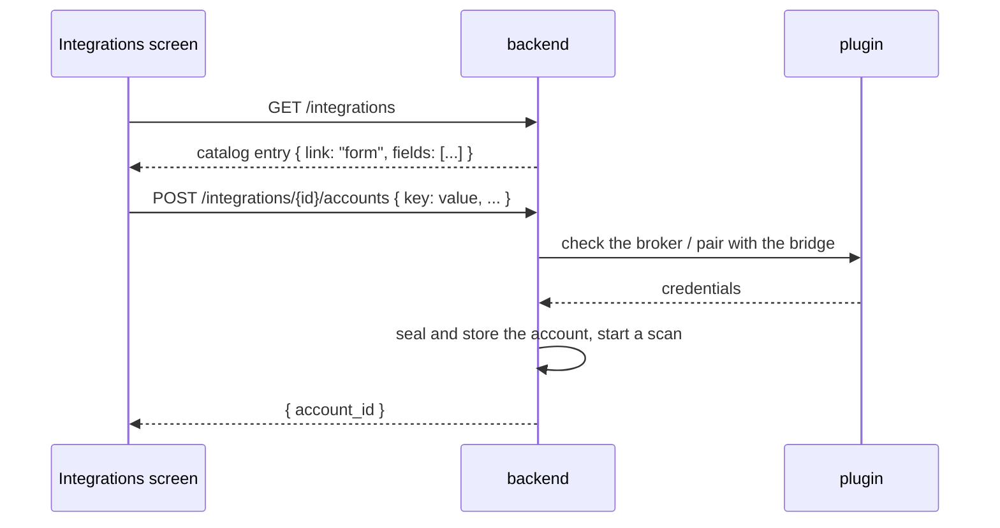

# Integrations

Every brand is a plugin in `backend/src/integrations/<name>/` implementing
`home_core::IntegrationPlugin`. The `DeviceManager` is the only caller. This page
lists what each plugin covers, how it is linked, and what has been checked on
real hardware. Read it before adding or changing a plugin.

## Architecture

A linked account is whatever the plugin needs to reach its devices: a cloud
login (Tuya, Xiaomi, Tapo), a broker address (MQTT) or a bridge and its app key
(Hue). All of them are rows in `integration_accounts`, sealed with the vault.

## What each plugin covers

| Plugin | Linked by | Devices | Polling | Checked on hardware |
|---|---|---|---|---|
| Tuya / Smart Life | QR code | switch, plug, light, air purifier, fan, sensor, climate, cover | cloud, 15 s | one light effect on a Tuya bulb |
| Tapo | TP-Link sign-in | plug, bulb, strip, switch; H100 hub with its sensors, switches and KE100 thermostats | LAN, 3 s; one request per hub | one light effect on the L900; **hub not checked** |
| Xiaomi | Mi account (or a device token) | air purifier, light, plug, switch, fan, climate, curtain, sensor | LAN, 3 s | not recorded |
| MQTT | form: broker address, port, login | light, switch, plug, fan, sensor, binary sensor from Home Assistant discovery | reads a cache the broker fills | against a Mosquitto broker with Zigbee2MQTT-shaped messages; **no real Zigbee device** |
| Philips Hue | form: press the bridge button | lights and Hue smart plugs on a bridge | LAN, 3 s; one request per bridge | against a stand-in bridge only; **no real bridge** |

"Not checked" means the code follows the documented protocol and has unit
tests, but nobody has run it against the device. Tick the box in
`development/TODO.md` when you do.

## Form links

Tuya, Tapo and Xiaomi have their own link screens. Newer plugins describe their
inputs instead, and the clients draw them:

To add a form-linked plugin: add its `FormField` list and catalog row in
`modules/integrations/mod.rs`, a `POST /<id>/accounts` handler that validates
and calls `save_account`, and register the plugin in `bootstrap.rs` behind
`integrations.<id>.enabled`. No client change is needed.

## MQTT

`mqtt/mod.rs` keeps one connection per linked broker. It subscribes to
`homeassistant/#`, stores each entity config, and subscribes to the state and
availability topics those configs name. `fetch_state` lays the cached payloads
over the device's last stored state, so a value the broker has not repeated
since a restart is kept. Port 8883 connects with TLS.

`mqtt/discovery.rs` is the mapping, with no I/O:

- Entities are grouped by `device.identifiers`. Each `light`, `switch` or `fan`
  becomes a Domus device; `sensor` and `binary_sensor` entities of the same
  hardware are merged into the first one (a plug gets its power reading). A
  device with only sensors becomes one sensor device.
- Entities with an `entity_category` (child lock, LED switch) are skipped.
- Lights: both the `json` schema (Zigbee2MQTT, ESPHome) and the basic schema.
- Sensor keys in the state: `temperature`, `humidity`, `air_quality_pm25`,
  `current_power_watts`, `voltage`, `current_amps`, and in `extra`: `motion`,
  `contact` (true = open), `water_leak`, `battery`, `battery_low`, `energy_kwh`.

Limits:

- Value templates are read only as far as `value_json.<path>`; anything that
  computes a value is ignored.
- Covers, climate, locks and other components are not mapped.
- Devices that do not publish Home Assistant discovery (Tasmota with its own
  discovery, hand-rolled topics) do not appear.
- State follows the 3 s poll, not the message itself.

The bundled Mosquitto (`docker compose --profile mqtt up -d`) is reached from
the Domus container as host `mqtt`, port `1883`.

## Philips Hue

`hue/mod.rs` uses the bridge's local API over HTTPS (the bridge's own
certificate is accepted). Linking posts to `/api` right after the bridge button
is pressed and stores the app key. An empty address asks
`discovery.meethue.com` for the bridge on the network.

Limits: the bridge address is stored as linked, so give the bridge a DHCP
reservation; Hue motion sensors, dimmer switches, scenes and entertainment
areas are not mapped.

## Tapo hubs and cameras

A hub (H100) is discovered like any Tapo device. Its paired devices come from
`get_child_device_list`, carry the hub's address and a `child_id` in their
config, and are commanded through `control_child`. The hub's siren is reported
(`alarm`) but cannot be switched from Domus, so "all on" in a room never sounds it.
A thermostat's target is set with the raw command `{ "target_temp": 21 }`.

Cameras are **not supported**. They do not speak KLAP: they take HTTPS on port
443 with an `admin` login and an AES "securePassthrough" envelope, and their
TLS only offers RSA key exchange, which rustls (the TLS library used
everywhere here) does not implement. Supporting them means linking OpenSSL
into the backend for those calls, and testing on a real camera. Until then a
camera shows up under Discovered with a note. H200/H500 hubs use the camera
protocol and are in the same position.
