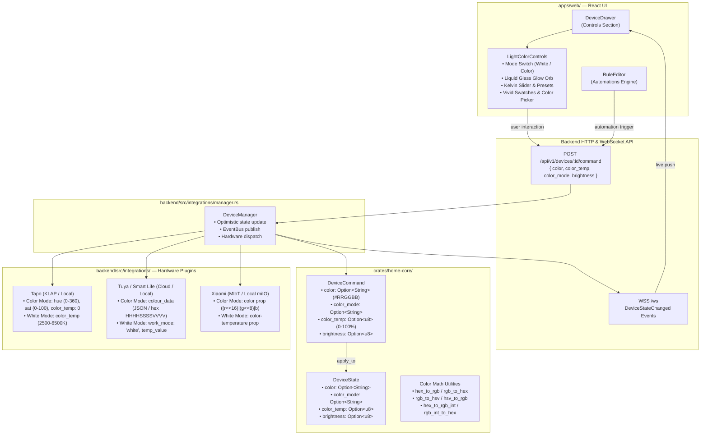

# Light Bulb Color & Temperature Architecture

This document describes the end-to-end architecture for smart light bulb color and white temperature controls in Docus across the web frontend, core domain model, and vendor integrations (Tapo, Tuya / Smart Life, Xiaomi MIoT).

## 1. System Architecture Diagram

## 2. Domain Data Model (`crates/home-core`)

The shared domain contracts in `crates/home-core/src/lib.rs` normalize disparate vendor formats into a standardized representation:

| Field | Type | Description |
|---|---|---|
| `color` | `Option<String>` | Standard hex color code `#RRGGBB` (uppercase or lowercase). |
| `color_mode` | `Option<String>` | Operating mode: `"white"` or `"color"`. |
| `color_temp` | `Option<u8>` | Normalized white temperature percentage (0% = warmest candle ~2000K, 100% = coolest ice ~6500K). |
| `brightness` | `Option<u8>` | Luminous intensity level (1–100%). |

### Color Conversion Utilities
`home-core` provides tested, zero-allocation math routines:
- `hex_to_rgb(hex) -> Option<(u8, u8, u8)>`
- `rgb_to_hex(r, g, b) -> String`
- `rgb_to_hsv(r, g, b) -> (u16, u8, u8)` (Hue 0–360, Saturation 0–100, Value 0–100)
- `hsv_to_rgb(h, s, v) -> (u8, u8, u8)`
- `hex_to_rgb_int(hex) -> Option<u32>` and `rgb_int_to_hex(u32) -> String` (Big-endian RGB integer).

## 3. Integration Mappings

### 3.1 Tapo (TP-Link KLAP)
- **Status Decoding**:
  - If `color_temp > 0`, state is normalized to `color_mode: "white"` and `color_temp` mapped from 2500K–6500K.
  - If `color_temp == 0` and `hue` / `saturation` are present, `hsv_to_rgb` computes the hex `#RRGGBB` and sets `color_mode: "color"`.
- **Command Dispatch**:
  - Setting `color`: Converts `#RRGGBB` to HSV. Dispatches `{"hue": H, "saturation": S, "color_temp": 0}` to the device.
  - Setting `color_temp`: Dispatches `{"color_temp": 2500 + pct * 40, "hue": 0, "saturation": 0}`.

### 3.2 Tuya / Smart Life
- **DP Codes**:
  - `colour_data_v2`, `colour_data_hsv`, `colour_data`
  - `work_mode`: `"white"` vs `"colour"`
- **Status Decoding**:
  - Decodes JSON format `{"h": 0-360, "s": 0-1000, "v": 0-1000}`.
  - Decodes Tuya 12-character hex format `HHHHSSSSVVVV` (4-hex-digit H, S, V).
  - Decodes Tuya 14-character hex format `RRGGBBHHHHSSVV`.
- **Command Dispatch**:
  - Setting `color`: Converts `#RRGGBB` to Tuya's target format, sets `work_mode: "colour"`.
  - Setting `color_temp`: Dispatches scaled `temp_value` (0–1000) and sets `work_mode: "white"`.

### 3.3 Xiaomi MIoT
- **Property Mappings**:
  - `color` (`urn:miot-spec-v2:property:color`)
  - `color-temperature` (`urn:miot-spec-v2:property:color-temperature`)
- **Status Decoding**:
  - Unpacks 24-bit integer `(r << 16) | (g << 8) | b` to `#RRGGBB`.
- **Command Dispatch**:
  - Converts hex `#RRGGBB` to integer `(r << 16) | (g << 8) | b` and sends `set_properties`.

## 4. User Experience & Apple Liquid Glass UI

`apps/web/src/components/devices/LightColorControls.tsx` provides:
1. **Mode Switcher**: Segmented pill tabs between "White" and "Color" modes.
2. **Liquid Glass Ambient Glow Orb**:
   - Translucent glass orb featuring specular highlight reflection curvature, inner depth shading, and soft ambient radiance box-shadows.
   - Dynamically tints and glows based on live color, temperature, brightness percentage, and power state.
3. **White Mode**:
   - Visual color temperature slider with smooth Kelvin gradient background (Candle Amber 2000K to Cool Sky 6500K).
   - Quick presets: Warm Yellow / Candle (2000K), Soft White (2700K), Daylight (5000K), Cool White (6500K).
4. **Color Mode**:
   - Curated palette swatches: Warm Amber, Gold, Sunset Orange, Crimson Red, Neon Pink, Purple, Sky Blue, Cyan, Emerald Green, Lime.
   - Custom native color wheel picker and interactive hue slider with editable Hex badge.
5. **Automations Integration**:
   - `RuleEditor` supports selecting and configuring color or temperature actions for individual lights and groups.
