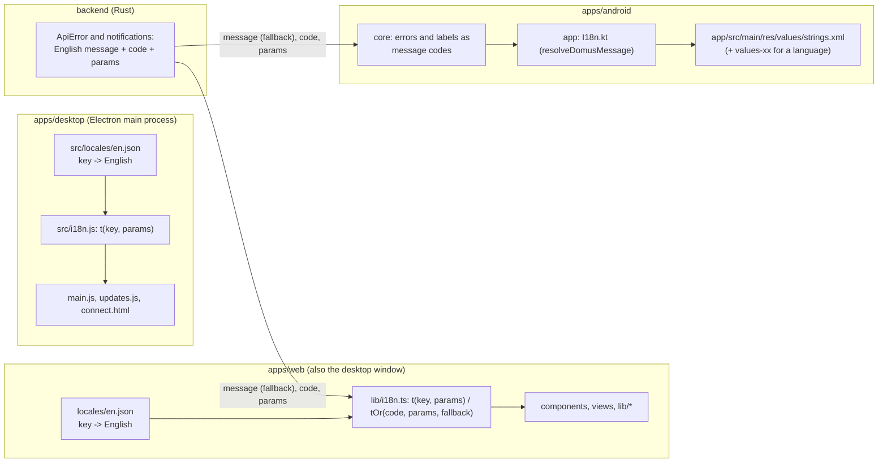

# Localization

Goal: no hard-coded UI text in any client, so another language is a new catalog file and nothing else.
Not in scope yet: the translations themselves, a language picker, plural rules beyond `one` / `other`.
Branch: `feat/localization`. Progress is tracked in `development/TODO.md` (Milestone 21).

## 1. Architecture

The server keeps sending its English `message`, so old clients and logs keep working. It also sends a stable
`code` and `params`. A client translates by `code` and shows `message` when it has no entry for it.

## 2. Web (`apps/web`)

- `src/locales/en.json` is the source catalog: flat keys, `{name}` placeholders. English is the fallback for every language.
- `src/lib/i18n.ts` exports `t(key, params?)` and `tOr(code, params, fallback)`. The language is `navigator.language` read once at load, so `t()` also works
  in module-level constants (`deviceTypeLabel`, `WHITE_PRESETS`, ...). A language picker would need `t()` to become reactive.
- Plurals: pass a numeric `count`. `t('common.deviceCount', { count })` looks up `common.deviceCount_one` / `_other`
  (the `Intl.PluralRules` category of the language) before `common.deviceCount`.
- Keys are grouped by screen (`settings.*`, `rooms.*`, `overview.*`), shared words under `common.*`, `nav.*`, `device.*`, and server codes under `error.*` and `notification.*`.
- To add a language: create the catalog, register it in `catalogs` in `lib/i18n.ts`. Missing keys fall back to English.

### Rules for new strings
1. Never write UI text in a component. Add the key to `en.json` and call `t()`.
2. Never build a sentence by gluing pieces (`'a ' + n + ' b'`). Give the whole sentence a key with placeholders; word order differs between languages.
3. Plural words need `_one` / `_other` keys, not `n === 1 ? 'device' : 'devices'`.
4. Not translated on purpose: brand and product names (Domus, Tuya, Tapo, Xiaomi, Hue, MQTT), units (W, kWh, °C, µg/m³), the `DEV` flavor badge, library names and licences in `lib/credits.ts`, device-reported values (a fan mode called `Manual`).
5. Dates, numbers and money keep going through `Intl` (`lib/format.ts`).

### Finding what is left
`python3 ../../scripts/i18n-scan.py [files]` (run in `apps/web`) lists text that is still hard-coded. It is a heuristic: import lists,
hooks and the brand name show up as false positives. A file is done when only those remain. `npx tsc -b` must pass.

## 3. Status

| Area | State |
|---|---|
| Web catalog + `t()` / `tOr()` | done (1,145 keys in `apps/web/src/locales/en.json`) |
| Web: format, toast, shared ui, device labels, update prompt, sign-in, app shell, rooms, devices, overview, device drawer / row / charts / light controls, settings | done |
| Web: Automations, RuleEditor, Energy, Integrations, Air quality, About, Updates, Avatar picker, ScreenSync, `lib/api.ts`, `lib/avatar.ts`, `lib/credits.ts` group names, `lib/devices.tsx` | done |
| Desktop (`apps/desktop/src/main.js`, `updates.js`, `connect.html`, `i18n.js`, `locales/en.json`) | done (24 keys) |
| Android (`apps/android/app/src/main/res/values/strings.xml`, `I18n.kt`, `core` message codes) | done (868 strings + 8 plurals; `core` stays free of Android resources in signatures via message codes resolved in `:app`) |
| Server message codes (`backend/src/api/error.rs`, `modules/notifications/mod.rs`) | done (`code` + `params` sent alongside `message`; translated in web and Android with fallback to `message`) |

## 4. Gotchas found while doing it

- Edits that put `t()` into a file that has a local variable called `t` (`Toaster`, chart components) shadow the import; alias it (`import { t as tr }`).
- A literal `\n` written into JSX text is valid TypeScript and shows as `\n` on screen, so `tsc` cannot catch it. Grep for `)}\n` after bulk edits.
- Messages that include a user-provided value must still fall back to something when the value is missing (`name ?? t('x.fallback')`), not render `undefined`.
