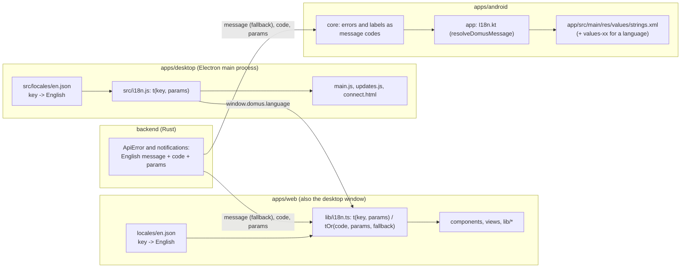
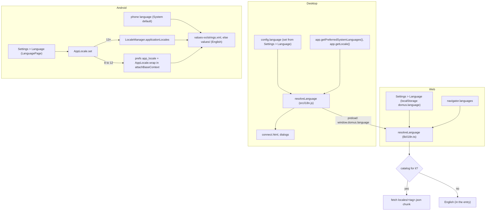

# Localization

Goal: no hard-coded UI text in any client, so another language is a new catalog file and nothing else.
27 languages ship (English plus 26, machine translated). Each client follows the system's language and shows English when it has no translation; every client can also pick one in Settings (section 3).
Branch: `feat/localization`. Progress is tracked in `development/TODO.md` (Milestone 21).

## 1. Architecture

The server keeps sending its English `message`, so old clients and logs keep working. It also sends a stable
`code` and `params`. A client translates by `code` and shows `message` when it has no entry for it.

## 2. Web (`apps/web`)

- `src/locales/en.json` is the source catalog: flat keys, `{name}` placeholders. English is the fallback for every language.
- `src/lib/i18n.ts` exports `t(key, params?)`, `tOr(code, params, fallback)` and `language`. The language is resolved once at load
  (section 3) and its catalog is awaited at the top level of the module, so `t()` also works in module-level constants
  (`deviceTypeLabel`, `WHITE_PRESETS`, ...). That is why picking a language reloads the page instead of re-rendering.
- Only English is in the entry chunk. Every other catalog is its own chunk (`import.meta.glob`), fetched for the language in use:
  the entry is 402 kB instead of 2,450 kB with all 27 inside. The top-level `await` is why `vite.config.ts` builds for `es2022`.
- `<html lang>` is set to the language and `dir="rtl"` for `ar` and `ur`. The rules that keep the layout right in both directions are below.
- Plurals: pass a numeric `count`. `t('common.deviceCount', { count })` looks up `common.deviceCount_one` / `_other`
  (the `Intl.PluralRules` category of the language) before `common.deviceCount`.
- Keys are grouped by screen (`settings.*`, `rooms.*`, `overview.*`), shared words under `common.*`, `nav.*`, `device.*`, and server codes under `error.*` and `notification.*`.
- To add a language: see section 3. Missing keys fall back to English.

### Rules for new strings
1. Never write UI text in a component. Add the key to `en.json` and call `t()`.
   Add the same key, translated, to every other catalog of that platform in the same change (web: 26 files in `apps/web/src/locales`,
   desktop: 26 in `apps/desktop/src/locales`, Android: 26 `values-*/strings.xml`). A key left out shows English in that language.
2. Never build a sentence by gluing pieces (`'a ' + n + ' b'`). Give the whole sentence a key with placeholders; word order differs between languages.
3. Plural words need `_one` / `_other` keys, not `n === 1 ? 'device' : 'devices'`.
4. Not translated on purpose: brand and product names (Domus, Tuya, Tapo, Xiaomi, Hue, MQTT), units (W, kWh, °C, µg/m³), the `DEV` flavor badge, library names and licences in `lib/credits.ts`, device-reported values (a fan mode called `Manual`).
5. Dates, numbers and money keep going through `Intl` (`lib/format.ts`).

### Rules for right-to-left (Arabic, Urdu)
1. Use Tailwind's logical classes, never the physical ones: `ms-` / `me-`, `ps-` / `pe-`, `start-` / `end-`, `text-start` / `text-end`,
   `border-s` / `border-e`. They are identical in English and mirror in Arabic.
2. An icon that points (`CaretRight`, `ArrowLeft`) gets `rtl:-scale-x-100`. A horizontal move gets its opposite (`translate-x-3.5 rtl:-translate-x-3.5`).
3. A number with something around it is left to right inside Arabic text. `formatNumber`, `formatWatts`, `formatKwh`, `formatMoney`,
   `formatTime` and `formatBucket` already put a left-to-right mark in front; for a string built by hand (`+12%`, `≈ 3 kWh`) call `ltr()` from `lib/format.ts`.
   Write `%` without a space after the number.
4. Time runs left to right in every language: a chart's plot and its axis labels, a gradient slider and a scale sit in `dir="ltr"`.
   The text around them follows the page.
5. Dates and numbers use `formatLocale`: the picked language, or the browser's own regional format while the app follows the system.

### Finding what is left
`python3 ../../scripts/i18n-scan.py [files]` (run in `apps/web`) lists text that is still hard-coded. It is a heuristic: import lists,
hooks and the brand name show up as false positives. A file is done when only those remain. `npx tsc -b` must pass.

## 3. Which language is shown

- **Rule (web and desktop, the same function in both)**: walk the requested languages in order and take the first with a catalog,
  else English. A region falls back to its language (`es-MX` to `es`). Chinese goes by script: Hong Kong, Macau and Taiwan read
  `zh-TW`, the rest `zh-CN`. Every Portuguese reads `pt-BR`.
- **Picker (web and desktop)**: Settings > Appearance > Language lists "System default" and every language by its own name
  (`languages`, `languageChoice`, `setLanguage` in `lib/i18n.ts`). The choice comes first in the rule above, and the page reloads.
  A browser keeps it in `localStorage` (`domus.language`, `domus.dev.language` in the dev flavor). The desktop app keeps it in its own
  config (`language` in `domus.json`, through `window.domus.setLanguage`), because its home and remote address are two origins with
  separate storage and its connect window reads it too.
- **Desktop** asks the system for its language list, because `app.getLocale()` only names languages Chromium itself is
  translated into (no Punjabi or Marathi). It passes the result to the page as `window.domus.language`, which the web reads
  before `navigator.languages`, so the connect window and the app agree.
- **Android** follows the phone by default. Settings > Language (`AppLocale.kt`: `AppLocale` and `LanguagePage`) lists "System default"
  and the 27 languages, each by its own name with the name in the current language under it. It is a page over the tabs
  (`language` in `MainScreen`), so it has the shared-axis motion and the predictive back gesture. Choosing recreates the activity;
  the open page is kept. On Android 13+ the choice also shows in the system's App languages (`generateLocaleConfig`). Below 13 the
  two services wrap their context too, and the repository wraps per message; a notification already showing keeps its old text.
- Dates and numbers stay on the browser's or phone's own locale (`Intl` with no tag).

### Adding a language
1. Web: add `apps/web/src/locales/<tag>.json` with the keys of `en.json`. It is picked up by file name. Add the tag to `RTL` in `lib/i18n.ts` if it is written right to left.
2. Desktop: add `apps/desktop/src/locales/<tag>.json` and register it in `catalogs` in `src/i18n.js`.
3. Android: add `values-<xx>/strings.xml` in `app` and `ui-shared`, the tag to `AppLocale.tags` and the language to `localeFilters` in `app/build.gradle.kts`.

## 4. Status

| Area | State |
|---|---|
| Web catalog + `t()` / `tOr()` | done (1,151 keys in `apps/web/src/locales/en.json`) |
| Web: format, toast, shared ui, device labels, update prompt, sign-in, app shell, rooms, devices, overview, device drawer / row / charts / light controls, settings | done |
| Web: Automations, RuleEditor, Energy, Integrations, Air quality, About, Updates, Avatar picker, ScreenSync, `lib/api.ts`, `lib/avatar.ts`, `lib/credits.ts` group names, `lib/devices.tsx` | done |
| Desktop (`apps/desktop/src/main.js`, `updates.js`, `connect.html`, `i18n.js`, `locales/en.json`) | done (24 keys) |
| Android (`apps/android/app/src/main/res/values/strings.xml`, `I18n.kt`, `core` message codes) | done (876 strings + 8 plurals; `core` stays free of Android resources in signatures via message codes resolved in `:app`) |
| Server message codes (`backend/src/api/error.rs`, `modules/notifications/mod.rs`) | done (`code` + `params` sent alongside `message`; translated in web and Android with fallback to `message`) |
| Language detection, fallback and the Language setting (web, desktop, Android) | done; Android checked in Hindi and Arabic on an Android 17 emulator, the web in Arabic and English at 1280 and 390 px on every page, the desktop app with a Punjabi system and the picker |
| Right-to-left layout on the web | done (rules in section 2) |
| Translations (26 languages: `hi`, `es`, `pt-BR`, `id`, `ar`, `fr`, `ru`, `de`, `tr`, `ja`, `ko`, `it`, `vi`, `th`, `zh-CN`, `zh-TW`, `pl`, `bn`, `ta`, `te`, `mr`, `gu`, `kn`, `ml`, `pa`, `ur`) | done across Web (`apps/web/src/locales/<tag>.json`), Desktop (`apps/desktop/src/locales/<tag>.json`), and Android (`values-<xx>/strings.xml` in `app` and `ui-shared`) — machine translation, no native review |

## 5. Gotchas found while doing it

- Edits that put `t()` into a file that has a local variable called `t` (`Toaster`, chart components) shadow the import; alias it (`import { t as tr }`).
- A literal `\n` written into JSX text is valid TypeScript and shows as `\n` on screen, so `tsc` cannot catch it. Grep for `)}\n` after bulk edits.
- Messages that include a user-provided value must still fall back to something when the value is missing (`name ?? t('x.fallback')`), not render `undefined`.
