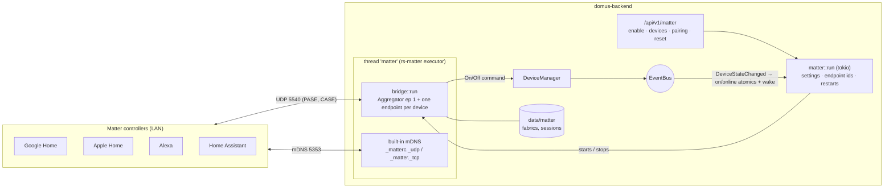

# Matter bridge

Domus shows the devices you pick to Google Home, Apple Home, Alexa and Home Assistant as a Matter bridge.
They switch them over the local network, with no cloud account. Code: `backend/src/modules/matter/`.

## 1. Architecture

- **rs-matter 0.4.1** (pure Rust crypto, no OpenSSL) runs on its own executor in a thread of its own. Domus
  talks to it through atomics (on, online) and an `async_channel` per device that wakes the On/Off cluster
  to report a change.
- A command from a controller comes back as a normal Domus command with `Actor::Matter`, so it shows in the
  device logbook as "Matter (voice assistant)" and fires automations like any other change.
- **Endpoints**: 0 root, 1 Aggregator, then one per shared device. A device keeps its endpoint for good
  (`app_settings` key `matter`), so controllers keep its name and room when the list changes.
- **Device types**: a light with colour or white temperature is an Extended Color Light (On/Off, Level
  Control, Color Control), a light or switch with brightness a Dimmable Light (On/Off, Level Control), any
  other light an On/Off Light, everything else with an on/off state an On/Off Plug-in Unit.
- **Commands**: Matter levels 1-254 map to Domus brightness 1-100 %; colours arrive as hue/saturation, xy
  or mireds and become a Domus `color` (full value) or `color_temp` (154-400 mireds = 6500-2500 K).
  Commands to one device within 300 ms are merged into one, so a fade or a dragged slider is one command
  to a (possibly cloud) device.
- **Domus to Matter**: on/off, online and brightness changes are reported to controllers. Colour is not:
  rs-matter 0.4.1 keeps it inside the cluster with no way to set it from outside.
  The Bridged Device Basic Information cluster carries the Domus name (NodeLabel), id (UniqueID) and
  online state (Reachable).
- **Restarts**: turning the bridge on or off, changing the shared devices, renaming or removing a shared
  device restarts the bridge (other edits do not). Pairings live in `data/matter` and survive restarts.
- **Port**: `[matter] port` in `config/default.toml` (`DOMUS__MATTER__PORT`), 5540 by default.

## 2. Pairing

Settings > Matter (web, desktop, Android; administrators only) shows the QR and the 11-digit code. Scan or
type it in the controller's app. The commissioning window is open for 15 minutes after the bridge starts
unpaired; "Allow pairing for 15 minutes" opens it again (to add a second ecosystem). "Forget all pairings"
deletes `data/matter` and draws a new passcode, discriminator and mDNS host name.

The passcode is random per home and never one of the values the spec forbids (`valid_passcode`).

## 3. Limits

| | |
|---|---|
| Certification | The bridge uses the Matter SDK's test attestation (VID 0xFFF1, PID 0x8001). Apps warn that it is uncertified; Google Home only accepts it once the VID/PID is added as a test device in the Google Home Developer Console. Certification needs a CSA vendor ID and a real DAC. |
| Features | On/off, brightness and colour. Fan speed and purifier modes are not exposed. Colour set in Domus is not reported back to controllers. |
| Rooms | Not sent: the Actions cluster that carries them is ignored by Google and Apple. Assign rooms in the controller. |
| Network | Needs UDP 5540 and mDNS on the LAN interface: run Docker with `network_mode: host` (the compose files do). |

## 4. Tests and what was checked

`backend/tests/matter_bridge.rs` pairs rs-matter's own commissioner with the bridge over UDP (PASE, NOC,
CASE, CommissioningComplete), then reads names and reachability, switches, dims, colours and sets white,
checks the Domus command each one produces, and checks that on/off and brightness changed in Domus reach
the controller. `cargo test -p domus-backend --test matter_bridge` (needs a LAN interface with IPv4).

The ignored test `a_controller_drives_a_running_server` does the same against a running server
(`DOMUS_MATTER_PORT`, `DOMUS_MATTER_PASSCODE` from `app_settings` key `matter`, `DOMUS_MATTER_PLUG`,
`DOMUS_MATTER_LAMP`). Run against a test server with fake MQTT devices (Zigbee2MQTT discovery on a
throwaway Mosquitto), a controller's toggle, dim and colour reached the fake devices as MQTT messages,
merged into one message per device, and showed in the logbook as Matter.

Also checked: advertised as `_matterc._udp` (`avahi-browse`); the QR drawn by the web and the Android app
decodes to the bridge's `MT:` payload; "Forget all pairings" drops the pairing and changes the code.

**Not checked:** pairing with Google Home, Apple Home, Alexa or Home Assistant (none on the development
machine). Try it before relying on it.
