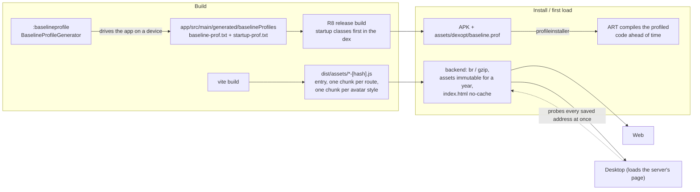

# Performance: startup on Android, web and desktop

What makes each client start fast, and what to re-run when the code changes.



## Android: baseline + startup profile

Without a profile ART interprets and JIT-compiles the app on its first runs; with one, the code on the launch
path and the main tabs is compiled when the app is installed. The same recording is the startup profile, which
R8 uses to put startup classes together at the front of the dex file.

- `apps/android/baselineprofile` is a `com.android.test` module with one generator
  (`BaselineProfileGenerator`): `startup` records a cold launch (this part is also the startup profile), `tabs`
  walks Home, Devices, Scenes, Analytics and Settings and scrolls each.
- `:app` applies `androidx.baselineprofile` with `mergeIntoMain = true`: one profile in
  `app/src/main/generated/baselineProfiles/`, used by both flavors (they run the same code). It is committed.
- `androidx.profileinstaller` installs the profile for sideloaded APKs too (there is no Play Store here).
- Only release builds use it. Debug builds are unaffected and stay slower; judge speed on `assembleProdRelease`.

To see it, install the signed release build: `pnpm android:release` (`:app:installProdRelease`). It is signed
with `apps/android/domus-release.jks` through `keystore.properties`; both are gitignored and exist only on the
machine that made them, so back them up: an app signed with another key cannot update this one.

The launch time itself does not move with the profile: `MainActivity.holdSplash` keeps the first frame back
until the splash mark has played (about 0.9 s from process start), and the app is ready before that either way.
The profile shows in what follows: the first tab switches and scrolls run compiled instead of interpreted.

Regenerate after a larger change to screens or navigation:

```bash
pnpm android:profile
# = cd apps/android && ./gradlew :app:generateBaselineProfile -Pandroid.injected.androidTest.leaveApksInstalledAfterRun=true
```

It needs one connected phone or emulator (Android 9+; a phone must be rooted below Android 13). The dev flavor
is recorded: the run installs a non-debuggable `com.aiyu.domus.dev` over the one on the device, keeping its
data. **Sign in on the device first** (`pnpm android:dev`), or the walk finds no tabs and only the launch and
connect screens are covered. Check the result: `grep -c HomeKt app/src/main/generated/baselineProfiles/baseline-prof.txt`
must not be 0.

Always go through the pnpm script. Without the `leaveApksInstalledAfterRun` flag Gradle uninstalls the app when
the run ends, which deletes its session on that device. `pnpm android:dev` afterwards puts the debug build back.

## Web

- The entry chunk carries the shell and the overview only; every other route is a `lazy()` chunk (`App.tsx`).
- Avatar artwork (DiceBear, ~1.4 MB for the 15 styles) is not in the entry. `lib/avatar.ts` loads a style's
  chunk the first time it is drawn (`@dicebear/collection/async`); until then `Avatar` shows the initial.
  Components that call `getAvatarUri` also call `useAvatarArt()` so they re-render when the artwork lands.
  Entry JS went from 1.79 MB to 0.33 MB (about 590 kB to 90 kB compressed).
- Inter is bundled (`@fontsource-variable/inter/wght.css`, imported by `main.tsx`), one variable woff2 per
  script served from `/assets` with the immutable cache. Nothing is fetched from another host, so the first
  paint does not wait on Google Fonts and the UI looks the same on a network without internet.
- The Markdown parser for release notes (`react-markdown`, `remark-gfm`, about 160 kB) is its own chunk,
  loaded the first time notes are drawn (`lib/releases.tsx`). `UpdatePrompt` sits in the shell, so it must
  keep importing the lazy wrapper and never `components/ReleaseNotes` directly.
- Only the English catalog is in the entry. The other 26 are one chunk each, and `lib/i18n.ts` fetches the one in use
  (`LOCALIZATION.md` section 2). Never import a `locales/*.json` other than `en.json` directly.
- Before adding a dependency to something imported by `main.tsx`, `App.tsx` or `AppShell`, check the entry
  size in the `pnpm build` output.

## Backend (serves the web UI to browsers and to the desktop app)

`api/routes.rs`:

- `CompressionLayer` (brotli or gzip, by `Accept-Encoding`) over the API and the static files. Event streams
  and images are skipped by tower-http's default rule.
- `/assets/*` is content-hashed by Vite, so it is sent with `Cache-Control: public, max-age=31536000, immutable`:
  a second visit downloads no JS or CSS. A missing asset is a 404, not `index.html`.
- Everything else from the web directory (`index.html`, icons, the SPA fallback) is `no-cache`: revalidated
  each time, so a new build is picked up at once and never reached through a stale page.

## Desktop

The window loads the page from the server, so the web and backend points above are its load time too
(Chromium also keeps compiled JS for immutable cached scripts). Before that, `start()` in `main.js` probes all
saved addresses at once and opens the first that answers, instead of waiting out the home address's 2.5 s
timeout before trying the remote one. If the remote address wins while at home, the existing focus check moves
the window to the home address.
