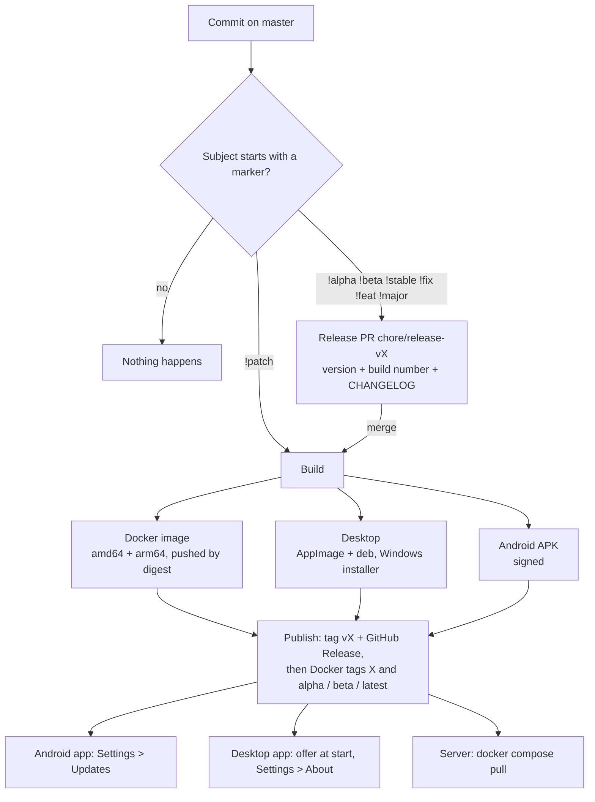

# Releases, versions and update channels

How a commit on `master` becomes a release, where every client gets its version from, and how the
apps find a newer build. Workflow: `.github/workflows/release.yml`. Version rules:
`scripts/release-version.mjs` (`--check` runs its self-test).

## 1. Flow



Step 1 builds nothing; the PR diff is the last look at what ships and at its notes. Step 2 names
nothing until every artifact exists, so a failed release leaves no tag, no Release and no moved
channel. Retry it from the Actions tab: **Release → Run workflow → mode `release`**.

## 2. Markers

The marker starts the commit subject; the rest follows the usual `scope(Change) : Message` form.

| Marker | From | To | |
|---|---|---|---|
| `!alpha` | nothing released | `0.0.1-alpha.1` | first release |
| `!alpha` | `0.0.1-alpha.1` | `0.0.1-alpha.2` | |
| `!beta` | `0.0.1-alpha.3` | `0.0.1-beta.1` | promote, same base |
| `!stable` | `0.0.1-beta.2` | `0.0.1` | promote, no bump |
| `!alpha` | `0.0.1` | `0.0.2-alpha.1` | next cycle |
| `!fix` | `1.4.2` | `1.4.3` | |
| `!feat` | `1.4.2` | `1.5.0` | |
| `!major` | `1.4.2` | `2.0.0` | |
| `!patch` | `0.0.2` | `0.0.2` | rebuild in place, no PR |

The current version is the last `v*` tag, or `0.0.0` when there is none. Several markers in one
push: the strongest wins (`major > feat > fix > stable > beta > alpha > patch`).

A scope made only of platform names limits what is built: `!alpha(android)`,
`!fix(docker,desktop)`. Names: `docker` (`server`, `backend`, `web`, `image`), `desktop` (`linux`,
`electron`), `android` (`apk`, `mobile`), `all`. Any other scope (`!feat(Energy)`) builds
everything. A scoped release only carries the files it built; the apps skip a release that has no
file for them.

```bash
git commit --allow-empty -m "!alpha : First public build"
git push            # opens the release PR; merge it to release
```

## 3. Version and build number

One source: `version` and `build` in the root `package.json`. The release PR runs
`scripts/set-version.mjs <version> --bump-build`.

| | Reads |
|---|---|
| Server (`/api/v1/health`, beacon) | `Cargo.toml` workspace version, written by `set-version.mjs` |
| Web UI (Settings → About) | root `package.json` through `vite.config.ts` (`__APP_VERSION__`, `__APP_BUILD__`) |
| Desktop | `apps/desktop/package.json`, written by `set-version.mjs` |
| Android `versionName` / `versionCode` | root `package.json` `version` / `build` (`app/build.gradle.kts`) |

`build` goes up by one with every release PR, so each release installs over the one before it.

## 4. Update channels

A channel takes its own builds and every steadier one: Alpha gets everything, Beta gets betas and
stable releases, Stable gets stable releases. The default is the channel of the installed build.

| Client | Where | How it updates |
|---|---|---|
| Android | Settings → Updates (`core/Updates.kt`) | Downloads the APK and hands it to Android's installer, which asks to allow installs from Docus the first time (`REQUEST_INSTALL_PACKAGES`, FileProvider `<applicationId>.updates`) |
| Desktop AppImage | Offer at start, Settings → About (`apps/desktop/src/updates.js`, `main.js`) | Downloads the AppImage over its own file and restarts |
| Desktop deb / Windows | same | Opens the `.deb` / `Docus-<version>-Setup.exe` download |
| Server | `DOCUS_VERSION` in `docker-compose.yml` | Docker tags `latest`, `beta`, `alpha` or an exact version; `docker compose pull && docker compose up -d` |
| `scripts/install-linux.sh` | `--channel`, `--version` | Re-run to update |

Dev flavors never update this way; they are rebuilt.

The Windows installer (NSIS, unsigned, so SmartScreen warns on first run) is built on `windows-latest` with `pnpm --filter @docus/desktop build:win`. Its job is `continue-on-error` until a release has shipped a working one: a failure there is a warning and the release goes out without it.

## 5. Repository setup

Secrets (Settings → Secrets and variables → Actions):

| Secret | Value |
|---|---|
| `DOCKERHUB_USERNAME` | `aiyuayaan` |
| `DOCKERHUB_TOKEN` | Docker Hub access token with Read & Write (Account settings → Personal access tokens) |
| `ANDROID_KEYSTORE_BASE64` | `base64 -w0 ~/Keys/aiyu-soft-android-keys.jsk` (alias `domus`) |
| `ANDROID_KEYSTORE_PASSWORD` | `storePassword` of `apps/android/keystore.properties` |
| `ANDROID_KEY_ALIAS` | `keyAlias` |
| `ANDROID_KEY_PASSWORD` | `keyPassword` |
| `RELEASE_TOKEN` (optional) | A personal access token, if Actions may not open pull requests |

Also turn on **Settings → Actions → General → Allow GitHub Actions to create and approve pull
requests**, and create the `aiyuayaan/domus` repository on Docker Hub (or let the first push create
it). The workflow checks the secrets before building and names the missing ones. Releases must be
signed with the same keystore every time, or Android refuses the update.
