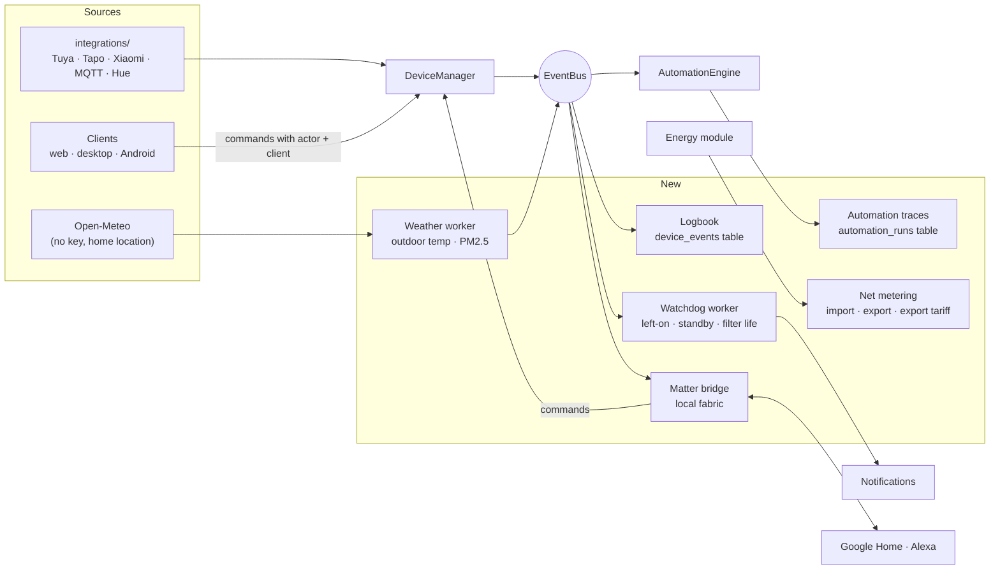

# Roadmap: insight, smarter automations and voice

Planned features after the MVP, in build order. Each one leans on the one
before it. Tracking lives in `development/TODO.md` (Milestone 17).

## Architecture

## 1. Device logbook

A per-device timeline: "Purifier turned on by Ayaan from Android, 21:04".

- A `device_events` table: device, time, what changed (power, mode, online),
  actor (user, automation, scene, device itself) and client (web, desktop,
  Android).
- Written by a subscriber on the `EventBus` from `DeviceStateChanged`, only for
  fields that actually changed. Commands carry the actor so the change can be
  attributed.
- Kept for a limited period (setting), pruned by the scheduler worker.
- Shown on the device sheet on web, desktop and Android.

## 2. Automation traces

Conditions (`TimeBetween`, `DeviceState`) already exist. What's missing is
seeing why a rule did or did not run.

- An `automation_runs` table: trigger that matched, each condition with its
  result, each action with its result or error.
- A "Runs" list on each automation, "last run" on the card.
- New trigger: power above X **for** Y minutes (left-on), since `PowerAbove`
  fires at once.

## 3. Standby and left-on alerts

From the energy samples already stored.

- Left-on: a device drawing more than a threshold for longer than a duration.
- Standby: the lowest steady draw of a device while "off", priced with the
  tariff as a monthly cost.
- Raised through the existing notifications, one per device per day.

## 4. Maintenance reminders

`DeviceState.filter_life` is already read. A notification fires once when it
crosses a threshold (default 10%) and resets when the filter is replaced.

## 5. Weather

Open-Meteo forecast and air-quality APIs, called by the server with the stored
home location every 30 minutes. Outdoor temperature and PM2.5 on Overview and
Air quality, and a trigger comparing outdoor with indoor air.

## 6. Solar and grid export

For homes with a bidirectional meter: import and export readings, an export
tariff, and a net bill in the energy overview.

## 7. Matter bridge

Domus becomes a Matter bridge so Google Home and Alexa control its devices
over the local network, with no cloud account. Evaluate the `rs-matter` crate
first; commissioning needs a QR or pairing code shown in Settings. The largest
item here, so it comes last.
