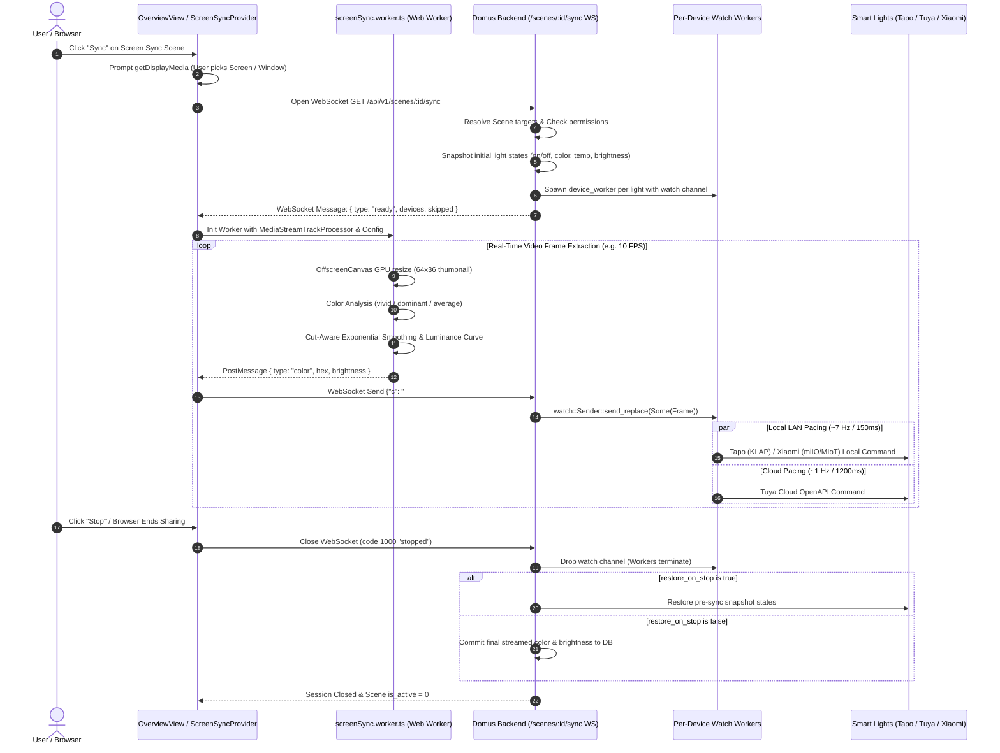
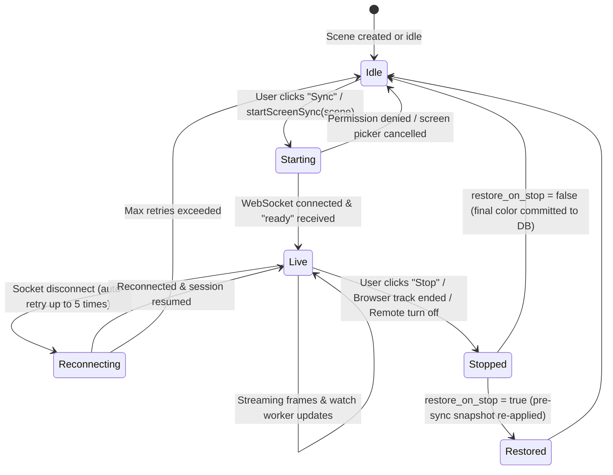

# Screen Sync Architecture & Design Specification

This document details the end-to-end architecture, color extraction pipeline, streaming protocol, and device pacing mechanisms for **Screen Sync** (Dynamic Ambilight) in Domus. Screen Sync enables real-time synchronization between displays (monitors, televisions, video streams) and smart RGB/tunable lighting fixtures across diverse hardware vendors (Tapo KLAP, Tuya / Smart Life, Xiaomi MIoT).

---

## 1. Architectural Motivation & Capture Topology

### Why Screen Capture Lives in Client / Electron
Screen capture and real-time pixel extraction intentionally execute in the **user's client window** (Web Browser or Electron desktop container) rather than on the central home automation server:

1. **Security & OS Sandboxing**: Modern operating systems and browsers require explicit user consent via security sandboxes (`navigator.mediaDevices.getDisplayMedia` in browsers, `desktopCapturer` in Electron). Server-side video acquisition would require invasive host agent binaries or untrusted remote desktop video streams.
2. **Computational Offload & Zero Server Transcoding**: Video frames rendered at 1080p, 1440p, or 4K 60/120 Hz represent massive bandwidth (hundreds of megabytes per second uncompressed). Performing GPU thumbnail downscaling and histogram extraction on the user's local hardware eliminates server CPU/GPU saturation. Even a lightweight home automation server (such as a Raspberry Pi or low-power mini PC) can orchestrate ambient lighting for multiple rooms simultaneously.
3. **Microscopic Payload Footprint**: Instead of streaming heavy raw video across the home LAN, the client transmits tiny JSON packets over a lightweight WebSocket (`~10 bytes/frame`, e.g. `{"c":"#ff8800","b":85}`), reducing home network overhead to less than 1 KB/s.

---

## 2. End-to-End System Sequence Diagram



---

## 3. Frame Analysis & Color Extraction Pipeline

The frame analysis pipeline runs off the main thread in a dedicated Web Worker ([`screenSync.worker.ts`](file:///media/aiyu/550E85595197DBEC/development/domus/apps/web/src/features/screensync/screenSync.worker.ts)) utilizing pure math modules in [`colorAnalysis.ts`](file:///media/aiyu/550E85595197DBEC/development/domus/apps/web/src/features/screensync/colorAnalysis.ts).

### 3.1 Frame Ingestion & Hardware Downscaling
- **Chromium / Electron (`MediaStreamTrackProcessor`)**: Incoming `MediaStreamTrack` frames are piped via a zero-copy `ReadableStream<VideoFrame>` directly into the worker. This continues uninterrupted even if the browser tab is minimized or in the background.
- **Cross-Browser Fallback (Firefox / Safari)**: Samples an offscreen `<video>` element on the main thread and transfers small `Uint8ClampedArray` buffers to the worker at the configured frame rate.
- **GPU Downscaling**: Rather than scanning millions of pixels, `createImageBitmap` scales the video frame down on the GPU to a **64 × 36** thumbnail (2,304 pixels). Scanning 2,304 pixels costs less than 0.3 ms of CPU time.

### 3.2 Color Extraction Modes
1. **Vivid Mode (`vivid`)**:
   - Employs a 36-bin Hue histogram with per-bin RGB accumulators.
   - Pixels are weighted by $w = s^2 \cdot v$ (saturation squared multiplied by value).
   - Near-black ($v < 30$) and achromatic gray pixels ($d = \max - \min < 20$) are discarded so they do not dilute the hue.
   - Finds the peak bin, smoothed with adjacent neighbors to avoid boundary quantization artifacts.
   - Applies a 1.2× saturation boost so physical bulbs pop with vivid ambiance matching high-end ambilight hardware.
2. **Dominant Mode (`dominant`)**:
   - Accumulates pixels into a 4,096-bin RGB color histogram (4 bits per channel).
   - Finds the statistical mode of non-letterbox pixels.
3. **Average Mode (`average`)**:
   - Computes the arithmetic mean RGB of all sampled pixels. Produces a soft, calm, natural room glow.
4. **Sampling Regions**:
   - `full`: Samples the entire screen area.
   - `edges`: Restricts sampling to an outer 20% perimeter band, ideal for TV bias lighting where the edges correspond to surrounding wall reflections.

### 3.3 Cut-Aware Exponential Smoothing
Pure exponential moving average (EMA) creates an unavoidable trade-off: high smoothing causes sluggish delays during movie cuts, while low smoothing causes distracting bulb flicker during subtle gradients.

The [`Smoother`](file:///media/aiyu/550E85595197DBEC/development/domus/apps/web/src/features/screensync/colorAnalysis.ts#L201-L228) solves this via non-linear color-distance scaling:

$$\text{base} = 1 - \left(\frac{\text{smoothing}}{100}\right) \times 0.9$$

$$\Delta_{\text{color}} = |R_{\text{target}} - R_{\text{curr}}| + |G_{\text{target}} - G_{\text{curr}}| + |B_{\text{target}} - B_{\text{curr}}|$$

$$\alpha = \text{base} + (1 - \text{base}) \times \min\left(1, \frac{\Delta_{\text{color}}}{450}\right) \times 0.6$$

- **Subtle Drift**: When $\Delta_{\text{color}}$ is small, $\alpha \approx \text{base}$, creating buttery smooth, flicker-free transitions.
- **Scene Cut**: When a dramatic cut occurs (e.g., bright flash or scene change, $\Delta_{\text{color}} > 400$), $\alpha$ jumps toward 1.0, snapping the lights immediately to the new color without lag.

### 3.4 Perceived Luminance & Brightness Follower
When `follow_brightness` is enabled, perceived screen luminance $L = 0.2126R + 0.7152G + 0.0722B$ is mapped across a gentle gamma curve ($L^{0.75}$) clamped between `min_brightness` and `max_brightness`:
$$\text{Brightness} = \text{round}\left(\text{min} + (\text{max} - \text{min}) \times L^{0.75}\right)$$
This prevents dark movie scenes from throwing the room into complete darkness while retaining deep contrast.

---

## 4. Backend Streaming Protocol & Device Pacing

The server implementation resides in [`backend/src/modules/scenes/screen_sync.rs`](file:///media/aiyu/550E85595197DBEC/development/domus/backend/src/modules/scenes/screen_sync.rs).

### 4.1 WebSocket Protocol (`GET /api/v1/scenes/:id/sync`)
- **Handshake & Auth**: Validates bearer token and user control permissions.
- **Target Resolution**: Filters scene `device_ids` and `group_ids` against user-permitted rooms, ensures devices are online lights, and skips non-color lights with explanatory reasons.
- **Handshake Ready Message**:
  ```json
  {
    "type": "ready",
    "devices": [
      { "id": "tapo_bulb_1", "name": "Living Room Floor Lamp", "interval_ms": 150 },
      { "id": "tuya_strip_1", "name": "TV Backlight Strip", "interval_ms": 1200 }
    ],
    "skipped": []
  }
  ```
- **Frame Message Format**:
  ```json
  { "c": "#ff7700", "b": 80 }
  ```

### 4.2 Watch Channels & Latest-Frame-Wins
Traditional messaging queues (`mpsc`) suffer from backpressure lag: if a light takes 250ms to acknowledge a Wi-Fi packet, a queue of 10 FPS builds up an ever-growing backlog, causing lighting changes to lag several seconds behind the screen.

Domus solves this using Tokio `watch` channels:
```rust
let (frame_tx, frame_rx) = watch::channel::<Option<Frame>>(None);
```
- Each light has an independent background worker (`device_worker`).
- When a new frame arrives from the WebSocket, `frame_tx.send_replace(Some(frame))` overwrites the previous frame atomically.
- Slow or struggling devices always pick up the **latest frame**, skipping outdated intermediate frames with zero latency build-up.

### 4.3 Heterogeneous Transport Pacing
Different smart home protocols have vastly different throughput capacities:
- **Local LAN (Tapo KLAP & Xiaomi miIO/MIoT)**: Paced at **150 ms** (~7 Hz). Local UDP/TCP sockets communicate directly with device microcontrollers on the local subnet.
- **Cloud (Tuya Cloud OpenAPI)**: Paced at **1200 ms** (~1 Hz). Prevents triggering vendor API rate limits and token bans.
- **Frame Deduplication**: Backend drops frames where color change is imperceptible ($\Delta_{\text{RGB}} \le 6$ and $\Delta_{\text{brightness}} \le 2$).
- **Adaptive Error Backoff**: If a light fails 3 consecutive commands, pacing backs off by 4× to allow the microcontroller or Wi-Fi radio to recover.

---

## 5. State Management & Lifecycle



### Snapshot & Restore Mechanics
1. **Pre-Sync Snapshot**: When the WebSocket session initializes, the exact state of each bulb (power `is_on`, `color_mode`, hex `color`, `color_temp`, and `brightness`) is captured into memory.
2. **Restoration on Teardown**:
   - If `restore_on_stop: true`: Backend restores every bulb to its pre-sync settings. Bulbs that were initially switched off are commanded off.
   - If `restore_on_stop: false`: Bulbs remain illuminated with the final captured scene color, which is committed to the database.

---

## 6. Frontend Integration & UI Controls

### 6.1 Persistent Session Management
- [`ScreenSyncProvider`](file:///media/aiyu/550E85595197DBEC/development/domus/apps/web/src/features/screensync/ScreenSync.tsx): Mounted at the root of `apps/web/src/main.tsx` above the router so Screen Sync continues seamlessly across page transitions.
- **Global Floating Pill (`ScreenSyncPill`)**: Displays a real-time glowing color preview, active light counts, lag warnings, and a one-click "Stop" button across all views.

### 6.2 Quick Controls in `OverviewView`
Integrated directly into the Overview Quick Controls card ([`OverviewView.tsx`](file:///media/aiyu/550E85595197DBEC/development/domus/apps/web/src/features/overview/OverviewView.tsx)):
- **Scene Type Badge**: Identifies Ambilight scenes with `<Monitor size={14} />` icon and `<Badge tone="info">Screen Sync</Badge>`.
- **Target Count**: Accurately computes unique target devices from `scene.config.device_ids` and expanded `scene.config.group_ids`.
- **Live State Indicator**: Shows a pulsing status indicator when synced locally in the current tab.
- **Contextual Actions**:
  - If syncing locally: Provides an instant red `Stop` button.
  - If idle: Provides a direct `Sync` button triggering display selection.
  - If active on another device: Displays `Turn off` button calling backend `toggleScene(id, false)` alongside `Sync` to take over locally.
