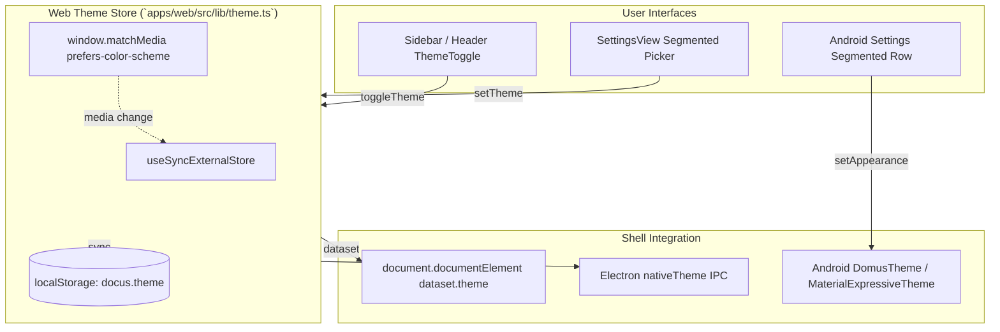
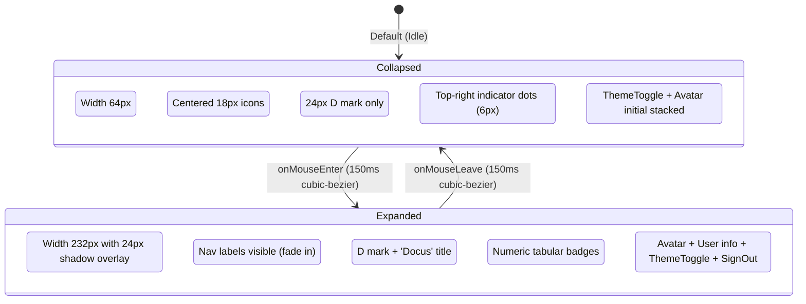

# Theme & Navigation Architecture

This document covers the unified theme management (Web, Electron desktop, and Android) and the auto-collapsing sidebar navigation system.

## 1. Unified Theme Architecture

Docus follows the **Minimalism & Swiss Style** design profile defined in `design-system/docus/MASTER.md`. Both Web and Android clients share this token system:
- **Dark Mode**: Neutral Zinc `#09090B` (page), `#111113` (panels), `#18181B` (raised containers), `#FAFAFA` (foreground text), and `#22C55E` (Domus live/on green).
- **Light Mode**: Clean Zinc `#FAFAFA` (page), `#FFFFFF` (panels), `#F4F4F5` (raised containers), `#09090B` (foreground text), and `#16A34A` (Domus live/on green).

### Theme Propagation Flow

### Color Mapping Matrix

| Token | Web (Dark) | Web (Light) | Android Compose (Dark) | Android Compose (Light) | Role |
|---|---|---|---|---|---|
| `bg` | `#09090B` | `#FAFAFA` | `background = 0xFF09090B` | `background = 0xFFFAFAFA` | Page background |
| `panel` | `#111113` | `#FFFFFF` | `surface = 0xFF111113` | `surface = 0xFFFFFFFF` | Cards, sidebar, sheets |
| `raised` | `#18181B` | `#F4F4F5` | `surfaceContainer = 0xFF18181B` | `surfaceContainer = 0xFFF4F4F5` | Inputs, active rows |
| `border` | `#27272A` | `#E4E4E7` | `outlineVariant = 0xFF27272A` | `outlineVariant = 0xFFE4E4E7` | Hairline dividers |
| `border-strong` | `#3F3F46` | `#D4D4D8` | `outline = 0xFF3F3F46` | `outline = 0xFFD4D4D8` | Active/focus outlines |
| `fg` | `#FAFAFA` | `#09090B` | `onSurface = 0xFFFAFAFA` | `onSurface = 0xFF09090B` | Primary text |
| `muted` | `#A1A1AA` | `#52525B` | `onSurfaceVariant = 0xFFA1A1AA` | `onSurfaceVariant = 0xFF52525B` | Secondary text |
| `on` | `#22C55E` | `#16A34A` | `tertiary = 0xFF22C55E` | `tertiary = 0xFF16A34A` | Live / healthy / turned on |
| `danger` | `#EF4444` | `#DC2626` | `error = 0xFFEF4444` | `error = 0xFFDC2626` | Errors / destructive |

---

## 2. Auto-Collapsing Sidebar Architecture

The desktop navigation operates in two synchronized states: a compact 64px icon rail when idle, and a full 232px sidebar when hovered.

### Layout Stability (Zero-Reflow)

To eliminate layout thrashing:
1. The main content container reserves a fixed `lg:pl-[64px]` gutter.
2. The sidebar element uses `z-nav` and an overlay shadow (`shadow-2xl`) when expanding to 232px on hover.
3. Content cards, responsive grids, and SVG charts remain strictly stable and never reflow during sidebar hover interactions.
