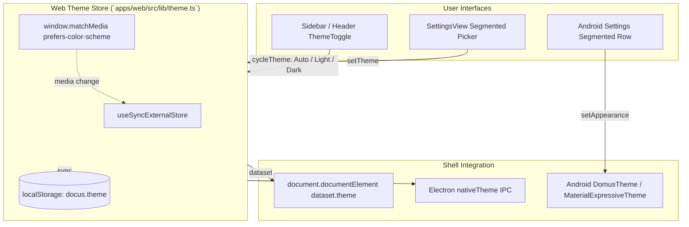
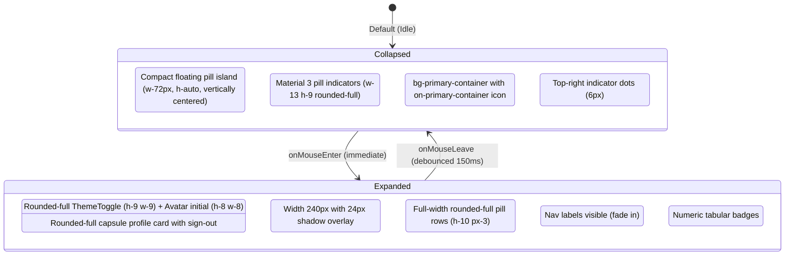
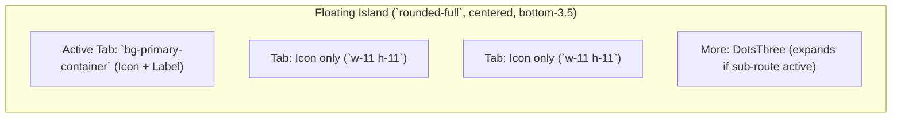

# Theme & Navigation Architecture

This document covers the unified theme management (Web, Electron desktop, and Android) and the Android-style floating pill sidebar navigation system.

## 1. Unified Material 3 Botanical Theme Architecture

Both Web/Desktop and Android clients share Android's Material 3 botanical color scheme:
- **Dark Mode**: Background `#12140E`, surface `#1A1C16`, container `#282B24`, borders `#44483D` / `#8F9285`, text `#E2E3D8`, muted `#C5C8BA`, active pill container `#354E16` with text `#CDEDA3`, and on/live green `#B1D18A`.
- **Light Mode**: Background `#F9FAEF`, clean cards `#FFFFFF`, container `#EEEFE3`, borders `#C5C8BA` / `#75796C`, text `#1A1C16`, muted `#44483D`, active pill container `#CDEDA3` with text `#354E16`, and on/live green `#4C662B`.

### Theme Propagation Flow

### Color Mapping Matrix

| Token | Web (Dark) | Web (Light) | Android Compose (Dark) | Android Compose (Light) | Role |
|---|---|---|---|---|---|
| `bg` | `#12140E` | `#F9FAEF` | `background = 0xFF12140E` | `background = 0xFFF9FAEF` | Page background |
| `panel` | `#1A1C16` | `#FFFFFF` | `surface = 0xFF12140E` | `surface = 0xFFF9FAEF` | Cards, sidebar, sheets |
| `raised` | `#282B24` | `#EEEFE3` | `surfaceContainer = 0xFF1E201A` | `surfaceContainer = 0xFFEEEFE3` | Inputs, active rows |
| `primary-container` | `#354E16` | `#CDEDA3` | `primaryContainer = 0xFF354E16` | `primaryContainer = 0xFFCDEDA3` | Active navigation pill background |
| `on-primary-container` | `#CDEDA3` | `#354E16` | `onPrimaryContainer = 0xFFCDEDA3` | `onPrimaryContainer = 0xFF354E16` | Active navigation pill text/icon |
| `border` | `#44483D` | `#C5C8BA` | `outlineVariant = 0xFF44483D` | `outlineVariant = 0xFFC5C8BA` | Hairline dividers |
| `border-strong` | `#8F9285` | `#75796C` | `outline = 0xFF8F9285` | `outline = 0xFF75796C` | Active/focus outlines |
| `fg` | `#E2E3D8` | `#1A1C16` | `onSurface = 0xFFE2E3D8` | `onSurface = 0xFF1A1C16` | Primary text |
| `muted` | `#C5C8BA` | `#44483D` | `onSurfaceVariant = 0xFFC5C8BA` | `onSurfaceVariant = 0xFF44483D` | Secondary text |
| `on` | `#B1D18A` | `#4C662B` | `primary = 0xFFB1D18A` | `primary = 0xFF4C662B` | Live / healthy / turned on |
| `danger` | `#FFB4AB` | `#BA1A1A` | `error = 0xFFFFB4AB` | `error = 0xFFBA1A1A` | Errors / destructive |

---

## 2. Android-Style Floating Pill Sidebar Architecture

The desktop navigation mirrors Android's `FloatingNavRail` with a compact, vertically centered floating pill dock (`rounded-[32px]`, `top-1/2 -translate-y-1/2 h-auto`) and capsule navigation indicators:

### Jitter-Free Debounced Hover

To avoid flickering when moving between elements:
1. `onMouseEnter` cancels any pending collapse timer and expands immediately (`200ms cubic-bezier(0.2, 0, 0, 1)`).
2. `onMouseLeave` uses a 150ms grace timeout before collapsing, preventing accidental snap-close if the cursor briefly crosses an edge.
3. The main content gutter reserves `lg:pl-[96px]` (72px rail + 12px margin + 12px gap) so the page layout never shifts during hover expansion.

---

## 3. Mobile Floating Pill Bottom Navigation (Android Parity)

On viewports below `1024px` (`lg:hidden`), the web UI mirrors Android's `FloatingNavBar`:

- **Floating Island**: Centered capsule (`fixed bottom-3.5 left-1/2 -translate-x-1/2`, `rounded-full border border-border/80 bg-panel/95 backdrop-blur-xl shadow-xl p-1.5`).
- **Dynamic Content-Size Capsule**:
  - Inactive tabs display only the icon in a circular `w-11 h-11 rounded-full` touch target.
  - Active tab expands horizontally (`px-4 h-11 rounded-full bg-primary-container text-on-primary-container font-semibold`) displaying both the icon and the text label with a smooth fade-in animation.
- **Badge Indicators**: Pending devices badge dot sits on the icon corner (`-top-1 -right-1`).
- **More Sheet**: Secondary tabs (Air quality, Energy, Integrations, Settings) accessible via 'More', with 'More' button turning active/expanded when browsing those routes.
